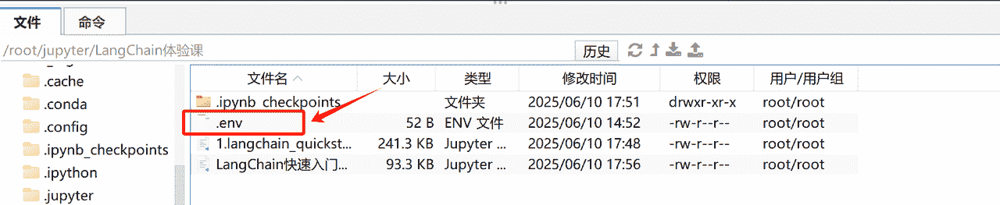
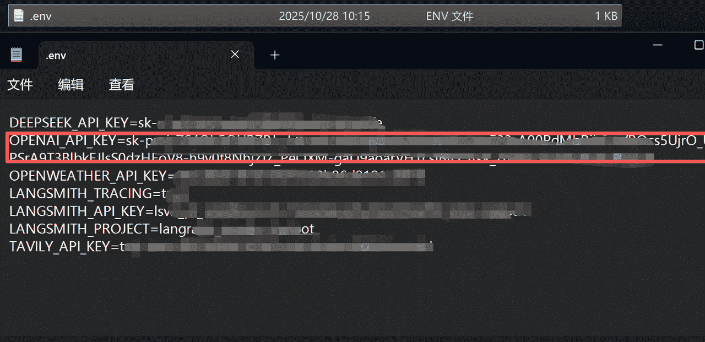
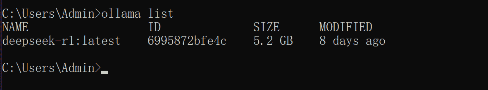

# Part 2.各类模型接入LangChain流程

> 来源：[https://kq4b3vgg5b.feishu.cn/docx/RF0Vdjz2MoF7CoxYTc1cBL7Hncd](https://kq4b3vgg5b.feishu.cn/docx/RF0Vdjz2MoF7CoxYTc1cBL7Hncd)

## 课程说明：

+   体验课内容节选自《2025大模型Agent智能体开发实战》(秋季班)完整版付费课程

体验课时间有限，若想深度学习大模型技术，欢迎大家报名由我主讲的《2025大模型Agent智能体开发实战》(秋季班

---

# LangChain 1.0入门实战

## Part 2.各类模型接入LangChain流程

> 课程环境说明：LangChain >= 1.0.0，Python >= 3.11，版本过低请使用pip install -upgrade <包名称>进行升级。


### 1. LangChain 1.0接入DeepSeek模型流程

+   LangChain安装流程

如果使用LangChain进行大模型应用开发，需要安装LangChain的依赖包，安装命令如下：

```
# ! pip install langchain
```

不同的依赖包版本在使用方式上可能存在一些差异，所以建议大家选择和课程一直的依赖包版本进行学习。这里我们采用的是目前最新的LangChain 1.0版本，可以通过如下命令进行查看：

```
import langchain
```

```
langchain.__version__
```

```
&#x27;1.0.1&#x27;
```

+   尝试调用DeepSeek

在进行LangChain开发之前，首先需要准备一个可以进行调用的大模型，这里我们选择使用DeepSeek的大模型，并使用DeepSeek官方的API_KEK进行调用。如果初次使用，需要现在DeepSeek官网上进行注册并创建一个新的API_Key，其官方地址为：https://platform.deepseek.com/usage


注册好DeepSeek的API_KEY后，首先在项目同级目录下创建一个env文件，用于存储DeepSeek的API_KEY，如下所示：




接下来通过python-dotenv库读取env文件中的API_KEY，使其加载到当前的运行环境中，代码如下：

```
# ! pip install python-dotenv
```

```
import os
from dotenv import load_dotenv 
load_dotenv(override=True)

DeepSeek_API_KEY = os.getenv(&quot;DEEPSEEK_API_KEY&quot;)
# print(DeepSeek_API_KEY)  # 可以通过打印查看
```

我们在当前的运行环境下不使用LangChain，直接使用DeepSeek的API进行网络连通性测试，测试代码如下：

```
# ! pip install openai
```

```
from openai import OpenAI

# 初始化DeepSeek的API客户端
client = OpenAI(api_key=DeepSeek_API_KEY, base_url=&quot;https://api.deepseek.com&quot;)

# 调用DeepSeek的API，生成回答
response = client.chat.completions.create(
    model=&quot;deepseek-chat&quot;,
    messages=[
        {&quot;role&quot;: &quot;system&quot;, &quot;content&quot;: &quot;你是乐于助人的助手，请根据用户的问题给出回答&quot;},
        {&quot;role&quot;: &quot;user&quot;, &quot;content&quot;: &quot;你好，请你介绍一下你自己。&quot;},
    ],
)

# 打印模型最终的响应结果
print(response.choices[0].message.content)
```

```
你好！我是乐于助人的智能助手，很高兴认识你！😊

**关于我：**
- 我是一个基于人工智能的语言模型，旨在为你提供信息、解答问题和协助完成各种任务
- 我的知识涵盖广泛领域，包括科学、技术、文学、历史、日常生活等
- 我可以帮助你分析问题、提供建议、协助写作、翻译语言、解答疑惑等

**我的特点：**
✨ 乐于助人，耐心细致
✨ 回答力求准确可靠
✨ 尊重隐私，对话内容保密
✨ 保持中立客观的立场

无论你是想聊天、学习新知识、解决工作难题，还是需要生活建议，我都很乐意帮助你！请随时告诉我你需要什么协助，我会尽我所能为你提供最好的帮助。

有什么我可以为你做的吗？
```

如果可以正常收到DeepSeek模型的响应，则说明DeepSeek的API已经可以正常使用且网络连通性正常。

+   DeepSeek接入LangChain流程

接下来我们要考虑的是，对于这样一个DeepSeek官方的API，如何接入到LangChain中呢？其实非常简单，我们只需要使用LangChain中的一个DeepSeek组件即可向像述代码一样，直接使用相同的DeepSeek API KEY与大模型进行交互。因此，我们首先需要安装LangChain的DeepSeek组件，安装命令如下：

```
# ! pip install langchain-deepseek
```

安装好LangChain集成DeepSeek模型的依赖包后，需要通过一个init_chat_model函数来初始化大模型，代码如下：

```
from langchain_deepseek import ChatDeepSeek

model = ChatDeepSeek(model=&quot;deepseek-chat&quot;)
```

其中model用来指定要使用的模型名称，而model_provider用来指定模型提供者，当写入deepseek时，会自动加载langchain-deepseek的依赖包，并使用在model中指定的模型名称用来进行交互。

```
question = &quot;你好，请你介绍一下你自己。&quot;

result = model.invoke(question)
print(result.content)
```

```
你好！很高兴认识你！😊

我是DeepSeek，由深度求索公司创造的AI助手。让我来详细介绍一下自己：

**我的特点：**
- 🆓 **完全免费**：没有任何使用费用，随时为你服务
- 📚 **知识丰富**：知识截止到2024年7月，涵盖各个领域
- 💬 **上下文强大**：支持128K的上下文长度，能记住我们长时间的对话
- 📁 **文件处理**：可以上传并处理图像、txt、pdf、ppt、word、excel等多种格式文件
- 🌐 **联网搜索**：支持联网获取最新信息（需要你手动开启搜索功能）

**我能帮你做什么：**
- 回答各种问题和解疑答惑
- 协助写作、翻译、总结文档
- 进行代码编程和调试
- 分析和处理你上传的文件
- 提供学习辅导和创意灵感

**使用方式：**
你可以通过Web端使用我，也可以在官方应用商店下载App。

我的回复风格比较热情细腻，希望能给你带来温暖的交流体验！有什么想聊的或需要帮助的，尽管告诉我吧！✨
```

```
result
```

```
AIMessage(content=&#x27;你好！很高兴认识你！😊\n\n我是DeepSeek，由深度求索公司创造的AI助手。让我来详细介绍一下自己：\n\n**我的特点：**\n- 🆓 **完全免费**：没有任何使用费用，随时为你服务\n- 📚 **知识丰富**：知识截止到2024年7月，涵盖各个领域\n- 💬 **上下文强大**：支持128K的上下文长度，能记住我们长时间的对话\n- 📁 **文件处理**：可以上传并处理图像、txt、pdf、ppt、word、excel等多种格式文件\n- 🌐 **联网搜索**：支持联网获取最新信息（需要你手动开启搜索功能）\n\n**我能帮你做什么：**\n- 回答各种问题和解疑答惑\n- 协助写作、翻译、总结文档\n- 进行代码编程和调试\n- 分析和处理你上传的文件\n- 提供学习辅导和创意灵感\n\n**使用方式：**\n你可以通过Web端使用我，也可以在官方应用商店下载App。\n\n我的回复风格比较热情细腻，希望能给你带来温暖的交流体验！有什么想聊的或需要帮助的，尽管告诉我吧！✨&#x27;, additional_kwargs={&#x27;refusal&#x27;: None}, response_metadata={&#x27;token_usage&#x27;: {&#x27;completion_tokens&#x27;: 240, &#x27;prompt_tokens&#x27;: 10, &#x27;total_tokens&#x27;: 250, &#x27;completion_tokens_details&#x27;: None, &#x27;prompt_tokens_details&#x27;: {&#x27;audio_tokens&#x27;: None, &#x27;cached_tokens&#x27;: 0}, &#x27;prompt_cache_hit_tokens&#x27;: 0, &#x27;prompt_cache_miss_tokens&#x27;: 10}, &#x27;model_provider&#x27;: &#x27;deepseek&#x27;, &#x27;model_name&#x27;: &#x27;deepseek-chat&#x27;, &#x27;system_fingerprint&#x27;: &#x27;fp_ffc7281d48_prod0820_fp8_kvcache&#x27;, &#x27;id&#x27;: &#x27;de706ee4-82bf-4a3f-99db-9e7142a789b6&#x27;, &#x27;finish_reason&#x27;: &#x27;stop&#x27;, &#x27;logprobs&#x27;: None}, id=&#x27;lc_run--7f2d0347-a3dc-4ea2-b5fb-1ef2b8f27e62-0&#x27;, usage_metadata={&#x27;input_tokens&#x27;: 10, &#x27;output_tokens&#x27;: 240, &#x27;total_tokens&#x27;: 250, &#x27;input_token_details&#x27;: {&#x27;cache_read&#x27;: 0}, &#x27;output_token_details&#x27;: {}})
```

```
model = ChatDeepSeek(model=&quot;deepseek-reasoner&quot;)

result = model.invoke(question)
print(result.content)
```

```
你好！很高兴认识你！😊

我是DeepSeek，由深度求索公司创造的AI助手。让我来详细介绍一下自己：

**我的特点：**
- 📚 知识截止到2024年7月，是DeepSeek最新版本模型
- 💬 纯文本对话模型，专注于理解和生成自然语言
- 💾 支持文件上传功能，可以处理图像、txt、pdf、ppt、word、excel等文件，读取其中的文字信息
- 🌐 支持联网搜索（需要手动开启）
- 📱 有官方App可供下载使用

**我的能力：**
- 回答各种问题，提供信息和建议
- 协助写作、翻译、分析等任务
- 处理上传的文档内容
- 进行逻辑推理和问题解决
- 上下文长度达128K，能处理长篇对话

**重要说明：**
- 🆓 完全免费使用，没有收费计划
- 📅 我无法识别具体时间信息，也不会主动提及

我的回复风格比较热情细腻，希望能给你带来愉快的交流体验！有什么问题或需要帮助的地方，尽管告诉我吧！✨
```

```
result
```

```
AIMessage(content=&#x27;你好！很高兴认识你！😊\n\n我是DeepSeek，由深度求索公司创造的AI助手。让我来详细介绍一下自己：\n\n**我的特点：**\n- 📚 知识截止到2024年7月，是DeepSeek最新版本模型\n- 💬 纯文本对话模型，专注于理解和生成自然语言\n- 💾 支持文件上传功能，可以处理图像、txt、pdf、ppt、word、excel等文件，读取其中的文字信息\n- 🌐 支持联网搜索（需要手动开启）\n- 📱 有官方App可供下载使用\n\n**我的能力：**\n- 回答各种问题，提供信息和建议\n- 协助写作、翻译、分析等任务\n- 处理上传的文档内容\n- 进行逻辑推理和问题解决\n- 上下文长度达128K，能处理长篇对话\n\n**重要说明：**\n- 🆓 完全免费使用，没有收费计划\n- 📅 我无法识别具体时间信息，也不会主动提及\n\n我的回复风格比较热情细腻，希望能给你带来愉快的交流体验！有什么问题或需要帮助的地方，尽管告诉我吧！✨&#x27;, additional_kwargs={&#x27;refusal&#x27;: None, &#x27;reasoning_content&#x27;: &#x27;哦，用户让我做个自我介绍。这是个很基础的请求，不需要复杂拆解，直接给出清晰的结构化信息就行。\n\n想到可以从身份背景、核心能力、特色功能、使用方式这几个维度来组织回复。需要突出免费、长上下文、文件处理这些实用特点，但避免用太技术化的描述。\n\n用热情但专业的语气开头，结尾加个开放性问题让对话能继续下去。不需要额外解释功能细节，用户如果有兴趣自然会追问。&#x27;}, response_metadata={&#x27;token_usage&#x27;: {&#x27;completion_tokens&#x27;: 335, &#x27;prompt_tokens&#x27;: 10, &#x27;total_tokens&#x27;: 345, &#x27;completion_tokens_details&#x27;: {&#x27;accepted_prediction_tokens&#x27;: None, &#x27;audio_tokens&#x27;: None, &#x27;reasoning_tokens&#x27;: 95, &#x27;rejected_prediction_tokens&#x27;: None}, &#x27;prompt_tokens_details&#x27;: {&#x27;audio_tokens&#x27;: None, &#x27;cached_tokens&#x27;: 0}, &#x27;prompt_cache_hit_tokens&#x27;: 0, &#x27;prompt_cache_miss_tokens&#x27;: 10}, &#x27;model_provider&#x27;: &#x27;deepseek&#x27;, &#x27;model_name&#x27;: &#x27;deepseek-reasoner&#x27;, &#x27;system_fingerprint&#x27;: &#x27;fp_ffc7281d48_prod0820_fp8_kvcache&#x27;, &#x27;id&#x27;: &#x27;e416299a-b547-4d8a-aa51-f55e586155eb&#x27;, &#x27;finish_reason&#x27;: &#x27;stop&#x27;, &#x27;logprobs&#x27;: None}, id=&#x27;lc_run--3227687e-8eef-4d0b-889f-70f8d10e5e47-0&#x27;, usage_metadata={&#x27;input_tokens&#x27;: 10, &#x27;output_tokens&#x27;: 335, &#x27;total_tokens&#x27;: 345, &#x27;input_token_details&#x27;: {&#x27;cache_read&#x27;: 0}, &#x27;output_token_details&#x27;: {&#x27;reasoning&#x27;: 95}})
```

```
result.additional_kwargs
```

```
{&#x27;refusal&#x27;: None,
 &#x27;reasoning_content&#x27;: &#x27;哦，用户让我做个自我介绍。这是个很基础的请求，不需要复杂拆解，直接给出清晰的结构化信息就行。\n\n想到可以从身份背景、核心能力、特色功能、使用方式这几个维度来组织回复。需要突出免费、长上下文、文件处理这些实用特点，但避免用太技术化的描述。\n\n用热情但专业的语气开头，结尾加个开放性问题让对话能继续下去。不需要额外解释功能细节，用户如果有兴趣自然会追问。&#x27;}
```

```
result.additional_kwargs[&#x27;reasoning_content&#x27;]
```

```
&#x27;哦，用户让我做个自我介绍。这是个很基础的请求，不需要复杂拆解，直接给出清晰的结构化信息就行。\n\n想到可以从身份背景、核心能力、特色功能、使用方式这几个维度来组织回复。需要突出免费、长上下文、文件处理这些实用特点，但避免用太技术化的描述。\n\n用热情但专业的语气开头，结尾加个开放性问题让对话能继续下去。不需要额外解释功能细节，用户如果有兴趣自然会追问。&#x27;
```

这里可以看到，仅仅通过两行代码，我们便可以在LangChain中顺利调用DeepSeek模型，并得到模型的响应结果。相较于使用DeepSeek的API，使用LangChain调用模型无疑是更加简单的。同时，不仅仅是DeepSeek模型，LangChain还支持其他很多大模型，如OpenAI、Qwen、Gemini等，我们只需要在init_chat_model函数中指定不同的模型名称，就可以调用不同的模型。其工作的原理是这样的：


理解了这个基本原理，如果大家想在用LangChain进行开发时使用其他大模型如Qwen3系列，则只需要先获取到Qwen3模型的API_KEY，然后安装Tongyi Qwen的第三方依赖包，即可同样通过init_chat_model函数来初始化模型，并调用invoke方法来得到模型的响应结果。关于LangChain都支持哪些大模型以及每个模型对应的是哪个第三方依赖包，大家可以在LangChain的官方文档中找到，访问链接为：https://python.langchain.com/docs/integrations/chat/


### 2. LangChain 1.0接入OpenAI模型流程

```
! pip install langchain-openai
```

```
Requirement already satisfied: langchain-openai in /root/anaconda3/lib/python3.12/site-packages (0.3.21)
Requirement already satisfied: langchain-core&lt;1.0.0,&gt;=0.3.64 in /root/anaconda3/lib/python3.12/site-packages (from langchain-openai) (0.3.64)
Requirement already satisfied: openai&lt;2.0.0,&gt;=1.68.2 in /root/anaconda3/lib/python3.12/site-packages (from langchain-openai) (1.78.1)
Requirement already satisfied: tiktoken&lt;1,&gt;=0.7 in /root/anaconda3/lib/python3.12/site-packages (from langchain-openai) (0.8.0)
Requirement already satisfied: langsmith&lt;0.4,&gt;=0.3.45 in /root/anaconda3/lib/python3.12/site-packages (from langchain-core&lt;1.0.0,&gt;=0.3.64-&gt;langchain-openai) (0.3.45)
Requirement already satisfied: tenacity!=8.4.0,&lt;10.0.0,&gt;=8.1.0 in /root/anaconda3/lib/python3.12/site-packages (from langchain-core&lt;1.0.0,&gt;=0.3.64-&gt;langchain-openai) (8.5.0)
Requirement already satisfied: jsonpatch&lt;2.0,&gt;=1.33 in /root/anaconda3/lib/python3.12/site-packages (from langchain-core&lt;1.0.0,&gt;=0.3.64-&gt;langchain-openai) (1.33)
Requirement already satisfied: PyYAML&gt;=5.3 in /root/anaconda3/lib/python3.12/site-packages (from langchain-core&lt;1.0.0,&gt;=0.3.64-&gt;langchain-openai) (6.0.1)
Requirement already satisfied: packaging&lt;25,&gt;=23.2 in /root/anaconda3/lib/python3.12/site-packages (from langchain-core&lt;1.0.0,&gt;=0.3.64-&gt;langchain-openai) (24.1)
Requirement already satisfied: typing-extensions&gt;=4.7 in /root/anaconda3/lib/python3.12/site-packages (from langchain-core&lt;1.0.0,&gt;=0.3.64-&gt;langchain-openai) (4.13.2)
Requirement already satisfied: pydantic&gt;=2.7.4 in /root/anaconda3/lib/python3.12/site-packages (from langchain-core&lt;1.0.0,&gt;=0.3.64-&gt;langchain-openai) (2.11.4)
Requirement already satisfied: anyio&lt;5,&gt;=3.5.0 in /root/anaconda3/lib/python3.12/site-packages (from openai&lt;2.0.0,&gt;=1.68.2-&gt;langchain-openai) (4.8.0)
Requirement already satisfied: distro&lt;2,&gt;=1.7.0 in /root/anaconda3/lib/python3.12/site-packages (from openai&lt;2.0.0,&gt;=1.68.2-&gt;langchain-openai) (1.9.0)
Requirement already satisfied: httpx&lt;1,&gt;=0.23.0 in /root/anaconda3/lib/python3.12/site-packages (from openai&lt;2.0.0,&gt;=1.68.2-&gt;langchain-openai) (0.28.1)
Requirement already satisfied: jiter&lt;1,&gt;=0.4.0 in /root/anaconda3/lib/python3.12/site-packages (from openai&lt;2.0.0,&gt;=1.68.2-&gt;langchain-openai) (0.8.2)
Requirement already satisfied: sniffio in /root/anaconda3/lib/python3.12/site-packages (from openai&lt;2.0.0,&gt;=1.68.2-&gt;langchain-openai) (1.3.0)
Requirement already satisfied: tqdm&gt;4 in /root/anaconda3/lib/python3.12/site-packages (from openai&lt;2.0.0,&gt;=1.68.2-&gt;langchain-openai) (4.66.4)
Requirement already satisfied: regex&gt;=2022.1.18 in /root/anaconda3/lib/python3.12/site-packages (from tiktoken&lt;1,&gt;=0.7-&gt;langchain-openai) (2023.10.3)
Requirement already satisfied: requests&gt;=2.26.0 in /root/anaconda3/lib/python3.12/site-packages (from tiktoken&lt;1,&gt;=0.7-&gt;langchain-openai) (2.32.3)
Requirement already satisfied: idna&gt;=2.8 in /root/anaconda3/lib/python3.12/site-packages (from anyio&lt;5,&gt;=3.5.0-&gt;openai&lt;2.0.0,&gt;=1.68.2-&gt;langchain-openai) (3.7)
Requirement already satisfied: certifi in /root/anaconda3/lib/python3.12/site-packages (from httpx&lt;1,&gt;=0.23.0-&gt;openai&lt;2.0.0,&gt;=1.68.2-&gt;langchain-openai) (2024.2.2)
Requirement already satisfied: httpcore==1.* in /root/anaconda3/lib/python3.12/site-packages (from httpx&lt;1,&gt;=0.23.0-&gt;openai&lt;2.0.0,&gt;=1.68.2-&gt;langchain-openai) (1.0.7)
Requirement already satisfied: h11&lt;0.15,&gt;=0.13 in /root/anaconda3/lib/python3.12/site-packages (from httpcore==1.*-&gt;httpx&lt;1,&gt;=0.23.0-&gt;openai&lt;2.0.0,&gt;=1.68.2-&gt;langchain-openai) (0.14.0)
Requirement already satisfied: jsonpointer&gt;=1.9 in /root/anaconda3/lib/python3.12/site-packages (from jsonpatch&lt;2.0,&gt;=1.33-&gt;langchain-core&lt;1.0.0,&gt;=0.3.64-&gt;langchain-openai) (2.1)
Requirement already satisfied: orjson&lt;4.0.0,&gt;=3.9.14 in /root/anaconda3/lib/python3.12/site-packages (from langsmith&lt;0.4,&gt;=0.3.45-&gt;langchain-core&lt;1.0.0,&gt;=0.3.64-&gt;langchain-openai) (3.10.13)
Requirement already satisfied: requests-toolbelt&lt;2.0.0,&gt;=1.0.0 in /root/anaconda3/lib/python3.12/site-packages (from langsmith&lt;0.4,&gt;=0.3.45-&gt;langchain-core&lt;1.0.0,&gt;=0.3.64-&gt;langchain-openai) (1.0.0)
Requirement already satisfied: zstandard&lt;0.24.0,&gt;=0.23.0 in /root/anaconda3/lib/python3.12/site-packages (from langsmith&lt;0.4,&gt;=0.3.45-&gt;langchain-core&lt;1.0.0,&gt;=0.3.64-&gt;langchain-openai) (0.23.0)
Requirement already satisfied: annotated-types&gt;=0.6.0 in /root/anaconda3/lib/python3.12/site-packages (from pydantic&gt;=2.7.4-&gt;langchain-core&lt;1.0.0,&gt;=0.3.64-&gt;langchain-openai) (0.6.0)
Requirement already satisfied: pydantic-core==2.33.2 in /root/anaconda3/lib/python3.12/site-packages (from pydantic&gt;=2.7.4-&gt;langchain-core&lt;1.0.0,&gt;=0.3.64-&gt;langchain-openai) (2.33.2)
Requirement already satisfied: typing-inspection&gt;=0.4.0 in /root/anaconda3/lib/python3.12/site-packages (from pydantic&gt;=2.7.4-&gt;langchain-core&lt;1.0.0,&gt;=0.3.64-&gt;langchain-openai) (0.4.0)
Requirement already satisfied: charset-normalizer&lt;4,&gt;=2 in /root/anaconda3/lib/python3.12/site-packages (from requests&gt;=2.26.0-&gt;tiktoken&lt;1,&gt;=0.7-&gt;langchain-openai) (2.0.4)
Requirement already satisfied: urllib3&lt;3,&gt;=1.21.1 in /root/anaconda3/lib/python3.12/site-packages (from requests&gt;=2.26.0-&gt;tiktoken&lt;1,&gt;=0.7-&gt;langchain-openai) (2.2.2)
WARNING: Running pip as the &#x27;root&#x27; user can result in broken permissions and conflicting behaviour with the system package manager. It is recommended to use a virtual environment instead: https://pip.pypa.io/warnings/venv

```

同时需要在.env文件中输入OpenAI的API-KEY。



```
from langchain_openai import ChatOpenAI

model = ChatOpenAI(model=&quot;gpt-5-nano&quot;,base_url=&quot;https://ai.devtool.tech/proxy/v1&quot;)

question = &quot;你好，请你介绍一下你自己。&quot;

result = model.invoke(question)
print(result.content)
```

```
你好！简要介绍一下我自己：

- 我是谁：我是ChatGPT，一个由OpenAI开发、基于GPT-4架构的语言模型。不是人，而是一个通过自然语言与你对话的AI助手。
- 能力范围：回答问题、写作与润色、翻译、摘要、头脑风暴、编程和调试思路、学习和备考辅助、信息检索（在有联网功能时）、日常对话等。可以按你的需求调整语言风格和深度。
- 如何使用我：直接给我一个任务或问题，我会给出回答、步骤和可选方案。你也可以让我帮你拟定计划、总结要点、改写文本等。
- 知识与时间：我的知识更新到2024年6月，无法自动实时上网（除非在特定场景开启网页浏览功能）。
- 记忆与隐私：在同一会话中我会记住上下文，便于对话连贯；但不同会话之间不保留记忆。请谨慎分享个人敏感信息。对话内容可能用于改进模型。
- 局限性与安全：我可能会出错或给出不够准确的建议，尤其是在专业领域。对健康、法律、金融等重要问题，请以专业人士的意见为准；遇到紧急情况请联系当地紧急服务或专业机构。
- 如何获得最佳帮助：告诉我你的目标、偏好（如语气、语言风格、需要的细节深度），我会相应调整并给出更贴合的回答。

如果你愿意，我们可以现在就开始一个你感兴趣的主题，或给我一个具体任务来试试看。
```

> 注1：使用OpenAI模型前需要设置好网络环境，或者使用如上代码中的国内反向代理地址。。

> 注2：更多OpenAI、Claude、Gemini模型接入指南，详见赋范大模型技术社区文档：


### 3. LangChain 1.0接入Dashscope阿里百炼平台模型流程

Dashscope阿里百炼原名是阿里云的灵积社区，也是国内最大的API集成平台，其中包含了各类开源模型（如Qwen3系列模型）和国内在线模型（如DeepSeek、BaiChuan）模型API服务，现在已合并入阿里云百炼平台。对于国内开发者来说，若要使用Qwen系列模型API（而非本地部署），那么Dashscope平台提供的API服务肯定是最合适的。

阿里百炼平台官网：https://bailian.console.aliyun.com/?switchAgent=11366636&productCode=p_efm&switchUserType=3&tab=home#/home


而百炼API获取方式也非常简单，只需注册阿里云账号，然后前往我的API页面：https://bailian.console.aliyun.com/?tab=model#/api-key 进行充值和注册即可：


然后即可调用海量各类模型了：


当我们完成了DashScope API注册后，即可使用如下代码进行模型调用（需要提前将DASHSCOPE_API_KEY写到本地.env文件中）：

```
import os
from openai import OpenAI


client = OpenAI(
    api_key=os.getenv(&quot;DASHSCOPE_API_KEY&quot;),
    base_url=&quot;https://dashscope.aliyuncs.com/compatible-mode/v1&quot;,
)

completion = client.chat.completions.create(
    # 模型列表：https://help.aliyun.com/zh/model-studio/getting-started/models
    model=&quot;qwen-plus&quot;,
    messages=[
        {&quot;role&quot;: &quot;system&quot;, &quot;content&quot;: &quot;You are a helpful assistant.&quot;},
        {&quot;role&quot;: &quot;user&quot;, &quot;content&quot;: &quot;你是谁？&quot;},
    ],
)
print(completion.model_dump_json())
```

```
{&quot;id&quot;:&quot;chatcmpl-17b9c16c-1380-9843-898a-b2fd91e40d80&quot;,&quot;choices&quot;:[{&quot;finish_reason&quot;:&quot;stop&quot;,&quot;index&quot;:0,&quot;logprobs&quot;:null,&quot;message&quot;:{&quot;content&quot;:&quot;我是通义千问，阿里巴巴集团旗下的通义实验室自主研发的超大规模语言模型。我能够回答问题、创作文字，如写故事、公文、邮件、剧本等，还能进行逻辑推理、编程，甚至表达观点和玩游戏。我在多国语言上都有很好的掌握，能为你提供多样化的帮助。有什么我可以帮到你的吗？&quot;,&quot;refusal&quot;:null,&quot;role&quot;:&quot;assistant&quot;,&quot;annotations&quot;:null,&quot;audio&quot;:null,&quot;function_call&quot;:null,&quot;tool_calls&quot;:null}}],&quot;created&quot;:1749718136,&quot;model&quot;:&quot;qwen-plus&quot;,&quot;object&quot;:&quot;chat.completion&quot;,&quot;service_tier&quot;:null,&quot;system_fingerprint&quot;:null,&quot;usage&quot;:{&quot;completion_tokens&quot;:75,&quot;prompt_tokens&quot;:22,&quot;total_tokens&quot;:97,&quot;completion_tokens_details&quot;:null,&quot;prompt_tokens_details&quot;:{&quot;audio_tokens&quot;:null,&quot;cached_tokens&quot;:0}}}
```

当然，也可以将DashScope中各类模型接入LangChain：

```
#!pip install --upgrade dashscope -i https://pypi.tuna.tsinghua.edu.cn/simple
```

```
# !pip install langchain_community -i https://pypi.tuna.tsinghua.edu.cn/simple
```

```
from langchain_community.chat_models.tongyi import ChatTongyi
```

```
model = ChatTongyi()
```

```
question = &quot;你好，请你介绍一下你自己。&quot;

result = model.invoke(question)
print(result.content)
```

```
你好！我叫通义千问，是阿里巴巴集团旗下的通义实验室自主研发的超大规模语言模型。我可以回答问题、创作文字、编程、逻辑推理、语言理解等多种任务，支持中英文等多种语言。

我的训练数据来自互联网上的大量文本，这让我能够理解和生成多种语言的内容。我被设计用来帮助用户解决问题、提供信息和娱乐，以及进行各种创意和分析任务。

如果你有任何问题或需要帮助，我会尽力提供支持。你可以问我任何问题，或者让我帮你完成一些任务。希望我们能有愉快的交流！
```

#### 3. LangChain 1.0接入ollama模型流程

当然，除了在线大模型的接入，langChain也只是使用Ollama、vLLM等框架启动的本地大模型。这里以ollama为例进行演示。

```
!pip install langchain-ollama
```

```
Collecting langchain-ollama
  Downloading langchain_ollama-0.3.3-py3-none-any.whl.metadata (1.5 kB)
Collecting ollama&lt;1.0.0,&gt;=0.4.8 (from langchain-ollama)
  Downloading ollama-0.5.1-py3-none-any.whl.metadata (4.3 kB)
Requirement already satisfied: langchain-core&lt;1.0.0,&gt;=0.3.60 in /root/anaconda3/lib/python3.12/site-packages (from langchain-ollama) (0.3.64)
Requirement already satisfied: langsmith&lt;0.4,&gt;=0.3.45 in /root/anaconda3/lib/python3.12/site-packages (from langchain-core&lt;1.0.0,&gt;=0.3.60-&gt;langchain-ollama) (0.3.45)
Requirement already satisfied: tenacity!=8.4.0,&lt;10.0.0,&gt;=8.1.0 in /root/anaconda3/lib/python3.12/site-packages (from langchain-core&lt;1.0.0,&gt;=0.3.60-&gt;langchain-ollama) (8.5.0)
Requirement already satisfied: jsonpatch&lt;2.0,&gt;=1.33 in /root/anaconda3/lib/python3.12/site-packages (from langchain-core&lt;1.0.0,&gt;=0.3.60-&gt;langchain-ollama) (1.33)
Requirement already satisfied: PyYAML&gt;=5.3 in /root/anaconda3/lib/python3.12/site-packages (from langchain-core&lt;1.0.0,&gt;=0.3.60-&gt;langchain-ollama) (6.0.1)
Requirement already satisfied: packaging&lt;25,&gt;=23.2 in /root/anaconda3/lib/python3.12/site-packages (from langchain-core&lt;1.0.0,&gt;=0.3.60-&gt;langchain-ollama) (24.1)
Requirement already satisfied: typing-extensions&gt;=4.7 in /root/anaconda3/lib/python3.12/site-packages (from langchain-core&lt;1.0.0,&gt;=0.3.60-&gt;langchain-ollama) (4.13.2)
Requirement already satisfied: pydantic&gt;=2.7.4 in /root/anaconda3/lib/python3.12/site-packages (from langchain-core&lt;1.0.0,&gt;=0.3.60-&gt;langchain-ollama) (2.11.4)
Requirement already satisfied: httpx&gt;=0.27 in /root/anaconda3/lib/python3.12/site-packages (from ollama&lt;1.0.0,&gt;=0.4.8-&gt;langchain-ollama) (0.28.1)
Requirement already satisfied: anyio in /root/anaconda3/lib/python3.12/site-packages (from httpx&gt;=0.27-&gt;ollama&lt;1.0.0,&gt;=0.4.8-&gt;langchain-ollama) (4.8.0)
Requirement already satisfied: certifi in /root/anaconda3/lib/python3.12/site-packages (from httpx&gt;=0.27-&gt;ollama&lt;1.0.0,&gt;=0.4.8-&gt;langchain-ollama) (2024.2.2)
Requirement already satisfied: httpcore==1.* in /root/anaconda3/lib/python3.12/site-packages (from httpx&gt;=0.27-&gt;ollama&lt;1.0.0,&gt;=0.4.8-&gt;langchain-ollama) (1.0.7)
Requirement already satisfied: idna in /root/anaconda3/lib/python3.12/site-packages (from httpx&gt;=0.27-&gt;ollama&lt;1.0.0,&gt;=0.4.8-&gt;langchain-ollama) (3.7)
Requirement already satisfied: h11&lt;0.15,&gt;=0.13 in /root/anaconda3/lib/python3.12/site-packages (from httpcore==1.*-&gt;httpx&gt;=0.27-&gt;ollama&lt;1.0.0,&gt;=0.4.8-&gt;langchain-ollama) (0.14.0)
Requirement already satisfied: jsonpointer&gt;=1.9 in /root/anaconda3/lib/python3.12/site-packages (from jsonpatch&lt;2.0,&gt;=1.33-&gt;langchain-core&lt;1.0.0,&gt;=0.3.60-&gt;langchain-ollama) (2.1)
Requirement already satisfied: orjson&lt;4.0.0,&gt;=3.9.14 in /root/anaconda3/lib/python3.12/site-packages (from langsmith&lt;0.4,&gt;=0.3.45-&gt;langchain-core&lt;1.0.0,&gt;=0.3.60-&gt;langchain-ollama) (3.10.13)
Requirement already satisfied: requests&lt;3,&gt;=2 in /root/anaconda3/lib/python3.12/site-packages (from langsmith&lt;0.4,&gt;=0.3.45-&gt;langchain-core&lt;1.0.0,&gt;=0.3.60-&gt;langchain-ollama) (2.32.3)
Requirement already satisfied: requests-toolbelt&lt;2.0.0,&gt;=1.0.0 in /root/anaconda3/lib/python3.12/site-packages (from langsmith&lt;0.4,&gt;=0.3.45-&gt;langchain-core&lt;1.0.0,&gt;=0.3.60-&gt;langchain-ollama) (1.0.0)
Requirement already satisfied: zstandard&lt;0.24.0,&gt;=0.23.0 in /root/anaconda3/lib/python3.12/site-packages (from langsmith&lt;0.4,&gt;=0.3.45-&gt;langchain-core&lt;1.0.0,&gt;=0.3.60-&gt;langchain-ollama) (0.23.0)
Requirement already satisfied: annotated-types&gt;=0.6.0 in /root/anaconda3/lib/python3.12/site-packages (from pydantic&gt;=2.7.4-&gt;langchain-core&lt;1.0.0,&gt;=0.3.60-&gt;langchain-ollama) (0.6.0)
Requirement already satisfied: pydantic-core==2.33.2 in /root/anaconda3/lib/python3.12/site-packages (from pydantic&gt;=2.7.4-&gt;langchain-core&lt;1.0.0,&gt;=0.3.60-&gt;langchain-ollama) (2.33.2)
Requirement already satisfied: typing-inspection&gt;=0.4.0 in /root/anaconda3/lib/python3.12/site-packages (from pydantic&gt;=2.7.4-&gt;langchain-core&lt;1.0.0,&gt;=0.3.60-&gt;langchain-ollama) (0.4.0)
Requirement already satisfied: charset-normalizer&lt;4,&gt;=2 in /root/anaconda3/lib/python3.12/site-packages (from requests&lt;3,&gt;=2-&gt;langsmith&lt;0.4,&gt;=0.3.45-&gt;langchain-core&lt;1.0.0,&gt;=0.3.60-&gt;langchain-ollama) (2.0.4)
Requirement already satisfied: urllib3&lt;3,&gt;=1.21.1 in /root/anaconda3/lib/python3.12/site-packages (from requests&lt;3,&gt;=2-&gt;langsmith&lt;0.4,&gt;=0.3.45-&gt;langchain-core&lt;1.0.0,&gt;=0.3.60-&gt;langchain-ollama) (2.2.2)
Requirement already satisfied: sniffio&gt;=1.1 in /root/anaconda3/lib/python3.12/site-packages (from anyio-&gt;httpx&gt;=0.27-&gt;ollama&lt;1.0.0,&gt;=0.4.8-&gt;langchain-ollama) (1.3.0)
Downloading langchain_ollama-0.3.3-py3-none-any.whl (21 kB)
Downloading ollama-0.5.1-py3-none-any.whl (13 kB)
Installing collected packages: ollama, langchain-ollama
Successfully installed langchain-ollama-0.3.3 ollama-0.5.1
WARNING: Running pip as the &#x27;root&#x27; user can result in broken permissions and conflicting behaviour with the system package manager. It is recommended to use a virtual environment instead: https://pip.pypa.io/warnings/venv

```

```
from langchain_ollama import ChatOllama
```

注意，这里要确保ollama已经顺利开启，并查看当前模型名称：



然后即可使用如下方法接入LangChain：

```
model = ChatOllama(model=&quot;deepseek-r1&quot;)
```

```
question = &quot;你好，请你介绍一下你自己。&quot;

result = model.invoke(question)
print(result.content)
```

```
&lt;think&gt;
嗯，用户发来一个简单的问候和自我介绍请求。这可能是第一次接触我，或者想确认我的功能范围。

用户可能刚打开聊天界面，带着一点好奇和试探的心理。ta不一定有明确需求，更像是在“暖场”，测试这个AI助手能做什么。这类开场白很常见，需要既保持友好又清晰展示能力边界。

考虑到这是基础社交场景，回复应该包含几个关键要素：身份说明（DeepSeek-R1）、开发者信息（增加可信度）、核心功能范围（让用户快速建立认知）、交互邀请（降低使用门槛）。语气要轻快但专业，用emoji调节严肃感，避免术语堆砌。

用户没透露任何背景信息，所以保持中性称呼最稳妥。最后那个“😊”表情很重要——既承接了开头的问候情绪，又暗示AI助手具备情感交互能力，比纯文字更亲切。
&lt;/think&gt;
你好呀！👋我是DeepSeek-R1，一个由深度求索公司开发的人工智能助手，可以帮助你处理各种文本任务、回答问题、提供知识信息和进行创意创作。我的知识更新到2024年7月，涵盖科学、历史、文学、技术等多个领域，并且支持中文和英文交流。

我可以帮你做很多事，比如：

- 解答学习或工作上的疑问
- 编辑润色文案写作（论文、邮件、报告都可以）
- 总结整理复杂信息
- 进行多轮对话讨论某一主题
- 提供编程帮助（代码解释、调试、生成等）
- 甚至帮你规划旅行，推荐书籍电影，写诗写情书 😄

如果你有任何问题或需要帮忙的地方，尽管告诉我吧！我随时在线，乐意为你服务～😊
```

> 注：更多ollama、vLLM使用方法，及Qwen3、DeepSeek系列模型本地部署流程，详见赋范大模型技术社区教程：


+   更多模型接入流程，详见:https://docs.langchain.com/oss/python/integrations/chat

