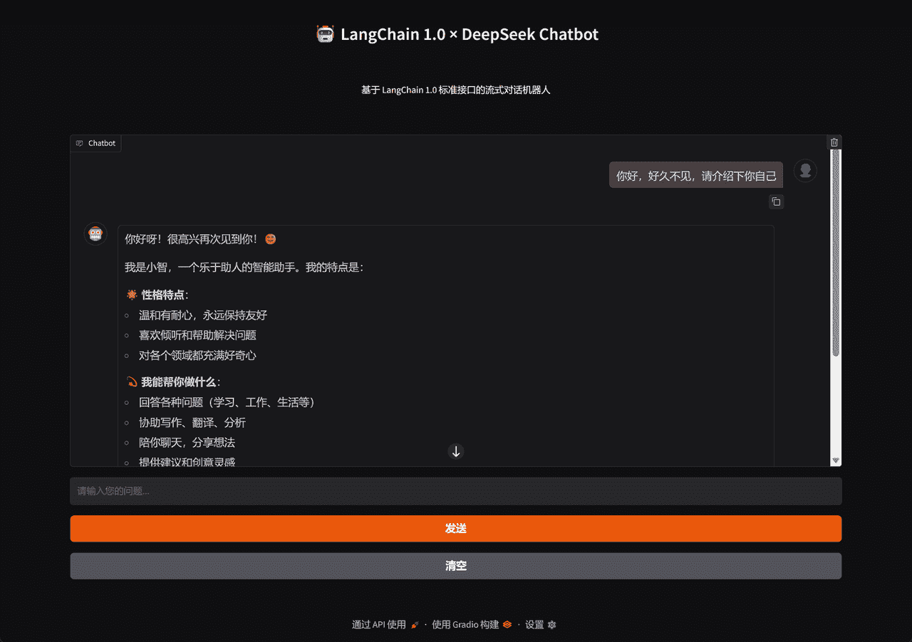

# Part 3.模型调用、记忆管理与工具调用流程

> 来源：[https://kq4b3vgg5b.feishu.cn/docx/GKTidyCnyoDpcvx8fPVcnx91nOc](https://kq4b3vgg5b.feishu.cn/docx/GKTidyCnyoDpcvx8fPVcnx91nOc)

## 课程说明：

+   体验课内容节选自《2025大模型Agent智能体开发实战》(秋季班)完整版付费课程

体验课时间有限，若想深度学习大模型技术，欢迎大家报名由我主讲的《2025大模型Agent智能体开发实战》(秋季班

---

# LangChain 1.0入门实战

## Part 3.模型调用、记忆管理与工具调用流程

在LangChain 1.0中，抛弃了此前版本LangChain的专门用于构建工作流的LCEL管道语言，转而大幅增强了基础模型的调用灵活度，因此学会使用LangChain API完成模型调用、对话、记忆管理以及工具调度等，也成了学习LangChain的非常核心的一部分内容。

```
import os
from dotenv import load_dotenv 
load_dotenv(override=True)

DeepSeek_API_KEY = os.getenv(&quot;DEEPSEEK_API_KEY&quot;)
# print(DeepSeek_API_KEY)  # 可以通过打印查看
```

### 1.LangChain 1.0基础模型消息格式说明与模型调用流程

在 LangChain 1.0 中，Message（消息）是模型交互的最基本单元。它既代表模型接收到的输入（Input），也代表模型生成的输出（Output）。

简单来说，每一轮与大模型的对话，都由一条或多条 Message 构成。每个 Message 不仅包含文字内容，还携带描述上下文状态的元信息（metadata），用于保持对话的一致性和可追踪性。通过这种结构化方式，LangChain 可以让模型在多轮交互中理解“谁在说话”“说了什么”“这条信息属于哪一轮对话”。

| 字段 | 说明 | 示例 |
| --- | --- | --- |
| **Role（角色）** | 指明消息的类型或来源。常见的有：system（系统提示）、user（用户输入）、assistant（模型回复） | &quot;role&quot;: &quot;user&quot; |
| **Content（内容）** | 消息的实际内容，可包含文本、图像、音频、文档等多模态数据 | &quot;content&quot;: &quot;你好，请帮我总结以下段落。&quot; |
| **Metadata（元数据）** | 可选字段，存储额外信息，如：消息ID、响应时间、token消耗量、消息标签等 | &quot;metadata&quot;: {&quot;message_id&quot;: &quot;abc123&quot;, &quot;tokens&quot;: 54} |

同时，LangChain 在 1.0 中提供了跨模型统一的 Message 标准。无论你使用的是 OpenAI、Anthropic、Gemini 还是本地模型，这一标准都能保持一致的行为。这种统一抽象带来三个好处：其一是，兼容性强：不同模型的消息格式自动对齐。其二是可扩展性高：方便添加多模态内容或自定义字段。其三是可追踪性好：为 LangSmith 等调试工具提供一致的上下文数据结构。

基本使用方法如下：

```
from langchain_deepseek import ChatDeepSeek

model = ChatDeepSeek(model=&quot;deepseek-chat&quot;)
```

```
from langchain.messages import HumanMessage, AIMessage, SystemMessage
```

```
system_msg = SystemMessage(&quot;你叫小智，是一名助人为乐的助手。&quot;)
human_msg = HumanMessage(&quot;你好，好久不见，请介绍下你自己。&quot;)
```

```
messages = [system_msg, human_msg]
```

```
messages
```

```
[SystemMessage(content=&#x27;你叫小智，是一名助人为乐的助手。&#x27;, additional_kwargs={}, response_metadata={}),
 HumanMessage(content=&#x27;你好，好久不见，请介绍下你自己。&#x27;, additional_kwargs={}, response_metadata={})]
```

```
response = model.invoke(messages)  
```

```
# 返回的结果也是一条message
response
```

```
AIMessage(content=&#x27;你好呀！我是小智，一个乐于助人的智能助手。我的主要功能是回答问题、提供建议、协助解决问题，或者陪你聊天。无论是学习、工作、生活琐事，还是想找点有趣的话题，我都可以帮忙！如果有任何需要，随时告诉我哦～ 😊&#x27;, additional_kwargs={&#x27;refusal&#x27;: None}, response_metadata={&#x27;token_usage&#x27;: {&#x27;completion_tokens&#x27;: 60, &#x27;prompt_tokens&#x27;: 25, &#x27;total_tokens&#x27;: 85, &#x27;completion_tokens_details&#x27;: None, &#x27;prompt_tokens_details&#x27;: {&#x27;audio_tokens&#x27;: None, &#x27;cached_tokens&#x27;: 0}, &#x27;prompt_cache_hit_tokens&#x27;: 0, &#x27;prompt_cache_miss_tokens&#x27;: 25}, &#x27;model_provider&#x27;: &#x27;deepseek&#x27;, &#x27;model_name&#x27;: &#x27;deepseek-chat&#x27;, &#x27;system_fingerprint&#x27;: &#x27;fp_ffc7281d48_prod0820_fp8_kvcache&#x27;, &#x27;id&#x27;: &#x27;311d2a0e-7fa2-4543-a8d6-374b201db854&#x27;, &#x27;finish_reason&#x27;: &#x27;stop&#x27;, &#x27;logprobs&#x27;: None}, id=&#x27;lc_run--0d38df6a-0aa7-41fd-9b33-a9ecae16cb80-0&#x27;, usage_metadata={&#x27;input_tokens&#x27;: 25, &#x27;output_tokens&#x27;: 60, &#x27;total_tokens&#x27;: 85, &#x27;input_token_details&#x27;: {&#x27;cache_read&#x27;: 0}, &#x27;output_token_details&#x27;: {}})
```

返回的内容结果解释如下：

| 字段名称 | 示例值 / 类型 | 说明与作用 |
| --- | --- | --- |
| **content** | &#x27;你好呀！我是小智，一个乐于助人的智能助手。我的主要功能是回答问题、提供建议、协助解决问题，或者陪你聊天。无论是学习、工作、生活琐事，还是想找点有趣的话题，我都可以帮忙！如果有任何需要，随时告诉我哦～ 😊&#x27; | **模型生成的主要文本内容**。即对话中 AI 的自然语言回复。 |
| additional_kwargs | {&#x27;refusal&#x27;: None} | **附加参数字段**，通常存放模型的拒答原因、补充说明等。此处为 None 表示没有拒答。 |
| response_metadata | {...}（字典对象） | **响应元数据**，用于记录模型调用的底层信息，如 token 使用量、模型来源、运行 ID 等。详解如下👇 |
| ↳ token_usage | {&#x27;completion_tokens&#x27;: 60, &#x27;prompt_tokens&#x27;: 25, &#x27;total_tokens&#x27;: 85, ...} | 记录生成所消耗的 **token 统计信息**：输入 25，输出 60，总计 85。 |
| ↳ model_provider | &#x27;deepseek&#x27; | 表示模型提供方（此处为 **DeepSeek**）。 |
| ↳ model_name | &#x27;deepseek-chat&#x27; | 模型的具体名称。 |
| ↳ system_fingerprint | &#x27;fp_ffc7281d48_prod0820_fp8_kvcache&#x27; | 模型版本或运行实例指纹，用于调试和追踪。 |
| ↳ id | &#x27;311d2a0e-7fa2-4543-a8d6-374b201db854&#x27; | 当前响应在 LangChain 运行中的唯一标识符。 |
| ↳ finish_reason | &#x27;stop&#x27; | 模型生成结束的原因，stop 表示自然结束（无截断或超长）。 |
| **id** | &#x27;lc_run--0d38df6a-0aa7-41fd-9b33-a9ecae16cb80-0&#x27; | **LangC**hain 内部为此消息生成的唯一 运行 ID。 |
| **usage_metadata** | {...}（字典对象） | LangChain 层的 **统一 token 计量信息**，与 response_metadata.token_usage 相呼应。详解如下👇 |
| ↳ input_tokens | 25 | 输入 token 数量。 |
| ↳ output_tokens | 60 | 输出 token 数量。 |
| ↳ total_tokens | 85 | 总 token 数量（输入 + 输出）。 |
| ↳ input_token_details | {&#x27;cache_read&#x27;: 0} | 输入部分缓存命中信息，用于优化推理性能统计。 |
| ↳ output_token_details | {} | 输出部分的补充统计（此处为空）。 |

据此，我们就能通过拼接消息列表来创建多轮对话或者进行Few-shot提示：

```
messages = [
    SystemMessage(&quot;你叫小智，是一名助人为乐的助手。&quot;),
    HumanMessage(&quot;你好，我叫陈明，好久不见，请介绍下你自己。&quot;),
    AIMessage(&quot;你好呀！我是小智，一个乐于助人的智能助手。我的主要功能是回答问题、提供建议、协助解决问题，或者陪你聊天。无论是学习、工作、生活琐事，还是想找点有趣的话题，我都可以帮忙！如果有任何需要，随时告诉我哦～ 😊&quot;),
    HumanMessage(&quot;你好，请问你还记得我叫什么名字么？&quot;),
]
```

```
response = model.invoke(messages)  
```

```
response.content
```

```
&#x27;当然记得！你刚才提到你叫陈明，很高兴再次和你打招呼！ 😊 有什么我可以帮你的吗？&#x27;
```

除此之外，如果只需要输入一个简答你的文本提示，也可以采用类似第二部分的调用方法，在invoke中直接输入文本，即可自动转化为user message并进行对话：

```
question = &quot;你好，请你介绍一下你自己。&quot;

result = model.invoke(question)
print(result.content)
```

```
你好！很高兴认识你！😊

我是DeepSeek，由深度求索公司创造的AI助手。让我来详细介绍一下自己：

**基本信息：**
- 我是一个纯文本AI模型，专注于理解和生成自然语言
- 知识截止到2024年7月，是DeepSeek的最新版本

**我的能力：**
- 💬 对话交流，回答各种问题
- 📝 文本创作、翻译、总结等
- 🧠 逻辑推理、分析解决问题
- 📚 学习研究、知识解答
- 📁 处理多种文件格式（图像、txt、pdf、ppt、word、excel等），读取其中的文字信息
- 🌐 支持联网搜索（需要手动开启）

**使用特点：**
- 完全免费使用，没有收费计划
- 上下文长度128K，能记住较长的对话历史
- 支持文件上传功能
- 可通过官方应用商店下载App使用

**我的局限：**
- 不支持多模态识别（但能读取上传文件中的文字）
- 没有语音功能
- 知识有时效性限制

我会用热情、细腻的方式为你提供帮助，无论是学习、工作还是日常问题，都很乐意协助你！有什么想了解或需要帮助的吗？
```

### 2.基础模型的流式响应和批处理

在 LangChain 中，大多数模型都支持流式生成（Streaming Generation），即在模型输出完整回答之前，边生成边输出结果。这种机制使得：

+   响应速度更快 — 用户不必等待完整输出；

+   交互体验更流畅 — 尤其在长文本或复杂推理场景下；

+   可实时展示模型思考过程。

在LangChain 1.0中，可以通过调用stream()来进行流式响应，当使用stream()方法后，模型不会一次性返回完整结果，而是返回一个迭代器（iterator），每次迭代都会生成一个 AIMessageChunk，包含部分生成内容，运行结果会实时打印模型输出的 token：

```
for chunk in model.stream(&quot;你好，好久不见&quot;):
    print(chunk.text, end=&quot;|&quot;, flush=True)
```

```
|你好|！|确实|好久|不见|，|很高兴|能|再次|与你|交谈|！|😊| |最近|过得|怎么样|？|有什么|新鲜|事|想|分享|，|或者|有什么|我可以|帮|你的|吗|？|无论是|闲聊|还是|需要|协助|，|我都|在这儿|呢|～||
```

每个 AIMessageChunk 都可以通过加法 + 操作符拼接。LangChain 内部为此设计了“消息块相加（chunk summation）”机制。

```
full = None  # 初始值为空
for chunk in model.stream(&quot;你好，好久不见&quot;):
    full = chunk if full is None else full + chunk
    print(full.text)
```

```
你好
你好！
你好！确实
你好！确实好久
你好！确实好久不见
你好！确实好久不见，
你好！确实好久不见，很高兴
你好！确实好久不见，很高兴能
你好！确实好久不见，很高兴能再次
你好！确实好久不见，很高兴能再次与你
你好！确实好久不见，很高兴能再次与你相遇
你好！确实好久不见，很高兴能再次与你相遇！
你好！确实好久不见，很高兴能再次与你相遇！😊
你好！确实好久不见，很高兴能再次与你相遇！😊  

你好！确实好久不见，很高兴能再次与你相遇！😊  
最近
你好！确实好久不见，很高兴能再次与你相遇！😊  
最近过得
你好！确实好久不见，很高兴能再次与你相遇！😊  
最近过得怎么样
你好！确实好久不见，很高兴能再次与你相遇！😊  
最近过得怎么样？
你好！确实好久不见，很高兴能再次与你相遇！😊  
最近过得怎么样？是否有
你好！确实好久不见，很高兴能再次与你相遇！😊  
最近过得怎么样？是否有新鲜
你好！确实好久不见，很高兴能再次与你相遇！😊  
最近过得怎么样？是否有新鲜事
你好！确实好久不见，很高兴能再次与你相遇！😊  
最近过得怎么样？是否有新鲜事想要
你好！确实好久不见，很高兴能再次与你相遇！😊  
最近过得怎么样？是否有新鲜事想要分享
你好！确实好久不见，很高兴能再次与你相遇！😊  
最近过得怎么样？是否有新鲜事想要分享，
你好！确实好久不见，很高兴能再次与你相遇！😊  
最近过得怎么样？是否有新鲜事想要分享，或者
你好！确实好久不见，很高兴能再次与你相遇！😊  
最近过得怎么样？是否有新鲜事想要分享，或者有什么
你好！确实好久不见，很高兴能再次与你相遇！😊  
最近过得怎么样？是否有新鲜事想要分享，或者有什么我可以
你好！确实好久不见，很高兴能再次与你相遇！😊  
最近过得怎么样？是否有新鲜事想要分享，或者有什么我可以帮
你好！确实好久不见，很高兴能再次与你相遇！😊  
最近过得怎么样？是否有新鲜事想要分享，或者有什么我可以帮你的
你好！确实好久不见，很高兴能再次与你相遇！😊  
最近过得怎么样？是否有新鲜事想要分享，或者有什么我可以帮你的呢
你好！确实好久不见，很高兴能再次与你相遇！😊  
最近过得怎么样？是否有新鲜事想要分享，或者有什么我可以帮你的呢？
你好！确实好久不见，很高兴能再次与你相遇！😊  
最近过得怎么样？是否有新鲜事想要分享，或者有什么我可以帮你的呢？无论是
你好！确实好久不见，很高兴能再次与你相遇！😊  
最近过得怎么样？是否有新鲜事想要分享，或者有什么我可以帮你的呢？无论是闲聊
你好！确实好久不见，很高兴能再次与你相遇！😊  
最近过得怎么样？是否有新鲜事想要分享，或者有什么我可以帮你的呢？无论是闲聊还是
你好！确实好久不见，很高兴能再次与你相遇！😊  
最近过得怎么样？是否有新鲜事想要分享，或者有什么我可以帮你的呢？无论是闲聊还是需要
你好！确实好久不见，很高兴能再次与你相遇！😊  
最近过得怎么样？是否有新鲜事想要分享，或者有什么我可以帮你的呢？无论是闲聊还是需要协助
你好！确实好久不见，很高兴能再次与你相遇！😊  
最近过得怎么样？是否有新鲜事想要分享，或者有什么我可以帮你的呢？无论是闲聊还是需要协助，
你好！确实好久不见，很高兴能再次与你相遇！😊  
最近过得怎么样？是否有新鲜事想要分享，或者有什么我可以帮你的呢？无论是闲聊还是需要协助，我
你好！确实好久不见，很高兴能再次与你相遇！😊  
最近过得怎么样？是否有新鲜事想要分享，或者有什么我可以帮你的呢？无论是闲聊还是需要协助，我都在
你好！确实好久不见，很高兴能再次与你相遇！😊  
最近过得怎么样？是否有新鲜事想要分享，或者有什么我可以帮你的呢？无论是闲聊还是需要协助，我都在这里
你好！确实好久不见，很高兴能再次与你相遇！😊  
最近过得怎么样？是否有新鲜事想要分享，或者有什么我可以帮你的呢？无论是闲聊还是需要协助，我都在这里～
你好！确实好久不见，很高兴能再次与你相遇！😊  
最近过得怎么样？是否有新鲜事想要分享，或者有什么我可以帮你的呢？无论是闲聊还是需要协助，我都在这里～
```

拼接完成后，可以查看完整内容块：

```
print(full.content_blocks)
```

```
[{&#x27;type&#x27;: &#x27;text&#x27;, &#x27;text&#x27;: &#x27;你好！确实好久不见，很高兴能再次与你相遇！😊  \n最近过得怎么样？是否有新鲜事想要分享，或者有什么我可以帮你的呢？无论是闲聊还是需要协助，我都在这里～&#x27;}]
```

需要注意的是：

1.  流式输出依赖于整个程序链路都支持“逐块处理”。如果程序中的某个环节必须等待完整输出（如需一次性写入数据库），则无法直接使用 Streaming；

1.  angChain 1.0 进一步优化了流式机制，引入 自动流式模式（Auto-streaming）。例如在Agent中，如果整体程序处于 streaming 模式，即便节点中调用 model.invoke()，LangChain 也会自动流式化模型调用。

此外，LangChain 还支持通过 astream_events() 对语义事件进行异步流式监听，适合需要过滤不同事件类型的复杂场景。

而在使用大模型时，如果需要同时处理多条独立请求（例如多个问题或多段文本），则可以使用 批量调用（Batch） 方法一次性提交这些请求。LangChain 中的 batch() 方法允许你同时发送一组请求，模型会在后台并行处理，然后返回所有结果：

```
responses = model.batch([
    &quot;请介绍下你自己。&quot;,
    &quot;请问什么是机器学习？&quot;,
    &quot;你知道机器学习和深度学习区别么？&quot;
])

for response in responses:
    print(response)
```

```
content=&#x27;你好！我是DeepSeek，很高兴认识你！😊\n\n我是由深度求索公司创造的AI助手，致力于为用户提供智能、贴心的服务。让我简单介绍一下自己的特点：\n\n**我的能力：**\n- 📝 纯文本对话，可以回答各种问题、协助写作、分析思考\n- 📁 支持文件上传功能，能处理图像、txt、pdf、ppt、word、excel等文件，从中读取文字信息\n- 🌐 支持联网搜索（需要你手动开启搜索功能）\n- 💭 拥有128K的上下文长度，能记住较长的对话内容\n\n**我的特色：**\n- 🆓 完全免费使用，没有收费计划\n- 📱 可通过官方应用商店下载App使用\n- 🔄 知识更新到2024年7月\n- 💬 回复风格热情、细腻\n\n**我的局限：**\n- 我是纯文本模型，不支持多模态识别\n- 没有语音功能\n- 需要你主动开启联网搜索\n\n我会尽我所能帮助你解决问题，无论是学习、工作还是生活中的各种疑问！有什么我可以帮你的吗？&#x27; additional_kwargs={&#x27;refusal&#x27;: None} response_metadata={&#x27;token_usage&#x27;: {&#x27;completion_tokens&#x27;: 234, &#x27;prompt_tokens&#x27;: 9, &#x27;total_tokens&#x27;: 243, &#x27;completion_tokens_details&#x27;: None, &#x27;prompt_tokens_details&#x27;: {&#x27;audio_tokens&#x27;: None, &#x27;cached_tokens&#x27;: 0}, &#x27;prompt_cache_hit_tokens&#x27;: 0, &#x27;prompt_cache_miss_tokens&#x27;: 9}, &#x27;model_provider&#x27;: &#x27;deepseek&#x27;, &#x27;model_name&#x27;: &#x27;deepseek-chat&#x27;, &#x27;system_fingerprint&#x27;: &#x27;fp_ffc7281d48_prod0820_fp8_kvcache&#x27;, &#x27;id&#x27;: &#x27;5e0c3725-0dcf-41b3-82f4-ca967517d032&#x27;, &#x27;finish_reason&#x27;: &#x27;stop&#x27;, &#x27;logprobs&#x27;: None} id=&#x27;lc_run--95d71138-6f27-4f03-8371-e1f45aa93af2-0&#x27; usage_metadata={&#x27;input_tokens&#x27;: 9, &#x27;output_tokens&#x27;: 234, &#x27;total_tokens&#x27;: 243, &#x27;input_token_details&#x27;: {&#x27;cache_read&#x27;: 0}, &#x27;output_token_details&#x27;: {}}
content=&#x27;当然，很乐意为您解释什么是机器学习。\n\n简单来说，**机器学习是人工智能的一个分支，其核心是让计算机通过数据“学习”如何完成任务，而无需被明确编程每一步该怎么做。**\n\n您可以把它想象成教一个孩子识别动物。您不会给他一本厚厚的规则手册（比如“猫有尖耳朵、胡须、四条腿…”），而是给他看很多猫、狗、鸟的图片，并告诉他这些分别是什么。通过看足够多的例子，孩子自己就能总结出猫的特征，并能在未来认出他从未见过的猫。\n\n机器学习的过程与此非常相似。\n\n---\n\n### 一个简单的类比：教机器识别猫\n\n1.  **数据输入**：我们给计算机程序提供海量的图片，每张图片都标有“这是猫”或“这不是猫”。这些数据称为**训练数据**。\n2.  **模型选择**：我们选择一个**模型**。这个模型就像一个空白的、可调节的“大脑”或“数学公式”。一开始它什么都不懂。\n3.  **训练过程**：模型开始分析这些图片（数据）。它可能会注意到，标有“猫”的图片通常包含某些特定的像素模式（比如胡须、耳朵的形状等）。它会不断地调整自己的内部参数，试图找出区分猫和非猫的最佳规则。\n4.  **预测与评估**：训练完成后，我们给模型看一张它从未见过的新图片。模型会根据它学到的“知识”（规则）来预测这张图片里是否有猫。\n5.  **反馈与优化**：如果预测错了，我们会纠正它，模型会根据错误再次调整自己的参数，让自己变得更准。这个过程就是“学习”。\n\n---\n\n### 机器学习的主要类型\n\n机器学习通常分为三大类：\n\n1.  **监督学习**\n    *   **核心思想**：数据带有“标签”或“答案”。就像有老师在一旁指导。\n    *   **目标**：学习输入到输出之间的映射关系。\n    *   **例子**：\n        *   **分类**：判断邮件是“垃圾邮件”还是“正常邮件”；判断肿瘤是“良性”还是“恶性”。\n        *   **回归**：根据房屋面积、地段预测房价；根据历史数据预测明天的气温。\n\n2.  **无监督学习**\n    *   **核心思想**：数据没有标签。让机器自己从数据中发现内在结构或模式。\n    *   **目标**：发现数据中的隐藏规律。\n    *   **例子**：\n        *   **聚类**：根据用户的购买行为将客户分成不同的群组，用于精准营销。\n        *   **降维**：将高维数据（如几百万像素的图片）压缩成核心特征，便于可视化或处理。\n\n3.  **强化学习**\n    *   **核心思想**：像一个智能体在环境中通过“试错”进行学习。通过行动获得奖励或惩罚，从而学习最优策略。\n    *   **目标**：学会采取一系列行动以最大化累积奖励。\n    *   **例子**：\n        *   **AlphaGo** 学习下围棋。\n        *   **自动驾驶汽车** 学习如何安全行驶。\n        *   **机器人** 学习走路。\n\n---\n\n### 为什么机器学习如此重要？\n\n因为它能解决一些传统编程难以处理的问题：\n\n*   **问题过于复杂，无法手动编写规则**：比如，几乎不可能写出所有规则来准确识别出每一只猫，因为猫的姿势、光线、品种千变万化。\n*   **处理海量数据**：在金融、医疗、社交网络等领域，数据量巨大，人力无法分析，机器学习可以从中发现有价值的洞见。\n*   **环境在不断变化**：机器学习系统可以持续学习并适应新的数据，比如推荐系统会根据你最新的点击行为调整推荐内容。\n\n---\n\n### 生活中的机器学习应用\n\n您每天都在不知不觉中使用机器学习：\n\n*   **推荐系统**：Netflix、淘宝、抖音的“猜你喜欢”。\n*   **语音助手**：Siri、小爱同学、Alexa的语音识别。\n*   **图像识别**：手机相册按人物、地点自动分类；支付宝的扫脸支付。\n*   **垃圾邮件过滤**：邮箱自动将垃圾邮件归入垃圾箱。\n*   **自动驾驶**：汽车识别行人、车辆和交通标志。\n\n### 总结\n\n**机器学习是一门让计算机从经验（数据）中自动学习和改进的科学。它不是通过硬编码的指令，而是通过从样本数据中构建模型来做出预测或决策。**\n\n它是当前人工智能浪潮的核心驱动力，正在深刻地改变着我们生活的方方面面。&#x27; additional_kwargs={&#x27;refusal&#x27;: None} response_metadata={&#x27;token_usage&#x27;: {&#x27;completion_tokens&#x27;: 945, &#x27;prompt_tokens&#x27;: 8, &#x27;total_tokens&#x27;: 953, &#x27;completion_tokens_details&#x27;: None, &#x27;prompt_tokens_details&#x27;: {&#x27;audio_tokens&#x27;: None, &#x27;cached_tokens&#x27;: 0}, &#x27;prompt_cache_hit_tokens&#x27;: 0, &#x27;prompt_cache_miss_tokens&#x27;: 8}, &#x27;model_provider&#x27;: &#x27;deepseek&#x27;, &#x27;model_name&#x27;: &#x27;deepseek-chat&#x27;, &#x27;system_fingerprint&#x27;: &#x27;fp_ffc7281d48_prod0820_fp8_kvcache&#x27;, &#x27;id&#x27;: &#x27;b0a5989c-55b4-437c-b9e4-7aad25a6d8f6&#x27;, &#x27;finish_reason&#x27;: &#x27;stop&#x27;, &#x27;logprobs&#x27;: None} id=&#x27;lc_run--942ec7c5-641b-4050-b629-270faefb35a8-0&#x27; usage_metadata={&#x27;input_tokens&#x27;: 8, &#x27;output_tokens&#x27;: 945, &#x27;total_tokens&#x27;: 953, &#x27;input_token_details&#x27;: {&#x27;cache_read&#x27;: 0}, &#x27;output_token_details&#x27;: {}}
content=&#x27;当然知道。这是一个非常核心的人工智能领域问题。简单来说，**深度学习是机器学习的一个特定子集**，它们的关系可以比作“轿车”和“汽车”的关系。\n\n下面我将从几个维度详细解释它们的区别。\n\n### 一、核心关系：从属关系\n\n- **机器学习**：一个更广阔的研究领域，其核心是让计算机通过算法从数据中“学习”规律，而无需进行明确的编程。\n- **深度学习**：是机器学习的一种方法，它使用被称为“神经网络”的复杂结构，尤其是具有很多“深度”层的神经网络（因此得名“深度”学习）。\n\n**一个简单的比喻：**\n- **机器学习** 就像是一个工具箱，里面有各种工具，比如锤子（决策树）、螺丝刀（支持向量机）、扳手（逻辑回归）。\n- **深度学习** 是这个工具箱里最强大、最复杂的一件电动工具，比如一台冲击扳手。它在处理特定复杂任务时非常高效，但通常也需要更多的“电力”（数据和算力）。\n\n---\n\n### 二、主要区别对比\n\n| 特征维度 | 机器学习 | 深度学习 |\n| :--- | :--- | :--- |\n| **数据依赖** | 性能随数据量增加而提升，但达到一定水平后会饱和。 | **极度依赖大量数据**。数据量越大，其性能优势越明显，通常能超越传统机器学习的天花板。 |\n| **硬件依赖** | 可以在普通CPU上运行，对算力要求相对不高。 | **需要强大的计算资源**，通常使用**GPU**来加速海量矩阵运算。 |\n| **特征工程** | **至关重要且非常耗时**。需要领域专家来手动设计和提取数据特征（如图像的边角、纹理）。 | **自动进行特征工程**。神经网络能自动从原始数据中学习到多层次的特征抽象（如从像素到边，再到五官，最后到人脸）。 |\n| **模型结构** | 模型相对简单、可解释性强。例如决策树、支持向量机、线性回归等。 | 模型是复杂的**深层神经网络**，包含数十、数百甚至上千层。结构像“黑箱”，**可解释性差**。 |\n| **解决问题的方法** | 通常将复杂问题**分解**为多个子问题，逐个解决后再合并结果。 | 倾向于**端到端**地解决问题，用一个模型直接从输入映射到输出。 |\n| **训练时间** | 相对较短，从几秒到几小时不等。 | 通常非常长，需要几天甚至几周，因为模型复杂、数据量大。 |\n| **常见应用场景** | - 垃圾邮件过滤&lt;br&gt;- 房价预测&lt;br&gt;- 客户细分&lt;br&gt;- 信用评分 | - **图像识别**（人脸识别、医疗影像）&lt;br&gt;- **自然语言处理**（机器翻译、智能聊天机器人）&lt;br&gt;- **语音识别**&lt;br&gt;- **自动驾驶** |\n\n---\n\n### 三、一个形象的例子：识别猫的图片\n\n- **机器学习方法**：\n    1.  **特征工程**：专家需要手动定义什么是猫的特征：比如胡须的长度、耳朵的形状、毛发的纹理、眼睛的颜色等。\n    2.  **模型训练**：将这些手动提取的特征输入到机器学习模型（如SVM）中进行训练。\n    3.  **局限性**：如果猫的姿势很奇怪，或者背景复杂，手动定义的特征可能就不管用了，导致识别失败。\n\n- **深度学习方法**：\n    1.  **输入数据**：直接将成千上万张猫和不是猫的图片（原始像素）输入到深度神经网络。\n    2.  **自动学习**：\n        - 底层神经元自动学会识别一些基础特征，如边缘、角落。\n        - 中间层神经元组合这些边缘，学会识别更复杂的特征，如眼睛、鼻子、毛发。\n        - 高层神经元组合这些器官，最终形成“猫”的概念。\n    3.  **输出结果**：模型自己学会了判断一张图片里是否有猫，无需人类告诉它“猫”应该长什么样。\n\n---\n\n### 总结：如何选择？\n\n- **选择传统机器学习当**：\n    - 数据量不大。\n    - 计算资源有限。\n    - 需要模型的可解释性来做决策（例如在金融或医疗领域）。\n    - 你有很好的领域知识来进行特征工程。\n\n- **选择深度学习当**：\n    - 拥有海量的标注数据。\n    - 拥有强大的计算资源（如GPU）。\n    - 问题非常复杂，且特征难以用规则描述（如图像、语音、自然语言）。\n    - 对模型的绝对性能要求很高，且可以接受“黑箱”特性。\n\n希望这个解释能帮助你清晰地理解它们之间的区别！&#x27; additional_kwargs={&#x27;refusal&#x27;: None} response_metadata={&#x27;token_usage&#x27;: {&#x27;completion_tokens&#x27;: 985, &#x27;prompt_tokens&#x27;: 11, &#x27;total_tokens&#x27;: 996, &#x27;completion_tokens_details&#x27;: None, &#x27;prompt_tokens_details&#x27;: {&#x27;audio_tokens&#x27;: None, &#x27;cached_tokens&#x27;: 0}, &#x27;prompt_cache_hit_tokens&#x27;: 0, &#x27;prompt_cache_miss_tokens&#x27;: 11}, &#x27;model_provider&#x27;: &#x27;deepseek&#x27;, &#x27;model_name&#x27;: &#x27;deepseek-chat&#x27;, &#x27;system_fingerprint&#x27;: &#x27;fp_ffc7281d48_prod0820_fp8_kvcache&#x27;, &#x27;id&#x27;: &#x27;935fb1be-4dbb-447d-a9b8-e305186d3b84&#x27;, &#x27;finish_reason&#x27;: &#x27;stop&#x27;, &#x27;logprobs&#x27;: None} id=&#x27;lc_run--4660aa5c-27dd-4c0b-981a-c9b1b9f82300-0&#x27; usage_metadata={&#x27;input_tokens&#x27;: 11, &#x27;output_tokens&#x27;: 985, &#x27;total_tokens&#x27;: 996, &#x27;input_token_details&#x27;: {&#x27;cache_read&#x27;: 0}, &#x27;output_token_details&#x27;: {}}
```

| 特性 | 说明 |
| --- | --- |
| **执行位置** | batch() 在客户端（Client-side）并行调用模型，而非调用模型提供商的批量API（如OpenAI或Anthropic自带的batch API）。 |
| **返回结果** | 默认会在所有任务完成后，统一返回完整结果列表。 |
| **并行优势** | 多条独立请求可同时执行，无需等待彼此完成。 |
| **适用场景** | 文档摘要、批量问答、数据预处理、多样本分类等。 |

当然，我们也可以进行流式批处理，也就是每个每个任务完成后就立即获取结果（而不是等待全部完成），可以使用 batch_as_completed() 方法。

```
for response in model.batch_as_completed([
    &quot;请介绍下你自己。&quot;,
    &quot;请问什么是机器学习？&quot;,
    &quot;你知道机器学习和深度学习区别么？&quot;
]):
    print(response)
```

```
(0, AIMessage(content=&#x27;你好！我是DeepSeek，很高兴认识你！😊\n\n我是由深度求索公司创造的AI助手，致力于为大家提供热情、细腻的帮助。让我简单介绍一下自己的特点：\n\n**我的能力：**\n- 📝 纯文本对话，可以回答各种问题、协助写作、分析问题等\n- 📁 支持文件上传功能，可以处理图像、txt、pdf、ppt、word、excel等文件，并从中读取文字信息\n- 🌐 支持联网搜索（需要你在Web/App手动开启）\n- 💭 拥有128K的上下文长度，能记住我们较长的对话内容\n\n**我的特色：**\n- 🆓 完全免费使用，没有任何收费计划\n- 📱 可以通过官方应用商店下载App使用\n- 🔄 会持续更新，不断提升自己的能力\n\n**我的知识：**\n- 知识截止到2024年7月\n- 涵盖广泛领域，包括学术、生活、工作、娱乐等\n\n我的回复风格比较热情细腻，喜欢用心倾听每个问题，然后尽我所能提供最有帮助的回答。无论你遇到什么困难或疑问，都可以随时找我聊聊！\n\n有什么我可以帮你的吗？我很期待与你的交流！✨&#x27;, additional_kwargs={&#x27;refusal&#x27;: None}, response_metadata={&#x27;token_usage&#x27;: {&#x27;completion_tokens&#x27;: 251, &#x27;prompt_tokens&#x27;: 9, &#x27;total_tokens&#x27;: 260, &#x27;completion_tokens_details&#x27;: None, &#x27;prompt_tokens_details&#x27;: {&#x27;audio_tokens&#x27;: None, &#x27;cached_tokens&#x27;: 0}, &#x27;prompt_cache_hit_tokens&#x27;: 0, &#x27;prompt_cache_miss_tokens&#x27;: 9}, &#x27;model_provider&#x27;: &#x27;deepseek&#x27;, &#x27;model_name&#x27;: &#x27;deepseek-chat&#x27;, &#x27;system_fingerprint&#x27;: &#x27;fp_ffc7281d48_prod0820_fp8_kvcache&#x27;, &#x27;id&#x27;: &#x27;bc413694-fba1-4908-9f70-362f05998f8d&#x27;, &#x27;finish_reason&#x27;: &#x27;stop&#x27;, &#x27;logprobs&#x27;: None}, id=&#x27;lc_run--08f6ec1a-8513-4a06-a677-c1fa4e196c06-0&#x27;, usage_metadata={&#x27;input_tokens&#x27;: 9, &#x27;output_tokens&#x27;: 251, &#x27;total_tokens&#x27;: 260, &#x27;input_token_details&#x27;: {&#x27;cache_read&#x27;: 0}, &#x27;output_token_details&#x27;: {}}))
(2, AIMessage(content=&#x27;当然知道。这是一个非常核心的人工智能领域问题。简单来说，**深度学习是机器学习的一个特定分支和演进**。\n\n可以把它们的关系想象成：\n\n*   **机器学习** 是一个大的工具箱，里面装着各种工具（算法）。\n*   **深度学习** 是这个工具箱里一套非常强大、但也比较复杂的“电动工具套装”。\n\n下面我们从几个方面来详细对比它们的区别。\n\n### 核心关系：子集与超集\n\n*   **机器学习**：是人工智能的一个子集，它赋予计算机从数据中学习的能力，而无需进行明确的编程。\n*   **深度学习**：是机器学习的一个子集，它使用受大脑结构和功能启发的复杂“神经网络”来学习。\n\n---\n\n### 详细对比表格\n\n| 特性 | 机器学习 | 深度学习 |\n| :--- | :--- | :--- |\n| **数据依赖** | 性能随数据量增加而提升，但在达到一定量后趋于平稳。 | **需要海量数据**才能表现出卓越性能，数据越多，性能通常越好。 |\n| **硬件依赖** | 可以在普通CPU上运行，对算力要求相对较低。 | **高度依赖高性能硬件**，尤其是**GPU**，因为需要进行大量的矩阵运算。 |\n| **特征工程** | **至关重要且依赖专家知识**。需要人工识别、选择和提取数据中最相关的特征。 | **自动进行特征提取**。神经网络能自动从原始数据中学习到层次化的特征。 |\n| **解决问题的方法** | 通常将问题分解为多个子任务，逐个解决后再组合结果。 | 倾向于使用**端到端**的学习方式，将原始输入直接映射到最终输出。 |\n| **模型可解释性** | 模型（如决策树、线性回归）通常**可解释性较强**，容易理解模型是如何做出决策的。 | 模型是复杂的“黑箱”，**可解释性非常差**，很难理解内部的具体决策过程。 |\n| **训练时间** | 训练时间相对较短，从几分钟到几小时。 | 训练时间非常长，可能需要数天甚至数周，因为网络结构复杂、数据量大。 |\n| **输出结果** | 输出通常是数值（如预测分数）、类别（如分类标签）或聚类结果。 | 输出可以非常复杂，如图像、句子、音乐等**非结构化数据**。 |\n\n---\n\n### 举例说明\n\n假设我们要构建一个“猫狗图片分类器”。\n\n#### 使用传统机器学习方法：\n\n1.  **特征工程**：你需要告诉计算机哪些特征可以用来区分猫和狗。例如：\n    *   眼睛的形状\n    *   鼻子的长度\n    *   耳朵的尖度\n    *   毛发的纹理\n    *   ...等等。\n2.  **模型训练**：将这些人工提取的特征输入到机器学习算法（如支持向量机SVM、随机森林）中。\n3.  **结果**：模型学习这些特征与“猫”或“狗”标签之间的对应关系。\n\n**缺点**：如果有一张猫的图片是闭着眼睛的，你提取的“眼睛形状”特征就失效了。模型的性能严重依赖于你设计的特征是否足够好、足够全面。\n\n#### 使用深度学习方法：\n\n1.  **输入数据**：直接将成千上万张标注好的猫狗原始图片（像素值）输入到深度神经网络中。\n2.  **自动学习**：\n    *   网络底层会自动学习识别最基本的特征，如边缘、角落。\n    *   中间层会组合这些底层特征，学习更复杂的形状，如眼睛、鼻子。\n    *   最高层会组合这些中级特征，形成“猫脸”或“狗脸”的抽象概念。\n3.  **结果**：网络自己学会了从像素到“猫”或“狗”的映射，无需人工告诉它具体要看什么特征。\n\n**优点**：它能发现人类专家可能都想不到的复杂特征，因此对于图像、语音、自然语言等复杂问题，性能通常远超传统机器学习。\n\n---\n\n### 总结与类比\n\n| 方面 | 机器学习 | 深度学习 |\n| :--- | :--- | :--- |\n| **数据** | 适量数据即可 | **数据饥渴** |\n| **硬件** | 普通电脑 | **计算怪兽** |\n| **人工干预** | **需要专家**指导（特征工程） | **自动化**学习 |\n| **透明度** | **玻璃箱**（相对透明） | **黑箱**（内部复杂难懂） |\n| **适用问题** | 结构化数据、预测、分类、聚类（如房价预测、信用卡欺诈检测） | **非结构化数据**、复杂模式识别（如图像识别、语音助手、机器翻译、自动驾驶） |\n\n总而言之，深度学习并非在所有场景下都优于机器学习。对于数据量不大、问题相对简单、或者需要高可解释性的场景（如金融风控、医疗诊断的辅助决策），传统机器学习模型仍然是更高效、更合适的选择。而当数据量巨大、问题极其复杂（尤其是涉及感知智能）时，深度学习则能展现出其无可比拟的优势。&#x27;, additional_kwargs={&#x27;refusal&#x27;: None}, response_metadata={&#x27;token_usage&#x27;: {&#x27;completion_tokens&#x27;: 1059, &#x27;prompt_tokens&#x27;: 11, &#x27;total_tokens&#x27;: 1070, &#x27;completion_tokens_details&#x27;: None, &#x27;prompt_tokens_details&#x27;: {&#x27;audio_tokens&#x27;: None, &#x27;cached_tokens&#x27;: 0}, &#x27;prompt_cache_hit_tokens&#x27;: 0, &#x27;prompt_cache_miss_tokens&#x27;: 11}, &#x27;model_provider&#x27;: &#x27;deepseek&#x27;, &#x27;model_name&#x27;: &#x27;deepseek-chat&#x27;, &#x27;system_fingerprint&#x27;: &#x27;fp_ffc7281d48_prod0820_fp8_kvcache&#x27;, &#x27;id&#x27;: &#x27;e64b359c-06bd-46a5-898d-1f3d7e9efcf9&#x27;, &#x27;finish_reason&#x27;: &#x27;stop&#x27;, &#x27;logprobs&#x27;: None}, id=&#x27;lc_run--329dbafb-43c1-48e2-9527-49846ecd464d-0&#x27;, usage_metadata={&#x27;input_tokens&#x27;: 11, &#x27;output_tokens&#x27;: 1059, &#x27;total_tokens&#x27;: 1070, &#x27;input_token_details&#x27;: {&#x27;cache_read&#x27;: 0}, &#x27;output_token_details&#x27;: {}}))
(1, AIMessage(content=&#x27;当然，很高兴为您解释什么是机器学习！\n\n这是一个非常核心且有趣的话题。我们可以用一个简单的比喻开始，然后深入细节。\n\n### 一句话概括\n\n**机器学习是让计算机通过数据自主学习并做出预测或决策的科学，而不是通过明确的程序指令。**\n\n---\n\n### 一个生动的比喻：教孩子识别动物\n\n想象一下，你教一个孩子认识“猫”。你不会给他一本写满“猫有尖耳朵、胡须、四条腿和一条尾巴”的规则手册。相反，你会给他看很多**图片**（数据），并告诉他哪些是猫，哪些不是（标签）。\n\n*   **过程**：孩子的大脑（**算法/模型**）会自己观察这些图片，找出猫的共同特征（例如，毛茸茸的身体、特定的脸型）。他可能一开始会认错，把狐狸当成猫，但经过你的纠正（**训练/反馈**），他会越来越准。\n*   **结果**：最终，当你给他看一张他从未见过的猫的图片时，他也能正确地识别出来。\n\n**机器学习就是这个过程的自动化版本：**\n*   **数据** = 成千上万张带有“猫”或“非猫”标签的图片。\n*   **算法/模型** = 代替孩子大脑的计算机程序。\n*   **训练** = 计算机程序反复分析这些数据，自动调整内部参数，学习“猫”的模式。\n*   **预测** = 训练好的模型可以准确判断一张新的、从未见过的图片里是否有猫。\n\n---\n\n### 机器学习的核心要素\n\n一个典型的机器学习项目包含三个基本要素：\n\n1.  **数据**\n    *   这是机器学习的“燃料”和“教材”。数据可以是数字、文本、图片、音频等。数据的数量和质量直接决定了模型性能的上限。\n\n2.  **模型**\n    *   这是从数据中学习到的“规律”或“知识”本身。你可以把它想象成一个数学函数，输入数据，它就能输出一个答案。\n\n3.  **算法**\n    *   这是学习的过程和方法。它是用来在数据中寻找模式、并构建或优化模型的数学过程。常见的算法包括决策树、支持向量机、神经网络等。\n\n---\n\n### 机器学习的主要类型\n\n根据学习方式的不同，机器学习主要分为以下几类：\n\n1.  **监督学习**\n    *   **特点**：数据是带有**标签**的。就像有答案的学习资料。\n    *   **目标**：学习输入到输出之间的映射关系。\n    *   **例子**：\n        *   **分类**：判断邮件是“垃圾邮件”还是“正常邮件”；判断图片是“猫”还是“狗”。\n        *   **回归**：预测明天的气温；根据房屋面积、位置预测房价。\n\n2.  **无监督学习**\n    *   **特点**：数据是**没有标签**的。就像给了一堆没有分类的杂物，让机器自己发现其中的结构。\n    *   **目标**：发现数据内在的模式或分组。\n    *   **例子**：\n        *   **聚类**：根据用户的购物行为将客户分成不同的群体，以便精准营销。\n        *   **降维**：将高维数据（如几百万像素的图片）压缩成核心特征，便于可视化或处理。\n\n3.  **强化学习**\n    *   **特点**：像一个**智能体**在**环境**中通过**试错**来学习。通过行动带来的奖励或惩罚来调整策略。\n    *   **目标**：学习一套能获得最大累积奖励的行动策略。\n    *   **例子**：\n        *   AlphaGo 学习下围棋。\n        *   自动驾驶汽车学习如何安全行驶。\n        *   机器人学习走路。\n\n---\n\n### 为什么机器学习如此重要？\n\n因为它解决了传统编程难以解决的问题：\n\n*   **规则过于复杂或未知的问题**：比如，如何用明确的规则写一个程序来准确识别出所有猫的图片？这几乎是不可能的。但机器学习可以通过数据学会。\n*   **处理海量数据**：在大数据时代，人类无法手动分析所有数据，机器学习可以自动从中提取有价值的信息。\n*   **环境的动态变化**：系统需要适应新情况，比如金融欺诈的模式总是在变，机器学习模型可以持续学习新的欺诈手段。\n\n### 现实世界中的应用\n\n机器学习已经无处不在：\n*   **推荐系统**： Netflix、淘宝、抖音的个性化推荐。\n*   **语音助手**： Siri、小爱同学、Alexa的语音识别和自然语言理解。\n*   **图像识别**： 人脸解锁、医疗影像分析（如识别癌细胞）。\n*   **自动驾驶**： 感知周围环境并做出驾驶决策。\n*   **金融风控**： 检测信用卡欺诈交易。\n\n### 总结\n\n简单来说，**机器学习是人工智能的一个关键分支，它赋予计算机一种从经验（数据）中自动学习和改进的能力，而无需进行明确的编程。** 它正在深刻地改变我们与世界互动的方式，是当今科技发展的核心驱动力之一。\n\n希望这个解释对您有帮助！如果您对某个特定类型或应用感兴趣，我们可以继续深入探讨。&#x27;, additional_kwargs={&#x27;refusal&#x27;: None}, response_metadata={&#x27;token_usage&#x27;: {&#x27;completion_tokens&#x27;: 1053, &#x27;prompt_tokens&#x27;: 8, &#x27;total_tokens&#x27;: 1061, &#x27;completion_tokens_details&#x27;: None, &#x27;prompt_tokens_details&#x27;: {&#x27;audio_tokens&#x27;: None, &#x27;cached_tokens&#x27;: 0}, &#x27;prompt_cache_hit_tokens&#x27;: 0, &#x27;prompt_cache_miss_tokens&#x27;: 8}, &#x27;model_provider&#x27;: &#x27;deepseek&#x27;, &#x27;model_name&#x27;: &#x27;deepseek-chat&#x27;, &#x27;system_fingerprint&#x27;: &#x27;fp_ffc7281d48_prod0820_fp8_kvcache&#x27;, &#x27;id&#x27;: &#x27;8e3b9c06-857c-4706-a83a-128484c7a59a&#x27;, &#x27;finish_reason&#x27;: &#x27;stop&#x27;, &#x27;logprobs&#x27;: None}, id=&#x27;lc_run--8244ce86-132c-4cd6-80a7-276004c04cde-0&#x27;, usage_metadata={&#x27;input_tokens&#x27;: 8, &#x27;output_tokens&#x27;: 1053, &#x27;total_tokens&#x27;: 1061, &#x27;input_token_details&#x27;: {&#x27;cache_read&#x27;: 0}, &#x27;output_token_details&#x27;: {}}))
```

注意：结果可能不按原输入顺序返回，因为不同请求完成时间不同，并且每个返回项都包含原始输入的 index 索引，可根据索引重新排序。

而为了更好的控制并发，我们还可以在config参数中设置批处理的并发数，例如

```
model.batch(
    list_of_inputs,
    config={
        &#x27;max_concurrency&#x27;: 5,  # 最多并行 5 个请求
    }
)
```

更多config参数解释如下：

| 属性名 | 类型 | 说明 |
| --- | --- | --- |
| max_concurrency | int | 最大并行执行数 |
| timeout | float | 每个请求的最大超时时间（秒） |
| callbacks | list | 触发事件回调，用于日志或监控 |
| metadata | dict | 额外的上下文信息，可用于追踪 |

### 3.基础模型的结构化输出方法

LangChain 1.0为所有模型都设置了结构化输出方法，可以让模型的回复严格匹配一份给定的 Schema（模式），便于解析与后续处理。结构化输出能避免“自然语言歧义”，让下游流程（数据库写入、API调用、连环任务）稳、准、可测。

目前LangChain 1.0支持多种Schema与结构化输出方式：

+   Pydantic（字段校验、描述、嵌套结构，功能最丰富）

+   TypedDict（轻量类型约束）

+   JSON Schema（与前后端/跨语言接口最通用）

其中Pydantic 提供字段校验、默认值、描述信息、多层嵌套等高级能力，是生产场景首选。

```
from pydantic import BaseModel, Field

class Movie(BaseModel):
    &quot;&quot;&quot;A movie with details.&quot;&quot;&quot;
    title: str = Field(..., description=&quot;The title of the movie&quot;)
    year: int = Field(..., description=&quot;The year the movie was released&quot;)
    director: str = Field(..., description=&quot;The director of the movie&quot;)
    rating: float = Field(..., description=&quot;The movie&#x27;s rating out of 10&quot;)
```

这里我们使用 Pydantic 的 BaseModel 定义一个严格的数据结构。每个字段都明确了类型（如 str、int、float），并用 Field(..., description="...") 提供语义描述。据此，模型回复时，LangChain 会要求 LLM 的输出必须能填充这些字段。

然后使用with_structured_output即可引导模型进行结构化输出：

```
model_with_structure = model.with_structured_output(Movie)
response = model_with_structure.invoke(&quot;Provide details about the movie Inception&quot;)
print(response)
```

```
title=&#x27;Inception&#x27; year=2010 director=&#x27;Christopher Nolan&#x27; rating=8.8
```

```
response
```

```
Movie(title=&#x27;Inception&#x27;, year=2010, director=&#x27;Christopher Nolan&#x27;, rating=8.8)
```

而如果想要获得模型的完整回复，则可以设置include_raw=True

```
model_with_structure = model.with_structured_output(Movie, include_raw=True)
resp = model_with_structure.invoke(&quot;Provide details about the movie Inception&quot;)
resp
```

```
{&#x27;raw&#x27;: AIMessage(content=&#x27;&#x27;, additional_kwargs={&#x27;refusal&#x27;: None}, response_metadata={&#x27;token_usage&#x27;: {&#x27;completion_tokens&#x27;: 35, &#x27;prompt_tokens&#x27;: 232, &#x27;total_tokens&#x27;: 267, &#x27;completion_tokens_details&#x27;: None, &#x27;prompt_tokens_details&#x27;: {&#x27;audio_tokens&#x27;: None, &#x27;cached_tokens&#x27;: 192}, &#x27;prompt_cache_hit_tokens&#x27;: 192, &#x27;prompt_cache_miss_tokens&#x27;: 40}, &#x27;model_provider&#x27;: &#x27;deepseek&#x27;, &#x27;model_name&#x27;: &#x27;deepseek-chat&#x27;, &#x27;system_fingerprint&#x27;: &#x27;fp_ffc7281d48_prod0820_fp8_kvcache&#x27;, &#x27;id&#x27;: &#x27;ba23a6bd-3204-44f0-9987-b7e9a9865378&#x27;, &#x27;finish_reason&#x27;: &#x27;tool_calls&#x27;, &#x27;logprobs&#x27;: None}, id=&#x27;lc_run--7d0538ae-3eec-4af7-8a31-566172cd28d4-0&#x27;, tool_calls=[{&#x27;name&#x27;: &#x27;Movie&#x27;, &#x27;args&#x27;: {&#x27;title&#x27;: &#x27;Inception&#x27;, &#x27;year&#x27;: 2010, &#x27;director&#x27;: &#x27;Christopher Nolan&#x27;, &#x27;rating&#x27;: 8.8}, &#x27;id&#x27;: &#x27;call_00_W5707pQrcI0iMZPXsd3AcPQB&#x27;, &#x27;type&#x27;: &#x27;tool_call&#x27;}], usage_metadata={&#x27;input_tokens&#x27;: 232, &#x27;output_tokens&#x27;: 35, &#x27;total_tokens&#x27;: 267, &#x27;input_token_details&#x27;: {&#x27;cache_read&#x27;: 192}, &#x27;output_token_details&#x27;: {}}),
 &#x27;parsed&#x27;: Movie(title=&#x27;Inception&#x27;, year=2010, director=&#x27;Christopher Nolan&#x27;, rating=8.8),
 &#x27;parsing_error&#x27;: None}
```

此外，LangChain 1.0还有非常多的对基础模型调用的方法设置，例如创建内容块（content block，主要用于传递多模态信息）、设置Rate Limit、以及设置Base_URL等等。公开课时间有限，我们就不展开一一介绍了，对更深度内容感兴趣的同学欢迎报名《2025大模型Agent智能体开发实战》(秋季班)付费课程进行学习。


### 4.【入门实践】搭建流式响应的多轮问答机器人

在本小节结束前，我们再通过一个简单的示例，帮大家更加深刻的理解LangChain 1.0中模型调用方法、流式响应以及通过消息队列的拼接来创建多轮聊天对话机器人的流程。

```
from langchain_deepseek import ChatDeepSeek
from langchain.messages import HumanMessage, AIMessage, SystemMessage

# 1️⃣ 初始化模型（LangChain 1.0 接口）
model = ChatDeepSeek(model=&quot;deepseek-chat&quot;)

# 2️⃣ 初始化系统提示词（System Prompt）
system_message = SystemMessage(
    content=&quot;你叫小智，是一名乐于助人的智能助手。请在对话中保持温和、有耐心的语气。&quot;
)

# 3️⃣ 初始化消息历史
messages = [system_message]

print(&quot;🔹 输入 exit 退出对话\n&quot;)

# 4️⃣ 主循环（支持多轮对话 + 流式输出）
while True:
    user_input = input(&quot;👤 你：&quot;)
    if user_input.lower() in {&quot;exit&quot;, &quot;quit&quot;}:
        print(&quot;🧩 对话结束，再见！&quot;)
        break

    # 追加用户消息
    messages.append(HumanMessage(content=user_input))

    # 实时输出模型生成内容
    print(&quot;🤖 小智：&quot;, end=&quot;&quot;, flush=True)
    full_reply = &quot;&quot;

    # ✅ LangChain 1.0 标准写法：流式输出
    for chunk in model.stream(messages):
        if chunk.content:
            print(chunk.content, end=&quot;&quot;, flush=True)
            full_reply += chunk.content

    print(&quot;\n&quot; + &quot;-&quot; * 40)  # 分隔线

    # 追加 AI 回复消息
    messages.append(AIMessage(content=full_reply))

    # 保持消息长度（只保留最近50轮）
    messages = messages[-50:]
```

```
🔹 输入 exit 退出对话


👤 你： 你好，我叫陈明，好久不见


🤖 小智：你好，陈明！很高兴再次见到你！最近过得怎么样？有什么需要我帮忙的吗？
----------------------------------------


👤 你： 你还记得我叫什么名字么？


🤖 小智：当然记得，你刚才告诉我你叫陈明！很高兴认识你，陈明。有什么我可以帮你的吗？
----------------------------------------


👤 你： quit


🧩 对话结束，再见！
```

如上所示展示的问答效果就是我们在构建大模型应用时需要实现的流式输出效果。接下来我们就进一步地，使用gradio来开发一个支持在网页上进行交互的问答机器人。

首先需要安装一下gradio的第三方依赖包，

```
# 安装 Gradio
# !pip install gradio
```

```
import gradio as gr
from langchain_deepseek import ChatDeepSeek
from langchain.messages import HumanMessage, AIMessage, SystemMessage

# ──────────────────────────────────────────────
# 1️⃣ 初始化模型与系统设定
# ──────────────────────────────────────────────
# 使用 LangChain 1.0 接口创建 DeepSeek 模型
model = ChatDeepSeek(model=&quot;deepseek-chat&quot;)

# 定义系统角色（System Prompt）
system_message = SystemMessage(
    content=&quot;你叫小智，是一名乐于助人的智能助手。请在对话中保持友好、有耐心、温和的语气。&quot;
)

# ──────────────────────────────────────────────
# 2️⃣ 定义 Gradio 界面
# ──────────────────────────────────────────────
CSS = &quot;&quot;&quot;
.main-container {max-width: 1200px; margin: 0 auto; padding: 20px;}
.header-text {text-align: center; margin-bottom: 20px;}
&quot;&quot;&quot;

def create_chatbot() -&gt; gr.Blocks:
    with gr.Blocks(title=&quot;DeepSeek Chat&quot;, css=CSS) as demo:
        with gr.Column(elem_classes=[&quot;main-container&quot;]):
            gr.Markdown(&quot;# 🤖 LangChain 1.0 × DeepSeek Chatbot&quot;, elem_classes=[&quot;header-text&quot;])
            gr.Markdown(&quot;基于 LangChain 1.0 标准接口的流式对话机器人&quot;, elem_classes=[&quot;header-text&quot;])

            chatbot = gr.Chatbot(
                height=500,
                show_copy_button=True,
                avatar_images=(
                    &quot;https://cdn.jsdelivr.net/gh/twitter/twemoji@v14.0.2/assets/72x72/1f464.png&quot;,
                    &quot;https://cdn.jsdelivr.net/gh/twitter/twemoji@v14.0.2/assets/72x72/1f916.png&quot;,
                ),
            )
            msg = gr.Textbox(placeholder=&quot;请输入您的问题...&quot;, container=False, scale=7)
            submit = gr.Button(&quot;发送&quot;, scale=1, variant=&quot;primary&quot;)
            clear = gr.Button(&quot;清空&quot;, scale=1)

        # 状态：保存消息历史（LangChain Message 对象）
        state = gr.State([])

        # ─────────────── 主响应函数（流式输出） ───────────────
        async def respond(user_msg: str, chat_hist: list, messages_list: list):
            # 1️⃣ 输入为空则直接返回
            if not user_msg.strip():
                yield &quot;&quot;, chat_hist, messages_list
                return

            # 2️⃣ 构建消息上下文（包括系统提示）
            if not messages_list:
                messages_list = [system_message]
            messages_list.append(HumanMessage(content=user_msg))
            chat_hist = chat_hist + [(user_msg, None)]
            yield &quot;&quot;, chat_hist, messages_list  # 先显示用户消息

            # 3️⃣ 流式生成模型回复
            partial = &quot;&quot;
            for chunk in model.stream(messages_list):
                if chunk.content:
                    partial += chunk.content
                    chat_hist[-1] = (user_msg, partial)
                    yield &quot;&quot;, chat_hist, messages_list

            # 4️⃣ 保存完整 AI 回复并截断历史（保留50轮）
            messages_list.append(AIMessage(content=partial))
            messages_list = messages_list[-50:]
            yield &quot;&quot;, chat_hist, messages_list

        # ─────────────── 清空对话函数 ───────────────
        def clear_history():
            return [], &quot;&quot;, []

        # ─────────────── Gradio 事件绑定 ───────────────
        msg.submit(respond, [msg, chatbot, state], [msg, chatbot, state])
        submit.click(respond, [msg, chatbot, state], [msg, chatbot, state])
        clear.click(clear_history, outputs=[chatbot, msg, state])

    return demo

# ──────────────────────────────────────────────
# 3️⃣ 启动 Gradio 应用
# ──────────────────────────────────────────────
demo = create_chatbot()
demo.launch(server_name=&quot;0.0.0.0&quot;, server_port=7860, share=False, debug=True)
```

```
C:\Users\Administrator\AppData\Local\Temp\ipykernel_30352\1858384946.py:30: UserWarning: You have not specified a value for the `type` parameter. Defaulting to the &#x27;tuples&#x27; format for chatbot messages, but this is deprecated and will be removed in a future version of Gradio. Please set type=&#x27;messages&#x27; instead, which uses openai-style dictionaries with &#x27;role&#x27; and &#x27;content&#x27; keys.
  chatbot = gr.Chatbot(


* Running on local URL:  http://0.0.0.0:7860
* To create a public link, set `share=True` in `launch()`.
```

```
Keyboard interruption in main thread... closing server.
```

具体运行效果如下：

