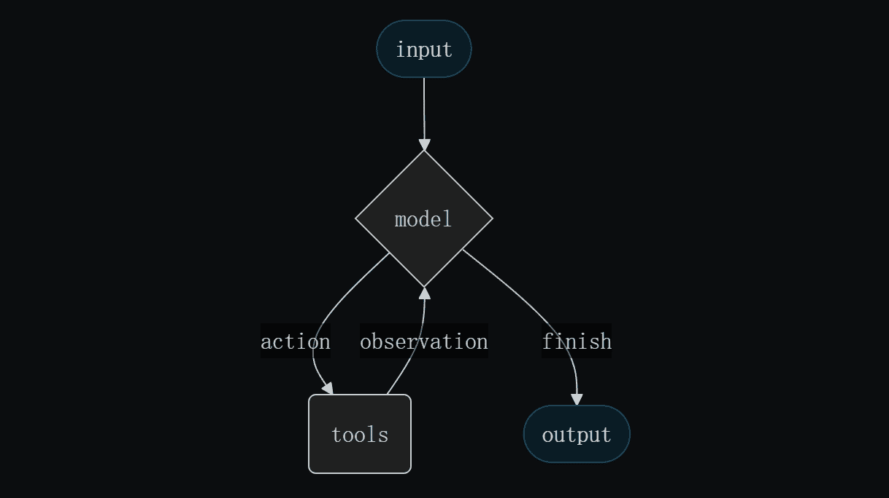
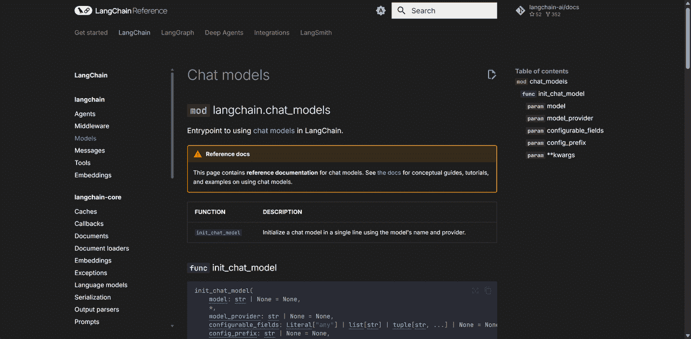
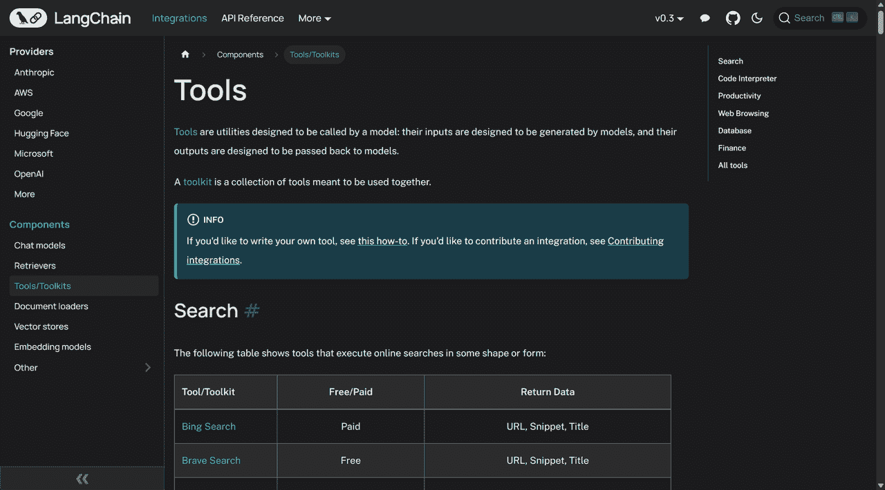
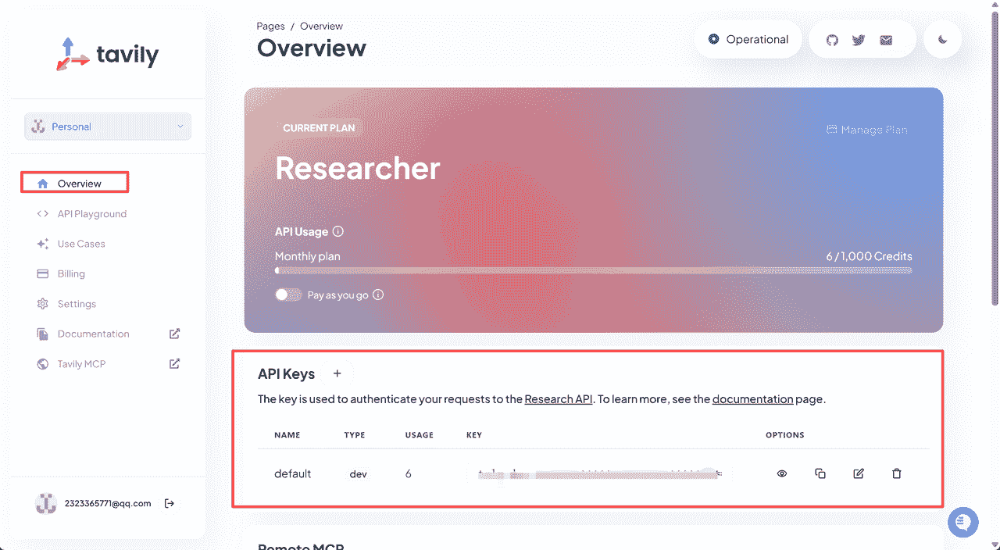
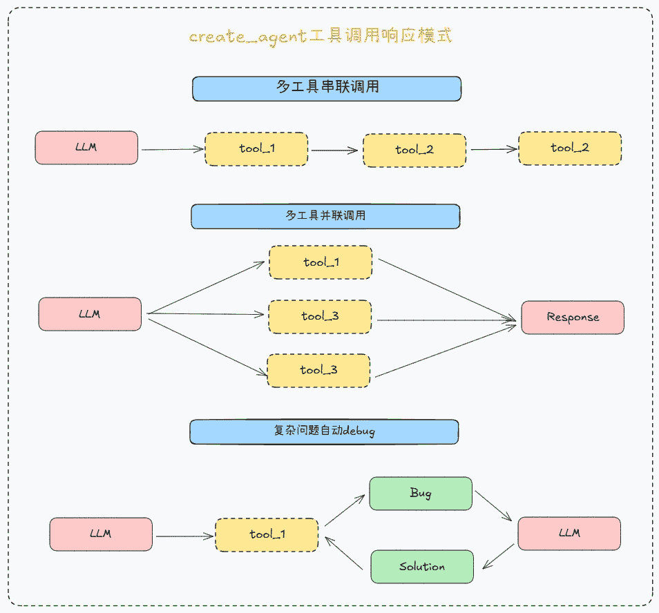
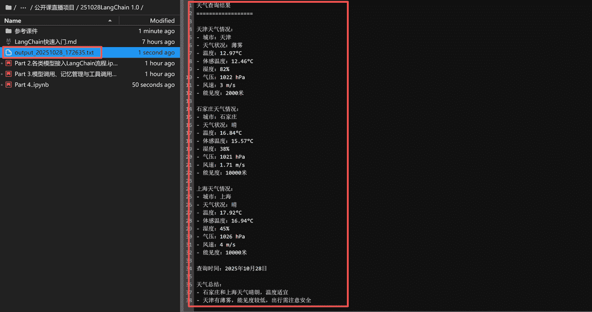

# Part 4.LangChain 1.0 Agent开发流程

> 来源：[https://kq4b3vgg5b.feishu.cn/docx/RHkKdOxDMo0c3gxcx1wch0K9nFg](https://kq4b3vgg5b.feishu.cn/docx/RHkKdOxDMo0c3gxcx1wch0K9nFg)

## 课程说明：

+   体验课内容节选自《2025大模型Agent智能体开发实战》(秋季班)完整版付费课程

体验课时间有限，若想深度学习大模型技术，欢迎大家报名由我主讲的《2025大模型Agent智能体开发实战》(秋季班)

---

# LangChain 1.0入门实战

## Part 4.LangChain 1.0 Agent开发流程

### 1. LangChain 1.0最大更新：全新Agent框架介绍

```
import os
from dotenv import load_dotenv 
load_dotenv(override=True)
```

```
True
```

**在** **LangCh**ain 1.0 中，最大的变化肯定是推出了全新的Agent API：create_agent。至此，LangChain Agent就已经不再是早期那种“带点魔法味的模型调用器”，它正式被定义为：一个可感知上下文、具备行动能力、可扩展、可插拔的智能运行体（Intelligent Runtime Unit）。简单来说，Agent 不再只是“用大模型回答问题”，而是能根据任务动态调用工具、推理决策、规划步骤，并与外部世界进行交互的 自治式执行体。

+   LangChain Agent API大一统

LangChain 在 1.0 版本中，将所有 Agent 的创建方式统一为了一个入口——create_agent()。它取代了旧版本中的 create_react_agent、create_json_agent、create_tool_calling_agent 等多种分支函数，真正让开发者用一行代码即可创建任何类型的智能体。

在 LangChain 0.x 时代，框架内的 Agent 系统经历了“碎片化”阶段。当时的设计理念是 “针对场景设计特定 Agent”——如果你要实现思维链推理（ReAct），就用 create_react_agent；如果需要结构化输出，就用 create_structured_chat_agent；要工具调用，则用 create_tool_calling_agent。这种方式灵活，但也带来了三个明显问题：

1.  **心智负担高**——每种 Agent 都要单独记忆 API 与参数；

1.  **可组合性差**——多个 Agent 之间无法统一调度；

1.  **生态碎片化**——不同模块难以复用或协同演化。

而进入 LangChain 1.0 后，团队做出了彻底重构：将所有 Agent 的创建入口合并为 create_agent()，同时在底层通过“中间件机制（Middleware）”和“标准模型接口（invoke / stream）”实现全局统一。这让框架更轻、更稳，也更易于被集成到其他 Agent 平台中。

+   create_agent API极简调用流程

而LangChain 1.0中的create_agent API的实际调用过程也非常简单，从代码层面来看，我们只需要将模型和工具拼接到一起，即可完成Agent创建：

```
# 1.导入相关库
from langchain.agents import create_agent
from langchain_deepseek import ChatDeepSeek
from langchain_community.tools.tavily_search import TavilySearchResults

# 2.导入模型和工具
web_search = TavilySearchResults(max_results=2)
model = ChatDeepSeek(model=&quot;deepseek-chat&quot;)

# 3.创建Agent
agent = create_agent(
    model=model,
    tools=[web_search],
    system_prompt=&quot;你是一名多才多艺的智能助手，可以调用工具帮助用户解决问题。&quot;
)

# 4.运行Agent获得结果
result = agent.invoke(
    {&quot;messages&quot;: [{&quot;role&quot;: &quot;user&quot;, &quot;content&quot;: &quot;请帮我查询2024年诺贝尔物理学奖得主是谁？&quot;}]}
)
```

```
result[&#x27;messages&#x27;][-1].content
```

```
&#x27;根据查询结果，2024年诺贝尔物理学奖得主已经揭晓：\n\n**获奖者：**\n- **John J. Hopfield**\n- **Geoffrey E. Hinton**\n\n**获奖理由：** &quot;表彰他们通过人工神经网络实现机器学习的基础性发现和发明&quot;\n\n**奖金：** 1100万瑞典克朗（约合745万元人民币）\n\n**颁奖时间：** 2024年10月8日\n\n这两位科学家在人工神经网络和机器学习领域做出了开创性的贡献，他们的工作为现代人工智能的发展奠定了重要基础。&#x27;
```

+   create_agent API底层LangGraph架构

而从底层架构来看，从 LangChain 1.0 开始，官方对框架的整体架构进行了根本性的角色重置：LangGraph 被正式确立为 LangChain 的底层运行框架（Runtime Foundation），而非附属扩展。在 0.x 时代，LangGraph 还被视作 LangChain 的“高层封装”——它是开发者在 LangChain 基础上进一步实现复杂 Agent 编排、状态流转与多节点控制的可选工具；换言之，那时 LangChain 是核心、LangGraph 是外挂。而进入 1.0 之后，情况彻底反转：LangGraph 被下沉为 LangChain 的底层执行引擎，一切新的高级 API（包括统一的 create_agent()、中间件系统、状态管理机制、流式回调与事件调度等）都直接运行在 LangGraph 架构之上。这样一来，LangChain 不再只是一个“Prompt 组织与调用库”，而是一个基于图结构的智能体运行时系统：每个 Agent 的生命周期、每次模型调用、每个工具执行，都是图中一个节点或边的执行过程。LangGraph 提供了稳定的调度、状态传递与事件流控制，而 LangChain 则提供了上层接口与开发体验。也就是说，上述Agent的实际运行逻辑，如果用LangGraph的语言来描述就是：



这种统一架构并以LangGraph为底层框架带来的优势如下：

1.  **接口统一，降低心智负担**

+   无论是工具型、规划型还是对话型 Agent，都用同一个入口创建。

+   开发者不再需要区分不同 Agent 的实现逻辑。

1.  **跨生态兼容性增强**

+   LangChain 1.0 的 Agent 架构与 LangGraph、LangServe、甚至 OpenAI Responses API 都完全兼容。

+   这意味着同一个 Agent 可以同时运行在命令行、Web UI、LangGraph 节点或云端推理环境中。

1.  **中间件机制的加入**

+   新版本允许通过装饰器或中间件在 Agent 生命周期中插入逻辑：
如日志、速率限制、记忆压缩、PII 审查、内容重写等。

+   这使得 Agent 更像一个“微型操作系统进程”，具备可观察性与可管理性。

1.  **可扩展性与定制性更强**

+   统一 API 底层基于标准化状态流（State Graph），
这意味着用户可以自由地扩展 Agent 行为而不破坏核心逻辑。

+   create_agent API与Agents SDK、ADK对比

并且，LangChain 1.0 的 create_agent() 与 OpenAI 的 client.agents.create()、Google ADK 的 Agent.create() 在形式上极为相似：都是 “传入模型 + 工具 + 说明 → 获得一个可交互 Agent 实例”。但 LangChain 的优势在于——它不仅是一个调用层 SDK，而是一个 完备的 Agent Runtime 框架。

| 维度 | LangChain 1.0 | OpenAI Agents SDK | Google ADK |
| --- | --- | --- | --- |
| **定位** | 完整 Agent Runtime（含状态流、中间件、LangGraph） | 平台级 SDK | 研究级 Agent 构建工具 |
| **创建方式** | create_agent(model, tools, system_prompt) | client.agents.create(...) | Agent.create(tools, model, config) |
| **状态管理** | AgentState + Graph | 隐式 | Context Graph |
| **中间件支持** | ✅ 丰富的 before/after hooks | ❌（需手动实现） | ✅ 部分支持 |
| **生态完备性** | 🟢 极高（内置工具库、RAG模块、Serve接口） | 中等 | 中等 |

因此我们可以说：**LangChain 1.0 的 Agent 系统兼具 OpenAI** SDK 的易用性 + Google ADK 的可扩展性 + 自身生态的完整性。 它不只是“能用”，更是“能跑得久、能部署、能运维”的生产级智能体框架。

+   Agent Runtime框架：create_agent

而从官方的角度进行解释，LangChain 1.0中的Agent系统是一个Agent Runtime框架。在计算机领域中，Runtime 通常指的是一段代码运行所依赖的执行环境，它负责管理：

+   程序的生命周期（从初始化 → 执行 → 结束）；

+   内部状态的维护；

+   与外部资源的交互（输入、输出、网络、文件等）；

+   异常处理、事件调度、中断恢复等底层细节。

而Agent Runtime 框架 = 让智能体能够持续运行、思考、决策、调用工具、保持状态的底层执行系统。它不是一个“函数库”，而是一整套管理 Agent 生命周期与执行流程的框架。当然其中主要得益于LangChain 1.0 Agent框架继承了此前LangGraph的全套开发框架、并在此基础上增加了中间件Middleware，使得Agent开发和运行过程更加可控。

### 2. create_agent API模型接入方法

在 LangChain 1.0 中，Agent（智能体） 不再只是调用模型的脚本，而是一个能理解任务、推理路径、调用工具并自主完成目标的系统。每个 Agent 都包含一个循环结构（Agent Loop）：模型会根据当前输入进行推理，决定是否调用工具、如何解析观察结果，并不断迭代，直到满足“停止条件”（Stop Condition），也就是模型生成最终答案，或达到设定的迭代次数上限。

LangChain 1.0 提供了全新的 create_agent() 接口，这是一个 可用于生产环境的标准化智能体构造函数。通过它，你可以用极简的方式创建一个完整的、可运行的智能体系统。create_agent 会在内部使用 LangGraph 构建一个基于图结构的 Agent Runtime，它以节点（Node）和边（Edge）的形式定义整个推理流程：

+   节点（Node）：代表执行步骤，例如模型调用节点、工具执行节点或中间件节点；

+   边（Edge）：代表执行流程与状态流转；

+   图（Graph）：定义了 Agent 如何在这些节点之间流动、推理和决策。

换而言之，LangChain 的每个 Agent 都是一张有向图，语言模型是推理引擎，工具是行动节点，而底层则是通过LangGrph进行的编写和实现。


在 create_agent() 的底层运行机制中，最重要的三个组件分别是：

1.  模型（Model）

模型是 Agent 的“大脑”，负责理解任务与决策推理。它既可以是静态模型（固定不变），也可以是动态模型（根据上下文切换）。

1.  工具（Tools）

工具是 Agent 的“手脚”。模型可以选择调用不同工具来实现特定子任务，例如：

+   web_search() → 进行联网搜索

+   calculate() → 计算公式

+   database_query() → 查询数据源

1.  中间件（Middleware）

中间件类似于“神经系统”，它可以在模型调用前后拦截请求、修改参数、或动态调整模型选择逻辑，是 LangChain 1.0 的强大扩展机制。

create_agent支持两种模型使用模式：静态模型（Static Model） 与 动态模型（Dynamic Model）。其中静态模型在创建 Agent 时配置一次，并在整个执行过程中保持固定。这种方式简单稳定，适合实验和一般生产场景。例如

```
from langchain.agents import create_agent

agent = create_agent(
    &quot;deepseek:deepseek-chat&quot;,
    tools=tools
)
```

此时LangChain 会自动识别 "deepseek-chat" 并推断其完整标识 "deepseek:deepseek-chat"。这种方式适合快速构建 Demo 或标准化模型调用。

> 完整静态模型字符串映射详见：https://reference.langchain.com/python/langchain/models/?_gl=1125pi5n_gcl_auMTI5ODI4NTA5Ny4xNzYxMjA1ODI2_gaMTc2OTg3MTQ2OS4xNzYxMzc5MDEw_ga_47WX3HKKY2*czE3NjE2MzMwNDQkbzYkZzEkdDE3NjE2MzczMzUkajYwJGwwJGgw#langchain.chat_models.init_chat_model(model_provider)



另外，在静态模型调用过程中，也可以类似此前的示例中展示的调用过程，先实例化模型，然后再将实例化后的模型带入create_agent中创建Agent，此时我们就可以在创建模型的环节进行更多的参数设置，例如：

```
from langchain_deepseek import ChatDeepSeek
from langchain.agents import create_agent

model = ChatDeepSeek(
    model=&quot;deepseek-chat&quot;,
    temperature=0.1,
    max_tokens=1000,
    timeout=30
)
agent = create_agent(model, tools=tools)
```

而除此之外，LangChain 1.0的create_agent API还提供了动态模型的方式，这是一种更高级的机制，它允许 Agent 在运行时根据任务上下文自动切换模型，实现智能的模型路由与成本优化。例如对话初期使用轻量模型（如 gpt-4o-mini）以节省成本；当上下文变复杂或任务难度提升时，自动切换到更强模型（如 gpt-4o）。而此时就需要使用到中间件的@wrap_model_call装饰器，这部分内容我们将放在下一小节进行介绍。

### 3. create_agent接入内置工具与Agent创建流程

当然，只有接入了一些工具，才能使用create_agent完成Agent创建（如果只是进行模型调用，可以采用上一小节介绍的model.invoke进行调用）。

这里我们首先介绍一个最基本的LangChain接入工具流程——接入LangChain内置的工具集。其实在MCP爆火之前，LangChian生态中就已经内置集成了非常多的实用工具，开发者可以快速调用这些工具完成更加复杂工作流的开发。

+   LangChain内置工具列表：https://python.langchain.com/docs/integrations/tools/



其中典型的工具如下：

| 领域 | 工具名称 | 功能说明 |
| --- | --- | --- |
| **搜索引擎与信息检索** | 🔹 DuckDuckGo Search | 免费搜索引擎，返回网页标题、摘要与链接，常用于联网问答。 |
|  | 🔹 Brave Search API | 提供隐私友好的网页搜索结果，可配置输出深度与过滤。 |
|  | 🔹 Bing Search Tool | 微软 Bing 搜索接口，支持精确检索与多语言查询。 |
| **网页浏览与内容提取** | 🔹 Playwright Browser Toolkit | 提供浏览器自动化访问、网页截图与文本抓取功能。 |
|  | 🔹 Selenium Toolkit | 类似于 Playwright，但偏向传统网页 DOM 操控。 |
| **生产力工具集成** | 🔹 S**lack Toolkit** | 允许 Agent 在 Slack 中发送、读取或总结消息。 |
|  | 🔹 J**ira Toolkit** | 用于查询、创建或更新 Jira 项目工单。 |
|  | 🔹 Google Drive / Docs Toolkit | 操作 Google 文档、表格与文件搜索。 |
| **数据库与数据操作** | 🔹 SQLDatabase Toolkit | 连接 SQL 数据库，自动生成并执行 SQL 查询。 |
|  | 🔹 F**aiss / Chroma / Milvu**s VectorStore Tools | 进行向量相似度搜索，用于 RAG 检索。 |
| **代码与终端执行** | 🔹 Python REPL Tool | 执行 Python 代码片段并返回结果（沙盒环境）。 |
|  | 🔹 Shell Tool (Bash) | 允许执行 Shell 命令（需安全限制）。 |
|  | 🔹 Requests Wrapper Tool | 发起 HTTP 请求、API 调用，用于外部数据交互。 |
| **多模态工具** | 🔹 D**ALL-E Tool** | 生成图像，可结合文本描述创作内容。 |
|  | 🔹 SerpAPI Image Search | 图片搜索引擎，可返回图片 URL 与元信息。 |
|  | 🔹 OpenAI Whisper Tool | 音频转录工具，将语音文件转换为文本。 |
| **知识问答与嵌入检索** | 🔹 VectorStoreRetrieverTool | 基于嵌入模型检索文档片段，用于 RAG 问答。 |
|  | 🔹 MultiQueryRetrieverTool | 生成多种查询变体以提升检索覆盖率。 |
| **云与AI服务** | 🔹 O**penAI Functions / A**zure Functions Tool | 让 Agent 调用 OpenAI 或 Azure 定义的函数。 |
|  | 🔹 Anthropic ToolKit | 集成 Claude 模型工具调用能力。 |
| **文件系统与数据处理** | 🔹 C**SV Toolkit** | 读取、过滤与分析 CSV 文件数据。 |
|  | 🔹 Pandas DataFrame Agent Tool | 直接在 DataFrame 上执行查询与统计任务。 |

我们就以其中网络搜索工具为例，来介绍如何将内置工具接入create_agent中。

```
# !pip install -qU langchain-community langchain-experimental pandas -i https://pypi.tuna.tsinghua.edu.cn/simple
```

LangChain中内置了TavilySearchResults搜索工具，可以借助Tavily进行网络搜索和信息爬取。这里我们需要先在tavily官网注册并获得API-KEY（每月有免费额度）：https://www.tavily.com/



然后将API-KEY写到本地.env中的TAVILY_API_KEY变量中。然后即可进行调用了。

```
from langchain_community.tools.tavily_search import TavilySearchResults
web_search = TavilySearchResults(max_results=2)
```

```
web_search?
```

```
Type:           TavilySearchResults
String form:    max_results=2 api_wrapper=TavilySearchAPIWrapper(tavily_api_key=SecretStr(&#x27;**********&#x27;))
File:           c:\programdata\anaconda3\envs\langchain\lib\site-packages\langchain_community\tools\tavily_search\tool.py
Docstring:     
!!! deprecated &quot;0.3.25 Use ``langchain_tavily.TavilySearch`` instead. It will not be removed until langchain-community==1.0.&quot;

Tool that queries the Tavily Search API and gets back json.

    Setup:
        Install ``langchain-openai`` and ``tavily-python``, and set environment variable ``TAVILY_API_KEY``.

        .. code-block:: bash

            pip install -U langchain-community tavily-python
            export TAVILY_API_KEY=&quot;your-api-key&quot;

    Instantiate:

        .. code-block:: python

            from langchain_community.tools import TavilySearchResults

            tool = TavilySearchResults(
                max_results=5,
                include_answer=True,
                include_raw_content=True,
                include_images=True,
                # search_depth=&quot;advanced&quot;,
                # include_domains = []
                # exclude_domains = []
            )

    Invoke directly with args:

        .. code-block:: python

            tool.invoke({&#x27;query&#x27;: &#x27;who won the last french open&#x27;})

        .. code-block:: json

            {
                &quot;url&quot;: &quot;https://www.nytimes.com...&quot;,
                &quot;content&quot;: &quot;Novak Djokovic won the last French Open by beating Casper Ruud ...&quot;
            }

    Invoke with tool call:

        .. code-block:: python

            tool.invoke({&quot;args&quot;: {&#x27;query&#x27;: &#x27;who won the last french open&#x27;}, &quot;type&quot;: &quot;tool_call&quot;, &quot;id&quot;: &quot;foo&quot;, &quot;name&quot;: &quot;tavily&quot;})

        .. code-block:: python

            ToolMessage(
                content=&#x27;{ &quot;url&quot;: &quot;https://www.nytimes.com...&quot;, &quot;content&quot;: &quot;Novak Djokovic won the last French Open by beating Casper Ruud ...&quot; }&#x27;,
                artifact={
                    &#x27;query&#x27;: &#x27;who won the last french open&#x27;,
                    &#x27;follow_up_questions&#x27;: None,
                    &#x27;answer&#x27;: &#x27;Novak ...&#x27;,
                    &#x27;images&#x27;: [
                        &#x27;https://www.amny.com/wp-content/uploads/2023/06/AP23162622181176-1200x800.jpg&#x27;,
                        ...
                        ],
                    &#x27;results&#x27;: [
                        {
                            &#x27;title&#x27;: &#x27;Djokovic ...&#x27;,
                            &#x27;url&#x27;: &#x27;https://www.nytimes.com...&#x27;,
                            &#x27;content&#x27;: &quot;Novak...&quot;,
                            &#x27;score&#x27;: 0.99505633,
                            &#x27;raw_content&#x27;: &#x27;Tennis
Novak ...&#x27;
                        },
                        ...
                    ],
                    &#x27;response_time&#x27;: 2.92
                },
                tool_call_id=&#x27;1&#x27;,
                name=&#x27;tavily_search_results_json&#x27;,
            )

    
Init docstring:
Initialize the tool.

Raises:
    TypeError: If `args_schema` is not a subclass of pydantic `BaseModel` or
        dict.
```

这是一个高度封装的网络搜索工具，可以直接调用：

```
web_search.invoke(&quot;请问截至目前，2025年诺贝尔奖颁发了几个？&quot;)
```

```
[{&#x27;title&#x27;: &#x27;2025年诺贝尔奖“开奖周”来了 - 新浪财经&#x27;,
  &#x27;url&#x27;: &#x27;https://finance.sina.com.cn/jjxw/2025-10-09/doc-infthfys0859921.shtml&#x27;,
  &#x27;content&#x27;: &#x27;新浪首页\n 新闻\n 体育\n 财经\n 娱乐\n 科技\n 博客\n 图片\n 专栏\n 更多\n\n 汽车 教育 时尚 女性 星座 健康\n 房产历史视频收藏育儿读书\n 佛学游戏旅游邮箱导航\n\n 新浪微博\n 新浪新闻\n 新浪财经\n 新浪体育\n 新浪众测\n 新浪博客\n 新浪视频\n 新浪游戏\n 天气通\n\n经济新闻滚动 &gt; 正文\n\n# 2025年诺贝尔奖“开奖周”来了\n\n2025年10月09日 11:45 齐鲁晚报\n\n新浪财经APP 缩小字体 放大字体 收藏 微博 微信 分享 \n\n腾讯QQ QQ空间\n\n一年一度的诺贝尔奖“开奖周”拉开帷幕,六大奖项将逐次揭晓。走过百年历程,诺贝尔奖已颁发了627次。截至发稿前,生理学或医学奖、物理学奖、化学奖已颁出。 [...] 瑞典卡罗琳医学院10月6日宣布,将2025年诺贝尔生理学或医学奖授予美国科学家玛丽·布伦科、弗雷德·拉姆斯德尔和日本科学家坂口志文,以表彰他们在外周免疫耐受机制方面的开创性发现。7日,瑞典皇家科学院决定将2025年诺贝尔物理学奖授予约翰·克拉克、米歇尔·H·德沃雷和约翰·M·马蒂尼斯,以表彰他们在电路中实现宏观量子力学隧穿效应和能量量子化方面的贡献。8日,瑞典皇家科学院宣布,将2025年诺贝尔化学奖授予北川进、理查德·罗布森和奥马尔·M·亚吉,以表彰他们“开发金属有机框架”。\n\n让量子现象“肉眼可见”\u30002025年诺贝尔物理学奖成果解读\n\n\u3000\u3000量子力学诞生百年之际,瑞典皇家科学院10月7日将2025年诺贝尔物理学奖授予约翰·克拉克、米歇尔·H·德沃雷和约翰·M·马蒂尼斯三名量子物理学家。正是他们在前人百年探索基础上的开创性发现,让我们“看见”曾只存在于微观领域的量子现象,也为新一代量子技术的发展奠定了坚实基础。\n\n系列开创实验&#x27;,
  &#x27;score&#x27;: 0.87605256},
 {&#x27;title&#x27;: &#x27;2025年诺贝尔奖-新闻专题 - 科学网&#x27;,
  &#x27;url&#x27;: &#x27;https://news.sciencenet.cn/news/sub26.aspx?id=4383&#x27;,
  &#x27;content&#x27;: &#x27;Image 19诺奖得主亲证：在科学界，“第一学历”不重要 Image 20刚刚，2025年诺贝尔化学奖揭晓！Image 21他们在分子世界造“房间”！解读诺贝尔化学奖 Image 22直播回放|2025诺贝尔化学奖解读\n\n 新闻 查看详细&gt;&gt;\n\n闹过乌龙，谁又陪跑？ 诺贝尔奖“开奖周”启幕\n\n当地时间10月6日，一年一度的诺贝尔奖“开奖周”拉开帷幕，六大奖项将逐次揭晓。\n\n走过百年历程，诺贝尔奖已颁发了627次，生理学或医学奖、物理学奖、化学奖等奖项的获奖者们，通常收获了奖章、证书和巨额奖金。\n\n如今，2025年诺贝尔奖又会产生什么样的结果？\n\nImage 23闹过乌龙，谁又陪跑？ 诺贝尔奖“开奖周”启幕\n\n关于我们 | 网站声明 | 服务条款 | 联系方式 | RSS | 举报 | 中国科学报社\n\n京ICP备07017567号-12互联网新闻信息服务许可证10120230008 京公网安备 11010802032783\n\nCopyright @ 2007-2025 中国科学报社 All Rights Reserved&#x27;,
  &#x27;score&#x27;: 0.8029425}]
```

也可以直接带入create_agent中作为外部工具。

```
# 1.导入相关库
from langchain.agents import create_agent
from langchain_deepseek import ChatDeepSeek
from langchain_community.tools.tavily_search import TavilySearchResults

# 2.导入模型和工具
web_search = TavilySearchResults(max_results=2)
model = ChatDeepSeek(model=&quot;deepseek-chat&quot;)

# 3.创建Agent
agent = create_agent(
    model=model,
    tools=[web_search],
    system_prompt=&quot;你是一名多才多艺的智能助手，可以调用工具帮助用户解决问题。&quot;
)

# 4.运行Agent获得结果
result = agent.invoke(
    {&quot;messages&quot;: [{&quot;role&quot;: &quot;user&quot;, &quot;content&quot;: &quot;请帮我查询2024年诺贝尔物理学奖得主是谁？&quot;}]}
)
```

```
result[&#x27;messages&#x27;][-1].content
```

```
&#x27;根据查询结果，2024年诺贝尔物理学奖得主已经揭晓：\n\n**获奖者：**\n- **John J. Hopfield**\n- **Geoffrey E. Hinton**\n\n**获奖理由：** &quot;表彰他们通过人工神经网络实现机器学习的基础性发现和发明&quot;\n\n**奖金：** 1100万瑞典克朗（约合745万元人民币）\n\n**颁奖时间：** 2024年10月8日\n\n这两位科学家在人工神经网络和机器学习领域做出了开创性的贡献，他们的工作为现代人工智能的发展奠定了重要基础。&#x27;
```

而如果仔细观察本次运行过程，本次工具调用仍然是一次典型的Function calling执行流程，包括用户首次发起消息在内，总共创建了4条消息，分别是user message、function call message、function response message以及final responses：

```
result[&#x27;messages&#x27;]
```

```
[HumanMessage(content=&#x27;请帮我查询2024年诺贝尔物理学奖得主是谁？&#x27;, additional_kwargs={}, response_metadata={}, id=&#x27;28dd30e3-d362-4250-94e6-9ff68872ae43&#x27;),
 AIMessage(content=&#x27;我来帮您查询2024年诺贝尔物理学奖得主的信息。&#x27;, additional_kwargs={&#x27;refusal&#x27;: None}, response_metadata={&#x27;token_usage&#x27;: {&#x27;completion_tokens&#x27;: 38, &#x27;prompt_tokens&#x27;: 213, &#x27;total_tokens&#x27;: 251, &#x27;completion_tokens_details&#x27;: None, &#x27;prompt_tokens_details&#x27;: {&#x27;audio_tokens&#x27;: None, &#x27;cached_tokens&#x27;: 192}, &#x27;prompt_cache_hit_tokens&#x27;: 192, &#x27;prompt_cache_miss_tokens&#x27;: 21}, &#x27;model_provider&#x27;: &#x27;deepseek&#x27;, &#x27;model_name&#x27;: &#x27;deepseek-chat&#x27;, &#x27;system_fingerprint&#x27;: &#x27;fp_ffc7281d48_prod0820_fp8_kvcache&#x27;, &#x27;id&#x27;: &#x27;2741ce6b-7c96-4bd1-a61a-15ad4e7d6671&#x27;, &#x27;finish_reason&#x27;: &#x27;tool_calls&#x27;, &#x27;logprobs&#x27;: None}, id=&#x27;lc_run--4da5bbd2-545b-4368-9ff0-18322e6c08c1-0&#x27;, tool_calls=[{&#x27;name&#x27;: &#x27;tavily_search_results_json&#x27;, &#x27;args&#x27;: {&#x27;query&#x27;: &#x27;2024年诺贝尔物理学奖得主&#x27;}, &#x27;id&#x27;: &#x27;call_00_cnUjtm6ucpDhpjSiVMrANDBH&#x27;, &#x27;type&#x27;: &#x27;tool_call&#x27;}], usage_metadata={&#x27;input_tokens&#x27;: 213, &#x27;output_tokens&#x27;: 38, &#x27;total_tokens&#x27;: 251, &#x27;input_token_details&#x27;: {&#x27;cache_read&#x27;: 192}, &#x27;output_token_details&#x27;: {}}),
 ToolMessage(content=&#x27;[{&quot;title&quot;: &quot;2024年诺贝尔物理学奖揭晓！ - 学术桥&quot;, &quot;url&quot;: &quot;https://www.acabridge.cn/kjjx/international/202410/t20241008_2636012.shtml&quot;, &quot;content&quot;: &quot;首页\\n\\n资讯\\n\\n高校论坛\\n\\n猎头服务\\n\\n评审评估\\n\\n资讯\\n\\n头条\\n\\n新闻\\n\\n科研\\n\\n高校\\n\\n政策\\n\\n观点\\n\\n学者\\n\\n活动\\n\\n论坛\\n\\n访谈\\n\\n专题\\n\\n首页 &gt; 国际\\n\\n关注我们\\n\\n学术桥-订阅号\\n\\n学术桥-小程序\\n\\n2024年诺贝尔物理学奖揭晓！\\n\\n诺贝尔奖委员会官网 2024年10月08日 18:09\\n\\n北京时间10月8日17时45分许，2024年诺贝尔物理学奖揭晓获奖名单。John J. Hopfield、Geoffrey E. Hinton获奖，获奖理由是“表彰他们通过人工神经网络实现机器学习的基础性发现和发明”。奖金为1100万瑞典克朗。\\n\\n近5年诺贝尔物理学奖得主\\n\\n\u3000\u30002023年，诺贝尔物理学奖颁给皮埃尔·阿戈斯蒂尼 (Pierre Agostini)、费伦茨·克劳斯 (Ferenc Krausz) 和安妮·卢利尔 (Anne L’Huillier)，以表彰他们在阿秒光脉冲方面所做出的贡献。&quot;, &quot;score&quot;: 0.9387167}, {&quot;title&quot;: &quot;揭晓了！2024年诺贝尔物理学奖授予了他们→ - 上海市科学技术委员会&quot;, &quot;url&quot;: &quot;https://stcsm.sh.gov.cn/xwzx/mtjj/20241010/cbf3a306092a4991871cfa69e98ea023.html&quot;, &quot;content&quot;: &quot;| |  |  | 当前位置：  首页 &gt; 新闻中心 &gt; 媒体聚焦 &gt; 正文 |     揭晓了！2024年诺贝尔物理学奖授予了他们→    发布日期：2024-10-10  来源：上海科技    当地时间10月8日，瑞典皇家科学院宣布，将2024年诺贝尔物理学奖授予John J.Hopfield和Geoffrey E.Hinton，以表彰他们“为利用人工神经网络进行机器学习做出的基础性发现和发明”。      \u3000\u3000此前，诺贝尔物理学奖已颁发给225位获奖者。由于约翰·巴丁(John Bardeen)曾两次获奖，因此自1901年以来，共有224人获得过诺贝尔物理学奖。自1901年以来，诺贝尔物理学奖已颁发117次。    \u3000\u3000据诺贝尔奖官方网站消息，2024年每项诺贝尔奖的奖金为1100万瑞典克朗（约合745万元人民币）。在百余年中，物理学奖是华人拿奖最多的奖项，李政道、杨振宁、丁肇中、朱棣文、崔琦和高琨等华人科学家均获此殊荣。    诺贝尔物理学奖近５年获奖者 [...] 诺贝尔物理学奖是根据诺贝尔1895年的遗嘱而设立的五个诺贝尔奖之一，该奖旨在奖励那些对人类物理学领域里作出突出贡献的科学家。近五年来物理学奖获奖名单如下：    2023    \u3000\u30002023年，物理学奖授予皮埃尔·阿戈斯蒂尼(Pierre Agostini)、费伦茨·克劳斯(Ferenc Krausz)和安妮·卢利尔(Anne L\&#x27;Huillier)，以表彰他们开发出的能够产生阿秒量级光脉冲的实验方法，这些方法被用来研究物质中的电子动力学。      2022    \u3000\u30002022年诺贝尔物理学奖被授予科学家阿兰·阿斯佩(Alain Aspect)，约翰·弗朗西斯·克劳泽(John F.Clauser)和安东·塞林格(Anton Zeilinger)，以表彰他们为纠缠光子实验、证明违反贝尔不等式和开创性的量子信息科学所作出的贡献。      2021    \u3000\u30002021年，诺贝尔物理学奖授予“对我们理解复杂系统的开创性贡献”。一半由美国科学家真锅淑郎(Syukuro Manabe)和德国科学家克劳斯·哈塞尔曼(Klaus&quot;, &quot;score&quot;: 0.9222657}]&#x27;, name=&#x27;tavily_search_results_json&#x27;, id=&#x27;e144ff5c-db94-4b48-ac8b-03f0adb191fa&#x27;, tool_call_id=&#x27;call_00_cnUjtm6ucpDhpjSiVMrANDBH&#x27;, artifact={&#x27;query&#x27;: &#x27;2024年诺贝尔物理学奖得主&#x27;, &#x27;follow_up_questions&#x27;: None, &#x27;answer&#x27;: None, &#x27;images&#x27;: [], &#x27;results&#x27;: [{&#x27;url&#x27;: &#x27;https://www.acabridge.cn/kjjx/international/202410/t20241008_2636012.shtml&#x27;, &#x27;title&#x27;: &#x27;2024年诺贝尔物理学奖揭晓！ - 学术桥&#x27;, &#x27;content&#x27;: &#x27;首页\n\n资讯\n\n高校论坛\n\n猎头服务\n\n评审评估\n\n资讯\n\n头条\n\n新闻\n\n科研\n\n高校\n\n政策\n\n观点\n\n学者\n\n活动\n\n论坛\n\n访谈\n\n专题\n\n首页 &gt; 国际\n\n关注我们\n\n学术桥-订阅号\n\n学术桥-小程序\n\n2024年诺贝尔物理学奖揭晓！\n\n诺贝尔奖委员会官网 2024年10月08日 18:09\n\n北京时间10月8日17时45分许，2024年诺贝尔物理学奖揭晓获奖名单。John J. Hopfield、Geoffrey E. Hinton获奖，获奖理由是“表彰他们通过人工神经网络实现机器学习的基础性发现和发明”。奖金为1100万瑞典克朗。\n\n近5年诺贝尔物理学奖得主\n\n\u3000\u30002023年，诺贝尔物理学奖颁给皮埃尔·阿戈斯蒂尼 (Pierre Agostini)、费伦茨·克劳斯 (Ferenc Krausz) 和安妮·卢利尔 (Anne L’Huillier)，以表彰他们在阿秒光脉冲方面所做出的贡献。&#x27;, &#x27;score&#x27;: 0.9387167, &#x27;raw_content&#x27;: None}, {&#x27;url&#x27;: &#x27;https://stcsm.sh.gov.cn/xwzx/mtjj/20241010/cbf3a306092a4991871cfa69e98ea023.html&#x27;, &#x27;title&#x27;: &#x27;揭晓了！2024年诺贝尔物理学奖授予了他们→ - 上海市科学技术委员会&#x27;, &#x27;content&#x27;: &quot;| |  |  | 当前位置：  首页 &gt; 新闻中心 &gt; 媒体聚焦 &gt; 正文 |     揭晓了！2024年诺贝尔物理学奖授予了他们→    发布日期：2024-10-10  来源：上海科技    当地时间10月8日，瑞典皇家科学院宣布，将2024年诺贝尔物理学奖授予John J.Hopfield和Geoffrey E.Hinton，以表彰他们“为利用人工神经网络进行机器学习做出的基础性发现和发明”。      \u3000\u3000此前，诺贝尔物理学奖已颁发给225位获奖者。由于约翰·巴丁(John Bardeen)曾两次获奖，因此自1901年以来，共有224人获得过诺贝尔物理学奖。自1901年以来，诺贝尔物理学奖已颁发117次。    \u3000\u3000据诺贝尔奖官方网站消息，2024年每项诺贝尔奖的奖金为1100万瑞典克朗（约合745万元人民币）。在百余年中，物理学奖是华人拿奖最多的奖项，李政道、杨振宁、丁肇中、朱棣文、崔琦和高琨等华人科学家均获此殊荣。    诺贝尔物理学奖近５年获奖者 [...] 诺贝尔物理学奖是根据诺贝尔1895年的遗嘱而设立的五个诺贝尔奖之一，该奖旨在奖励那些对人类物理学领域里作出突出贡献的科学家。近五年来物理学奖获奖名单如下：    2023    \u3000\u30002023年，物理学奖授予皮埃尔·阿戈斯蒂尼(Pierre Agostini)、费伦茨·克劳斯(Ferenc Krausz)和安妮·卢利尔(Anne L&#x27;Huillier)，以表彰他们开发出的能够产生阿秒量级光脉冲的实验方法，这些方法被用来研究物质中的电子动力学。      2022    \u3000\u30002022年诺贝尔物理学奖被授予科学家阿兰·阿斯佩(Alain Aspect)，约翰·弗朗西斯·克劳泽(John F.Clauser)和安东·塞林格(Anton Zeilinger)，以表彰他们为纠缠光子实验、证明违反贝尔不等式和开创性的量子信息科学所作出的贡献。      2021    \u3000\u30002021年，诺贝尔物理学奖授予“对我们理解复杂系统的开创性贡献”。一半由美国科学家真锅淑郎(Syukuro Manabe)和德国科学家克劳斯·哈塞尔曼(Klaus&quot;, &#x27;score&#x27;: 0.9222657, &#x27;raw_content&#x27;: None}], &#x27;response_time&#x27;: 1.39, &#x27;request_id&#x27;: &#x27;79295415-92d3-4882-a234-fa822a34c181&#x27;}),
 AIMessage(content=&#x27;根据查询结果，2024年诺贝尔物理学奖得主已经揭晓：\n\n**获奖者：**\n- **John J. Hopfield**\n- **Geoffrey E. Hinton**\n\n**获奖理由：** &quot;表彰他们通过人工神经网络实现机器学习的基础性发现和发明&quot;\n\n**奖金：** 1100万瑞典克朗（约合745万元人民币）\n\n**颁奖时间：** 2024年10月8日\n\n这两位科学家在人工神经网络和机器学习领域做出了开创性的贡献，他们的工作为现代人工智能的发展奠定了重要基础。&#x27;, additional_kwargs={&#x27;refusal&#x27;: None}, response_metadata={&#x27;token_usage&#x27;: {&#x27;completion_tokens&#x27;: 113, &#x27;prompt_tokens&#x27;: 1129, &#x27;total_tokens&#x27;: 1242, &#x27;completion_tokens_details&#x27;: None, &#x27;prompt_tokens_details&#x27;: {&#x27;audio_tokens&#x27;: None, &#x27;cached_tokens&#x27;: 192}, &#x27;prompt_cache_hit_tokens&#x27;: 192, &#x27;prompt_cache_miss_tokens&#x27;: 937}, &#x27;model_provider&#x27;: &#x27;deepseek&#x27;, &#x27;model_name&#x27;: &#x27;deepseek-chat&#x27;, &#x27;system_fingerprint&#x27;: &#x27;fp_ffc7281d48_prod0820_fp8_kvcache&#x27;, &#x27;id&#x27;: &#x27;e8316121-eaf5-4ded-86ef-a380d34376ab&#x27;, &#x27;finish_reason&#x27;: &#x27;stop&#x27;, &#x27;logprobs&#x27;: None}, id=&#x27;lc_run--cb98e376-3214-4648-957c-44b67a125d0c-0&#x27;, usage_metadata={&#x27;input_tokens&#x27;: 1129, &#x27;output_tokens&#x27;: 113, &#x27;total_tokens&#x27;: 1242, &#x27;input_token_details&#x27;: {&#x27;cache_read&#x27;: 192}, &#x27;output_token_details&#x27;: {}})]
```

```
len(result[&#x27;messages&#x27;])
```

```
4
```

```
result[&#x27;messages&#x27;][0]
```

```
HumanMessage(content=&#x27;请帮我查询2024年诺贝尔物理学奖得主是谁？&#x27;, additional_kwargs={}, response_metadata={}, id=&#x27;28dd30e3-d362-4250-94e6-9ff68872ae43&#x27;)
```

```
result[&#x27;messages&#x27;][1]
```

```
AIMessage(content=&#x27;我来帮您查询2024年诺贝尔物理学奖得主的信息。&#x27;, additional_kwargs={&#x27;refusal&#x27;: None}, response_metadata={&#x27;token_usage&#x27;: {&#x27;completion_tokens&#x27;: 38, &#x27;prompt_tokens&#x27;: 213, &#x27;total_tokens&#x27;: 251, &#x27;completion_tokens_details&#x27;: None, &#x27;prompt_tokens_details&#x27;: {&#x27;audio_tokens&#x27;: None, &#x27;cached_tokens&#x27;: 192}, &#x27;prompt_cache_hit_tokens&#x27;: 192, &#x27;prompt_cache_miss_tokens&#x27;: 21}, &#x27;model_provider&#x27;: &#x27;deepseek&#x27;, &#x27;model_name&#x27;: &#x27;deepseek-chat&#x27;, &#x27;system_fingerprint&#x27;: &#x27;fp_ffc7281d48_prod0820_fp8_kvcache&#x27;, &#x27;id&#x27;: &#x27;2741ce6b-7c96-4bd1-a61a-15ad4e7d6671&#x27;, &#x27;finish_reason&#x27;: &#x27;tool_calls&#x27;, &#x27;logprobs&#x27;: None}, id=&#x27;lc_run--4da5bbd2-545b-4368-9ff0-18322e6c08c1-0&#x27;, tool_calls=[{&#x27;name&#x27;: &#x27;tavily_search_results_json&#x27;, &#x27;args&#x27;: {&#x27;query&#x27;: &#x27;2024年诺贝尔物理学奖得主&#x27;}, &#x27;id&#x27;: &#x27;call_00_cnUjtm6ucpDhpjSiVMrANDBH&#x27;, &#x27;type&#x27;: &#x27;tool_call&#x27;}], usage_metadata={&#x27;input_tokens&#x27;: 213, &#x27;output_tokens&#x27;: 38, &#x27;total_tokens&#x27;: 251, &#x27;input_token_details&#x27;: {&#x27;cache_read&#x27;: 192}, &#x27;output_token_details&#x27;: {}})
```

```
result[&#x27;messages&#x27;][2]
```

```
ToolMessage(content=&#x27;[{&quot;title&quot;: &quot;2024年诺贝尔物理学奖揭晓！ - 学术桥&quot;, &quot;url&quot;: &quot;https://www.acabridge.cn/kjjx/international/202410/t20241008_2636012.shtml&quot;, &quot;content&quot;: &quot;首页\\n\\n资讯\\n\\n高校论坛\\n\\n猎头服务\\n\\n评审评估\\n\\n资讯\\n\\n头条\\n\\n新闻\\n\\n科研\\n\\n高校\\n\\n政策\\n\\n观点\\n\\n学者\\n\\n活动\\n\\n论坛\\n\\n访谈\\n\\n专题\\n\\n首页 &gt; 国际\\n\\n关注我们\\n\\n学术桥-订阅号\\n\\n学术桥-小程序\\n\\n2024年诺贝尔物理学奖揭晓！\\n\\n诺贝尔奖委员会官网 2024年10月08日 18:09\\n\\n北京时间10月8日17时45分许，2024年诺贝尔物理学奖揭晓获奖名单。John J. Hopfield、Geoffrey E. Hinton获奖，获奖理由是“表彰他们通过人工神经网络实现机器学习的基础性发现和发明”。奖金为1100万瑞典克朗。\\n\\n近5年诺贝尔物理学奖得主\\n\\n\u3000\u30002023年，诺贝尔物理学奖颁给皮埃尔·阿戈斯蒂尼 (Pierre Agostini)、费伦茨·克劳斯 (Ferenc Krausz) 和安妮·卢利尔 (Anne L’Huillier)，以表彰他们在阿秒光脉冲方面所做出的贡献。&quot;, &quot;score&quot;: 0.9387167}, {&quot;title&quot;: &quot;揭晓了！2024年诺贝尔物理学奖授予了他们→ - 上海市科学技术委员会&quot;, &quot;url&quot;: &quot;https://stcsm.sh.gov.cn/xwzx/mtjj/20241010/cbf3a306092a4991871cfa69e98ea023.html&quot;, &quot;content&quot;: &quot;| |  |  | 当前位置：  首页 &gt; 新闻中心 &gt; 媒体聚焦 &gt; 正文 |     揭晓了！2024年诺贝尔物理学奖授予了他们→    发布日期：2024-10-10  来源：上海科技    当地时间10月8日，瑞典皇家科学院宣布，将2024年诺贝尔物理学奖授予John J.Hopfield和Geoffrey E.Hinton，以表彰他们“为利用人工神经网络进行机器学习做出的基础性发现和发明”。      \u3000\u3000此前，诺贝尔物理学奖已颁发给225位获奖者。由于约翰·巴丁(John Bardeen)曾两次获奖，因此自1901年以来，共有224人获得过诺贝尔物理学奖。自1901年以来，诺贝尔物理学奖已颁发117次。    \u3000\u3000据诺贝尔奖官方网站消息，2024年每项诺贝尔奖的奖金为1100万瑞典克朗（约合745万元人民币）。在百余年中，物理学奖是华人拿奖最多的奖项，李政道、杨振宁、丁肇中、朱棣文、崔琦和高琨等华人科学家均获此殊荣。    诺贝尔物理学奖近５年获奖者 [...] 诺贝尔物理学奖是根据诺贝尔1895年的遗嘱而设立的五个诺贝尔奖之一，该奖旨在奖励那些对人类物理学领域里作出突出贡献的科学家。近五年来物理学奖获奖名单如下：    2023    \u3000\u30002023年，物理学奖授予皮埃尔·阿戈斯蒂尼(Pierre Agostini)、费伦茨·克劳斯(Ferenc Krausz)和安妮·卢利尔(Anne L\&#x27;Huillier)，以表彰他们开发出的能够产生阿秒量级光脉冲的实验方法，这些方法被用来研究物质中的电子动力学。      2022    \u3000\u30002022年诺贝尔物理学奖被授予科学家阿兰·阿斯佩(Alain Aspect)，约翰·弗朗西斯·克劳泽(John F.Clauser)和安东·塞林格(Anton Zeilinger)，以表彰他们为纠缠光子实验、证明违反贝尔不等式和开创性的量子信息科学所作出的贡献。      2021    \u3000\u30002021年，诺贝尔物理学奖授予“对我们理解复杂系统的开创性贡献”。一半由美国科学家真锅淑郎(Syukuro Manabe)和德国科学家克劳斯·哈塞尔曼(Klaus&quot;, &quot;score&quot;: 0.9222657}]&#x27;, name=&#x27;tavily_search_results_json&#x27;, id=&#x27;e144ff5c-db94-4b48-ac8b-03f0adb191fa&#x27;, tool_call_id=&#x27;call_00_cnUjtm6ucpDhpjSiVMrANDBH&#x27;, artifact={&#x27;query&#x27;: &#x27;2024年诺贝尔物理学奖得主&#x27;, &#x27;follow_up_questions&#x27;: None, &#x27;answer&#x27;: None, &#x27;images&#x27;: [], &#x27;results&#x27;: [{&#x27;url&#x27;: &#x27;https://www.acabridge.cn/kjjx/international/202410/t20241008_2636012.shtml&#x27;, &#x27;title&#x27;: &#x27;2024年诺贝尔物理学奖揭晓！ - 学术桥&#x27;, &#x27;content&#x27;: &#x27;首页\n\n资讯\n\n高校论坛\n\n猎头服务\n\n评审评估\n\n资讯\n\n头条\n\n新闻\n\n科研\n\n高校\n\n政策\n\n观点\n\n学者\n\n活动\n\n论坛\n\n访谈\n\n专题\n\n首页 &gt; 国际\n\n关注我们\n\n学术桥-订阅号\n\n学术桥-小程序\n\n2024年诺贝尔物理学奖揭晓！\n\n诺贝尔奖委员会官网 2024年10月08日 18:09\n\n北京时间10月8日17时45分许，2024年诺贝尔物理学奖揭晓获奖名单。John J. Hopfield、Geoffrey E. Hinton获奖，获奖理由是“表彰他们通过人工神经网络实现机器学习的基础性发现和发明”。奖金为1100万瑞典克朗。\n\n近5年诺贝尔物理学奖得主\n\n\u3000\u30002023年，诺贝尔物理学奖颁给皮埃尔·阿戈斯蒂尼 (Pierre Agostini)、费伦茨·克劳斯 (Ferenc Krausz) 和安妮·卢利尔 (Anne L’Huillier)，以表彰他们在阿秒光脉冲方面所做出的贡献。&#x27;, &#x27;score&#x27;: 0.9387167, &#x27;raw_content&#x27;: None}, {&#x27;url&#x27;: &#x27;https://stcsm.sh.gov.cn/xwzx/mtjj/20241010/cbf3a306092a4991871cfa69e98ea023.html&#x27;, &#x27;title&#x27;: &#x27;揭晓了！2024年诺贝尔物理学奖授予了他们→ - 上海市科学技术委员会&#x27;, &#x27;content&#x27;: &quot;| |  |  | 当前位置：  首页 &gt; 新闻中心 &gt; 媒体聚焦 &gt; 正文 |     揭晓了！2024年诺贝尔物理学奖授予了他们→    发布日期：2024-10-10  来源：上海科技    当地时间10月8日，瑞典皇家科学院宣布，将2024年诺贝尔物理学奖授予John J.Hopfield和Geoffrey E.Hinton，以表彰他们“为利用人工神经网络进行机器学习做出的基础性发现和发明”。      \u3000\u3000此前，诺贝尔物理学奖已颁发给225位获奖者。由于约翰·巴丁(John Bardeen)曾两次获奖，因此自1901年以来，共有224人获得过诺贝尔物理学奖。自1901年以来，诺贝尔物理学奖已颁发117次。    \u3000\u3000据诺贝尔奖官方网站消息，2024年每项诺贝尔奖的奖金为1100万瑞典克朗（约合745万元人民币）。在百余年中，物理学奖是华人拿奖最多的奖项，李政道、杨振宁、丁肇中、朱棣文、崔琦和高琨等华人科学家均获此殊荣。    诺贝尔物理学奖近５年获奖者 [...] 诺贝尔物理学奖是根据诺贝尔1895年的遗嘱而设立的五个诺贝尔奖之一，该奖旨在奖励那些对人类物理学领域里作出突出贡献的科学家。近五年来物理学奖获奖名单如下：    2023    \u3000\u30002023年，物理学奖授予皮埃尔·阿戈斯蒂尼(Pierre Agostini)、费伦茨·克劳斯(Ferenc Krausz)和安妮·卢利尔(Anne L&#x27;Huillier)，以表彰他们开发出的能够产生阿秒量级光脉冲的实验方法，这些方法被用来研究物质中的电子动力学。      2022    \u3000\u30002022年诺贝尔物理学奖被授予科学家阿兰·阿斯佩(Alain Aspect)，约翰·弗朗西斯·克劳泽(John F.Clauser)和安东·塞林格(Anton Zeilinger)，以表彰他们为纠缠光子实验、证明违反贝尔不等式和开创性的量子信息科学所作出的贡献。      2021    \u3000\u30002021年，诺贝尔物理学奖授予“对我们理解复杂系统的开创性贡献”。一半由美国科学家真锅淑郎(Syukuro Manabe)和德国科学家克劳斯·哈塞尔曼(Klaus&quot;, &#x27;score&#x27;: 0.9222657, &#x27;raw_content&#x27;: None}], &#x27;response_time&#x27;: 1.39, &#x27;request_id&#x27;: &#x27;79295415-92d3-4882-a234-fa822a34c181&#x27;})
```

```
result[&#x27;messages&#x27;][3]
```

```
AIMessage(content=&#x27;根据查询结果，2024年诺贝尔物理学奖得主已经揭晓：\n\n**获奖者：**\n- **John J. Hopfield**\n- **Geoffrey E. Hinton**\n\n**获奖理由：** &quot;表彰他们通过人工神经网络实现机器学习的基础性发现和发明&quot;\n\n**奖金：** 1100万瑞典克朗（约合745万元人民币）\n\n**颁奖时间：** 2024年10月8日\n\n这两位科学家在人工神经网络和机器学习领域做出了开创性的贡献，他们的工作为现代人工智能的发展奠定了重要基础。&#x27;, additional_kwargs={&#x27;refusal&#x27;: None}, response_metadata={&#x27;token_usage&#x27;: {&#x27;completion_tokens&#x27;: 113, &#x27;prompt_tokens&#x27;: 1129, &#x27;total_tokens&#x27;: 1242, &#x27;completion_tokens_details&#x27;: None, &#x27;prompt_tokens_details&#x27;: {&#x27;audio_tokens&#x27;: None, &#x27;cached_tokens&#x27;: 192}, &#x27;prompt_cache_hit_tokens&#x27;: 192, &#x27;prompt_cache_miss_tokens&#x27;: 937}, &#x27;model_provider&#x27;: &#x27;deepseek&#x27;, &#x27;model_name&#x27;: &#x27;deepseek-chat&#x27;, &#x27;system_fingerprint&#x27;: &#x27;fp_ffc7281d48_prod0820_fp8_kvcache&#x27;, &#x27;id&#x27;: &#x27;e8316121-eaf5-4ded-86ef-a380d34376ab&#x27;, &#x27;finish_reason&#x27;: &#x27;stop&#x27;, &#x27;logprobs&#x27;: None}, id=&#x27;lc_run--cb98e376-3214-4648-957c-44b67a125d0c-0&#x27;, usage_metadata={&#x27;input_tokens&#x27;: 1129, &#x27;output_tokens&#x27;: 113, &#x27;total_tokens&#x27;: 1242, &#x27;input_token_details&#x27;: {&#x27;cache_read&#x27;: 192}, &#x27;output_token_details&#x27;: {}})
```

一次完整的Function calling执行流程如下：


更多大模型底层调用工具原理、流程、Fucntion calling原理介绍，对更深度内容感兴趣的同学欢迎报名《2025大模型Agent智能体开发实战》(秋季班)付费课程进行学习。


### 4. create_agent接入自定义工具与React循环介绍

我们都知道，能调用外部工具，是大模型进化为智能体Agent的关键，如果不能使用外部工具，大模型就只能是个简单的聊天机器人，甚至连查询天气都做不到。由于底层技术限制，大模型本身是无法和外部工具直接通信的，因此Function calling的思路，就是创建一个外部函数（function）作为中介，一边传递大模型的请求，另一边调用外部工具，最终让大模型能够间接的调用外部工具。


例如，当我们要查询当前天气时，让大模型调用外部工具的function calling的过程就如图所示：


因此所谓的接入自定义外部工具，核心我们需要创建的就是这个能够调用外部工具API的外部函数。一个典型的能够查询实时天气信息的外部函数如下：

> 这里需要先登录openweather官网获取API-KEY：https://home.openweathermap.org/ ，然后将其写入.env中的OPENWEATHER_API_KEY变量中。

```
import os
from dotenv import load_dotenv 
load_dotenv(override=True)

OPENWEATHER_API_KEY = os.getenv(&quot;OPENWEATHER_API_KEY&quot;)
```

```
import requests,json
```

```
def get_weather(loc):
    &quot;&quot;&quot;
    查询即时天气函数
    :param loc: 必要参数，字符串类型，用于表示查询天气的具体城市名称，\
    注意，中国的城市需要用对应城市的英文名称代替，例如如果需要查询北京市天气，则loc参数需要输入&#x27;Beijing&#x27;；
    :return：OpenWeather API查询即时天气的结果，具体URL请求地址为：https://api.openweathermap.org/data/2.5/weather\
    返回结果对象类型为解析之后的JSON格式对象，并用字符串形式进行表示，其中包含了全部重要的天气信息
    &quot;&quot;&quot;
    # Step 1.构建请求
    url = &quot;https://api.openweathermap.org/data/2.5/weather&quot;

    # Step 2.设置查询参数
    params = {
        &quot;q&quot;: loc,               
        &quot;appid&quot;: os.getenv(&quot;OPENWEATHER_API_KEY&quot;),    # 输入API key
        &quot;units&quot;: &quot;metric&quot;,            # 使用摄氏度而不是华氏度
        &quot;lang&quot;:&quot;zh_cn&quot;                # 输出语言为简体中文
    }

    # Step 3.发送GET请求
    response = requests.get(url, params=params)
    
    # Step 4.解析响应
    data = response.json()
    return json.dumps(data)
```

```
get_weather(&quot;Beijing&quot;)
```

```
&#x27;{&quot;coord&quot;: {&quot;lon&quot;: 116.3972, &quot;lat&quot;: 39.9075}, &quot;weather&quot;: [{&quot;id&quot;: 800, &quot;main&quot;: &quot;Clear&quot;, &quot;description&quot;: &quot;\\u6674&quot;, &quot;icon&quot;: &quot;01d&quot;}], &quot;base&quot;: &quot;stations&quot;, &quot;main&quot;: {&quot;temp&quot;: 12.94, &quot;feels_like&quot;: 11.49, &quot;temp_min&quot;: 12.94, &quot;temp_max&quot;: 12.94, &quot;pressure&quot;: 1021, &quot;humidity&quot;: 46, &quot;sea_level&quot;: 1021, &quot;grnd_level&quot;: 1016}, &quot;visibility&quot;: 10000, &quot;wind&quot;: {&quot;speed&quot;: 1.37, &quot;deg&quot;: 192, &quot;gust&quot;: 2.57}, &quot;clouds&quot;: {&quot;all&quot;: 1}, &quot;dt&quot;: 1761642458, &quot;sys&quot;: {&quot;type&quot;: 1, &quot;id&quot;: 9609, &quot;country&quot;: &quot;CN&quot;, &quot;sunrise&quot;: 1761604701, &quot;sunset&quot;: 1761643072}, &quot;timezone&quot;: 28800, &quot;id&quot;: 1816670, &quot;name&quot;: &quot;Beijing&quot;, &quot;cod&quot;: 200}&#x27;
```

紧接着将其封装为LangChain能够识别的外部函数：

```
from langchain.tools import tool
```

```
@tool
def get_weather(loc):
    &quot;&quot;&quot;
    查询即时天气函数
    :param loc: 必要参数，字符串类型，用于表示查询天气的具体城市名称，\
    注意，中国的城市需要用对应城市的英文名称代替，例如如果需要查询北京市天气，则loc参数需要输入&#x27;Beijing&#x27;；
    :return：OpenWeather API查询即时天气的结果，具体URL请求地址为：https://api.openweathermap.org/data/2.5/weather\
    返回结果对象类型为解析之后的JSON格式对象，并用字符串形式进行表示，其中包含了全部重要的天气信息
    &quot;&quot;&quot;
    # Step 1.构建请求
    url = &quot;https://api.openweathermap.org/data/2.5/weather&quot;

    # Step 2.设置查询参数
    params = {
        &quot;q&quot;: loc,               
        &quot;appid&quot;: os.getenv(&quot;OPENWEATHER_API_KEY&quot;),    # 输入API key
        &quot;units&quot;: &quot;metric&quot;,            # 使用摄氏度而不是华氏度
        &quot;lang&quot;:&quot;zh_cn&quot;                # 输出语言为简体中文
    }

    # Step 3.发送GET请求
    response = requests.get(url, params=params)
    
    # Step 4.解析响应
    data = response.json()
    return json.dumps(data)
```

```
print(get_weather.name)
print(get_weather.description)
print(get_weather.args)
```

```
get_weather
查询即时天气函数
:param loc: 必要参数，字符串类型，用于表示查询天气的具体城市名称，    注意，中国的城市需要用对应城市的英文名称代替，例如如果需要查询北京市天气，则loc参数需要输入&#x27;Beijing&#x27;；
:return：OpenWeather API查询即时天气的结果，具体URL请求地址为：https://api.openweathermap.org/data/2.5/weather    返回结果对象类型为解析之后的JSON格式对象，并用字符串形式进行表示，其中包含了全部重要的天气信息
{&#x27;loc&#x27;: {&#x27;title&#x27;: &#x27;Loc&#x27;}}
```

然后即可直接带入到create_agent中，创建一个简易的天气查询Agent：

```
# 1.导入相关库
from langchain.agents import create_agent
from langchain_deepseek import ChatDeepSeek
from langchain_community.tools.tavily_search import TavilySearchResults

# 2.导入模型
model = ChatDeepSeek(model=&quot;deepseek-chat&quot;)

# 3.创建Agent
agent = create_agent(
    model=model,
    tools=[get_weather],
    system_prompt=&quot;你是一名多才多艺的智能助手，可以调用工具帮助用户解决问题。&quot;
)

# 4.运行Agent获得结果
result = agent.invoke(
    {&quot;messages&quot;: [{&quot;role&quot;: &quot;user&quot;, &quot;content&quot;: &quot;请问北京今天天气如何？&quot;}]}
)
```

```
result[&#x27;messages&#x27;][-1].content
```

```
&#x27;根据查询结果，北京今天的天气情况如下：\n\n**天气状况：** 晴天 ☀️\n**温度：** 12.94°C\n**体感温度：** 11.49°C\n**湿度：** 46%\n**气压：** 1021 hPa\n**风速：** 1.37 m/s\n**能见度：** 10000米\n\n今天北京天气晴朗，温度适中，风力较小，是个不错的天气！建议您可以根据这个温度适当穿衣，享受这美好的晴天。&#x27;
```

而同样，这也是一个典型的Fucntion calling流程。

```
len(result[&#x27;messages&#x27;])
```

```
4
```

而对于create_agent API来说，其工具调用的核心逻辑也是React循环工具调用，即可以在简短的推理步骤和有针对性的工具调用之间交替，并将得到的观察结果反馈到后续决策中，直到他们能够给出最终答案。并且具备如下特性：

+   按顺序调用多个工具（由单个提示触发）

+   适当时并行调用工具

+   根据先前结果进行动态工具选择

+   工具重试逻辑和错误处理

+   跨工具调用的状态持久性




例如：

```
result = agent.invoke(
    {&quot;messages&quot;: [{&quot;role&quot;: &quot;user&quot;, &quot;content&quot;: &quot;请问今天杭州和南昌哪里更冷？&quot;}]}
)
```

```
result[&#x27;messages&#x27;][-1].content
```

```
&#x27;根据查询到的天气数据，我来为您比较一下：\n\n**杭州天气情况：**\n- 温度：17.95°C\n- 体感温度：17.34°C\n- 天气状况：晴，少云\n- 湿度：59%\n\n**南昌天气情况：**\n- 温度：22.23°C\n- 体感温度：21.58°C\n- 天气状况：晴\n- 湿度：41%\n\n**比较结果：**\n**杭州比南昌更冷**。杭州的温度比南昌低了约4.3°C，而且杭州的湿度更高，体感温度也会更冷一些。\n\n如果您要去这两个城市中的一个，建议根据这个温度差异来选择合适的衣物。&#x27;
```

此时Agent进行了多工具的并发调用。

```
result
```

```
{&#x27;messages&#x27;: [HumanMessage(content=&#x27;请问今天杭州和南昌哪里更冷？&#x27;, additional_kwargs={}, response_metadata={}, id=&#x27;ab87626d-6d01-4259-9958-26bb03258a80&#x27;),
  AIMessage(content=&#x27;我来帮您查询杭州和南昌的天气情况，然后比较哪里更冷。&#x27;, additional_kwargs={&#x27;refusal&#x27;: None}, response_metadata={&#x27;token_usage&#x27;: {&#x27;completion_tokens&#x27;: 47, &#x27;prompt_tokens&#x27;: 268, &#x27;total_tokens&#x27;: 315, &#x27;completion_tokens_details&#x27;: None, &#x27;prompt_tokens_details&#x27;: {&#x27;audio_tokens&#x27;: None, &#x27;cached_tokens&#x27;: 256}, &#x27;prompt_cache_hit_tokens&#x27;: 256, &#x27;prompt_cache_miss_tokens&#x27;: 12}, &#x27;model_provider&#x27;: &#x27;deepseek&#x27;, &#x27;model_name&#x27;: &#x27;deepseek-chat&#x27;, &#x27;system_fingerprint&#x27;: &#x27;fp_ffc7281d48_prod0820_fp8_kvcache&#x27;, &#x27;id&#x27;: &#x27;e9aa0e11-7648-46f5-913c-404f312d3629&#x27;, &#x27;finish_reason&#x27;: &#x27;tool_calls&#x27;, &#x27;logprobs&#x27;: None}, id=&#x27;lc_run--0a2ee063-15e1-4c12-9d2c-5263729a4854-0&#x27;, tool_calls=[{&#x27;name&#x27;: &#x27;get_weather&#x27;, &#x27;args&#x27;: {&#x27;loc&#x27;: &#x27;Hangzhou&#x27;}, &#x27;id&#x27;: &#x27;call_00_mgmyqmNFMZT3VJRaGCtKrT3Z&#x27;, &#x27;type&#x27;: &#x27;tool_call&#x27;}, {&#x27;name&#x27;: &#x27;get_weather&#x27;, &#x27;args&#x27;: {&#x27;loc&#x27;: &#x27;Nanchang&#x27;}, &#x27;id&#x27;: &#x27;call_01_7LMEpHXEuKf289QX1uw2iIoE&#x27;, &#x27;type&#x27;: &#x27;tool_call&#x27;}], usage_metadata={&#x27;input_tokens&#x27;: 268, &#x27;output_tokens&#x27;: 47, &#x27;total_tokens&#x27;: 315, &#x27;input_token_details&#x27;: {&#x27;cache_read&#x27;: 256}, &#x27;output_token_details&#x27;: {}}),
  ToolMessage(content=&#x27;{&quot;coord&quot;: {&quot;lon&quot;: 120.1614, &quot;lat&quot;: 30.2937}, &quot;weather&quot;: [{&quot;id&quot;: 801, &quot;main&quot;: &quot;Clouds&quot;, &quot;description&quot;: &quot;\\u6674\\uff0c\\u5c11\\u4e91&quot;, &quot;icon&quot;: &quot;02n&quot;}], &quot;base&quot;: &quot;stations&quot;, &quot;main&quot;: {&quot;temp&quot;: 17.95, &quot;feels_like&quot;: 17.34, &quot;temp_min&quot;: 17.95, &quot;temp_max&quot;: 17.95, &quot;pressure&quot;: 1025, &quot;humidity&quot;: 59, &quot;sea_level&quot;: 1025, &quot;grnd_level&quot;: 1022}, &quot;visibility&quot;: 10000, &quot;wind&quot;: {&quot;speed&quot;: 3.79, &quot;deg&quot;: 88, &quot;gust&quot;: 6.22}, &quot;clouds&quot;: {&quot;all&quot;: 15}, &quot;dt&quot;: 1761643099, &quot;sys&quot;: {&quot;type&quot;: 1, &quot;id&quot;: 9651, &quot;country&quot;: &quot;CN&quot;, &quot;sunrise&quot;: 1761603014, &quot;sunset&quot;: 1761642952}, &quot;timezone&quot;: 28800, &quot;id&quot;: 1808926, &quot;name&quot;: &quot;Hangzhou&quot;, &quot;cod&quot;: 200}&#x27;, name=&#x27;get_weather&#x27;, id=&#x27;5eef508a-5168-44a3-90e6-e1980488be91&#x27;, tool_call_id=&#x27;call_00_mgmyqmNFMZT3VJRaGCtKrT3Z&#x27;),
  ToolMessage(content=&#x27;{&quot;coord&quot;: {&quot;lon&quot;: 115.8833, &quot;lat&quot;: 28.6833}, &quot;weather&quot;: [{&quot;id&quot;: 800, &quot;main&quot;: &quot;Clear&quot;, &quot;description&quot;: &quot;\\u6674&quot;, &quot;icon&quot;: &quot;01d&quot;}], &quot;base&quot;: &quot;stations&quot;, &quot;main&quot;: {&quot;temp&quot;: 22.23, &quot;feels_like&quot;: 21.58, &quot;temp_min&quot;: 22.23, &quot;temp_max&quot;: 22.23, &quot;pressure&quot;: 1020, &quot;humidity&quot;: 41, &quot;sea_level&quot;: 1020, &quot;grnd_level&quot;: 1011}, &quot;visibility&quot;: 10000, &quot;wind&quot;: {&quot;speed&quot;: 2.85, &quot;deg&quot;: 26, &quot;gust&quot;: 4.21}, &quot;clouds&quot;: {&quot;all&quot;: 2}, &quot;dt&quot;: 1761643134, &quot;sys&quot;: {&quot;country&quot;: &quot;CN&quot;, &quot;sunrise&quot;: 1761603926, &quot;sunset&quot;: 1761644094}, &quot;timezone&quot;: 28800, &quot;id&quot;: 1800163, &quot;name&quot;: &quot;Nanchang&quot;, &quot;cod&quot;: 200}&#x27;, name=&#x27;get_weather&#x27;, id=&#x27;fe7a7950-3088-4a98-b5cf-ce0e1e8fbf45&#x27;, tool_call_id=&#x27;call_01_7LMEpHXEuKf289QX1uw2iIoE&#x27;),
  AIMessage(content=&#x27;根据查询到的天气数据，我来为您比较一下：\n\n**杭州天气情况：**\n- 温度：17.95°C\n- 体感温度：17.34°C\n- 天气状况：晴，少云\n- 湿度：59%\n\n**南昌天气情况：**\n- 温度：22.23°C\n- 体感温度：21.58°C\n- 天气状况：晴\n- 湿度：41%\n\n**比较结果：**\n**杭州比南昌更冷**。杭州的温度比南昌低了约4.3°C，而且杭州的湿度更高，体感温度也会更冷一些。\n\n如果您要去这两个城市中的一个，建议根据这个温度差异来选择合适的衣物。&#x27;, additional_kwargs={&#x27;refusal&#x27;: None}, response_metadata={&#x27;token_usage&#x27;: {&#x27;completion_tokens&#x27;: 150, &#x27;prompt_tokens&#x27;: 826, &#x27;total_tokens&#x27;: 976, &#x27;completion_tokens_details&#x27;: None, &#x27;prompt_tokens_details&#x27;: {&#x27;audio_tokens&#x27;: None, &#x27;cached_tokens&#x27;: 256}, &#x27;prompt_cache_hit_tokens&#x27;: 256, &#x27;prompt_cache_miss_tokens&#x27;: 570}, &#x27;model_provider&#x27;: &#x27;deepseek&#x27;, &#x27;model_name&#x27;: &#x27;deepseek-chat&#x27;, &#x27;system_fingerprint&#x27;: &#x27;fp_ffc7281d48_prod0820_fp8_kvcache&#x27;, &#x27;id&#x27;: &#x27;4c4c9ce5-f779-44d6-9ebf-074b2e9bed64&#x27;, &#x27;finish_reason&#x27;: &#x27;stop&#x27;, &#x27;logprobs&#x27;: None}, id=&#x27;lc_run--84eee571-b1e9-4aa4-ab75-e21f821ec00c-0&#x27;, usage_metadata={&#x27;input_tokens&#x27;: 826, &#x27;output_tokens&#x27;: 150, &#x27;total_tokens&#x27;: 976, &#x27;input_token_details&#x27;: {&#x27;cache_read&#x27;: 256}, &#x27;output_token_details&#x27;: {}})]}
```

接下来继续尝试进行工具的多步调用：

```
import os
from datetime import datetime
```

```
@tool
def write_file(content: str) -&gt; str:
    &quot;&quot;&quot;
    将指定内容写入本地文件。
    :param content: 必要参数，字符串类型，用于表示需要写入文档的具体内容。
    :return: 写入结果提示信息。
    &quot;&quot;&quot;
    try:
        # ✅ 始终先定义文件名（防止未绑定变量）
        timestamp = datetime.now().strftime(&quot;%Y%m%d_%H%M%S&quot;)
        filename = f&quot;output_{timestamp}.txt&quot;

        # 写入文件
        with open(filename, &quot;w&quot;, encoding=&quot;utf-8&quot;) as f:
            f.write(content)

        abs_path = os.path.abspath(filename)
        return f&quot;✅ 已成功写入本地文件：{abs_path}&quot;

    except Exception as e:
        return f&quot;❌ 文件写入失败：{str(e)}&quot;
```

```
agent = create_agent(
    model=model,
    tools=[get_weather, write_file],
    system_prompt=&quot;你是一名多才多艺的智能助手，可以调用工具帮助用户解决问题。&quot;
)
```

```
result = agent.invoke(
    {&quot;messages&quot;: [{&quot;role&quot;: &quot;user&quot;, &quot;content&quot;: &quot;请帮我查询天津、石家庄、上海等地天气，并写入本地文件。&quot;}]}
)
```

```
result[&#x27;messages&#x27;][-1].content
```

```
&#x27;完成！我已经成功查询了天津、石家庄和上海三个城市的天气信息，并将详细结果写入本地文件。\n\n**查询结果摘要：**\n- **天津**：12.97°C，薄雾，湿度82%\n- **石家庄**：16.84°C，晴朗，湿度38%  \n- **上海**：17.92°C，晴朗，湿度45%\n\n所有详细的天气信息（包括温度、湿度、风速、能见度等）都已保存在本地文件中，您可以在文件中查看完整的天气报告。&#x27;
```



而此时就经历了两轮Function calling，也就是先查询天气、然后写入到本地文件中。

```
len(result[&#x27;messages&#x27;])
```

```
8
```

而如果出现调用工具报错，则一般会尝试2-3次之后停止尝试。此外，关于调用工具报错信息的输出格式、以及控制报错响应流程，都可以使用稍后介绍的中间件来完成。

```
result[&#x27;messages&#x27;]
```

```
[HumanMessage(content=&#x27;请帮我查询天津、石家庄、上海等地天气，并写入本地文件。&#x27;, additional_kwargs={}, response_metadata={}, id=&#x27;5fe03519-9b6f-450d-8ddb-d894cd06a3f7&#x27;),
 AIMessage(content=&#x27;我来帮您查询天津、石家庄、上海的天气信息，并写入本地文件。&#x27;, additional_kwargs={&#x27;refusal&#x27;: None}, response_metadata={&#x27;token_usage&#x27;: {&#x27;completion_tokens&#x27;: 62, &#x27;prompt_tokens&#x27;: 343, &#x27;total_tokens&#x27;: 405, &#x27;completion_tokens_details&#x27;: None, &#x27;prompt_tokens_details&#x27;: {&#x27;audio_tokens&#x27;: None, &#x27;cached_tokens&#x27;: 128}, &#x27;prompt_cache_hit_tokens&#x27;: 128, &#x27;prompt_cache_miss_tokens&#x27;: 215}, &#x27;model_provider&#x27;: &#x27;deepseek&#x27;, &#x27;model_name&#x27;: &#x27;deepseek-chat&#x27;, &#x27;system_fingerprint&#x27;: &#x27;fp_ffc7281d48_prod0820_fp8_kvcache&#x27;, &#x27;id&#x27;: &#x27;3a73852d-9c0a-4b6b-838e-773e8c803f8a&#x27;, &#x27;finish_reason&#x27;: &#x27;tool_calls&#x27;, &#x27;logprobs&#x27;: None}, id=&#x27;lc_run--65990faa-1b2b-4d46-a888-125821ba6ffd-0&#x27;, tool_calls=[{&#x27;name&#x27;: &#x27;get_weather&#x27;, &#x27;args&#x27;: {&#x27;loc&#x27;: &#x27;Tianjin&#x27;}, &#x27;id&#x27;: &#x27;call_00_p3BKWiEo8owoD7JMWx246AsK&#x27;, &#x27;type&#x27;: &#x27;tool_call&#x27;}, {&#x27;name&#x27;: &#x27;get_weather&#x27;, &#x27;args&#x27;: {&#x27;loc&#x27;: &#x27;Shijiazhuang&#x27;}, &#x27;id&#x27;: &#x27;call_01_B87AJ7iIeqQZrMdaqMP6nIIR&#x27;, &#x27;type&#x27;: &#x27;tool_call&#x27;}, {&#x27;name&#x27;: &#x27;get_weather&#x27;, &#x27;args&#x27;: {&#x27;loc&#x27;: &#x27;Shanghai&#x27;}, &#x27;id&#x27;: &#x27;call_02_CTYE75McQan0Oqq3P02bAdUu&#x27;, &#x27;type&#x27;: &#x27;tool_call&#x27;}], usage_metadata={&#x27;input_tokens&#x27;: 343, &#x27;output_tokens&#x27;: 62, &#x27;total_tokens&#x27;: 405, &#x27;input_token_details&#x27;: {&#x27;cache_read&#x27;: 128}, &#x27;output_token_details&#x27;: {}}),
 ToolMessage(content=&#x27;{&quot;coord&quot;: {&quot;lon&quot;: 117.1767, &quot;lat&quot;: 39.1422}, &quot;weather&quot;: [{&quot;id&quot;: 701, &quot;main&quot;: &quot;Mist&quot;, &quot;description&quot;: &quot;\\u8584\\u96fe&quot;, &quot;icon&quot;: &quot;50n&quot;}], &quot;base&quot;: &quot;stations&quot;, &quot;main&quot;: {&quot;temp&quot;: 12.97, &quot;feels_like&quot;: 12.46, &quot;temp_min&quot;: 12.97, &quot;temp_max&quot;: 12.97, &quot;pressure&quot;: 1022, &quot;humidity&quot;: 82, &quot;sea_level&quot;: 1022, &quot;grnd_level&quot;: 1021}, &quot;visibility&quot;: 2000, &quot;wind&quot;: {&quot;speed&quot;: 3, &quot;deg&quot;: 150}, &quot;clouds&quot;: {&quot;all&quot;: 40}, &quot;dt&quot;: 1761643398, &quot;sys&quot;: {&quot;type&quot;: 1, &quot;id&quot;: 9619, &quot;country&quot;: &quot;CN&quot;, &quot;sunrise&quot;: 1761604444, &quot;sunset&quot;: 1761642954}, &quot;timezone&quot;: 28800, &quot;id&quot;: 1792947, &quot;name&quot;: &quot;Tianjin&quot;, &quot;cod&quot;: 200}&#x27;, name=&#x27;get_weather&#x27;, id=&#x27;64d59e00-043a-40dc-8eb1-316c45e38990&#x27;, tool_call_id=&#x27;call_00_p3BKWiEo8owoD7JMWx246AsK&#x27;),
 ToolMessage(content=&#x27;{&quot;coord&quot;: {&quot;lon&quot;: 114.4786, &quot;lat&quot;: 38.0414}, &quot;weather&quot;: [{&quot;id&quot;: 800, &quot;main&quot;: &quot;Clear&quot;, &quot;description&quot;: &quot;\\u6674&quot;, &quot;icon&quot;: &quot;01d&quot;}], &quot;base&quot;: &quot;stations&quot;, &quot;main&quot;: {&quot;temp&quot;: 16.84, &quot;feels_like&quot;: 15.57, &quot;temp_min&quot;: 16.84, &quot;temp_max&quot;: 16.84, &quot;pressure&quot;: 1021, &quot;humidity&quot;: 38, &quot;sea_level&quot;: 1021, &quot;grnd_level&quot;: 1011}, &quot;visibility&quot;: 10000, &quot;wind&quot;: {&quot;speed&quot;: 1.71, &quot;deg&quot;: 147, &quot;gust&quot;: 2.65}, &quot;clouds&quot;: {&quot;all&quot;: 0}, &quot;dt&quot;: 1761643389, &quot;sys&quot;: {&quot;country&quot;: &quot;CN&quot;, &quot;sunrise&quot;: 1761604994, &quot;sunset&quot;: 1761643699}, &quot;timezone&quot;: 28800, &quot;id&quot;: 1795270, &quot;name&quot;: &quot;Shijiazhuang&quot;, &quot;cod&quot;: 200}&#x27;, name=&#x27;get_weather&#x27;, id=&#x27;052bc36f-7ac4-4563-9c43-b534b8ed3577&#x27;, tool_call_id=&#x27;call_01_B87AJ7iIeqQZrMdaqMP6nIIR&#x27;),
 ToolMessage(content=&#x27;{&quot;coord&quot;: {&quot;lon&quot;: 121.4581, &quot;lat&quot;: 31.2222}, &quot;weather&quot;: [{&quot;id&quot;: 800, &quot;main&quot;: &quot;Clear&quot;, &quot;description&quot;: &quot;\\u6674&quot;, &quot;icon&quot;: &quot;01n&quot;}], &quot;base&quot;: &quot;stations&quot;, &quot;main&quot;: {&quot;temp&quot;: 17.92, &quot;feels_like&quot;: 16.94, &quot;temp_min&quot;: 17.92, &quot;temp_max&quot;: 17.92, &quot;pressure&quot;: 1026, &quot;humidity&quot;: 45, &quot;sea_level&quot;: 1026, &quot;grnd_level&quot;: 1025}, &quot;visibility&quot;: 10000, &quot;wind&quot;: {&quot;speed&quot;: 4, &quot;deg&quot;: 100}, &quot;clouds&quot;: {&quot;all&quot;: 0}, &quot;dt&quot;: 1761643151, &quot;sys&quot;: {&quot;type&quot;: 1, &quot;id&quot;: 9659, &quot;country&quot;: &quot;CN&quot;, &quot;sunrise&quot;: 1761602771, &quot;sunset&quot;: 1761642573}, &quot;timezone&quot;: 28800, &quot;id&quot;: 1796236, &quot;name&quot;: &quot;Shanghai&quot;, &quot;cod&quot;: 200}&#x27;, name=&#x27;get_weather&#x27;, id=&#x27;43b4cad4-b293-4aa1-90d1-93f720cb024f&#x27;, tool_call_id=&#x27;call_02_CTYE75McQan0Oqq3P02bAdUu&#x27;),
 AIMessage(content=&#x27;现在我将这些天气信息整理并写入本地文件：&#x27;, additional_kwargs={&#x27;refusal&#x27;: None}, response_metadata={&#x27;token_usage&#x27;: {&#x27;completion_tokens&#x27;: 886, &#x27;prompt_tokens&#x27;: 1143, &#x27;total_tokens&#x27;: 2029, &#x27;completion_tokens_details&#x27;: None, &#x27;prompt_tokens_details&#x27;: {&#x27;audio_tokens&#x27;: None, &#x27;cached_tokens&#x27;: 384}, &#x27;prompt_cache_hit_tokens&#x27;: 384, &#x27;prompt_cache_miss_tokens&#x27;: 759}, &#x27;model_provider&#x27;: &#x27;deepseek&#x27;, &#x27;model_name&#x27;: &#x27;deepseek-chat&#x27;, &#x27;system_fingerprint&#x27;: &#x27;fp_ffc7281d48_prod0820_fp8_kvcache&#x27;, &#x27;id&#x27;: &#x27;5c5dfdcf-0065-4ef9-a3d7-051e502bd252&#x27;, &#x27;finish_reason&#x27;: &#x27;tool_calls&#x27;, &#x27;logprobs&#x27;: None}, id=&#x27;lc_run--267cf829-33f9-4a8c-8e55-0c057cbe412a-0&#x27;, tool_calls=[{&#x27;name&#x27;: &#x27;write_file&#x27;, &#x27;args&#x27;: {&#x27;content&#x27;: &#x27;天气查询结果 - 天津、石家庄、上海\n\n查询时间：2025年1月\n\n1. 天津天气情况：\n   - 天气状况：薄雾\n   - 温度：12.97°C\n   - 体感温度：12.46°C\n   - 湿度：82%\n   - 气压：1022 hPa\n   - 风速：3 m/s\n   - 能见度：2000米\n\n2. 石家庄天气情况：\n   - 天气状况：晴\n   - 温度：16.84°C\n   - 体感温度：15.57°C\n   - 湿度：38%\n   - 气压：1021 hPa\n   - 风速：1.71 m/s\n   - 能见度：10000米\n\n3. 上海天气情况：\n   - 天气状况：晴\n   - 温度：17.92°C\n   - 体感温度：16.94°C\n   - 湿度：45%\n   - 气压：1026 hPa\n   - 风速：4 m/s\n   - 能见度：10000米\n\n总结：\n- 天津有薄雾，温度较低，湿度较高\n- 石家庄和上海均为晴天，温度适宜\n- 上海温度最高，天津温度最低&#x27;}, &#x27;id&#x27;: &#x27;call_00_y75Zgy9532UouEU6N1e4pFOh&#x27;, &#x27;type&#x27;: &#x27;tool_call&#x27;}], usage_metadata={&#x27;input_tokens&#x27;: 1143, &#x27;output_tokens&#x27;: 886, &#x27;total_tokens&#x27;: 2029, &#x27;input_token_details&#x27;: {&#x27;cache_read&#x27;: 384}, &#x27;output_token_details&#x27;: {}}),
 ToolMessage(content=&quot;❌ 文件写入失败：cannot access local variable &#x27;filename&#x27; where it is not associated with a value&quot;, name=&#x27;write_file&#x27;, id=&#x27;3be01081-3ac4-4548-b963-efc86e6768f1&#x27;, tool_call_id=&#x27;call_00_y75Zgy9532UouEU6N1e4pFOh&#x27;),
 AIMessage(content=&#x27;让我重新尝试写入文件：&#x27;, additional_kwargs={&#x27;refusal&#x27;: None}, response_metadata={&#x27;token_usage&#x27;: {&#x27;completion_tokens&#x27;: 335, &#x27;prompt_tokens&#x27;: 1490, &#x27;total_tokens&#x27;: 1825, &#x27;completion_tokens_details&#x27;: None, &#x27;prompt_tokens_details&#x27;: {&#x27;audio_tokens&#x27;: None, &#x27;cached_tokens&#x27;: 1152}, &#x27;prompt_cache_hit_tokens&#x27;: 1152, &#x27;prompt_cache_miss_tokens&#x27;: 338}, &#x27;model_provider&#x27;: &#x27;deepseek&#x27;, &#x27;model_name&#x27;: &#x27;deepseek-chat&#x27;, &#x27;system_fingerprint&#x27;: &#x27;fp_ffc7281d48_prod0820_fp8_kvcache&#x27;, &#x27;id&#x27;: &#x27;57e033b1-37d6-45b5-b674-c6fd4de8ec40&#x27;, &#x27;finish_reason&#x27;: &#x27;tool_calls&#x27;, &#x27;logprobs&#x27;: None}, id=&#x27;lc_run--ad29809c-8ca3-47d8-9d0b-77d27c25f451-0&#x27;, tool_calls=[{&#x27;name&#x27;: &#x27;write_file&#x27;, &#x27;args&#x27;: {&#x27;content&#x27;: &#x27;天气查询结果 - 天津、石家庄、上海\n\n查询时间：2025年1月\n\n1. 天津天气情况：\n   - 天气状况：薄雾\n   - 温度：12.97°C\n   - 体感温度：12.46°C\n   - 湿度：82%\n   - 气压：1022 hPa\n   - 风速：3 m/s\n   - 能见度：2000米\n\n2. 石家庄天气情况：\n   - 天气状况：晴\n   - 温度：16.84°C\n   - 体感温度：15.57°C\n   - 湿度：38%\n   - 气压：1021 hPa\n   - 风速：1.71 m/s\n   - 能见度：10000米\n\n3. 上海天气情况：\n   - 天气状况：晴\n   - 温度：17.92°C\n   - 体感温度：16.94°C\n   - 湿度：45%\n   - 气压：1026 hPa\n   - 风速：4 m/s\n   - 能见度：10000米\n\n总结：\n- 天津有薄雾，温度较低，湿度较高\n- 石家庄和上海均为晴天，温度适宜\n- 上海温度最高，天津温度最低&#x27;}, &#x27;id&#x27;: &#x27;call_00_TrHVCew4UPfCBNfYbVYGdmG2&#x27;, &#x27;type&#x27;: &#x27;tool_call&#x27;}], usage_metadata={&#x27;input_tokens&#x27;: 1490, &#x27;output_tokens&#x27;: 335, &#x27;total_tokens&#x27;: 1825, &#x27;input_token_details&#x27;: {&#x27;cache_read&#x27;: 1152}, &#x27;output_token_details&#x27;: {}}),
 ToolMessage(content=&quot;❌ 文件写入失败：cannot access local variable &#x27;filename&#x27; where it is not associated with a value&quot;, name=&#x27;write_file&#x27;, id=&#x27;3445a3f1-3913-425e-8836-1cd47daf14af&#x27;, tool_call_id=&#x27;call_00_TrHVCew4UPfCBNfYbVYGdmG2&#x27;),
 AIMessage(content=&#x27;看起来文件写入功能暂时无法使用。不过我已经成功为您查询到了三个城市的天气信息：\n\n**天气查询结果总结：**\n\n**天津：**\n- 天气：薄雾\n- 温度：12.97°C\n- 湿度：82%\n- 风速：3 m/s\n\n**石家庄：**\n- 天气：晴\n- 温度：16.84°C  \n- 湿度：38%\n- 风速：1.71 m/s\n\n**上海：**\n- 天气：晴\n- 温度：17.92°C\n- 湿度：45%\n- 风速：4 m/s\n\n**对比分析：**\n- 上海温度最高，天气晴朗\n- 石家庄天气也很好，温度适中\n- 天津有薄雾，温度相对较低，湿度较高\n\n虽然文件写入功能暂时不可用，但您可以将上述天气信息复制保存。&#x27;, additional_kwargs={&#x27;refusal&#x27;: None}, response_metadata={&#x27;token_usage&#x27;: {&#x27;completion_tokens&#x27;: 185, &#x27;prompt_tokens&#x27;: 1832, &#x27;total_tokens&#x27;: 2017, &#x27;completion_tokens_details&#x27;: None, &#x27;prompt_tokens_details&#x27;: {&#x27;audio_tokens&#x27;: None, &#x27;cached_tokens&#x27;: 1536}, &#x27;prompt_cache_hit_tokens&#x27;: 1536, &#x27;prompt_cache_miss_tokens&#x27;: 296}, &#x27;model_provider&#x27;: &#x27;deepseek&#x27;, &#x27;model_name&#x27;: &#x27;deepseek-chat&#x27;, &#x27;system_fingerprint&#x27;: &#x27;fp_ffc7281d48_prod0820_fp8_kvcache&#x27;, &#x27;id&#x27;: &#x27;5075caf9-96ba-4790-af50-186272d50037&#x27;, &#x27;finish_reason&#x27;: &#x27;stop&#x27;, &#x27;logprobs&#x27;: None}, id=&#x27;lc_run--2b4273f9-9004-4b3c-aea4-2dd767ea125f-0&#x27;, usage_metadata={&#x27;input_tokens&#x27;: 1832, &#x27;output_tokens&#x27;: 185, &#x27;total_tokens&#x27;: 2017, &#x27;input_token_details&#x27;: {&#x27;cache_read&#x27;: 1536}, &#x27;output_token_details&#x27;: {}})]
```

### 5.create_agent记忆管理

在实际进行Agent开发时，还有一项工作至关重要，那就是需要管理智能体的记忆。

```
from langgraph.checkpoint.memory import InMemorySaver
```

```
checkpointer = InMemorySaver()
```

```
tools = [get_weather]
```

```
agent = create_agent(model=model, 
                     tools=tools,
                     checkpointer=checkpointer)
```

```
config = {
    &quot;configurable&quot;: {
        &quot;thread_id&quot;: &quot;1&quot;  
    }
}
```

```
response = agent.invoke(
    {&quot;messages&quot;: [{&quot;role&quot;: &quot;user&quot;, &quot;content&quot;: &quot;你好，我叫陈明，好久不见！&quot;}]},
    config
)
```

```
response[&#x27;messages&#x27;]
```

```
[HumanMessage(content=&#x27;你好，我叫陈明，好久不见！&#x27;, additional_kwargs={}, response_metadata={}, id=&#x27;0bcbd429-e2c5-4078-ae2e-342cd3ded21d&#x27;),
 AIMessage(content=&#x27;你好陈明！很高兴见到你！虽然我们可能是第一次对话，但还是很开心能和你聊天。有什么我可以帮助你的吗？比如查询天气信息，或者其他问题都可以问我！&#x27;, additional_kwargs={&#x27;refusal&#x27;: None}, response_metadata={&#x27;token_usage&#x27;: {&#x27;completion_tokens&#x27;: 37, &#x27;prompt_tokens&#x27;: 251, &#x27;total_tokens&#x27;: 288, &#x27;completion_tokens_details&#x27;: None, &#x27;prompt_tokens_details&#x27;: {&#x27;audio_tokens&#x27;: None, &#x27;cached_tokens&#x27;: 0}, &#x27;prompt_cache_hit_tokens&#x27;: 0, &#x27;prompt_cache_miss_tokens&#x27;: 251}, &#x27;model_provider&#x27;: &#x27;deepseek&#x27;, &#x27;model_name&#x27;: &#x27;deepseek-chat&#x27;, &#x27;system_fingerprint&#x27;: &#x27;fp_ffc7281d48_prod0820_fp8_kvcache&#x27;, &#x27;id&#x27;: &#x27;620f39da-3567-4b1e-8c05-add3105d60e2&#x27;, &#x27;finish_reason&#x27;: &#x27;stop&#x27;, &#x27;logprobs&#x27;: None}, id=&#x27;lc_run--dde8ba3d-58c6-494e-baf4-cf0023ac06f9-0&#x27;, usage_metadata={&#x27;input_tokens&#x27;: 251, &#x27;output_tokens&#x27;: 37, &#x27;total_tokens&#x27;: 288, &#x27;input_token_details&#x27;: {&#x27;cache_read&#x27;: 0}, &#x27;output_token_details&#x27;: {}})]
```

```
response[&#x27;messages&#x27;][-1].content
```

```
&#x27;你好陈明！很高兴见到你！虽然我们可能是第一次对话，但还是很开心能和你聊天。有什么我可以帮助你的吗？比如查询天气信息，或者其他问题都可以问我！&#x27;
```

此时记忆就自动保存在当前Agent和线程中：

```
latest = agent.get_state(config)
```

```
latest
```

```
StateSnapshot(values={&#x27;messages&#x27;: [HumanMessage(content=&#x27;你好，我叫陈明，好久不见！&#x27;, additional_kwargs={}, response_metadata={}, id=&#x27;0bcbd429-e2c5-4078-ae2e-342cd3ded21d&#x27;), AIMessage(content=&#x27;你好陈明！很高兴见到你！虽然我们可能是第一次对话，但还是很开心能和你聊天。有什么我可以帮助你的吗？比如查询天气信息，或者其他问题都可以问我！&#x27;, additional_kwargs={&#x27;refusal&#x27;: None}, response_metadata={&#x27;token_usage&#x27;: {&#x27;completion_tokens&#x27;: 37, &#x27;prompt_tokens&#x27;: 251, &#x27;total_tokens&#x27;: 288, &#x27;completion_tokens_details&#x27;: None, &#x27;prompt_tokens_details&#x27;: {&#x27;audio_tokens&#x27;: None, &#x27;cached_tokens&#x27;: 0}, &#x27;prompt_cache_hit_tokens&#x27;: 0, &#x27;prompt_cache_miss_tokens&#x27;: 251}, &#x27;model_provider&#x27;: &#x27;deepseek&#x27;, &#x27;model_name&#x27;: &#x27;deepseek-chat&#x27;, &#x27;system_fingerprint&#x27;: &#x27;fp_ffc7281d48_prod0820_fp8_kvcache&#x27;, &#x27;id&#x27;: &#x27;620f39da-3567-4b1e-8c05-add3105d60e2&#x27;, &#x27;finish_reason&#x27;: &#x27;stop&#x27;, &#x27;logprobs&#x27;: None}, id=&#x27;lc_run--dde8ba3d-58c6-494e-baf4-cf0023ac06f9-0&#x27;, usage_metadata={&#x27;input_tokens&#x27;: 251, &#x27;output_tokens&#x27;: 37, &#x27;total_tokens&#x27;: 288, &#x27;input_token_details&#x27;: {&#x27;cache_read&#x27;: 0}, &#x27;output_token_details&#x27;: {}})]}, next=(), config={&#x27;configurable&#x27;: {&#x27;thread_id&#x27;: &#x27;1&#x27;, &#x27;checkpoint_ns&#x27;: &#x27;&#x27;, &#x27;checkpoint_id&#x27;: &#x27;1f0b3e18-edee-6355-8001-e32b35d3d174&#x27;}}, metadata={&#x27;source&#x27;: &#x27;loop&#x27;, &#x27;step&#x27;: 1, &#x27;parents&#x27;: {}}, created_at=&#x27;2025-10-28T09:36:19.447074+00:00&#x27;, parent_config={&#x27;configurable&#x27;: {&#x27;thread_id&#x27;: &#x27;1&#x27;, &#x27;checkpoint_ns&#x27;: &#x27;&#x27;, &#x27;checkpoint_id&#x27;: &#x27;1f0b3e18-d94f-633c-8000-b4ca61eb2816&#x27;}}, tasks=(), interrupts=())
```

当我们再次进行对话时，直接带入线程ID，即可带入此前对话记忆：

```
response = agent.invoke(
    {&quot;messages&quot;: [{&quot;role&quot;: &quot;user&quot;, &quot;content&quot;: &quot;你好，请问你还记得我叫什么名字么？&quot;}]},
    config
)
```

```
response[&#x27;messages&#x27;]
```

```
[HumanMessage(content=&#x27;你好，我叫陈明，好久不见！&#x27;, additional_kwargs={}, response_metadata={}, id=&#x27;0bcbd429-e2c5-4078-ae2e-342cd3ded21d&#x27;),
 AIMessage(content=&#x27;你好陈明！很高兴见到你！虽然我们可能是第一次对话，但还是很开心能和你聊天。有什么我可以帮助你的吗？比如查询天气信息，或者其他问题都可以问我！&#x27;, additional_kwargs={&#x27;refusal&#x27;: None}, response_metadata={&#x27;token_usage&#x27;: {&#x27;completion_tokens&#x27;: 37, &#x27;prompt_tokens&#x27;: 251, &#x27;total_tokens&#x27;: 288, &#x27;completion_tokens_details&#x27;: None, &#x27;prompt_tokens_details&#x27;: {&#x27;audio_tokens&#x27;: None, &#x27;cached_tokens&#x27;: 0}, &#x27;prompt_cache_hit_tokens&#x27;: 0, &#x27;prompt_cache_miss_tokens&#x27;: 251}, &#x27;model_provider&#x27;: &#x27;deepseek&#x27;, &#x27;model_name&#x27;: &#x27;deepseek-chat&#x27;, &#x27;system_fingerprint&#x27;: &#x27;fp_ffc7281d48_prod0820_fp8_kvcache&#x27;, &#x27;id&#x27;: &#x27;620f39da-3567-4b1e-8c05-add3105d60e2&#x27;, &#x27;finish_reason&#x27;: &#x27;stop&#x27;, &#x27;logprobs&#x27;: None}, id=&#x27;lc_run--dde8ba3d-58c6-494e-baf4-cf0023ac06f9-0&#x27;, usage_metadata={&#x27;input_tokens&#x27;: 251, &#x27;output_tokens&#x27;: 37, &#x27;total_tokens&#x27;: 288, &#x27;input_token_details&#x27;: {&#x27;cache_read&#x27;: 0}, &#x27;output_token_details&#x27;: {}}),
 HumanMessage(content=&#x27;你好，请问你还记得我叫什么名字么？&#x27;, additional_kwargs={}, response_metadata={}, id=&#x27;450bbe75-6e48-46ac-b379-e2dd92c1279c&#x27;),
 AIMessage(content=&#x27;当然记得！你刚才告诉我你叫陈明。很高兴再次和你打招呼！有什么我可以为你做的吗？&#x27;, additional_kwargs={&#x27;refusal&#x27;: None}, response_metadata={&#x27;token_usage&#x27;: {&#x27;completion_tokens&#x27;: 22, &#x27;prompt_tokens&#x27;: 302, &#x27;total_tokens&#x27;: 324, &#x27;completion_tokens_details&#x27;: None, &#x27;prompt_tokens_details&#x27;: {&#x27;audio_tokens&#x27;: None, &#x27;cached_tokens&#x27;: 256}, &#x27;prompt_cache_hit_tokens&#x27;: 256, &#x27;prompt_cache_miss_tokens&#x27;: 46}, &#x27;model_provider&#x27;: &#x27;deepseek&#x27;, &#x27;model_name&#x27;: &#x27;deepseek-chat&#x27;, &#x27;system_fingerprint&#x27;: &#x27;fp_ffc7281d48_prod0820_fp8_kvcache&#x27;, &#x27;id&#x27;: &#x27;e9663dd9-9ee5-4aa4-abfc-202ae90fa14d&#x27;, &#x27;finish_reason&#x27;: &#x27;stop&#x27;, &#x27;logprobs&#x27;: None}, id=&#x27;lc_run--6d6ec240-7af9-42b7-87ae-725b963b4a2e-0&#x27;, usage_metadata={&#x27;input_tokens&#x27;: 302, &#x27;output_tokens&#x27;: 22, &#x27;total_tokens&#x27;: 324, &#x27;input_token_details&#x27;: {&#x27;cache_read&#x27;: 256}, &#x27;output_token_details&#x27;: {}})]
```

```
response[&#x27;messages&#x27;][-1].content
```

```
&#x27;当然记得！你刚才告诉我你叫陈明。很高兴再次和你打招呼！有什么我可以为你做的吗？&#x27;
```

```
latest = agent.get_state(config)
latest
```

```
StateSnapshot(values={&#x27;messages&#x27;: [HumanMessage(content=&#x27;你好，我叫陈明，好久不见！&#x27;, additional_kwargs={}, response_metadata={}, id=&#x27;0bcbd429-e2c5-4078-ae2e-342cd3ded21d&#x27;), AIMessage(content=&#x27;你好陈明！很高兴见到你！虽然我们可能是第一次对话，但还是很开心能和你聊天。有什么我可以帮助你的吗？比如查询天气信息，或者其他问题都可以问我！&#x27;, additional_kwargs={&#x27;refusal&#x27;: None}, response_metadata={&#x27;token_usage&#x27;: {&#x27;completion_tokens&#x27;: 37, &#x27;prompt_tokens&#x27;: 251, &#x27;total_tokens&#x27;: 288, &#x27;completion_tokens_details&#x27;: None, &#x27;prompt_tokens_details&#x27;: {&#x27;audio_tokens&#x27;: None, &#x27;cached_tokens&#x27;: 0}, &#x27;prompt_cache_hit_tokens&#x27;: 0, &#x27;prompt_cache_miss_tokens&#x27;: 251}, &#x27;model_provider&#x27;: &#x27;deepseek&#x27;, &#x27;model_name&#x27;: &#x27;deepseek-chat&#x27;, &#x27;system_fingerprint&#x27;: &#x27;fp_ffc7281d48_prod0820_fp8_kvcache&#x27;, &#x27;id&#x27;: &#x27;620f39da-3567-4b1e-8c05-add3105d60e2&#x27;, &#x27;finish_reason&#x27;: &#x27;stop&#x27;, &#x27;logprobs&#x27;: None}, id=&#x27;lc_run--dde8ba3d-58c6-494e-baf4-cf0023ac06f9-0&#x27;, usage_metadata={&#x27;input_tokens&#x27;: 251, &#x27;output_tokens&#x27;: 37, &#x27;total_tokens&#x27;: 288, &#x27;input_token_details&#x27;: {&#x27;cache_read&#x27;: 0}, &#x27;output_token_details&#x27;: {}}), HumanMessage(content=&#x27;你好，请问你还记得我叫什么名字么？&#x27;, additional_kwargs={}, response_metadata={}, id=&#x27;450bbe75-6e48-46ac-b379-e2dd92c1279c&#x27;), AIMessage(content=&#x27;当然记得！你刚才告诉我你叫陈明。很高兴再次和你打招呼！有什么我可以为你做的吗？&#x27;, additional_kwargs={&#x27;refusal&#x27;: None}, response_metadata={&#x27;token_usage&#x27;: {&#x27;completion_tokens&#x27;: 22, &#x27;prompt_tokens&#x27;: 302, &#x27;total_tokens&#x27;: 324, &#x27;completion_tokens_details&#x27;: None, &#x27;prompt_tokens_details&#x27;: {&#x27;audio_tokens&#x27;: None, &#x27;cached_tokens&#x27;: 256}, &#x27;prompt_cache_hit_tokens&#x27;: 256, &#x27;prompt_cache_miss_tokens&#x27;: 46}, &#x27;model_provider&#x27;: &#x27;deepseek&#x27;, &#x27;model_name&#x27;: &#x27;deepseek-chat&#x27;, &#x27;system_fingerprint&#x27;: &#x27;fp_ffc7281d48_prod0820_fp8_kvcache&#x27;, &#x27;id&#x27;: &#x27;e9663dd9-9ee5-4aa4-abfc-202ae90fa14d&#x27;, &#x27;finish_reason&#x27;: &#x27;stop&#x27;, &#x27;logprobs&#x27;: None}, id=&#x27;lc_run--6d6ec240-7af9-42b7-87ae-725b963b4a2e-0&#x27;, usage_metadata={&#x27;input_tokens&#x27;: 302, &#x27;output_tokens&#x27;: 22, &#x27;total_tokens&#x27;: 324, &#x27;input_token_details&#x27;: {&#x27;cache_read&#x27;: 256}, &#x27;output_token_details&#x27;: {}})]}, next=(), config={&#x27;configurable&#x27;: {&#x27;thread_id&#x27;: &#x27;1&#x27;, &#x27;checkpoint_ns&#x27;: &#x27;&#x27;, &#x27;checkpoint_id&#x27;: &#x27;1f0b3e19-6ed7-603d-8004-0d2e6a48041e&#x27;}}, metadata={&#x27;source&#x27;: &#x27;loop&#x27;, &#x27;step&#x27;: 4, &#x27;parents&#x27;: {}}, created_at=&#x27;2025-10-28T09:36:32.964204+00:00&#x27;, parent_config={&#x27;configurable&#x27;: {&#x27;thread_id&#x27;: &#x27;1&#x27;, &#x27;checkpoint_ns&#x27;: &#x27;&#x27;, &#x27;checkpoint_id&#x27;: &#x27;1f0b3e19-5e6b-6995-8003-46cbd00b6724&#x27;}}, tasks=(), interrupts=())
```

而如果更新线程ID，则会重新开启对话：

```
config2 = {
    &quot;configurable&quot;: {
        &quot;thread_id&quot;: &quot;2&quot;  
    }
}
```

```
response2 = agent.invoke(
    {&quot;messages&quot;: [{&quot;role&quot;: &quot;user&quot;, &quot;content&quot;: &quot;你好，你还记得我叫什么名字么？&quot;}]},
    config2
)
```

```
response2[&#x27;messages&#x27;]
```

```
[HumanMessage(content=&#x27;你好，你还记得我叫什么名字么？&#x27;, additional_kwargs={}, response_metadata={}, id=&#x27;0460d0cb-612c-4b90-8abc-d55d7fcb49bf&#x27;),
 AIMessage(content=&#x27;很抱歉，我无法记住您的名字。每次对话对我来说都是全新的开始，我没有记忆之前对话内容的能力。如果您愿意的话，可以重新告诉我您的名字，我会在这次对话中称呼您。&#x27;, additional_kwargs={&#x27;refusal&#x27;: None}, response_metadata={&#x27;token_usage&#x27;: {&#x27;completion_tokens&#x27;: 40, &#x27;prompt_tokens&#x27;: 251, &#x27;total_tokens&#x27;: 291, &#x27;completion_tokens_details&#x27;: None, &#x27;prompt_tokens_details&#x27;: {&#x27;audio_tokens&#x27;: None, &#x27;cached_tokens&#x27;: 192}, &#x27;prompt_cache_hit_tokens&#x27;: 192, &#x27;prompt_cache_miss_tokens&#x27;: 59}, &#x27;model_provider&#x27;: &#x27;deepseek&#x27;, &#x27;model_name&#x27;: &#x27;deepseek-chat&#x27;, &#x27;system_fingerprint&#x27;: &#x27;fp_ffc7281d48_prod0820_fp8_kvcache&#x27;, &#x27;id&#x27;: &#x27;be99ab3b-8a73-41ea-b2a8-d51912e184d8&#x27;, &#x27;finish_reason&#x27;: &#x27;stop&#x27;, &#x27;logprobs&#x27;: None}, id=&#x27;lc_run--f210b923-b232-48c5-89b0-2f73ffd49ea7-0&#x27;, usage_metadata={&#x27;input_tokens&#x27;: 251, &#x27;output_tokens&#x27;: 40, &#x27;total_tokens&#x27;: 291, &#x27;input_token_details&#x27;: {&#x27;cache_read&#x27;: 192}, &#x27;output_token_details&#x27;: {}})]
```

此外，关于记忆的管理，往往还涉及记忆持久化存储、跨线程记忆管理、修建&总结历史记录、设置用户偏好记忆、记忆修改、语义搜索、数据加密、快照回复、人机交互（Human in loop）等功能，受限于公开课时间，无法具体展开介绍，感兴趣的同学可以参与付费课程进行更深入的学习，欢迎大家报名由我主讲的《2025大模型Agent智能体开发实战》(秋季班)，下图扫码即可咨询。

