# LangChain 1.0入门实战

> 来源：`https://kq4b3vgg5b.feishu.cn/docx/UUPbdYORSoeyrdxHMYKc2LzGnDh`

## 课程说明

体验课内容节选自《2025大模型Agent智能体开发实战》(秋季班)完整版付费课程

体验课时间有限，若想深度学习大模型技术，欢迎大家报名由我主讲的《2025大模型Agent智能体开发实战》(秋季班)

---

## Part 5. LangChain Agent 部署与上线流程

### 1. LangChain Agent 开发必备工具套件回顾

在对`LangChain 1.0`有了一定的基础了解之后，对于开发者来说，还需要进一步了解和掌握`LangChain Agent`必备的开发者套件。分别是`LangChain Agent`运行监控框架`LangSmith`、底层`LangGraph`图结构可视化与调试框架`LangGraph Studio`和`LangGraph`服务部署工具`LangGraph Cli`。可以说这些开发工具套件，是真正推动`LangGraph`的企业级应用开发效率大幅提升的关键。同时监控、调试和部署工具，也是全新一代企业级`Agent`开发框架的必备工具，也是开发者必须要掌握的基础工具。

#### 1.1 LangGraph 运行监控框架：LangSmith

> `LangSmith`官网地址：`https://docs.smith.langchain.com/`

`LangSmith` 是一款用于构建、调试、可视化和评估 `LLM` 工作流的全生命周期开发平台。它聚焦的不是模型训练，而是我们在构建 `AI` 应用（尤其是多工具 `Agent`、`LangChain/Graph`）时的「可视化调试」、「性能评估」与「运维监控」。

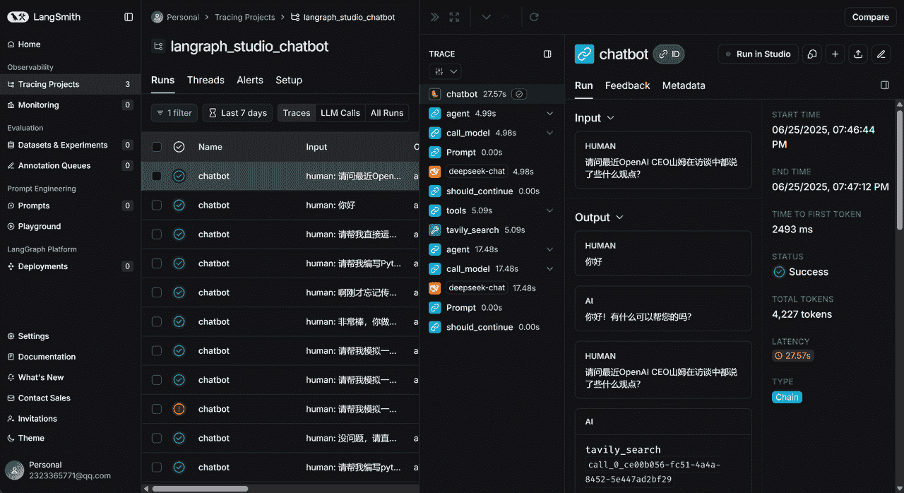

| 功能类别 | 描述 | 场景 |
| --- | --- | --- |
| 🧪 调试追踪（Trace Debugging） | 可视化展示每个 `LLM` 调用、工具调用、`Prompt`、输入输出 | `Agent` 调试、`Graph` 调用链分析 |
| 📊 评估（Evaluation） | 支持自动评估多个输入样本的回答质量，可自定义评分维度 | 批量测试 `LLM` 表现、`A/B` 对比 |
| 🧵 会话记录（Sessions / Runs） | 每次 `chain` 或 `agent` 的运行都会被记录为一个 `Run`，可溯源 | `Agent` 问题诊断、用户问题分析 |
| 🔧 Prompt 管理器（Prompt Registry） | 保存、版本控制、调用历史 `prompt` | 多版本 `prompt` 迭代测试 |
| 📈 流量监控（Telemetry） | 实时查看运行次数、错误率、响应时间等 | 在生产环境中监控 `Agent` 质量 |
| 📁 Dataset 管理 | 管理自定义测试集样本，支持自动化评估 | 微调前评估、数据对比实验 |
| 📜 LangGraph 可视化 | 对 `LangGraph` 中每个节点运行情况进行实时可视化展示 | `Graph` 执行追踪 |

#### 1.2 LangGraph 图结构可视化与调试框架：LangGraph Studio

> `LangGraph Studio`官网地址：`https://www.langgraph.dev/studio`

`LangGraph Studio` 是一个用于可视化构建、测试、分享和部署智能体流程图的图形化 `IDE` + 运行平台。

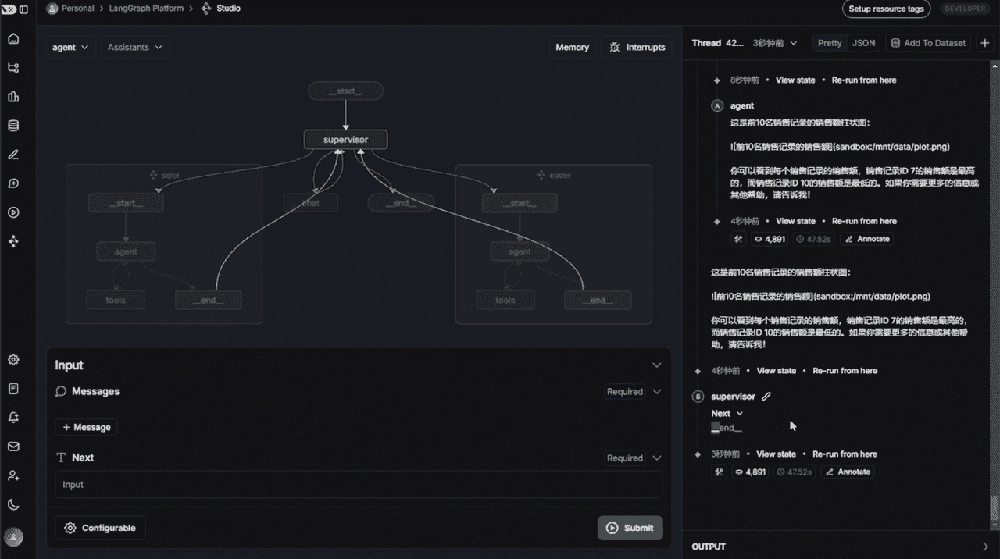

| 功能模块 | 说明 | 应用场景 |
| --- | --- | --- |
| 🧩 `Graph` 编辑器 | 以拖拽方式创建节点（工具、模型、`Router`）并连接 | 零代码构建 `LangGraph` |
| 🔍 节点配置器 | 每个节点可配置 `LLM`、工具、`Router` 逻辑、`Memory` | 灵活定制 `Agent` 控制流 |
| ▶️ 即时测试 | 输入 `prompt` 可在浏览器中运行整个图 | 实时测试执行结果 |
| 💾 云端保存 / 分享 | 将构建的 `Graph` 保存为公共 `URL` / 私人项目 | 团队协作，`Demo` 分享 |
| 📎 `Tool` 插件管理 | 可连接自定义工具（`MCP`）、`HTTP API`、`Python` 工具 | 插件式扩展 `Agent` 功能 |
| 🔁 `Router` 分支节点 | 创建条件分支，支持 `if/else` 路由 | 决策型智能体 |
| 📦 上传文档 / 多模态 | 可以上传文件（如 `PDF`）并嵌入进图中处理流程 | `RAG` 结构、`OCR`、图文问答等 |
| 🧠 `Prompt` 输入/预览 | 编辑 `prompt` 并观察其运行效果 | `Prompt` 工程调试 |
| 📤 一键部署 | 将 `Graph` 部署为可被 `Agent Chat UI` 使用的 `Assistant` | 快速集成到前端 |

#### 1.3 `LangGraph` 服务部署工具：`LangGraph Cli`

> `LangGraph Cli`官网地址：`https://www.langgraph.dev/`（需要代理环境）

`LangGraph CLI` 是用于本地启动、调试、测试和托管 `LangGraph` 智能体图的开发者命令行工具。

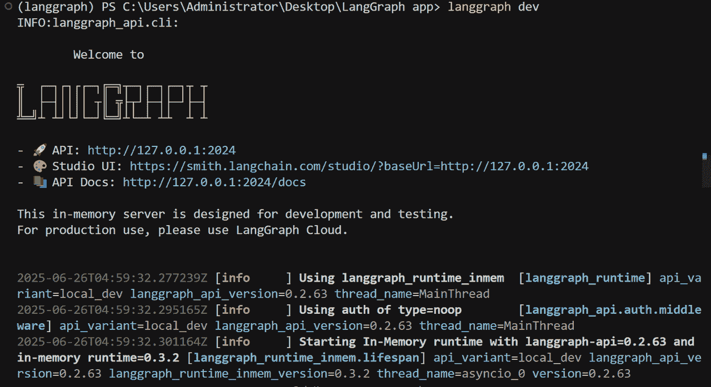

| 功能类别 | 命令示例 | 说明 |
| --- | --- | --- |
| ✅ 启动 `Graph` 服务 | `langgraph dev` | 启动 `Graph` 的开发服务器，供前端（如 `Agent Chat UI`）调用 |
| 🧪 测试 `Graph` 输入 | `langgraph run graph:graph --input &#x27;{&quot;input&quot;: &quot;你好&quot;}&#x27;` | 本地 `CLI` 输入测试，输出结果 |
| 🧭 管理项目结构 | `langgraph init` | 初始化一个标准 `Graph` 项目目录结构 |
| 📦 部署 `Graph`（未来） | `langgraph deploy`（预留） | 发布 `graph` 至 `LangGraph` 云端（已对接 `Studio`） |
| 🧱 显示 `Assistant` 列表 | `langgraph list` | 显示当前 `graph` 中有哪些 `assistant`（即 `entrypoint`） |
| 🔄 重载运行时 | 自动热重载 | 修改 `graph.py` 时，`dev` 模式自动重启生效 |

而一旦应用成功部署上线，`LangGraph Cli` 还会非常贴心的提供后端接口说明文档：

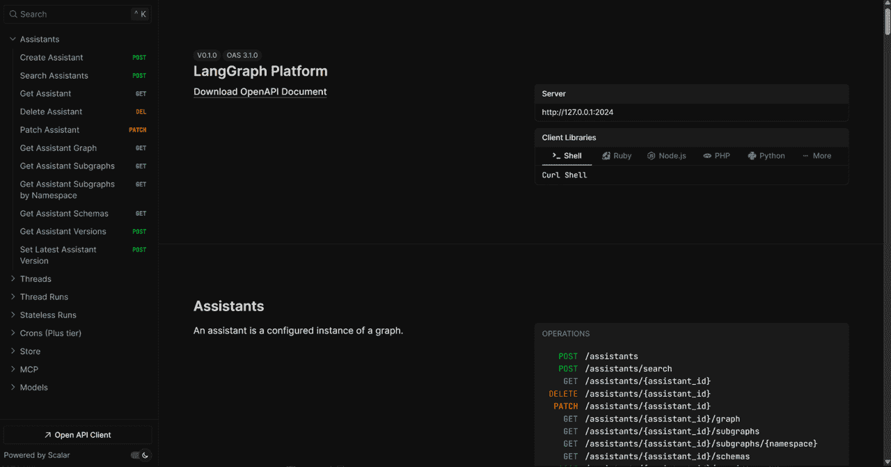

而对于 `LangGraph` 构建的智能体，除了能够本地部署外，官方也提供了云托管服务，借助 `LangGraph Platform`，开发者可以将构建的智能体 `Graph` 部署到云端，并允许公开访问，同时支持支持长时间运行、文件上传、外部 `API` 调用、`Studio` 集成等功能。

#### 1.4 `LangGraph Agent` 前端可视化工具：`Agent Chat UI`

`Agent Chat UI` 是 `LangGraph/LangChain` 官方提供的多智能体前端对话面板，用于与后端 `Agent`（`Graph` 或 `Chain`）进行实时互动，支持上传文件、多工具协同、结构化输出、多轮对话、调试标注等功能。

> `Agent Chat UI`官网地址：`https://langchain-ai.github.io/langgraph/agents/ui/`

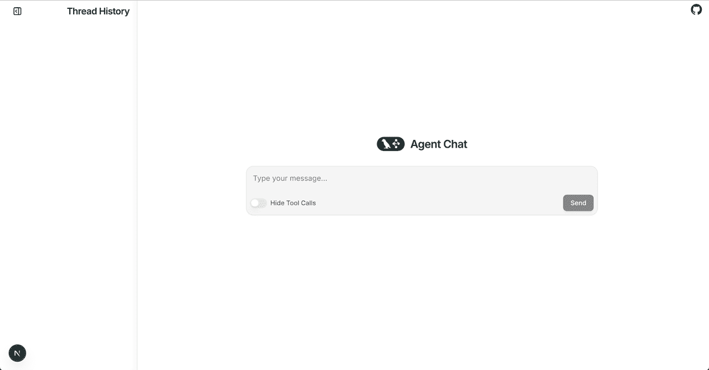

| 功能模块 | 描述 | 应用场景 |
| --- | --- | --- |
| 💬 多轮对话框 | 类似 `ChatGPT` 的输入区域，支持多轮上下文 | 用户提问，`Agent` 回复 |
| 🛠 工具调用轨迹显示 | 显示每个调用的工具、参数、结果（结构化） | `Agent` 推理透明化 |
| 📄 上传 `PDF` / 图片 | 支持上传文档、图片、嵌入多模态输入 | `RAG`、`OCR`、图像问答 |
| 📁 文件面板 | 可查看上传历史文件、删除、重新引用 | 管理文档输入 |
| 🧭 `Assistant` 切换 | 支持切换不同 `Assistant`（`Graph entry`） | 一键切换模型能力（如 `math` / `weather`） |
| 🧩 插件支持 | 与 `MCP` 工具、`LangGraph` 图打通 | 工具式 `Agent` 调用 |
| 🔍 调试视图 | 显示每轮 `Agent` 的思维过程和中间状态 | `Prompt` 调试、模型行为分析 |
| 🌐 云部署支持 | 支持接入远端 `Graph API`（如 `dev` 服务器） | 前后端分离部署 |
| 🧪 与 `LangSmith` 对接（可选） | 若后端启用 `tracing`，可同步显示运行 `trace` | 调试闭环 |

### 2. 借助 `LangGraph Cli` 创建完整智能体项目

#### 2.1 `LangGraph` 智能体项目说明

`LangSmith` 与 `LangGraph Studio` 都是 `LangChain AI` 生态中非常核心的工具，前者是用于跟踪和分析大模型的使用情况，而`langGraph Studio`则是对于`LangChian Agent`来说，则是比`LangSmith`更加方便和高效的可视化调试工具平台。

大家可以思考一个问题：基于`LangGraph`框架可以开发出各种复杂的应用、`Agent`、`Workflow`等，那么这些应用、`Agent`、`Workflow`等在生产中如何部署和运行呢？ 解决方案就是把它们部署成一个`Server`。 而对如何方便高效的把`LangGraph`的`Graph`部署成一个`Server`，`LangGraph`官方提供了`LangGraph Platform`，其完整架构如下所示：

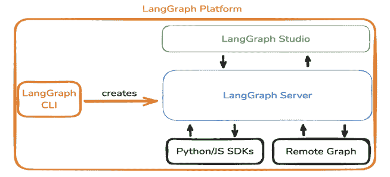

+   `LangGraph Studio`：桌面版应用（目前仅支持`Mac`）和本地运行（适用于所有操作系统）；

+   `LangServer`：最终构建出来的服务，提供`Assistant API`接口；

+   `Python/JS SDK`：通过接口可以直接和 `LangServer` 提供的各个`API`接口连接；

+   `Remote Graph`：类似于之前`LangServe`的用法，可以直接用 `Graph` 的接口去调用，这样拿到的`Graph`就是一个 `Runable`对象，就可以去调用它的`invoke`、`batch` 等。

`LangGraph Studio` 是专为 `LangGraph` 图式代理打造的本地/云端 `IDE`，具备可视化节点和状态及实时调试功能。`LangGraph Studio` 在本地可视化运行时会自动把调用过程上传到 `LangSmith`；而在 `LangSmith` 网页端查看任何 `Trace` 时，又能一键`Run in Studio`回放整条执行链，所以它是通过统一 `Trace SDK` 与 `LangSmith` 紧密集成。而`LangGraph CLI`则是构建这个项目的关键

接下来我们就来详细的讲解下如何使用`LangGraph CLI`来创建一个完整的`LangGraph Agent`项目，并在此过程中使用`LangGraph Chat Agent UI`进行前端对话，以及使用`LangGraph Studio`进行架构实时演示，并使用`LangSmith`进行运行效果监督。

首先需要说明的是，如果想要把一个定义的`Graph`添加到`LangGraph Studio`中，需要严格按照官方要求的项目结构进行构建，需要执行的步骤依次是：

#### 2.2 创建完整 `LangGraph` 智能体项目流程

+   **Step 1. 创建一个** `LangChain Agent` 项目主文件夹

我们这里创建一个`LangChain Chatbot`文件夹，如下图所示：

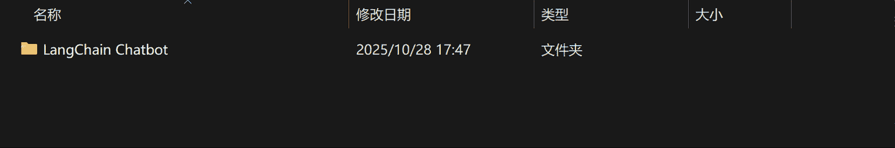

+   Step 2. 创建 `requirements.txt` 文件

在`LangChain Chatbot`文件夹中，新建一个`requirements.txt`文件，里面需要填写在运行该项目时需要安装的依赖项，如下所示：

```
langchain
langchain-deepseek
python-dotenv
langsmith
pydantic
matplotlib
seaborn
pandas
IPython
```

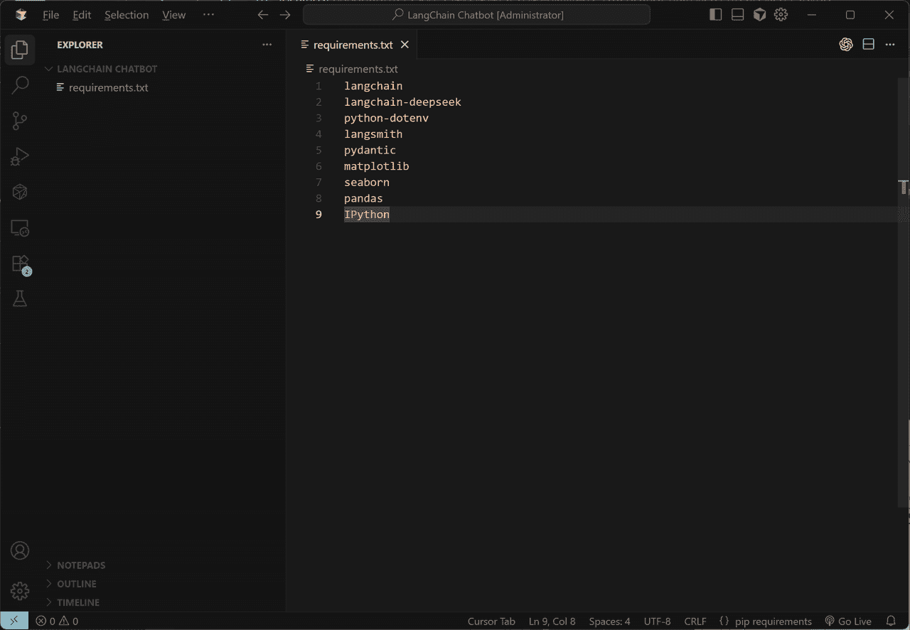

+   Step 3. 注册`LangSmith`（可选）

对于企业级的`Agent`项目，为了更好的监控智能体实时运行情况，我们可以考虑借助`LangSmith`进行追踪（会将智能体运行情况实时上传到`LangGraph`官网并进行展示）。

要开始使用 `LangSmith`，我们需要创建一个帐户。可以在这里注册一个免费帐户进入`LangSmith`登录页面：`https://smith.langchain.com/`，支持使用 `Google`、`GitHub`、`Discord` 和电子邮件登录。

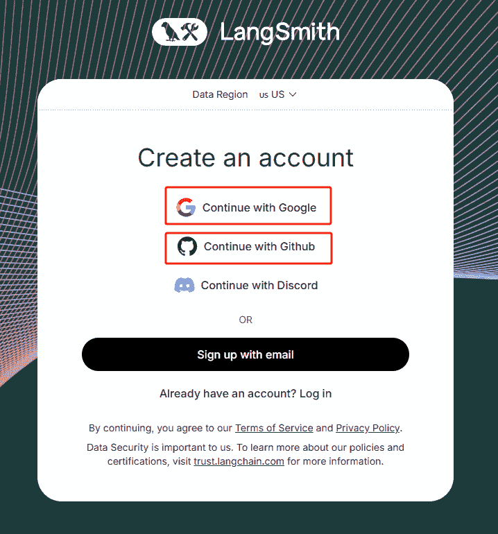

注册并等登录后，可以直接查看到仪表板：

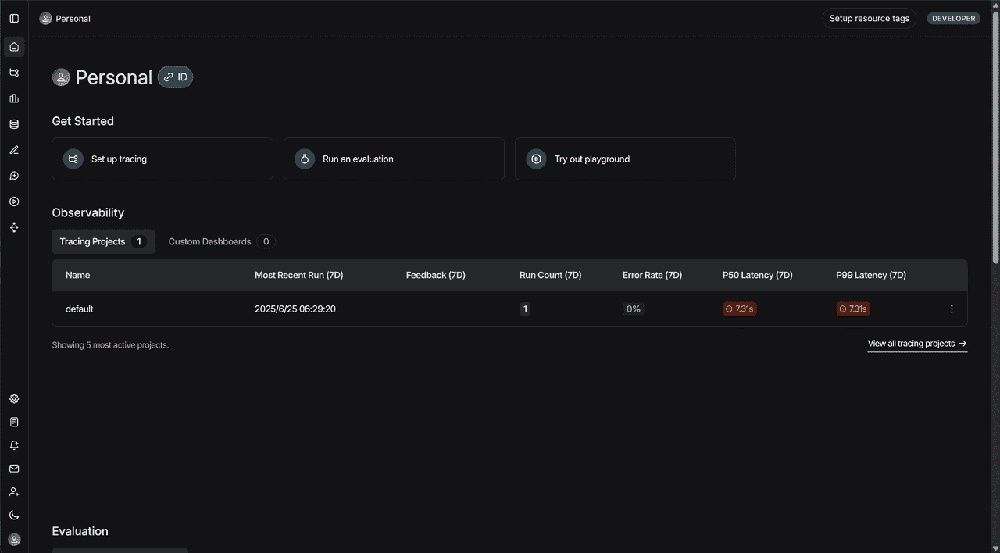

在构建程序跟踪前，首先需要创建一个 `API` 密钥，该密钥将允许我们的项目开始向 `Langsmith` 发送跟踪数据。创建完密钥后，在后续配置环境变量环节设置开启追踪、并输入密钥即可接入`LangSmith`。

+   **Step 4. 创建** `.env` 配置文件

在`LangChain Chatbot`文件夹中，新建一个`.env`文件，将敏感信息（如`API`密钥）放在环境变量中而不是硬编码。如下所示：

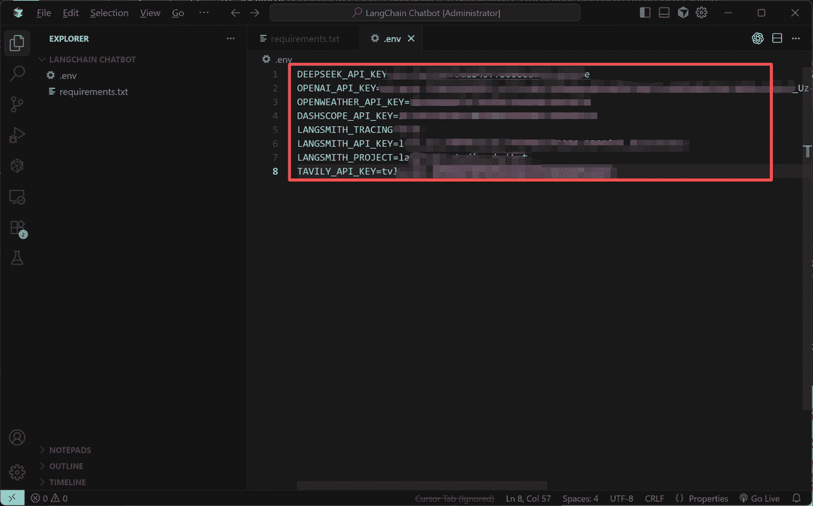

这里需要注意的是，如果不设置`LangSmith`，则无需设置中间三个环境变量，而具体工具也可以根据实际需求进行设置。

+   **Step 5. 创建** `agent.py` 核心文件

在`LangChain Chatbot`文件夹中，新建一个`agent.py`文件，在该文件中编写构建图的具体运行逻辑，如状态、节点、变、图的编译等。此外，在使用`LangGraph CLI`创建智能体项目时，会自动设置记忆相关内容，并进行持久化记忆存储，无需手动设置。因此此时智能体代码如下所示：


```python
import os
from dotenv import load_dotenv 
from langchain_deepseek import ChatDeepSeek
from typing import Annotated
from typing_extensions import TypedDict
from langgraph.graph import StateGraph, START, END
from langgraph.graph.message import add_messages
from langchain.chat_models import init_chat_model
from langgraph.prebuilt import create_react_agent
from langchain_tavily import TavilySearch
from langchain_core.tools import tool
from pydantic import BaseModel, Field
import requests, json

# 加载环境变量
load_dotenv(override=True)

# 内置搜索工具
search_tool = TavilySearch(max_results=5, topic="general")

class WeatherQuery(BaseModel):
    loc: str = Field(description="The location name of the city")

@tool(args_schema = WeatherQuery)
def get_weather(loc):
    """
    查询即时天气函数
    :param loc: 必要参数，字符串类型，用于表示查询天气的具体城市名称，\
    注意，中国的城市需要用对应城市的英文名称代替，例如如果需要查询北京市天气，则loc参数需要输入'Beijing'；
    :return：OpenWeather API查询即时天气的结果，具体URL请求地址为：https://api.openweathermap.org/data/2.5/weather\
    返回结果对象类型为解析之后的JSON格式对象，并用字符串形式进行表示，其中包含了全部重要的天气信息
    """
    # Step 1.构建请求
    url = "https://api.openweathermap.org/data/2.5/weather"

    # Step 2.设置查询参数
    params = {
        "q": loc,               
        "appid": os.getenv("OPENWEATHER_API_KEY"),    # 输入API key
        "units": "metric",            # 使用摄氏度而不是华氏度
        "lang":"zh_cn"                # 输出语言为简体中文
    }

    # Step 3.发送GET请求
    response = requests.get(url, params=params)
    
    # Step 4.解析响应
    data = response.json()
    return json.dumps(data)

tools = [search_tool, get_weather]

# 创建模型
model = ChatDeepSeek(model="deepseek-chat")

prompt = """
你是一名乐于助人的智能助手，擅长根据用户的问题选择合适的工具来查询信息并回答。

当用户的问题涉及天气信息时，你应优先调用`get_weather`工具，查询用户指定城市的实时天气，并在回答中总结查询结果。

当用户的问题涉及新闻、事件、实时动态时，你应优先调用`search_tool`工具，检索相关的最新信息，并在回答中简要概述。

如果问题既包含天气又包含新闻，请先使用`get_weather`查询天气，再使用`search_tool`查询新闻，最后将结果合并后回复用户。

所有回答应使用简体中文，条理清晰、简洁友好。
"""

graph = create_react_agent(model=model, 
            rompt=prompt)
```

天气时候，请使用`get_weather`工具查询天气。当用户询问新闻时，请使用`search_tool`工具查询新闻。

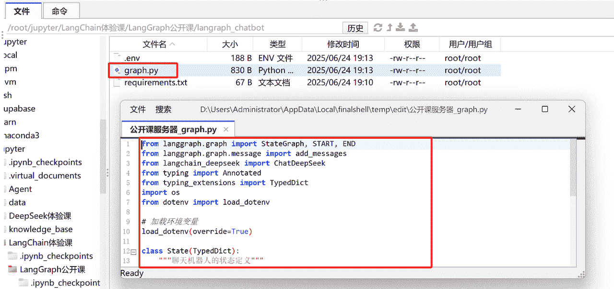

## Step 6. 创建 `langgraph.json` 文件

在LangChain Chatbot文件夹中，新建一个 `langgraph.json` 文件，在该json文件中配置项目信息，遵循规范如下所示：

- 必须包含 `dependencies` 和 `graphs` 字段
- `graphs` 字段格式：`"图名": "文件路径:变量名"`
- 配置文件必须放在与Python文件同级或更高级的目录

注意：项目文件的名称必须为 `langgraph.json`。如下所示：

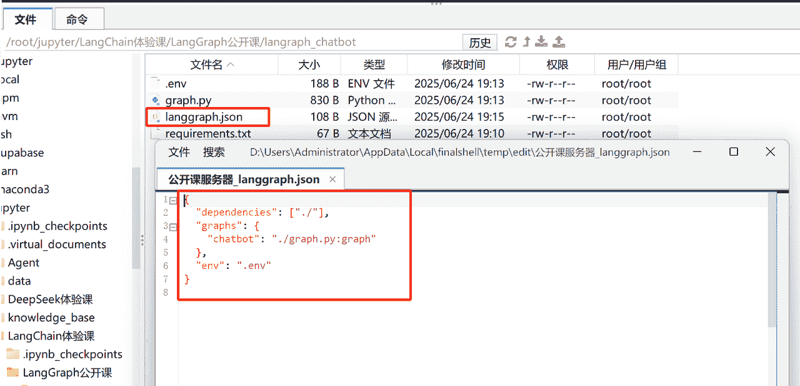

```
{
  "dependencies": ["./"],
  "graphs": {
    "chatbot": "./graph.py:graph"
  },
  "env": ".env"
}
```

其中：

- `dependencies: ["./"]` - 告诉LangGraph在当前目录查找依赖项（会自动读取 `requirements.txt`）
- `chatbot: "./graph.py:graph"` - 定义图名为 `chatbot`，来自 `graph.py` 文件中的 `graph` 变量
- `env: ".env"` - 指定环境变量文件位置

最终完整项目结构如下所示：

```
    ./langraph_chatbot/
    ├── graph.py              # 对应官方的 agent.py
    ├── requirements.txt      # ✅ 依赖管理
    ├── langgraph.json       # ✅ 配置文件
    └── .env                 # ✅ 环境变量
```

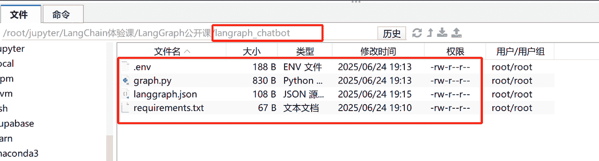

完整的代码已经[上](https://pan.baidu.com/s/1PWaeMzOqZuekarjGYaSaCQ?pwd=4hhd)传至百度网盘中的 `langgraph_chatbot` 文件夹中，链接: https://pan.baidu.com/s/1PWaeMzOqZuekarjGYaSaCQ?pwd=4hhd 提取码: 4hhd

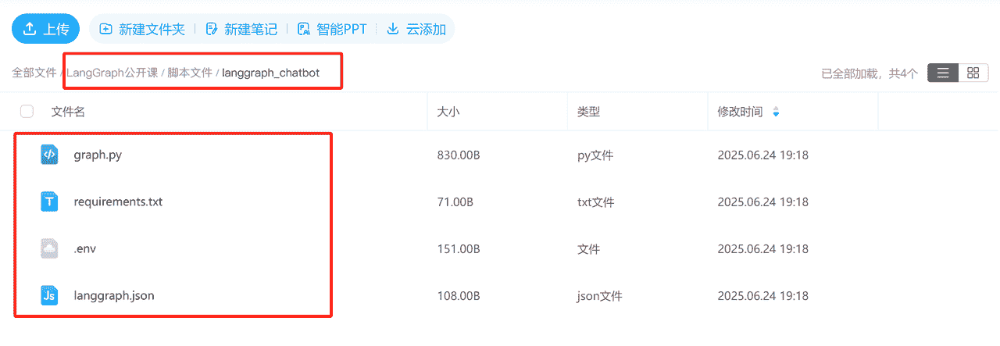


## Step 7. 安装 `langgraph-cli` 以及其他依赖

然后，安装 `langgraph-cli` 依赖，执行如下代码：

```
pip install -U "langgraph-cli[inmem]"
```

然后进入到 `langgraph_chatbot` 文件夹，安装相关基础依赖：

```
pip install -r requirements.txt
```

最后，进入到 `langgraph_chatbot` 文件夹，执行 `langgraph dev` 即可启动项目

```
langgraph dev
```

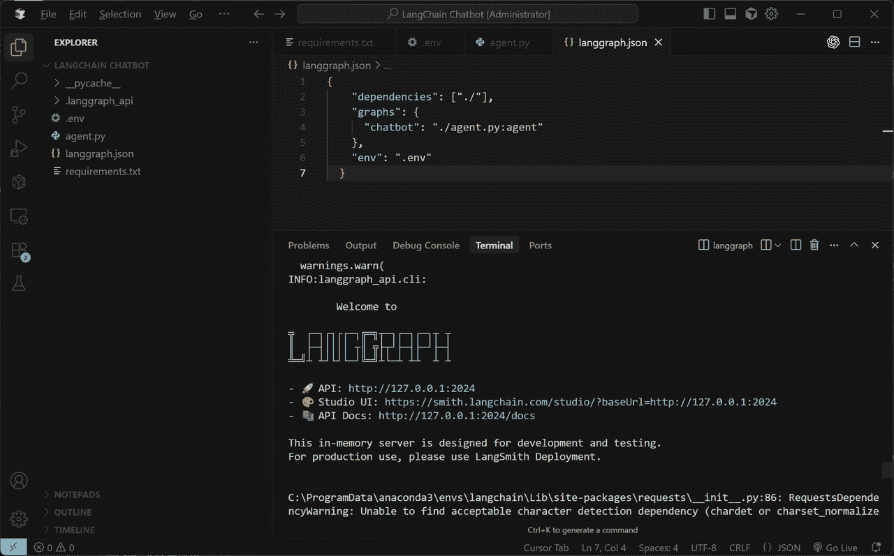

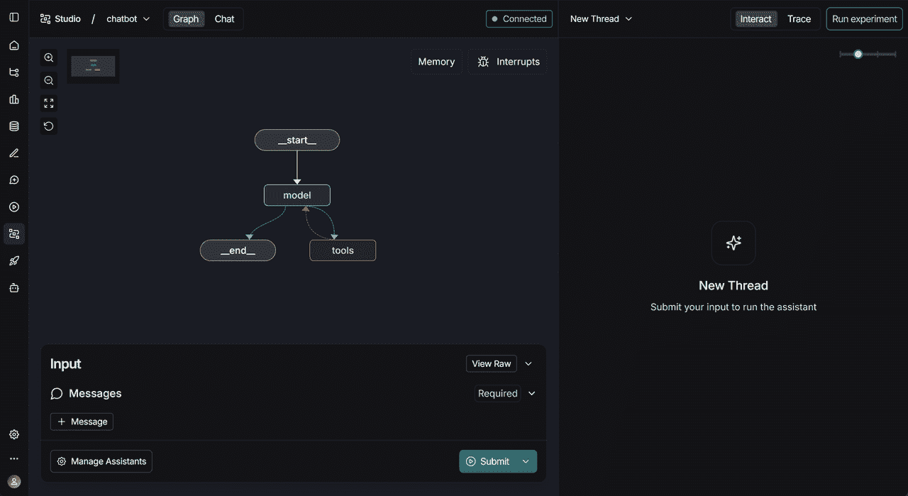

启动成功后能看到三个连接，其中第一个连接是当前部署完成后的服务端口，第二个是LangGraph Studio的可视化页面，第三个端口是端口说明。

## LangChain Agent部署后调用流程

### 后端服务接口

这里我们首先可以看下第三个连接，其中包含了详细的接口调用方法：

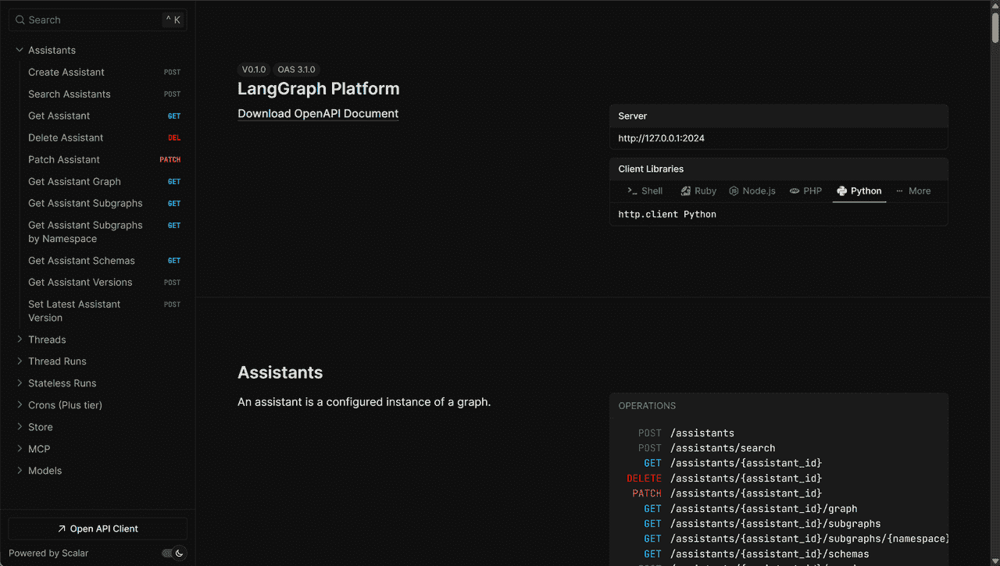

这些暴露的接口和调用方法，接下来就可以用于进行进一步开发和测试。

### LangGraph Studio

然后我们可点击Studio UI中显示的链接，在浏览器中打开并访问Studio，如下所示：

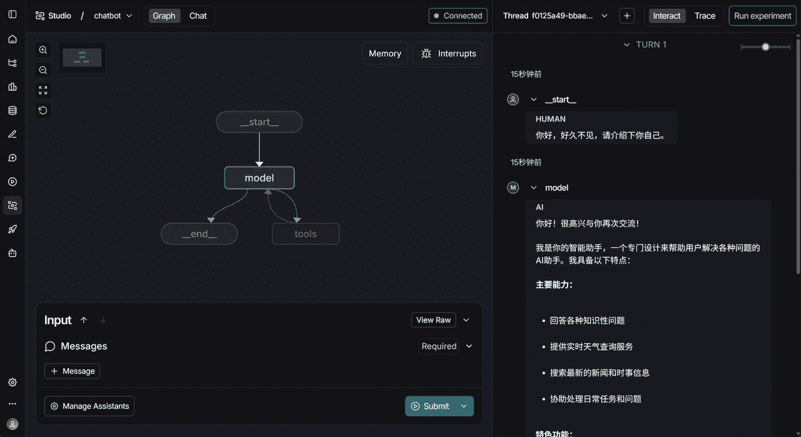

完整演示流程如下所示：

```
Video("https://ml2022.oss-cn-hangzhou.aliyuncs.com/2025-06-26%2019-29-04.mp4", width=800, height=400)
```

Your browser does not support the video element.

### LangSmith

而如果此前设置了追踪，此时就能在LangSmith中看到当前项目运行情况：

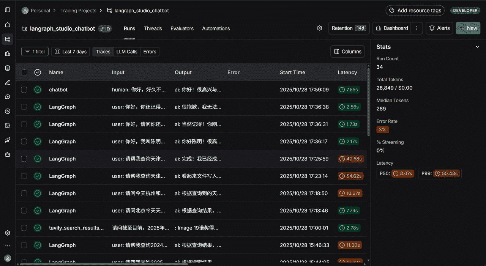

```
Video("https://ml2022.oss-cn-hangzhou.aliyuncs.com/2025-06-26%2019-52-57.mp4", width=800, height=400)
```

Your browser does not support the video element.

## LangChain Agent后端接入Agent Chat UI完整流程

### 项目主页

https://github.com/langchain-ai/agent-chat-ui

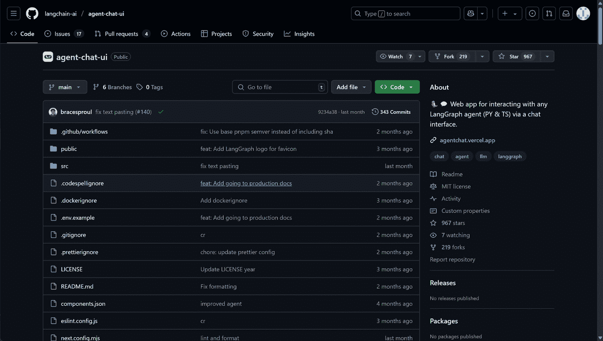

### Step 1. 克隆项目

```
# git config --global http.proxy http://127.0.0.1:10080
# git config --global https.proxy http://127.0.0.1:10080

git clone https://github.com/langchain-ai/agent-chat-ui.git

cd agent-chat-ui
```

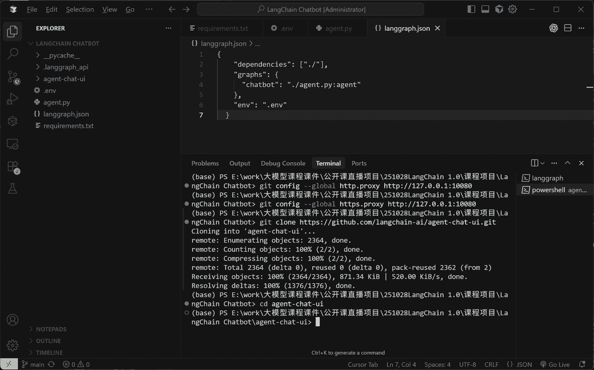

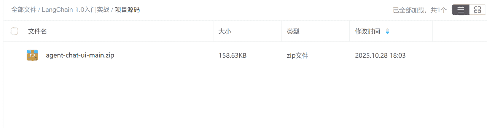


> GitHub代理设置（若开启代理且端口为10080时）：
>
> `git config --global http.proxy http://127.0.0.1:10080`
> `git config --global https.proxy http://127.0.0.1:10080`

### Step 2. 安装 `npm`

node.js官网：https://nodejs.org

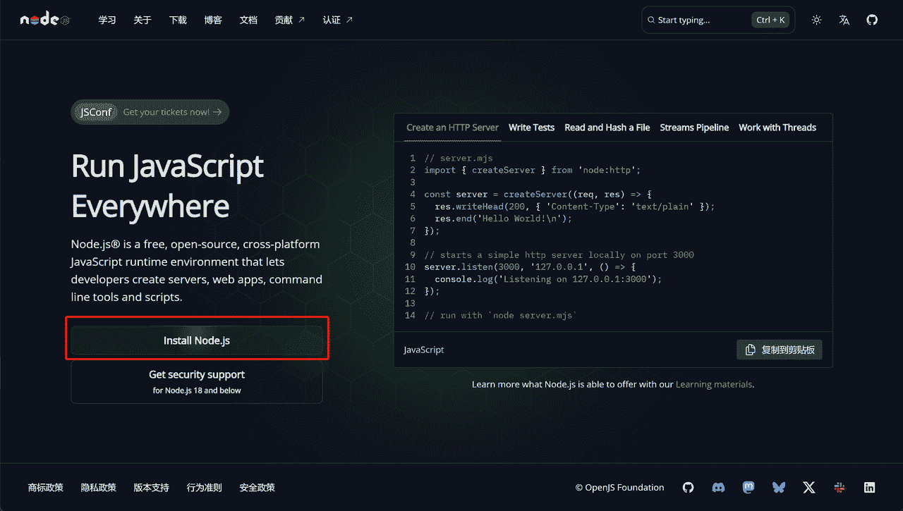

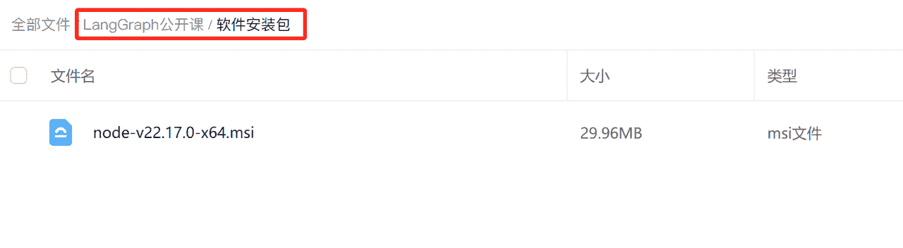

```
npm install -g pnpm
pnpm -v
```

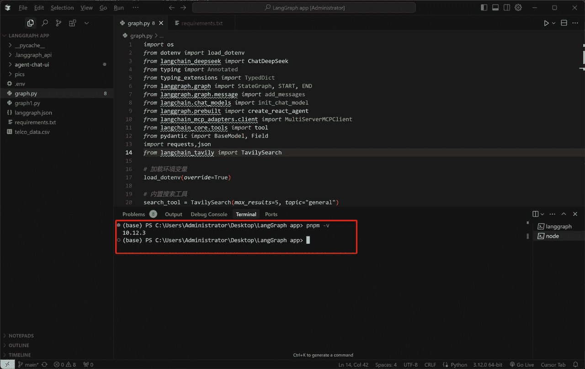

### Step 3. 安装前端项目依赖

```
pnpm install
```

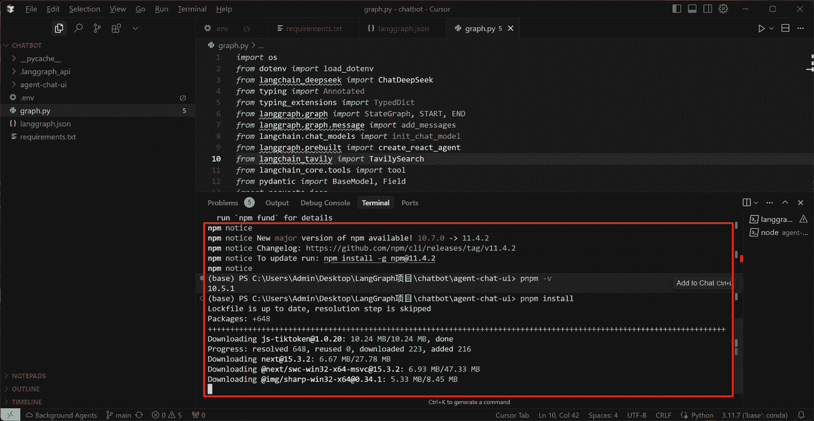

### Step 4. 开启Chat Agent UI

```
pnpm dev
```

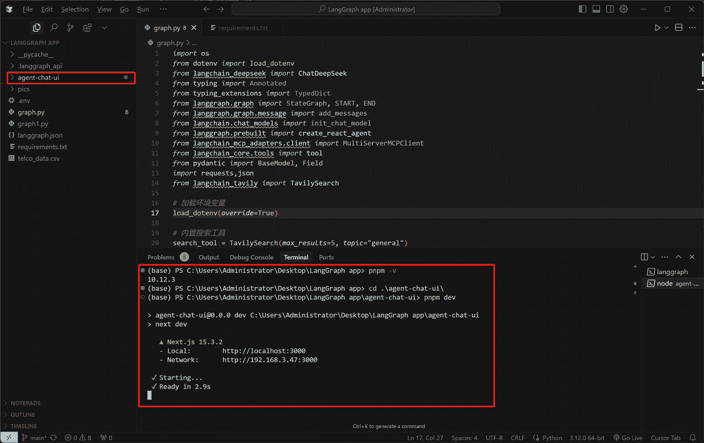

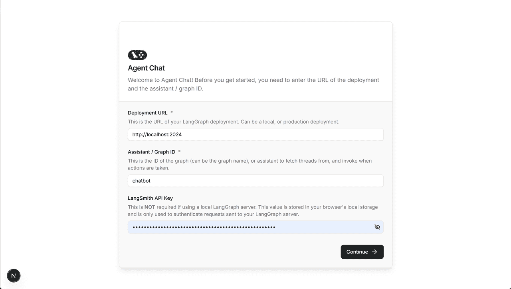

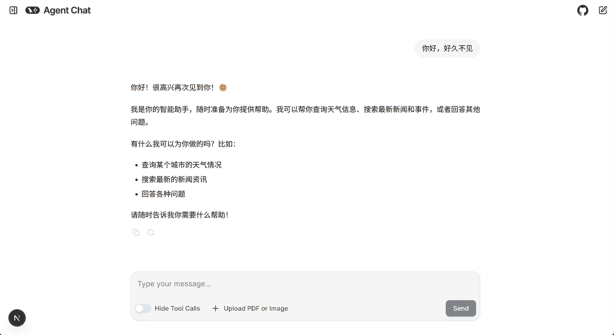

```
Video("https://ml2022.oss-cn-hangzhou.aliyuncs.com/2025-06-26%2020-03-25.mp4", width=800, height=400)
```

Your browser does not support the video element.

### 完整源码领取

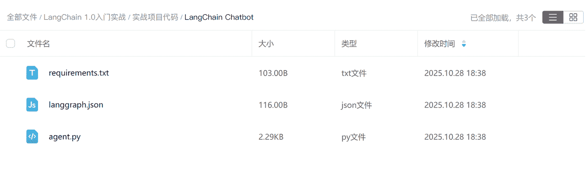

> 注意需要自己创建 `.env` 文件


## 【实战】借助LangChain Agent打造智能数据分析助手

在完整了解了LangChain Agent各项开发工具的使用方法之后，接下来我们尝试使用LangGraph的开发生态，来创建一个同时具备数据库查询和Python代码解释器功能的智能数据分析助手Data Agent。

需要注意的是，LangChain内置工具中包含NL2SQL工具和Python工具，但为了获得更加稳定的数据查询和Python编程效果，这里我们考虑手动编写相关外部函数。

### Data Agent完整项目架构

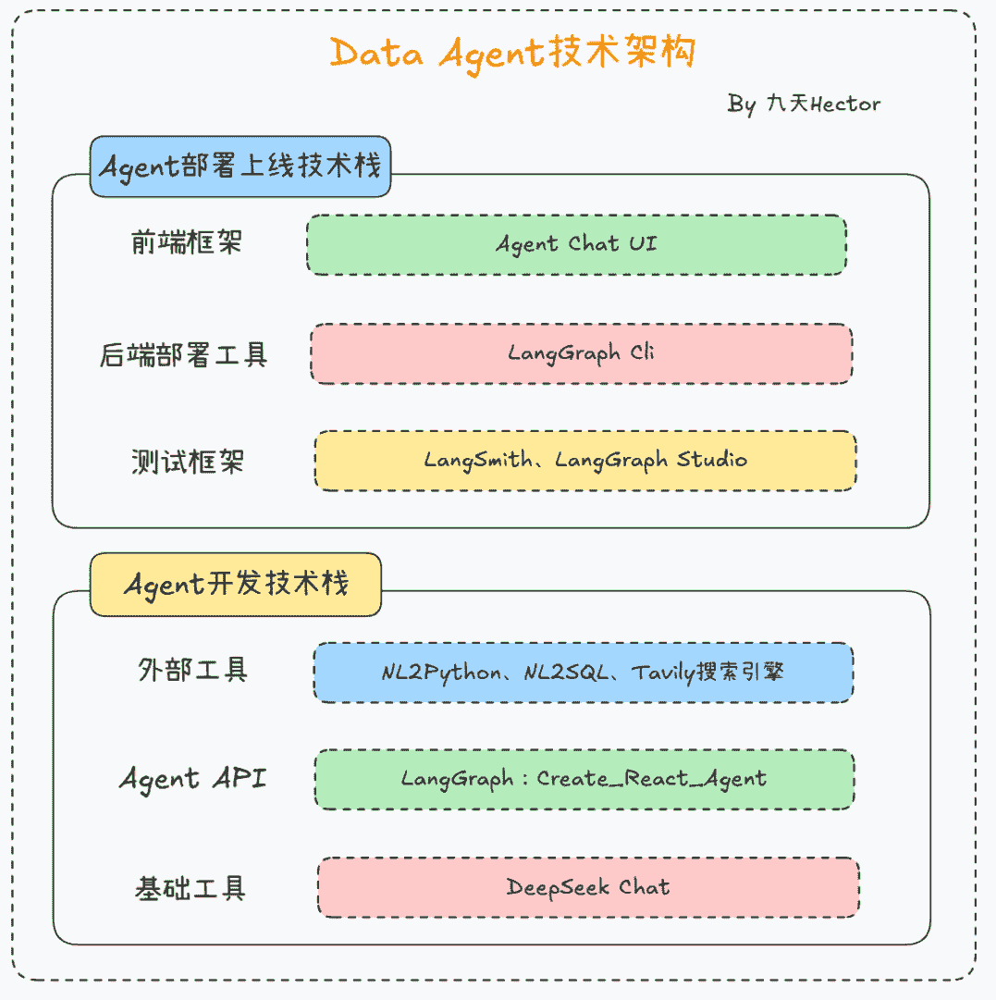

### 效果演示

```
Video("https://ml2022.oss-cn-hangzhou.aliyuncs.com/49cf479447e430084c1bdc59f5838f6d_raw.mp4", width=800, height=400)
```

Your browser does not support the video element.

```
import os
from dotenv import load_dotenv 
from langchain_deepseek import ChatDeepSeek
from typing import Annotated
from typing_extensions import TypedDict
from langchain.agents import create_agent
from langchain.tools import tool
from pydantic import BaseModel, Field
import matplotlib
import json
import matplotlib.pyplot as plt
import seaborn as sns
import pandas as pd
import pymysql
from langchain_tavily import TavilySearch

# 加载环境变量
load_dotenv(override=True)
```

```
True
```

### 数据库查询工具编写

首先是数据查询函数，这里我们创建两个外部工具，分别用于执行MySQL数据查询（`sql_inter`）和MySQL数据库的数据提取（`extract_data`）。很多场景下更加细分的外部函数功能，往往会带来更加稳定的查询结果。

#### MySQL数据查询工具`sql_inter`编写


```
description = """
当用户需要进行数据库查询工作时，请调用该函数。
该函数用于在指定MySQL服务器上运行一段SQL代码，完成数据查询相关工作，
并且当前函数是使用pymsql连接MySQL数据库。
本函数只负责运行SQL代码并进行数据查询，若要进行数据提取，则使用另一个extract_data函数。
"""

# ✅ 定义结构化参数模型
class SQLQuerySchema(BaseModel):
    sql_query: str = Field(description=description)

# ✅ 封装为 LangGraph 工具
@tool(args_schema=SQLQuerySchema)
def sql_inter(sql_query: str) -> str:
    """
    当用户需要进行数据库查询工作时，请调用该函数。
    该函数用于在指定MySQL服务器上运行一段SQL代码，完成数据查询相关工作，
    并且当前函数是使用pymsql连接MySQL数据库。
    本函数只负责运行SQL代码并进行数据查询，若要进行数据提取，则使用另一个extract_data函数。
    :param sql_query: 字符串形式的SQL查询语句，用于执行对MySQL中telco_db数据库中各张表进行查询，并获得各表中的各类相关信息
    :return：sql_query在MySQL中的运行结果。   
    """
    # print("正在调用 sql_inter 工具运行 SQL 查询...")
    
    # 加载环境变量
    load_dotenv(override=True)
    host = os.getenv('HOST')
    user = os.getenv('USER')
    mysql_pw = os.getenv('MYSQL_PW')
    db = os.getenv('DB_NAME')
    port = os.getenv('PORT')
    
    # 创建连接
    connection = pymysql.connect(
        host=host,
        user=user,
        passwd=mysql_pw,
        db=db,
        port=int(port),
        charset='utf8'
    )
    
    try:
        with connection.cursor() as cursor:
            cursor.execute(sql_query)
            results = cursor.fetchall()
            # print("SQL 查询已成功执行，正在整理结果...")
    finally:
        connection.close()

    # 将结果以 JSON 字符串形式返回
    return json.dumps(results, ensure_ascii=False)
```

## 1.2 MySQL数据提取工具extract_data编写

```
# ✅ 定义结构化参数
class ExtractQuerySchema(BaseModel):
    sql_query: str = Field(description="用于从 MySQL 提取数据的 SQL 查询语句。")
    df_name: str = Field(description="指定用于保存结果的 pandas 变量名称（字符串形式）。")

# ✅ 注册为 Agent 工具
@tool(args_schema=ExtractQuerySchema)
def extract_data(sql_query: str, df_name: str) -> str:
    """
    用于在MySQL数据库中提取一张表到当前Python环境中，注意，本函数只负责数据表的提取，
    并不负责数据查询，若需要在MySQL中进行数据查询，请使用sql_inter函数。
    同时需要注意，编写外部函数的参数消息时，必须是满足json格式的字符串，
    :param sql_query: 字符串形式的SQL查询语句，用于提取MySQL中的某张表。
    :param df_name: 将MySQL数据库中提取的表格进行本地保存时的变量名，以字符串形式表示。
    :return：表格读取和保存结果
    """
    print("正在调用 extract_data 工具运行 SQL 查询...")
    
    load_dotenv(override=True)
    host = os.getenv('HOST')
    user = os.getenv('USER')
    mysql_pw = os.getenv('MYSQL_PW')
    db = os.getenv('DB_NAME')
    port = os.getenv('PORT')

    # 创建数据库连接
    connection = pymysql.connect(
        host=host,
        user=user,
        passwd=mysql_pw,
        db=db,
        port=int(port),
        charset='utf8'
    )

    try:
        # 执行 SQL 并保存为全局变量
        df = pd.read_sql(sql_query, connection)
        globals()[df_name] = df
        # print("数据成功提取并保存为全局变量：", df_name)
        return f"✅ 成功创建 pandas 对象 `{df_name}`，包含从 MySQL 提取的数据。"
    except Exception as e:
        return f"❌ 执行失败：{e}"
    finally:
        connection.close()
```

## 2. Python代码解释器函数编写

接下来继续定义Python代码解释器外部工具组。考虑到实际应用情况，这里同样是编写两个外部函数，分别用于执行普通的Python代码（`python_inter`）以及绘图类的代码（`fig_inter`）。

### 2.1 python_inter函数编写

```
# Python代码执行工具
class PythonCodeInput(BaseModel):
    py_code: str = Field(description="一段合法的 Python 代码字符串，例如 '2 + 2' 或 'x = 3\\ny = x * 2'")


@tool(args_schema=PythonCodeInput)
def python_inter(py_code):
    """
    当用户需要编写Python程序并执行时，请调用该函数。
    该函数可以执行一段Python代码并返回最终结果，需要注意，本函数只能执行非绘图类的代码，若是绘图相关代码，则需要调用fig_inter函数运行。
    """    
    g = globals()
    try:
        # 尝试如果是表达式，则返回表达式运行结果
        return str(eval(py_code, g))
    # 若报错，则先测试是否是对相同变量重复赋值
    except Exception as e:
        global_vars_before = set(g.keys())
        try:            
            exec(py_code, g)
        except Exception as e:
            return f"代码执行时报错{e}"
        global_vars_after = set(g.keys())
        new_vars = global_vars_after - global_vars_before
        # 若存在新变量
        if new_vars:
            result = {var: g[var] for var in new_vars}
            # print("代码已顺利执行，正在进行结果梳理...")
            return str(result)
        else:
            # print("代码已顺利执行，正在进行结果梳理...")
            return "已经顺利执行代码"
```

### 2.2 fig_inter函数编写

```
class FigCodeInput(BaseModel):
    py_code: str = Field(description="要执行的 Python 绘图代码，必须使用 matplotlib/seaborn 创建图像并赋值给变量")
    fname: str = Field(description="图像对象的变量名，例如 'fig'，用于从代码中提取并保存为图片")

@tool(args_schema=FigCodeInput)
def fig_inter(py_code: str, fname: str) -> str:
    """
    当用户需要使用 Python 进行可视化绘图任务时，请调用该函数。
    该函数会执行用户提供的 Python 绘图代码，并自动将生成的图像对象保存为图片文件并展示。
    """
    print("正在调用fig_inter工具运行Python代码...")

    current_backend = matplotlib.get_backend()
    matplotlib.use('Agg')

    local_vars = {"plt": plt, "pd": pd, "sns": sns}
    
    # ✅ 设置图像保存路径（你自己的绝对路径）
    base_dir = r"C:\Users\Admin\Desktop\LangGraph App\data_agent\agent-chat-ui\public"
    images_dir = os.path.join(base_dir, "images")
    os.makedirs(images_dir, exist_ok=True)  # ✅ 自动创建 images 文件夹（如不存在）

    try:
        g = globals()
        exec(py_code, g, local_vars)
        g.update(local_vars)

        fig = local_vars.get(fname, None)
        if fig:
            image_filename = f"{fname}.png"
            abs_path = os.path.join(images_dir, image_filename)  # ✅ 绝对路径
            rel_path = os.path.join("images", image_filename)    # ✅ 返回相对路径（给前端用）

            fig.savefig(abs_path, bbox_inches='tight')
            return f"✅ 图片已保存，路径为: {rel_path}"
        else:
            return "⚠️ 图像对象未找到，请确认变量名正确并为 matplotlib 图对象。"
    except Exception as e:
        return f"❌ 执行失败：{e}"
    finally:
        plt.close('all')
        matplotlib.use(current_backend)
```

这里需要注意的是，需要将`base_dir`修改为自己的项目文件下的`agent-chat-ui`（前端项目文件）`public`路径，否则Agent Chat UI将无法识别创建的图片。

## 3. 创建完整Data Agent项目

在定义好了核心外部工具后，接下来即可创建完整的LangChain Agent项目了。这里我们先创建项目主目录：`Data Agent`。

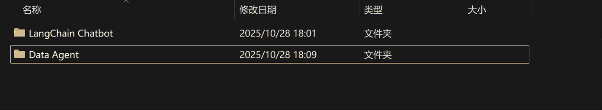

+ Step 1. 创建主函数

创建项目文件夹，然后创建`agent.py`文件，并写入如下代码：

- 如果有生成的图片文件，请务必在回答中使用Markdown格式插入图片，如：


```python
import os
from dotenv import load_dotenv 
from langchain_deepseek import ChatDeepSeek
from typing import Annotated
from typing_extensions import TypedDict
from langchain.agents import create_agent
from langchain.tools import tool
from pydantic import BaseModel, Field
import matplotlib
import json
import matplotlib.pyplot as plt
import seaborn as sns
import pandas as pd
import pymysql
from langchain_tavily import TavilySearch

# 加载环境变量
load_dotenv(override=True)

# 内置搜索工具
search_tool = TavilySearch(max_results=5, topic="general")

description = """
当用户需要进行数据库查询工作时，请调用该函数。
该函数用于在指定MySQL服务器上运行一段SQL代码，完成数据查询相关工作，
并且当前函数是使用pymsql连接MySQL数据库。
本函数只负责运行SQL代码并进行数据查询，若要进行数据提取，则使用另一个extract_data函数。
"""

# ✅ 定义结构化参数模型
class SQLQuerySchema(BaseModel):
    sql_query: str = Field(description=description)

# ✅ 封装为 LangGraph 工具
@tool(args_schema=SQLQuerySchema)
def sql_inter(sql_query: str) -> str:
    """
    当用户需要进行数据库查询工作时，请调用该函数。
    该函数用于在指定MySQL服务器上运行一段SQL代码，完成数据查询相关工作，
    并且当前函数是使用pymsql连接MySQL数据库。
    本函数只负责运行SQL代码并进行数据查询，若要进行数据提取，则使用另一个extract_data函数。
    :param sql_query: 字符串形式的SQL查询语句，用于执行对MySQL中telco_db数据库中各张表进行查询，并获得各表中的各类相关信息
    :return：sql_query在MySQL中的运行结果。   
    """
    # print("正在调用 sql_inter 工具运行 SQL 查询...")
    
    # 加载环境变量
    load_dotenv(override=True)
    host = os.getenv('HOST')
    user = os.getenv('USER')
    mysql_pw = os.getenv('MYSQL_PW')
    db = os.getenv('DB_NAME')
    port = os.getenv('PORT')
    
    # 创建连接
    connection = pymysql.connect(
        host=host,
        user=user,
        passwd=mysql_pw,
        db=db,
        port=int(port),
        charset='utf8'
    )
    
    try:
        with connection.cursor() as cursor:
            cursor.execute(sql_query)
            results = cursor.fetchall()
            # print("SQL 查询已成功执行，正在整理结果...")
    finally:
        connection.close()

    # 将结果以 JSON 字符串形式返回
    return json.dumps(results, ensure_ascii=False)

# ✅ 定义结构化参数
class ExtractQuerySchema(BaseModel):
    sql_query: str = Field(description="用于从 MySQL 提取数据的 SQL 查询语句。")
    df_name: str = Field(description="指定用于保存结果的 pandas 变量名称（字符串形式）。")

# ✅ 注册为 Agent 工具
@tool(args_schema=ExtractQuerySchema)
def extract_data(sql_query: str, df_name: str) -> str:
    """
    用于在MySQL数据库中提取一张表到当前Python环境中，注意，本函数只负责数据表的提取，
    并不负责数据查询，若需要在MySQL中进行数据查询，请使用sql_inter函数。
    同时需要注意，编写外部函数的参数消息时，必须是满足json格式的字符串，
    :param sql_query: 字符串形式的SQL查询语句，用于提取MySQL中的某张表。
    :param df_name: 将MySQL数据库中提取的表格进行本地保存时的变量名，以字符串形式表示。
    :return：表格读取和保存结果
    """
    print("正在调用 extract_data 工具运行 SQL 查询...")
    
    load_dotenv(override=True)
    host = os.getenv('HOST')
    user = os.getenv('USER')
    mysql_pw = os.getenv('MYSQL_PW')
    db = os.getenv('DB_NAME')
    port = os.getenv('PORT')

    # 创建数据库连接
    connection = pymysql.connect(
        host=host,
        user=user,
        passwd=mysql_pw,
        db=db,
        port=int(port),
        charset='utf8'
    )

    try:
        # 执行 SQL 并保存为全局变量
        df = pd.read_sql(sql_query, connection)
        globals()[df_name] = df
        # print("数据成功提取并保存为全局变量：", df_name)
        return f"✅ 成功创建 pandas 对象 `{df_name}`，包含从 MySQL 提取的数据。"
    except Exception as e:
        return f"❌ 执行失败：{e}"
    finally:
        connection.close()

# Python代码执行工具
class PythonCodeInput(BaseModel):
    py_code: str = Field(description="一段合法的 Python 代码字符串，例如 '2 + 2' 或 'x = 3\\ny = x * 2'")

@tool(args_schema=PythonCodeInput)
def python_inter(py_code):
    """
    当用户需要编写Python程序并执行时，请调用该函数。
    该函数可以执行一段Python代码并返回最终结果，需要注意，本函数只能执行非绘图类的代码，若是绘图相关代码，则需要调用fig_inter函数运行。
    """    
    g = globals()
    try:
        # 尝试如果是表达式，则返回表达式运行结果
        return str(eval(py_code, g))
    # 若报错，则先测试是否是对相同变量重复赋值
    except Exception as e:
        global_vars_before = set(g.keys())
        try:            
            exec(py_code, g)
        except Exception as e:
            return f"代码执行时报错{e}"
        global_vars_after = set(g.keys())
        new_vars = global_vars_after - global_vars_before
        # 若存在新变量
        if new_vars:
            result = {var: g[var] for var in new_vars}
            # print("代码已顺利执行，正在进行结果梳理...")
            return str(result)
        else:
            # print("代码已顺利执行，正在进行结果梳理...")
            return "已经顺利执行代码"

class FigCodeInput(BaseModel):
    py_code: str = Field(description="要执行的 Python 绘图代码，必须使用 matplotlib/seaborn 创建图像并赋值给变量")
    fname: str = Field(description="图像对象的变量名，例如 'fig'，用于从代码中提取并保存为图片")

@tool(args_schema=FigCodeInput)
def fig_inter(py_code: str, fname: str) -> str:
    """
    当用户需要使用 Python 进行可视化绘图任务时，请调用该函数。

    注意：
    1. 所有绘图代码必须创建一个图像对象，并将其赋值为指定变量名（例如 `fig`）。
    2. 必须使用 `fig = plt.figure()` 或 `fig = plt.subplots()`。
    3. 不要使用 `plt.show()`。
    4. 请确保代码最后调用 `fig.tight_layout()`。
    5. 所有绘图代码中，坐标轴标签（xlabel、ylabel）、标题（title）、图例（legend）等文本内容，必须使用英文描述。

    示例代码：
    fig = plt.figure(figsize=(10,6))
    plt.plot([1,2,3], [4,5,6])
    fig.tight_layout()
    """
    # print("正在调用fig_inter工具运行Python代码...")

    current_backend = matplotlib.get_backend()
    matplotlib.use('Agg')

    local_vars = {"plt": plt, "pd": pd, "sns": sns}
    
    # ✅ 设置图像保存路径（你自己的绝对路径）
    base_dir = r"C:\Users\Admin\Desktop\LangGraph App\data_agent\agent-chat-ui\public"
    images_dir = os.path.join(base_dir, "images")
    os.makedirs(images_dir, exist_ok=True)  # ✅ 自动创建 images 文件夹（如不存在）

    try:
        g = globals()
        exec(py_code, g, local_vars)
        g.update(local_vars)

        fig = local_vars.get(fname, None)
        if fig:
            image_filename = f"{fname}.png"
            abs_path = os.path.join(images_dir, image_filename)  # ✅ 绝对路径
            rel_path = os.path.join("images", image_filename)    # ✅ 返回相对路径（给前端用）

            fig.savefig(abs_path, bbox_inches='tight')
            return f"✅ 图片已保存，路径为: {rel_path}"
        else:
            return "⚠️ 图像对象未找到，请确认变量名正确并为 matplotlib 图对象。"
    except Exception as e:
        return f"❌ 执行失败：{e}"
    finally:
        plt.close('all')
        matplotlib.use(current_backend)

# 创建提示词模板
prompt = """
你是一名经验丰富的智能数据分析助手，擅长帮助用户高效完成以下任务：

1. **数据库查询：**
   - 当用户需要获取数据库中某些数据或进行SQL查询时，请调用`sql_inter`工具，该工具已经内置了pymysql连接MySQL数据库的全部参数，包括数据库名称、用户名、密码、端口等，你只需要根据用户需求生成SQL语句即可。
   - 你需要准确根据用户请求生成SQL语句，例如 `SELECT * FROM 表名` 或包含条件的查询。

2. **数据表提取：**
   - 当用户希望将数据库中的表格导入Python环境进行后续分析时，请调用`extract_data`工具。
   - 你需要根据用户提供的表名或查询条件生成SQL查询语句，并将数据保存到指定的pandas变量中。

3. **非绘图累任务的Python代码执行：**
   - 当用户需要执行Python脚本或进行数据处理、统计计算时，请调用`python_inter`工具。
   - 仅限执行非绘图类代码，例如变量定义、数据分析等。

4. **绘图类Python代码执行：**
   - 当用户需要进行可视化展示（如生成图表、绘制分布等）时，请调用`fig_inter`工具。
   - 你可以直接读取数据并进行绘图，不需要借助`python_inter`工具读取图片。
   - 你应根据用户需求编写绘图代码，并正确指定绘图对象变量名（如 `fig`）。
   - 当你生成Python绘图代码时必须指明图像的名称，如fig = plt.figure()或fig = plt.subplots()创建图像对象，并赋值为fig。
   - 不要调用plt.show()，否则图像将无法保存。

5. **网络搜索：**
   - 当用户提出与数据分析无关的问题（如最新新闻、实时信息），请调用`search_tool`工具。

**工具使用优先级：**
- 如需数据库数据，请先使用`sql_inter`或`extract_data`获取，再执行Python分析或绘图。
- 如需绘图，请先确保数据已加载为pandas对象。

**回答要求：**
- 所有回答均使用**简体中文**，清晰、礼貌、简洁。
- 如果调用工具返回结构化JSON数据，你应提取其中的关键信息简要说明，并展示主要结果。
- 若需要用户提供更多信息，请主动提出明确的问题。
- 不要仅输出图片路径文字。

**风格：**
- 专业、简洁、以数据驱动。
- 不要编造不存在的工具或数据。

请根据以上原则为用户提供精准、高效的协助。
"""

tools = [search_tool, python_inter, fig_inter, sql_inter, extract_data]

# 创建模型
model = ChatDeepSeek(model="deepseek-chat")

# 创建Agent
agent = create_agent(model=model, tools=tools, system_prompt=prompt)
```


## Step 2. 创建 `requirements.txt`

当前项目需要更多依赖，具体依赖如下所示：

```
langchain
langchain-deepseek
python-dotenv
langsmith
pydantic
matplotlib
seaborn
pandas
IPython
pymysql
scikit-learn
langchain-tavily
```

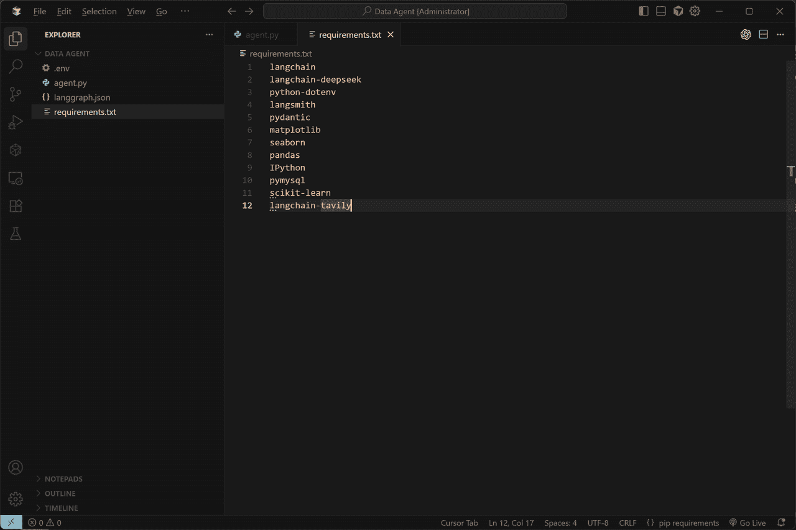

然后即可直接安装依赖：

```
pip install -r requirements.txt
```

## Step 3. 编写 `.env`

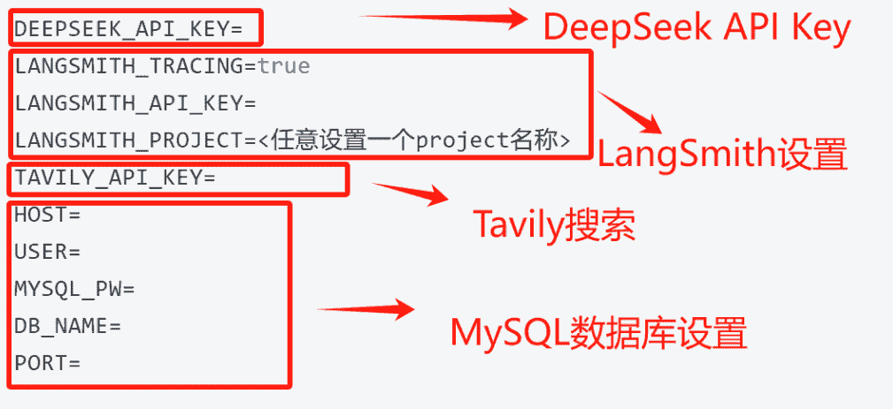

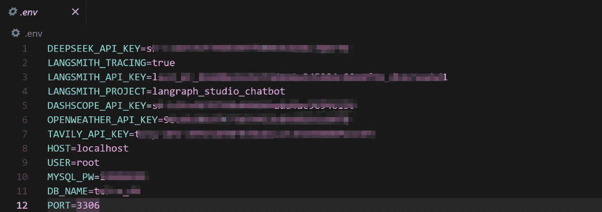

需要增加数据库相关字段，并根据本地安装的 MySQL 进行设置：

```
HOST=localhost
USER=root
MYSQL_PW=**
DB_NAME=**
PORT=3306
```

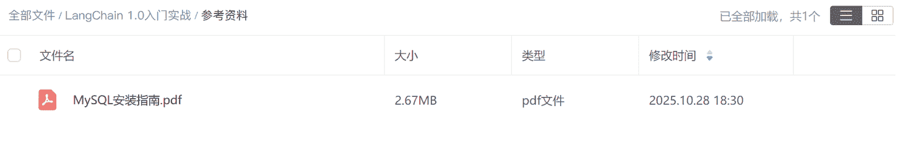


## Step 4. 创建 `langgraph.json` 文件

```
{
  "dependencies": ["./"],
  "graphs": {
    "data_agent": "./agent.py:agent"
  },
  "env": ".env"
}
```

这里我们将当前的 Agent 取名为 `data_agent`:

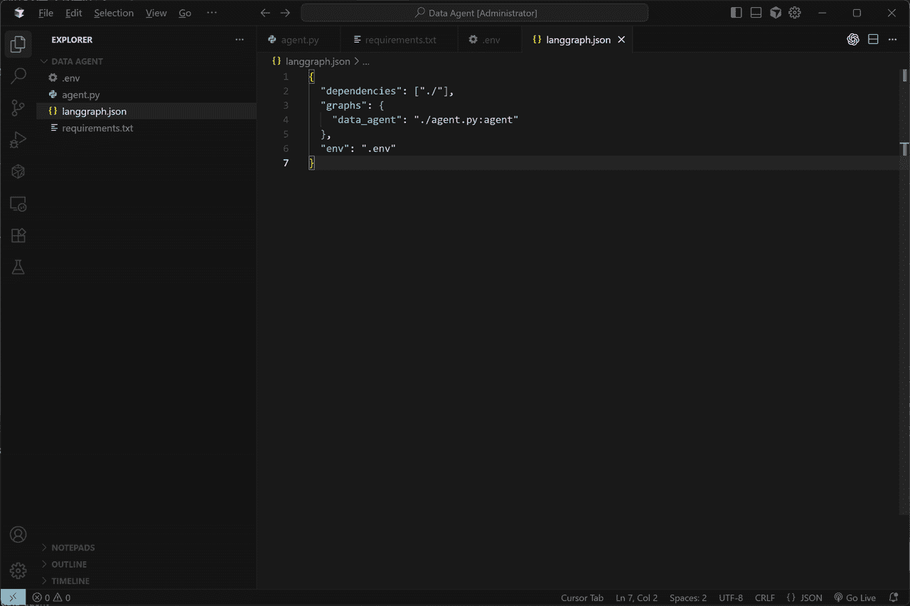

## Step 5. 开启后端服务

然后即可开启后端服务：

```
langgraph dev
```

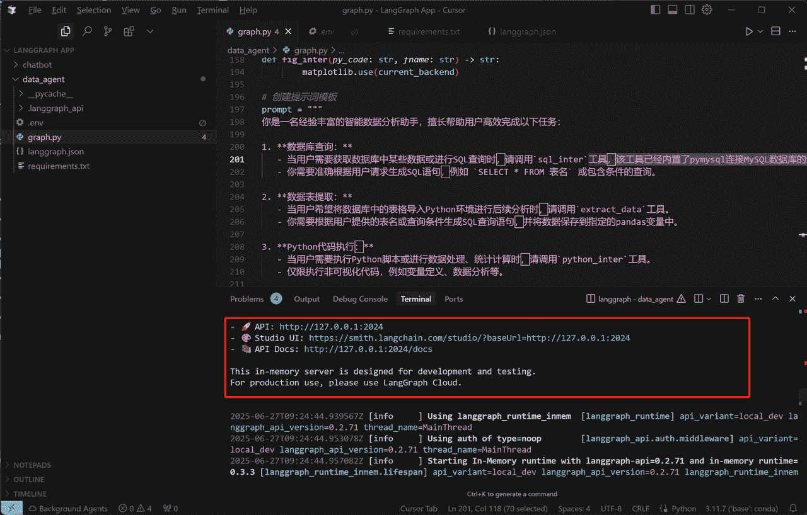

然后即可在 LanguageGraph Studio 中进行功能测试：

```
Video("https://ml2022.oss-cn-hangzhou.aliyuncs.com/2025-06-27%2017-30-09.mp4", width=800, height=400)
```

Your browser does not support the video element.

完整项目代码已上传至百度网盘，扫码即可领取：

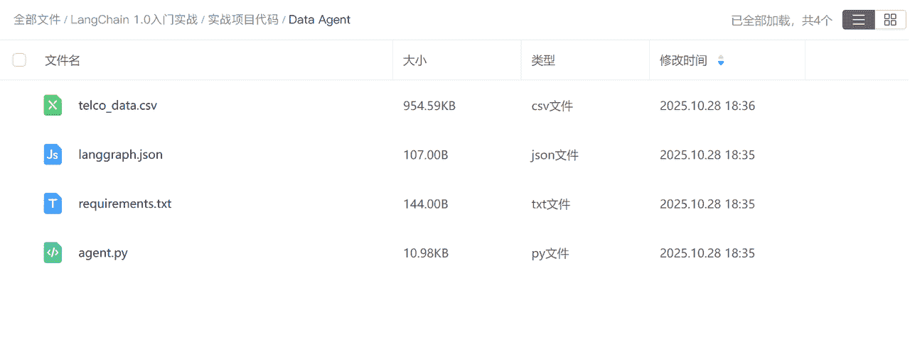

> 注意需要自己创建 `.env` 文件

## Step 6. 开启前端服务

接下来可以复用前端的服务，但更推荐围绕当前项目单独再下载一个前端模板并进行运行：

```
# git config --global http.proxy http://127.0.0.1:10080
# git config --global https.proxy http://127.0.0.1:10080

# set HTTP_PROXY=http://127.0.0.1:10080
# set HTTPS_PROXY=http://127.0.0.1:10080

git clone https://github.com/langchain-ai/agent-chat-ui.git
cd agent-chat-ui
pnpm install
pnpm dev
```

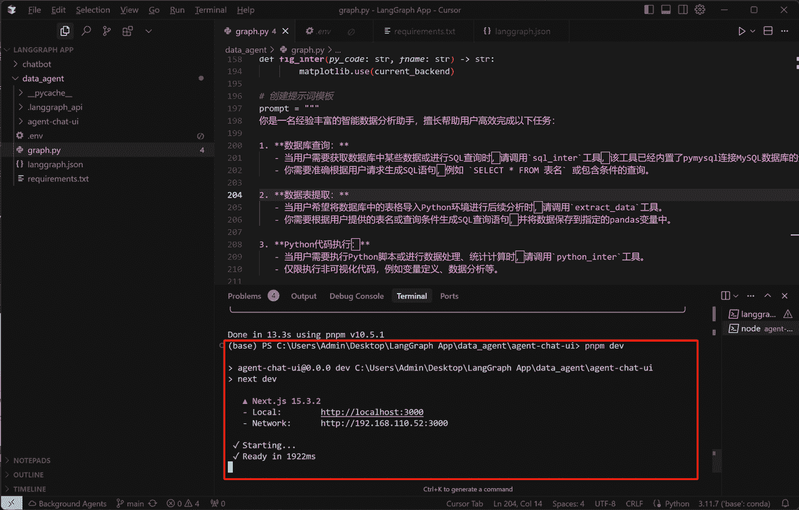

然后即可登录并进行测试，这里需要写清楚 Agent 名称，并可选输入 LangSmith 的 API Key：

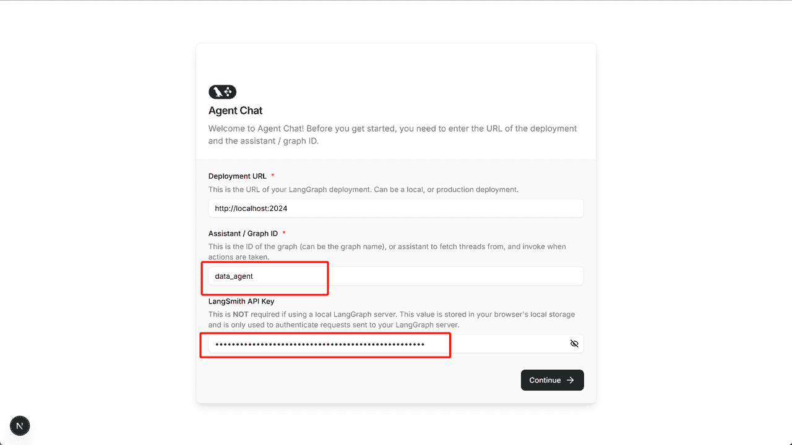

然后即可开始进行对话：

+   请帮我查询当前数据库中总共有几张表

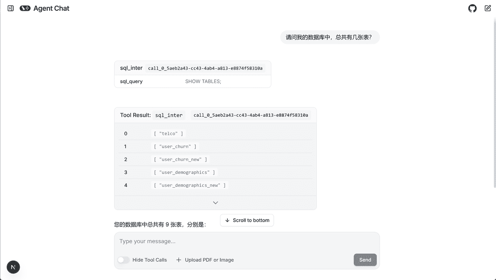

+   请帮我用Python代码模拟数据并绘制核密度分布图

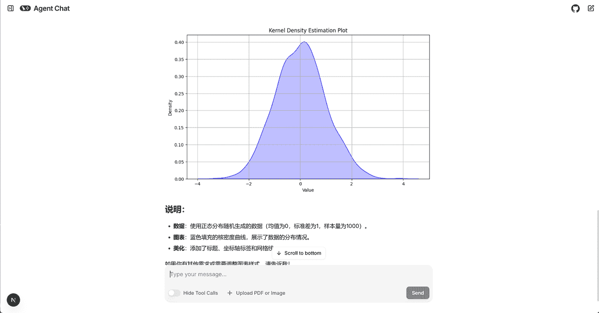

## 4. Data Agent 实际功能测试

+   你好，好久不见，请介绍下你自己

+   请帮我查询，数据库中总共有几张表

+   请问数据库中这些表都分别由多少数据

```
Video("https://ml2022.oss-cn-hangzhou.aliyuncs.com/2025-06-27%2017-44-49.mp4", width=800, height=400)
```

Your browser does not support the video element.

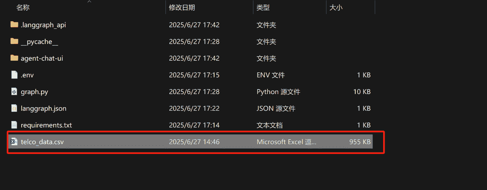

+   目前我的主目录下有一个名叫 `telco_data.csv` 的数据集，这个数据集是Kaggle上非常有名的电信用户流式预测数据集，请你帮我上网搜索这个数据集的相关信息，接下来我们需要一起围绕这个数据集进行数据分析工作。

```
Video("https://ml2022.oss-cn-hangzhou.aliyuncs.com/2025-06-27%2018-58-32.mp4", width=800, height=400)
```

Your browser does not support the video element.

+   目前我的主目录下有一个名叫 `telco_data.csv` 的数据集，请帮我绘制一张热力图，来展示除 `customerID`、`MonthlyCharges`、`TotalCharges` 字段外，其他离散字段和标签之间的关联关系。

```
Video("https://ml2022.oss-cn-hangzhou.aliyuncs.com/2025-06-27%2019-11-41.mp4", width=800, height=400)
```

Your browser does not support the video element.

```
Video("https://ml2022.oss-cn-hangzhou.aliyuncs.com/2025-06-27%2019-14-41.mp4", width=800, height=400)
```

Your browser does not support the video element.
