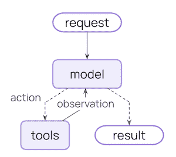
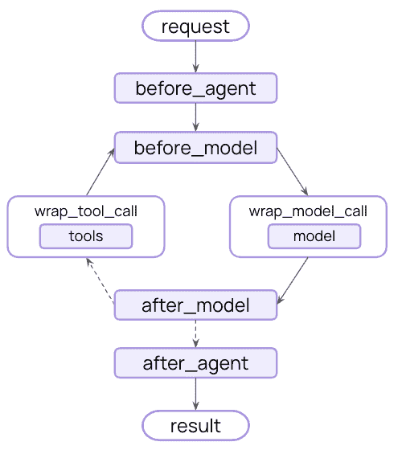
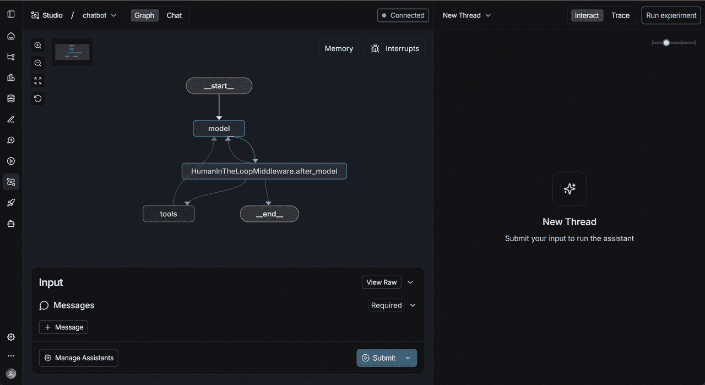
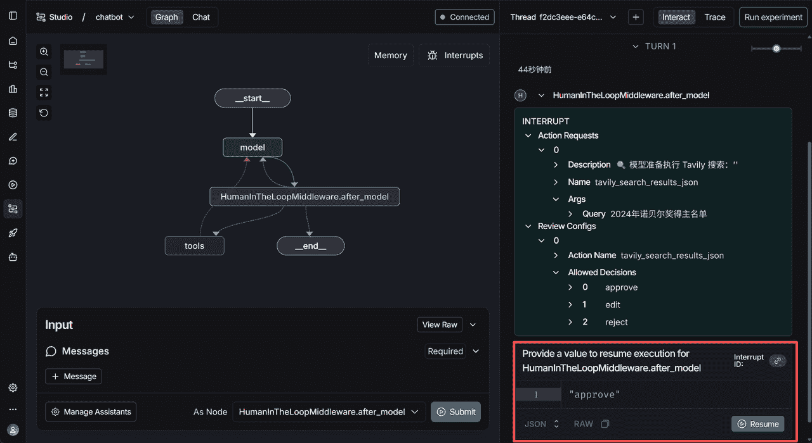

# LangChain 1.0入门实战

> 来源：[https://kq4b3vgg5b.feishu.cn/docx/EocEdhAmkojWRTxw5mmcASMJnzb](https://kq4b3vgg5b.feishu.cn/docx/EocEdhAmkojWRTxw5mmcASMJnzb)

## 课程说明

体验课内容节选自《2025大模型Agent智能体开发实战》(秋季班)完整版付费课程

体验课时间有限，若想深度学习大模型技术，欢迎大家报名由我主讲的《2025大模型Agent智能体开发实战》(秋季班)

---

## Part 6.LangChain Agent中间件入门介绍

```python
import os
from dotenv import load_dotenv 
load_dotenv(override=True)
```

```text
True
```

### 1. LangChain 1.0中间件核心功能介绍

中间件`Middleware`是本次LangChain 1.0更新中上线的一个重大功能，根据官网的说明，借助中间件，开发者可以高度定制和控制Agent运行的每一个环节。简而言之，借助中间件，一个`React Agent`的运行模型，就可以由这种：



变为这种：



也就是说，通过在Agent实际运行过程中设置一些钩子，来更改原始程序运行的行为。而LangChain 1.0的中间件的能实现如下功能：

| 功能类别 | 功能说明 | 常用钩子 |
| --- | --- | --- |
| **监控 / 日志 /指标** | 跟踪 Agent 的行为、模型调用次数、token 使用量、工具调用频率等。 | `before_model`、`after_model`、`wrap_model_call` |
| **修改输入 / 上下文工程** | 在模型调用前修改消息历史、添补系统提示、裁剪上下文、替换模型参数等。 | `before_model`、`modify_model_request` |
| **动态模型 /工具路由** | 根据当前状态决定使用哪个模型、启用哪些工具，动态调整调用策略。 | `modify_model_request`、`wrap_model_call` |
| 控制流程 / 限流 /重试 /降级 | 对模型或工具调用加上重试机制、超时、降级方案、跳转结束、提前中断。 | `wrap_model_call`、`before_model`（跳转） |
| 合规 / 审核（Guardrails / HITL） | 在调用工具前或后插入人工审核、敏感内容检查、PII检测、安全过滤。 | `after_model`（或 `wrap_tool_call`） |
| **摘要 / 上下文裁剪** | 当对话变长或token靠近限制时，自动摘要历史、压缩上下文以维持性能。 | `before_model` |
| **工具选择与调用管理** | 在模型调度工具前决定哪些工具可用、们是否被选中、限制调用频率。 | `modify_model_request`、`wrap_tool_call` |
| **结构化输出 / 响应格式控制** | 在请求模型之前或之后规范输出格式、校验结构化数据。 | `modify_model_request`、`after_model` |
| **状态扩展** | 自定义 Agent 的状态 schema（如调用次数、用户偏好、认证状态），中间件可以读写这些状态。 | `before_model`、`after_model` |

> 钩子是框架或系统在某些关键执行点暴露的扩展接口。开发者可以“挂上”自己的逻辑，在那些点上插入、修改或替换行为，而无需改变主流程代码。就像在流水线上某个环节设置了一个“检查点”或“插入器”。在 LangChain 的 Agent 执行循环中，比如 “模型调用前”“模型调用后”“工具调用前后” 都是可能挂钩子的点。

总的来说，`Middleware`“模型相关”钩子归纳为三种：`before_model`、`modify_model_request`、`after_model`（可三选其一或组合实现）。它们对应“模型调用前 → 请求修改 → 模型返回后”的三个阶段。典型用途如下：

+ `before_model`：总结/裁剪历史、注入系统指令、敏感信息脱敏、状态校验、条件分支跳转。
+ `modify_model_request`：对即将发送的请求做精准改写（模型名、参数、工具列表、`messages` 等）。
+ `after_model`：做人审（HITL）、输出校验/重写、添加安全标签或生成可观测数据。

此外，开发者还能用包装器把一次模型/工具调用整体“包起来”，实现重试、熔断、缓存、降级与动态路由：

+ `wrap_model_call`：在一次模型调用外层加壳，可动态换模型/改温度/改 `tools`，也可做 A/B、回退策略。v1 把“动态模型选择”正式迁入这里。
+ `wrap_tool_call`：统一处理工具调用的超时、重试、白/黑名单、错误上报，或在人审批准前阻断高风险工具（写文件、SQL、HTTP）。

并且在LangChain 1.0中，还允许开发者自定义中间件，从而实现更加灵活的Agent行为管理。

### 2. 模型动态选择

```python
from langchain_community.tools.tavily_search import TavilySearchResults
web_search = TavilySearchResults(max_results=2)
tools = [web_search]
```

+ 复杂问题 → `deepseek-reasoner`：推理更强，适合多步骤/长上下文/证明与规划类问题
+ 简单问题 → `deepseek-chat`：速度/成本更优，常规问答与闲聊

```python
from langchain_deepseek import ChatDeepSeek
from langchain.agents import create_agent
from langchain.agents.middleware import wrap_model_call, ModelRequest, ModelResponse
from langchain_core.messages import HumanMessage

# ① 准备两种 DeepSeek 模型
basic_model = ChatDeepSeek(model="deepseek-chat")        # 简单问题：快速、经济
reasoner_model = ChatDeepSeek(model="deepseek-reasoner") # 复杂问题：推理更强

def _get_last_user_text(messages) -> str:
    """从消息列表中取最近一条用户消息文本（无则返回空串）"""
    for m in reversed(messages):
        if isinstance(m, HumanMessage):
            # content 可能是纯字符串或富内容；这里只处理为字符串的常见情况
            return m.content if isinstance(m.content, str) else ""
    return ""

@wrap_model_call
def dynamic_deepseek_routing(request: ModelRequest, handler) -> ModelResponse:
    """
    根据对话复杂度动态选择 DeepSeek 模型：
    - 复杂：deepseek-reasoner
    - 简单：deepseek-chat
    """
    messages = request.state.get("messages", [])
    msg_count = len(messages)
    last_user = _get_last_user_text(messages)
    last_len = len(last_user)

    # 一些“复杂任务”关键词（可按需扩充）
    hard_keywords = ("证明", "推导", "严谨", "规划", "多步骤", "chain of thought",
                     "step-by-step", "reason step by step", "数学", "逻辑证明", "约束求解")

    # 简单的复杂度启发式：
    # 1) 历史消息较长   2) 最近用户输入很长   3) 出现复杂任务关键词
    is_hard = (
        msg_count > 10 or
        last_len > 120 or
        any(kw.lower() in last_user.lower() for kw in hard_keywords)
    )

    # 选择模型
    request.model = reasoner_model if is_hard else basic_model
    print(request.model)

    # 调用被包裹的下游（真正的模型调用）
    return handler(request)

# ② 创建 Agent（默认用 chat，但运行时会被中间件按需替换）
agent = create_agent(
    model=basic_model,
    tools=tools,  
    middleware=[dynamic_deepseek_routing]
)
```

代码解释如下：

1. 两种 DeepSeek 模型并存

我们分别实例化了：

+ `deepseek-chat`：适合日常对话、直接问答、信息型问题，响应快/更省钱。
+ `deepseek-reasoner`：适合多步骤推理/严谨证明/复杂规划等高难任务。

2. `@wrap_model_call` 中间件做“整体包裹”

+ 这个装饰器会把一次模型调用整体包起来，你能在这里动态替换 `request.model`。
+ 调用 `handler(request)` 之前把 `request.model` 改成你想用的那个模型即可，实现运行时路由。
+ 这种“外壳式”包装适合做重试/超时/降级/动态路由等控制。

3. 复杂度启发式（heuristics）

我们用了 3 条简单、可解释的启发式规则判断是否复杂：

+ 会话长度：`msg_count > 10` 说明上下文较长，信息综合度更高；
+ 最近输入长度：`last_len > 120` 说明问题描述较长，往往需要分解 & 规划；
+ 关键词命中：若用户写 “证明/推导/规划/多步骤/step-by-step/chain of thought/数学/逻辑证明/约束求解” 等词，倾向判定为复杂。

```python
from langchain_core.messages import HumanMessage
```

```python
messages = {"messages": [{"role": "user", "content": "你好，请介绍下你自己。"}]}
```

```python
result = agent.invoke(messages)
```

```python
result
```

```text
{'messages': [HumanMessage(content='你好，请介绍下你自己。', additional_kwargs={}, response_metadata={}, id='1c95bc22-a74d-4e0d-b2ed-26117b784cb6'),
  AIMessage(content='你好！我是DeepSeek，由深度求索公司创造的AI助手。很高兴认识你！😊\n\n让我简单介绍一下自己：\n\n**我的特点：**\n- 是一个纯文本AI模型，专注于理解和生成自然语言\n- 支持128K的上下文长度，可以处理很长的对话和文档\n- 具备文件上传功能，可以读取和处理图像、txt、pdf、ppt、word、excel等文件中的文字信息\n- 完全免费使用，没有任何收费计划\n- 支持联网搜索功能（需要手动开启）\n\n**我能帮你做什么：**\n- 回答各种问题，提供信息和建议\n- 协助写作、翻译、编程等任务\n- 分析和处理上传的文档内容\n- 进行创意思考和问题解决\n\n**使用方式：**\n- 可以通过官方应用商店下载App使用\n- 目前是纯文本交互，暂不支持语音功能\n\n我会以热情、细腻的方式为你提供帮助。有什么问题或需要协助的地方，尽管告诉我吧！我很乐意为你服务！✨', additional_kwargs={'refusal': None}, response_metadata={'token_usage': {'completion_tokens': 214, 'prompt_tokens': 190, 'total_tokens': 404, 'completion_tokens_details': None, 'prompt_tokens_details': {'audio_tokens': None, 'cached_tokens': 0}}, 'prompt_cache_hit_tokens': 0, 'prompt_cache_miss_tokens': 190}, 'model_provider': 'deepseek', 'model_name': 'deepseek-chat', 'system_fingerprint': 'fp_ffc7281d48_prod0820_fp8_kvcache', 'id': '91523f04-4062-4c20-b059-9997b4c7af84', 'finish_reason': 'stop', 'logprobs': None}, id='lc_run--9d3ae21c-ead8-408a-af43-9a28334da76f-0', usage_metadata={'input_tokens': 190, 'output_tokens': 214, 'total_tokens': 404, 'input_token_details': {'cache_read': 0}, 'output_token_details': {}})]
```

促发推理模型调用：

```python
complex_question = """请帮我详细推理以下数学问题：
假设一个粒子以恒定加速度a沿直线运动，初速度为v0，位移为s。
推导出其速度与时间t的函数关系，并逐步解释每一步的物理意义。
"""

result = agent.invoke({
    "messages": [HumanMessage(content=complex_question)]
})
```

```text
client=<openai.resources.chat.completions.completions.Completions object at 0x000002480A3D4610> async_client=<openai.resources.chat.completions.completions.AsyncCompletions object at 0x000002480A3D6650> root_client=<openai.OpenAI object at 0x000002480A07AE50> root_async_client=<openai.AsyncOpenAI object at 0x000002480A3D4E10> model_name='deepseek-reasoner' model_kwargs={} openai_api_key=SecretStr('**********') api_key=SecretStr('**********') api_base='https://api.deepseek.com/v1'
```

```python
result
```


```` ```
{'messages': [HumanMessage(content='请帮我详细推理以下数学问题：\n假设一个粒子以恒定加速度a沿直线运动，初速度为v0，位移为s。\n推导出其速度与时间t的函数关系，并逐步解释每一步的物理意义。\n', additional_kwargs={}, response_metadata={}, id='c0129626-a315-45e2-b1fc-21d85ca1c9f7'),
  AIMessage(content='我来为您详细推导这个匀加速直线运动问题，并解释每一步的物理意义。\n\n## 问题分析\n已知：\n- 恒定加速度：a\n- 初速度：v₀  \n- 时间：t\n\n我们需要推导速度与时间的函数关系：v = f(t)\n\n## 推导过程\n\n### 第一步：加速度的定义\n根据加速度的定义：\n\na = dv/dt\n\n**物理意义**：加速度是速度对时间的变化率，表示单位时间内速度的变化量。\n\n### 第二步：积分求速度\n对加速度进行积分：\n\n∫dv = ∫a dt\nv = at + C\n\n**物理意义**：通过对加速度在时间上的累积，我们得到了速度的变化量。\n\n### 第三步：确定积分常数\n当 t = 0 时，v = v₀，代入得：\n\nv₀ = a×0 + C\nC = v₀\n\n**物理意义**：积分常数C代表初始条件，即t=0时刻的初速度。\n\n### 第四步：最终的速度-时间关系\n\nv = v₀ + at\n\n**物理意义**：这是匀加速直线运动的基本公式，表明：\n- 任意时刻的速度等于初速度加上加速度与时间的乘积\n- 速度随时间线性变化\n- 加速度a是速度-时间曲线的斜率\n\n## 完整的速度-时间关系\n**最终结果**：\n\nv(t) = v₀ + at\n\n## 物理意义总结\n\n1. **v₀**：初始状态的速度，代表粒子在t=0时刻的运动状态\n2. **at**：速度的变化量，表示在时间t内由于加速度作用导致的速度增量\n3. **v₀ + at**：总速度，体现了运动的叠加原理 - 初始运动状态加上运动状态的变化\n\n这个公式描述了匀加速直线运动中最基本的物理规律：在恒定加速度作用下，速度随时间均匀变化。', additional_kwargs={'refusal': None}, response_metadata={'token_usage': {'completion_tokens': 411, 'prompt_tokens': 228, 'total_tokens': 639, 'completion_tokens_details': None, 'prompt_tokens_details': {'audio_tokens': None, 'cached_tokens': 192}, 'prompt_cache_hit_tokens': 192, 'prompt_cache_miss_tokens': 36}, 'model_provider': 'deepseek', 'model_name': 'deepseek-chat', 'system_fingerprint': 'fp_ffc7281d48_prod0820_fp8_kvcache', 'id': '7d35bbe0-7c77-47ff-a8d2-96e35b00094b', 'finish_reason': 'stop', 'logprobs': None}, id='lc_run--36d717f9-f000-4bce-a0ab-e09d3da65f11-0', usage_metadata={'input_tokens': 228, 'output_tokens': 411, 'total_tokens': 639, 'input_token_details': {'cache_read': 192}, 'output_token_details': {}})]
}
```` ```

### 3. 消息压缩

#### 修剪消息（Trimming）

修剪（Trimming）是最轻量、最直接的压缩方式。

它的思想是：只保留最近 `N` 条消息或 `M` 个 token 以内的上下文，其余的自动裁剪掉。

这种方法通常配合 `@before_model` 钩子使用，在每次模型调用前计算历史消息数量或 token 长度；当接近模型的最大上下文限制（如 4k、16k、128k）时，就删除较早的对话，只保留关键的系统提示和最新几轮对话。

它的优点是实现简单、执行快速、成本可控，非常适合聊天型 Agent 或 RAG 问答系统；缺点是容易丢失远期上下文记忆。

```python
from langchain_deepseek import ChatDeepSeek

from langchain.agents import create_agent, AgentState

from langchain.agents.middleware import before_model

from langchain.messages import RemoveMessage

from langgraph.graph.message import REMOVE_ALL_MESSAGES

from langgraph.checkpoint.memory import InMemorySaver

from langgraph.runtime import Runtime

from typing import Any

# 初始化模型

model = ChatDeepSeek(model="deepseek-chat")

@before_model
def trim_messages(state: AgentState, runtime: Runtime) -> dict[str, Any] | None:
    """在模型调用前修剪消息历史，只保留前1+后3条。"""

    messages = state["messages"]

    # 只有超过 4 条消息才裁剪
    if len(messages) <= 4:
        return None

    # 保留首条 System 提示 + 最近3条
    first_msg = messages[0]
    new_messages = [first_msg] + messages[-3:]

    print(f"✂️ 修剪消息：从 {len(messages)} 条 → {len(new_messages)} 条")

    return {
        "messages": [
            RemoveMessage(id=REMOVE_ALL_MESSAGES),
            *new_messages
        ]
    }

agent = create_agent(
    model=model,
    tools=tools,
    middleware=[trim_messages],
    checkpointer=InMemorySaver(),
)
```

```python
config = {
    "configurable": {
        "thread_id": "2"
    }
}
```

```python
agent.invoke(
    {"messages": "你好，我叫陈明"},
    config
)
```

```python
{'messages': [HumanMessage(content='你好，我叫陈明', additional_kwargs={}, response_metadata={}, id='94e69f1f-556f-47ce-807e-447e1c869dd2'),
  AIMessage(content='你好陈明！很高兴认识你！我是DeepSeek，一个AI助手，随时准备为你提供帮助。\n\n有什么我可以为你做的吗？无论是回答问题、协助解决问题、提供信息，还是其他任何需要，我都很乐意帮助你！', additional_kwargs={'refusal': None}, response_metadata={'token_usage': {'completion_tokens': 48, 'prompt_tokens': 188, 'total_tokens': 236, 'completion_tokens_details': None, 'prompt_tokens_details': {'audio_tokens': None, 'cached_tokens': 128}, 'prompt_cache_hit_tokens': 128, 'prompt_cache_miss_tokens': 60}, 'model_provider': 'deepseek', 'model_name': 'deepseek-chat', 'system_fingerprint': 'fp_ffc7281d48_prod0820_fp8_kvcache', 'id': '410171b9-e016-436b-a452-305e74840c5b', 'finish_reason': 'stop', 'logprobs': None}, id='lc_run--3fac9d8e-6229-4a2b-8ef1-d61f6517ce19-0', usage_metadata={'input_tokens': 188, 'output_tokens': 48, 'total_tokens': 236, 'input_token_details': {'cache_read': 128}, 'output_token_details': {}})]
}
```

```python
agent.invoke(
    {"messages": "帮我写一句每日格言"},
    config
)
```

```python
{'messages': [HumanMessage(content='你好，我叫陈明', additional_kwargs={}, response_metadata={}, id='94e69f1f-556f-47ce-807e-447e1c869dd2'),
  AIMessage(content='你好陈明！很高兴认识你！我是DeepSeek，一个AI助手，随时准备为你提供帮助。\n\n有什么我可以为你做的吗？无论是回答问题、协助解决问题、提供信息，还是其他任何需要，我都很乐意帮助你！', additional_kwargs={'refusal': None}, response_metadata={'token_usage': {'completion_tokens': 48, 'prompt_tokens': 188, 'total_tokens': 236, 'completion_tokens_details': None, 'prompt_tokens_details': {'audio_tokens': None, 'cached_tokens': 128}, 'prompt_cache_hit_tokens': 128, 'prompt_cache_miss_tokens': 60}, 'model_provider': 'deepseek', 'model_name': 'deepseek-chat', 'system_fingerprint': 'fp_ffc7281d48_prod0820_fp8_kvcache', 'id': '410171b9-e016-436b-a452-305e74840c5b', 'finish_reason': 'stop', 'logprobs': None}, id='lc_run--3fac9d8e-6229-4a2b-8ef1-d61f6517ce19-0', usage_metadata={'input_tokens': 188, 'output_tokens': 48, 'total_tokens': 236, 'input_token_details': {'cache_read': 128}, 'output_token_details': {}}),
  HumanMessage(content='帮我写一句每日格言', additional_kwargs={}, response_metadata={}, id='be8dfc15-4488-4d8d-87b8-86f30a03062e'),
  AIMessage(content='以下是一句每日格言供您参考：\n\n"每一天都是新的开始，每一次努力都是未来的铺垫。"\n\n这句格言鼓励我们以积极的心态面对每一天，认识到每个清晨都带来新的机会，而我们当下的努力和坚持都在为更美好的未来打下基础。无论昨天如何，今天都可以重新出发，向着目标稳步前行。\n\n希望这句格言能给您带来启发和力量！如果您想要特定主题的格言，比如关于坚持、勇气、学习等方面的，我很乐意为您提供更多选择。', additional_kwargs={'refusal': None}, response_metadata={'token_usage': {'completion_tokens': 106, 'prompt_tokens': 246, 'total_tokens': 352, 'completion_tokens_details': None, 'prompt_tokens_details': {'audio_tokens': None, 'cached_tokens': 192}, 'prompt_cache_hit_tokens': 192, 'prompt_cache_miss_tokens': 54}, 'model_provider': 'deepseek', 'model_name': 'deepseek-chat', 'system_fingerprint': 'fp_ffc7281d48_prod0820_fp8_kvcache', 'id': '63f6c65b-09b8-4883-bdc9-3513200b3de9', 'finish_reason': 'stop', 'logprobs': None}, id='lc_run--a89813ba-4e3f-4cea-8990-a2a627189188-0', usage_metadata={'input_tokens': 246, 'output_tokens': 106, 'total_tokens': 352, 'input_token_details': {'cache_read': 192}, 'output_token_details': {}})]
}
```

```python
agent.invoke(
    {"messages": "请介绍下你自己。"},
)
```


# 消息修剪与删除

## 修剪消息

✂️ 修剪消息：从 5 条 → 4 条

```json
{'messages': [
  HumanMessage(content='你好，我叫陈明', additional_kwargs={}, response_metadata={}, id='94e69f1f-556f-47ce-807e-447e1c869dd2'),
  HumanMessage(content='帮我写一句每日格言', additional_kwargs={}, response_metadata={}, id='be8dfc15-4488-4d8d-87b8-86f30a03062e'),
  AIMessage(content='以下是一句每日格言供您参考：\n\n"每一天都是新的开始，每一次努力都是未来的铺垫。"\n\n这句格言鼓励我们以积极的心态面对每一天，认识到每个清晨都带来新的机会，而我们当下的努力和坚持都在为更美好的未来打下基础。无论昨天如何，今天都可以重新出发，向着目标稳步前行。\n\n希望这句格言能给您带来启发和力量！如果您想要特定主题的格言，比如关于坚持、勇气、学习等方面的，我很乐意为您提供更多选择。', additional_kwargs={'refusal': None}, response_metadata={'token_usage': {'completion_tokens': 106, 'prompt_tokens': 246, 'total_tokens': 352, 'completion_tokens_details': None, 'prompt_tokens_details': {'audio_tokens': None, 'cached_tokens': 192}, 'prompt_cache_hit_tokens': 192, 'prompt_cache_miss_tokens': 54}, 'model_provider': 'deepseek', 'model_name': 'deepseek-chat', 'system_fingerprint': 'fp_ffc7281d48_prod0820_fp8_kvcache', 'id': '63f6c65b-09b8-4883-bdc9-3513200b3de9', 'finish_reason': 'stop', 'logprobs': None}, id='lc_run--a89813ba-4e3f-4cea-8990-a2a627189188-0', usage_metadata={'input_tokens': 246, 'output_tokens': 106, 'total_tokens': 352, 'input_token_details': {'cache_read': 192}, 'output_token_details': {}}),
  HumanMessage(content='请介绍下你自己。', additional_kwargs={}, response_metadata={}, id='3245ed3b-8ece-403f-b155-42bdc843de73'),
  AIMessage(content='你好陈明！我是DeepSeek，由深度求索公司创造的AI助手。很高兴认识你！\n\n让我简单介绍一下自己：\n\n**我的基本信息：**\n- 我是一个纯文本AI模型，专注于理解和生成自然语言\n- 知识截止到2024年7月\n- 支持128K的上下文长度，能够处理较长的对话\n\n**我能为你做什么：**\n- 回答各种问题，提供信息和解释\n- 协助写作、翻译、总结等文字工作\n- 进行逻辑推理和问题分析\n- 上传并处理文件（图像、txt、pdf、ppt、word、excel等），读取其中的文字信息\n- 通过联网搜索获取最新信息（需要你手动开启搜索功能）\n\n**我的特点：**\n- 完全免费使用，没有收费计划\n- 热情细腻的交流风格\n- 尽力提供准确、有帮助的回答\n\n你可以通过官方应用商店下载DeepSeek App来更方便地使用我。\n\n有什么我可以帮助你的吗？无论是学习、工作还是生活中的问题，我都很乐意协助你！', additional_kwargs={'refusal': None}, response_metadata={'token_usage': {'completion_tokens': 219, 'prompt_tokens': 310, 'total_tokens': 529, 'completion_tokens_details': None, 'prompt_tokens_details': {'audio_tokens': None, 'cached_tokens': 192}, 'prompt_cache_hit_tokens': 192, 'prompt_cache_miss_tokens': 118}, 'model_provider': 'deepseek', 'model_name': 'deepseek-chat', 'system_fingerprint': 'fp_ffc7281d48_prod0820_fp8_kvcache', 'id': '7c3432a8-c516-4a3e-897d-317d9c4bd4ae', 'finish_reason': 'stop', 'logprobs': None}, id='lc_run--029fc4ad-9dd2-4570-98bf-19fa781987be-0', usage_metadata={'input_tokens': 310, 'output_tokens': 219, 'total_tokens': 529, 'input_token_details': {'cache_read': 192}, 'output_token_details': {}}),
  HumanMessage(content='你还记得我叫什么吗？', additional_kwargs={}, response_metadata={}, id='c61cb6ff-de5c-47af-8c98-651cf3f8cc39'),
  AIMessage(content='当然记得！你刚才告诉我你叫**陈明**。很高兴再次与你交流！😊\n\n有什么我可以帮助你的吗，陈明？', additional_kwargs={'refusal': None}, response_metadata={'token_usage': {'completion_tokens': 30, 'prompt_tokens': 423, 'total_tokens': 453, 'completion_tokens_details': None, 'prompt_tokens_details': {'audio_tokens': None, 'cached_tokens': 128}, 'prompt_cache_hit_tokens': 128, 'prompt_cache_miss_tokens': 295}, 'model_provider': 'deepseek', 'model_name': 'deepseek-chat', 'system_fingerprint': 'fp_ffc7281d48_prod0820_fp8_kvcache', 'id': 'bb9048ed-9989-4207-8e5a-1db0568fd8e6', 'finish_reason': 'stop', 'logprobs': None}, id='lc_run--6e18e71d-f96a-475d-859e-01b9d3861a79-0', usage_metadata={'input_tokens': 423, 'output_tokens': 30, 'total_tokens': 453, 'input_token_details': {'cache_read': 128}, 'output_token_details': {}})
]}
```

```python
agent.invoke(
    {"messages": "你还记得我叫什么吗？"},
    config
)
```

✂️ 修剪消息：从 6 条 → 4 条

```json
{'messages': [
  HumanMessage(content='你好，我叫陈明', additional_kwargs={}, response_metadata={}, id='94e69f1f-556f-47ce-807e-447e1c869dd2'),
  HumanMessage(content='请介绍下你自己。', additional_kwargs={}, response_metadata={}, id='3245ed3b-8ece-403f-b155-42bdc843de73'),
  AIMessage(content='你好陈明！我是DeepSeek，由深度求索公司创造的AI助手。很高兴认识你！\n\n让我简单介绍一下自己：\n\n**我的基本信息：**\n- 我是一个纯文本AI模型，专注于理解和生成自然语言\n- 知识截止到2024年7月\n- 支持128K的上下文长度，能够处理较长的对话\n\n**我能为你做什么：**\n- 回答各种问题，提供信息和解释\n- 协助写作、翻译、总结等文字工作\n- 进行逻辑推理和问题分析\n- 上传并处理文件（图像、txt、pdf、ppt、word、excel等），读取其中的文字信息\n- 通过联网搜索获取最新信息（需要你手动开启搜索功能）\n\n**我的特点：**\n- 完全免费使用，没有收费计划\n- 热情细腻的交流风格\n- 尽力提供准确、有帮助的回答\n\n你可以通过官方应用商店下载DeepSeek App来更方便地使用我。\n\n有什么我可以帮助你的吗？无论是学习、工作还是生活中的问题，我都很乐意协助你！', additional_kwargs={'refusal': None}, response_metadata={'token_usage': {'completion_tokens': 219, 'prompt_tokens': 310, 'total_tokens': 529, 'completion_tokens_details': None, 'prompt_tokens_details': {'audio_tokens': None, 'cached_tokens': 192}, 'prompt_cache_hit_tokens': 192, 'prompt_cache_miss_tokens': 118}, 'model_provider': 'deepseek', 'model_name': 'deepseek-chat', 'system_fingerprint': 'fp_ffc7281d48_prod0820_fp8_kvcache', 'id': '7c3432a8-c516-4a3e-897d-317d9c4bd4ae', 'finish_reason': 'stop', 'logprobs': None}, id='lc_run--029fc4ad-9dd2-4570-98bf-19fa781987be-0', usage_metadata={'input_tokens': 310, 'output_tokens': 219, 'total_tokens': 529, 'input_token_details': {'cache_read': 192}, 'output_token_details': {}}),
  HumanMessage(content='你还记得我叫什么吗？', additional_kwargs={}, response_metadata={}, id='c61cb6ff-de5c-47af-8c98-651cf3f8cc39'),
  AIMessage(content='当然记得！你刚才告诉我你叫**陈明**。很高兴再次与你交流！😊\n\n有什么我可以帮助你的吗，陈明？', additional_kwargs={'refusal': None}, response_metadata={'token_usage': {'completion_tokens': 30, 'prompt_tokens': 423, 'total_tokens': 453, 'completion_tokens_details': None, 'prompt_tokens_details': {'audio_tokens': None, 'cached_tokens': 128}, 'prompt_cache_hit_tokens': 128, 'prompt_cache_miss_tokens': 295}, 'model_provider': 'deepseek', 'model_name': 'deepseek-chat', 'system_fingerprint': 'fp_ffc7281d48_prod0820_fp8_kvcache', 'id': 'bb9048ed-9989-4207-8e5a-1db0568fd8e6', 'finish_reason': 'stop', 'logprobs': None}, id='lc_run--6e18e71d-f96a-475d-859e-01b9d3861a79-0', usage_metadata={'input_tokens': 423, 'output_tokens': 30, 'total_tokens': 453, 'input_token_details': {'cache_read': 128}, 'output_token_details': {}})
]}
```

## 删除消息（Deleting）

删除（Deleting）是一种更主动的上下文管理方式。

它允许开发者通过 `RemoveMessage` 机制，精确指定要删除哪些消息，例如清除最早的 2 条消息、只删除 tool 调用类消息、或直接重置整个会话。

这种方法通常配合 `@after_model` 钩子使用，也就是说在模型回复后清理历史消息，保证下次调用时上下文简洁干净。

删除策略通常用于长周期运行的 Agent 或工作流系统中，既能防止上下文爆炸，又能在关键节点（如新任务开始）重置状态，实现“会话阶段化”管理。

```python
from langchain_deepseek import ChatDeepSeek
from langchain.agents import create_agent, AgentState
from langchain.agents.middleware import after_model
from langchain.messages import RemoveMessage
from langgraph.checkpoint.memory import InMemorySaver
from langgraph.runtime import Runtime
from langchain_core.runnables import RunnableConfig

# 初始化模型
model = ChatDeepSeek(model="deepseek-chat")

@after_model
def delete_old_messages(state: AgentState, runtime: Runtime) -> dict | None:
    """模型调用后，删除最早的两条消息"""
    messages = state["messages"]
    if len(messages) > 4:
        removed = [m.id for m in messages[:2]]
        print(f"🧹 删除前两条消息，ID: {removed}")
        return {"messages": [RemoveMessage(id=m.id) for m in messages[:2]]}
    return None

agent = create_agent(
    model,
    tools=[],
    middleware=[delete_old_messages],
    checkpointer=InMemorySaver(),
)
```

```python
config: RunnableConfig = {"configurable": {"thread_id": "session-1"}}

agent.invoke({"messages": "你好，我叫小明"}, config)
agent.invoke({"messages": "请记住我的名字"}, config)
agent.invoke({"messages": "写一首关于春天的诗"}, config)
```


# LangChain Agent 中间件与人在闭环

## Agent 调用示例

```
final = agent.invoke({"messages": "你还记得我叫什么吗？"}, config)

print("\n🤖 最终回答：", final["messages"][-1].content)
```

## 汇总消息（Summarization）

汇总（Summarization）是最“智能”的压缩策略。

与简单的修剪不同，它不是直接删除历史，而是调用一个轻量模型自动总结过去的对话内容，把长历史浓缩成短摘要，再拼接到当前上下文中。

LangChain 1.0 提供了现成的 `SummarizationMiddleware` 中间件，只需指定：

- `max_tokens_before_summary`：超出后自动触发摘要；
- `model`：通常使用成本更低的小模型；
- `messages_to_keep`：例如只留最近 20 条原始消息。

这种方式兼顾了上下文连续性与效率，适合多轮对话、长期交互，或多 Agent 系统中做会话记忆压缩。

```
from langchain.agents import create_agent

from langchain.agents.middleware import SummarizationMiddleware

from langgraph.checkpoint.memory import InMemorySaver

from langchain_core.runnables import RunnableConfig

# 主模型（执行任务）
main_model = "deepseek-reasoner"

# 摘要模型（用于生成会话总结）
summary_model = "deepseek-chat"

checkpointer = InMemorySaver()

agent = create_agent(
    model=main_model,
    tools=[],
    middleware=[
        SummarizationMiddleware(
            model=summary_model,
            max_tokens_before_summary=3000,  # 超过3000token触发摘要
            messages_to_keep=10,             # 摘要后保留最近10条原始消息
        )
    ],
    checkpointer=checkpointer,
)
```

```
config: RunnableConfig = {"configurable": {"thread_id": "summary-demo"}}

agent.invoke({"messages": "你好，我叫小明"}, config)

agent.invoke({"messages": "请写一首关于夏天的诗"}, config)

agent.invoke({"messages": "现在写一篇关于秋天的随笔"}, config)

agent.invoke({"messages": "再帮我写一段冬天的散文"}, config)

final = agent.invoke({"messages": "你能总结一下四季的特点吗？"}, config)

print("\n🤖 最终回答：", final["messages"][-1].content)
```

## 4. 借助中间件实现人在闭环（Human in the loop）

在自动化系统中，尤其是 高风险任务（如数据库写入、财务操作、邮件发送） 中，完全让大模型自主执行往往并不安全。LangChain 1.0 引入的 `HumanInTheLoopMiddleware`（人类在环中间件）允许在关键节点 暂停 Agent 执行，等待人类对模型的行为进行批准（`approve`）、编辑（`edit`） 或 拒绝（`reject`），从而让「智能体」的行为真正符合企业安全、合规和伦理要求。

```
from langchain.agents import create_agent

from langchain.agents.middleware import HumanInTheLoopMiddleware

from langgraph.checkpoint.memory import InMemorySaver

# 创建 Agent，接入 HumanInTheLoopMiddleware
agent = create_agent(
    model=model,
    tools=tools,
    checkpointer=InMemorySaver(),
    middleware=[
        HumanInTheLoopMiddleware(
            interrupt_on={
                # 拦截 Tavily 搜索工具执行前，要求人工确认
                "tavily_search_results_json": {
                    "allowed_decisions": ["approve", "edit", "reject"],
                    "description": lambda tool_name, tool_input, state: (
                        f"🔍 模型准备执行 Tavily 搜索：'{tool_input.get('query', '')}'"
                    ),
                }
            },
            description_prefix="⚠️ 工具执行需要人工审批"
        )
    ],
)
```

```
config = {
    "configurable": {
        "thread_id": "23"
    }
}
```

```
result = agent.invoke(
    {"messages": "你好，请问2024年诺贝尔奖得主有哪些？"},
    config
)
```

```
result
```

```
{'messages': [HumanMessage(content='你好，请问2024年诺贝尔奖得主有哪些？', additional_kwargs={}, response_metadata={}, id='68d76e40-b807-4a56-98ac-d9235f72b6d2'),
  AIMessage(content='我来为您查询2024年诺贝尔奖得主的最新信息。', additional_kwargs={'refusal': None}, response_metadata={'token_usage': {'completion_tokens': 83, 'prompt_tokens': 195, 'total_tokens': 278, 'completion_tokens_details': None, 'prompt_tokens_details': {'audio_tokens': None, 'cached_tokens': 192}, 'prompt_cache_hit_tokens': 192, 'prompt_cache_miss_tokens': 3}, 'model_provider': 'deepseek', 'model_name': 'deepseek-chat', 'system_fingerprint': 'fp_ffc7281d48_prod0820_fp8_kvcache', 'id': '1b429d23-9c71-466f-a303-eb3e59137b25', 'finish_reason': 'tool_calls', 'logprobs': None}, id='lc_run--78292626-49a5-4870-b9a6-711c37a0f928-0', tool_calls=[{'name': 'tavily_search_results_json', 'args': {'query': '2024年诺贝尔奖得主 各项奖项获奖者'}, 'id': 'call_00_ctRvjGTHNM01w9HeTJ1EsHnG', 'type': 'tool_call'}], usage_metadata={'input_tokens': 195, 'output_tokens': 83, 'total_tokens': 278, 'input_token_details': {'cache_read': 192}, 'output_token_details': {}})],
 '__interrupt__': [Interrupt(value={'action_requests': [{'name': 'tavily_search_results_json', 'args': {'query': '2024年诺贝尔奖得主 各项奖项获奖者'}, 'description': "🔍 模型准备执行 Tavily 搜索：''"}], 'review_configs': [{'action_name': 'tavily_search_results_json', 'allowed_decisions': ['approve', 'edit', 'reject']}]}, id='f43dca8857e2c4dd96b400d687d7c23b')]}
```

人在闭环功能在部署后可以直观看到效果：




