# 全自动数据分析可视化Agent系统

> 来源：[https://kq4b3vgg5b.feishu.cn/docx/XGSBdZw7no6g72xNSn3cYoiwnIb](https://kq4b3vgg5b.feishu.cn/docx/XGSBdZw7no6g72xNSn3cYoiwnIb)

---

# 全自动数据分析可视化Agent系统

## (基于 LangChain 1.0 + DeepSeek-OCR 开发实战)

+   **本期案例功能介绍**

核心功能一：使用Vllm启动DeepSeek-OCR模型并多线程实现复杂图像、PDF、扫描件、手写笔记、旧试卷等文档高精度一键解析;


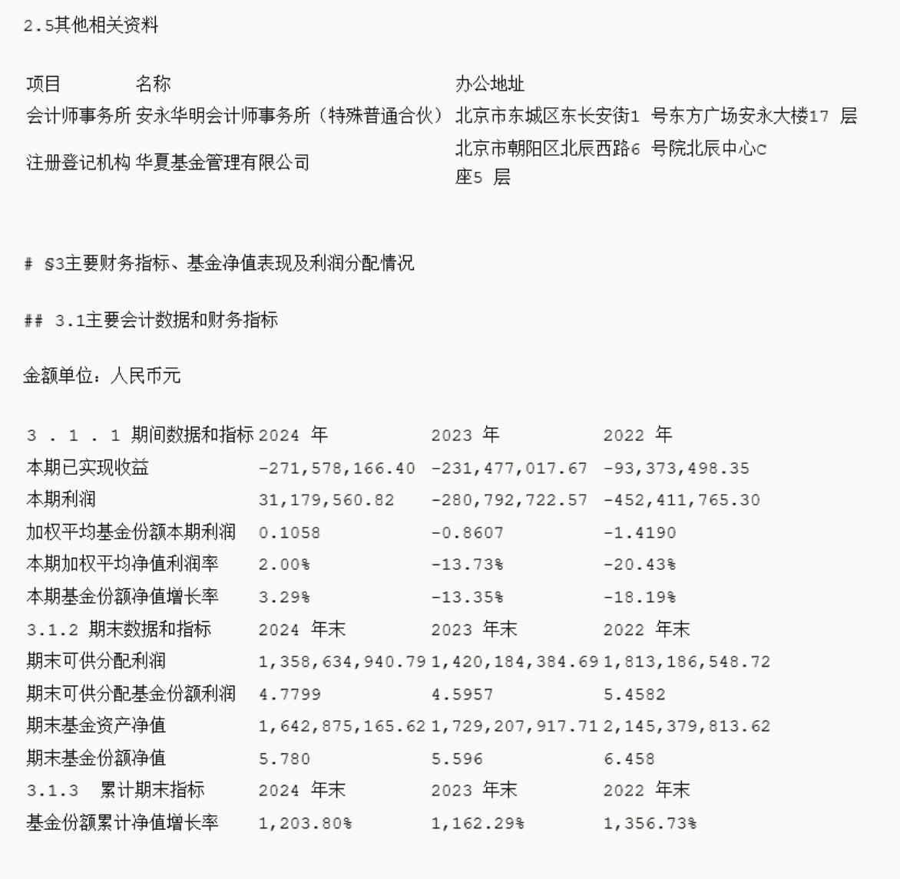

+   核心功能二：支持超长文本上下文压缩，并能接入DeepSeek、Qwen3、GPT 等模型生成详细的分析报告，并实时输出可视化报表；

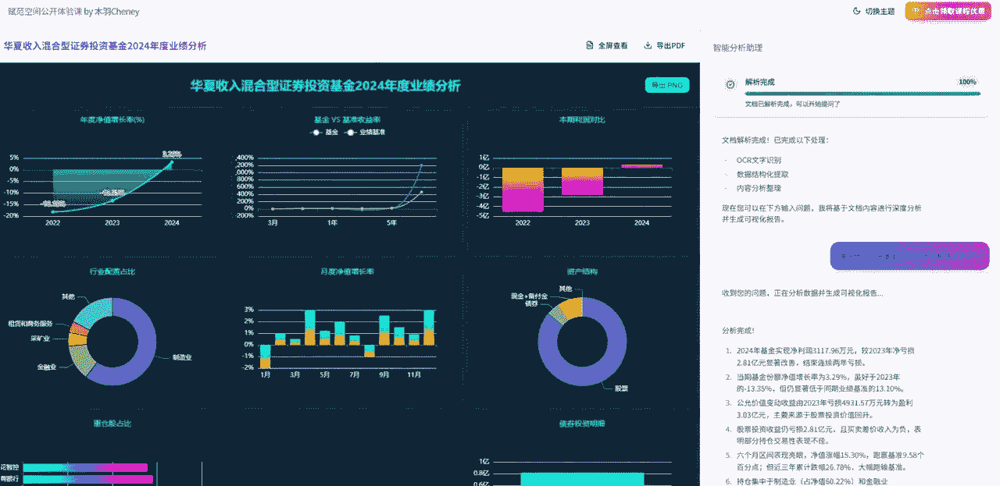

+   核心功能三：动态可视化报表生成，支持多轮追问并从不同维度输出BI大屏；


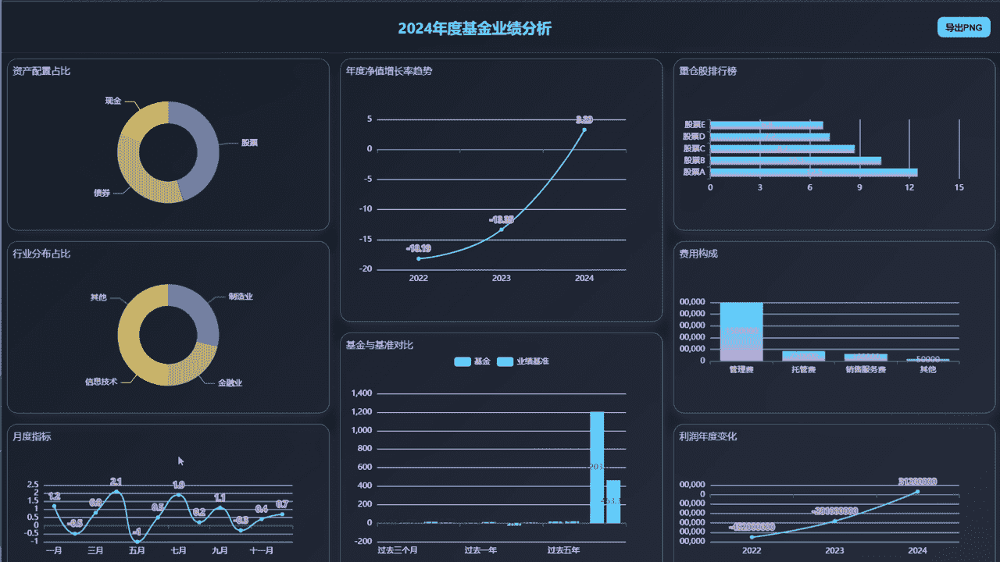

本期内容将详细为大家深入探索如何利用最新的 LangChain 1.0 Agent开发框架和 DeepSeek-OCR 多模态数据解析的能力，构建一个能够自主完成数据清洗、分析、可视化的智能Agent系统。我们不仅会讲解理论原理，更会通过三个完整的企业级项目实战，让大家掌握从0到1搭建生产级数据分析Agent的全流程技能。

如果大家有如下几方面的工作、学习需求，那本期内容将会非常适合你学习：

+   数据分析师希望提升借助大模型提升工作效率；

+   传统后端开发者想要掌握AI Agent系统开发；

+   AI大模型工程师寻求数据分析场景落地；

+   企业技术决策者评估AI数分解决方案；

# 一、数分领域如何结合AI

在正式讲解目前行业内AI数据分析主流应用的技术方案之前，我们先来思考一个问题：为什么数据分析工作需要AI大模型的介入、以及应该如何介入！ 有了明确的需求，才能够产生解决这个需求的技术方案。

## 1.1 传统数据分析的痛点

数据分析工作一直是企业决策的核心支撑。数据对于企业的重要性在于：它将组织中大量、杂乱、结构不一的原始数据转化为可操作的洞察，从而支持战略制定、提升运营效率、降低成本并驱动创新。具体来说，借助数据分析，企业可以更精准地把握目标客户画像、监控市场与竞品动态、优化供应链流程、识别风险点、发掘业务增长机会。比如，通过分析客户行为数据，企业能更有效地进行精准营销与产品推荐，从而提升销售转化率；通过分析运营数据，则能发现流程瓶颈、减少浪费、提高整体效率。

但数据分析不仅仅是“报表工具”那么简单，而是贯穿从运营执行、客户互动到战略决策的全链路能力。通常来说，一个最常见、也能覆盖多数“典型”数据分析项目的流程如下图所示：


当然，真实企业下的需求往往比这更加复杂且精细化。而要做好这项工作，从企业角度看对传统数据分析的候选人要求来看，往往需要具备扎实的SQL、Python等技术功底，以及极强的业务理解能力才能胜任数据分析相关的工作。

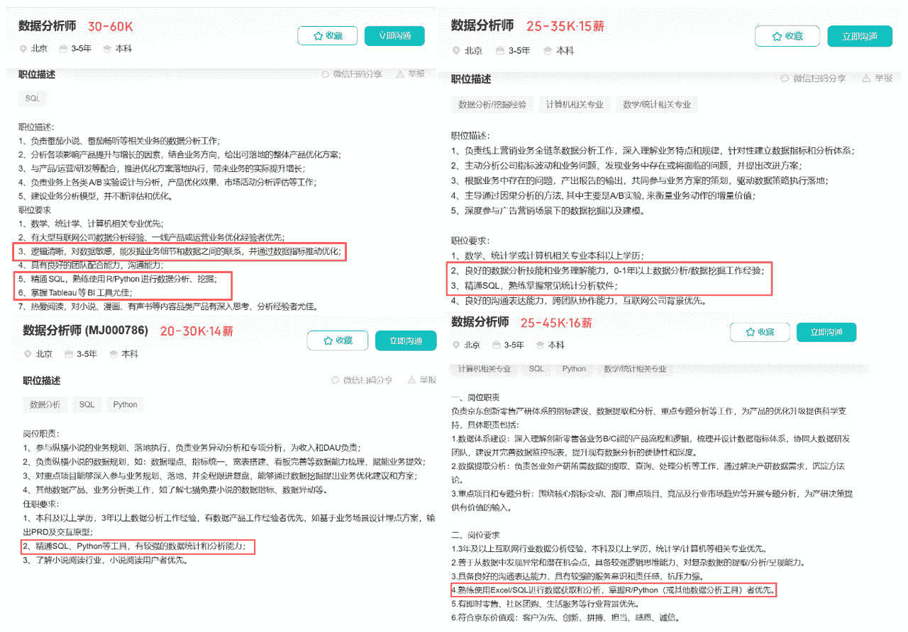

这里大家也能看到，数据分析是有一定的技术门槛的，同时哪怕是在职的数据分析师，在日常的工作中也存在着诸多痛点：诸如业务人员需要学习复杂的 SQL 语法，数据分析师疲于应对各种临时性的数据需求，而决策者往往需要等待数小时甚至数天才能看到一份分析报告。

而从流程上看，抛开定制化的场景需求，单从数据分析的流程上看，核心的痛点就在于：

+   数据分析师需要花费大量时间在数据提取、清洗、处理等重复性工作上；

+   业务人员往往需要等待数小时甚至数天才能看到一份分析报告；

+   数据分析师需要具备扎实的SQL、Python等技术功底，才能完成复杂的数据分析任务；

+   数据分析的流程缺乏灵活性，难以适应快速变化的业务需求；

AI如何介入数据分析工作，其实也就是要思考清楚：大模型到底能帮助数据分析做什么？

**有**非常多的小伙伴都希望让大模型帮助自己在工作、学习上提效，甚至很多企业也都在积极尝试在现有业务体系中融入大模型做AI+模块，但往往不知道传统的业务哪一部分工作可以由大模型接管，核心的原因是：不知道大模型的能力边界在哪。也就是说，以大模型现在能力，哪些工作是完全可以替代人的，哪些工作是只能辅助的。

## 1.2 AI如何介入数据分析工作

回到数据分析场景中，现在已经涌现出非常多的AI数据分析岗位。（除了AI数据分析师岗位，大部分的数据分析岗位中也明确将会用AI作为考核重点或重大加分项）

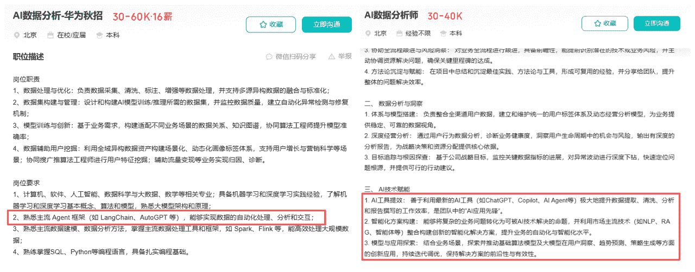

随着大模型如 GPT-5、DeepSeek、Qwen3 等大模型在多模态、上下文理解、代码生成等能力上都有了显著的提升，目前是完全可以将其用于全自动的数据处理、分析与可视化，并能够用于自动完成数据清洗、分析并生成图表和洞察报告。只不过，数据分析的各个阶段，大模型能够接入的深度和广度有很大的差别。

+   **自然语言理解能力**

LLM能够理解人类的自然语言表达，将模糊的业务需求转化为精确的技术操作。例如：

```
    用户说：&quot;帮我看看上个月各区域销售情况&quot;
    LLM理解为：查询时间范围（上月）+ 分组维度（区域）+ 指标（销售额）
```

+   **代码生成能力**

大模型能够根据意图自动生成SQL查询、Python分析代码、可视化代码等。这意味着：

```
    用户提问：计算每个产品线的月度增长率
    大模型自动生成代码：
    &quot;df.groupby([&#x27;product_line&#x27;, &#x27;month&#x27;])[&#x27;sales&#x27;].sum().pct_change()&quot;
```

+   **推理与规划能力**

大模型不仅能执行单步任务，还能进行多步骤的复杂推理。比如：

```
    用户：分析销售下滑的原因
           ↓
    大模型规划：
    1. 先查询销售趋势数据
    2. 识别下滑时间点
    3. 对比该时期的营销活动、季节因素
    4. 分析各区域/产品的贡献度
    5. 生成归因分析报告
```

所以针对现有数据分析的痛点，我们其实可以总结出大**模**型在数据分析场景中可以辅助或替代的点：自然语言理解和代码生成能力完全可以借助大模型原生/微调的能力来实现，而推理与规划能力则需要借助大模型+人工的业务理解来构建。

同时也是基于这种技术现状，实际的企业应用中,往往会将数据分析+大模型能够做到的工作凝练为三大核心场景。如下表所示：

AI 数据分析三大应用场景

| 场景类型 | 核心需求 | 技术侧重 | 典型用户 |
| --- | --- | --- | --- |
| 业务报表展示 | 定期生成关键指标图表 | NL2SQL + 可视化自动化 | 业务管理层 |
| 探索式数据分析 | 动态问答与交互式分析 | NL2Code + 多轮对话 | 数据分析师 |
| 文件数据实时分析 | 实时图表生成与解读 | 多模态理解 + 快速响应 | 决策者/汇报人 |

每个场景都有其独特的技术挑战和实现路径，接下来我会逐一为大家深入剖析。

# 二、三大核心应用场景解析

## 2.1 LangChain搭建 NL2SQL Agent（业务报表类）

+   **场景一：业务报表展示**

**  这个业务场**景其实就是要做到：让数据自己说话。在企业中，业务部门每周、每月都需要生成大量的报表：销售业绩、用户增长、运营指标等等。传统做法是数据分析师手工编写 SQL 查询、导出数据、制作图表，整个流程可能需要几小时甚至一天时间。而要让大模型做到这种，其实就是要让大模型具备以下能力：

1.  理解自然语言的意图；

1.  生成精确的SQL查询语句；

1.  自主去连接数据库，并执行SQL查询语句；

1.  根据查询后的数据，生成对应的图表；

。举个例子：

> 用户的自然语言："北京和上海两地上个月的销售额对比"

> Agent 需要生成：SELECT region, SUM(sales) FROM orders WHERE region IN ('北京','上海') AND date >= '2025-09-01' AND date < '2025-10-01' GROUP BY region

**  这是基础中的基**础，应用到的**是自然语言查询解**析（NL2SQL） 技术，让人人都能查数据库。比如我们可以借助LangChain 框架结合 DeepSeek 大模型，实现自然语言到 SQL 查询的转换（NL2SQL）, 完成一个智能 SQL Agent。

首先在当前的运行环境下安装必要的 Python 包，包括

+   langchain-deepseek: DeepSeek 模型集成

+   langchain-community: 社区工具（包含 SQL 数据库）

+   langchain: 核心框架

```
%pip install -qU langchain-deepseek langchain-community langchain langchain-core
```

```
WARNING: Running pip as the &#x27;root&#x27; user can result in broken permissions and conflicting behaviour with the system package manager, possibly rendering your system unusable. It is recommended to use a virtual environment instead: https://pip.pypa.io/warnings/venv. Use the --root-user-action option if you know what you are doing and want to suppress this warning.
Note: you may need to restart the kernel to use updated packages.
```

```
! pip show langchain
```

```
Name: langchain
Version: 1.0.2
Summary: Building applications with LLMs through composability
Home-page: https://docs.langchain.com/
Author: 
Author-email: 
License: MIT
Location: /root/anaconda3/envs/data_analysis/lib/python3.11/site-packages
Requires: langchain-core, langgraph, pydantic
Required-by: 
```

接下来导入需要的所有模块，包括：（注意：我们这里使用的是LangChain 1.0 的版本）

+   create_agent: 创建智能 Agent

+   SQLDatabase: SQL 数据库连接器

+   SQLDatabaseToolkit: SQL 工具集

```
import os
import sqlite3
from langchain.agents import create_agent
from langchain_deepseek import ChatDeepSeek
from langchain_community.utilities import SQLDatabase
from langchain_community.agent_toolkits import SQLDatabaseToolkit
```

[  接下来配置Deep](https://platform.deepseek.com/)Seek API Key。如若没有账号：访问 DeepSeek 官网 注册账号，然后替换下面的 your-deepseek-api-key 为你的真实 API Key。

```
# 使用 getpass 安全输入（推荐）
import getpass
if not os.getenv(&quot;DEEPSEEK_API_KEY&quot;):
    os.environ[&quot;DEEPSEEK_API_KEY&quot;] = getpass.getpass(&quot;请输入你的 DeepSeek API Key: &quot;)
```

为了实现生成SQL**并实际查询数据的真实**业务流程，我们先创建一个示例数据库company.db用来存储电商订单数据库，其中包含：

+   employees 表：员工信息

+   products 表：产品信息

+   orders 表：订单记录

并插入一些示例数据用于测试查询。

```
# 创建 SQLite 数据库
conn = sqlite3.connect(&quot;company.db&quot;)
cursor = conn.cursor()

# 创建员工表
cursor.execute(&quot;&quot;&quot;
CREATE TABLE IF NOT EXISTS employees (
    id INTEGER PRIMARY KEY,
    name TEXT NOT NULL,
    department TEXT NOT NULL,
    salary REAL NOT NULL,
    hire_date TEXT
)
&quot;&quot;&quot;)

# 创建产品表
cursor.execute(&quot;&quot;&quot;
CREATE TABLE IF NOT EXISTS products (
    id INTEGER PRIMARY KEY,
    product_name TEXT NOT NULL,
    category TEXT NOT NULL,
    price REAL NOT NULL,
    stock INTEGER DEFAULT 0
)
&quot;&quot;&quot;)

# 创建订单表
cursor.execute(&quot;&quot;&quot;
CREATE TABLE IF NOT EXISTS orders (
    id INTEGER PRIMARY KEY,
    employee_id INTEGER,
    product_id INTEGER,
    quantity INTEGER,
    order_date TEXT,
    FOREIGN KEY (employee_id) REFERENCES employees (id),
    FOREIGN KEY (product_id) REFERENCES products (id)
)
&quot;&quot;&quot;)

# 插入员工数据
employees_data = [
    (1, &quot;张三&quot;, &quot;技术部&quot;, 15000, &quot;2023-01-15&quot;),
    (2, &quot;李四&quot;, &quot;销售部&quot;, 12000, &quot;2023-02-20&quot;),
    (3, &quot;王五&quot;, &quot;技术部&quot;, 18000, &quot;2022-11-10&quot;),
    (4, &quot;赵六&quot;, &quot;人力资源部&quot;, 10000, &quot;2023-03-01&quot;),
    (5, &quot;钱七&quot;, &quot;销售部&quot;, 16000, &quot;2022-12-05&quot;),
]

# 插入产品数据
products_data = [
    (1, &quot;笔记本电脑&quot;, &quot;电子产品&quot;, 5999.0, 50),
    (2, &quot;机械键盘&quot;, &quot;电子产品&quot;, 499.0, 100),
    (3, &quot;办公椅&quot;, &quot;办公用品&quot;, 899.0, 30),
    (4, &quot;显示器&quot;, &quot;电子产品&quot;, 1999.0, 40),
]

# 插入订单数据
orders_data = [
    (1, 1, 1, 2, &quot;2024-01-15&quot;),
    (2, 2, 2, 5, &quot;2024-01-16&quot;),
    (3, 3, 1, 1, &quot;2024-01-17&quot;),
    (4, 5, 3, 3, &quot;2024-01-18&quot;),
    (5, 2, 4, 2, &quot;2024-01-19&quot;),
]

cursor.executemany(
    &quot;INSERT OR REPLACE INTO employees VALUES (?, ?, ?, ?, ?)&quot;, employees_data
)
cursor.executemany(
    &quot;INSERT OR REPLACE INTO products VALUES (?, ?, ?, ?, ?)&quot;, products_data
)
cursor.executemany(
    &quot;INSERT OR REPLACE INTO orders VALUES (?, ?, ?, ?, ?)&quot;, orders_data
)

conn.commit()
conn.close()

print(&quot;数据库创建成功！&quot;)
print(&quot;已创建 3 张表：employees, products, orders&quot;)
```

```
数据库创建成功！
已创建 3 张表：employees, products, orders
```

接下来初始化 SQL Database。通过使用 LangChain 的 SQLDatabase 连接数据库，该对象可以提供:

+   表结构查询

+   SQL 执行

+   数据库元信息获取

```
# 连接数据库
db = SQLDatabase.from_uri(&quot;sqlite:///company.db&quot;)

print(&quot;数据库信息：&quot;)
print(f&quot;可用表: {db.get_usable_table_names()}&quot;)
print(f&quot;\n示例查询结果:&quot;)
print(db.run(&quot;SELECT * FROM employees LIMIT 3;&quot;))
```

```
数据库信息：
可用表: [&#x27;employees&#x27;, &#x27;orders&#x27;, &#x27;products&#x27;]

示例查询结果:
[(1, &#x27;张三&#x27;, &#x27;技术部&#x27;, 15000.0, &#x27;2023-01-15&#x27;), (2, &#x27;李四&#x27;, &#x27;销售部&#x27;, 12000.0, &#x27;2023-02-20&#x27;), (3, &#x27;王五&#x27;, &#x27;技术部&#x27;, 18000.0, &#x27;2022-11-10&#x27;)]
```

初始化 DeepSeek 模型：

```
# 初始化 DeepSeek 模型
model = ChatDeepSeek(
    model=&quot;deepseek-chat&quot;,  # DeepSeek-V3
    temperature=0,          # 确定性输出
    max_retries=2,
)

print(&quot; DeepSeek 模型初始化成功！&quot;)
```

```
 DeepSeek 模型初始化成功！
```

创建 SQL 工具包。这里使用SQLDatabaseToolkit 创建 SQL Agent 所需的工具集。该工具集包含：

1.  sql_db_query - 执行 SQL 查询

1.  sql_db_schema - 获取表结构

1.  sql_db_list_tables - 列出所有表

1.  sql_db_query_checker - SQL 语法检查

```
# 创建 SQL 工具包
toolkit = SQLDatabaseToolkit(db=db, llm=model)

# 获取所有工具
tools = toolkit.get_tools()

print(&quot;SQL 工具包创建成功！&quot;)
print(f&quot;\n可用工具 ({len(tools)} 个)：&quot;)
for tool in tools:
    print(f&quot;  • {tool.name}: {tool.description}...&quot;)
```

```
SQL 工具包创建成功！

可用工具 (4 个)：
  • sql_db_query: Input to this tool is a detailed and correct SQL query, output is a result from the database. If the query is not correct, an error message will be returned. If an error is returned, rewrite the query, check the query, and try again. If you encounter an issue with Unknown column &#x27;xxxx&#x27; in &#x27;field list&#x27;, use sql_db_schema to query the correct table fields....
  • sql_db_schema: Input to this tool is a comma-separated list of tables, output is the schema and sample rows for those tables. Be sure that the tables actually exist by calling sql_db_list_tables first! Example Input: table1, table2, table3...
  • sql_db_list_tables: Input is an empty string, output is a comma-separated list of tables in the database....
  • sql_db_query_checker: Use this tool to double check if your query is correct before executing it. Always use this tool before executing a query with sql_db_query!...
```

最后，使用 LangChain 1.0 的 create_agent 创建智能 SQL Agent。

```
# 创建 SQL Agent
agent = create_agent(
    model=model,
    tools=tools,
    system_prompt=&quot;&quot;&quot;你是一个专业的 SQL 数据分析师。

工作流程：
1. 先使用 sql_db_list_tables 查看所有表
2. 使用 sql_db_schema 获取相关表的结构
3. 生成 SQL 查询前，使用 sql_db_query_checker 检查语法
4. 使用 sql_db_query 执行查询
5. 用中文总结查询结果

注意事项：
- 只使用数据库中实际存在的表和字段
- 查询结果限制在 10 条以内
- 如果查询出错，分析错误并重新生成 SQL
&quot;&quot;&quot;,
)

print(&quot;SQL Agent 创建成功！&quot;)
```

```
SQL Agent 创建成功！
```

仅需要如上操作，现在便可以开始用自然语言提问了！Agent 会自动发现相关表结构，生成并验证 SQL，执行查询，返回结果。

```
# 示例 1：简单查询
question1 = &quot;有多少名员工？&quot;

print(f&quot;问题: {question1}&quot;)
response1 = agent.invoke({&quot;messages&quot;: [{&quot;role&quot;: &quot;user&quot;, &quot;content&quot;: question1}]})

# 打印最终回答
final_message = response1[&quot;messages&quot;][-1]
print(f&quot;\n回答: {final_message.content}&quot;)
print(&quot;\n&quot; + &quot;=&quot;*60)
```

```
问题: 有多少名员工？

回答: **查询结果总结：**

该数据库中共有 **5名员工**。

从之前查看表结构时看到的样本数据来看，员工信息包括姓名、部门、薪资和入职日期等信息。

============================================================
```

```
# 示例 2：复杂查询
question2 = &quot;列出技术部员工的姓名和薪资，按薪资从高到低排序&quot;

print(f&quot;问题: {question2}&quot;)
response2 = agent.invoke({&quot;messages&quot;: [{&quot;role&quot;: &quot;user&quot;, &quot;content&quot;: question2}]})

final_message = response2[&quot;messages&quot;][-1]
print(f&quot;\n回答: {final_message.content}&quot;)
print(&quot;\n&quot; + &quot;=&quot;*60)
```

```
问题: 列出技术部员工的姓名和薪资，按薪资从高到低排序

回答: ## 查询结果总结

根据查询结果，技术部员工的姓名和薪资情况如下（按薪资从高到低排序）：

1. **王五** - 薪资：18,000元
2. **张三** - 薪资：15,000元

技术部共有2名员工，最高薪资为18,000元，最低薪资为15,000元。

============================================================
```

而如果想要查看 Agent 的完整思考和执行过程，比如使用了哪些工具，中间生成的 SQL 语句，以及中间步骤的输出，可以参考如下代码：

```
# 查看完整的消息历史
question = &quot;销售部的员工总共下了多少订单？&quot;

print(f&quot;问题: {question}&quot;)
print(&quot;\n执行过程：\n&quot;)

response = agent.invoke({&quot;messages&quot;: [{&quot;role&quot;: &quot;user&quot;, &quot;content&quot;: question}]})

# 打印所有消息
for i, msg in enumerate(response[&quot;messages&quot;]):
    role = msg.__class__.__name__
    print(f&quot;[{i+1}] {role}:&quot;)
    
    # 如果是 AIMessage 且有 tool_calls，显示工具调用
    if hasattr(msg, &#x27;tool_calls&#x27;) and msg.tool_calls:
        for tool_call in msg.tool_calls:
            print(f&quot;  调用工具: {tool_call[&#x27;name&#x27;]}&quot;)
            print(f&quot;  输入: {tool_call.get(&#x27;args&#x27;, {})}&quot;)
    
    # 显示消息内容
    if msg.content:
        print(f&quot;  内容: {msg.content[:200]}{&#x27;...&#x27; if len(msg.content) &gt; 200 else &#x27;&#x27;}&quot;)
    
    print()
```

```
问题: 销售部的员工总共下了多少订单？

执行过程：

[1] HumanMessage:
  内容: 销售部的员工总共下了多少订单？

[2] AIMessage:
  调用工具: sql_db_list_tables
  输入: {&#x27;tool_input&#x27;: &#x27;&#x27;}
  内容: 我来帮您查询销售部员工的总订单数量。首先让我查看数据库中的表结构。

[3] ToolMessage:
  内容: employees, orders, products

[4] AIMessage:
  调用工具: sql_db_schema
  输入: {&#x27;table_names&#x27;: &#x27;employees, orders&#x27;}
  内容: 现在让我查看这些表的结构，特别是员工表和订单表：

[5] ToolMessage:
  内容: 
CREATE TABLE employees (
        id INTEGER, 
        name TEXT NOT NULL, 
        department TEXT NOT NULL, 
        salary REAL NOT NULL, 
        hire_date TEXT, 
        PRIMARY KEY (id)
)

/*
3 rows from employees table:
id        name        departm...

[6] AIMessage:
  调用工具: sql_db_query_checker
  输入: {&#x27;query&#x27;: &quot;SELECT COUNT(*) as total_orders \nFROM orders o \nJOIN employees e ON o.employee_id = e.id \nWHERE e.department = &#x27;销售部&#x27;&quot;}
  内容: 现在我了解了表结构。我需要查询销售部员工的总订单数量。让我先生成并检查SQL查询：

[7] ToolMessage:
  内容: ```sql
SELECT COUNT(*) as total_orders 
FROM orders o 
JOIN employees e ON o.employee_id = e.id 
WHERE e.department = &#x27;销售部&#x27;
```

The original query appears to be correct. It:
- Uses proper JOIN syntax...

[8] AIMessage:
  调用工具: sql_db_query
  输入: {&#x27;query&#x27;: &quot;SELECT COUNT(*) as total_orders \nFROM orders o \nJOIN employees e ON o.employee_id = e.id \nWHERE e.department = &#x27;销售部&#x27;&quot;}
  内容: 查询语法正确，现在执行查询：

[9] ToolMessage:
  内容: [(3,)]

[10] AIMessage:
  内容: ## 查询结果总结

根据查询结果，**销售部的员工总共下了 3 个订单**。

这个查询通过连接员工表（employees）和订单表（orders），统计了所有部门为&quot;销售部&quot;的员工所创建的订单总数。结果显示销售部员工在系统中总共创建了3个订单记录。

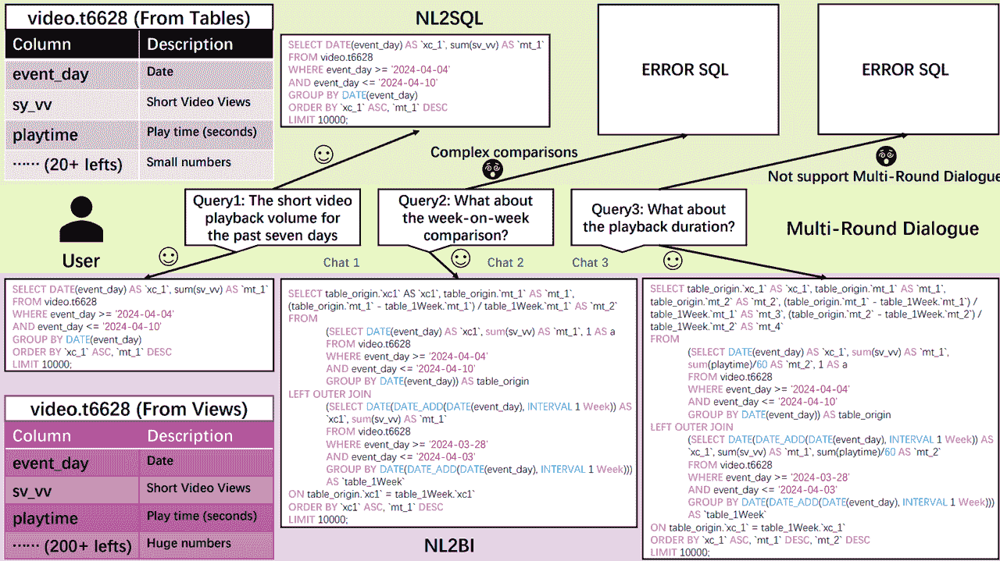


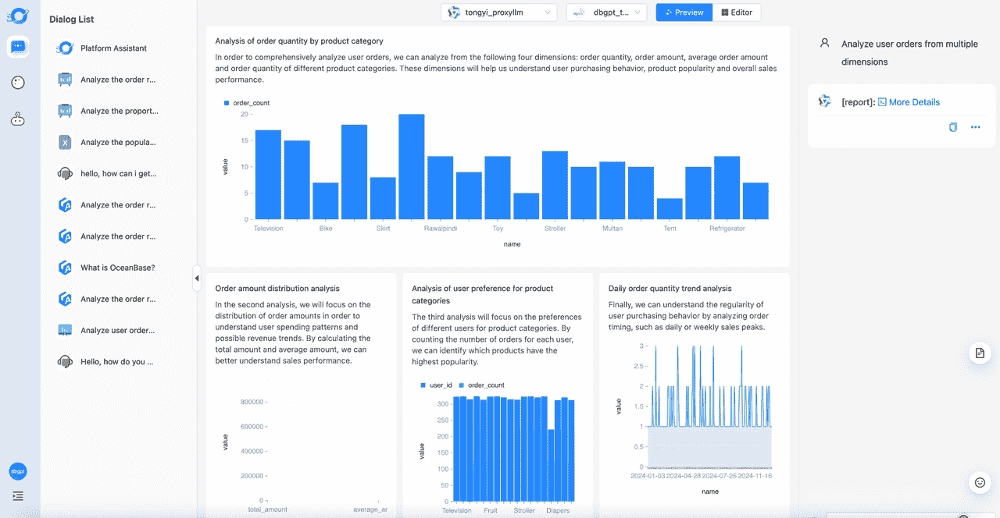

```

当然能实现NL2SQL功能的落地方案很多，如我们上面使用到的LangChain框架，还有像LangGraph、AutoGen、Google ADK等都有不同的实现形式。而我们所需要关注的是：虽然在开发框架的帮助下可以快速完成功能，但NL2SQL技术实现的挑战也很多，如下图所示，就是针对 BI 场景中“多表、多维度、多列”复杂 SQL 生成问题，提出视图选择＋分阶段流程：
> 论文地址：https://arxiv.org/pdf/2405.00527

这张流程图展示了传统 NL2SQL 与 NL2BI 在实际业务分析场景中的核心区别：

+   上半部分（NL2SQL）：只能处理单轮对话（Single-Round Dialogue），如 Query 1 “过去七天的短视频播放量”，能生成正确 SQL；但当用户追问“环比”或“播放时长”等复杂比较时，NL2SQL 模型无法保留上下文，会输出错误 SQL。

+   下半部分（NL2BI）：在 ChatBI 框架下支持多轮对话（Multi-Round Dialogue）与复杂语义关系。模型会记住上下文，连续生成 Query 2、Query 3 对应的 SQL ——包括环比计算（week-on-week comparison）和播放时长（playtime duration）比较。

+   左侧表格：示例 video.t6628 数据源，展示 BI 表中列很多（上百列），而 NL2SQL 一般只面对几十列。

+   右上角“ERROR SQL”区：说明现有 NL2SQL 在面对多轮复杂问题时易失败。

简言之，NL2SQL 如何从“单轮查询生成”扩展为“多轮、复杂、上下文感知的 BI 分析对话”，以及如何解决真实数据分析任务中的交互性与复杂性问题，还需要做更多细节性的开发工作。

典型的开源项目就是 DB-GPT：https://github.com/eosphoros-ai/DB-GPT , 由蚂蚁集团发起的开源项目，重点在数据库交互和商业智能领域。它提供了一个框架，让大模型与企业数据库无缝对接，实现“用对话查询和分析数据库”的应用.
NL2SQL现在借助大模型技术手段可以很好的实现，但是业务指标的语义理解，则更多情况下是依赖数据分析的人工经验来“调教Agent”。比如"GMV"、"ROI"、"客单价"这些业务术语，大模型不一定天然理解它们在你们公司的具体定义。这是容易被忽视但极其重要的一环

## 2.2 LangChain搭建NL2Coder Agent(探索式数据分析类)

如果说第一个场景是"有目标的任务执行"，那么第二个场景就是"开放式的数据探索"。数据科学家在面对新数据集时，往往需要不断提问、验证假设、发现规律。这个过程充满了不确定性和创造性。

这种场景下，企业希望打造的是一个对话式的数据分析助手，让用户能够像和同事聊天一样，去快速探索数据之间的潜在关系。所以要做到的就是技术点升级，从从 NL2SQL 到 NL2Code。

与场景一不同，探索式分析往往需要更灵活的数据操作。单纯的 SQL 查询已经不够用了，我们需要让 Agent 能够生成并执行 Python 代码。举个例子:

> 用户问："这两个变量之间有相关性吗？"

> Agent 可能会生成这样的代码：

```
    # Agent 自动生成的相关性分析代码
    import pandas as pd
    import matplotlib.pyplot as plt
    import seaborn as sns

    # 假设 df 是已经加载的 DataFrame
    # 计算两个变量的相关系数
    correlation = df[&#x27;变量A&#x27;].corr(df[&#x27;变量B&#x27;])
    print(f&quot;相关系数: {correlation:.3f}&quot;)

    # 绘制散点图
    plt.figure(figsize=(10, 6))
    sns.scatterplot(data=df, x=&#x27;变量A&#x27;, y=&#x27;变量B&#x27;, alpha=0.6)
    plt.title(f&#x27;变量A vs 变量B (相关系数: {correlation:.3f})&#x27;)
    plt.xlabel(&#x27;变量A&#x27;)
    plt.ylabel(&#x27;变量B&#x27;)
    plt.show()
```

数据探索类场景需要Agent突破传统 SQL 的限制，可以执行任意复杂的数据分析操作：数据清洗、特征工程、统计检验、甚至机器学习建模。同样，该过程我们可以利用LangChain框架来实现，只不过构建过程要更加复杂一些。

首先在上一个案例的基础上，需要安装额外的依赖，包括：

+   pandas: 数据处理

+   matplotlib: 绘图

+   seaborn: 高级可视化

```
%pip install -qU pandas matplotlib seaborn numpy
```

```
WARNING: Running pip as the &#x27;root&#x27; user can result in broken permissions and conflicting behaviour with the system package manager, possibly rendering your system unusable. It is recommended to use a virtual environment instead: https://pip.pypa.io/warnings/venv. Use the --root-user-action option if you know what you are doing and want to suppress this warning.
Note: you may need to restart the kernel to use updated packages.
```

然后，从数据库加载数据到 Pandas DataFrame，便于后续分析。

```
import pandas as pd
import matplotlib.pyplot as plt
import seaborn as sns
import numpy as np
from io import StringIO

# 设置中文字体（避免中文乱码）
plt.rcParams[&#x27;font.sans-serif&#x27;] = [&#x27;SimHei&#x27;, &#x27;DejaVu Sans&#x27;]
plt.rcParams[&#x27;axes.unicode_minus&#x27;] = False

# 从数据库加载数据 - 使用 _engine（私有属性）
employees_df = pd.read_sql_query(&quot;SELECT * FROM employees&quot;, db._engine)
products_df = pd.read_sql_query(&quot;SELECT * FROM products&quot;, db._engine)
orders_df = pd.read_sql_query(&quot;SELECT * FROM orders&quot;, db._engine)

print(&quot;数据加载成功！&quot;)
print(f&quot;\n数据概览：&quot;)
print(f&quot;  • 员工表: {len(employees_df)} 行&quot;)
print(f&quot;  • 产品表: {len(products_df)} 行&quot;)
print(f&quot;  • 订单表: {len(orders_df)} 行&quot;)
print(f&quot;\n示例数据（员工表前3行）：&quot;)
print(employees_df.head(3))
```

```
数据加载成功！

数据概览：
  • 员工表: 5 行
  • 产品表: 4 行
  • 订单表: 5 行

示例数据（员工表前3行）：
   id name department   salary   hire_date
0   1   张三        技术部  15000.0  2023-01-15
1   2   李四        销售部  12000.0  2023-02-20
2   3   王五        技术部  18000.0  2022-11-10
```

接下来创建一个自定义工具，让 Agent 能够执行 Python 代码进行数据分析和可视化。

```
from langchain.tools import tool
import traceback
from contextlib import redirect_stdout

@tool
def execute_python_code(code: str) -&gt; str:
    &quot;&quot;&quot;
    执行Python代码进行数据分析和可视化。
    
    可用的全局变量：
    - employees_df: 员工数据DataFrame
    - products_df: 产品数据DataFrame  
    - orders_df: 订单数据DataFrame
    - pd: pandas库
    - plt: matplotlib.pyplot
    - sns: seaborn
    - np: numpy
    
    代码示例：
    # 计算统计量
    result = employees_df[&#x27;salary&#x27;].describe()
    print(result)
    
    # 绘制图表
    plt.figure(figsize=(10, 6))
    employees_df.groupby(&#x27;department&#x27;)[&#x27;salary&#x27;].mean().plot(kind=&#x27;bar&#x27;)
    plt.title(&#x27;各部门平均薪资&#x27;)
    plt.show()
    &quot;&quot;&quot;
    # 准备执行环境
    globals_dict = {
        &#x27;employees_df&#x27;: employees_df,
        &#x27;products_df&#x27;: products_df,
        &#x27;orders_df&#x27;: orders_df,
        &#x27;pd&#x27;: pd,
        &#x27;plt&#x27;: plt,
        &#x27;sns&#x27;: sns,
        &#x27;np&#x27;: np,
    }
    
    locals_dict = {}
    
    # 捕获输出
    output = StringIO()
    
    try:
        # 重定向标准输出
        with redirect_stdout(output):
            # 执行代码
            exec(code, globals_dict, locals_dict)
        
        result = output.getvalue()
        
        if not result:
            result = &quot;代码执行成功，无输出。&quot;
        
        return f&quot;执行成功\n\n{result}&quot;
        
    except Exception as e:
        error_msg = &quot;执行出错：{str(e)}\n\n{traceback.format_exc()}&quot;
        return error_msg

print(&quot;Python 代码执行工具创建成功！&quot;)
```

```
Python 代码执行工具创建成功！
```

最后，创建一个能够执行 Python 代码的 Agent，用于探索式数据分析。其能力包括数据探索和统计分析、数据清洗和转换、可视化图表生成、多步骤分析推理。

```
# 创建数据分析 Agent
data_analysis_tools = [execute_python_code]

analysis_agent = create_agent(
    model=model,
    tools=data_analysis_tools,
    system_prompt=&quot;&quot;&quot;你是一个专业的数据分析师，精通 Python、Pandas 和数据可视化。

可用数据：
1. employees_df - 员工表（字段：id, name, department, salary, hire_date）
2. products_df - 产品表（字段：id, product_name, category, price, stock）
3. orders_df - 订单表（字段：id, employee_id, product_id, quantity, order_date）

工作流程：
1. 理解用户的分析需求
2. 使用 execute_python_code 工具编写 Python 代码
3. 执行数据分析、统计计算或可视化
4. 用中文解释分析结果和洞察

代码规范：
- 使用 Pandas 进行数据处理
- 绘图时设置合适的图表大小 plt.figure(figsize=(10, 6))
- 添加标题、标签等让图表更清晰
- **图表标题和标签使用英文（避免中文显示问题）**
- 使用 print() 输出关键结果

注意：
- 每次只执行一段完整的代码
- 先进行数据探索，再进行深入分析
- 结果要有业务洞察，不只是数字
- 图表使用英文标题，但用中文向用户解释
&quot;&quot;&quot;,
)

print(&quot;数据分析 Agent 创建成功！&quot;)
```

```
数据分析 Agent 创建成功！
```

现在便可以开始用自然语言进行探索式数据分析！

```
import warnings

# 抑制所有警告
warnings.filterwarnings(&#x27;ignore&#x27;)

# 示例 1：基础统计分析
question1 = &quot;分析一下员工薪资的分布情况，包括均值、中位数、最大最小值等统计量&quot;

print(f&quot;问题: {question1}&quot;)
print(&quot;=&quot;*60)

response1 = analysis_agent.invoke({
    &quot;messages&quot;: [{&quot;role&quot;: &quot;user&quot;, &quot;content&quot;: question1}]
})

# 打印最终回答
final_msg = response1[&quot;messages&quot;][-1]
print(f&quot;\n分析结果:\n{final_msg.content}&quot;)
print(&quot;\n&quot; + &quot;=&quot;*60)
```

```
问题: 分析一下员工薪资的分布情况，包括均值、中位数、最大最小值等统计量
============================================================


```
```
分析结果:
## 员工薪资分布分析总结

基于数据分析，我为您提供以下洞察：

### 📊 基本统计信息
- **员工总数**: 5人
- **平均薪资**: 14,200元
- **薪资中位数**: 15,000元
- **薪资范围**: 10,000 - 18,000元
- **薪资跨度**: 8,000元
- **标准差**: 3,194元（变异系数22.5%）

### 📈 分布特征
1. **均匀分布**: 薪资在各个区间分布相对均匀，每个薪资区间都有1名员工
2. **无异常值**: 薪资数据中没有发现异常值
3. **中等离散程度**: 变异系数22.5%表明薪资离散程度适中

### 🏢 部门薪资对比
- **技术部**: 平均薪资最高（16,500元），薪资范围15,000-18,000元
- **销售部**: 平均薪资14,000元，薪资范围12,000-16,000元
- **人力资源部**: 薪资最低（10,000元）

### 💡 业务洞察
1. **薪资结构合理**: 技术部门薪资较高，符合行业特点
2. **分布均衡**: 薪资在各区间分布均匀，没有明显的薪资聚集
3. **激励空间**: 销售部门薪资差异较大，可能存在绩效激励机制

### 🔍 建议
- 可以考虑进一步分析薪资与入职时间的关系
- 观察薪资分布是否与员工绩效相关
- 评估各部门薪资水平是否具有市场竞争力

============================================================
```

```
# 示例 2：数据可视化
question2 = &quot;画一个柱状图，展示各部门的平均薪资对比&quot;

print(f&quot;问题: {question2}&quot;)
print(&quot;=&quot;*60)

response2 = analysis_agent.invoke({
    &quot;messages&quot;: [{&quot;role&quot;: &quot;user&quot;, &quot;content&quot;: question2}]
})

final_msg = response2[&quot;messages&quot;][-1]
print(f&quot;\n分析结果:\n{final_msg.content}&quot;)
print(&quot;\n&quot; + &quot;=&quot;*60)
```

```
问题: 画一个柱状图，展示各部门的平均薪资对比
============================================================


```
```
分析结果:
## 分析结果解释

从柱状图可以看出各部门的平均薪资对比情况：

**薪资排名：**
1. **技术部** - 平均薪资16,500元（最高）
2. **销售部** - 平均薪资14,000元
3. **人力资源部** - 平均薪资10,000元（最低）

**业务洞察：**
- 技术部门薪资最高，这可能反映了市场对技术人才的强烈需求和较高的技能门槛
- 销售部门薪资居中，通常销售岗位有基本薪资加提成的结构
- 人力资源部门薪资相对较低，这可能与该岗位的市场定位和技能要求有关
- 最高与最低部门之间的薪资差距达到6,500元，显示出明显的部门间薪资差异

这种薪资结构在大多数企业中是比较典型的，技术类岗位通常因为技能稀缺性而获得较高薪酬。

============================================================
```

```
# 查看完整的执行过程
question = &quot;计算每个产品类别的库存总量，并用水平条形图展示&quot;

print(f&quot;问题: {question}&quot;)
print(&quot;=&quot;*60)

response = analysis_agent.invoke({
    &quot;messages&quot;: [{&quot;role&quot;: &quot;user&quot;, &quot;content&quot;: question}]
})

# 打印所有消息，包括生成的代码
for i, msg in enumerate(response[&quot;messages&quot;]):
    msg_type = msg.__class__.__name__
    
    if msg_type == &quot;AIMessage&quot; and hasattr(msg, &#x27;tool_calls&#x27;) and msg.tool_calls:
        print(f&quot;\nAI 决策 #{i}:&quot;)
        for tool_call in msg.tool_calls:
            tool_name = tool_call.get(&#x27;name&#x27;, &#x27;unknown&#x27;)
            tool_args = tool_call.get(&#x27;args&#x27;, {})
            
            if tool_name == &quot;execute_python_code&quot;:
                code = tool_args.get(&#x27;code&#x27;, &#x27;&#x27;)
                print(f&quot;  ├─ 调用工具: {tool_name}&quot;)
                print(f&quot;  └─ 生成的Python代码:\n&quot;)
                print(&quot;```python&quot;)
                print(code)
                print(&quot;```\n&quot;)
    
    elif msg_type == &quot;ToolMessage&quot;:
        print(f&quot;工具返回 #{i}:&quot;)
        result = msg.content[:500] + &quot;...&quot; if len(msg.content) &gt; 500 else msg.content
        print(f&quot;{result}\n&quot;)

# 最终回答
print(&quot;=&quot;*60)
final_msg = response[&quot;messages&quot;][-1]
print(f&quot;\n💡 最终回答:\n{final_msg.content}&quot;)
```

```
问题: 计算每个产品类别的库存总量，并用水平条形图展示
============================================================


```
```
AI 决策 #1:
  ├─ 调用工具: execute_python_code
  └─ 生成的Python代码:

```python
# 首先查看产品数据的基本信息
print(&quot;产品数据基本信息:&quot;)
print(products_df.info())
print(&quot;\n产品数据前5行:&quot;)
print(products_df.head())
print(&quot;\n产品类别分布:&quot;)
print(products_df[&#x27;category&#x27;].value_counts())
```

工具返回 #2:
执行成功

产品数据基本信息:
&lt;class &#x27;pandas.core.frame.DataFrame&#x27;&gt;
RangeIndex: 4 entries, 0 to 3
Data columns (total 5 columns):
 #   Column        Non-Null Count  Dtype  
---  ------        --------------  -----  
 0   id            4 non-null      int64  
 1   product_name  4 non-null      object 
 2   category      4 non-null      object 
 3   price         4 non-null      float64
 4   stock         4 non-null      int64  
dtypes: float64(1), int64(2), object(2)
memory usage: 292.0+ bytes
None

产品数据前5行:
 ...


AI 决策 #3:
  ├─ 调用工具: execute_python_code
  └─ 生成的Python代码:

```python
# 计算每个产品类别的库存总量
category_stock = products_df.groupby(&#x27;category&#x27;)[&#x27;stock&#x27;].sum().sort_values(ascending=True)

print(&quot;每个产品类别的库存总量:&quot;)
print(category_stock)

# 绘制水平条形图
plt.figure(figsize=(10, 6))
category_stock.plot(kind=&#x27;barh&#x27;, color=[&#x27;skyblue&#x27;, &#x27;lightcoral&#x27;])
plt.title(&#x27;Total Stock by Product Category&#x27;)
plt.xlabel(&#x27;Total Stock Quantity&#x27;)
plt.ylabel(&#x27;Product Category&#x27;)
plt.grid(axis=&#x27;x&#x27;, alpha=0.3)

# 在条形上显示数值
for i, v in enumerate(category_stock):
    plt.text(v + 1, i, str(v), va=&#x27;center&#x27;)

plt.tight_layout()
plt.show()

# 计算库存占比
print(&quot;\n库存占比分析:&quot;)
total_stock = category_stock.sum()
for category, stock in category_stock.items():
    percentage = (stock / total_stock) * 100
    print(f&quot;{category}: {stock}件 ({percentage:.1f}%)&quot;)
```

工具返回 #4:
执行成功

每个产品类别的库存总量:
category
办公用品     30
电子产品    190
Name: stock, dtype: int64

库存占比分析:
办公用品: 30件 (13.6%)
电子产品: 190件 (86.4%)


============================================================

💡 最终回答:
## 分析结果解释

根据数据分析，我为您计算了每个产品类别的库存总量：

**库存总量统计：**
- **电子产品**：190件（占总库存的86.4%）
- **办公用品**：30件（占总库存的13.6%）

**业务洞察：**

1. **库存分布极不均衡**：电子产品占据了绝大部分库存（86.4%），而办公用品库存相对较少。

2. **库存管理建议**：
   - 电子产品库存充足，可能需要关注库存周转率，避免资金占用过多
   - 办公用品库存较少，可能需要考虑适当增加库存，确保供应稳定

3. **产品结构分析**：从数据可以看出，公司主要经营电子产品业务，办公用品可能只是辅助业务线。

这个分析可以帮助您更好地了解公司的库存结构，为库存管理和采购决策提供数据支持。
```

NL2SQL vs NL2Code 技术方案对比总结如下：

应用场景对比

| 维度 | NL2SQL Agent | NL2Code Agent |
| --- | --- | --- |
| **适用场景** | 结构化数据查询 | 探索式数据分析 |
| **复杂度** | 简单查询和聚合 | 复杂统计和建模 |
| **输出类型** | 表格数据 | 数据 + 图表 + 洞察 |
| **灵活性** | 受SQL限制 | 无限制 |
| **学习曲线** | 低 | 中等 |

这个实现方案中比较关键的是代码解释器的应用，企业环境中肯定是不可以使用应用服务器做代码解释的，一般都要在安全隔离的沙箱环境中处理代码逻辑，其基本流程如下：

```
    # 生产级实现
    LangChain Agent (代码生成)
        ↓
    + Docker/E2B (代码隔离执行)
        ↓  
    + 安全策略层 (权限控制、敏感操作检测)
        ↓
    + 审计日志 (所有执行记录)
        ↓
    = 企业级数据分析 Agent

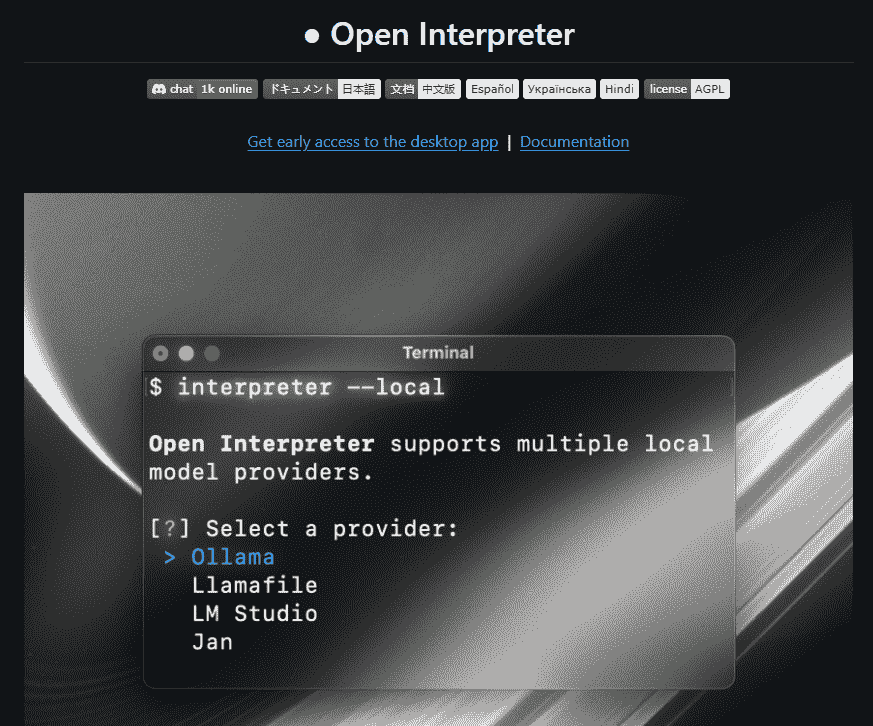


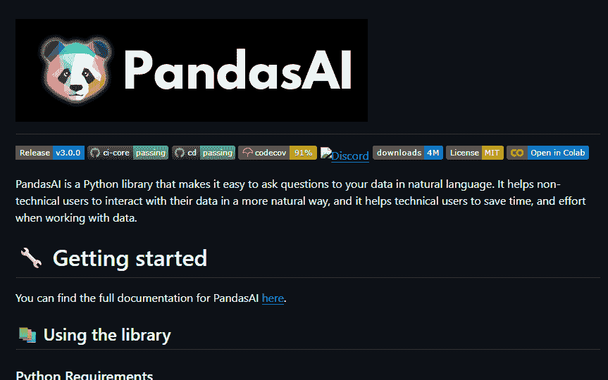


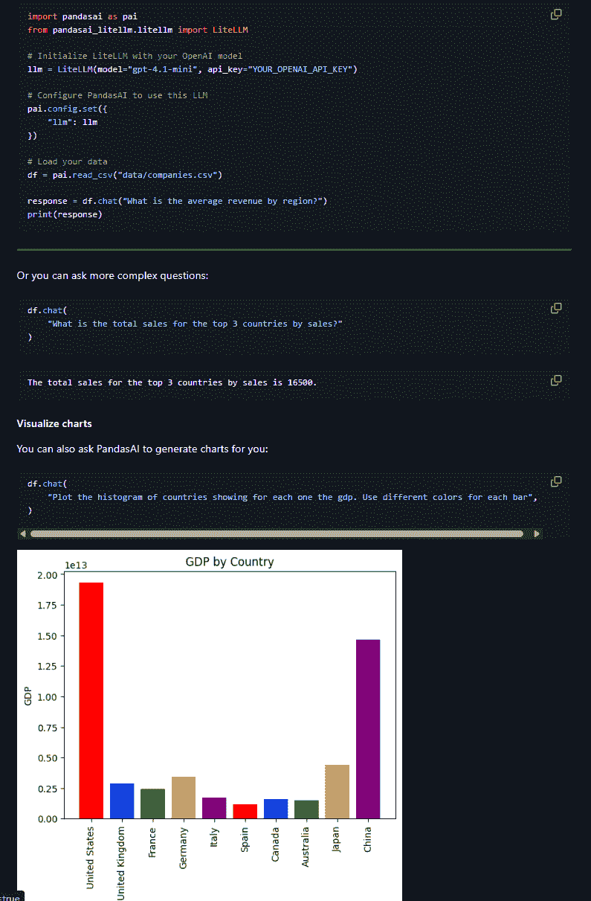


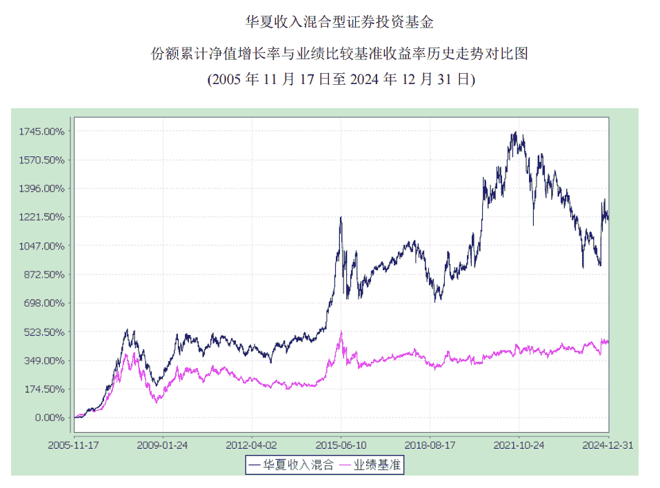


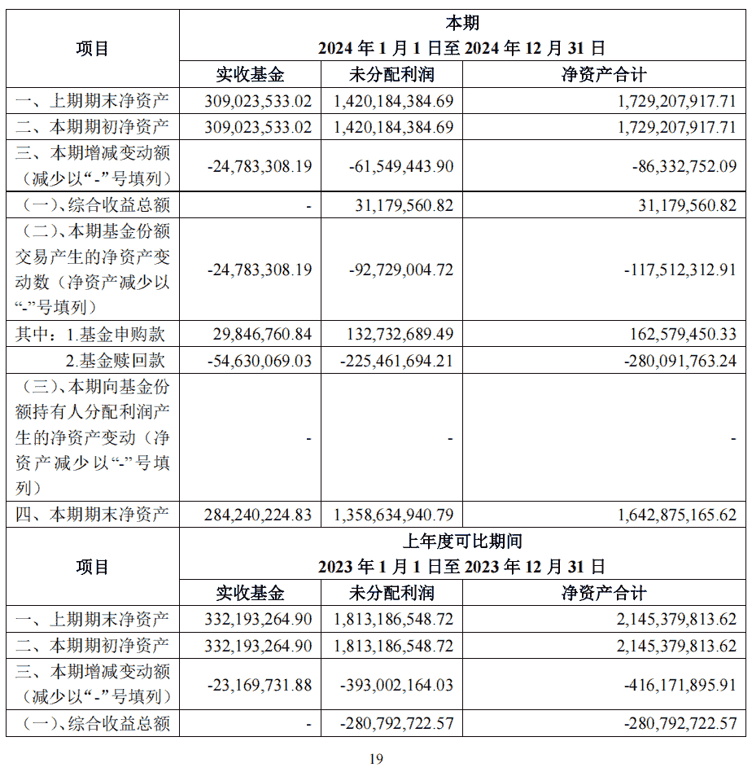

```

比较推荐且应用最广泛的项目是：Open Interpreter：https://github.com/openinterpreter/open-interpreter
Open Interpreter 是一个开源项目，它提供了一个安全的本地代码执行环境，并且支持多轮对话来逐步完善代码。

当然，除了代码解释器的环境，像多轮对话处理、Agent 工具调用等，在探索式分析场景下都是需要重点关注的技术栈。

## 2.3 文件数据实时分析（最复杂）

最后一个数据分析的场景类型聚焦于文件数据实时分析。比如：在会议中，高管在会议上突然问"我们在华东市场的占有率是多少？"，或者需要对竞争对手报告中的一张图表进行解读。包括如果我们需要根据某些文件内容快速生成针对该文件内容的洞察报告。时效性和多模态能力则变成了技术关键。

实时性的数据分析需要的数据往往是最新的。除了一些数据仓库的实时数据接口，当然免不了需要针对现有数据源先做解析再做数据分析的情况，比如找到一些 .csv/excel 文件，通过对话的方式让大模型解析数据，生成可视化报表或者针对文件的内容进行问答。

比如 PandasAI 则是在这个场景下非常优秀的开源项目。它的核心理念就是让你用对话的方式操作 DataFrame。https://github.com/sinaptik-ai/pandas-ai
其对话示例过程如下：
真实世界的数据不仅有结构化的表格，还有文档、图片、音频、JSON等非结构化形式。比如：

+   复杂图表
+   复杂表格
要做到基于文件的实时数据分析，数据的解析则是第一步，同时也是最难的一步。

# 三、DeepSeek-OCR 在数据分析中的应用

现代数据分析要的是多模态数据整合，不仅要处理表格数据，还要能理解：

+   **图像**：OCR 识别图表、PDF 报告中的图形

+   **文本**：分析用户评论、日志文件

+   **语音**：会议录音转文字后进行分析

例如PDF报告中的表格可以用表格抽取工具转换为CSV，图片中的图表和文字用OCR识别，音频用语音识别转文本，JSON/XML通过解析库提取字段。然后，大模型对提取的信息进行分析总结。先进的方案会直接引入视觉大模型或语音模型协同工作：比如让一个图像caption模型描述图表内容，再交由LLM分析。这实际上形成了一个多智能体协作或插件体系：根据输入数据类型，选择不同专家模型处理，再汇总结果。

这在技术上，可以通过组合多个专用模型来实现：

```
    多模态输入处理流程
    ├─ 图像 → OCR模型 → 文本
    ├─ 语音 → ASR模型 → 文本
    ├─ PDF → 文档解析 → 结构化数据
    └─ 全部汇聚到 LLM 进行统一分析

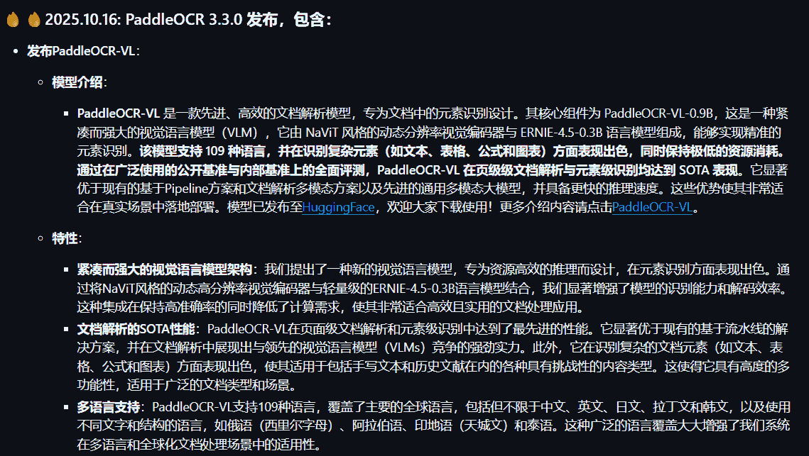


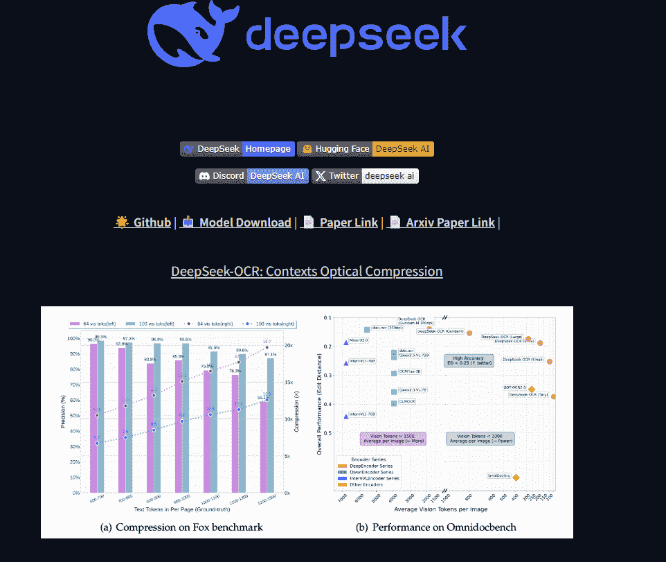


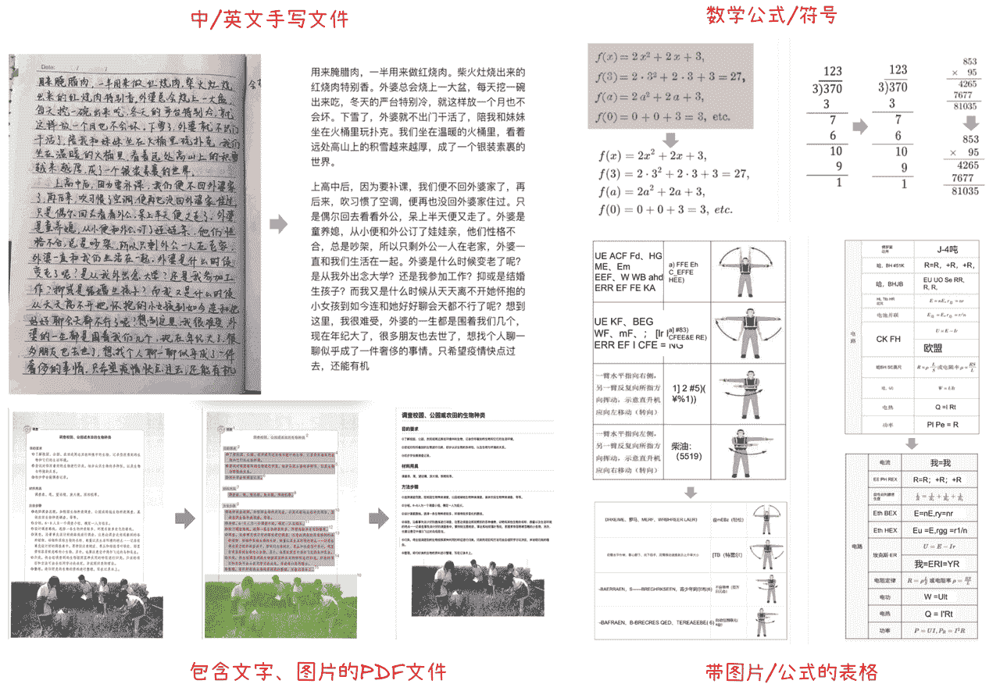

```

这样才能让数据分析Agent不局限于纯数字表，还能从更广泛的数据源获取洞察。

随着大模型技术的兴起，OCR 技术也迎来了新的快速发展机遇。2025年10月16日发布的 PaddleOCR-VL 模型直接屠榜，在全球权威榜单OmniDocBench V1.5中以92.6分夺得综合性能第一，横扫文本识别、公式识别、表格理解与阅读顺序四项SOTA。
而紧接其后，DeepSeek 也于 2025年10月21日发布了 DeepSeek-OCR 模型，仅需7G的显存，就能完成高精度的表格、公式识别，图片语义识别，并且在多项评测指标中一举拿下SOTA成绩。
这类模型的兴起，完全是源于真实应用需求的驱动。

OCR（全称：Optical Character Recognition，光学字符识别）是将包含文本的图像（如扫描文档、照片、表单、书页）转换成 机器可读的文本格式的技术，如下图所示：
在数据分析领域， OCR（光学字符识别）+ 计算机视觉技术主要涉及的是图表识别与重构，核心处理流程如下：

```
    输入：图表图片/ PDF多模态文件
        ↓
    【结构检测】识别坐标轴、图例、标题位置
        ↓
    【OCR提取】读取文字：轴标签、刻度值、数据标签
        ↓
    【图形识别】检测柱子、折线、点的位置和大小
        ↓
    【数据计算】根据像素位置和坐标刻度反推数值
        ↓
    【重新绘制】用提取的数据重新生成图表

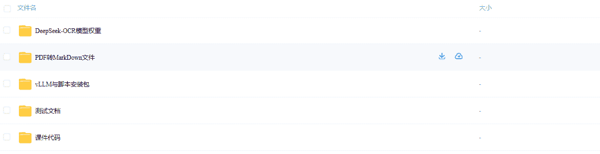


```

除了 OCR 方案，还可以利用多模态大模型（如 GPT-5、Qwen3-VL）来直接"看懂"图表，

+   输入：一张图表图片

+   输出：图表的文字描述和洞察

当然，DeepSeek-OCR 作为一个小参数量的VLM模型，在图表识别方面表现也非常优秀。本期公开课我们就不详细介绍 Deepseek-OCR 的本地部署流程，大家可以从百度网盘中领取详细的本地部署及运行测试文档。
# 四、【实战】使用DeepSeek-OCR构建多模态数据分析
这里我们以一个基金的PDF报告为例，给大家讲解一下实时多模态数据做数据分析的处理流程如下所示：

```
    1. 用户上传PDF文档
             ↓
    2. OCR识别 + 信息结构化（后台自动完成）
             ↓
    3. 用户提问：&quot;分析该基金2024年的整体业绩表现&quot;
             ↓
    4. 调用大模型接口
             ↓
    5. 返回：
        - HTML可视化报告（ECharts图表）
        - 文字摘要
             ↓
    6. 前端显示：
        - 左侧：渲染HTML可视化报告
        - 右侧：聊天框显示摘要文字
             ↓
    7. 用户操作：
    - 点击&quot;全屏查看&quot;：新窗口打开完整报告
    - 点击&quot;导出PDF&quot;：生成PDF文件（待开发）

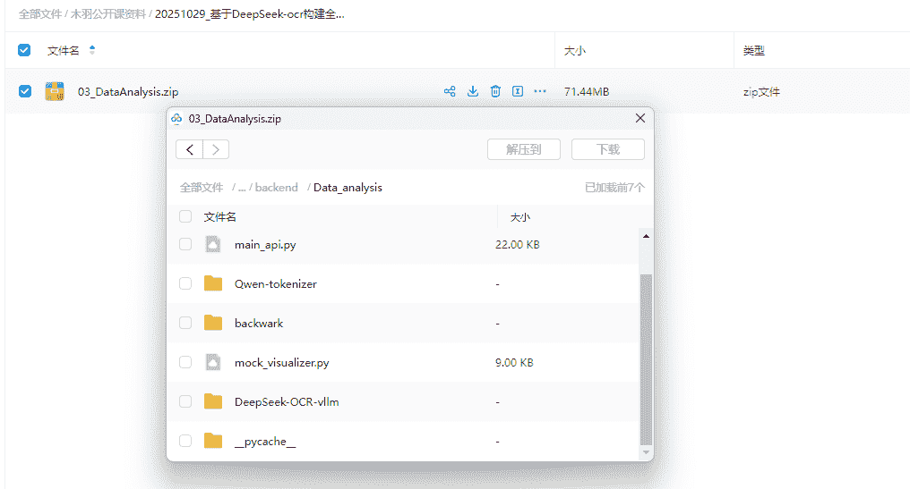


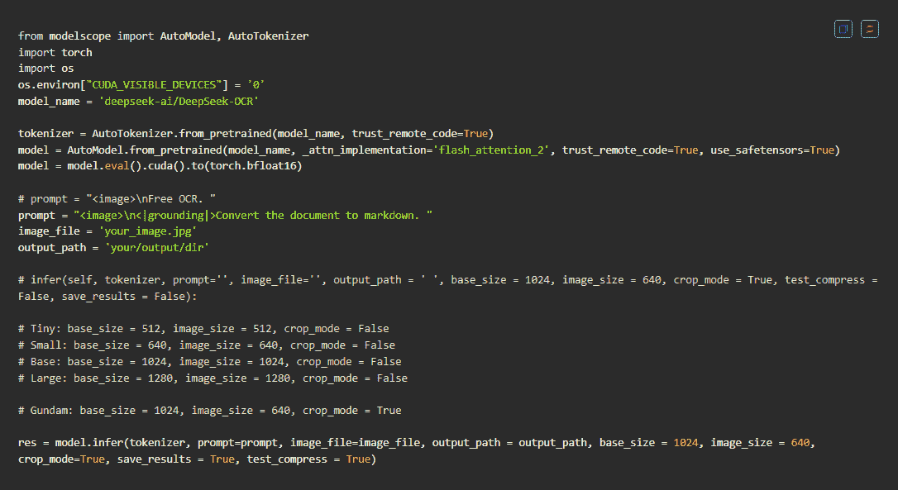


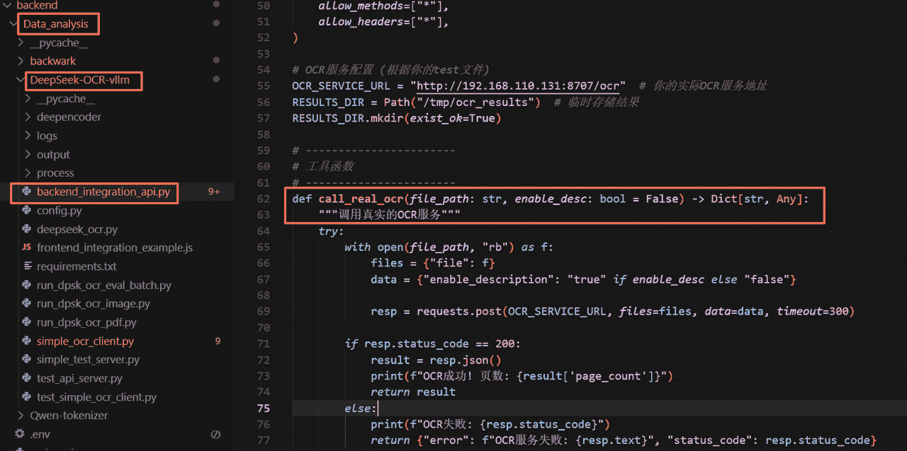

```

这里最关键，且最核心的就是如何将多模态的数据精准的解析出来。这一步操作的主要难点包括：

1.  如何精准的区分多模态数据中的图片、表格、文字、公式等数据类型；

1.  **在数据分析领域，很多有效的数据，并不仅仅在**表格中，关键的分析结论还可能夹杂在文字中；

1.  **大模型是有上下文限制的，一旦需要同时分析的文档**较多，那么是不可能把所有信息都给到大模型；

所以，除了借助OCR/VLM模型去对多模态数据进行解析外，还有一项比较关键的工作就是Agent上下文工程。

基于DeepSeek-OCR构建全自动数据分析系统的完整前后端源码，大家可以从百度网盘中领取详细的本地部署及运行测试文档。
+   **难点一：多模态数据解析**

大家可以根据上面的文档内容在本地启动DeepSeek-OCR在Vllm模型下的API服务，我们这里直接进行API调用及核心处理流程的技术方案讲解。

这里需要说明的是：为什么实时解析场景下需要用 vLLM 等推理框架加载模型，而不是直接用官方的方式来使用DeepSeek-OCR服务？
其一是因为vLLm等推理框架对模型的集成做了非常多推理上的优化，可以加快推理速度，提升推理效率。其次，通过在线的API服务不至于每次调用DeepSeek-OCR模型时，都要在本地启动服务，这对于企业级应用的实时性场景下是非常不适用的.

DeepSeek-OCR 可以直接处理 PDF 文件，自动识别多页内容并合并为完整的 Markdown 文本。
通过不同的提示词，对输入的PDF文档的每一页做格式化提取：

```
    # 固定 Prompt
    PROMPT_OCR = &quot;&lt;image&gt;\n&lt;|grounding|&gt;Convert the document to markdown.&quot;
    PROMPT_DESC = &quot;&lt;image&gt;\nDescribe this image in detail.&quot;


```

最终返回的是解析后的Markdown内容，如下所示：
+   难点二：超长上下文如何压缩

DeepSeek-OCR 识别出的 Markdown 内容虽然准确，但对于数据分析来说，还存在几个问题：

DeepSeek-OCR 原始输出的痛点

| 问题 | 具体表现 | 影响 |
| --- | --- | --- |
| **长文本难以理解** | 一份50页PDF可能产生10万字符 | LLM上下文长度限制 |
| **数据分散** | 表格、数字、结论混杂在文字中 | 难以快速提取关键信息 |
| **缺乏结构** | 纯文本流，没有层次和分类 | 后续分析效率低 |
| **信息冗余** | 包含大量描述性文字 | 干扰数据分析的准确性 |

```
    OCR输出 ≈ 10万字符文本
            VS
    LLM上下文 ≈ 12.8万 tokens (约10万字)
            ⬇
    单次分析刚好用完全部上下文！
            ⬇
    无法容纳Prompt、历史对话、分析结果
```

**  因此，我们需要**将 OCR 结果预处理为结构化数据，只保留关键信息供 LLM 分析。

所以需要将长文档转换为**易于分析的结构化数据**，这里做三步处理流程：

```
    步骤1：智能切片 (Chunking)
      └─ 按文档标题层级切分
      └─ 控制每块大小在1500 tokens左右
      └─ 保留完整的上下文信息

    步骤2：并发分析 (Concurrent Analysis)
      └─ 对每个块调用 LLM
      └─ 提取：摘要 + 表格 + 关键点
      └─ 多线程加速处理

    步骤3：结构化存储 (Structured Storage)
      └─ 统一 JSON 格式
      └─ 便于后续检索和分析
      └─ 支持可视化和报表生成

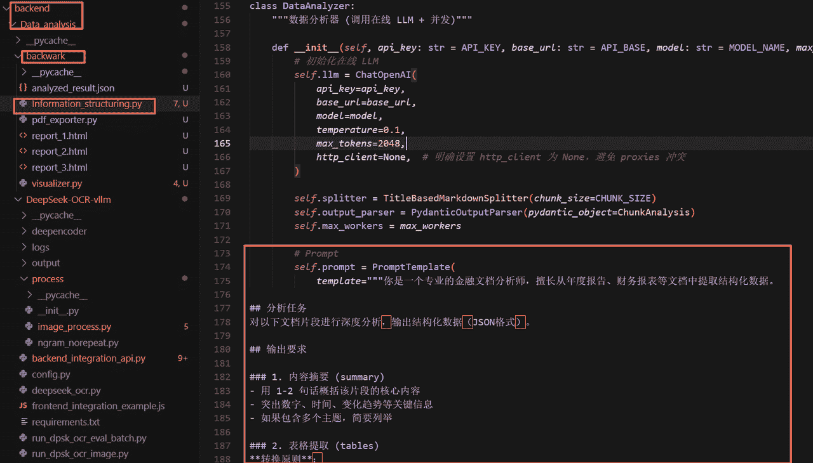


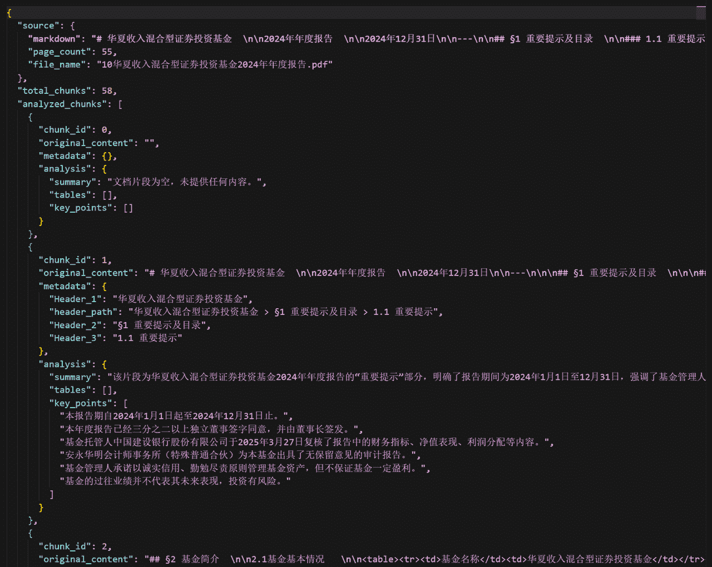

```

核心代码逻辑在：
最终返回的结构化数据如下所示：
方案优化效果对比

| 对比维度 | 直接分析原始Markdown | 结构化预处理 |
| --- | --- | --- |
| **上下文消耗** | 10万字符（接近上限） | 仅传必要信息（~5000字符） |
| **分析准确性** | 容易遗漏关键信息 | 提前提取，准确率高 |
| **处理速度** | 1次LLM调用 | n次切片+1次汇总（但可并发） |
| **成本** | 单次高token消耗 | 分散处理，总成本类似 |
| **可复用性** | 每次都要重新分析 | 结构化数据可缓存复用 |

**  最后，基于**前面我们通过结构化提取获得了易于分析的数据，但对于最终用户（特别是决策者）来说，他们需要的是：

数据呈现的三个层次

| 层次 | 形式 | 适用场景 | 局限性 |
| --- | --- | --- | --- |
| **原始数据** | JSON、表格 | 技术人员调试 | 难以快速理解趋势 |
| **文字分析** | 文本总结、要点 | 简单问答 | 缺乏直观性 |
| **可视化报表** | 图表 + 洞察 | 汇报、决策 | ✅ 最佳方式 |

而让LLM 生成可视化报告，我们采取的方案是：让 LLM 直接生成 HTML + ECharts 可视化代码

```
  输入：结构化数据 + 用户问题
           ↓
  【步骤1】构建知识库上下文
    └─ 提取所有表格（最重要）
    └─ 汇总关键要点
    └─ 组织章节摘要
           ↓
  【步骤2】设计 Prompt
    └─ 明确输出格式：HTML + Title + Summary
    └─ 指定可视化需求：至少7张图表
    └─ 定义设计风格：深色霓虹、玻璃拟物
           ↓
  【步骤3】LLM 生成
    └─ 输出完整的 HTML 代码
    └─ 包含 ECharts 可视化
    └─ 附带分析摘要
         ↓
  【步骤4】保存并展示
    └─ 保存为 .html 文件
    └─ 可直接用浏览器打开
    └─ 支持交互和导出

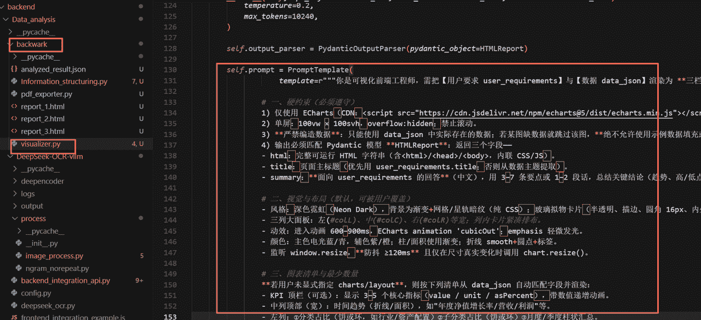

```

核心代码如下：
根据得到的 JSON 格式的分析结果，从结构化数据中提取关键信息，构建紧凑的上下文供 LLM 使用。LLM 会生成包含以下内容的交互式报告：

```
    &lt;!DOCTYPE html&gt;
    &lt;html&gt;
    &lt;head&gt;
        &lt;title&gt;2024年财务分析报告&lt;/title&gt;
        &lt;script src=&quot;https://cdn.jsdelivr.net/npm/echarts@5/dist/echarts.min.js&quot;&gt;&lt;/script&gt;
        &lt;style&gt;
            /* 深色霓虹风格 */
            body {
                background: linear-gradient(135deg, #1a1a2e 0%, #16213e 100%);
                color: #fff;
                font-family: Arial, sans-serif;
            }
            /* 三栏布局 */
            .container { display: flex; gap: 20px; }
            .col { flex: 1; }
            /* 玻璃拟物卡片 */
            .panel {
                background: rgba(255,255,255,0.05);
                border: 1px solid rgba(255,255,255,0.2);
                border-radius: 16px;
                padding: 20px;
                margin-bottom: 20px;
            }
        &lt;/style&gt;
    &lt;/head&gt;
    &lt;body&gt;
        &lt;h1&gt;2024年财务分析报告&lt;/h1&gt;
        &lt;div class=&quot;container&quot;&gt;
            &lt;div class=&quot;col&quot; id=&quot;colL&quot;&gt;
                &lt;!-- 左列：饼图、环图 --&gt;
            &lt;/div&gt;
            &lt;div class=&quot;col&quot; id=&quot;colC&quot;&gt;
                &lt;!-- 中列：趋势图、对比图 --&gt;
            &lt;/div&gt;
            &lt;div class=&quot;col&quot; id=&quot;colR&quot;&gt;
                &lt;!-- 右列：排行榜、分类柱状图 --&gt;
            &lt;/div&gt;
        &lt;/div&gt;
        &lt;script&gt;
            // ECharts 初始化代码...
        &lt;/script&gt;
    &lt;/body&gt;
    &lt;/html&gt;

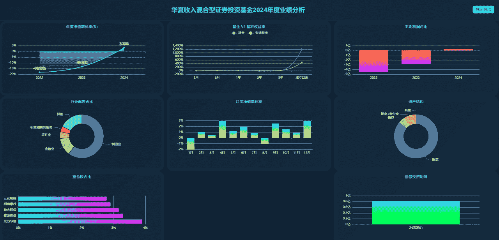

```
将所有步骤整合，形成**从文档到可视化报告的端到端流程**：

```
    ┌─────────────────────────────────────────────────┐
    │  输入：PDF文档 + 用户问题                        │
    │  &quot;分析2024年财务报告，重点关注收入和利润&quot;        │
    └──────────────────┬──────────────────────────────┘
                    ↓
            【第1步：文档识别】
            DeepSeek-OCR API
                    ↓
            输出：Markdown文本（10万字符）
                    ↓
            【第2步：智能切片】
            按标题分割为30个块
                    ↓
            【第3步：并发结构化提取】
            提取：摘要 + 表格 + 关键点
            耗时：（并发）
                    ↓
            【第4步：知识库构建】
            压缩为紧凑的上下文（2万字符）
                    ↓
            【第5步：LLM生成报告】
            输出：HTML + Title + Summary
                    ↓
            【第6步：保存展示】
            浏览器打开查看交互式报告
                    ↓
    ┌──────────────────┴──────────────────────────────┐
    │  输出：交互式HTML报告 + 文字分析摘要              │
    │  - 7+ 个可视化图表（ECharts）                    │
    │  - 3-5条核心洞察要点                             │
    │  - 支持交互、导出、分享                          │
    └─────────────────────────────────────────────────┘
```

# 五、全自动数据分析系统本地部署与上线

接下来，我就详细讲解如何从零搭建一个部署完整的智能数据分析系统。项目采用模块化设计，核心结构如下：

```
    DataAnalysis/                           # 项目根目录
    ├── 📁 backend/                            # 后端服务层
    │   ├── Data_analysis/
    │   │   ├── DeepSeek-OCR-vllm/            # OCR服务
    │   │   │   ├── backend_integration_api.py   # 🔥 主服务入口
    │   │   │   ├── simple_ocr_client.py         # OCR推理服务
    │   │   │   ├── config.py                    # OCR配置
    │   │   │   └── deepseek_ocr.py              # DeepSeek-VL模型封装
    │   │   ├── backwark/                     # 数据分析核心
    │   │   │   ├── Information_structuring.py   # 信息结构化
    │   │   │   ├── visualizer.py                # 可视化生成器
    │   │   │   └── pdf_exporter.py              # PDF导出
    │   │   └── mock_visualizer.py            # 测试用模拟器
    │   └── 10华夏收入混合型证券投资基金2024年年度报告.pdf  # 示例文档
    │
    └── /tmp/ocr_results/                      # 临时结果目录
        ├── status_*.json                     # 任务状态
        ├── *_analyzed.json                   # 结构化结果
        └── answer_*.html                     # 可视化报告
```

核心模块

| 模块 | 文件 | 功能 |
| --- | --- | --- |
| **主服务** | backend_integration_api.py | FastAPI服务，协调OCR→结构化→可视化流程 |
| **OCR推理** | simple_ocr_client.py | DeepSeek-VL推理服务（运行在 GPU 服务器） |
| **结构化分析** | Information_structuring.py | 使用LLM提取表格、要点、摘要 |
| **可视化** | visualizer.py | 生成 ECharts 交互式报告 |

环境配置要求

| 组件 | 版本要求 | 说明 |
| --- | --- | --- |
| **Python** | ≥ 3.10 | 推荐 3.11 |
| **CUDA** | ≥ 12.1 | DeepSeek-VL 需要GPU支持 |
| **GPU显存** | ≥ 16GB | 推荐 24GB+ |
| **系统内存** | ≥ 16GB | 推荐 32GB+ |

首先创建虚拟环境：

```
    # 创建新的虚拟环境
    conda create -n deepseek_ocr python=3.11 -y

    # 激活环境
    conda activate deepseek_ocr

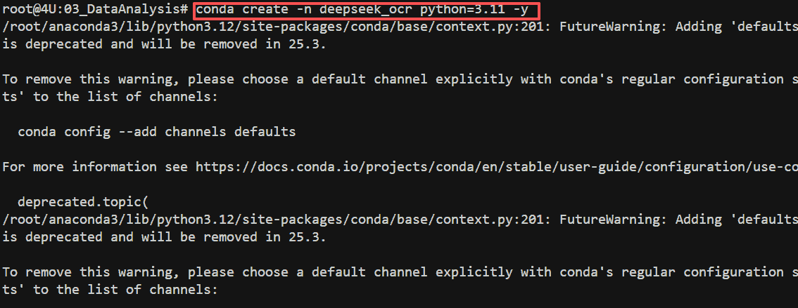


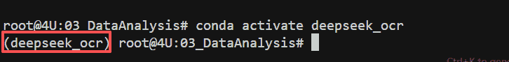

```
激活成功后，命令行前会显示 (deepseek_ocr)。
接下来安装项目依赖，执行

```
    cd backend/DeepSeek-OCR-vllm
    pip install -r requirements.txt
```

然后按照如下说明配置.env服务：

```
    # DeepSeek-OCR 配置
    DEEPSEEK_MODEL_PATH=/home/data/nongwa/workspace/model/OCR/DeepSeek-OCR
    DEEPSEEK_OCR_URL=http://192.168.110.131:8707/ocr
    DEEPSEEK_OCR_HOST=0.0.0.0
    DEEPSEEK_OCR_PORT=8707

    # 数据分析配置
    DATA_ANALYSIS_BASE_SIZE=1024
    DATA_ANALYSIS_IMAGE_SIZE=640
    DATA_ANALYSIS_CROP_MODE=true
    DATA_ANALYSIS_PROMPT=&quot;&lt;image&gt;\n&lt;|grounding|&gt;Convert the document to markdown.&quot;

    # 信息结构化配置
    QWEN_TOKENIZER_PATH=/home/data/nongwa/workspace/Data_analysis/Qwen-tokenizer
    ANALYSIS_CHUNK_SIZE=1500
    ANALYSIS_MAX_WORKERS=10
    ANALYSIS_API_KEY=sk-e3ffbd4facf5b
    ANALYSIS_API_BASE=https://dashscope.aliyuncs.com/compatible-mode/v1
    ANALYSIS_MODEL_NAME=qwen3-max

    # 可视化配置
    VISUALIZER_API_KEY=sk-e3ffbd4faceb4df5b
    VISUALIZER_API_BASE=https://dashscope.aliyuncs.com/compatible-mode/v1
    VISUALIZER_MODEL_NAME=qwen3-max

    # API服务配置
    API_HOST=0.0.0.0
    API_PORT=8708
    API_DEBUG=false
    API_RELOAD=false

    # 文件存储配置
    UPLOAD_DIR=/home/MuyuWorkSpace/03_DataAnalysis/backend/Data_analysis/output/ocr_uploads
    RESULTS_DIR=/home/MuyuWorkSpace/03_DataAnalysis/backend/Data_analysis/output/ocr_results
    TEMP_DIR=/home/MuyuWorkSpace/03_DataAnalysis/backend/Data_analysis/output/ocr_temp

    # 文件处理限制
    MAX_FILE_SIZE_MB=100
    SUPPORTED_EXTENSIONS=.jpg,.jpeg,.png,.pdf,.txt,.md

    # 并发和性能配置
    MAX_CONCURRENT_REQUESTS=5
    REQUEST_TIMEOUT=300
    CLEANUP_INTERVAL_HOURS=24

    # 开发环境配置
    ENVIRONMENT=development
    LOG_LEVEL=info
```

最后启动主服务

```
  # 确保在 deepseek_ocr 虚拟环境中
  conda activate deepseek_ocr

  # 进入项目目录
  cd /home/MuyuWorkSpace/03_DataAnalysis/backend/Data_analysis/DeepSeek-OCR-vllm

  # 启动主服务
  python backend_integration_api.py

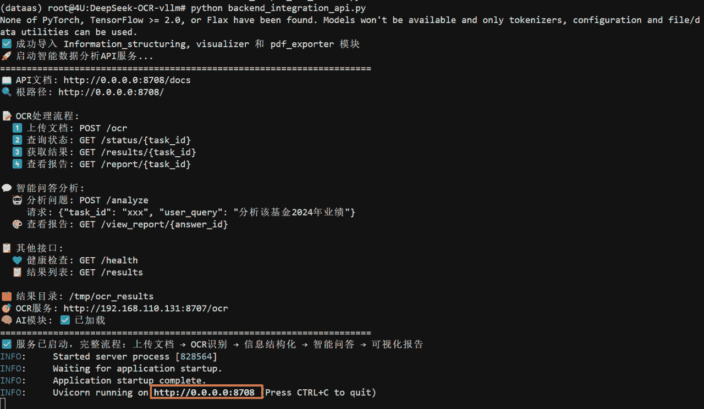


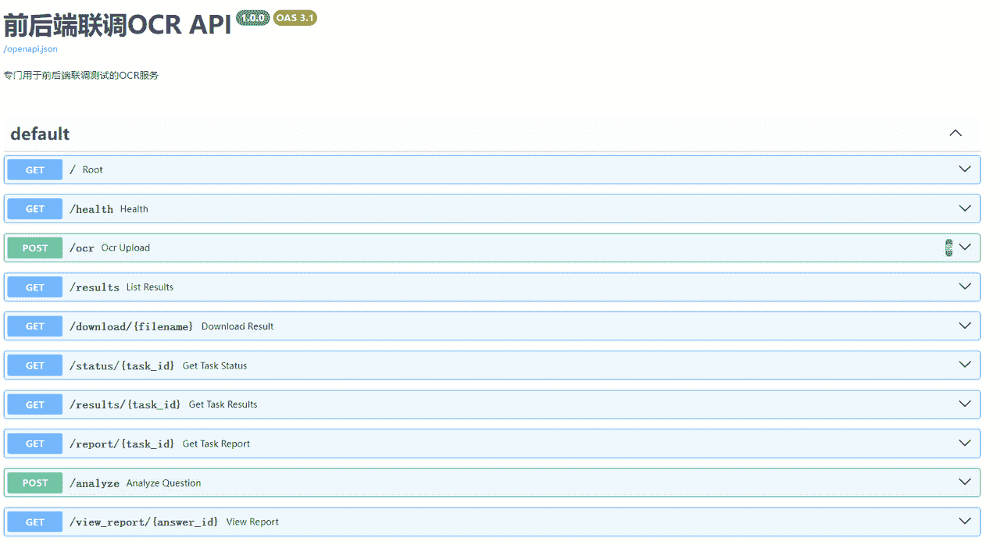

```
成功启动后，打开浏览器访问：http://localhost:8708/docs
接下来进入前端目录，安装Node.js依赖：

```
  # 进入前端目录
  cd /home/MuyuWorkSpace/03_DataAnalysis/frontend

  # 安装依赖（首次运行需要，耗时约2-5分钟）
  npm install

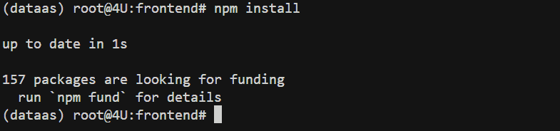

```
**核心前端技术栈：**

前端技术栈

| 技术 | 版本 | 用途 |
| --- | --- | --- |
| **React** | 18.3.1 | UI框架 |
| **TypeScript** | 5.6.3 | 类型系统 |
| **Vite** | 5.4.11 | 构建工具 |
| **TailwindCSS** | 3.4.15 | CSS框架 |
| **Radix UI** | 最新版 | 组件库 |
| **React Markdown** | 10.1.0 | Markdown渲染 |
| **KaTeX** | 0.16.25 | 公式渲染 |

依赖安装完成后，启动Vite开发服务器：

```
  # 在前端目录下执行
  npm run dev
```

启动成功后，终端会显示如下信息：

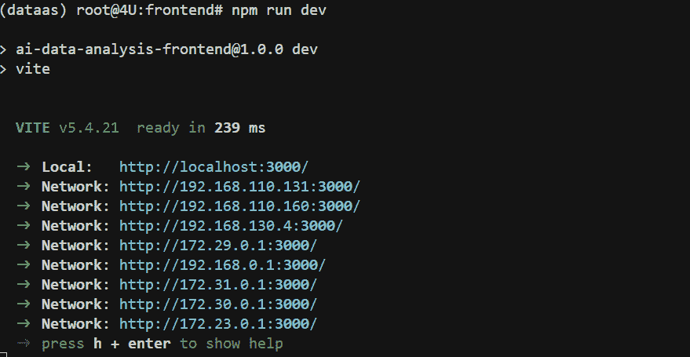

打开浏览器访问 http://localhost:3000，即可看到智能分析系统的前端界面。


至此，我们就完整实现了基于DeepSeek-OCR的全自动数据分析可视化系统的完整搭建，相信通过本节课程的学习，

**我们下期公开课，再见！** 👋