# LangChain v1.0 文档审核类Agent开发实战

> 来源：[https://kq4b3vgg5b.feishu.cn/docx/GAG2dwMWCoQlV4xrWJnc0vAwnBf](https://kq4b3vgg5b.feishu.cn/docx/GAG2dwMWCoQlV4xrWJnc0vAwnBf)

## 从技术选型到产品落地


本期公开课，我们将深入探索基于大语言模型的文档审核Agent技术方案。

+   文档审核类Agent系统功能速览

核心功能一：支持在线上传财务类票据，自动实现数据精准提取与审核功能：

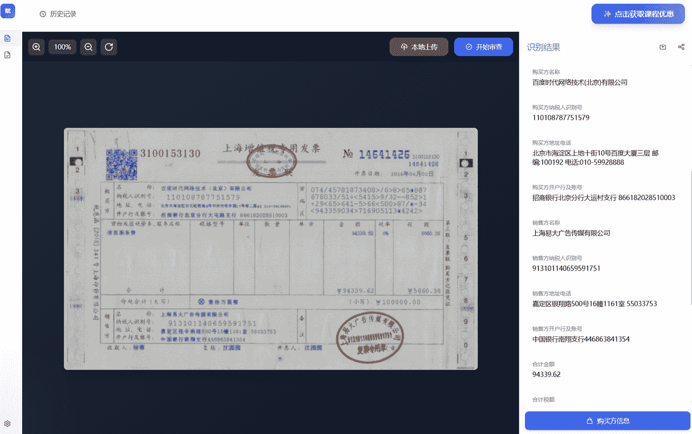

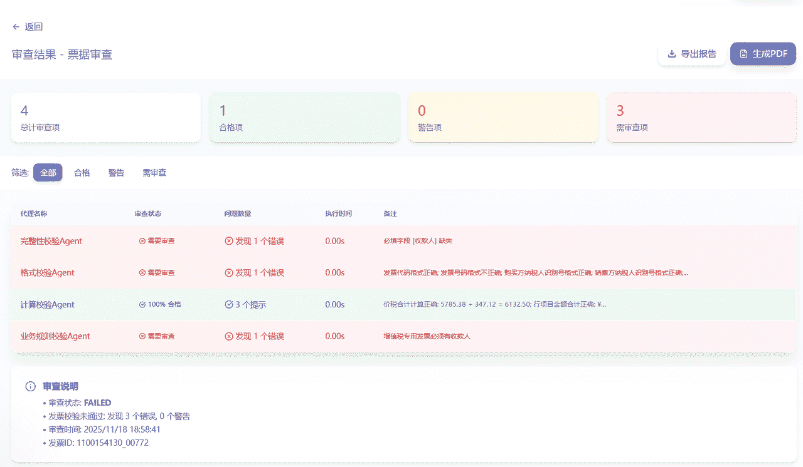

核心功能二：支持在线批量上传PDF法务合同文件，自动解析、分块，并能够自定义审核规则，自主完成内容审核及输出审核报告；

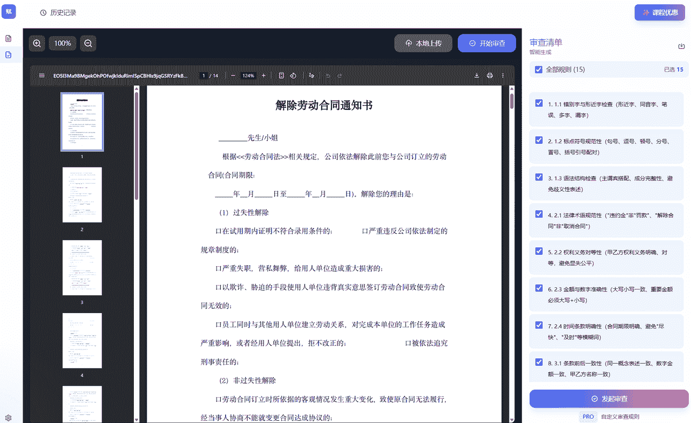

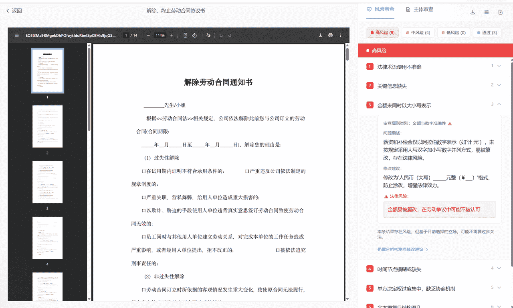

# 一、文档审核类AI成熟落地产品介绍

首先看一组数据，如下论文中是对法律大模型与传统法律合同审查员、初级律师和法律流程外包商进行了开创性的比较，并深入剖析了大模型在合同审查的准确性、速度和成本效益方面是否能够超越人类。而最终的实验结果表明，先进的大模型在确定法律问题方面的准确性能够达到甚至超过人类。在速度方面，大模型只需几秒钟即可完成审查，远超人类所需的数小时。在成本方面，大模型的运行成本仅为传统方法的几分之一，成本降低了惊人的 99.97%。

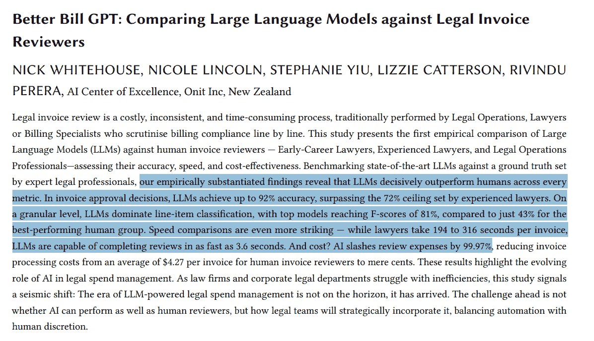

> 论文地址：https://arxiv.org/pdf/2401.16212

随着大模型能力的提升，将其作为智能代理用于专业文档的合规性审核已经从理论变为现实，并且在多个行业中展现出了惊人的效率提升。

**文档合规审核指的是根据法律法规、行业规范或企业内部规则，对各种专业文件进行内容和格式上的检查，以发现潜在**的违规或缺陷之处。典型场景包括：合同文档的法律合规审核、财务票据的规范校验、以及标书、公文等特定格式文件的规则符合性检查。以下是我们国内已经落地的在文档审核类产品中大模型的落地场景：

+   **阿里的通义法睿**：可以用于快速识别合同潜在风险，并提供专业的风险评估和修改建议。 体验地址：https://tongyi.aliyun.com/farui/review

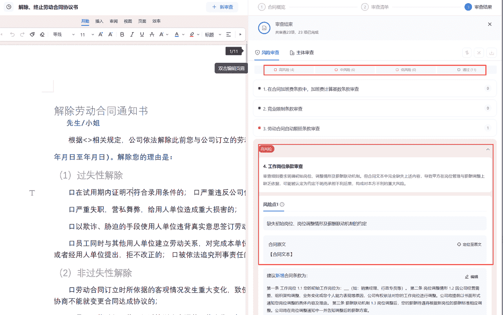

+   百度的财务、医疗、教育票据OCR识别及自动审查 ： https://ai.baidu.com/tech/ocr_receipts/vat_invoice

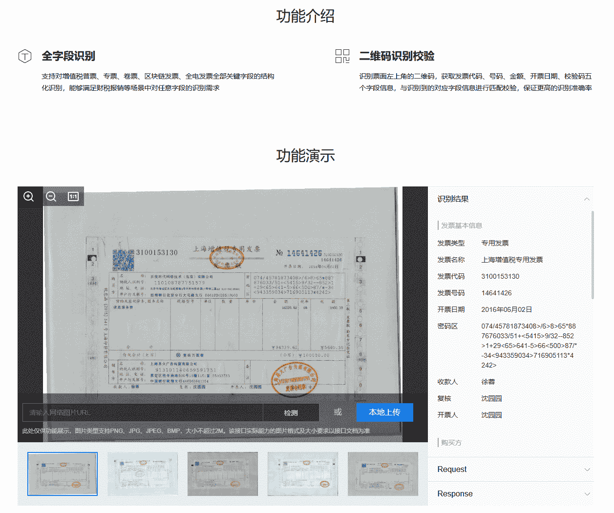

+   **语核科技的数字员工（文档审查方向）：ht**tps://langcore.cn/zh

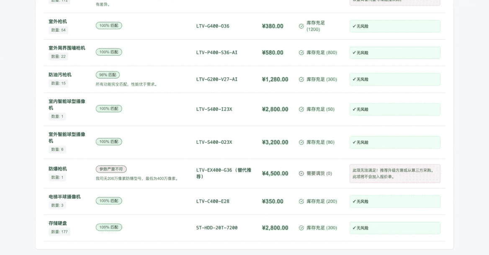

诸如此类的文档合规审核Agent是指基于大语言模型构建的智能代理系统，能够根据法律法规、行业规范或企业内部规则，自动对专业文件进行内容和格式上的检查，发现潜在的违规或缺陷之处，从而避免人工审核耗时耗力等诸多问题。同时也正是在这样的需求痛点下，文档审核类Agent目前主要应用在如下经典场景下：

文档审核Agent核心应用场景

| 场景类型 | 审核内容 | 核心价值 | 难度等级 |
| --- | --- | --- | --- |
| **法务合同审核** | 必要条款检查、法律风险识别、措辞合规性 | 降低法律风险、提升审核效率 | ⭐⭐⭐⭐⭐ |
| **财务票据校验** | 发票真伪、金额计算、政策合规 | 减少财务错误、加速报销流程 | ⭐⭐⭐⭐ |
| **标书公文审核** | 格式规范、必备内容、章节完整性 | 提高中标率、确保公文质量 | ⭐⭐⭐ |

之所以能够实现上述复杂工作流程的原因在于基于大模型构建而成的Agent具备自主决策和工具调用能力：

1.  **自主推理**：不只是执行预设规则，而是能理解文档语义、推理条款间的逻辑关系

1.  **工具编排**：可以主动调用外部工具（如计算器、数据库查询、API接口）来辅助判断

1.  **知识检索**：能从知识库中检索相关法规、案例，基于证据给出审核意见

1.  **链式思考**：像人类专家一样，分步骤、有逻辑地完成复杂审核任务


**举个例子**：审核一份采购合同时，Agent会先提取关键信息（供应商、金额、交付日期），然后检索公司采购政策，再核对预算系统中的额度，最后综合判断是否合规。这整个过程涉及多个步骤和工具调用，这就是Agent的核心能力。

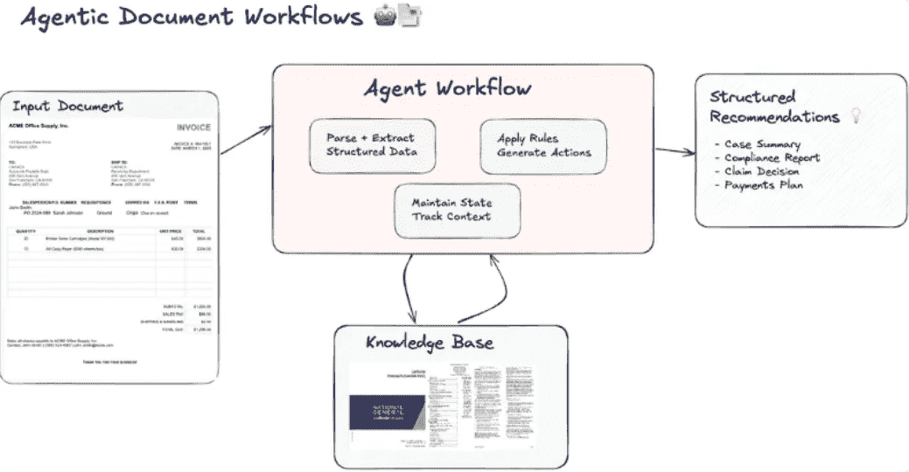

> 论文地址：https://arxiv.org/pdf/2501.09136

在合同、票据/收据、长篇公文等场景中，“大模型 + 工具调用 + 外部知识检索 + 规划/反思（Agentic模式）” 能把抽取、核对与基于证据的判断串成多步流程，用于自动化或半自动的合规审核。法务合同有 CUAD 这一权威标注集支撑条款级审核可行性；多模态文档 AI（如 LayoutLMv3 / LayoutLLM）显著提升了票据/表单/PDF 的结构化与问答能力；而 Agentic RAG/RA-LLM 则把检索、工具使用与多步推理纳入可控工作流。

同样，针对上图中的文档审核类的实现方案，如果进一步拆分则可以拆解为如下三大核心技术模块：

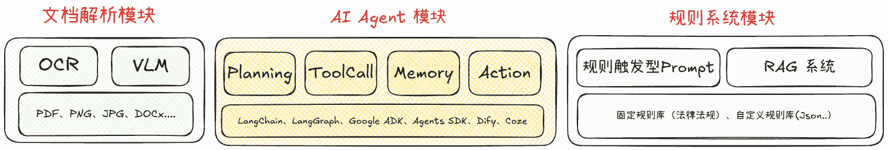

而如果再进一步拆解，则如下图所示：

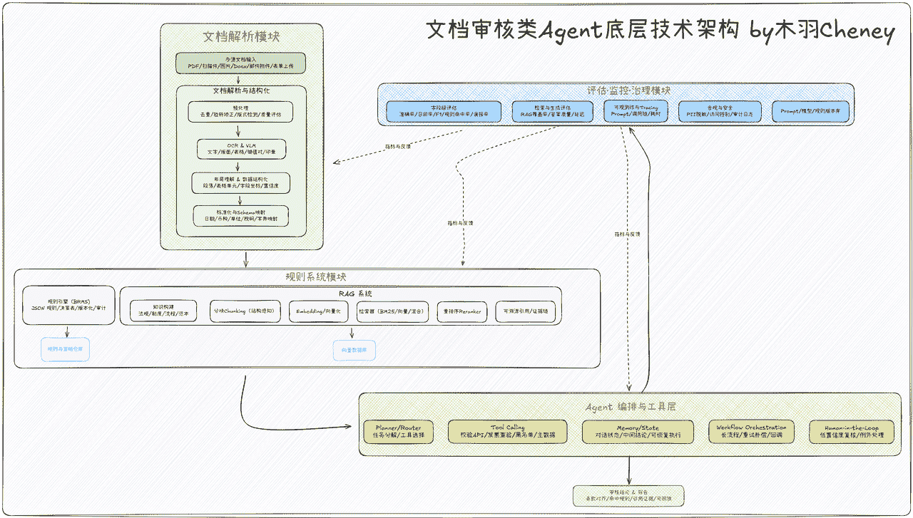

其中：

+   **解析与结构化**：主流 Document AI 都把 OCR/布局/**键值对/表格**抽取到统一 JSON，并附带置信度与坐标，便于后续规则与证据回链。

+   **规则与知识**：企业审核离不开**可配置规则引擎**（版本化/审计）与**RAG****（把法规与制度做**成可检索、可引用的知识源），并通过混合检索+重排序提升命中与可溯源性。

+   **Agent 编排**：用 **Lang**Graph/LangChain 等做计划-工具调用-记忆-长流程编排，并把人类在环作为低置信度的兜底环节。

+   **评估与治理**：上线后需要字段级与 RAG 两路评估、Tracing/监控，以及 PII/审计合规治理，形成持续改进闭环。

所以一个相对比较健全的文档审核类Agent的实现，不仅需要我们掌握 Agent 及 RAG 的底层技术原理，还需要我们掌握多模态大模型、多 Agent 协作、Prompt 工程、Agent 编排等技术。综合起来是相对较难的落地场景。

此外，对于文档的精准解析是文档审核类Agent落地的关键，也主要分为OCR和VLM 两条实现链路，通过传统 OCR +规则的方法逐步转到现在基于 VLM-based 方法的革新，可以在不同场景下发挥各自的优势。

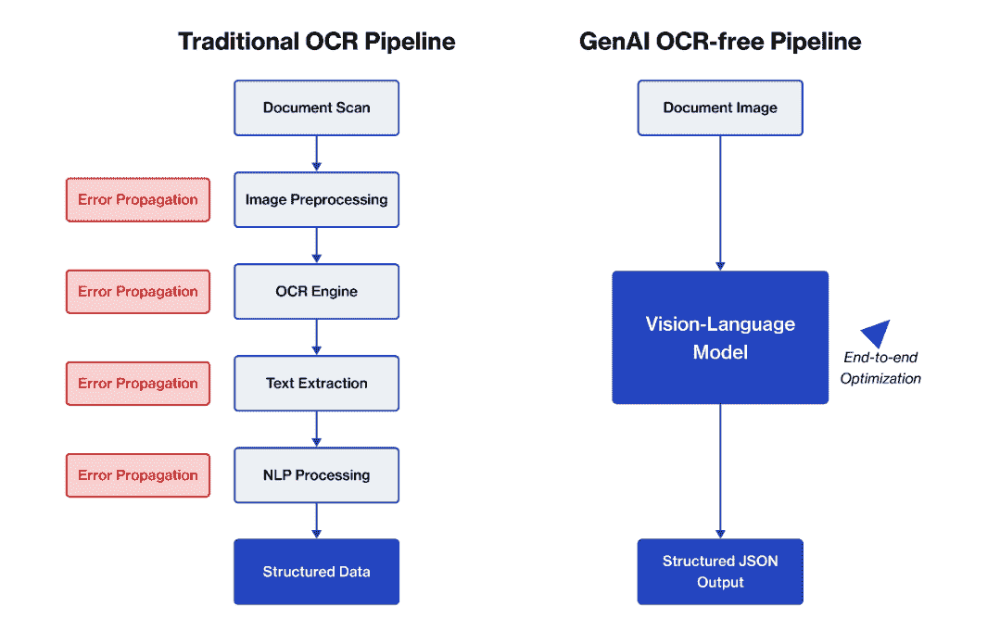

> 技术综述地址：https://www.firstsource.com/insights/whitepapers/document-processing-with-vlm

因此，本期公开课我们就从简到难，从基础的票据审核开始，逐步深入到更为复杂的合同审核，给大家全面讲解不同的解析和审核Agent构建思路，以及如何将这些方法应用到实际场景中。

# 二、多模态大模型搭建票据审核Agent

我们先从较为简单的需求场景开始，即票据类审核方向。财务部门需要审核各种票据和发票，确保其内容完整、真假有效，并符合财务规定（例如发票抬头、税号、金额计算正确，报销单据符合公司政策等）。传统手工核对易出错且耗费人力，引入大模型的Agent可自动解析票据并核查关键字段，极大提高效率。

一般来说，人工在处理票据的完整审核流程包括:

票据的人工审核标准流程

| 审核环节 | 工作内容 | 耗时 | 风险点 |
| --- | --- | --- | --- |
| ①真伪鉴别 | 税务局网站查验 | 2-3分钟 | 假发票、克隆票 |
| ②形式审核 | 检查发票代码、号码、印章等 | 1-2分钟 | 格式错误、要素缺失 |
| ③金额计算 | 验证价税合计、行项目加总 | 2-3分钟 | 计算错误、税率错误 |
| ④业务合理性 | 检查供应商资质、三流一致性 | 5-10分钟 | 虚构交易、关联交易 |
| ⑤税务合规 | 验证税率、抵扣资格 | 3-5分钟 | 税务风险 |
| ⑥归档管理 | 扫描、分类、录入系统 | 2-3分钟 | 资料遗失 |

如果我们做的合规性检查输入比较简单，且规范都是统一的，比如票据类，此类的审核规则都是比较规范的，我们只需要定制化的提取出某些数值，那么这类场景是非常适合直接使用多模态大模型构建Agent审核流程的。

通过结合**多模态大模型**和**多 Agent 协作**技术,实现发票审核的智能化:

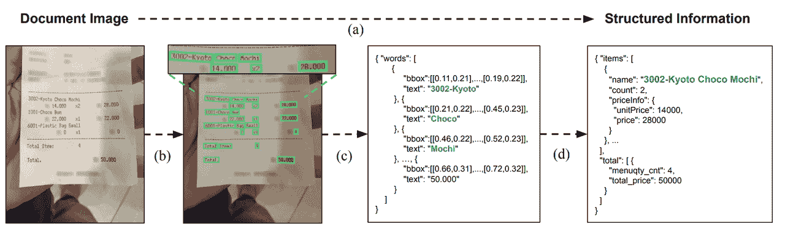

我们就可以非常迅速的确定出如下方案来实现票据类审核Agent的技术架构方案：

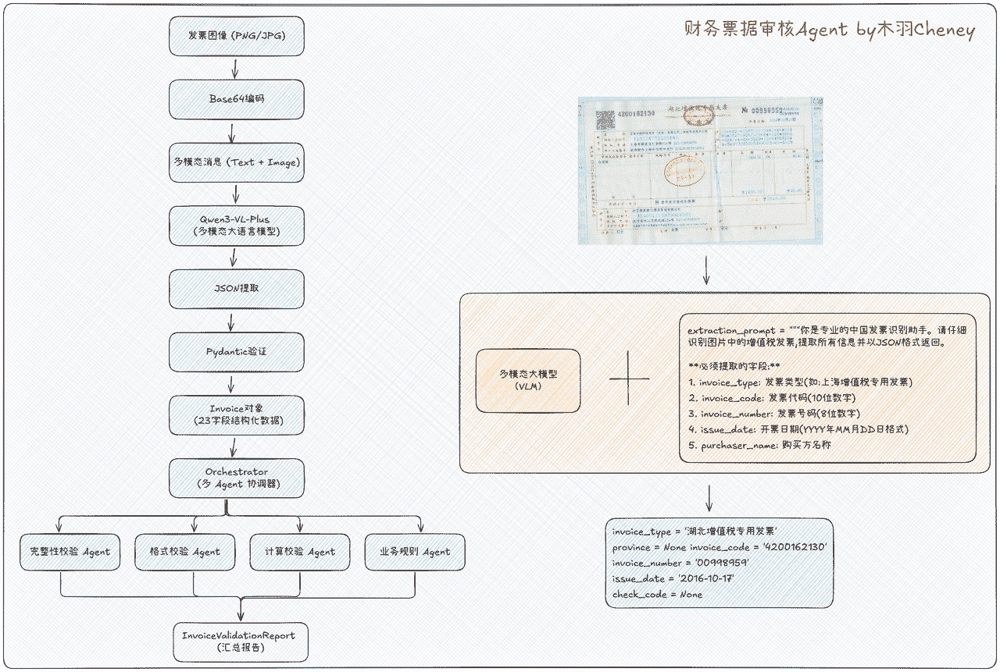

+   **自动提取**: 使用 Qwen3-VL 多模态模型从发票图像中自动提取结构化信息

+   **智能校验**: 4 个专门 Agent 协作完成格式、计算、业务规则等多维度校验

接下来我们就使用 LangChain 框架来搭建这个完整的票据审核Agent系统。

+   **Step 1. 安装环境依赖**

使用 **LangChain 1.0** 作为核心Agent开发框架, 需要预先安装如下依赖包：

```
# 安装必要的依赖包
! pip install pydantic langchain langchain_openai -q
```

```
WARNING: Running pip as the &#x27;root&#x27; user can result in broken permissions and conflicting behaviour with the system package manager, possibly rendering your system unusable. It is recommended to use a virtual environment instead: https://pip.pypa.io/warnings/venv. Use the --root-user-action option if you know what you are doing and want to suppress this warning.

```

+   Step 2. 配置 API Key

接下来我们需要准备一个多模态大模型，我们使用阿里云百炼的 Qwen3-vl-plus 模型。注册地址：https://bailian.console.aliyun.com/#/home

```
import os

# 设置 API Key (请替换为你的实际 Key)
os.environ[&quot;DASHSCOPE_API_KEY&quot;] = &quot;sk-d036126977ff488fa2e29231975469f2&quot;  # 注意：这里要替换成你自己的

print(&quot;API Key 配置完成&quot;)
```

```
API Key 配置完成
```

+   **Step 3. 导入必要的库**

导入项目所需的核心库:

```
import os
import re
import json
import base64
import time
from datetime import datetime
from typing import List, Optional

# Pydantic v2 用于数据建模和验证
from pydantic import BaseModel, Field, field_validator

# LangChain 1.0 用于 LLM 应用开发
from langchain_core.messages import HumanMessage, SystemMessage
from langchain_openai import ChatOpenAI

print(&quot;导入完成&quot;)
```

```
/root/anaconda3/envs/jina_run/lib/python3.13/site-packages/tqdm/auto.py:21: TqdmWarning: IProgress not found. Please update jupyter and ipywidgets. See https://ipywidgets.readthedocs.io/en/stable/user_install.html
  from .autonotebook import tqdm as notebook_tqdm


导入完成
```

+   Step 4. 发票信息提取模块

阶段的核心任务是:从发票图**像或 OCR 数据中提**取结构化的 JSON 数据。使用 Pydantic v2 定义发票的数据模型。Pydantic 提供了强大的数据验证功能，可用于将大模型返回的JSON数据转换为严格的数据模型。

```
class LineItem(BaseModel):
    &quot;&quot;&quot;发票行项目 - 代表一条商品或服务明细&quot;&quot;&quot;
    
    row: str = Field(..., description=&quot;行号&quot;)
    name: str = Field(..., description=&quot;商品或服务名称&quot;)
    specification: Optional[str] = Field(None, description=&quot;规格型号&quot;)
    unit: Optional[str] = Field(None, description=&quot;单位&quot;)
    quantity: Optional[float] = Field(None, description=&quot;数量&quot;)
    unit_price: Optional[float] = Field(None, description=&quot;单价&quot;)
    amount: float = Field(..., description=&quot;金额(不含税)&quot;)
    tax_rate: float = Field(..., description=&quot;税率(小数,如0.06表示6%)&quot;)
    tax_amount: float = Field(..., description=&quot;税额&quot;)
    
    @field_validator(&#x27;row&#x27;, mode=&#x27;before&#x27;)
    @classmethod
    def convert_row_to_string(cls, v):
        &quot;&quot;&quot;自动将行号转换为字符串 - 兼容模型返回整数的情况&quot;&quot;&quot;
        if v is None:
            return v
        return str(v)

print(&quot;LineItem 模型定义完成&quot;)
print(&quot;添加了 row 字段自动类型转换&quot;)

# 测试示例
test_item = LineItem(
    row=&quot;1&quot;,
    name=&quot;*广告制作*广告费&quot;,
    amount=94339.62,
    tax_rate=0.06,
    tax_amount=5660.38
)

print(f&quot;测试数据: {test_item.name}, 金额: ¥{test_item.amount:,.2f}, 税率: {test_item.tax_rate*100}%&quot;)
```

```
LineItem 模型定义完成
添加了 row 字段自动类型转换
测试数据: *广告制作*广告费, 金额: ¥94,339.62, 税率: 6.0%
```

行项目就是发票里逐条计费的“最小可核查单元”，包含名称、数量、单价、金额、税率/税额等。清晰的行项目能提高透明度、减少争议与拒付风险，这是发票开具与收款的基本要求。注意：给多模态大模型做“行项目（LineItem）”模型，不是为了好看，而是为了把“每一条商品/服务明细”变成可校验、可对账、可落账的数据单位。这样后续才能做金额/税额一致性校验、与采购单/入库单的三方匹配、以及对接电子发票/财务系统标准。

接下来再定义完整的发票模型，给多模态大模型一个“完整的发票模型（Invoice）”，是在抽取→校验→对账→入账/归档这条流水线上，给每个关键环节预留“有据可依的字段与规则锚点”。

```
class Invoice(BaseModel):
    &quot;&quot;&quot;中国增值税发票完整模型&quot;&quot;&quot;

    # ===== 基本信息 =====
    invoice_type: str = Field(..., description=&quot;发票类型(如:增值税专用发票)&quot;)
    province: Optional[str] = Field(None, description=&quot;省份&quot;)
    invoice_code: str = Field(..., description=&quot;发票代码(10位数字)&quot;)
    invoice_number: str = Field(..., description=&quot;发票号码(8位数字)&quot;)
    issue_date: str = Field(..., description=&quot;开票日期(YYYY-MM-DD)&quot;)
    check_code: Optional[str] = Field(None, description=&quot;校验码(普通发票有,专用发票无)&quot;)

    # ===== 购买方信息 =====
    purchaser_name: str = Field(..., description=&quot;购买方名称&quot;)
    purchaser_tax_id: str = Field(..., description=&quot;购买方纳税人识别号&quot;)
    purchaser_address: Optional[str] = Field(None, description=&quot;购买方地址电话&quot;)
    purchaser_bank: Optional[str] = Field(None, description=&quot;购买方开户行及账号&quot;)

    # ===== 销售方信息 =====
    seller_name: str = Field(..., description=&quot;销售方名称&quot;)
    seller_tax_id: str = Field(..., description=&quot;销售方纳税人识别号&quot;)
    seller_address: Optional[str] = Field(None, description=&quot;销售方地址电话&quot;)
    seller_bank: Optional[str] = Field(None, description=&quot;销售方开户行及账号&quot;)

    # ===== 金额信息 =====
    total_amount: float = Field(..., description=&quot;合计金额(不含税)&quot;)
    total_tax: float = Field(..., description=&quot;合计税额&quot;)
    total_amount_with_tax: float = Field(..., description=&quot;价税合计&quot;)
    amount_in_words: Optional[str] = Field(None, description=&quot;价税合计(大写)&quot;)

    # ===== 商品明细 =====
    line_items: List[LineItem] = Field(default_factory=list, description=&quot;行项目明细&quot;)

    # ===== 其他信息 =====
    payee: Optional[str] = Field(None, description=&quot;收款人&quot;)
    checker: Optional[str] = Field(None, description=&quot;复核人&quot;)
    drawer: Optional[str] = Field(None, description=&quot;开票人&quot;)
    remarks: Optional[str] = Field(None, description=&quot;备注&quot;)

    @field_validator(&#x27;issue_date&#x27;)
    @classmethod
    def validate_date(cls, v):
        &quot;&quot;&quot;标准化日期格式 - 将中文日期转换为 YYYY-MM-DD&quot;&quot;&quot;
        if not v:
            return v

        # 处理中文日期: 2016年06月02日 -&gt; 2016-06-02
        match = re.search(r&#x27;(\d{4})年(\d{2})月(\d{2})日&#x27;, v)
        if match:
            return f&quot;{match.group(1)}-{match.group(2)}-{match.group(3)}&quot;

        # 处理其他格式
        for fmt in [&#x27;%Y-%m-%d&#x27;, &#x27;%Y/%m/%d&#x27;, &#x27;%Y.%m.%d&#x27;, &#x27;%Y%m%d&#x27;]:
            try:
                dt = datetime.strptime(str(v), fmt)
                return dt.strftime(&#x27;%Y-%m-%d&#x27;)
            except ValueError:
                continue

        return v

    def to_dict(self) -&gt; dict:
        &quot;&quot;&quot;转换为字典&quot;&quot;&quot;
        return self.model_dump(mode=&#x27;python&#x27;)

    def to_json(self, indent: int = 2) -&gt; str:
        &quot;&quot;&quot;转换为JSON字符串&quot;&quot;&quot;
        return self.model_dump_json(indent=indent, exclude_none=False)

print(&quot;Invoice 模型定义完成&quot;)
print(&quot;  包含 23 个字段&quot;)
print(&quot;  自动验证日期格式&quot;)
print(&quot;  支持导出为 dict/json&quot;)
```

```
Invoice 模型定义完成
  包含 23 个字段
  自动验证日期格式
  支持导出为 dict/json
```

+   Step 5. 初始化多模态大模型

使用 **LangChain** 接入多模态大模型。多模态模型可以同时处理图像和文本输入。

```
# 使用 ChatOpenAI 接入阿里云百炼的 Qwen3-VL-Plus 模型
llm = ChatOpenAI(
    model=&quot;qwen3-vl-plus&quot;,  # 多模态视觉语言模型
    api_key=os.getenv(&quot;DASHSCOPE_API_KEY&quot;),
    base_url=&quot;https://dashscope.aliyuncs.com/compatible-mode/v1&quot;,  # 兼容 OpenAI 格式的 API 地址
    temperature=0.1,  # 较低温度保证输出稳定
)

print(&quot;多模态大模型初始化完成&quot;)
```

```
多模态大模型初始化完成
```

+   Step 6. 如何传入问题和图像

**  多模态**模型的**输入包含**两部分:文本提示词 + 图像数据。我们需要将图像编码为 base64 格式。

```
extraction_prompt = &quot;&quot;&quot;你是专业的中国发票识别助手。请仔细识别图片中的增值税发票,提取所有信息并以JSON格式返回。

**必须提取的字段:**
1. invoice_type: 发票类型(如:上海增值税专用发票)
2. invoice_code: 发票代码(10位数字)
3. invoice_number: 发票号码(8位数字)
4. issue_date: 开票日期(YYYY年MM月DD日格式)
5. purchaser_name: 购买方名称
6. purchaser_tax_id: 购买方纳税人识别号
7. purchaser_address: 购买方地址电话
8. purchaser_bank: 购买方开户行及账号
9. seller_name: 销售方名称
10. seller_tax_id: 销售方纳税人识别号
11. seller_address: 销售方地址电话
12. seller_bank: 销售方开户行及账号
13. total_amount: 合计金额(纯数字)
14. total_tax: 合计税额(纯数字)
15. total_amount_with_tax: 价税合计(纯数字)
16. amount_in_words: 价税合计大写
17. line_items: 商品明细数组,每项包含:
    - row: 行号
    - name: 商品名称
    - amount: 金额
    - tax_rate: 税率(小数,如6%写成0.06)
    - tax_amount: 税额
18. payee: 收款人
19. checker: 复核人
20. drawer: 开票人

**重要规则:**
1. 所有金额必须是纯数字,不要包含¥、元等符号
2. 税率用小数表示(6%写成0.06)
3. 日期保持原格式(2025年11月18日)
4. 如果字段无法识别,使用null
5. 专用发票没有校验码,check_code留空

请直接返回JSON,不要其他说明。
&quot;&quot;&quot;

print(&quot;提示词构建完成&quot;)
print(f&quot;  - 提示词长度: {len(extraction_prompt)} 字符&quot;)
print(f&quot;  - 要求提取 20 个关键字段&quot;)
```

```
提示词构建完成
  - 提示词长度: 853 字符
  - 要求提取 20 个关键字段
```

提示词构建完成，接下来我们读取图像并编码为 base64。

```
def encode_image(image_path: str) -&gt; str:
    &quot;&quot;&quot;将图像编码为 base64 字符串&quot;&quot;&quot;
    with open(image_path, &#x27;rb&#x27;) as f:
        image_data = base64.b64encode(f.read()).decode(&#x27;utf-8&#x27;)
    return image_data

# 发票图像路径
image_base64 = encode_image(&quot;./data/invoice_1.png&quot;)
print(f&quot;图像编码完成, base64 长度: {len(image_base64)} 字符&quot;)
```

```
图像编码完成, base64 长度: 362616 字符
```

图像编码完成，接下来我们构建多模态消息。

```
def build_multimodal_message(prompt: str, image_base64: str) -&gt; HumanMessage:
    &quot;&quot;&quot;构建包含文本和图像的多模态消息&quot;&quot;&quot;
    
    message = HumanMessage(content=[
        # 第一部分: 文本提示
        {
            &quot;type&quot;: &quot;text&quot;,
            &quot;text&quot;: prompt
        },
        # 第二部分: 图像数据
        {
            &quot;type&quot;: &quot;image_url&quot;,
            &quot;image_url&quot;: {
                &quot;url&quot;: f&quot;data:image/jpeg;base64,{image_base64}&quot;
            }
        }
    ])
    
    return message

print(&quot;多模态消息构建函数定义完成&quot;)
print(&quot;  输入: 文本提示 + base64 图像&quot;)
print(&quot;  输出: HumanMessage 对象&quot;)
```

```
多模态消息构建函数定义完成
  输入: 文本提示 + base64 图像
  输出: HumanMessage 对象
```

+   Step 7. 如何调用模型并做结构化输出

调用多模态模型后,我们需要从响应中提取 JSON 数据,并使用 Pydantic 模型进行验证。

```
def extract_json_from_response(text: str) -&gt; dict:
    &quot;&quot;&quot;从模型响应中提取 JSON 对象&quot;&quot;&quot;
    
    # 尝试 1: 直接解析整个响应
    try:
        return json.loads(text)
    except:
        pass

    # 尝试 2: 提取 ```json ... ``` 代码块
    json_match = re.search(r&#x27;```json\s*\n(.*?)\n```&#x27;, text, re.DOTALL)
    if json_match:
        try:
            return json.loads(json_match.group(1))
        except:
            pass

    # 尝试 3: 提取 {...} JSON 对象
    json_match = re.search(r&#x27;\{.*\}&#x27;, text, re.DOTALL)
    if json_match:
        try:
            return json.loads(json_match.group(0))
        except:
            pass

    raise ValueError(f&quot;无法从响应中提取JSON: {text[:200]}...&quot;)

print(&quot;JSON 提取函数定义完成&quot;)
print(&quot;  支持 3 种提取模式&quot;)
print(&quot;  自动处理代码块格式&quot;)
```

```
JSON 提取函数定义完成
  支持 3 种提取模式
  自动处理代码块格式
```

+   **Step 8. 完整的提取流程**

最后,我们定义一个完整的提取流程,将上述步骤串联起来。

```
# ========== 步骤 8: 完整的提取流程 ==========

def extract_invoice_from_image(image_path: str) -&gt; Invoice:
    &quot;&quot;&quot;从发票图像中提取结构化数据的完整流程&quot;&quot;&quot;
    
    print(&quot;正在提取发票信息...&quot;)
    
    # 1. 读取并编码图像
    print(&quot;  [1/4] 读取图像...&quot;)
    image_base64 = encode_image(image_path)
    
    # 2. 构建多模态消息
    print(&quot;  [2/4] 构建多模态消息...&quot;)
    message = build_multimodal_message(extraction_prompt, image_base64)
    
    # 3. 调用多模态大模型
    print(&quot;  [3/4] 调用 Qwen3-VL-Plus 模型...&quot;)
    response = llm.invoke([message])
    
    # 4. 提取 JSON 并验证
    print(&quot;  [4/4] 提取并验证数据...&quot;)
    raw_json = extract_json_from_response(response.content)
    invoice = Invoice.model_validate(raw_json)
    
    print(&quot;发票信息提取完成&quot;)
    return invoice

print(&quot;完整提取流程定义完成&quot;)
```

```
完整提取流程定义完成
```

+   **Step 9. 运行测试**

以上代码构建完成后，接下来便可以实际进行运行测试了：

```
# 如果你有发票图像,可以运行以下代码:
invoice = extract_invoice_from_image(&quot;./data/invoice_1.png&quot;)

print(f&quot;发票代码: {invoice.invoice_code}&quot;)
print(f&quot;发票号码: {invoice.invoice_number}&quot;)
print(f&quot;价税合计: ¥{invoice.total_amount_with_tax:,.2f}&quot;)
```

```
正在提取发票信息...
  [1/4] 读取图像...
  [2/4] 构建多模态消息...
  [3/4] 调用 Qwen3-VL-Plus 模型...
  [4/4] 提取并验证数据...
发票信息提取完成
发票代码: 3100153130
发票号码: 14641426
价税合计: ¥100,000.00
```

```
# 如果有发票图像,可以运行以下代码:
invoice = extract_invoice_from_image(&quot;./data/invoice_2.png&quot;)

print(f&quot;完整输出: {invoice}&quot;)
```

```
正在提取发票信息...
  [1/4] 读取图像...
  [2/4] 构建多模态消息...
  [3/4] 调用 Qwen3-VL-Plus 模型...
  [4/4] 提取并验证数据...
发票信息提取完成
完整输出: invoice_type=&#x27;湖北增值税专用发票&#x27; province=None invoice_code=&#x27;4200162130&#x27; invoice_number=&#x27;00998959&#x27; issue_date=&#x27;2016-10-17&#x27; check_code=None purchaser_name=&#x27;百度在线网络技术(北京)有限公司上海软件技术分公司&#x27; purchaser_tax_id=&#x27;310114772120643&#x27; purchaser_address=&#x27;上海市嘉定区汇华路500号 021-39005678&#x27; purchaser_bank=&#x27;招商银行上海分行漕河泾支行 212280455510001&#x27; seller_name=&#x27;武汉海庭假日酒店管理有限公司&#x27; seller_tax_id=&#x27;914201115879926501&#x27; seller_address=&#x27;武汉市洪山区民族路124号 027-87598879&#x27; seller_bank=&#x27;交通银行武汉市南湖路支行4219 6163 5018 0100 41948&#x27; total_amount=1430.19 total_tax=85.81 total_amount_with_tax=1516.0 amount_in_words=&#x27;壹仟伍佰壹拾陆圆整&#x27; line_items=[LineItem(row=&#x27;1&#x27;, name=&#x27;住宿费&#x27;, specification=None, unit=None, quantity=None, unit_price=None, amount=1430.19, tax_rate=0.06, tax_amount=85.81)] payee=&#x27;前台&#x27; checker=&#x27;肖晨&#x27; drawer=&#x27;前台&#x27; remarks=None
```

做到这里，其实我们就已经完成了一个“发票识别 Agent”，可以识别发票的结构化数据了。如下所示：


** 但是，我**们还需要对识别出来的发票数据进行校验，以确保数据的准确性。所以我们需要进一步设计一个“发票校验 Agent”。这个阶段是整个系统的核心创新点，我们会使用多个专门的 Agent 协作完成发票校验。


多Agent协作校验系统的优势

| 优势 | 优势描述 |
| --- | --- |
| 职责单一 | 每个Agent只负责一个特定领域的校验 |
| 易于扩展 | 添加新Agent不影响现有代码 |
| 可以并行 | 部分Agent可以并行执行 |

+   Step 10：定义校验结果数据模型

同样，我们定义校验结果数据模型，用于存储每个Agent的校验结果。

```
class ValidationResult(BaseModel):
    &quot;&quot;&quot;单个校验结果&quot;&quot;&quot;
    level: str = Field(..., description=&quot;级别: error/warning/info&quot;)
    field: str = Field(..., description=&quot;相关字段&quot;)
    message: str = Field(..., description=&quot;问题描述&quot;)
    expected: Optional[str] = Field(None, description=&quot;期望值&quot;)
    actual: Optional[str] = Field(None, description=&quot;实际值&quot;)
    suggestion: Optional[str] = Field(None, description=&quot;修复建议&quot;)


class AgentValidationReport(BaseModel):
    &quot;&quot;&quot;单个 Agent 的校验报告&quot;&quot;&quot;
    agent_name: str = Field(..., description=&quot;Agent 名称&quot;)
    results: List[ValidationResult] = Field(default_factory=list)
    execution_time: float = Field(0.0, description=&quot;执行时间(秒)&quot;)
    
    @property
    def error_count(self) -&gt; int:
        return len([r for r in self.results if r.level == &quot;error&quot;])
    
    @property
    def warning_count(self) -&gt; int:
        return len([r for r in self.results if r.level == &quot;warning&quot;])
    
    @property
    def info_count(self) -&gt; int:
        return len([r for r in self.results if r.level == &quot;info&quot;])


class InvoiceValidationReport(BaseModel):
    &quot;&quot;&quot;完整的发票校验报告&quot;&quot;&quot;
    invoice_id: str = Field(..., description=&quot;发票标识&quot;)
    validation_time: str = Field(..., description=&quot;校验时间&quot;)
    overall_status: str = Field(..., description=&quot;总体状态: PASS/FAIL/WARNING&quot;)
    summary: str = Field(..., description=&quot;总结&quot;)
    agent_reports: List[AgentValidationReport] = Field(default_factory=list)
    
    @property
    def total_errors(self) -&gt; int:
        return sum(r.error_count for r in self.agent_reports)
    
    @property
    def total_warnings(self) -&gt; int:
        return sum(r.warning_count for r in self.agent_reports)
    
    @property
    def total_info(self) -&gt; int:
        return sum(r.info_count for r in self.agent_reports)

print(&quot;校验结果数据模型定义完成&quot;)
```

```
校验结果数据模型定义完成
```

+   Step 11：完整性校验 Agent

该 Agent 主要检查发票的必填字段是否完整。

```
# 增值税专用发票的必填字段(13个核心字段)
REQUIRED_FIELDS_SPECIAL = {
    &#x27;invoice_type&#x27;: &#x27;发票类型&#x27;,
    &#x27;invoice_code&#x27;: &#x27;发票代码&#x27;,
    &#x27;invoice_number&#x27;: &#x27;发票号码&#x27;,
    &#x27;issue_date&#x27;: &#x27;开票日期&#x27;,
    &#x27;purchaser_name&#x27;: &#x27;购买方名称&#x27;,
    &#x27;purchaser_tax_id&#x27;: &#x27;购买方纳税人识别号&#x27;,
    &#x27;seller_name&#x27;: &#x27;销售方名称&#x27;,
    &#x27;seller_tax_id&#x27;: &#x27;销售方纳税人识别号&#x27;,
    &#x27;total_amount&#x27;: &#x27;合计金额&#x27;,
    &#x27;total_tax&#x27;: &#x27;合计税额&#x27;,
    &#x27;total_amount_with_tax&#x27;: &#x27;价税合计&#x27;,
    &#x27;payee&#x27;: &#x27;收款人&#x27;,
    &#x27;drawer&#x27;: &#x27;开票人&#x27;
}

# 建议填写的字段
RECOMMENDED_FIELDS = {
    &#x27;purchaser_address&#x27;: &#x27;购买方地址电话&#x27;,
    &#x27;purchaser_bank&#x27;: &#x27;购买方开户行及账号&#x27;,
    &#x27;seller_address&#x27;: &#x27;销售方地址电话&#x27;,
    &#x27;seller_bank&#x27;: &#x27;销售方开户行及账号&#x27;,
    &#x27;line_items&#x27;: &#x27;商品明细&#x27;,
    &#x27;checker&#x27;: &#x27;复核人&#x27;
}


def validate_completeness(invoice_data: dict) -&gt; AgentValidationReport:
    &quot;&quot;&quot;完整性校验 Agent&quot;&quot;&quot;
    start_time = time.time()
    results = []
    
    # 检查必填字段
    for field, desc in REQUIRED_FIELDS_SPECIAL.items():
        value = invoice_data.get(field)
        
        # 检查是否为空
        if value is None or value == &#x27;&#x27; or (isinstance(value, list) and len(value) == 0):
            results.append(ValidationResult(
                level=&quot;error&quot;,
                field=field,
                message=f&quot;必填字段 &#x27;{desc}&#x27; 缺失或为空&quot;,
                expected=&quot;非空值&quot;,
                actual=&quot;空&quot;,
                suggestion=f&quot;请补充 {desc} 信息&quot;
            ))
    
    # 检查建议字段
    for field, desc in RECOMMENDED_FIELDS.items():
        value = invoice_data.get(field)
        
        if value is None or value == &#x27;&#x27; or (isinstance(value, list) and len(value) == 0):
            results.append(ValidationResult(
                level=&quot;warning&quot;,
                field=field,
                message=f&quot;建议填写字段 &#x27;{desc}&#x27; 缺失&quot;,
                expected=&quot;非空值&quot;,
                actual=&quot;空&quot;,
                suggestion=f&quot;建议补充 {desc} 信息以提高发票可信度&quot;
            ))
    
    execution_time = time.time() - start_time
    
    return AgentValidationReport(
        agent_name=&quot;完整性校验Agent&quot;,
        results=results,
        execution_time=execution_time
    )

print(&quot;完整性校验 Agent 定义完成&quot;)
print(f&quot;  检查 {len(REQUIRED_FIELDS_SPECIAL)} 个必填字段&quot;)
print(f&quot;  检查 {len(RECOMMENDED_FIELDS)} 个建议字段&quot;)
```

```
完整性校验 Agent 定义完成
  检查 13 个必填字段
  检查 6 个建议字段
```

+   Step 12：格式校验 Agent

进一步地，当第一阶段正确输出验证发票代码、号码、税号等字段后，我们还要校验其识别的格式是否正确。

```
def validate_format(invoice_data: dict) -&gt; AgentValidationReport:
    &quot;&quot;&quot;格式校验 Agent&quot;&quot;&quot;
    start_time = time.time()
    results = []
    
    # 1. 发票代码: 10位数字
    invoice_code = invoice_data.get(&#x27;invoice_code&#x27;, &#x27;&#x27;)
    if invoice_code and not re.match(r&#x27;^\d{10}$&#x27;, str(invoice_code)):
        results.append(ValidationResult(
            level=&quot;error&quot;,
            field=&quot;invoice_code&quot;,
            message=&quot;发票代码格式错误&quot;,
            expected=&quot;10位数字&quot;,
            actual=str(invoice_code),
            suggestion=&quot;发票代码必须是10位纯数字,如: 3100153130&quot;
        ))
    
    # 2. 发票号码: 8位数字
    invoice_number = invoice_data.get(&#x27;invoice_number&#x27;, &#x27;&#x27;)
    if invoice_number and not re.match(r&#x27;^\d{8}$&#x27;, str(invoice_number)):
        results.append(ValidationResult(
            level=&quot;error&quot;,
            field=&quot;invoice_number&quot;,
            message=&quot;发票号码格式错误&quot;,
            expected=&quot;8位数字&quot;,
            actual=str(invoice_number),
            suggestion=&quot;发票号码必须是8位纯数字,如: 14641426&quot;
        ))
    
    # 3. 纳税人识别号: 15/18/20位
    for field_name, desc in [(&#x27;purchaser_tax_id&#x27;, &#x27;购买方&#x27;), (&#x27;seller_tax_id&#x27;, &#x27;销售方&#x27;)]:
        tax_id = invoice_data.get(field_name, &#x27;&#x27;)
        if tax_id and not re.match(r&#x27;^[0-9A-Z]{15}$|^[0-9A-Z]{18}$|^[0-9A-Z]{20}$&#x27;, str(tax_id)):
            results.append(ValidationResult(
                level=&quot;error&quot;,
                field=field_name,
                message=f&quot;{desc}纳税人识别号格式错误&quot;,
                expected=&quot;15/18/20位数字或大写字母&quot;,
                actual=str(tax_id),
                suggestion=&quot;纳税人识别号长度必须是15、18或20位&quot;
            ))
    
    # 4. 开票日期: YYYY-MM-DD 格式且不能是未来日期
    issue_date = invoice_data.get(&#x27;issue_date&#x27;, &#x27;&#x27;)
    if issue_date:
        if not re.match(r&#x27;^\d{4}-\d{2}-\d{2}$&#x27;, str(issue_date)):
            results.append(ValidationResult(
                level=&quot;error&quot;,
                field=&quot;issue_date&quot;,
                message=&quot;开票日期格式错误&quot;,
                expected=&quot;YYYY-MM-DD&quot;,
                actual=str(issue_date),
                suggestion=&quot;日期格式应为: 2016-06-02&quot;
            ))
        else:
            try:
                date_obj = datetime.strptime(issue_date, &#x27;%Y-%m-%d&#x27;)
                if date_obj &gt; datetime.now():
                    results.append(ValidationResult(
                        level=&quot;error&quot;,
                        field=&quot;issue_date&quot;,
                        message=&quot;开票日期不能是未来日期&quot;,
                        expected=f&quot;&lt;= {datetime.now().strftime(&#x27;%Y-%m-%d&#x27;)}&quot;,
                        actual=issue_date,
                        suggestion=&quot;请检查开票日期是否正确&quot;
                    ))
            except ValueError:
                results.append(ValidationResult(
                    level=&quot;error&quot;,
                    field=&quot;issue_date&quot;,
                    message=&quot;开票日期无效&quot;,
                    expected=&quot;有效的日期&quot;,
                    actual=issue_date,
                    suggestion=&quot;请检查日期是否真实存在&quot;
                ))
    
    execution_time = time.time() - start_time
    
    return AgentValidationReport(
        agent_name=&quot;格式校验Agent&quot;,
        results=results,
        execution_time=execution_time
    )

print(&quot;格式校验 Agent 定义完成&quot;)
print(&quot;  - 检查发票代码/号码格式&quot;)
print(&quot;  - 检查纳税人识别号格式&quot;)
print(&quot;  - 检查日期格式和有效性&quot;)
```

```
格式校验 Agent 定义完成
  - 检查发票代码/号码格式
  - 检查纳税人识别号格式
  - 检查日期格式和有效性
```

+   Step 13：计算校验 Agent

接下来进一步验证发票金额、税额的计算是否正确。

```
def validate_calculation(invoice_data: dict) -&gt; AgentValidationReport:
    &quot;&quot;&quot;计算校验 Agent&quot;&quot;&quot;
    start_time = time.time()
    results = []
    
    TOLERANCE = 0.02  # 允许2分钱误差(四舍五入)
    
    total_amount = invoice_data.get(&#x27;total_amount&#x27;, 0)
    total_tax = invoice_data.get(&#x27;total_tax&#x27;, 0)
    total_amount_with_tax = invoice_data.get(&#x27;total_amount_with_tax&#x27;, 0)
    
    # 1. 验证: 价税合计 = 合计金额 + 合计税额
    expected_total = total_amount + total_tax
    diff = abs(total_amount_with_tax - expected_total)
    
    if diff &gt; TOLERANCE:
        results.append(ValidationResult(
            level=&quot;error&quot;,
            field=&quot;total_amount_with_tax&quot;,
            message=&quot;价税合计计算错误&quot;,
            expected=f&quot;¥{expected_total:.2f}&quot;,
            actual=f&quot;¥{total_amount_with_tax:.2f}&quot;,
            suggestion=f&quot;价税合计应该 = 合计金额({total_amount:.2f}) + 合计税额({total_tax:.2f}) = {expected_total:.2f}&quot;
        ))
    
    # 2. 验证行项目金额合计
    line_items = invoice_data.get(&#x27;line_items&#x27;, [])
    if line_items:
        sum_amount = sum(item.get(&#x27;amount&#x27;, 0) for item in line_items)
        diff_amount = abs(sum_amount - total_amount)
        
        if diff_amount &gt; TOLERANCE:
            results.append(ValidationResult(
                level=&quot;error&quot;,
                field=&quot;total_amount&quot;,
                message=&quot;行项目金额合计不匹配&quot;,
                expected=f&quot;¥{sum_amount:.2f}&quot;,
                actual=f&quot;¥{total_amount:.2f}&quot;,
                suggestion=f&quot;行项目金额之和为 {sum_amount:.2f}, 但合计金额为 {total_amount:.2f}&quot;
            ))
        
        # 3. 验证行项目税额合计
        sum_tax = sum(item.get(&#x27;tax_amount&#x27;, 0) for item in line_items)
        diff_tax = abs(sum_tax - total_tax)
        
        if diff_tax &gt; TOLERANCE:
            results.append(ValidationResult(
                level=&quot;error&quot;,
                field=&quot;total_tax&quot;,
                message=&quot;行项目税额合计不匹配&quot;,
                expected=f&quot;¥{sum_tax:.2f}&quot;,
                actual=f&quot;¥{total_tax:.2f}&quot;,
                suggestion=f&quot;行项目税额之和为 {sum_tax:.2f}, 但合计税额为 {total_tax:.2f}&quot;
            ))
        
        # 4. 验证每个行项目的税额计算
        for idx, item in enumerate(line_items, 1):
            amount = item.get(&#x27;amount&#x27;, 0)
            tax_rate = item.get(&#x27;tax_rate&#x27;, 0)
            tax_amount = item.get(&#x27;tax_amount&#x27;, 0)
            expected_tax = amount * tax_rate
            
            if abs(tax_amount - expected_tax) &gt; TOLERANCE:
                results.append(ValidationResult(
                    level=&quot;error&quot;,
                    field=f&quot;line_items[{idx-1}].tax_amount&quot;,
                    message=f&quot;第{idx}行税额计算错误&quot;,
                    expected=f&quot;¥{expected_tax:.2f}&quot;,
                    actual=f&quot;¥{tax_amount:.2f}&quot;,
                    suggestion=f&quot;税额应该 = 金额({amount:.2f}) × 税率({tax_rate*100}%) = {expected_tax:.2f}&quot;
                ))
    
    execution_time = time.time() - start_time
    
    return AgentValidationReport(
        agent_name=&quot;计算校验Agent&quot;,
        results=results,
        execution_time=execution_time
    )

print(&quot;计算校验 Agent 定义完成&quot;)
print(&quot;  - 验证价税合计 = 金额 + 税额&quot;)
print(&quot;  - 验证行项目金额/税额合计&quot;)
print(&quot;  - 验证每行税额 = 金额 × 税率&quot;)
print(&quot;  - 允许 ¥0.02 误差&quot;)
```

```
计算校验 Agent 定义完成
  - 验证价税合计 = 金额 + 税额
  - 验证行项目金额/税额合计
  - 验证每行税额 = 金额 × 税率
  - 允许 ¥0.02 误差
```

+   Step 14：业务规则校验 Agent

最后，我们可以通过定制化的一些业务规则来精细化校验，比如我们这里以验证税率、发票类型等业务逻辑为例进行说明。

```
# 中国增值税标准税率
VALID_TAX_RATES = [0.00, 0.01, 0.03, 0.05, 0.06, 0.09, 0.13]

def validate_business_rules(invoice_data: dict) -&gt; AgentValidationReport:
    &quot;&quot;&quot;业务规则校验 Agent&quot;&quot;&quot;
    start_time = time.time()
    results = []
    
    # 1. 检查税率是否合法
    line_items = invoice_data.get(&#x27;line_items&#x27;, [])
    for idx, item in enumerate(line_items, 1):
        tax_rate = item.get(&#x27;tax_rate&#x27;, 0)
        
        # 找到最接近的标准税率
        closest_rate = min(VALID_TAX_RATES, key=lambda x: abs(x - tax_rate))
        
        if abs(tax_rate - closest_rate) &gt; 0.001:
            results.append(ValidationResult(
                level=&quot;error&quot;,
                field=f&quot;line_items[{idx-1}].tax_rate&quot;,
                message=f&quot;第{idx}行税率不是标准税率&quot;,
                expected=f&quot;{&#x27;, &#x27;.join([f&#x27;{r*100}%&#x27; for r in VALID_TAX_RATES])}&quot;,
                actual=f&quot;{tax_rate*100}%&quot;,
                suggestion=f&quot;中国增值税标准税率为: 0%, 1%, 3%, 5%, 6%, 9%, 13%&quot;
            ))
    
    # 2. 专用发票必须有购买方税号
    invoice_type = invoice_data.get(&#x27;invoice_type&#x27;, &#x27;&#x27;)
    if &#x27;专用&#x27; in invoice_type:
        if not invoice_data.get(&#x27;purchaser_tax_id&#x27;):
            results.append(ValidationResult(
                level=&quot;error&quot;,
                field=&quot;purchaser_tax_id&quot;,
                message=&quot;专用发票必须有购买方纳税人识别号&quot;,
                expected=&quot;购买方税号&quot;,
                actual=&quot;空&quot;,
                suggestion=&quot;专用发票用于抵扣,必须填写购买方税号&quot;
            ))
    
    # 3. 金额不能为负
    total_amount = invoice_data.get(&#x27;total_amount&#x27;, 0)
    if total_amount &lt; 0:
        results.append(ValidationResult(
            level=&quot;error&quot;,
            field=&quot;total_amount&quot;,
            message=&quot;合计金额不能为负数&quot;,
            expected=&quot;&gt;= 0&quot;,
            actual=f&quot;¥{total_amount:.2f}&quot;,
            suggestion=&quot;如果是红字发票,请使用红字发票专用格式&quot;
        ))
    
    # 4. 大额发票提示
    total_amount_with_tax = invoice_data.get(&#x27;total_amount_with_tax&#x27;, 0)
    if total_amount_with_tax &gt; 10000000:  # 超过1000万
        results.append(ValidationResult(
            level=&quot;warning&quot;,
            field=&quot;total_amount_with_tax&quot;,
            message=&quot;大额发票,建议重点审核&quot;,
            expected=&quot;&lt; ¥10,000,000&quot;,
            actual=f&quot;¥{total_amount_with_tax:,.2f}&quot;,
            suggestion=&quot;金额超过1000万,建议人工复核交易真实性&quot;
        ))
    
    execution_time = time.time() - start_time
    
    return AgentValidationReport(
        agent_name=&quot;业务规则校验Agent&quot;,
        results=results,
        execution_time=execution_time
    )

print(&quot;业务规则校验 Agent 定义完成&quot;)
print(&quot;  - 检查税率是否合法&quot;)
print(&quot;  - 检查专用发票必填项&quot;)
print(&quot;  - 检查金额合理性&quot;)
```

```
业务规则校验 Agent 定义完成
  - 检查税率是否合法
  - 检查专用发票必填项
  - 检查金额合理性
```

+   Step 15：Orchestrator: 编排所有 Agent

最终，我们定义一个协调器负责调用所有 Agent 并汇总结果。

```
def validate_invoice_complete(invoice_data: dict) -&gt; InvoiceValidationReport:
    &quot;&quot;&quot;完整的发票校验流程&quot;&quot;&quot;
    
    print(&quot;开始发票校验...&quot;)
    
    # 1. 调用所有 Agent
    agent_reports = []
    
    print(&quot;  [1/4] 完整性校验...&quot;)
    agent_reports.append(validate_completeness(invoice_data))
    
    print(&quot;  [2/4] 格式校验...&quot;)
    agent_reports.append(validate_format(invoice_data))
    
    print(&quot;  [3/4] 计算校验...&quot;)
    agent_reports.append(validate_calculation(invoice_data))
    
    print(&quot;  [4/4] 业务规则校验...&quot;)
    agent_reports.append(validate_business_rules(invoice_data))
    
    # 2. 汇总结果
    total_errors = sum(r.error_count for r in agent_reports)
    total_warnings = sum(r.warning_count for r in agent_reports)
    
    # 3. 确定总体状态
    if total_errors &gt; 0:
        overall_status = &quot;FAIL&quot;
        summary = f&quot;发现 {total_errors} 个错误, {total_warnings} 个警告,需要修正后才能通过&quot;
    elif total_warnings &gt; 0:
        overall_status = &quot;WARNING&quot;
        summary = f&quot;发现 {total_warnings} 个警告,建议修正但不阻塞流程&quot;
    else:
        overall_status = &quot;PASS&quot;
        summary = &quot;所有校验通过,发票数据正常&quot;
    
    # 4. 生成报告
    report = InvoiceValidationReport(
        invoice_id=f&quot;{invoice_data.get(&#x27;invoice_code&#x27;, &#x27;&#x27;)}_{invoice_data.get(&#x27;invoice_number&#x27;, &#x27;&#x27;)}&quot;,
        validation_time=datetime.now().strftime(&#x27;%Y-%m-%d %H:%M:%S&#x27;),
        overall_status=overall_status,
        summary=summary,
        agent_reports=agent_reports
    )
    
    print(f&quot;校验完成: {overall_status}&quot;)
    
    return report

print(&quot;Orchestrator 编排器定义完成&quot;)
print(&quot;  - 顺序调用 4 个 Agent&quot;)
print(&quot;  - 汇总所有校验结果&quot;)
print(&quot;  - 确定总体状态 (PASS/WARNING/FAIL)&quot;)
```

```
Orchestrator 编排器定义完成
  - 顺序调用 4 个 Agent
  - 汇总所有校验结果
  - 确定总体状态 (PASS/WARNING/FAIL)
```

+   Step 16：多代理校验系统运行测试

最后，我们使用真实的发票数据进行校验，并打印校验报告。

```
# 将之前提取的 invoice 对象转换为字典
invoice_dict = invoice.to_dict()
invoice_dict
```

```
{&#x27;invoice_type&#x27;: &#x27;湖北增值税专用发票&#x27;,
 &#x27;province&#x27;: None,
 &#x27;invoice_code&#x27;: &#x27;4200162130&#x27;,
 &#x27;invoice_number&#x27;: &#x27;00998959&#x27;,
 &#x27;issue_date&#x27;: &#x27;2016-10-17&#x27;,
 &#x27;check_code&#x27;: None,
 &#x27;purchaser_name&#x27;: &#x27;百度在线网络技术(北京)有限公司上海软件技术分公司&#x27;,
 &#x27;purchaser_tax_id&#x27;: &#x27;310114772120643&#x27;,
 &#x27;purchaser_address&#x27;: &#x27;上海市嘉定区汇华路500号 021-39005678&#x27;,
 &#x27;purchaser_bank&#x27;: &#x27;招商银行上海分行漕河泾支行 212280455510001&#x27;,
 &#x27;seller_name&#x27;: &#x27;武汉海庭假日酒店管理有限公司&#x27;,
 &#x27;seller_tax_id&#x27;: &#x27;914201115879926501&#x27;,
 &#x27;seller_address&#x27;: &#x27;武汉市洪山区民族路124号 027-87598879&#x27;,
 &#x27;seller_bank&#x27;: &#x27;交通银行武汉市南湖路支行4219 6163 5018 0100 41948&#x27;,
 &#x27;total_amount&#x27;: 1430.19,
 &#x27;total_tax&#x27;: 85.81,
 &#x27;total_amount_with_tax&#x27;: 1516.0,
 &#x27;amount_in_words&#x27;: &#x27;壹仟伍佰壹拾陆圆整&#x27;,
 &#x27;line_items&#x27;: [{&#x27;row&#x27;: &#x27;1&#x27;,
   &#x27;name&#x27;: &#x27;住宿费&#x27;,
   &#x27;specification&#x27;: None,
   &#x27;unit&#x27;: None,
   &#x27;quantity&#x27;: None,
   &#x27;unit_price&#x27;: None,
   &#x27;amount&#x27;: 1430.19,
   &#x27;tax_rate&#x27;: 0.06,
   &#x27;tax_amount&#x27;: 85.81}],
 &#x27;payee&#x27;: &#x27;前台&#x27;,
 &#x27;checker&#x27;: &#x27;肖晨&#x27;,
 &#x27;drawer&#x27;: &#x27;前台&#x27;,
 &#x27;remarks&#x27;: None}
```

```
# 执行完整校验
validation_report = validate_invoice_complete(invoice_dict)
```

```
开始发票校验...
  [1/4] 完整性校验...
  [2/4] 格式校验...
  [3/4] 计算校验...
  [4/4] 业务规则校验...
校验完成: PASS
```

```
def print_validation_report(report: InvoiceValidationReport):
    &quot;&quot;&quot;打印校验报告&quot;&quot;&quot;
    
    print(&quot;\n&quot; + &quot;=&quot;*70)
    print(&quot; &quot; * 20 + &quot;发票校验报告&quot;)
    print(&quot;=&quot;*70)
    
    print(f&quot;\n发票编号: {report.invoice_id}&quot;)
    print(f&quot;校验时间: {report.validation_time}&quot;)
    print(f&quot;总体状态: {report.overall_status}&quot;)
    print(f&quot;总结: {report.summary}&quot;)
    
    print(f&quot;\n统计信息:&quot;)
    print(f&quot;  - 错误: {report.total_errors}&quot;)
    print(f&quot;  - 警告: {report.total_warnings}&quot;)
    print(f&quot;  - 信息: {report.total_info}&quot;)
    
    # 打印各 Agent 报告
    for agent_report in report.agent_reports:
        print(f&quot;\n{&#x27;=&#x27;*70}&quot;)
        print(f&quot;【{agent_report.agent_name}】 (耗时: {agent_report.execution_time:.3f}秒)&quot;)
        print(f&quot;{&#x27;=&#x27;*70}&quot;)
        
        if not agent_report.results:
            print(&quot;无问题&quot;)
        else:
            for idx, result in enumerate(agent_report.results, 1):
                level_icon = &quot;❌&quot; if result.level == &quot;error&quot; else &quot;⚠️&quot; if result.level == &quot;warning&quot; else &quot;ℹ️&quot;
                print(f&quot;\n  {level_icon} [{result.level.upper()}] {result.message}&quot;)
                print(f&quot;     字段: {result.field}&quot;)
                if result.expected:
                    print(f&quot;     期望: {result.expected}&quot;)
                if result.actual:
                    print(f&quot;     实际: {result.actual}&quot;)
                if result.suggestion:
                    print(f&quot;     建议: {result.suggestion}&quot;)
    
    print(&quot;\n&quot; + &quot;=&quot;*70)

# 打印报告
print_validation_report(validation_report)
```

```
======================================================================
                    发票校验报告
======================================================================

发票编号: 4200162130_00998959
校验时间: 2025-11-28 11:06:10
总体状态: PASS
总结: 所有校验通过,发票数据正常

统计信息:
  - 错误: 0
  - 警告: 0
  - 信息: 0

======================================================================
【完整性校验Agent】 (耗时: 0.000秒)
======================================================================
无问题

======================================================================
【格式校验Agent】 (耗时: 0.001秒)
======================================================================
无问题

======================================================================
【计算校验Agent】 (耗时: 0.000秒)
======================================================================
无问题

======================================================================
【业务规则校验Agent】 (耗时: 0.000秒)
======================================================================
无问题

======================================================================
```

我们这里可以测试一下有问题的票据：

```
invoice = extract_invoice_from_image(&quot;./data/invoice_4.png&quot;)

print(f&quot;完整输出: {invoice}&quot;)
```

```
正在提取发票信息...
  [1/4] 读取图像...
  [2/4] 构建多模态消息...
  [3/4] 调用 Qwen3-VL-Plus 模型...
  [4/4] 提取并验证数据...
发票信息提取完成
完整输出: invoice_type=&#x27;北京增值税专用发票&#x27; province=None invoice_code=&#x27;1100154130&#x27; invoice_number=&#x27;00772&#x27; issue_date=&#x27;2016.9&#x27; check_code=None purchaser_name=&#x27;北京百度网讯科技有限公司&#x27; purchaser_tax_id=&#x27;110108802100433&#x27; purchaser_address=&#x27;北京市海淀区上地十街10号百度大厦2层010-59928888&#x27; purchaser_bank=&#x27;招商银行北京分行上地支行110902160610706&#x27; seller_name=&#x27;北京圣紫茗管理咨询有限公司&#x27; seller_tax_id=&#x27;110105057317113&#x27; seller_address=&#x27;北京市朝阳区 64377727&#x27; seller_bank=&#x27;上海浦发银行 91150154740007408&#x27; total_amount=5785.38 total_tax=61.0 total_amount_with_tax=5846.38 amount_in_words=&#x27;陆仟壹佰叁拾贰圆伍角整&#x27; line_items=[LineItem(row=&#x27;1&#x27;, name=&#x27;服务费&#x27;, specification=None, unit=None, quantity=None, unit_price=None, amount=5785.38, tax_rate=0.06, tax_amount=61.0)] payee=None checker=&#x27;马学琦&#x27; drawer=&#x27;焦红娟&#x27; remarks=None
```

```
validation_report = validate_invoice_complete(invoice.to_dict())

print_validation_report(validation_report)
```

```
开始发票校验...
  [1/4] 完整性校验...
  [2/4] 格式校验...
  [3/4] 计算校验...
  [4/4] 业务规则校验...
校验完成: FAIL

======================================================================
                    发票校验报告
======================================================================

发票编号: 1100154130_00772
校验时间: 2025-11-18 17:00:15
总体状态: FAIL
总结: 发现 4 个错误, 0 个警告,需要修正后才能通过

统计信息:
  - 错误: 4
  - 警告: 0
  - 信息: 0

======================================================================
【完整性校验Agent】 (耗时: 0.000秒)
======================================================================

  ❌ [ERROR] 必填字段 &#x27;收款人&#x27; 缺失或为空
     字段: payee
     期望: 非空值
     实际: 空
     建议: 请补充 收款人 信息

======================================================================
【格式校验Agent】 (耗时: 0.000秒)
======================================================================

  ❌ [ERROR] 发票号码格式错误
     字段: invoice_number
     期望: 8位数字
     实际: 00772
     建议: 发票号码必须是8位纯数字,如: 14641426

  ❌ [ERROR] 开票日期格式错误
     字段: issue_date
     期望: YYYY-MM-DD
     实际: 2016年9月
     建议: 日期格式应为: 2016-06-02

======================================================================
【计算校验Agent】 (耗时: 0.000秒)
======================================================================

  ❌ [ERROR] 第1行税额计算错误
     字段: line_items[0].tax_amount
     期望: ¥347.12
     实际: ¥61.00
     建议: 税额应该 = 金额(5785.38) × 税率(6.0%) = 347.12

======================================================================
【业务规则校验Agent】 (耗时: 0.000秒)
======================================================================
无问题

======================================================================
```

```
# 导出详细的校验报告
with open(&quot;validation_report.json&quot;, &quot;w&quot;, encoding=&quot;utf-8&quot;) as f:
    f.write(validation_report.model_dump_json(indent=2, exclude_none=False))

print(&quot;校验报告已导出到 validation_report.json&quot;)
```

```
校验报告已导出到 validation_report.json
```

```
# 导出提取的发票数据
with open(&quot;invoice_extracted.json&quot;, &quot;w&quot;, encoding=&quot;utf-8&quot;) as f:
    f.write(invoice.to_json())

print(&quot;发票数据已导出到 invoice_extracted.json&quot;)
```

```
发票数据已导出到 invoice_extracted.json
```

# 三、基于OCR搭建法务合同审核Agent

接下里我们再看第二个场景。在特定类别的文档需要遵循严格的格式与内容要求，例如政府或企业的招投标书（RFP响应文档）、各类行政公文、行业报告等。这些文档通常有明确的章节结构、必备内容和格式规范（如字体大小、页边距），不符合要求可能导致投标无效或公文退回。在这种场景下，针对每次审核，Agent需要两个输入：一是待审的主文档（标书/公文等），二是相应的规范要求（可能是招标文件或内部规章）。

为什么合同、标书审核更适合OCR+RAG方案而非VLM方案？ 这一选择基于以下几个核心考量：

+   **文档长度与Token成本**

合同和标书通常是多页长文档，动辄数十页甚至**上百页。VLM在处**理此类文档时面临严重的token限制问题。以一份20页的劳动合同为例，如果将整个P**DF作为**图像输入VLM，每页图像约消耗1000-2000 tokens，整份文档就需要2万-4万tokens，这不仅接近多数VLM的上下文窗口上限，而且成本极高（图像token价格通常是文本token的5-10倍）。而采用OCR方案，20页合同提取的纯文本通常只需5000-8000 tokens，成本降低了80%以上。

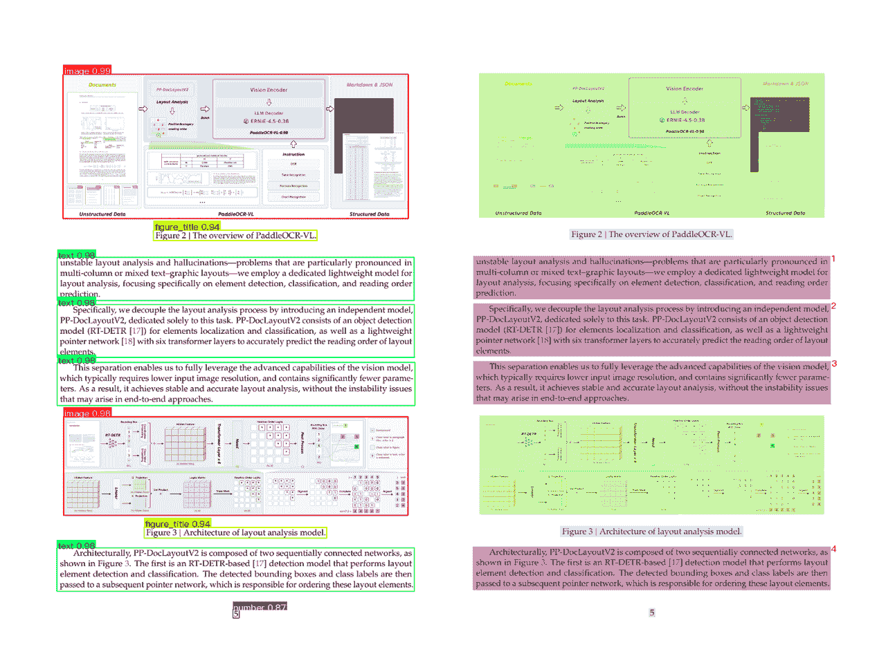

+   **精确坐标定位与可追溯性**

**  法务合同审核的核心**需求之一是精确定位问题条款的位置，以便法务人员快速**查阅和修改。**OCR方案（如MinerU）在解析PDF时会返回每个文本块的精确**坐标信息（bbox**: [x1, y1, x2, y2] + page_idx），可以精确到字符级别的定位。而VLM虽然能"看到"文档内容，但其返回结果中缺乏精确的坐标映射，只能给出模糊的页码或段落描述，无法支持后续的PDF批注、高亮标记等可视化功能。这对于需要生成审核报告并在原文档上标注问题的场景来说是致命缺陷。

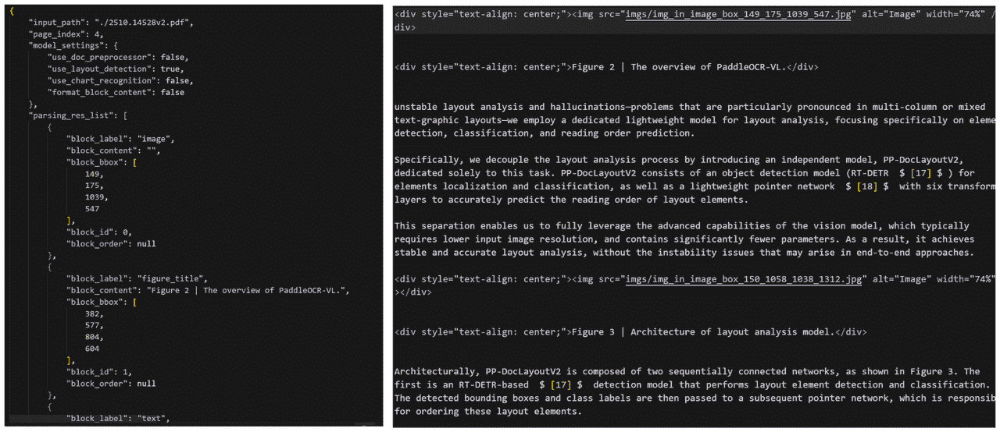

+   **智能切分与上下文控制**

**  OC**R方案可以在提取文本后进行智能切分（按标题层级、段落语义**切分），****每个片段控制在800 to**kens以内，既保持了上下文完整性，又能并发处理以提升效率。更重要的是，切分时可以保留每个片段对应的坐标信息（bbox_list），实现"文本-坐标"的完美映射。而VLM处理长文档时，要么一次性输入（成本高、易超限），要么分页输入（丢失跨页上下文、无法保证坐标一致性），两者都不理想。

+   **表格与复杂格式的处理**

合同中常包含**表格****（如付款**计**划表、违**约**金计算表）和复杂格式（如条款编**号、多级标题）。OCR方案可以将表格解析为结构化数据（JSON或Markdown表格），便于后续的计算校验（如金额汇总、日期逻辑检查）。而VLM虽然能识别表格，但其输出往往是描述性文本（"表格中显示..."），难以直接用于数值计算和格式校验，需要额外的后处理步骤，反而增加了系统复杂度。

票据的人工审核标准流程

| 对比维度 | OCR + RAG 方案 | VLM 方案 |
| --- | --- | --- |
| **长文档处理** | 智能切分，无token上限 | 受限于上下文窗口 |
| **成本** | 纯文本token，成本低 | 图像token，成本高5-10倍 |
| **坐标定位** | 精确到字符级别 | 缺乏精确坐标映射 |
| **可追溯性** | 完整的bbox_list | 仅模糊描述 |
| **规则灵活性** | 支持动态规则库（RAG） | 依赖模型内置知识 |
| **表格处理** | 结构化解析，可计算 | 描述性输出，难计算 |

综上，对于**合同、标书等长文档审核场景**，OCR+RAG方案在**成本、精度、可追溯性、灵活性****等多个维度均优于V**LM方案。VLM更适合短文档、强视觉依赖的场景（如票据识别、图文混排的宣传册审核），而法务文档审核这类"重文本、重逻辑、重定位"的任务，OCR+RAG才是最优选择。

**  本课程将带你从零开始实现**一个完整的文档审核系统。该系统的核心特点是保留 PDF 文档的坐标信息，实现可追溯、可定位的文档审核和修改。

```
    PDF 文档 → MinerU 解析 → 提取文本 + 坐标 → 智能切分 → LLM 审核 → 精确定位问题
```

如下图所示：

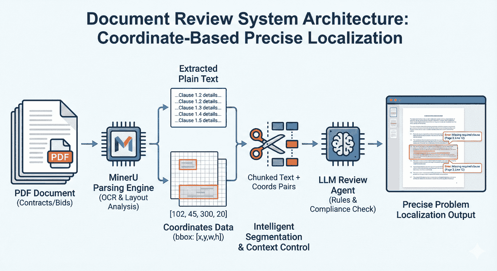

**  本课程将带你从零开始实现**一个完整的文档审核系统。该系统的核心特点是保留 PDF 文档的坐标信息，实现可追溯、可定位的文档审核和修改。

+   **Step 1：环境准备**

首先安装必要的依赖包。

```
# 安装核心依赖
! pip install langchain langchain-openai langchain-core pydantic requests -q

print(&quot;环境准备完成&quot;)
```

```
WARNING: Running pip as the &#x27;root&#x27; user can result in broken permissions and conflicting behaviour with the system package manager, possibly rendering your system unusable. It is recommended to use a virtual environment instead: https://pip.pypa.io/warnings/venv. Use the --root-user-action option if you know what you are doing and want to suppress this warning.
环境准备完成
```

+   Step 2：配置 API Key 和 MinerU 服务地址

```
# 配置 API Key 和 MinerU 服务地址
import os

# LLM 配置
os.environ[&quot;OPENAI_API_KEY&quot;] = &quot;sk-d036126977ff488fa2e29231975469f2&quot;
os.environ[&quot;OPENAI_BASE_URL&quot;] = &quot;https://dashscope.aliyuncs.com/compatible-mode/v1&quot;

# MinerU API 配置（PDF 解析服务）
MINERU_API_URL = &quot;http://192.168.110.131:10010/file_parse&quot;  # 替换为你的 MinerU 服务地址
VLLM_SERVER_URL = &quot;http://192.168.110.131:30000&quot;

print(&quot;API 配置完成&quot;)
```

```
API 配置完成
```

其中关于MinerU、PaddleOCR-VL和DeepSeek-OCR的详细[介](https://www.bilibili.com/video/BV1UEkDBhEvg/?spm_id_from=333.1387.upload.video_card.click&vd_source=b403a3d3e6fbb0deaa718687ee6b77a0)绍以及如何在本地通过vLLM框架启动解析服务，大家可以学习我的往期公开课视频：从零实现DeepSeek-OCR、PaddleOCR-VL及MinerU本地vLLM服务，搭建多模态PDF解析系统，企业级OCR模型进阶实战！


+   Step 3：PDF 解析与坐标提取

这是整个系统的核心基础。我们使用 MinerU 将 PDF 转换为带坐标的 JSON 格式。

MinerU 是一个 PDF 解析工具，它不仅提取文本，还保留每个文本块在 PDF 中的精确位置（坐标）。

输入*:** P**DF 文件

输出: JSON 文件，包含：

+   md_content: Markdown 格式的文本内容

+   content_list: 每个文本块的坐标信息列表

其中**坐标格式示例**:

```
    {
    &quot;type&quot;: &quot;text&quot;,
    &quot;bbox&quot;: [100, 200, 300, 250],  // [x1, y1, x2, y2]
    &quot;page_idx&quot;: 0,
    &quot;content&quot;: &quot;这是一段文本&quot;
    }
```

```
import requests
import json
from pathlib import Path

def parse_pdf_with_mineru(pdf_path: str, output_dir: str = &quot;./temp&quot;) -&gt; str:
    &quot;&quot;&quot;
    调用 MinerU API 解析 PDF，保留坐标信息
    
    Args:
        pdf_path: PDF 文件路径
        output_dir: 输出目录
    
    Returns:
        生成的 JSON 文件路径
    &quot;&quot;&quot;
    # 创建输出目录
    Path(output_dir).mkdir(exist_ok=True)
    
    print(f&quot;开始解析 PDF: {pdf_path}&quot;)
    
    # 准备请求参数
    with open(pdf_path, &quot;rb&quot;) as f:
        files = [(&quot;files&quot;, (Path(pdf_path).name, f, &quot;application/pdf&quot;))]
        
        # MinerU 参数配置
        data = {
            &quot;backend&quot;: &quot;pipeline&quot;,              # 使用 pipeline 后端
            &quot;server_url&quot;: VLLM_SERVER_URL,
            &quot;parse_method&quot;: &quot;auto&quot;,             # 自动识别
            &quot;lang_list&quot;: &quot;ch&quot;,                  # 中文
            &quot;return_md&quot;: &quot;true&quot;,                # 返回 Markdown
            &quot;return_content_list&quot;: &quot;true&quot;,      # 关键：返回坐标信息
            &quot;start_page_id&quot;: &quot;0&quot;,
            &quot;end_page_id&quot;: &quot;99999&quot;,
        }
        
        # 调用 MinerU API
        print(f&quot;  调用 MinerU API...&quot;)
        response = requests.post(MINERU_API_URL, files=files, data=data, timeout=600)
        response.raise_for_status()
    
    # 解析响应
    result = response.json()
    
    # 保存完整 JSON
    file_name = Path(pdf_path).stem
    json_path = Path(output_dir) / f&quot;{file_name}_output.json&quot;
    
    with open(json_path, &quot;w&quot;, encoding=&quot;utf-8&quot;) as f:
        json.dump(result, f, ensure_ascii=False, indent=2)
    
    print(f&quot;  PDF 解析完成&quot;)
    print(f&quot;  JSON 已保存到: {json_path}&quot;)
    print(f&quot;  文件大小: {json_path.stat().st_size / 1024:.2f} KB&quot;)
    
    return str(json_path)

print(&quot;PDF 解析函数已定义&quot;)
```

```
PDF 解析函数已定义
```

```
# 测试 PDF 解析（如果你有 PDF 文件）
json_path = parse_pdf_with_mineru(&quot;./data/解除、终止劳动合同协议书.pdf&quot;)

print(f&quot;PDF 解析完成: {json_path}&quot;)
```

```
开始解析 PDF: ./data/解除、终止劳动合同协议书.pdf
  调用 MinerU API...
  PDF 解析完成
  JSON 已保存到: temp/解除、终止劳动合同协议书_output.json
  文件大小: 73.80 KB
PDF 解析完成: temp/解除、终止劳动合同协议书_output.json
```

+   Step 4：加载带坐标的 JSON 文档

解析 MinerU 生成的 JSON，提取文本和坐标信息。

```
def load_json_with_coordinates(json_path: str) -&gt; dict:
    &quot;&quot;&quot;
    加载 MinerU 生成的 JSON 文件
    
    Args:
        json_path: JSON 文件路径
    
    Returns:
        包含 md_content 和 content_list 的字典
    &quot;&quot;&quot;
    with open(json_path, &quot;r&quot;, encoding=&quot;utf-8&quot;) as f:
        data = json.load(f)
    
    # MinerU 输出格式：{&quot;results&quot;: {&quot;filename&quot;: {&quot;md_content&quot;: ..., &quot;content_list&quot;: ...}}}
    if &quot;results&quot; in data:
        # 提取第一个结果
        result_key = list(data[&quot;results&quot;].keys())[0]
        result = data[&quot;results&quot;][result_key]
        
        # content_list 可能是字符串形式的 JSON
        content_list = result.get(&quot;content_list&quot;, [])
        if isinstance(content_list, str):
            content_list = json.loads(content_list)
        
        return {
            &quot;md_content&quot;: result.get(&quot;md_content&quot;, &quot;&quot;),
            &quot;content_list&quot;: content_list,
            &quot;metadata&quot;: {
                &quot;backend&quot;: data.get(&quot;backend&quot;, &quot;&quot;),
                &quot;version&quot;: data.get(&quot;version&quot;, &quot;&quot;),
            }
        }
    
    # 如果不是标准格式，尝试直接提取
    return {
        &quot;md_content&quot;: data.get(&quot;md_content&quot;, &quot;&quot;),
        &quot;content_list&quot;: data.get(&quot;content_list&quot;, []),
        &quot;metadata&quot;: {}
    }

# 加载文档
doc_data = load_json_with_coordinates(json_path)

print(&quot;文档加载成功:&quot;)
print(f&quot;  文本长度: {len(doc_data[&#x27;md_content&#x27;])} 字符&quot;)
print(f&quot;  坐标块数: {len(doc_data[&#x27;content_list&#x27;])} 个&quot;)
print(f&quot;\n文本预览 (前 300 字符):&quot;)
print(doc_data[&#x27;md_content&#x27;][:300])
print(&quot;\n坐标信息示例 (前 2 个):&quot;)
for i, item in enumerate(doc_data[&#x27;content_list&#x27;][:2], 1):
    print(f&quot;  块 {i}: 类型={item.get(&#x27;type&#x27;)}, 页码={item.get(&#x27;page_idx&#x27;)}, 坐标={item.get(&#x27;bbox&#x27;)}&quot;)
    print(f&quot;       内容={item.get(&#x27;content&#x27;, &#x27;&#x27;)[:50]}...&quot;)
```

```
文档加载成功:
  文本长度: 5897 字符
  坐标块数: 219 个

文本预览 (前 300 字符):
# 解除劳动合同通知书

先生/小姐

根据 $&lt; &lt;$ 劳动合同法 $&gt; &gt;$ 相关规定，公司依法解除此前您与公司订立的劳动合同(合同期限:

年 月 日至 年 月 日)。解除您的理由是：

（1）过失性解除

口在试用期内证明不符合录用条件的； 口严重违反公司依法制定的规章制度的；

口严重失职，营私舞弊，给用人单位造成重大损害的；

口以欺诈、胁迫的手段使用人单位违背真实意思签订劳动合同致使劳动合同无效的；

口员工同时与其他用人单位建立劳动关系，对完成本单位的工作任务造成严重影响，或者经用人单位提出，拒不改正的； 口被依法追究刑事责任的；

（2）非过失性解除

口劳动合同订立时所依据

坐标信息示例 (前 2 个):
  块 1: 类型=text, 页码=0, 坐标=[359, 95, 638, 120]
       内容=...
  块 2: 类型=text, 页码=0, 坐标=[199, 164, 373, 181]
       内容=...
```

+   **Step 5：带坐标的文档切分**

将长文档切分成小片段，同时为每个片段分配对应的坐标信息。切分策略为：

1.  **按标题层级切分**: 优先在 # H1, ## H2, ### H3 处切分

1.  **控制片段大小**: 每个片段不超过 800 tokens

1.  **分配坐标**: 根据文本内容匹配对应的坐标信息

**关键点**: 坐标信息让我们能够在原 PDF 中精确定位每个审核问题的位置。

```
   # MinerU 返回的原始数据：按照行、段落、表格单元格等自然单位切分的。

    {
    &quot;content_list&quot;: [
        {&quot;text&quot;: &quot;解除劳动合同通知书&quot;, &quot;bbox&quot;: [359, 95, 638, 120], &quot;page_idx&quot;: 0},
        {&quot;text&quot;: &quot;先生/小姐&quot;, &quot;bbox&quot;: [199, 164, 373, 181], &quot;page_idx&quot;: 0},
        {&quot;text&quot;: &quot;根据 &lt;&lt; 劳动合同法...&quot;, &quot;bbox&quot;: [170, 200, 847, 255], &quot;page_idx&quot;: 0},
        // ... 共219个文本块
    ]
    }

    # 重新切分 (chunk_size=800)：

    Chunk 1 (831 tokens):
    内容: &quot;解除劳动合同通知书\n\n先生/小姐\n\n根据&lt;&lt;劳动合同法&gt;&gt;...&quot;
    bbox_list: [
        {bbox: [359, 95, 638, 120], text: &quot;解除劳动合同通知书&quot;},
        {bbox: [199, 164, 373, 181], text: &quot;先生/小姐&quot;},
        {bbox: [170, 200, 847, 255], text: &quot;根据...&quot;},
        // ... 共86个原始文本块的坐标
    ]

    # 核心逻辑：一个Chunk → 多个BBox: 每个原始文本块都有自己精确的坐标

    # 后续的审核逻辑：
   
    issue = {
    &quot;original&quot;: &quot;年 月 日至 年 月 日&quot;,  # 有问题的原文
    &quot;description&quot;: &quot;日期填写不完整&quot;
    }

    # 在chunk的bbox_list中查找匹配的坐标
    for bbox_item in chunk[&#x27;bbox_list&#x27;]:
        if &quot;年 月 日至 年 月 日&quot; in bbox_item[&#x27;text&#x27;]:
            problem_bbox = bbox_item[&#x27;bbox&#x27;]  # 找到了！
            problem_page = bbox_item[&#x27;page_idx&#x27;]
            # 可以在PDF上精确高亮这个位置
```

```
import json
import re
from typing import List, Dict, Any

import re
import json
from typing import Dict, Any, List

def clean_ocr_errors(text: str) -&gt; str:
    &quot;&quot;&quot;清理常见的OCR识别错误&quot;&quot;&quot;
    if not text:
        return text
    
    # 修复书名号识别错误（各种变体）
    text = re.sub(r&#x27;\$&lt;\s*&lt;\s*\$\s*(.+?)\s*\$&gt;\s*&gt;\s*\$&#x27;, r&#x27;《\1》&#x27;, text)
    text = re.sub(r&#x27;\$&lt;\s*&lt;\s*(.+?)\s*&gt;\s*&gt;\s*\$&#x27;, r&#x27;《\1》&#x27;, text)
    text = re.sub(r&#x27;\$&lt; &lt;\s*(.+?)\s*&gt; &gt;\s*\$&#x27;, r&#x27;《\1》&#x27;, text)
    
    # 修复 LaTeX 符号
    text = re.sub(r&#x27;\$\\ll\s*\$\s*(.+?)\s*\$\\mathrm\s*\{\s*&gt;\s*\}\s*&gt;\s*\$&#x27;, r&#x27;《\1》&#x27;, text)
    text = re.sub(r&#x27;\$&lt;\s*&lt;\s*\$(.+?)\$\\mathrm\s*\{\s*&gt;\s*\}\s*&gt;\s*\$&#x27;, r&#x27;《\1》&#x27;, text)
    
    # 清理多余空格
    text = re.sub(r&#x27;\s+&#x27;, &#x27; &#x27;, text).strip()
    
    return text

def load_json_with_coordinates(json_path: str) -&gt; Dict[str, Any]:
    &quot;&quot;&quot;加载 MinerU 输出的 JSON 文件（带OCR清理）&quot;&quot;&quot;
    with open(json_path, &#x27;r&#x27;, encoding=&#x27;utf-8&#x27;) as f:
        data = json.load(f)
    
    results = data[&#x27;results&#x27;]
    doc_name = list(results.keys())[0]
    doc_result = results[doc_name]
    
    # 解析 content_list
    content_list_str = doc_result.get(&#x27;content_list&#x27;, &#x27;[]&#x27;)
    if isinstance(content_list_str, str):
        content_list = json.loads(content_list_str)
    else:
        content_list = content_list_str
    
    # 清理 md_content 中的OCR错误
    md_content = doc_result.get(&#x27;md_content&#x27;, &#x27;&#x27;)
    md_content = clean_ocr_errors(md_content)
    
    # 清理 content_list 中的文本
    for item in content_list:
        if &#x27;text&#x27; in item and item[&#x27;text&#x27;]:
            item[&#x27;text&#x27;] = clean_ocr_errors(item[&#x27;text&#x27;])
    
    return {
        &#x27;md_content&#x27;: md_content,
        &#x27;content_list&#x27;: content_list
    }

def estimate_tokens(text: str) -&gt; int:
    &quot;&quot;&quot;估算文本的 token 数&quot;&quot;&quot;
    chinese_chars = len(re.findall(r&#x27;[\u4e00-\u9fff]&#x27;, text))
    other_chars = len(text) - chinese_chars
    return chinese_chars + int(other_chars * 0.25)

def normalize_text(text: str) -&gt; str:
    &quot;&quot;&quot;规范化文本用于匹配&quot;&quot;&quot;
    # 移除多余空格和换行
    text = re.sub(r&#x27;\s+&#x27;, &#x27; &#x27;, text)
    # 移除LaTeX符号和特殊字符
    text = re.sub(r&#x27;[\$&lt;&gt;\\]&#x27;, &#x27;&#x27;, text)
    return text.strip().lower()

def split_document_with_coords(
    md_content: str,
    content_list: List[Dict],
    chunk_size: int = 800
) -&gt; List[Dict[str, Any]]:
    &quot;&quot;&quot;
    切分文档并精确分配坐标（基于文本首次出现位置）
    &quot;&quot;&quot;
    # 1. 切分文本
    paragraphs = md_content.split(&#x27;\n\n&#x27;)
    chunks = []
    current_chunk = &quot;&quot;
    current_tokens = 0
    chunk_start_positions = []  # 记录每个chunk在原文中的起始位置
    
    current_position = 0
    for para in paragraphs:
        para = para.strip()
        if not para:
            continue
        
        para_tokens = estimate_tokens(para)
        
        if current_tokens + para_tokens &gt; chunk_size and current_chunk:
            chunks.append(current_chunk.strip())
            current_chunk = para
            chunk_start_positions.append(current_position)
            current_tokens = para_tokens
        else:
            if not current_chunk:
                chunk_start_positions.append(current_position)
            current_chunk += &quot;\n\n&quot; + para if current_chunk else para
            current_tokens += para_tokens
        
        current_position += len(para) + 2  # +2 for \n\n
    
    if current_chunk:
        chunks.append(current_chunk.strip())
    
    # 2. 为每个chunk分配坐标（基于文本在原文中的位置）
    result = []
    
    for i, chunk_text in enumerate(chunks):
        bbox_list = []
        
        for item in content_list:
            if item.get(&#x27;type&#x27;) == &#x27;text&#x27;:
                text = item.get(&#x27;text&#x27;, &#x27;&#x27;).strip()
                if not text:
                    continue
                
                # 在原文中查找这个text的位置
                text_pos = md_content.find(text)
                if text_pos == -1:
                    # 尝试规范化匹配
                    normalized_text = normalize_text(text)
                    normalized_md = normalize_text(md_content)
                    text_pos = normalized_md.find(normalized_text)
                
                # 判断这个text属于哪个chunk
                if text_pos != -1:
                    chunk_start = chunk_start_positions[i]
                    chunk_end = chunk_start + len(chunk_text)
                    
                    # 如果text在当前chunk的范围内
                    if chunk_start &lt;= text_pos &lt; chunk_end:
                        bbox_list.append({
                            &#x27;type&#x27;: item.get(&#x27;type&#x27;),
                            &#x27;bbox&#x27;: item.get(&#x27;bbox&#x27;),
                            &#x27;page_idx&#x27;: item.get(&#x27;page_idx&#x27;),
                            &#x27;text&#x27;: text,
                            &#x27;content_preview&#x27;: text[:50]
                        })
        
        result.append({
            &#x27;content&#x27;: chunk_text,
            &#x27;token_count&#x27;: estimate_tokens(chunk_text),
            &#x27;bbox_list&#x27;: bbox_list
        })
    
    return result
```

```
json_path = &quot;./temp/解除、终止劳动合同协议书_output.json&quot;

# 加载数据（自动解析 content_list）
doc_data = load_json_with_coordinates(json_path)

print(f&quot;JSON 加载成功!&quot;)
print(f&quot;  md_content 长度: {len(doc_data[&#x27;md_content&#x27;])}&quot;)
print(f&quot;  content_list 元素数: {len(doc_data[&#x27;content_list&#x27;])}&quot;)
print(f&quot;  content_list 类型: {type(doc_data[&#x27;content_list&#x27;])}&quot;)

# 切分文档
chunks = split_document_with_coords(
    md_content=doc_data[&#x27;md_content&#x27;],
    content_list=doc_data[&#x27;content_list&#x27;],
    chunk_size=800
)

print(f&quot;\n文档已切分为 {len(chunks)} 个片段\n&quot;)
for i, chunk in enumerate(chunks[:3], 1):
    print(f&quot;片段 {i}:&quot;)
    print(f&quot;  Token 数: {chunk[&#x27;token_count&#x27;]}&quot;)
    print(f&quot;  坐标块数: {len(chunk[&#x27;bbox_list&#x27;])}&quot;)  # ✅ 现在应该有坐标了
    print(f&quot;  内容预览: {chunk[&#x27;content&#x27;][:100]}...&quot;)
    if chunk[&#x27;bbox_list&#x27;]:
        print(f&quot;  坐标示例: 页码={chunk[&#x27;bbox_list&#x27;][0][&#x27;page_idx&#x27;]}, bbox={chunk[&#x27;bbox_list&#x27;][0][&#x27;bbox&#x27;]}&quot;)
        print(f&quot;  文本示例: {chunk[&#x27;bbox_list&#x27;][0][&#x27;text&#x27;]}&quot;)
    print()
```

```
JSON 加载成功!
  md_content 长度: 5632
  content_list 元素数: 219
  content_list 类型: &lt;class &#x27;list&#x27;&gt;

文档已切分为 1 个片段

片段 1:
  Token 数: 4765
  坐标块数: 198
  内容预览: # 解除劳动合同通知书 先生/小姐 根据 《劳动合同法》 相关规定，公司依法解除此前您与公司订立的劳动合同(合同期限: 年 月 日至 年 月 日)。解除您的理由是： （1）过失性解除 口在试用期内证明...
  坐标示例: 页码=0, bbox=[359, 95, 638, 120]
  文本示例: 解除劳动合同通知书
```

```
# 调试：查看 content_list 的内容
print(&quot;=&quot; * 60)
print(&quot;【调试】查看 content_list 前5个元素:&quot;)
print(&quot;=&quot; * 60)
for i, item in enumerate(doc_data[&#x27;content_list&#x27;][:5], 1):
    print(f&quot;\n元素 {i}:&quot;)
    print(f&quot;  类型: {item.get(&#x27;type&#x27;)}&quot;)
    print(f&quot;  页码: {item.get(&#x27;page_idx&#x27;)}&quot;)
    print(f&quot;  坐标: {item.get(&#x27;bbox&#x27;)}&quot;)

print(&quot;\n&quot; + &quot;=&quot; * 60)
print(&quot;【调试】查看 md_content 前500字符:&quot;)
print(&quot;=&quot; * 60)
print(doc_data[&#x27;md_content&#x27;][:500])
```

```
============================================================
【调试】查看 content_list 前5个元素:
============================================================

元素 1:
  类型: text
  页码: 0
  坐标: [359, 95, 638, 120]

元素 2:
  类型: text
  页码: 0
  坐标: [199, 164, 373, 181]

元素 3:
  类型: text
  页码: 0
  坐标: [170, 200, 847, 255]

元素 4:
  类型: text
  页码: 0
  坐标: [187, 275, 753, 293]

元素 5:
  类型: text
  页码: 0
  坐标: [202, 312, 346, 330]

============================================================
【调试】查看 md_content 前500字符:
============================================================
# 解除劳动合同通知书 先生/小姐 根据 《劳动合同法》 相关规定，公司依法解除此前您与公司订立的劳动合同(合同期限: 年 月 日至 年 月 日)。解除您的理由是： （1）过失性解除 口在试用期内证明不符合录用条件的； 口严重违反公司依法制定的规章制度的； 口严重失职，营私舞弊，给用人单位造成重大损害的； 口以欺诈、胁迫的手段使用人单位违背真实意思签订劳动合同致使劳动合同无效的； 口员工同时与其他用人单位建立劳动关系，对完成本单位的工作任务造成严重影响，或者经用人单位提出，拒不改正的； 口被依法追究刑事责任的； （2）非过失性解除 口劳动合同订立时所依据的客观情况发生重大变化，致使原合同无法履行，经当事人协商不能就变更合同达成协议的； 口员工不能胜任工作，经过培训或者调整工作岗位，仍不能胜任的； 口员工患病或非因工负伤，医疗期满后不能从事原工作，也不能从事由公司安排的其他工作； （3）经济性裁员 口依据企业破产法规定进行重整的；口生产经营发生严重困难的 口公司转产、重大技术革新或者经营方式调整，经变更劳动合同后仍需裁员的。 口其他因劳动合同订立时所依据的客观经济情况发生重大变化，致使劳
```

+   **Step 6：设计审核规则**

定义文档审核需要检查的规则。

```
PROFESSIONAL_CONTRACT_AUDIT_RULES = &quot;&quot;&quot;
# 合同协议书专业审核规则

## 一、文本规范性审核（P1-P2级）

### 1.1 错别字与形近字检查
- 形近字：&quot;己&quot;/&quot;已&quot;/&quot;以&quot;、&quot;的&quot;/&quot;地&quot;/&quot;得&quot;、&quot;做&quot;/&quot;作&quot;、&quot;账&quot;/&quot;帐&quot;
- 多字、漏字、笔误
- 严重程度：medium

### 1.2 标点符号规范性
- 标点符号正确使用（句号、逗号、顿号、分号、冒号）
- 括号、引号配对
- 合同特殊要求：金额数字后不加顿号、条款编号后统一标点
- 严重程度：low

### 1.3 语法结构检查
- 主谓宾搭配、成分完整性
- 合同特殊要求：避免主语缺失、避免歧义性表述、避免过长复合句
- 严重程度：high

---

## 二、合同专业性审核（P0级 - 核心）

### 2.1 法律术语规范性 ⚠️
- 法律术语准确性：&quot;违约金&quot;非&quot;罚款&quot;、&quot;解除合同&quot;非&quot;取消合同&quot;
- 避免口语化：&quot;差不多&quot;、&quot;大概&quot;、&quot;基本上&quot;
- 术语前后一致
- 严重程度：high
- 法律风险：术语使用不当可能影响合同效力

### 2.2 权利义务对等性 ⚠️
- 甲乙方权利义务是否明确、对等
- 关注：&quot;应当&quot;、&quot;必须&quot;、&quot;有权&quot;、&quot;可以&quot;
- 避免显失公平条款
- 严重程度：high
- 法律风险：可能被认定为无效条款

### 2.3 金额与数字准确性 ⚠️
- 大写小写一致、数字单位统一
- 重要金额必须大写+小写
- 不使用约数：&quot;一万左右&quot;❌
- 严重程度：high
- 法律风险：直接影响经济利益

### 2.4 时间条款明确性 ⚠️
- 合同期限明确（起止日期）
- 避免模糊词：&quot;尽快&quot;、&quot;及时&quot;→改为具体天数
- 明确计算方式（自然日/工作日）
- 严重程度：high
- 法律风险：影响履行标准，可能引发争议

---

## 三、逻辑一致性审核（P0级）

### 3.1 条款前后一致性 ⚠️
- 同一概念表述一致
- 数字、金额一致
- 甲乙方名称一致
- 附件引用准确
- 严重程度：high

### 3.2 条款间逻辑矛盾 ⚠️
- 不同条款是否矛盾
- 排他性条款是否冲突
- 违约金与赔偿损失关系是否明确
- 严重程度：high
- 法律风险：影响合同执行

### 3.3 引用条款准确性
- 条款编号引用准确
- 附件编号存在
- 法律法规引用准确
- 严重程度：medium

---

## 四、合规性与风险审核（P0级）

### 4.1 法律合规性 ⚠️⚠️
- 是否违反法律强制性规定
- 是否存在无效条款
- 免责条款是否合规（不得免除己方责任、加重对方责任）
- 违约金是否超出法定上限
- 严重程度：high
- 法律风险：条款可能无效，合同可能无效

### 4.2 敏感词汇检查
- 避免歧视性语言
- 避免绝对化承诺：&quot;绝不&quot;、&quot;永远&quot;、&quot;完全&quot;
- 避免贬损性词汇
- 严重程度：medium

### 4.3 必备条款完整性 ⚠️
- 合同主体信息完整（名称、地址、联系方式）
- 标的物明确（数量、质量、规格）
- 价款或报酬明确
- 履行期限、地点、方式明确
- 违约责任约定
- 争议解决方式约定
- 严重程度：high
- 法律风险：影响合同效力

---

## 五、表述清晰度审核（P1级）

### 5.1 歧义性表述 ⚠️
- 多义词导致歧义
- &quot;和&quot;、&quot;或&quot;、&quot;及&quot;、&quot;与&quot;连接词准确性
- 标点影响理解：&quot;未经甲方同意不得转让&quot; vs &quot;未经甲方同意，不得转让&quot;
- 严重程度：high
- 法律风险：可能引发争议

### 5.2 冗余与重复
- 不必要的重复
- 冗余修饰语
- 过长条款
- 严重程度：low

---

## 审核优先级说明

**P0级（⚠️⚠️标记）**：法律合规性 - 可能导致合同无效
**P0级（⚠️标记）**：专业性、一致性、风险 - 可能引发争议或损失
**P1级**：规范性、可读性 - 建议修正
**P2级**：优化项 - 可优化
&quot;&quot;&quot;

print(&quot;审核规则已定义&quot;)
```

```
审核规则已定义
```

+   Step 7. 构建审核 Agent（带坐标追溯）

关键点：审核结果需要关联坐标信息，实现问题的精确定位。

```
from pydantic import BaseModel, Field, ConfigDict, model_validator
from typing import List

class Issue(BaseModel):
    &quot;&quot;&quot;单个问题&quot;&quot;&quot;
    model_config = ConfigDict(populate_by_name=True, extra=&#x27;allow&#x27;)
    
    rule_category: str = Field(description=&quot;规则类别&quot;)
    description: str = Field(description=&quot;问题描述&quot;)
    
    original: str = Field(default=&quot;&quot;, description=&quot;原文中有问题的部分（精确引用）&quot;)
    suggestion: str = Field(default=&quot;&quot;, description=&quot;修改建议（具体的替换文本）&quot;)
    
    severity: str = Field(
        description=&quot;严重程度&quot;,
        pattern=&quot;^(high|medium|low)$&quot;
    )
    legal_risk: str = Field(default=&quot;&quot;, description=&quot;法律风险说明&quot;)
    
    @model_validator(mode=&#x27;before&#x27;)
    @classmethod
    def map_fields(cls, data):
        &quot;&quot;&quot;映射多种可能的字段名&quot;&quot;&quot;
        if isinstance(data, dict):
            # 映射 original 字段（支持多种别名）
            if not data.get(&#x27;original&#x27;):
                data[&#x27;original&#x27;] = (
                    data.get(&#x27;original_text&#x27;) or 
                    data.get(&#x27;original_snippet&#x27;) or 
                    data.get(&#x27;problematic_text&#x27;) or 
                    data.get(&#x27;quoted_text&#x27;) or 
                    &#x27;&#x27;
                )
            
            # 映射 suggestion 字段（支持多种别名）
            if not data.get(&#x27;suggestion&#x27;):
                data[&#x27;suggestion&#x27;] = (
                    data.get(&#x27;suggested_correction&#x27;) or 
                    data.get(&#x27;corrected_text&#x27;) or 
                    data.get(&#x27;correction&#x27;) or 
                    data.get(&#x27;recommended_text&#x27;) or 
                    data.get(&#x27;fix&#x27;) or 
                    &#x27;&#x27;
                )
        
        return data


class ModificationMapping(BaseModel):
    &quot;&quot;&quot;修改映射&quot;&quot;&quot;
    model_config = ConfigDict(populate_by_name=True, extra=&#x27;allow&#x27;)
    
    original: str = Field(default=&quot;&quot;, description=&quot;原文片段&quot;)
    modified: str = Field(default=&quot;&quot;, description=&quot;修改后的文本&quot;)
    reason: str = Field(default=&quot;&quot;, description=&quot;修改原因&quot;)
    rule_ref: str = Field(default=&quot;&quot;, description=&quot;规则编号&quot;)
    
    @model_validator(mode=&#x27;before&#x27;)
    @classmethod
    def map_fields(cls, data):
        &quot;&quot;&quot;映射多种可能的字段名&quot;&quot;&quot;
        if isinstance(data, dict):
            # 映射 original
            if not data.get(&#x27;original&#x27;):
                data[&#x27;original&#x27;] = (
                    data.get(&#x27;original_snippet&#x27;) or 
                    data.get(&#x27;original_text&#x27;) or 
                    &#x27;&#x27;
                )
            
            # 映射 modified
            if not data.get(&#x27;modified&#x27;):
                data[&#x27;modified&#x27;] = (
                    data.get(&#x27;corrected_snippet&#x27;) or 
                    data.get(&#x27;modified_text&#x27;) or 
                    data.get(&#x27;corrected_text&#x27;) or 
                    &#x27;&#x27;
                )
            
            # 映射 rule_ref
            if not data.get(&#x27;rule_ref&#x27;):
                data[&#x27;rule_ref&#x27;] = (
                    data.get(&#x27;rule_reference&#x27;) or 
                    data.get(&#x27;rule_category&#x27;) or 
                    &#x27;&#x27;
                )
        
        return data


class AuditResult(BaseModel):
    &quot;&quot;&quot;审核结果&quot;&quot;&quot;
    has_issues: bool = Field(description=&quot;是否发现问题&quot;)
    issues: List[Issue] = Field(description=&quot;问题列表&quot;, default_factory=list)
    modifications: List[ModificationMapping] = Field(description=&quot;修改映射列表&quot;, default_factory=list)
    corrected_text: str = Field(description=&quot;修正后的完整文本&quot;)
    summary: str = Field(description=&quot;审核总结&quot;)
    overall_risk_level: str = Field(
        description=&quot;整体风险等级&quot;,
        pattern=&quot;^(high|medium|low|none)$&quot;
    )


print(&quot;数据结构定义完成&quot;)
```

```
数据结构定义完成
```

+   Step 8. 构建审核 Agent 的提示词

```
PROFESSIONAL_SYSTEM_PROMPT = &quot;&quot;&quot;你是资深的合同法律审核专家，具有10年以上的合同审查经验。你的任务是对合同协议书进行专业、全面、细致的审核。

【审核标准】
严格按照提供的《合同协议书专业审核规则》进行审查，重点关注：
1. **法律风险**（P0级）：可能影响合同效力的问题
2. **权利义务**（P0级）：甲乙方权利义务是否明确、对等
3. **金额数字**（P0级）：涉及经济利益的准确性
4. **逻辑一致性**（P0级）：条款间是否矛盾
5. **文本规范**（P1-P2级）：语言、格式的专业性

【审核原则】
1. **专业严谨**：使用法律专业术语，避免口语化表述
2. **细致全面**：逐条逐句审查，不遗漏任何问题
3. **风险导向**：优先识别高风险问题（P0级）
4. **建设性**：不仅指出问题，还要给出专业的修改建议
5. **证据充分**：每个问题都要精确引用原文位置

【审核流程】
1. 快速通读，识别文档类型和结构
2. 逐条审查，标记问题位置
3. 按规则分类，评估严重程度
4. 分析法律风险，给出修改建议
5. 生成修正后的完整文本
6. 编写审核总结

【输出规范】
1. **issues列表**：
   - 按严重程度排序（high → medium → low）
   - 每个问题必须包含：规则类别、问题类型、详细描述、原文引用、修改建议、严重程度
   - 高严重程度问题必须说明法律风险

2. **modifications列表**：
   - 记录每处修改的原文、修改后文本、修改原因、规则引用
   - 原文和修改后文本都要包含上下文（10-30字符）

3. **corrected_text**：
   - 完整的修正后文本
   - 保持原文格式和结构
   - 如果没有问题，与原文完全相同

4. **summary**：
   - 简要说明审核结果
   - 列出主要问题类型和数量
   - 给出整体评价和建议

5. **overall_risk_level**：
   - high: 存在P0级法律风险问题
   - medium: 存在P0级专业性问题
   - low: 仅有P1-P2级问题
   - none: 无问题

【特别注意】
1. 金额、日期、数字必须逐个核对
2. &quot;甲方&quot;、&quot;乙方&quot;等关键词前后表述必须一致
3. 法律术语使用必须准确
4. 权利义务条款必须明确、对等
5. 不要遗漏任何逻辑矛盾
6. severity字段只能是 &#x27;high&#x27;、&#x27;medium&#x27;、&#x27;low&#x27; 三个英文值之一

【审核规则】
{rules}
&quot;&quot;&quot;
```

```
PROFESSIONAL_USER_PROMPT = &quot;&quot;&quot;请对以下合同协议书片段进行专业审核：

【待审核文本】
{text}

【审核要求】
1. 严格按照《合同协议书专业审核规则》逐条审查
2. 重点关注P0级问题（法律风险、权利义务、金额数字、逻辑一致性）
3. 对于每个发现的问题：
   - 精确引用原文位置
   - 说明违反的具体规则
   - 评估严重程度和法律风险
   - 给出专业的修改建议
4. 生成修正后的完整文本
5. 编写审核总结

【特别说明】
1. 如果发现书名号显示为 $&lt; &lt;$ 和 $&gt; &gt;$ 等符号，这是OCR识别错误，应归类为【OCR识别问题】而非【法律术语规范性】问题
2. 对于明显的OCR错误（如特殊符号、乱码），请在modifications中提供正确版本，但在issues中标注为&quot;OCR识别错误&quot;
3. 只有当原文确实使用了错误的标点符号时，才归类为【法律术语规范性】问题

请输出审核结果（JSON格式）。

【输出格式】
以JSON格式返回AuditResult对象，确保：
- has_issues: 是否发现问题（布尔值）
- issues: 问题列表（按严重程度排序）
- modifications: 修改映射列表
- corrected_text: 修正后的完整文本
- summary: 审核总结
- overall_risk_level: 整体风险等级（high/medium/low/none）

请开始审核。
&quot;&quot;&quot;
```

+   Step 9. 基于langChain构建审核 Agent

```
from langchain_openai import ChatOpenAI
from langchain_core.prompts import ChatPromptTemplate

# 创建 LLM
llm = ChatOpenAI(
    model=&quot;qwen3-max&quot;,
    temperature=0.1,
)

# 使用结构化输出
structured_llm = llm.with_structured_output(AuditResult)

# 定义 Prompt
audit_prompt = ChatPromptTemplate.from_messages([
    (&quot;system&quot;, PROFESSIONAL_SYSTEM_PROMPT),
    (&quot;user&quot;, PROFESSIONAL_USER_PROMPT)
])

# 创建审核链
audit_chain = audit_prompt | structured_llm

print(&quot;审核 Agent 构建完成&quot;)
```

```
审核 Agent 构建完成
```

+   Step 10. 执行带坐标的审核

审核单个片段，并关联坐标信息。

```
try:
    print(&quot;\n正在调用专业审核系统...&quot;)
    result = audit_chain.invoke({
        &quot;rules&quot;: PROFESSIONAL_CONTRACT_AUDIT_RULES,
        &quot;text&quot;: chunks[0]
    })

    print(&quot;\n审核成功！&quot;)
    print(&quot;\n&quot; + &quot;=&quot;*80)
    print(&quot;【审核结果概览】&quot;)
    print(&quot;=&quot;*80)
    print(f&quot;是否发现问题: {result.has_issues}&quot;)
    print(f&quot;整体风险等级: {result.overall_risk_level}&quot;)
    print(f&quot;问题总数: {len(result.issues)}&quot;)
    print(f&quot;修改总数: {len(result.modifications)}&quot;)
    print(f&quot;\n审核总结: {result.summary}&quot;)

    if result.has_issues:
        # 按严重程度分组
        high_issues = [i for i in result.issues if i.severity == &#x27;high&#x27;]
        medium_issues = [i for i in result.issues if i.severity == &#x27;medium&#x27;]
        low_issues = [i for i in result.issues if i.severity == &#x27;low&#x27;]

        print(&quot;\n&quot; + &quot;=&quot;*80)
        print(&quot;【问题详情】&quot;)
        print(&quot;=&quot;*80)

        if high_issues:
            print(f&quot;\n高风险问题 ({len(high_issues)} 个)：&quot;)
            print(&quot;-&quot;*80)
            for i, issue in enumerate(high_issues, 1):
                print(f&quot;\n{i}. [{issue.rule_category}] {issue.issue_type}&quot;)
                print(f&quot;   描述: {issue.description}&quot;)
                print(f&quot;   原文: {issue.original}&quot;)
                print(f&quot;   建议: {issue.suggestion}&quot;)
                if issue.legal_risk:
                    print(f&quot;   ⚠️ 法律风险: {issue.legal_risk}&quot;)

        if medium_issues:
            print(f&quot;\n中风险问题 ({len(medium_issues)} 个)：&quot;)
            print(&quot;-&quot;*80)
            for i, issue in enumerate(medium_issues, 1):
                print(f&quot;\n{i}. [{issue.rule_category}] {issue.issue_type}&quot;)
                print(f&quot;   描述: {issue.description}&quot;)
                print(f&quot;   原文: {issue.original}&quot;)
                print(f&quot;   建议: {issue.suggestion}&quot;)

        if low_issues:
            print(f&quot;\n低风险问题 ({len(low_issues)} 个)：&quot;)
            print(&quot;-&quot;*80)
            for i, issue in enumerate(low_issues, 1):
                print(f&quot;\n{i}. [{issue.rule_category}] {issue.issue_type}&quot;)
                print(f&quot;   描述: {issue.description}&quot;)
                print(f&quot;   原文: {issue.original}&quot;)
                print(f&quot;   建议: {issue.suggestion}&quot;)

        if result.modifications:
            print(&quot;\n&quot; + &quot;=&quot;*80)
            print(f&quot;【修改记录】({len(result.modifications)} 处)&quot;)
            print(&quot;=&quot;*80)
            for i, mod in enumerate(result.modifications, 1):
                print(f&quot;\n修改 {i}:&quot;)
                print(f&quot;  原文: {mod.original}&quot;)
                print(f&quot;  修改: {mod.modified}&quot;)
                print(f&quot;  原因: {mod.reason}&quot;)
                if mod.rule_ref:
                    print(f&quot;  规则: {mod.rule_ref}&quot;)

        print(&quot;\n&quot; + &quot;=&quot;*80)
        print(&quot;【修正后的文本】&quot;)
        print(&quot;=&quot;*80)
        print(result.corrected_text)

    else:
        print(&quot;\n文档无问题！&quot;)

    print(&quot;\n&quot; + &quot;=&quot;*80)
    print(&quot;测试通过！数据结构完全兼容！&quot;)
    print(&quot;=&quot;*80)


except Exception as e:
    print(f&quot;\n测试失败！&quot;)
    print(f&quot;\n错误类型: {type(e).__name__}&quot;)
    print(f&quot;错误信息: {e}&quot;)
    print(&quot;\n完整错误堆栈:&quot;)
    import traceback
    traceback.print_exc()
```

```
正在调用专业审核系统...

审核成功！

================================================================================
【审核结果概览】
================================================================================
是否发现问题: True
整体风险等级: high
问题总数: 9
修改总数: 6

审核总结: 本次审核发现该劳动合同相关文书模板存在多项高风险法律问题，主要包括：1）法律术语使用不当，混淆不同性质的解除类型；2）主体信息缺失，未填写员工姓名；3）经济补偿金表述模糊，缺乏计算标准；4）关键日期全部空白，不符合法定要求；5）续订意向书条款可能违反无固定期限合同强制性规定；6）存在严重歧义性表述。此外，还发现文书重复冗余、标点不规范等中低风险问题。建议全面修订模板，区分不同解除/终止情形，补充完整要素，明确经济补偿计算标准，并删除重复内容。

================================================================================
【问题详情】
================================================================================

高风险问题 (6 个)：
--------------------------------------------------------------------------------

1. [法律术语规范性] 法律术语使用不当
   描述: 多处使用&#x27;解除劳动合同通知书&#x27;作为单方通知文书，但根据《劳动合同法》，用人单位单方解除劳动合同必须说明具体法定事由并符合程序要求。该文本将协商解除、过失性解除、非过失性解除等不同性质的解除混在同一份通知书中，容易导致法律定性错误。
   原文: 解除劳动合同通知书
   建议: 应根据解除类型分别使用：&#x27;协商解除劳动合同协议书&#x27;（双方合意）、&#x27;解除劳动合同通知书（依据《劳动合同法》第XX条）&#x27;（单方解除），并在正文中明确引用具体法律条款。

2. [权利义务对等性] 主体信息缺失
   描述: 多份文书（如解除通知、终止通知、确认书等）中未填写员工姓名，仅以&#x27;先生/小姐&#x27;代替，违反《劳动合同法》关于书面通知应载明劳动者基本信息的要求，影响文书法律效力。
   原文: 先生/小姐
   建议: 应替换为具体员工姓名，或至少在正式使用时填写完整姓名。

3. [金额与数字准确性] 经济补偿金表述不规范
   描述: 经济补偿金计算未明确是否包含代通知金、是否按N+1标准，且未说明计算基数（如月工资指解除前12个月平均工资）。例如&#x27;相当于 月工资的经济补偿&#x27;表述模糊，易引发争议。
   原文: 口公司需要支付给您相当于 月工资的经济补偿，计 元。
   建议: 应明确为&#x27;相当于【X】个月工资的经济补偿金（按解除劳动合同前12个月平均工资计算），共计人民币【大写】元（¥【小写】）&#x27;。

4. [必备条款完整性] 关键日期空白
   描述: 所有文书中的关键日期（如合同起止日、解除日、薪资结算日等）均为空白，不符合《劳动合同法》第五十条关于出具解除或终止证明应载明劳动合同期限、解除或终止日期等要求。
   原文: 年 月 日
   建议: 在正式使用时必须填写完整日期，模板中可标注为&#x27;【年】年【月】月【日】日&#x27;以提示填写。

5. [法律合规性] 续订意向书期限设置不当
   描述: &#x27;续订劳动合同意向书&#x27;中规定&#x27;逾期7天视为不同意续签&#x27;，但根据《劳动合同法》第十四条，若劳动者符合签订无固定期限劳动合同条件，用人单位不得以逾期未回复为由拒绝续签，此条款可能被认定为无效。
   原文: 请您于收到此《意向书》后7天之内填妥回执意见并归还人力资源部，逾期将视为本人不同意与公司续签劳动合同。
   建议: 修改为&#x27;请您于收到此《意向书》后7天之内填妥回执意见并归还人力资源部。若您符合签订无固定期限劳动合同的法定条件，公司将依法与您签订无固定期限劳动合同。&#x27;

6. [表述清晰度] 歧义性表述
   描述: &#x27;二、乙方薪资结算至 年 月 日；计 元方支付 方经济补偿金 元；&#x27;存在严重语法错误和歧义，无法判断支付主体和金额。
   原文: 二、乙方薪资结算至 年 月 日；计 元方支付 方经济补偿金 元；
   建议: 应拆分为：&#x27;（1）乙方薪资结算至【年】年【月】月【日】日，共计人民币【大写】元（¥【小写】）；（2）甲方支付乙方经济补偿金人民币【大写】元（¥【小写】）。&#x27;

中风险问题 (1 个)：
--------------------------------------------------------------------------------

1. [逻辑一致性] 文书重复冗余
   描述: 同一份文档中重复出现完全相同的文书模板（如两份&#x27;协商解除劳动合同协议书&#x27;、两份&#x27;劳动合同到期终止通知书&#x27;等），属于明显的格式错误，可能导致实际使用混乱。
   原文: 协商解除劳动合同协议书（全文重复）
   建议: 删除重复的文书模板，保留一份即可。

低风险问题 (2 个)：
--------------------------------------------------------------------------------

1. [文本规范性] 标点符号不规范
   描述: 多处顿号、逗号使用不规范，如&#x27;口不予支付经济补偿金； 口公司需要支付...&#x27;中分号应为句号或换行；法律条文引用中括号使用不一致。
   原文: 口不予支付经济补偿金； 口公司需要支付给您相当于 月工资的经济补偿，计 元。
   建议: 每个选项应独立成行或以句号结束，避免使用分号连接不同选项。

2. [OCR识别问题] 特殊符号错误
   描述: 《劳动合同法》书名号显示正常，但部分空格异常，如&#x27;《 劳动合同法 》&#x27;，属OCR识别错误。
   原文: 《 劳动合同法 》
   建议: 修正为&#x27;《劳动合同法》&#x27;

================================================================================
【修改记录】(6 处)
================================================================================

修改 1:
  原文: 解除劳动合同通知书
  修改: 
  原因: 区分不同解除性质，确保法律定性准确
  规则: 法律术语规范性

修改 2:
  原文: 先生/小姐
  修改: 
  原因: 补充主体信息，符合法律规定
  规则: 权利义务对等性

修改 3:
  原文: 口公司需要支付给您相当于 月工资的经济补偿，计 元。
  修改: 
  原因: 明确经济补偿金计算标准和金额
  规则: 金额与数字准确性

修改 4:
  原文: 二、乙方薪资结算至 年 月 日；计 元方支付 方经济补偿金 元；
  修改: 
  原因: 消除歧义，明确支付内容
  规则: 表述清晰度

修改 5:
  原文: 请您于收到此《意向书》后7天之内填妥回执意见并归还人力资源部，逾期将视为本人不同意与公司续签劳动合同。
  修改: 
  原因: 避免违反《劳动合同法》关于无固定期限合同的强制性规定
  规则: 法律合规性

修改 6:
  原文: 《 劳动合同法 》
  修改: 
  原因: 修正OCR识别错误
  规则: OCR识别问题

================================================================================
【修正后的文本】
================================================================================
# 【根据解除类型选择】协商解除劳动合同协议书 / 解除劳动合同通知书（依据《劳动合同法》第XX条）

【员工姓名】

根据《劳动合同法》相关规定，公司依法解除此前您与公司订立的劳动合同(合同期限: 【年】年【月】月【日】日至【年】年【月】月【日】日)。解除您的理由是：

（1）过失性解除
□ 在试用期内证明不符合录用条件的；
□ 严重违反公司依法制定的规章制度的；
□ 严重失职，营私舞弊，给用人单位造成重大损害的；
□ 以欺诈、胁迫的手段使用人单位违背真实意思签订劳动合同致使劳动合同无效的；
□ 员工同时与其他用人单位建立劳动关系，对完成本单位的工作任务造成严重影响，或者经用人单位提出，拒不改正的；
□ 被依法追究刑事责任的；

（2）非过失性解除
□ 劳动合同订立时所依据的客观情况发生重大变化，致使原合同无法履行，经当事人协商不能就变更合同达成协议的；
□ 员工不能胜任工作，经过培训或者调整工作岗位，仍不能胜任的；
□ 员工患病或非因工负伤，医疗期满后不能从事原工作，也不能从事由公司安排的其他工作；

（3）经济性裁员
□ 依据企业破产法规定进行重整的；
□ 生产经营发生严重困难的；
□ 公司转产、重大技术革新或者经营方式调整，经变更劳动合同后仍需裁员的；
□ 其他因劳动合同订立时所依据的客观经济情况发生重大变化，致使劳动合同无法履行的。

您的劳动合同于【年】年【月】月【日】日解除。您需要结算以下薪资和补偿金事项：

（1）您薪资结算至【年】年【月】月【日】日；计人民币【大写】元（¥【小写】）；

（2）此种情况下：
□ 不予支付经济补偿金；
□ 公司需要支付给您相当于【X】个月工资的经济补偿金（按解除劳动合同前12个月平均工资计算），共计人民币【大写】元（¥【小写】）。

您需要按照公司的离职管理制度规定办理离职手续。

通知单位（盖章）
通知时间：【年】年【月】月【日】日

说明：本通知一式二份，送达劳动者一份，用人单位留存一份，涂改无效。

送达记录：受送达人签字：                签收时间：

---

协商解除劳动合同协议书

甲 方：AA公司
乙 方：【员工姓名】（员工身份证号：【身份证号】）

甲、乙双方于【年】年【月】月【日】日签订了有/无固定期限劳动合同，现由【甲/乙】方提出协商解除劳动合同要求，经甲、乙双方协商一致，同意解除劳动合同，并达成如下协议：

一、解除劳动合同的日期为：【年】年【月】月【日】日；

二、（1）乙方薪资结算至【年】年【月】月【日】日，共计人民币【大写】元（¥【小写】）；（2）甲方支付乙方经济补偿金人民币【大写】元（¥【小写】）；

三、【其他约定事项】；

四、本协议自甲、乙双方签字（盖章）后生效；

五、本协议一式两份，甲、乙双方各执一份，具有同等法律效力，涂改无效。

甲方（盖章）：                    乙方（签字）：
法定代表人或委托代理人（签字盖章）：
签约日期：【年】年【月】月【日】日        签约日期：【年】年【月】月【日】日

---

劳动合同到期终止通知书

【员工姓名】

公司与员工【员工姓名】订立的劳动合同（【年】年【月】月【日】日至【年】年【月】月【日】日），即将届满。根据国家和地方相关法律、法规、政策以及劳动合同相关约定，经公司管理层批准，依法与您终止劳动合同。

您需要结算以下薪资和补偿金事项：

（1）您薪资结算至【年】年【月】月【日】日；计人民币【大写】元（¥【小写】）；

（2）此种情况下：公司需要支付给您相当于【X】个月工资的经济补偿金（按终止劳动合同前12个月平均工资计算），共计人民币【大写】元（¥【小写】）。

您需要按照公司的离职管理制度规定办理离职手续。

通知单位（盖章）
通知时间：【年】年【月】月【日】日

说明：本通知一式二份，送达劳动者一份，用人单位留存一份，涂改无效。

送达记录：受送达人签字：                签收时间：

---

劳动合同解除确认书

【员工姓名】

根据《劳动合同法》相关规定，你于【年】年【月】月【日】日向公司递交了辞职申请，提前解除此前公司与您订立的劳动合同(合同期限: 【年】年【月】月【日】日至【年】年【月】月【日】日)。您与公司订立的劳动合同将于【年】年【月】月【日】日解除。

您需要结算以下薪资和补偿金事项：

（1）您薪资结算至【年】年【月】月【日】日；计人民币【大写】元（¥【小写】）；

（2）此种情况下：
□ 不予支付经济补偿金；
□ 公司需要支付给您相当于【X】个月工资的经济补偿金（按解除劳动合同前12个月平均工资计算），共计人民币【大写】元（¥【小写】）。

您需要按照公司的离职管理制度规定办理离职手续。

单位（盖章）
【年】年【月】月【日】日

说明：本确认书一式二份，送达劳动者一份，用人单位留存一份，涂改无效。

确认记录：员工签字：                签收确认时间：

---

续订劳动合同意向书（用人单位使用）

【员工姓名】

本公司与您订立的劳动合同（合同期限：【年】年【月】月【日】日至【年】年【月】月【日】日）即将期满，根据国家法律规定，经公司管理层批准，公司同意与您不降低该到期劳动合同约定条件续订劳动合同，届时由公司人力资源部与您办理续签手续。请您于收到此《意向书》后7天之内填妥回执意见并归还人力资源部。若您符合签订无固定期限劳动合同的法定条件，公司将依法与您签订无固定期限劳动合同。

特此通知

员工签字确认收到通知：                单位（签章）
【年】年【月】月【日】日                【年】年【月】月【日】日

---

劳动合同到期续签意向书回执意见

公司【公司名称】：

本人已于【年】年【月】月【日】日收到了【公司名称】签发的与本人不降低原劳动合同约定条件续订劳动合同的意向书。

本人意见：
□ 同意续签
□ 不同意续签

签名：
【年】年【月】月【日】日

---

劳动合同终止通知书（适用于其他终止情形）

【员工姓名】

公司与员工【员工姓名】订立的劳动合同（【年】年【月】月【日】日至【年】年【月】月【日】日），符合《劳动合同法》第44条及《劳动合同法实施条例》下列情形之一：

□ 劳动者开始依法享受基本养老保险待遇的；
□ 劳动者达到退休年龄的；
□ 劳动者死亡，或者被人民法院宣告死亡或者宣告失踪的；
□ 用人单位被依法宣告破产的；
□ 用人单位被吊销营业执照、责令关闭、撤销或者用人单位决定提前解散的；
□ 法律、法规规定的其他情形。

故您的合同将至【年】年【月】月【日】日终止。

您需要结算以下薪资和补偿金事项：

（1）您薪资结算至【年】年【月】月【日】日；计人民币【大写】元（¥【小写】）；

（2）此种情况下：
□ 不予支付经济补偿金；
□ 公司需要支付给您相当于【X】个月工资的经济补偿金（按终止劳动合同前12个月平均工资计算），共计人民币【大写】元（¥【小写】）。

您需要按照公司的离职管理制度规定办理离职手续。

单位（盖章）
【年】年【月】月【日】日

说明：本确认书一式二份，送达劳动者一份，用人单位留存一份，涂改无效。

确认记录：员工签字：                签收确认时间：

---

订立劳动合同通知书（劳动者）：

【员工姓名】：

本单位决定与您订立劳动合同。请您在收到本通知后于【年】年【月】月【日】日前到【部门名称】部门，按照《劳动合同法》有关规定，协商订立劳动合同。逾期不签订，本单位将与你终止劳动关系。

单位：（盖章）
【年】年【月】月【日】日

---

终止劳动关系通知书

【员工姓名】：

因你没有按照《订立劳动合同通知书》的时间要求，与本单位协商订立劳动合同，本单位决定与你终止劳动关系。请你在收到本通知后于【年】年【月】月【日】日前到【部门名称】部门办理终止劳动关系手续。

(劳动者)签收:                        单位：（盖章）
【年】年【月】月【日】日                【年】年【月】月【日】日

---

解除或终止劳动合同（关系）证明书

【员工姓名】：

你与我单位订立了（固定期限、无固定期限、以完成一定工作任务）的劳动合同，合同期内从事【岗位名称】工作。根据《劳动合同法》等有关法律法规的规定，现按下列第【X】条款规定解除或终止你与单位的劳动合同（关系）：

一、符合《劳动合同法》第三十六条 经双方当事人协商一致，解除劳动合同（关系）；
二、符合《劳动合同法》第三十八条【第X款】规定，解除劳动合同（关系）；
三、符合《劳动合同法》第三十九条【第X款】规定，解除劳动合同（关系）；
四、符合《劳动合同法》第四十条【第X款】规定，解除劳动合同（关系）；
五、符合《劳动合同法》第四十一条【第X款】规定，解除劳动合同（关系）；
六、符合《劳动合同法》第四十四条【第X款】规定，终止劳动合同（关系）；
七、因其它原因解除或终止劳动合同（关系）：【具体原因】

解除或（终止）劳动合同日期: 【年】年【月】月【日】日

甲方单位(章):                        劳动者（签名）:

送达时间：【年】年【月】月【日】日        签收时间：【年】年【月】月【日】日

注：《证明书》一式二联，附《劳动合同法》相关法律条款。

---

变更劳动合同协议书

甲 方：AA公司
乙 方：【员工姓名】（员工身份证号：【身份证号】）

甲、乙双方经平等协商，一致同意在【年】年【月】月【日】日签订/续订的劳动合同第【X】条第【X】款作以下变更：

【具体变更内容】

劳动合同的其他条款仍按原约定继续履行。

（本协议书一式二份，甲乙双方各留存一份，涂改无效，具有同等法律效力。）

甲方：（盖章）                        乙方：（签名或盖章）
法定代表人或委托代理人（签字或盖章）
【年】年【月】月【日】日                【年】年【月】月【日】日

================================================================================
测试通过！数据结构完全兼容！
================================================================================
```

# 四、本地部署启动文档审核系统

# 一、系统架构与设计

## 1.1 整体架构

**  DocumentAgent** 是一个基于 FastAP**I + **R**eact** 的智能文档审核系统，支持票据审查和合同审查两大核心功能。

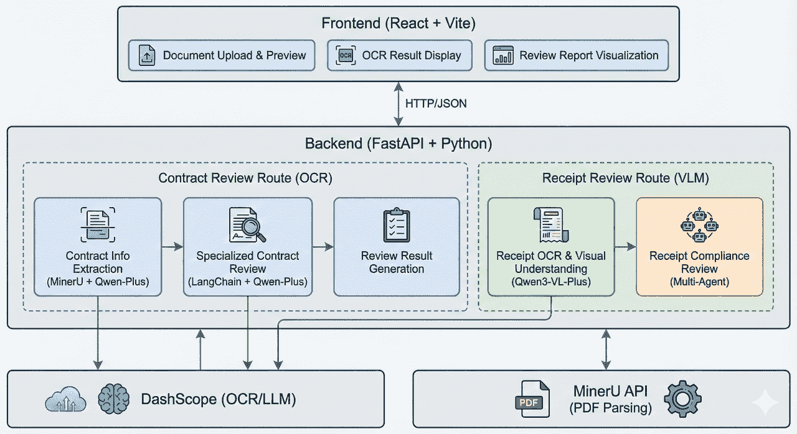

核心目录结构如下：

```
    DocumentAgent/
    ├── backend/                  # FastAPI 后端
    │   ├── main.py              # 主服务器文件 (723行)
    │   ├── requirements.txt     # Python 依赖
    │   └── uploads/             # 上传文件目录(自动创建)
    ├── frontend/                 # React 前端
    │   ├── src/
    │   │   ├── services/api.ts  # API 服务层
    │   │   ├── components/      # UI 组件
    │   │   │   ├── Sidebar.tsx
    │   │   │   ├── DocumentUpload.tsx
    │   │   │   ├── OCRResults.tsx
    │   │   │   └── ReviewResults.tsx
    │   │   └── App.tsx          # 主应用
    │   ├── package.json
    │   └── vite.config.ts
    ├── DEPLOYMENT_GUIDE.md      # 部署指南
    └── (项目根目录)
        ├── invoice_verification.py      # OCR识别核心代码
        ├── invoice_validation_agents.py  # 审查核心代码 (881行)
        ├── contract_info_extraction.py  # 合同信息提取
        └── contract_audit_prompt_professional.py  # 合同审查提示词
```

对应的技术栈如下：

DocumentAgent 技术栈

| 层级 | 技术 | 用途 |
| --- | --- | --- |
| **前端** | React 18 + TypeScript | UI框架 |
|  | Vite | 构建工具 |
|  | Tailwind CSS | 样式框架 |
| **后端** | FastAPI | Web框架 |
|  | Pydantic | 数据验证 |
|  | Uvicorn | ASGI服务器 |
| **AI能力** | LangChain | Agent编排 |
|  | Qwen3-VL-Plus | 多模态OCR |
|  | Qwen-Plus | 文本理解与审查 |
|  | MinerU | PDF解析 |
| **工具** | Python 3.10+ | 后端语言 |
|  | Node.js 18+ | 前端环境 |

项目的前后端源码已经上传到百度网盘中：LangChain v1.0 文档审核类Agent开发实战

链接: https://pan.baidu.com/s/1GWZJX9tjvjtrbp1t-iWfLQ?pwd=4b9f 提取码: 4b9f

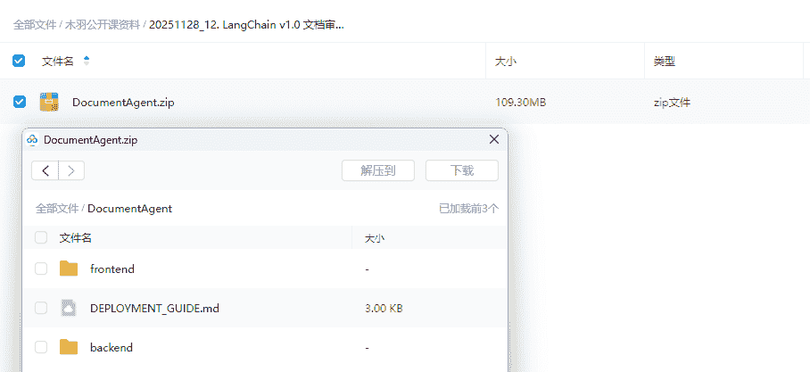


下载后，解压即可得到完整的项目源码，然后按照以下步骤进行部署：

+   **后端服务部署与启动**

```
    # 1. 安装Python依赖
    cd /backend
    pip install -r requirements.txt
```

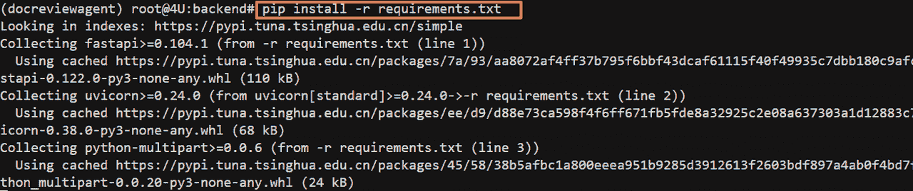

```
    # 2. 配置环境变量
    export DASHSCOPE_API_KEY=&quot;your-api-key&quot;
    export OPENAI_API_KEY=&quot;your-api-key&quot;  # 合同审查使用
    export OPENAI_BASE_URL=&quot;https://dashscope.aliyuncs.com/compatible-mode/v1&quot;
    export MINERU_API_URL=&quot;http://localhost:8080/parse&quot;  # MinerU服务地址
    export VLLM_SERVER_URL=&quot;&quot;  # 可选，如果使用vLLM

    # 3. 启动后端服务
    python main.py
    # 或使用 uvicorn
    uvicorn main:app --host 0.0.0.0 --port 8000 --reload
```

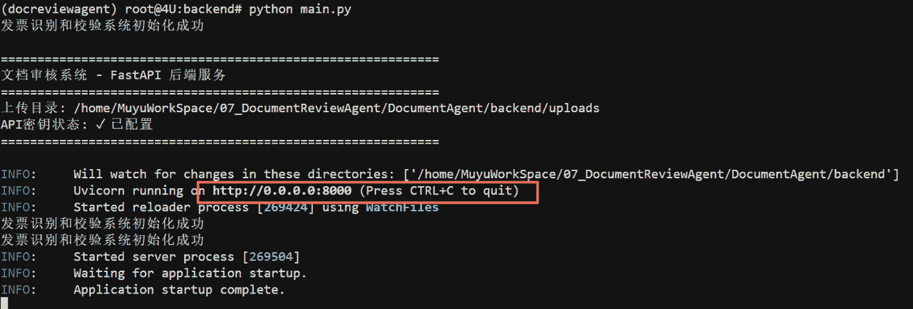

成功启动后，在浏览器中访问 http://localhost:8000/docs 即可看到项目提供的API接口文档。

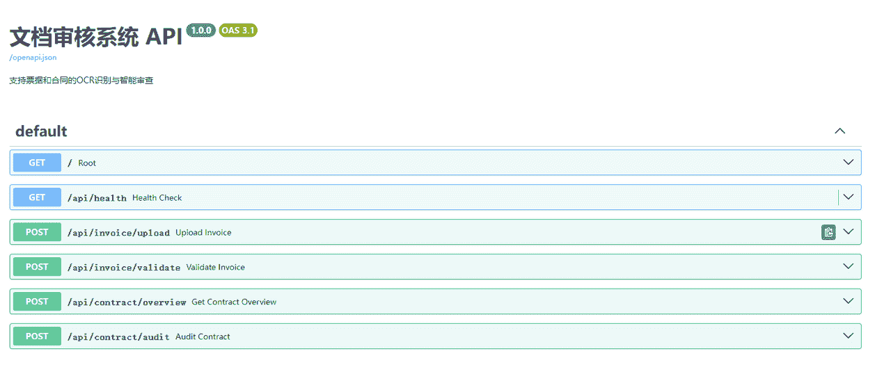

后端启动后，接下来部署前端应用。保持后端服务运行，打开一个新的终端窗口。进入前端目录并安装项目依赖：

```
    cd frontend
    npm install
```

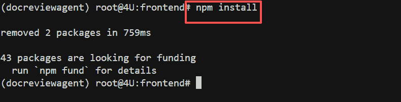

这条命令会安装所有前端依赖包，包括 react、vite、tailwindcss 等。首次安装可能需要几分钟。

启动开发服务器，执行如下命令：

```
  npm run dev
```

启动成功后，你会看到类似以下的输出：

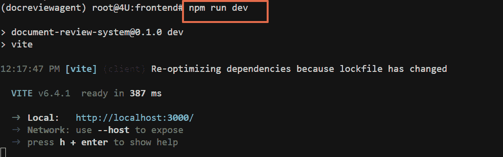

此时，前端应用已经在 http://localhost:3000 成功运行！打开浏览器，访问 http://localhost:3000，你应该能看到主页，显示 6 个创意选项卡片。


如果以上步骤都顺利完成，恭喜你！项目已经成功在本地部署运行了！

**我们下期公开课，再见！** 👋