# Ep.01 从零搭建mini ChatGPT（上）

> 来源：[https://kq4b3vgg5b.feishu.cn/docx/Pmd2dM6vhoUWtkxMqJic0aPmntg](https://kq4b3vgg5b.feishu.cn/docx/Pmd2dM6vhoUWtkxMqJic0aPmntg)

#### 公开课网盘领取：

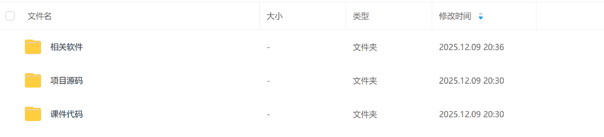


---

#### 本期公开课项目安装流程：

+   下载完整源码

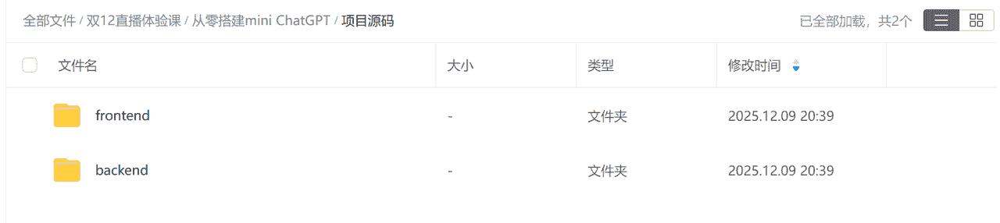

+   安装后端依赖

```
cd backend
pip install --upgrade -r requirements.txt -i https://mirrors.huaweicloud.com/repository/pypi/simple
```

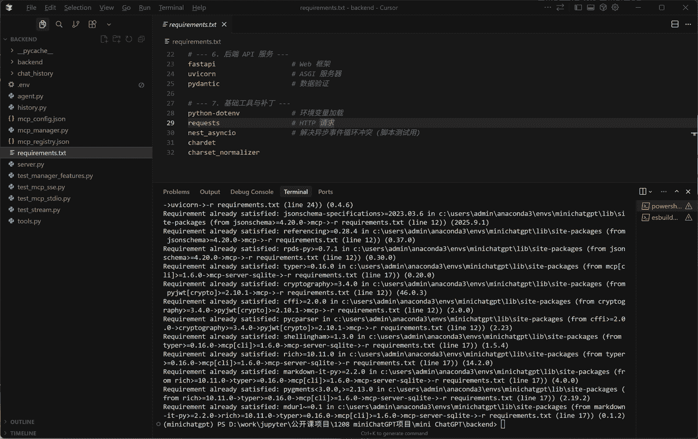

+   所有基础依赖如下：

```
# --- 1. 核心框架 (LangChain Ecosystem) ---
langchain&gt;=1.0.0
langchain-core
langchain-community
langgraph                 # 用于构建 Agent 状态机

# --- 2. 大模型适配 ---
langchain-deepseek        # DeepSeek 官方适配库
# langchain-openai        # (可选) 如果未来想兼容 OpenAI 格式

# --- 3. MCP (Model Context Protocol) ---
mcp                       # MCP 官方 SDK
langchain-mcp-adapters    # LangChain 官方 MCP 适配器 (MultiServerMCPClient)

# --- 4. 本地 MCP 工具服务 (Python版) ---
mcp-server-time           # 时间工具
mcp-server-sqlite         # 数据库工具

# --- 5. 外部工具库 ---
langchain-tavily          # Tavily 联网搜索

# --- 6. 后端 API 服务 ---
fastapi                   # Web 框架
uvicorn                   # ASGI 服务器
pydantic                  # 数据验证

# --- 7. 基础工具与补丁 ---
python-dotenv             # 环境变量加载
requests                  # HTTP 请求
nest_asyncio              # 解决异步事件循环冲突 (脚本测试用)
chardet
charset_normalizer
```

+   创建.env文件

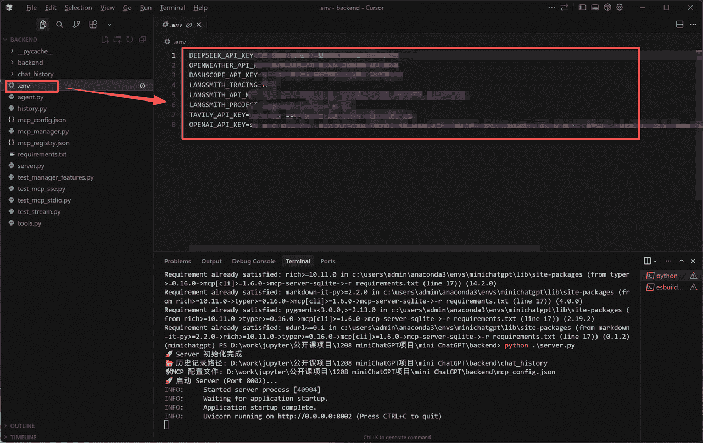

+   核心需要写入DEEPSEEK_API_KEY。

+   启动后端

```
python .\server.py
```

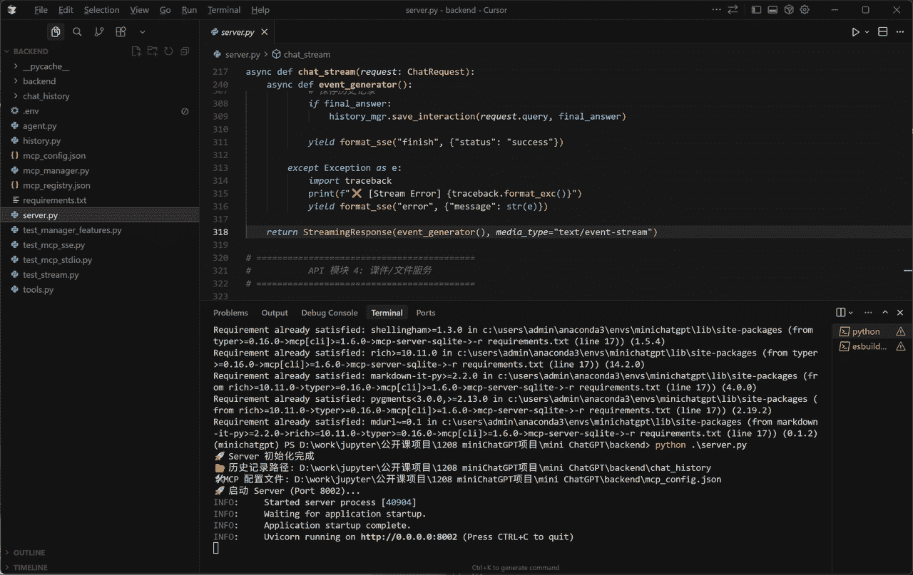

+   安装node.js

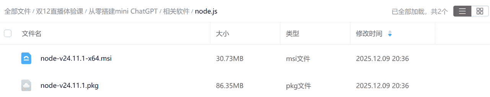

+   安装前端依赖

+   再次打开命令行，进入前端项目文件：

```
cd frontend
```

+   然后安装相关依赖：

```
npm install
```

+   启动前端

```
npm run dev
```

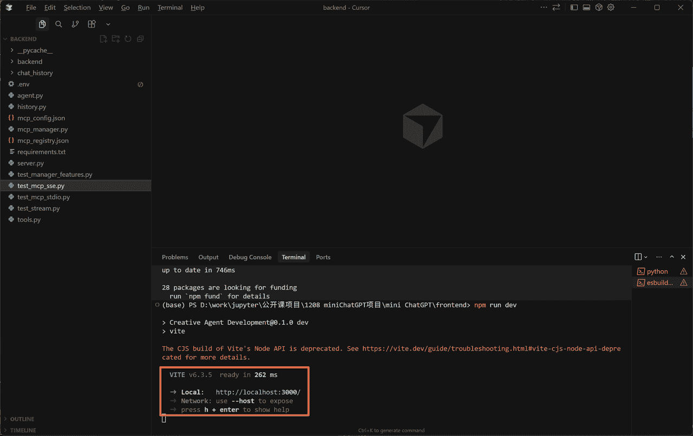

+   在localhost:3000即可访问

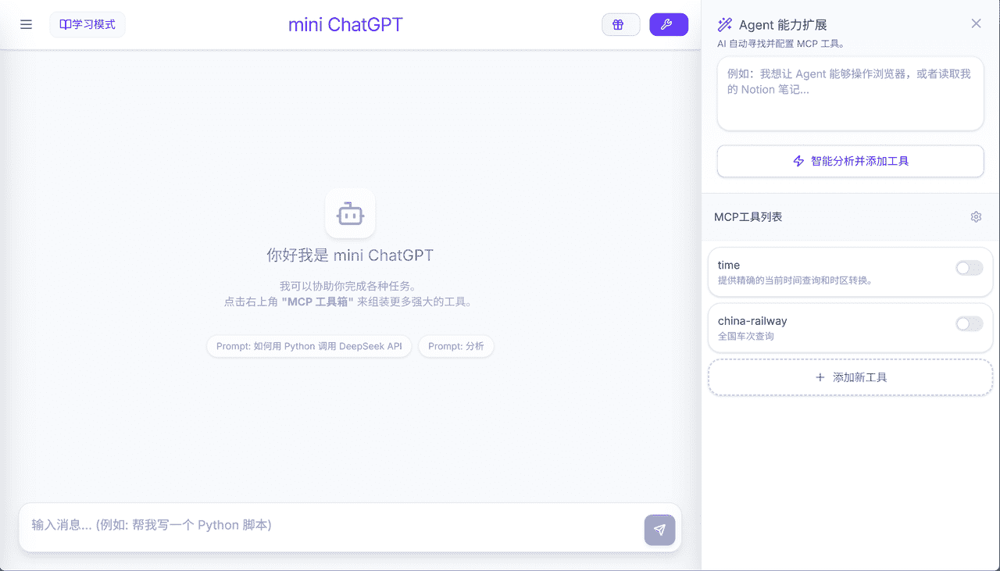

#### 本期公开课项目演示：

https://ml2022.oss-cn-hangzhou.aliyuncs.com/5669e323f6d870b5240a76470253e6f8_raw.mp4)

## 一、大模型时代最高价值技术：Agent开发

### 1. 2025 Agent 技术大爆发

> **核心摘要**：如果是 2023 年是“Chat（对话）”的元年，那么 2025 年则是“Agent（智能体）”的爆发之年。在模型能力跃升、开发工具链成熟以及国家战略政策的三重驱动下，AI 正从“语言生成系统”向“推理执行系统”发生根本性的范式转移。

#### 1.1 定义与范式转移：从 Chat 到 Agent

+   **概念重塑**：

+   2023-2024 (Chat Era)：大模型的应用形态主要局限于 Chatbot（聊天机器人）。用户通过 Prompt 获取信息，核心价值在于**“信息压缩与生成”**。

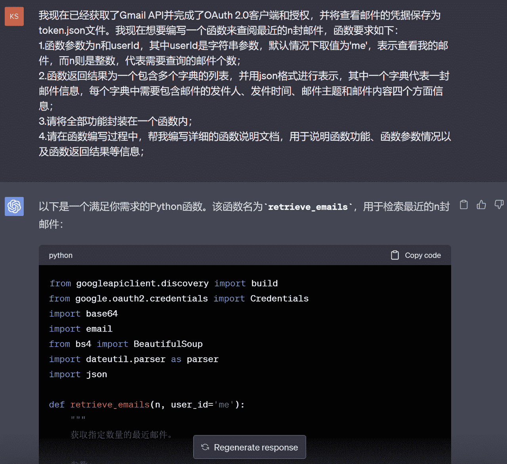

+   **2025 (Agent** Era)：Agent（智能体）成为大模型的主流载体。Agent 是具备感知、规划、行动、反思能力的智能系统。它不再仅仅是“说话”，而是能够使用工具、执行任务、解决复杂问题。

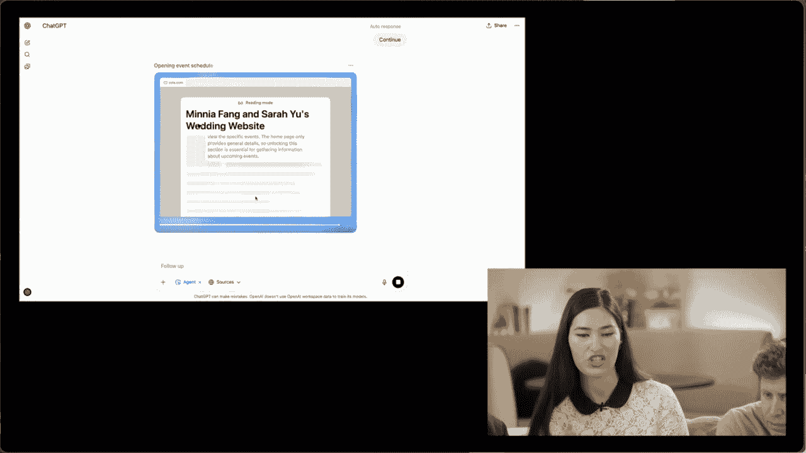

+   **本质区别**：Chat 是“副驾驶（Copilot）”，提供建议；而 Agent 是“主驾驶（Autopilot）”，通过自主闭环完成任务交付。

#### 1.2 数据实证：算力流向的结构性变革

根**据全球领先的大模型中转平**台 OpenRouter 发布的《2025 AI 现状报告》，基于其平台年度 100 万亿 Token 的消耗数据分析，我们观察到了惊人的趋势：

+   **推理执行系统崛起**：模型算力正在从单纯的“语言生成”向“推理执行”大规模迁移。

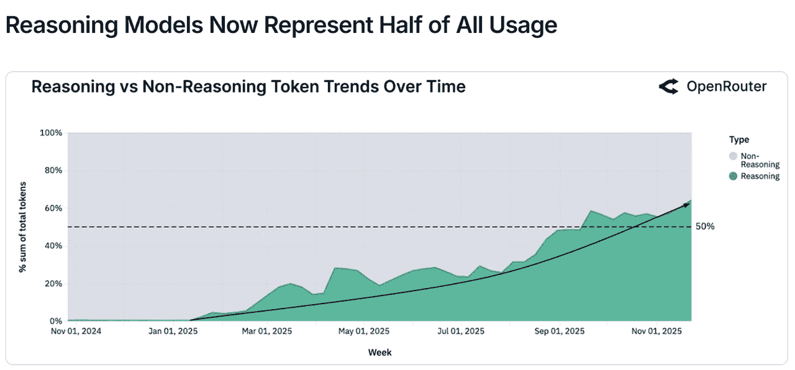

+   **工具调用激增**：涉及 Function Calling (工具调用) 和 Code Interpreter (代码解释器) 的 Token 消耗量呈现指数级增长，这意味着 AI 正在频繁地与外部世界交互。

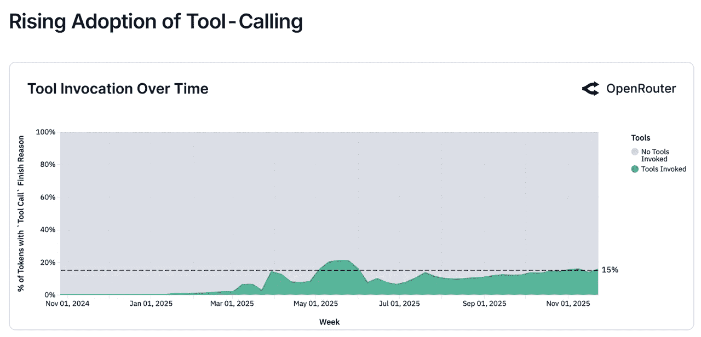

+   **编程 Agent 成为主流**：在所有 Agent 应用中，辅助编程、自动化运维类 Agent 占据了主导地位，AI 正在重塑软件生产的生命周期。

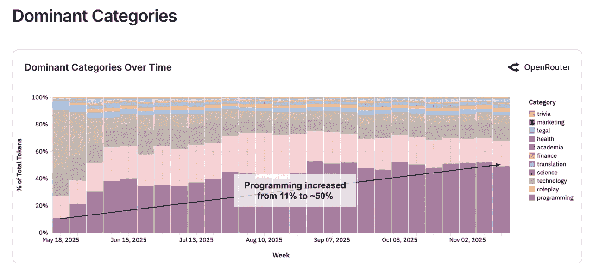

+   数据来源参考：OpenRouter State of AI 2025

#### 1.3 算力基座：模型性能的“摩尔定律”时刻

**      **Agent 技术的爆发，根本原因在于基座模型（Foundation Model）性能突破了“临界点”。2025 年，全球主流模型厂商均完成了重大版本迭代，模型在数学推理、复杂编程、指令跟随、工具调用等 Agent 核心能力上普遍提升了 30% 以上：

| **厂商** | **模型迭代路径 (2025年度)** | **核心突破** |
| --- | --- | --- |
| **DeepSeek** | R1   V3.1   V3.2 Exp   **DeepSeek-V3.2** | 在开源领域率先实现“自主推理”能力的质变，成本优势显著。 |
| **Google** | Gemini 2.0   **Gemini 3.0 Pro** | 多模态原生理解能力大幅增强，极长的上下文窗口支持复杂 Agent 记忆。 |
| **Alibaba** | Qwen 2.5   **Qwen 3** | 中文语境下的指令遵循能力全球领先，整体能力大幅提升。 |
| **OpenAI** | GPT-4o   GPT-4.5/4.1   **GPT-5.1** | 推理深度大幅提升，解决了复杂任务规划中的“幻觉”问题并大幅提升情商。 |
| **Anthropic** | Claude 3.5   4.0   **Claude 4.5** | 依然保持着最强的代码生成与逻辑推理能力，是编程 Agent 的首选基座。 |

> **技术洞察**：基座模型的性能上限决定了 Agent 的能力下限。只有当模型足够聪明（Smart Enough），Agent 才能从“玩具”变成“工具”。

### 1.4 工具链革命：开发门槛的断崖式下降

2025 年也是 Agent 开发工具链的“寒武纪大爆发”，开发范式经历了从“手搓 Prompt”到“标准化架构”的跃迁：

+   连接标准统一：MCP (Model Context Protocol)

+   年初爆火的 MCP 协议，彻底解决了 LLM 与数据源/工具之间的连接难题。它就像 USB 接口一样，让开发者只需编写一次工具，即可被所有支持 MCP 的 Agent 调用，极大降低了生态协同门槛。

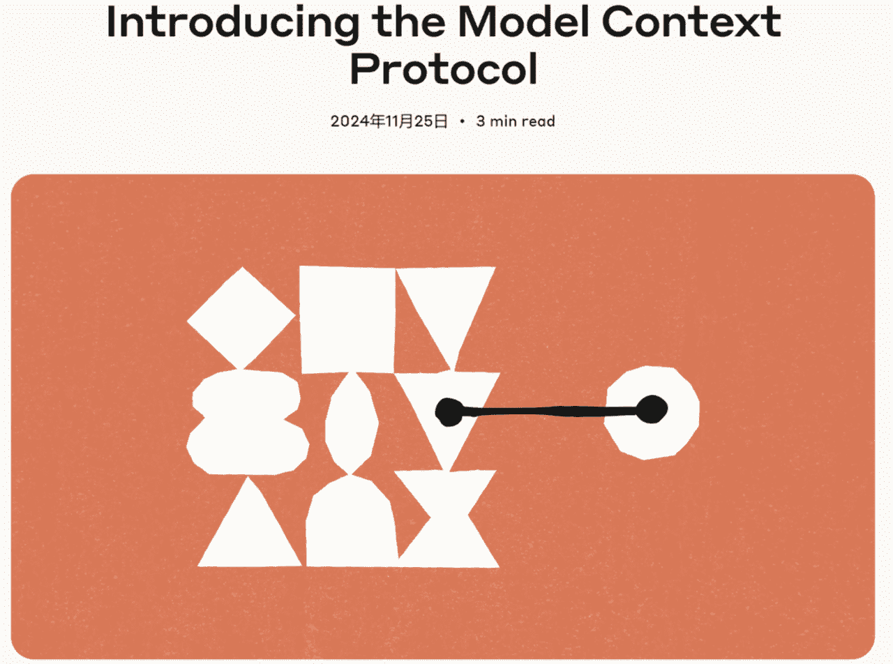

+   **开发框架标准化**：

+   OpenAI Agents SDK & Google ADK：巨头下场定义标准，推动了 Agent 开发向工程化、模块化发展。

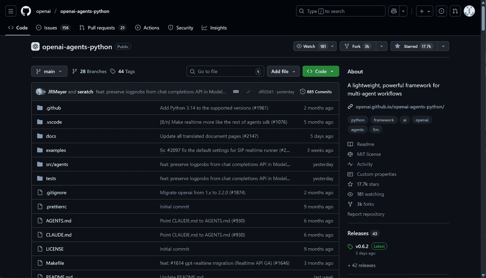

+

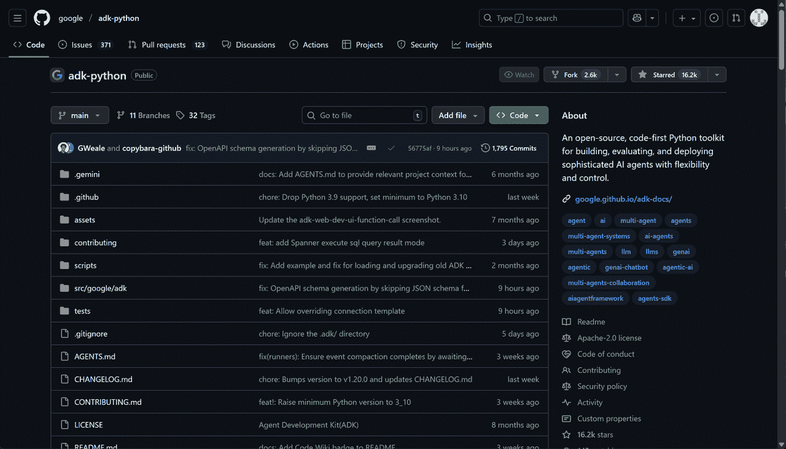

+   **LangChain 1.0**：作为行业事实标准，LangChain 1.0 版本全面拥抱大模型自主的 React (Reasoning + Acting) 范式，摒弃了旧版复杂的 Chain 结构，转向更灵活的图（Graph）架构。

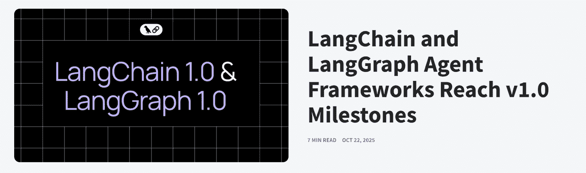

+   Agent Builder 与 AI 编程：

+   进一步提出的“纯自然语言开发”设想，结合 AI 编程助手，使得开发者可以通过自然语言描述业务逻辑，由 AI 自动生成 Agent 代码。目前该技术已进入测试阶段，预示着“人人都是 Agent 开发者”时代的临近。

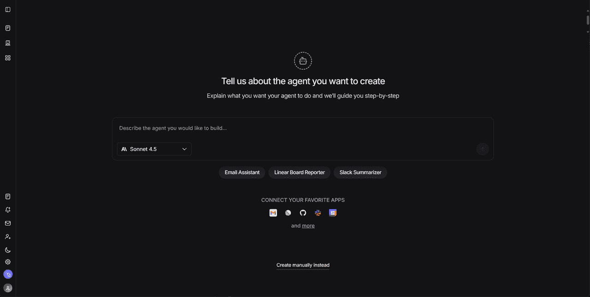

### 1.5 政策风口：国家战略的“新十年”机遇

**2025 年 8 月，国务院正式发布《**关于深入实施“人工智能+”行动的意见》。

+   **历史的回响**：

+   **10 年前（2015）**：“互联网+”指导意见发布，开启了移动互联网的黄金十年，催生了拼多多、美团、字节跳动等万亿级巨头。

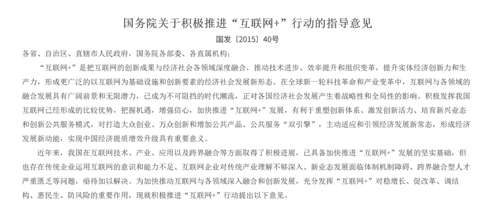

+   **10 年后（2025）**：“人工智能+”指导意见发布，这不仅是政策导向，更是行业发展的风向标。它标志着我们正式进入了属于 AI 的“黄金十年”。

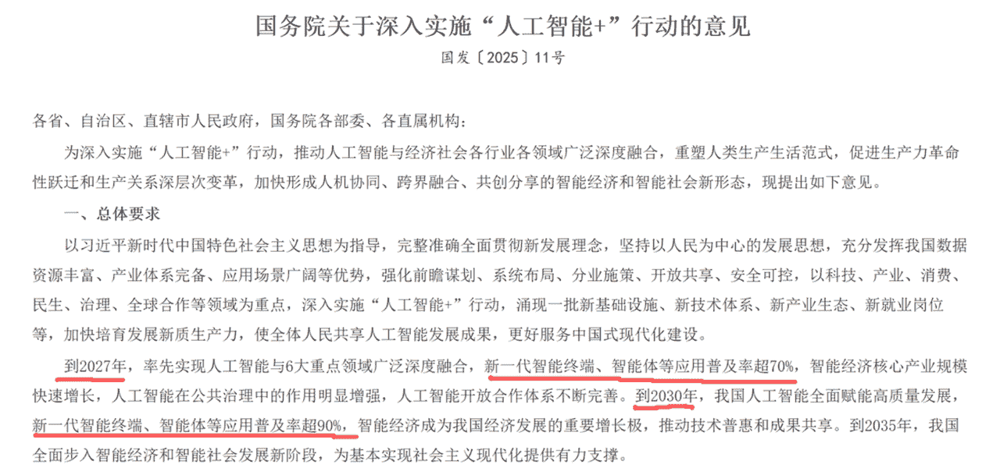

+   **量化目标**：

+   报告明确指出：**未**来 2-3 年，智能终端、智能体（Agent）应用的普及率要达到 70%；未来 5 年，这一数字将达到 90%。

+   **机遇解读**：

+   对于技术人而言，这不再是可选的“加分项”，而是必须掌握的“生存技能”。Agent 将重构所有行业的生产流程，从金融风控到软件开发，从客户服务到创意设计。

不难看出，Agent 技术正处于**“应用市场爆发（需求侧）+ 开发工具成熟（供给侧）+ 政策红利释放（环境侧）”**的三重叠加期。

+   **技术快车道**：借助 MCP 和 AI 编程工具，Agent 开发的复杂度已大幅降低。

+   **价值高地**：掌握 Agent 开发技术，意味着掌握了调用未来算力资源的“钥匙”。

**现在，正是大模型技术人系统学习 Age**nt 开发、完成职业转型的最佳时间窗口。

### 2. 大模型Agent核心应用场景介绍

> **数据背景**：本节内容基于我们团队对 2025 年第三季度市场招聘数据（覆盖 20,000+ 大模型相关岗位 JD）的深度调研分析。数据直观地揭示了企业在落地大模型技术时的真实痛点与核心需求分布。

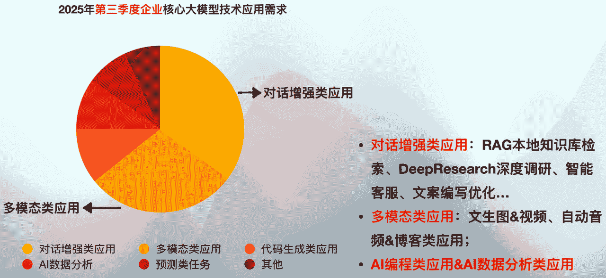

#### 2.1 对话增强类应用（占比约40%）：从“简单问答”到“专家级深度调研”

从图**表中可以看出，“对**话增强类应用”占据了最大的市场份额（黄色区块）。这表明企业的第一波落地潮依然围绕着“知识处理”与“交互升级”展开，但其内涵已发生质变。企业不再需要只会“闲聊”的机器人，而是需要具备深度思考与执行能力的 Agent。

+   Agentic RAG（智能增强检索）：

+   **痛点升级**：传统的 RAG（检索增强生成）只是机械地匹配数据库文本，容易出现“查到了但没用”的情况。

+   **Agent 解决方案**：现在的企业级 RAG 是 Agentic 的。Agent 不再是单次检索，而是具备**“自反思（Self-Reflection）”**能力。如果第一次检索结果不佳，Agent 会自动修改搜索关键词重新检索；它还能通过 Re-ranking（重排序）技术精准过滤噪音，甚至主动反问用户以明确需求。

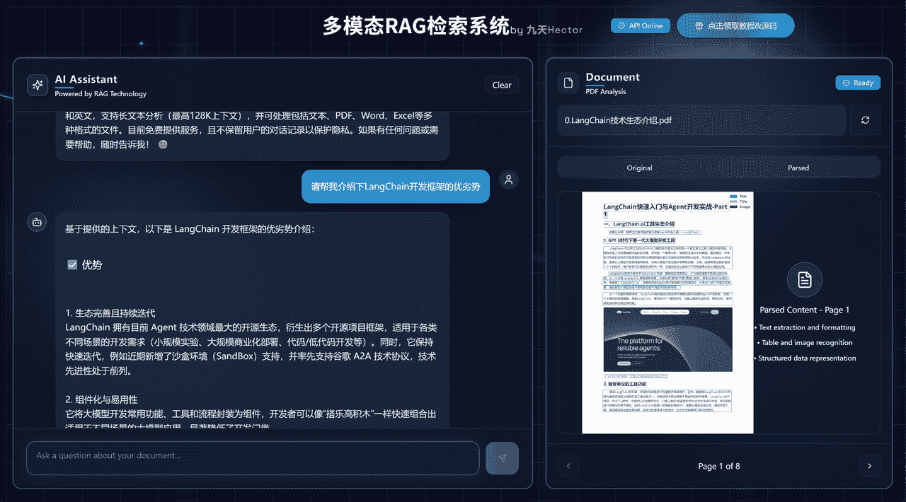

+   **应用场景**：企业合同合规审查、复杂技术文档的故障排查助手。

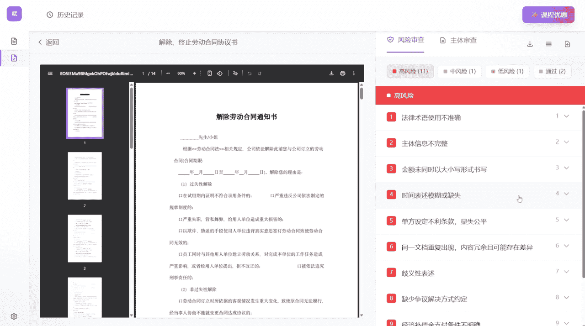

+   DeepResearch（深度调研 Agent）：

+   **核心价值**：这是 2025 年最火热的场景之一。它解决了大模型“懒惰”的问题。

+   **工作流**：用户只需给出一个模糊课题（如“分析 2025 年新能源车电池技术路线”），Agent 会自主拆解任务   调用 Tavily/Google 进行广度搜索   阅读数百个网页   交叉验证信息真伪   最终生成一份长达万字的、带有引用来源的深度行业研究报告。

+   **企业意义**：将分析师从繁琐的信息搜集工作中解放出来，专注于决策。

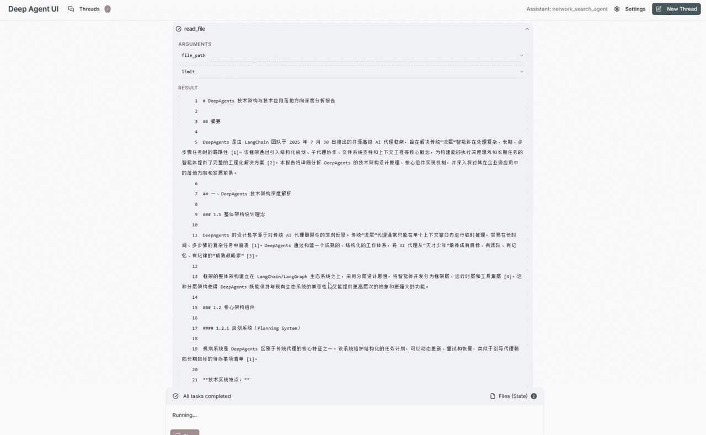

+   **行动型智能客服**：

+   区别于传统的“话术库”匹配，Agent 客服拥有调用 C**RM 系**统、修改订单状态、发起退款流程的工具权限，真正实现了从“咨询”到“业务闭环”的跨越。

#### 2.2 多模态类应用（占比约25%）：内容营销的“自动化工厂”

图中橙色区块显示，多模态应用是第二大需求阵地。这标志着 AIGC 已从个人创作者的玩具，变成了企业营销和运营的“工业流水线”。

+   **全流程内容营销 Agent**：

+   **场景描述**：企业不再满足于生成一张图。现在的需求是构建一个“创意总监 Agent”。

+   **工作流**：它能根据当下的热点新闻，自主构思文案   调用 MJ/Flux 生成配图   调用 Suno 生成背景乐   最终合成短视频并分发到抖音/小红书。

+   **技术支撑**：底层依赖于强大的多模态基座（如 GPT-5, Gemini 3.0 Pro），但在 Agent 层面上，核心在于对工作流（Workflow）的编排和对**一致性（Consistency）**的控制（如保持角色形象在不同画面中的统一）。

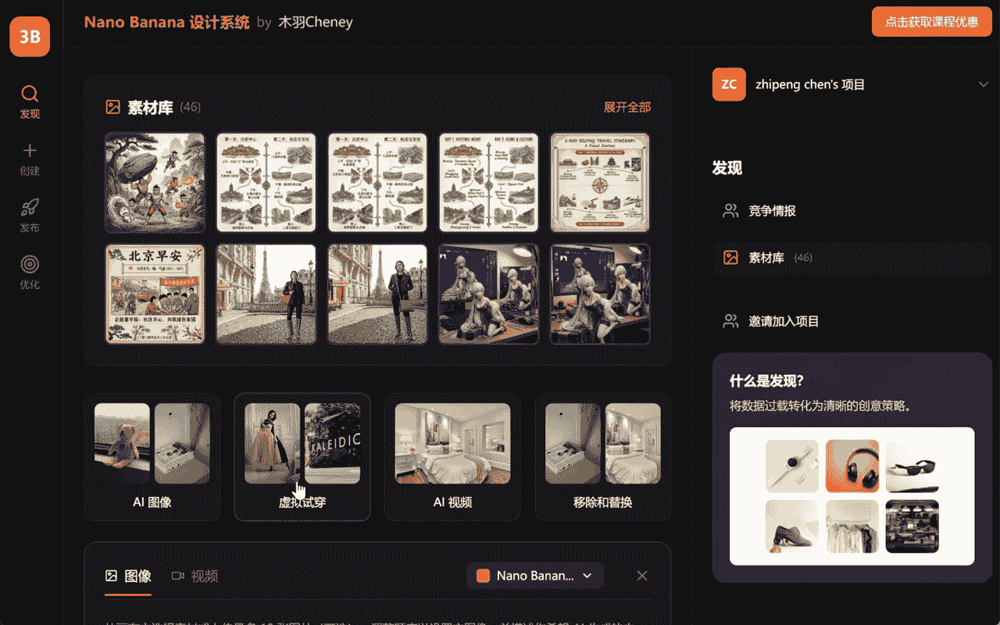

+

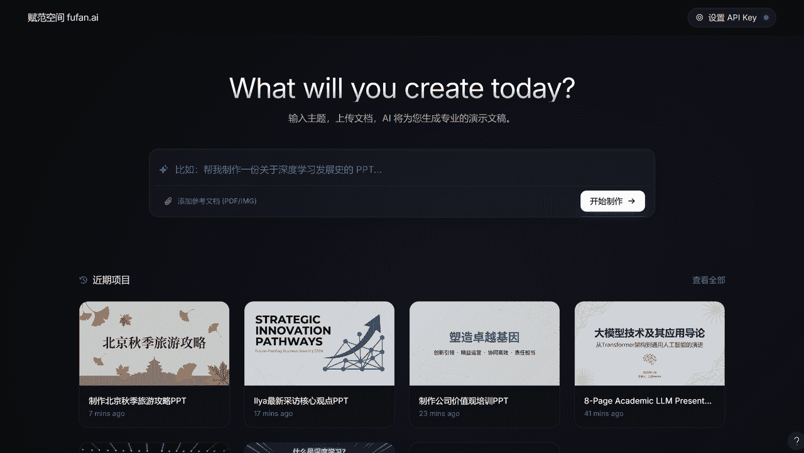

+   **自动化音频与播客系统**：

+   利用 NotebookLM 等技术思路，企业正在构建内部培训资料的“音频化 Agent”。它能自动阅读 100 页的 PDF 产品手册，然后生成一段双人对话形式的、生动有趣的播客音频，极大提高了员工的学习效率。

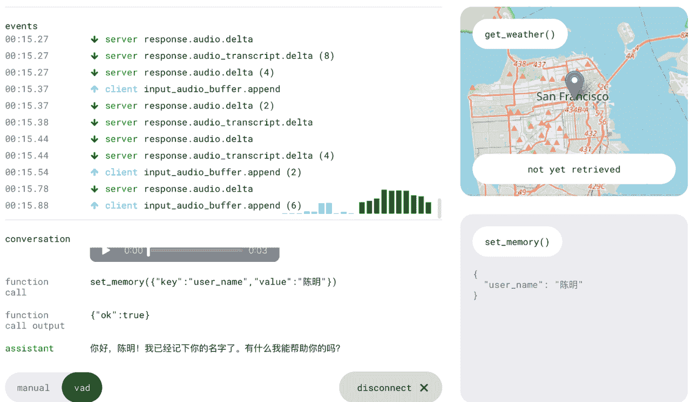

#### 2.3 AI编程与数据分析（占比约20%）：技术与决策的“超级副驾”

**图中的深色区块代表**了更硬核的技术需求。这部分虽然占比不如前两者高，但客单价（价值）极高，是企业数字化转型的深水区。

+   AI 数据分析师（Data Analyst Agent）：

+   **颠覆点**：彻底改变了 BI（商业智能）的交互方式。

+   **场景**：老板不再需要等待数据团队排期做报表。只需对 Agent 说：“帮我分析下上季度华东地区销售下滑的原因”，Agent 会自动编写 SQL 查询数据库   使用 Python/Pandas 进行数据清洗与分析   调用 Matplotlib 画图   最终生成一份包含归因分析的 PDF 报告。

+   **核心技术**：Code Interpreter（代码解释器）是此类 Agent 的心脏。

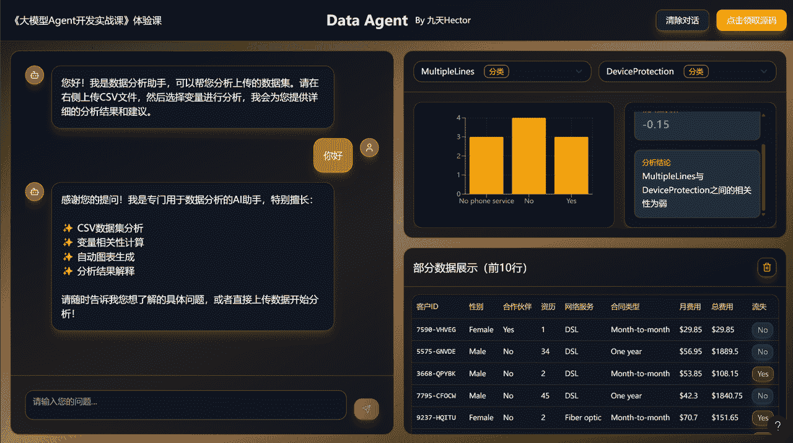

+   **编程 Agent**：

+   **企业需求已从**简单的代码补全（Copilot）转向了自主任务执行。

+   例如：运维 Agent 可以自主监控服务器报警日志，自主编写脚本尝试修复，或者自主进行旧代码的 Unit Test（单元测试）编写与重构。

#### 2.4 预测类任务与长尾需求（占比约15%）：专用领域的深耕

图中的红色与灰色区块代表了预测类及其他长尾任务。这通常涉及特定行业的垂直模型微调与 Agent 结合。

+   **预测类任务**：如供应链库存预测 Agent、金融市场量化交易 Agent。这类 Agent 往往结合了传统机器学习模型（预测）与大模型（决策解释）。

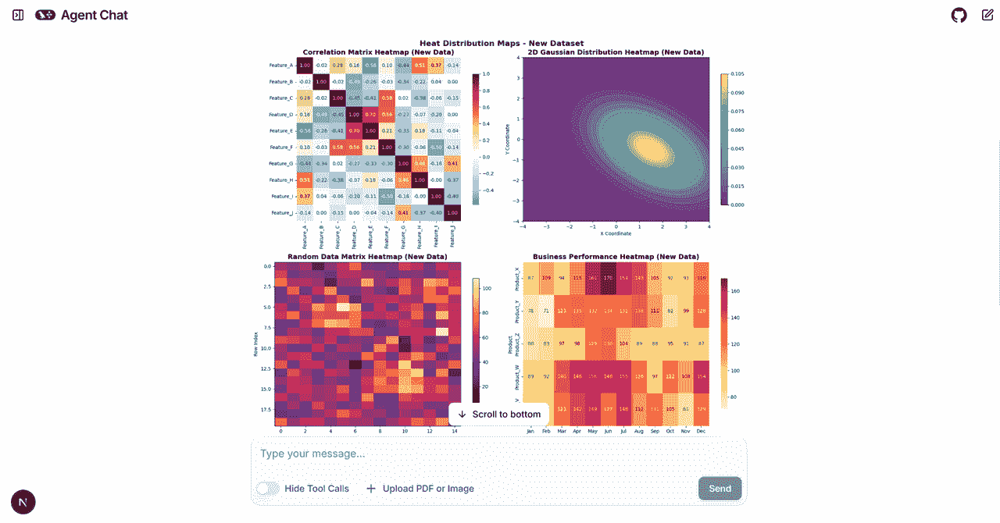

+   **企业定制化 Agent**：如 HR 招聘面试 Agent、法务合同生成 Agent 等。

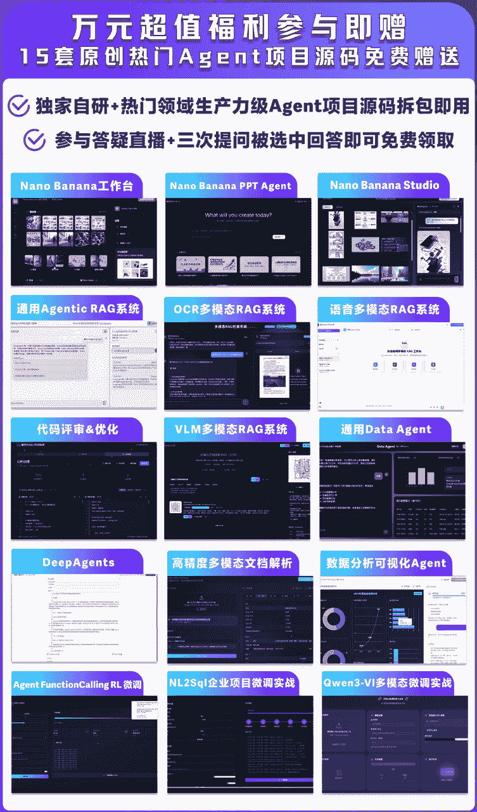

### 3. 当代大模型技术人必备 Agent 技术体系

> 在了解了 Agent 的宏大背景和广泛的应用场景后，作为技术人，我们最关心的问题一定是：“我具体需要掌握哪些技术，才能接住这波泼天富贵？”

> 基于我们团队对 Q3 季度 20,000+ 份大模型相关岗位 JD 的深度拆解，我们绘制了这张**《2025 大模型技术人能力与薪资跃迁图谱》**。这不仅仅是一张技术架构图，更是一份职业晋升的藏宝图。我们将大模型技术人的成长路径划分为四个阶段，每一个阶段都对应着明确的技术壁垒和市场价值。

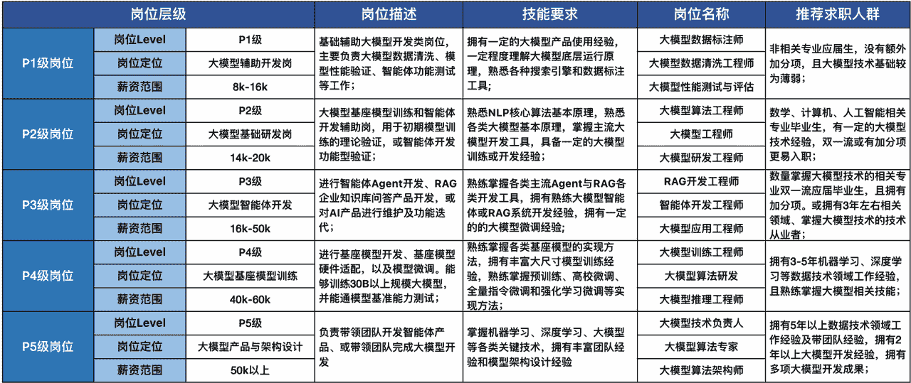

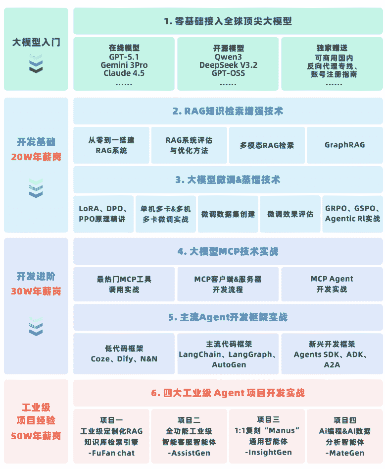

#### 3.1 筑基阶段：零基础接入全球顶尖大模型

这是所有技术人的起点，也是通往 AI 世界的“入场券”。在 2025 年，仅仅会使用 ChatGPT 网页版已经不够了，技术人需要具备**“模型鉴赏与底层接入”**的能力。

+   **闭源模型矩阵**：熟练掌握 GPT-5.1、Gemini 3 Pro、Claude 4.5 等顶尖闭源模型的 API 接入特性。了解它们在长文本、推理深度上的差异，以便在不同业务场景下做选型。

+   **开源模型生态**：重点关注 DeepSeek V3.2、Qwen3 以及 GPT-OSS。开源模型是企业私有化部署的首选，掌握其部署和微调门槛是基础中的基础。

+   **基础设施能力**：能够解决国内网络环境下的反向代理、账号注册、API Key 管理等工程化问题，确保企业服务的稳定性。

#### 3.2 开发基础（年薪 20W+ 岗）：RAG 与微调的双轮驱动

当掌握了基础模型接入，你就具备了初级开发能力。但在企业招聘 JD 中，年薪 20W 的分水岭在于：你是否能让大模型“懂”企业的私有数据？ 这需要两项核心技术：

+   RAG 知识检索增强技术（外挂大脑）：

+   **从零搭建**：不依赖集成平台，手写向量数据库检索、文本切片逻辑。

+   **进阶 RAG**：掌握 Gra**phRAG（图**谱增强检索） 和 多模态 RAG。现在的文档不仅仅是文字，还包含图片、表格，GraphRAG 能解决跨文档的复杂推理问题，这是 2025 年企业知识库的标配。

+   **评估与优化**：会写代码不够，还要会用 Ragas 等框架评估检索质量，解决“幻觉”问题。

+   大模型微调与蒸馏技术（重塑大脑）：

+   **高效微调**：精通 **LoRA、QLoRA** 等参数高效微调方法。

+   **RLHF 与 **Agentic** RL：这是 DeepSee**k 带来的技术红利。掌握 PPO、DPO 以及最新的 GRPO（群组相对策略优化） 算法，让模型通过强化学习具备更强的 Agent 自主决策能力。

+   **工程实战**：具备单机多卡、多机多卡的微调实操经验。

#### 3.3 开发进阶（年薪 30W+ 岗）：MCP 与主流 Agent 框架

要突破 30W 年薪，你的角色需要从“模型调用者”转**变为“系统架构师”。**这一阶段的核心任务是让模型与真实世界交互，也就是我们本次课程的重头戏——Agent 开发。

+   大模型 MCP 技术实战（连接万物）：

+   **标准统一**：熟练掌握 MCP (Model Context Protocol) 协议。这是 2025 年连接大模型与本地数据（SQLite）、外部服务（高德地图、12306）的通用标准。

+   **全栈开发**：具备开发 MCP Client（客户端）和 MCP Server（服务端）的能力，能够为企业内部的旧系统（ERP、CRM）编写 MCP 接口，将其接入 AI 时代。

+   主流 Agent 开发框架实战（系统编排）：

+   **低代码原型**：熟悉 Coze、Dify 等平台，用于快速验证 PM 的需求。

+   **代码级工程**：精通 **LangChain 1.0** 和 **LangGraph**。LangGraph 是构建复杂、有状态、循环 Agent 的行业标准。同时需关注 AutoGen 以及 Google/OpenAI 推出的 Agents SDK、ADK 等新兴框架。

#### 3.4 工业级项目经验（年薪 50W+ 岗）：四大实战项目交付能力

**这是金字塔的塔尖。年薪 **50W+ 的专家，不仅懂技术，更要有端到端的复杂系统交付能力。本次课程我们将深度拆解四个对标行业标杆的工业级项目：

1.  **项目一：工业级定制化 RAG 知识库搜索引擎 **

+   **对标产品**：Perplexity、企业内部知识中台。

+   **核心难点**：解决海量异构数据的高并发检索、混合排序（Hybrid Search）以及引用的精准溯源。

1.  **项目二：全功能工业级智能客服智能体 **

+   **对标场景**：电商售后、银行客服。

+   **核心难点**：不仅是回答问题，更要具备**Tool Use（工具调用）能力，实现查询订单、修改退款状态等Action（行动）**闭环，且需保证 100% 的意图识别准确率。

1.  **项目三：1:1 复刻 "Manus" 通用智能体 **

+   **对标产品**：Manus、OpenAI Operator。

+   **核心难点**：实现 DeepResearch（深度调研） 能力。Agent 需要具备自主规划、多步网页浏览、信息交叉验证、长报告生成的全自动化能力。

1.  **项目四：AI 编程 & AI 数据分析智能体 **

+   **对标产品**：Devin、Cursor Backend。

+   **核心难点**：集成 Code Interpreter（代码解释器），让 Agent 具备沙箱环境下的代码执行、Debug、数据可视化绘图能力。

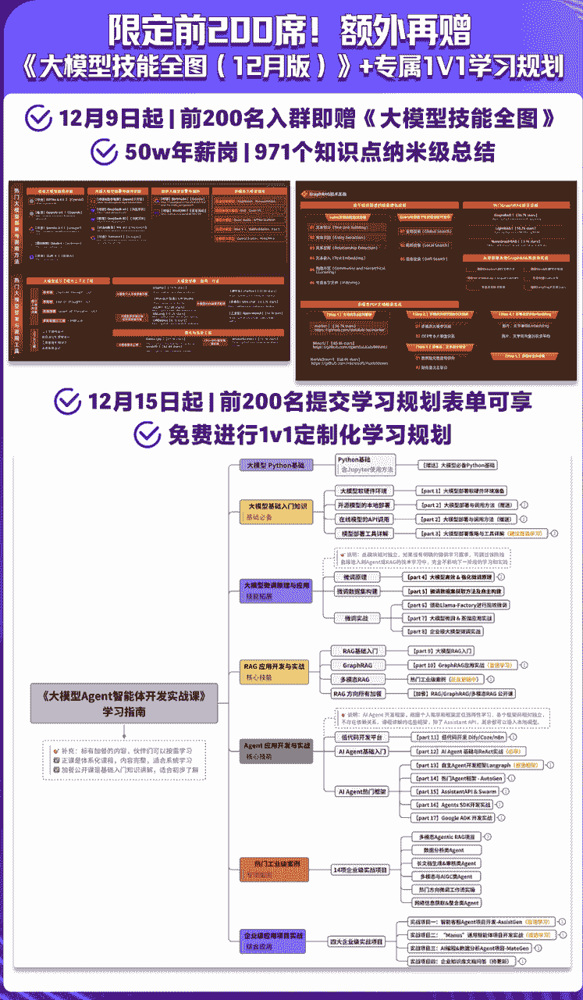

#### 3.5 大模型Agent开发岗位薪资

各大招聘网站给出的2025年招聘数据中能更加明显的看出大模型Agent岗位薪资增长状况，例如猎聘在《2025上半年人才供需洞察报告》中表示新增AI岗位的增幅超过36%，而人才缺口则达到了500万。

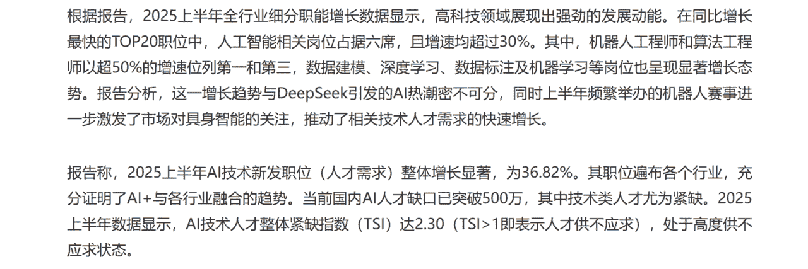

最关键的是，由于人才缺口较大，目前AI岗位的学历要求普遍较低，硕士学历以下、也就是专科和本科学历要求的岗位占比达到2/3以上。

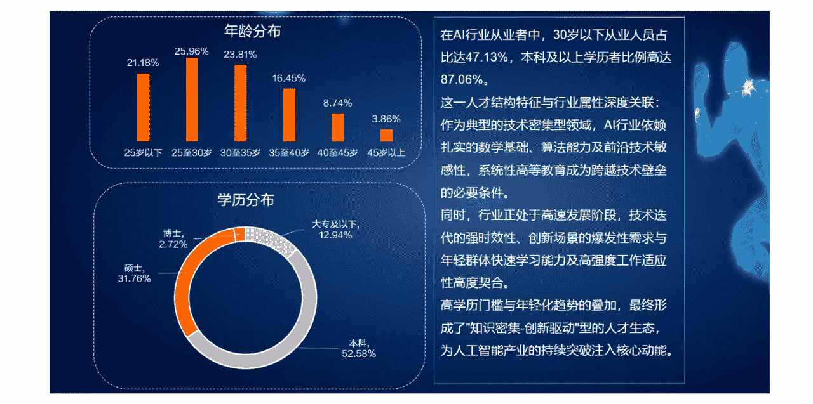

而智联招聘则在《2025中国人工智能产业人才报告》也给出了相类似的数据结论。岗位缺口巨大、学历要求低、岗位薪资高，不难看出，AI大模型岗毫无争议的正处在红利期。

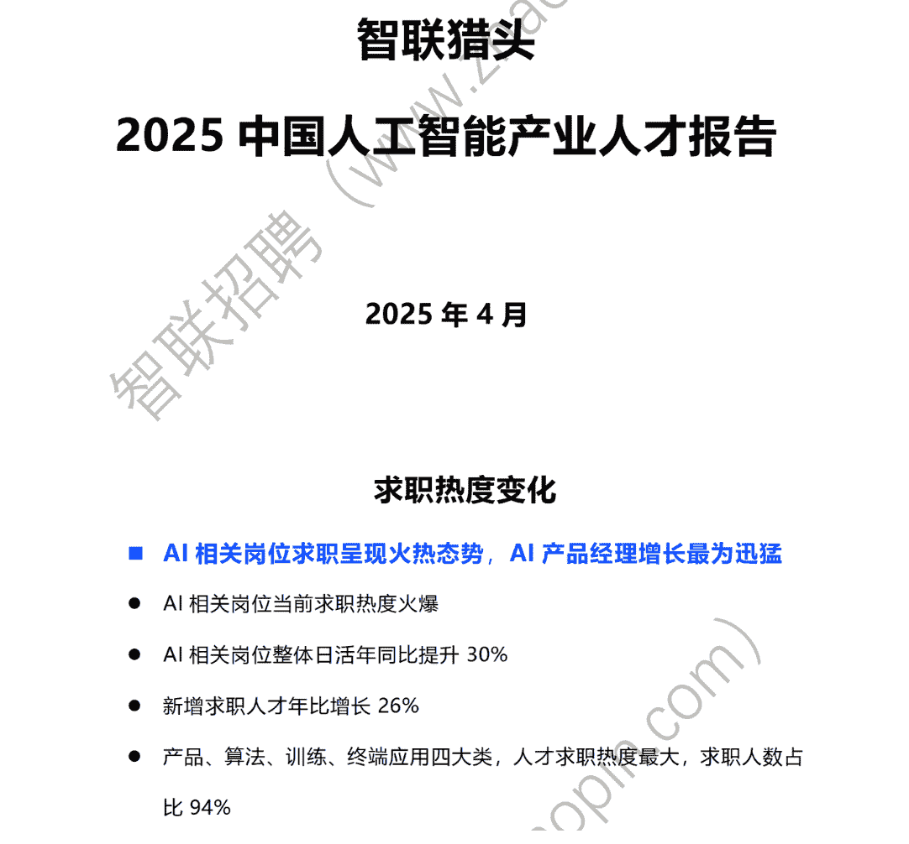

而根据我们回访的学员数据来看，入职平均起薪就达到了2万多月薪，而我们的23年第一批学员，两年大模型工作经验的各位同学更是平均薪资达到了年薪50万：

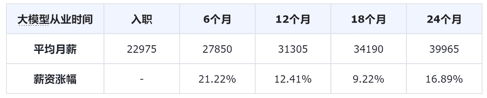

+   今年第四季度团队大模型技术岗位招聘

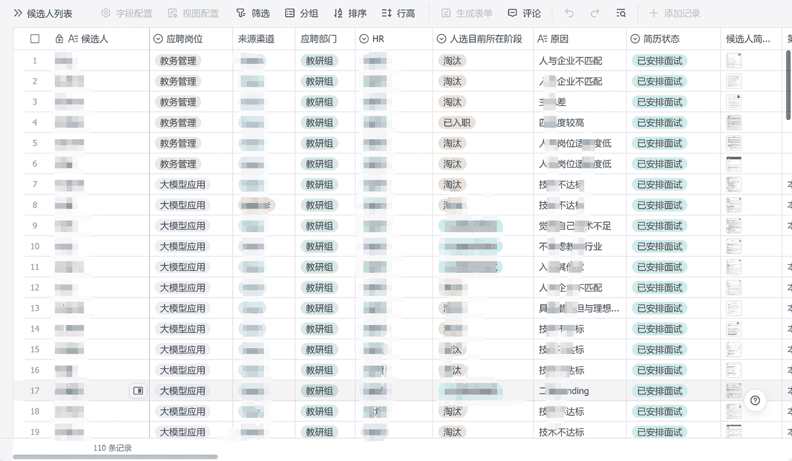

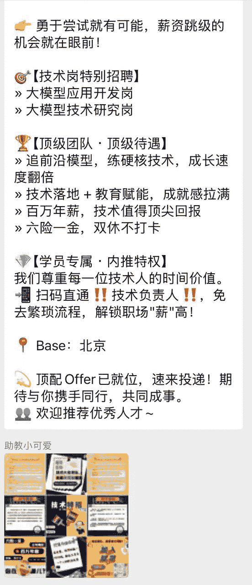

## 二、Agent开发基座模型快速上手指南

### 1. Agent 开发基座模型选取指南

#### 1.1 在线模型 VS 开源模型：从“一家独大”到“双雄并立”

在 2025 年之前的 Agent 开发领域，我们面临的选择其实非常有限。彼时，以 GPT-4 为代表的闭源在线模型（SaaS API）几乎占据了统治地位，开发者往往只能在“昂贵但聪明”和“便宜但愚笨”之间做艰难取舍。

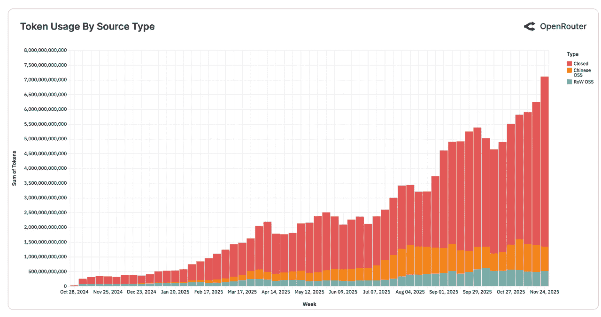

然而，DeepSeek-R1 的发布是一个历史性的分水岭。它不仅打破了闭源模型在推理能力上的垄断，更引爆了全球对中国开源模型的关注。

##### (1) 市场格局：数据背后的真相

根据全球最大的模型路由平台 **OpenRouter** 发布的最新统计数据（基于 **100 万亿 Token** 的调用量分析）：

+   **中国开源力量崛起**：中国开源模型（以 DeepSeek、Qwen 为主）在**全球开**发者调用量中的占比已惊人地达到了 30%。这意味着，全球每 3 次 API 调用，就有一次是在使用中国的模型。

+   **双轨竞争态势**：

+   **第一梯队（在线领跑）**：GPT-5、Gemini 3 Pro、Claude 4.5 依然代表着人类 AI 智慧的最高水平（SOTA）。它们在处理超长上下文（Context Window）、多模态理解以及极度复杂的逻辑推理上，仍保持着身位优势。

+   **第二梯队（开源紧追）**：以 DeepSeek-V3.2、Qwen 3、Llama 4 为代表的开源模型，在特定领域（如编程、数学、纯文本指令跟随）的性能已经达到甚至超越了上一代顶尖闭源模型（如 GPT-4o），且迭代速度极快。

##### (2) 企业选型决策矩阵：安全与成本的博弈

在企业级 Agent 开发中，选择“**在线”还是“开源”，**本质上是在做一道关于数据安全、成本与性能的平衡题。

+   **选择在线模型（API）的场景**：

+   **业务验证期（MVP）**：需要最快速度验证 Agent 逻辑，不想投入算力运维成本。

+   **极致智能需求**：任务极度复杂，需要最强的推理能力（如复杂的法律文书分析、创意生成），且数据脱敏后可传出外网。

+   **全球化业务**：服务海外用户，对合规性要求符合当地标准。

+   选择开源模型（私有化部署）的场景：

+   **数据安全红线**：金融、医疗、政务等核心数据**绝对不出域**。这是 2025 年企业采用开源模型的首要驱动力。

+   **成本敏感型业务**：日均调用量巨大（如百万级），使用 API 成本过高，自建推理集群（配合 vLLM 等加速框架）反而更划算。

+   **深度定制需求**：需要基于企业私有知识库进行全参数微调（Full Fine-tuning）或 LoRA 微调，让模型成为“行业专家”。

#### 1.2 DeepSeek 与 Qwen 系列模型优势：国产之光的崛起

在开源模型的浩瀚星空中，**D**eepSeek（深度求索）与 Qwen（通义千问） 无疑是最耀眼的双子星。对于国内企业技术团队而言，它们不仅仅是“备胎”，而是首选。

##### (1) 为什么选择 DeepSeek？

+   **极致的性价比与推理效率**：DeepSeek 凭借其独特的 MLA（多头潜在注意力）架构和 MoE（混合专家）技术，在保持高性能的同时，极大地降低了显存占用和推理成本。DeepSeek-V3.2 是目前公认的**“Token 成本杀手”**。

+   推理能力（Reasoning）的质变：DeepSeek-R1 开启了开源模型具备 CoT（思维链）能力的先河。在构建需要复杂逻辑分析、数学计算的 Agent 时，DeepSeek 系列表现出惊人的鲁棒性。

+   **纯粹的开源精神**：DeepSeek 往往第一时间公开技术细节和权重，社区支持极佳。

##### (2) 为什么选择 Qwen (通义千问)？

+   **全能型选手**：Qwen 系列（特别是 Qwen 2.5/3）在代码生成（Coding）**和**数学能力上表现卓越，长期霸榜各类开源评测。

+   工具调用（Tool Use）之王：对于 Agent 开发最关键的 Function Calling 能力，Qwen 经过了专项优化，其 API 格式遵循度极高，连接 MCP 工具时的成功率甚至优于许多闭源模型。

+   **多语言优势**：作为阿里出品的模型，Qwen 在中文理解、中英互译以及多语言场景下具有天然优势。

##### (3) 共同优势：国产技术生态的护城河

对于中国企业而言，选择这两款模型还有更深层的战略意义：

+   **数据合规与可控**：模型权重完全掌握在自己手中，无“卡脖子”风险，符合国内数据出境及算法备案要求。

+   **国产算力适配**：两者均对**国产 GPU（如华为昇腾、海光 DCU 等）**进行了深度适配与优化。在国家信创大背景下，这是政企项目落地的必要条件。

+   **繁荣的开发生态**：无论是 Hugging Face 还是魔搭社区（ModelScope），亦或是 LangChain、Ollama、vLLM 等主流框架，对 DeepSeek 和 Qwen 的支持都是**第一优先级（First-class Citizen）**的。这意味着你遇到任何 bug，都能在社区找到解决方案。

### 2. 国内最佳Agent开发基座模型：DeepSeek-V3.2

#### 2.1 DeepSeek-V3.2模型介绍

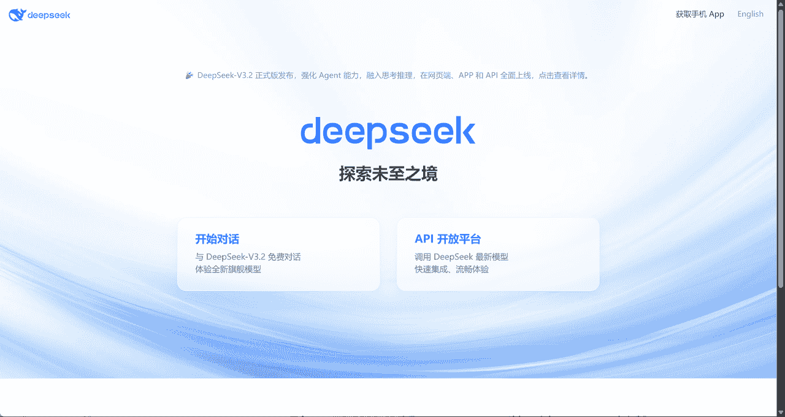

DeepSeek-V3.2模型作为国产最强大模型，在数学、编程、Agent性能方面全面领先GPT-5，跻身全球顶尖大模型第一梯队。并且，DeepSeek团队还做了一项大胆的尝试，那就是为模型的训练过程解除思考链长度限制，并同时引入DeepSeekMath-V2提出的自验证数学推理训练法，最终训练得到DeepSeek-V3.2-Speciale模型，更是在各项指标上整体追平全球性能最强大模型Gemini 3.0 Pro。

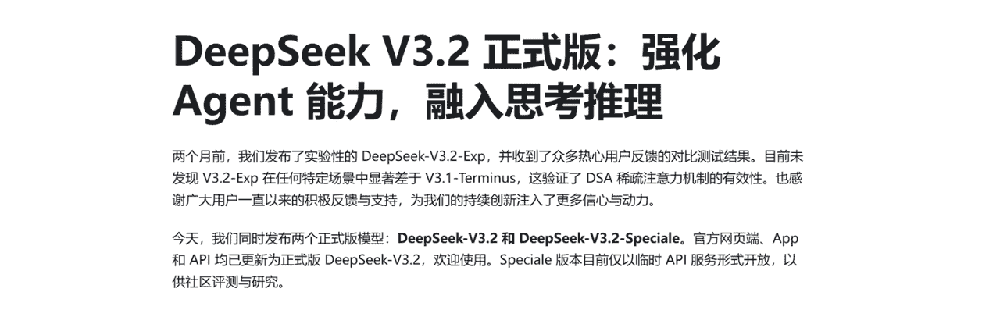

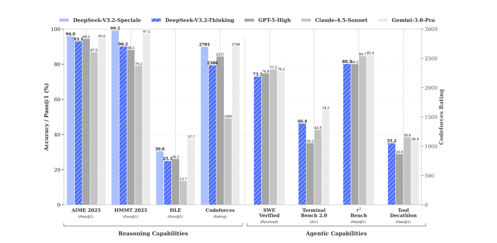

并且DeepSeek首次引入“思考模式下工具调用”的功能，允许模型在单轮任务调用过程保持多步工具调用思考链记忆，也就是像人一样一边思考一边调用工具，从而大幅提升模型多步调用工具的前后一致性，显著提升模型Agent性能。

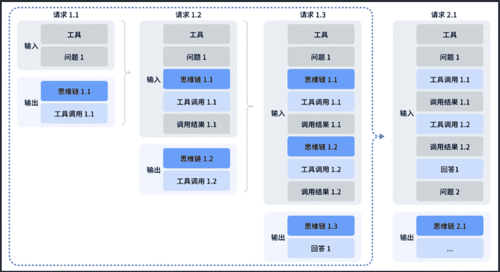

而我们团队也对此进行了测试。首先我们将DeepSeek-V3.2模型带入前不久刚开发的生产力级的基于Nano Banana Pro的AI PPT Agent，作为Agent基座模型（注意不是绘图模型），实际运行过程中，无论是多PPT任务拆解、自主提示词编写、还是外部工具调用，都达到了和Gemini 3.0 Pro的同等水平。

#### 2.2 DeepSeek基础调用流程

在进行Agent开发之前，首先需要准备一个可以进行调用的大模型，这里我们选择使用DeepSeek的大模型，并使用DeepSeek官方的API_KEK进行调用。如果初次使用，需要现在DeepSeek官网上进行注册并创建一个新的API_Key，其官方地址为：https://platform.deepseek.com/usage


注册好DeepSeek的API_KEY后，首先在项目同级目录下创建一个env文件，用于存储DeepSeek的API_KEY，如下所示：

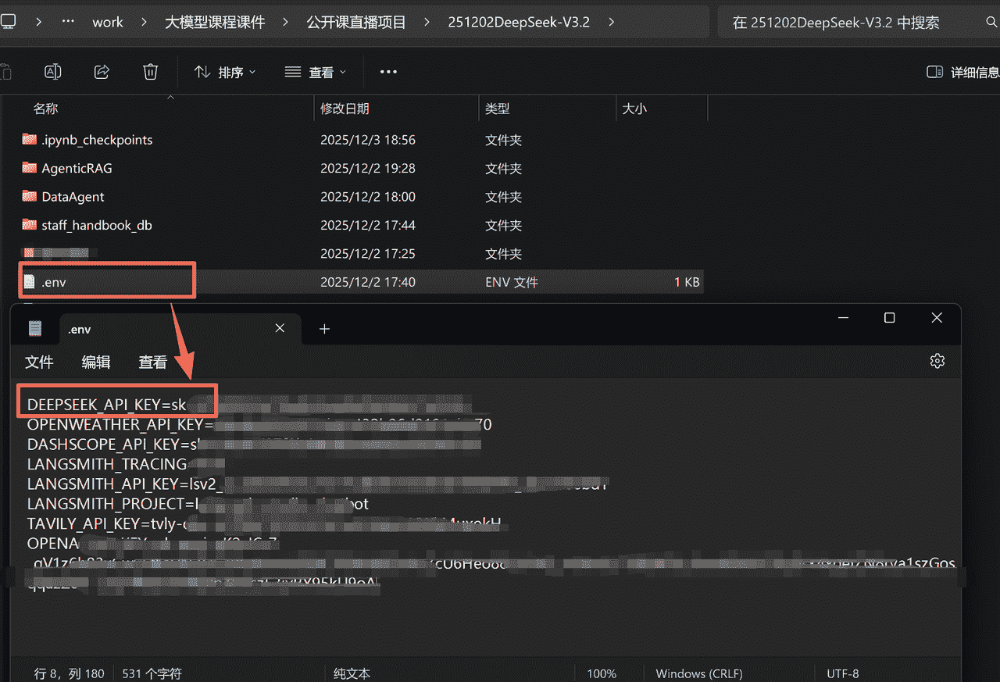

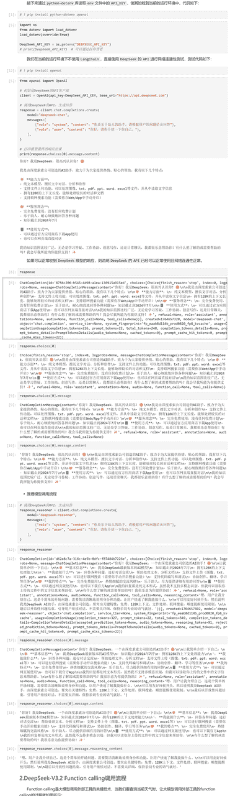

Function calling是大模型调用外部工具的关键技术，当我们要查询当前天气时，让大模型调用外部工具的function calling的过程就如图所示：


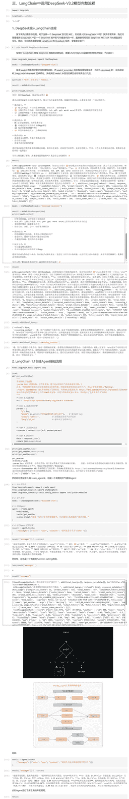

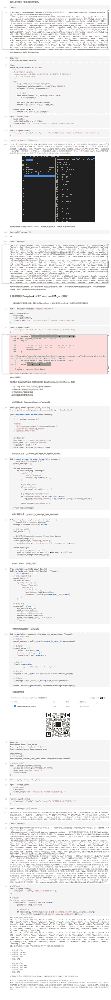

---

+   体验课内容节选自《2025大模型Agent智能体开发实战》(12月班)完整版付费课程

体验课时间有限，若想深度学习大模型技术，欢迎大家报名由我主讲的《2025大模型Agent智能体开发实战》(12月班)

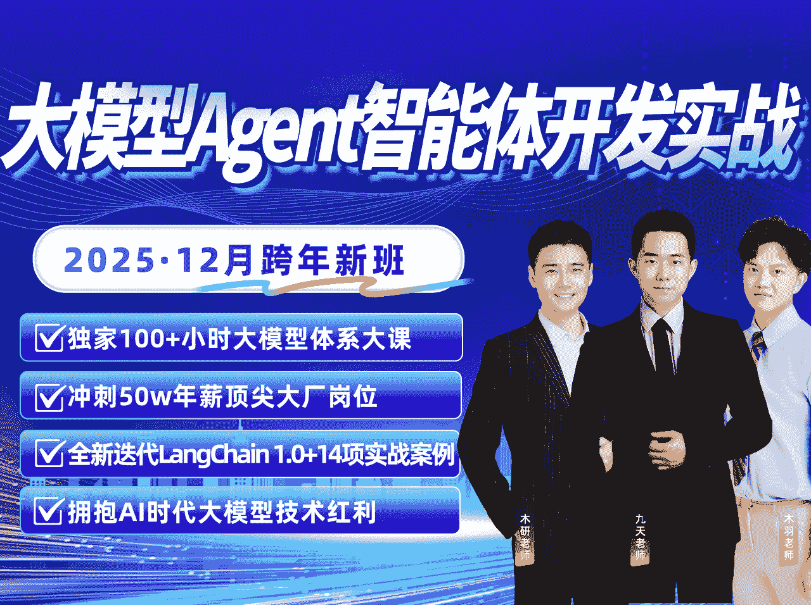

**《2025大模型Agent智能体开发实战**》(12月班)为【100+小时】体系大课，总共20大模块精讲精析，零基础直达大模型企业级应用！

### 课程完整介绍


### 12月新班新增内容

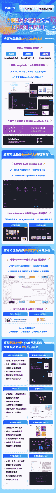