# LangChain 1.1 + MCP Agent开发实战

> 来源：[https://kq4b3vgg5b.feishu.cn/docx/SwNCdEeJRo468HxEKX9cvI9anXd](https://kq4b3vgg5b.feishu.cn/docx/SwNCdEeJRo468HxEKX9cvI9anXd)

+ 公开课网盘领取：

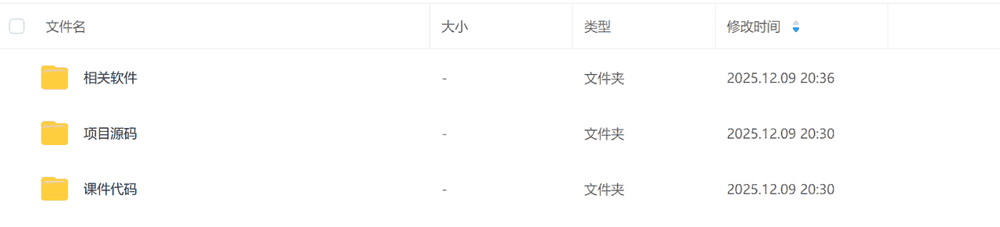


---

## 大模型技术入门与Agent开发实战

## 一、LangChain 1.x技术生态介绍

### 1. LangChain 1.x：全面拥抱 React Agent 开发范式

> **核心摘要**：`LangChain` 1.x 的发布标志着 AI 开发框架从“链式堆叠（Chains）”向“自主智能体（Agents）”的彻底转型。通过标准化的 `create_agent` API，`LangChain` 统一了过去碎片化的开发接口，确立了 `ReAct` (Reasoning + Acting) 作为大模型应用开发的各种事实标准。

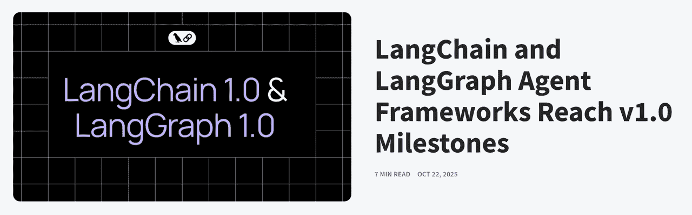

#### 1.1 演进背景：告别“API 碎片化”时代

在 `LangChain` 0.x 时代，开发者面临着极高的认知负担。为了适配不同的模型能力和场景，官方提供了十几种不同的 Agent 构造函数（如 `initialize_agent`、`create_structured_chat_agent`、`create_openai_functions_agent` 等）。

这种“烟囱式”的设计导致了两个核心痛点：

1. **选型困难**：开发者不知道在什么场景下该用哪种 Agent。

1. **维护成本高**：每种 Agent 底层的 Prompt 策略和解析逻辑都不尽相同，难以统一管理。

+ `LangChain` 1.x 的核心变革：

官方废弃了大量冗余接口，将核心能力收敛至标准化的 `create_agent` API（以及更底层的 `LangGraph` 构建方式）。这不仅仅是代码层面的重构，更是对 “大模型原生能力” 的信任——现代大模型已经具备了强大的原生工具调用（`Tool Calling`）能力，框架层不再需要编写复杂的 Prompt Hacks 来“教”模型怎么调用工具。

#### 1.2 核心范式：`ReAct` 架构的标准化

`LangChain` 1.x 全面拥抱的 `ReAct` (Reasoning + Acting) 范式，是目前构建通用智能体的最佳实践。

+ Reasoning (推理/思考)：模型根据当前任务，进行思维链（`CoT`）推导，规划下一步该做什么。

+ Acting (行动/执行)：模型生成具体的工具调用指令（如查询数据库、调用 API）。

+ Observation (观察/反馈)：框架执行工具，并将结果（Output）回传给模型。

+ Loop (循环)：模型根据反馈结果，决定是继续思考、继续行动，还是输出最终答案。

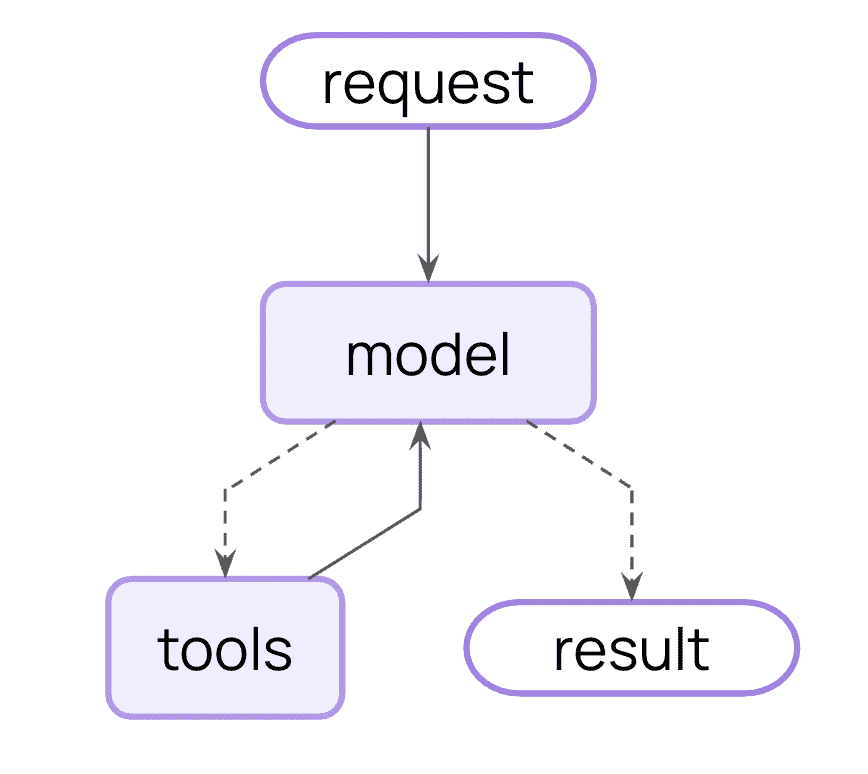

`LangChain` 1.x 将这一复杂的“认知闭环”封装在了 `create_agent` 内部，使得开发者只需关注“模型选型”和“工具定义”，而无需手写复杂的循环逻辑。

+ `DeepSeek-V3.2` `ReAct`推理范式

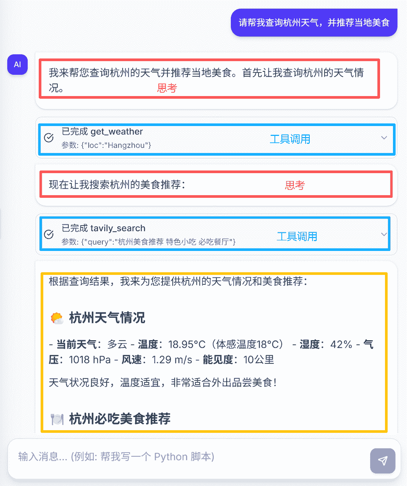

#### 1.3 核心 API `create_agent`：易用性与强大的统一

`create_agent` 是 `LangChain` 1.x 中构建智能体的“万能钥匙”。它能够自动适配不同模型的底层特性（如 `OpenAI` 风格的 `Function Calling` 或 `DeepSeek` 的 `JSON Mode`），对外提供统一的开发体验。并且调用简单，仅需几行代码即可完成一个简易的Agent搭建：

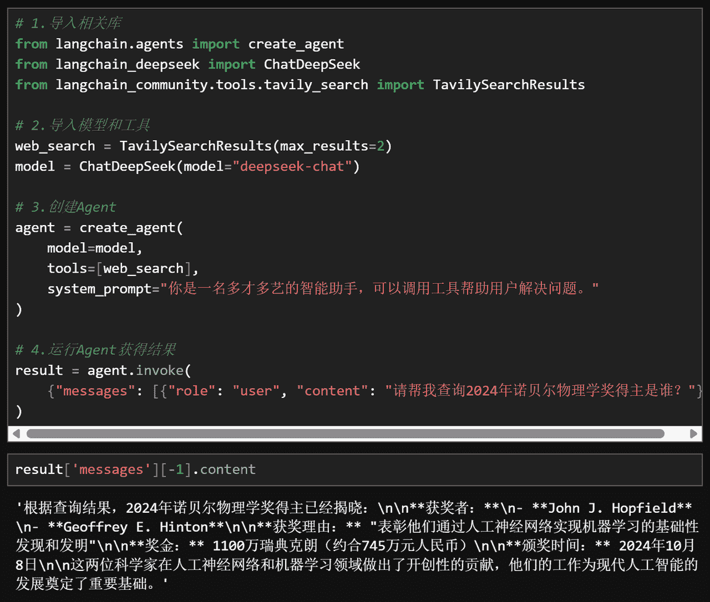

此外，`LangChain` 1.0中还新增了支持多模态的全新消息格式、简化了包的命名以及添加中间件等功能。

#### 1.4 技术价值与趋势对齐

`LangChain` 1.x 的这一升级，完美契合了当下大模型技术发展的三个主流趋势：

1. 多步工具调用 (`Multi-step Tool Use`)：现代业务场景（如自动化订票、复杂数据分析）往往需要 Agent 连续调用多个工具。`ReAct` 范式天然支持这种“规划-执行-再规划”的复杂链路。

1. 模型能力原生化：随着 `DeepSeek-V3`、`Qwen 2.5` 等开源模型对 `Tool Calling` 的支持越来越好，`LangChain` 1.x 通过做减法，让模型本身的智能得以最大化释放，减少了框架层的干扰（`Less Middleware, More Intelligence`）。

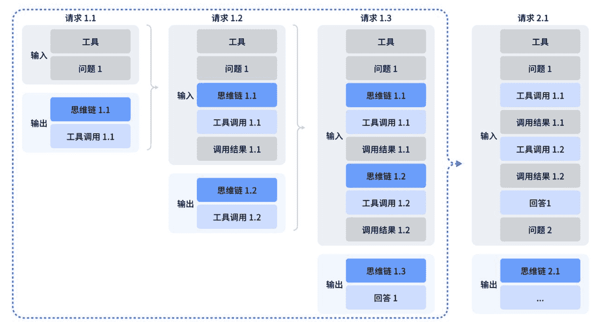

1. 图（`Graph`）架构的铺垫：虽然 `create_agent` 提供了高层封装，但 `LangChain` 1.x 底层已全面引入图论理念。这为后续升级到 `LangGraph`（实现更复杂的状态机和多智能体协作）打下了坚实基础。

## 二、LangChain 1.x 系统生态全面重构

> **核心摘要**：`LangChain` 1.x 不再仅仅是一个 `Python` 库，而是一套完整的企业级 Agent 操作系统。最终形成了以 `LangGraph` 为内核、`LangChain`为核心开发工具、`Deep Agents` 为模版、`LangSmith` 为运维控制台的铁三角生态。

### 2.1 底层架构升级：`LangGraph` 成为新一代 Agent 运行时（Runtime）

在 `LangChain` 0.x 时代，核心抽象是 `Chain`（链）。链本质上是有向无环图（`DAG`），它像瀑布一样，数据单向流动，一旦开始就很难回头。这对于简单的问答够用，但对于需要循环（`Loop`）、反思（`Reflection`）、记忆（`Memory`）的复杂 Agent 来说，链的架构捉襟见肘。

而在`LangChain` 1.0发布时官方正式确立 `LangGraph` 为 Agent 开发的底层架构。`LangChain` 库本身退居为“组件库”（提供模型接口、工具封装），而 `LangGraph` 接管了“大脑”的编排工作。

+ 从 `DAG` 到 `Cyclic Graph`（循环图）：`LangGraph` 允许开发者定义“节点（`Node`）”和“边（`Edge`）”，最关键的是支持循环。Agent 可以思考 执行 发现错误 回到思考步骤重试。这种循环能力是构建高可靠性 Agent 的基石。

+ `State Management`（状态管理）：`LangGraph` 引入了全局 `State`（状态机）概念。所有的上下文、记忆、中间变量都存储在 `State` 中，在不同节点间流转。这解决了以往 Agent 记忆管理混乱的问题。

+ `Human-in-the-loop`（人机协同）：`LangGraph` 原生支持在图的执行过程中“暂停”，等待人类审批或输入后再继续。这对于金融、医疗等高风险场景的企业级 Agent 至关重要。

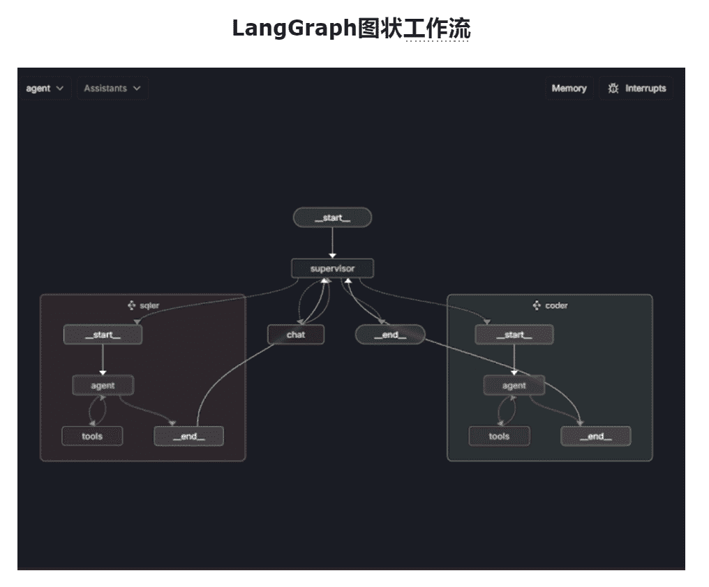

而需要注意的是，`LangChain`目前主推的`create_agent`本质上也是一个图结构，只不过可以通过`create_agent`这个更高层的接口进行调用。

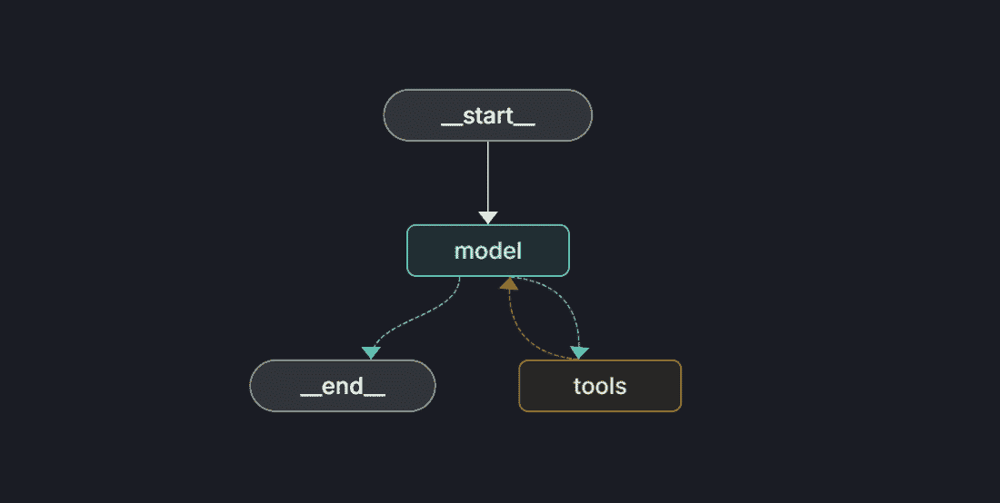

### 2.2 架构模式升级：`Deep Agents` 与 `Multi-Agent` 模板化

而随着单体 Agent 能力遇到瓶颈，`Multi-Agent`（多智能体协作） 成为解决复杂问题的必经之路。`LangChain` 1.x 引入了 `Deep Agents` 理念及一系列标准化的 `Multi-Agent` 架构模板。

+ `Deep Agents` 概念：它指代那些具有深层推理能力、能够自主拆解复杂任务的 Agent 系统。它们不再是简单的指令执行者，而是具备特定角色（`Role`）的专家。

+ 标准化协作模式：`LangChain` 1.x 提供了开箱即用的 `Multi-Agent` 模板（基于 `LangGraph` 实现），企业无需从零设计复杂的通信协议：

+ `Supervisor Pattern`（主管模式）：一个“主管 Agent”负责派活，指挥底下的“代码 Agent”、“搜索 Agent”协同工作。

+ `Hierarchical Teams`（层级团队模式）：模拟公司组织架构，部门与部门之间进行任务交接。

+ `Network Pattern`（网络模式）：Agent 之间地位平等，通过广播或点对点通信协作。

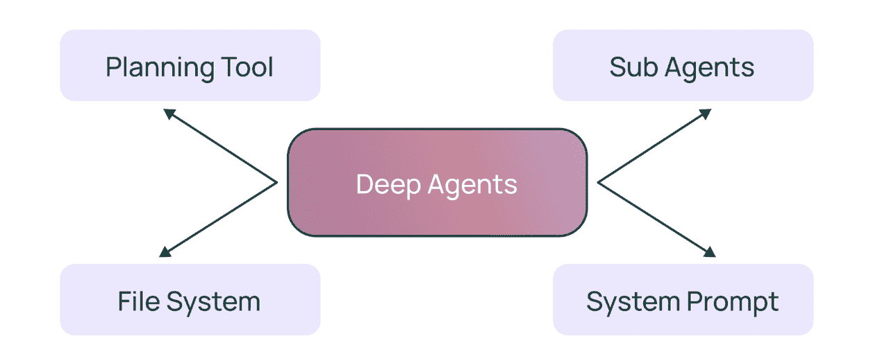

+ `LangGraph`、`LangChain`、`DeepAgents`三者关系：

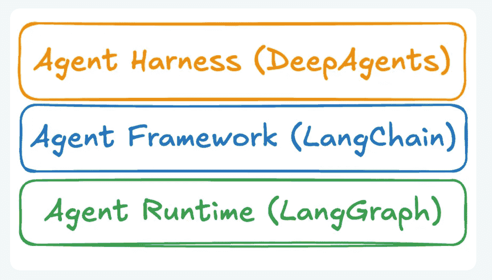

### 2.3 开发与运维升级：`LangSmith` 全生命周期管理与 `Agent Builder`

如果说 `LangGraph` 是引擎，那么 `LangSmith` 就是这台法拉利的仪表盘和控制台。在 1.x 生态中，`LangSmith` 的地位被空前拔高，它不仅负责运维，更开始介入“无代码开发”。

+ `DevOps` 基础设施（监控与调试）：

+ 可视化 `Tracing`：在 Agent 开发中，一次任务可能包含几十次 LLM 调用和工具执行。`LangSmith` 能将这些复杂的调用链以“全链路树状图”的形式展示出来，让开发者一眼看出 Agent 在哪一步“变笨了”或“死循环了”。

+ `Dataset Evaluation`（数据集评测）：企业上线 Agent 前，必须进行回归测试。`LangSmith` 允许开发者上传“金标准”问答对，自动评估 Agent 的准确率、召回率。

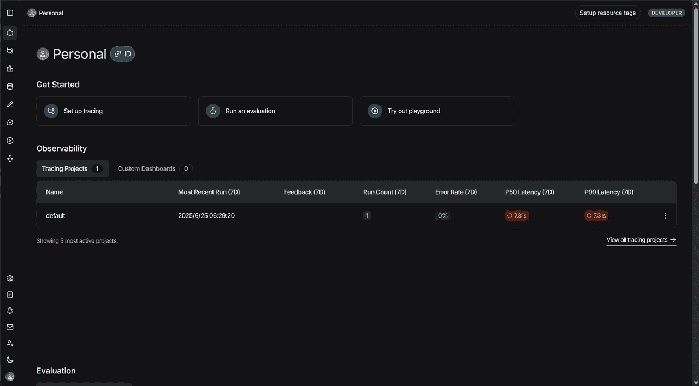

+

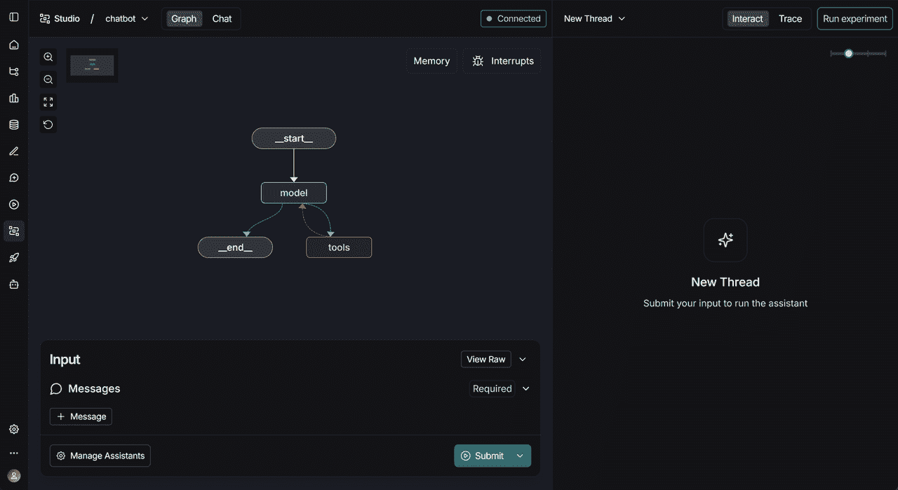

+ 重磅新功能：`Agent Builder`（`AI` 编写 `AI`）

+ 背景：为了进一步降低 `Agent` 开发门槛，`LangChain` 推出了 `Agent Builder`（目前处于 `Public Beta` 阶段）。

+ 核心逻辑：这是一个“`Text-to-Agent`”的开发环境。开发者无需写 `Python` 代码，只需用自然语言描述：“我需要一个能查阅 `Google` 新闻并撰写简报的助手，遇到付费墙要自动跳过”。

+ 底层原理：`Agent Builder` 会自动理解需求，生成基于 `LangGraph` 的标准架构代码。

+ 价值：

1. 快速原型（`Rapid Prototyping`）：产品经理可以在 5 分钟内生成一个可运行的 `Agent` 原型。

1. 代码导出（`Code Export`）：不同于其他低代码平台的封闭性，`Agent Builder` 生成的 `Agent` 可以直接导出为 `Python` 代码。工程师可以在此基础上进行二次开发和私有化部署。

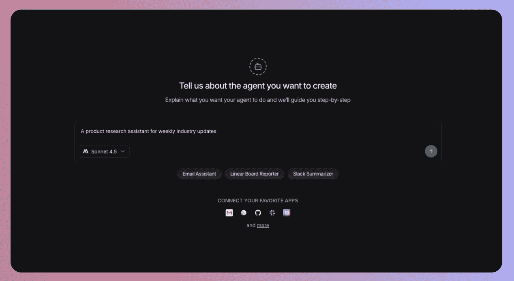

+

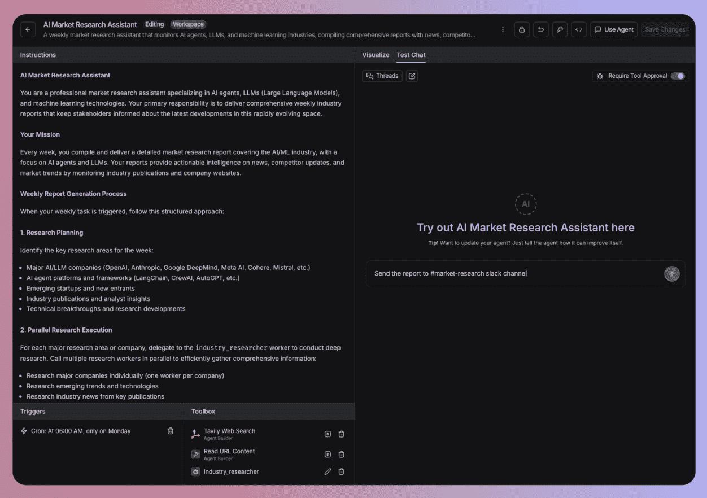

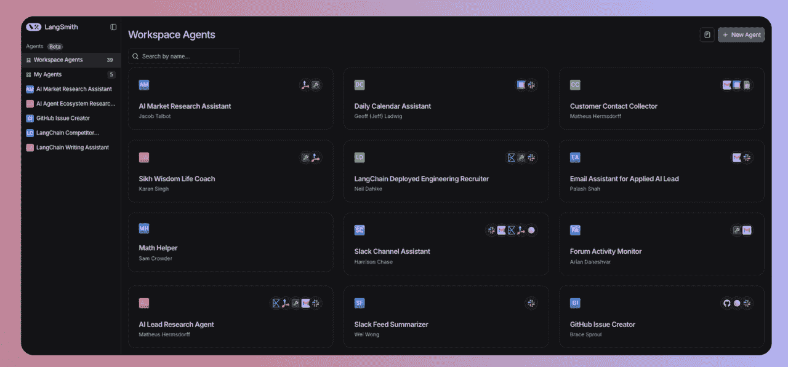

## 三、`LangChain` 1.x 大杀器：中间件功能介绍

> **核心摘要**：如果说 `ReAct` 范式赋予了 Agent “自主思考”的能力，那么中间件（`Middleware`）系统则赋予了开发者“上帝视角”的控制权。它通过一套标准化的钩子（`Hooks`）机制，允许开发者在 Agent 思考、行动、反馈的每一个关键生命周期节点插入自定义逻辑，从而将“黑盒”变成“白盒”。

### 3.1 诞生背景：破解 `ReAct` 架构的“黑盒悖论”

在 `LangChain` 1.0 之前，运行一个 Agent（尤其是 `ReAct` 类型的 Agent）往往是一种“发射后不管”的体验。一旦调用 `agent.invoke()`，模型就开始自主循环：思考 调工具 观察 再思考。

在这个过程中，开发者面临三大痛点：

1. 过程不可见：不知道模型为什么选错了工具，也不知道中间产生了什么幻觉。

1. 状态不可改：无法在模型调用工具前临时修改参数（例如：强制将“明天”替换为具体日期）。

1. 风险不可控：无法在模型执行高危操作（如删除数据库）前进行拦截或人工审批。

正是为了解决这些问题，`LangChain` 1.0 引入了中间件系统。这并非 `LangChain` 独创，而是工业级 Agent 框架的共识：

+ `Google ADK` (`Agent Development Kit`)：提供了类似的生命周期回调，允许在规划（`Planning`）和执行（`Execution`）阶段注入逻辑。

+ 阿里 `AgentScope`：内置了强大的 `Hook` 系统，支持在 `reply`（回复）和 `act`（行动）前后挂载自定义函数，用于多智能体间的消息拦截与修改。

### 3.2 核心机制：生命周期钩子 (`Lifecycle Hooks`)

`LangChain` 1.0 的中间件本质上是一系列拦截器，它们按顺序执行，像洋葱皮一样包裹着 Agent 的核心逻辑。核心钩子包括：

1. `before_agent`：在 Agent 启动初期执行。常用于初始化用户画像、加载长期记忆或设置全局 `Session ID`。

1. `before_model` (关键)：在将 `Prompt` 发送给大模型之前触发。

+ 作用：修改 `Prompt`（如注入动态上下文）、检查输入敏感词、甚至直接拦截请求返回缓存结果。

1. `after_model`：在大模型返回 `Response` 之后，但在解析工具调用之前触发。

+ 作用：修正模型的输出格式错误、记录 `Token` 消耗、检测模型是否输出了违禁内容。

1. `before_tools` / `after_tools`：在工具执行的前后触发。这是实现“人机协同（`Human-in-the-loop`）”的最佳位置。

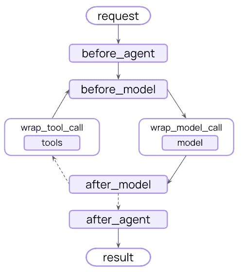

### 3.3 四大核心应用场景

中间件的引入，让 Agent 开发从“写 `Prompt`”升级为“治理系统”。其核心能力可归纳为 `M.M.C.E`：

+ 1. `Monitor` (监控与观测)

+ 全链路追踪：自动将每一次思考和工具调用的输入输出上报到 `LangSmith` 或 `Datadog`。

+ 成本计算：实时计算当前会话消耗的 `Token` 数，超出预算通过中间件强制终止。

+ 2. `Modify` (动态修正)

+ 上下文压缩：当对话历史过长时，`SummarizationMiddleware` 可自动触发摘要，防止 `Context Window` 溢出。

+ `Prompt` 注入：根据用户当前的地理位置或时间，在 `before_model` 阶段动态向 `System Prompt` 注入 "Current Time: 2025-12-10"。

+ 3. `Control` (流程控制)

+ `Human-in-the-Loop` (`HITL`)：在执行关键工具（如 `transfer_money`）前，通过中间件挂起（`Suspend`）`Agent`，发送审批请求给人类管理员，获批后恢复运行。

+ 重试与回退：当检测到工具调用报错时，自动切换备用模型或重试，而无需修改 `Agent` 核心代码。

+ 4. `Enforce` (安全与合规)

+ `PII` 过滤：自动检测并掩盖用户输入中的手机号、身份证等敏感信息（`Redaction`）。

+ 输出护栏：强制检查模型输出是否包含竞争对手名称或不合规建议。

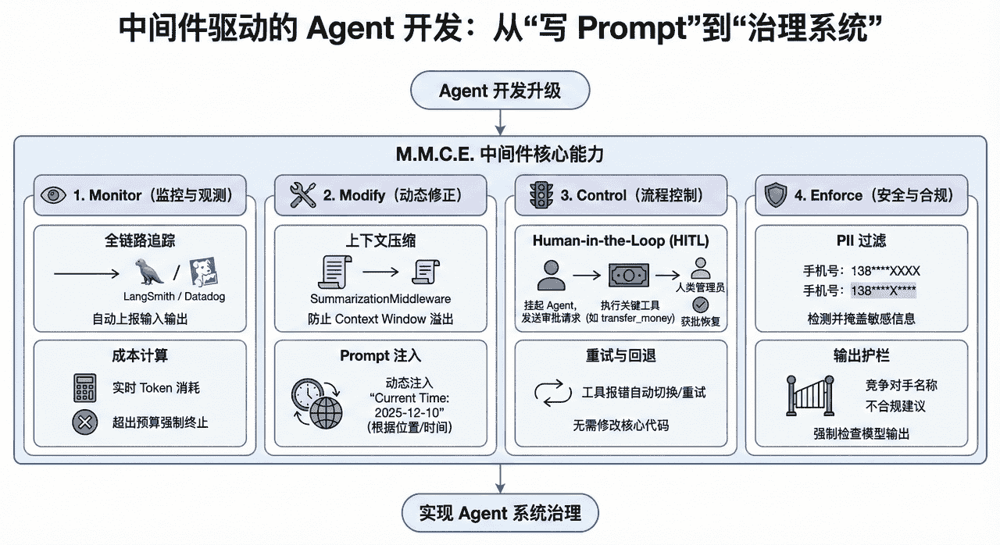

### 3.4 内置中间件与自定义接口

`LangChain` 1.0 官方内置了一批生产就绪的中间件，开发者可以开箱即用：

| 内置中间件 | 功能描述 |

| --- | --- |

| `HumanInTheLoopMiddleware` | 在特定工具调用前暂停，等待人工反馈。 |

| `SummarizationMiddleware` | 自动管理上下文窗口，对超长历史进行摘要。 |

| `PIIMiddleware` | 敏感信息（`PII`）过滤与脱敏。 |

| `RateLimiter` | 限制 `API` 调用频率，防止超额。 |

此外`LangChain` 1.x还提供了强大的自定义中间件开发接口（`Developer API`），`LangChain` 提供了极简的`Decorator`风格接口，让开发者像写 `Flask` 路由一样定义中间件：


```python
from langchain.middleware import before_model, after_tools

# 定义一个自定义中间件：防止模型“摸鱼”
@before_model
def anti_lazy_middleware(state, config):
    # 检查 System Prompt，强制注入激励语
    state["messages"][0].content += "\n请深呼吸，这对我很重要，请一步步思考。"
    return state

# 定义一个工具审计中间件
@after_tools
def audit_log_middleware(tool_output, tool_name):
    print(f"审计日志: 工具 {tool_name} 执行完毕，结果长度: {len(str(tool_output))}")
    return tool_output
```

# LangChain 1.1 版本更新与企业级项目开发

## 4. LangChain 1.1 版本更新情况介绍

> **技术背景**：如果说 `LangChain` 1.0 的发布标志着它从“实验性玩具”走向了“稳定 API”，那么 1.1 阶段则标志着它完成了企业级中间件的下一块拼图——生态解耦与标准化。

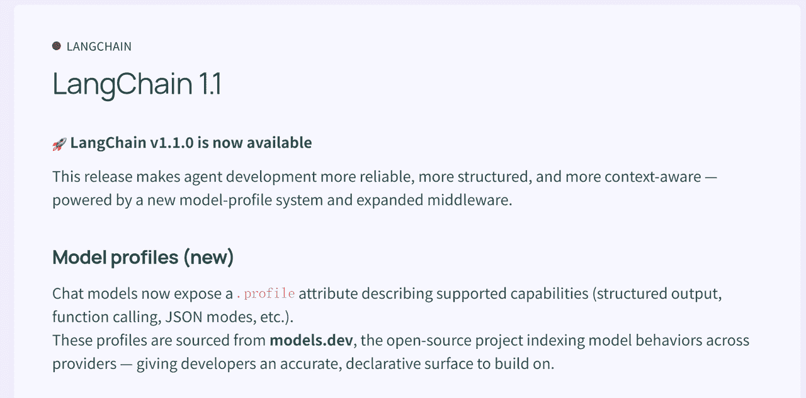

### 4.1 核心变革一：生态架构的彻底解耦 (Decoupling)

在早期版本中，`LangChain` 是一个臃肿的“单体应用”，安装一个 `langchain` 包会附带上百个不必要的依赖（如 `numpy`, `pandas` 等）。1.1 版本完成了彻底的模块化拆分，这对于企业级应用的安全性和体积控制至关重要。

+   `langchain-core` (内核)：仅包含最基础的抽象（如 `LCEL`, `Runnables`, `Messages`）。它没有第三方依赖，极其轻量，定义了所有 `Agent` 的标准接口。

+   `langchain-community` (社区)：包含了数千种第三方工具的集成（如 Wikipedia, DuckDuckGo）。

+   `langchain-partners` (合作伙伴)：这是最大的变化。OpenAI、DeepSeek、Google 等主流厂商的代码被拆分为独立的包（如 `langchain-deepseek`, `langchain-openai`）。

+   **企业价值**：当 OpenAI 更新 `API` 时，你只需要升级 `langchain-openai`，而不用升级整个 `langchain`，极大降低了生产环境的回归测试风险（Regression Risk）。

### 4.2 核心变革二：工具调用标准化 (Standardized Tool Calling)

在 1.0 之前，调用 OpenAI 的 Function Calling 和 Anthropic 的 Tool Use 需要完全不同的代码逻辑。1.1 版本引入了统一的 Tool Calling `API`，彻底抹平了模型厂商之间的差异。

+   `.bind_tools()` 接口：无论底层是 GPT-5 还是 DeepSeek V3，开发者只需调用 `model.bind_tools(tools)`，框架会自动将 Python 函数转换为模型特定的 JSON Schema（如 OpenAI 的 JSON 结构或 XML 结构）。

+   `tool_calls` 属性：模型返回的工具调用请求被统一封装在 `AIMessage.tool_calls` 属性中，开发者不再需要手动解析原始的 JSON 字符串。

+   `create_tool_calling_agent`：这是我们在课程中使用的核心 API，它取代了旧版专用的 `create_openai_tools_agent`，使得 `Agent` 代码具备了模型无关性（Model Agnostic）——今天用 GPT-4，明天换 DeepSeek，代码几乎不用改。

### 4.3 核心变革三：Pydantic V2 原生支持与性能跃升

`LangChain` 1.1 阶段完成了底层数据验证引擎从 `Pydantic V1` 到 `Pydantic V2` 的全量迁移。

+   **Rust 内核加速**：`Pydantic V2` 的核心逻辑由 Rust 重写，这使得 `Agent` 在处理大量数据结构验证（如解析复杂的 JSON 输出）时，性能提升了 5-10 倍。

+   **严格模式**：引入了更严格的类型检查机制。在企业级开发中，这意味着许多潜在的类型错误（Type Errors）在代码编写阶段就能被 IDE 捕获，而不是等到生产环境运行时才报错。

### 4.4 核心变革四：异步与流式优先 (Async & Streaming First)

为了适配 `Agent` 复杂的交互场景，1.1 版本对异步事件循环进行了重构，推出了 `astream_events` (v2) `API`。

+   **细粒度事件流**：旧版的 `stream` 只能吐出最终的文本 `Token`。而新的 `astream_events`（我们在实战中使用的 `API`）可以实时推送工具调用开始（`on_tool_start`）、工具执行结束（`on_tool_end`）、中间思考过程等细粒度事件。

+   **前端体验革命**：这使得前端可以精确地渲染出“正在思考...”、“正在搜索...”、“搜索完成”等状态，而不是让用户对着空白屏幕傻等。

## 二、LangChain 1.1 + MCP + DeepSeek-V3.2企业级项目开发说明

### 1. mini ChatGPT项目演示

mini ChatGPT不仅仅是一个聊天机器人，它是一个基于 MCP 协议的可扩展智能体操作系统 (Agent OS)。它复刻了 ChatGPT 核心的“插件化”架构，允许用户像安装手机 APP 一样，动态地为 AI 挂载各种工具（如 12306 查票、本地数据库操作、高德地图等），实现从“对话”到“办事”的质变。

### 2. mini ChatGPT核心功能点介绍

+   毫秒级流式打印

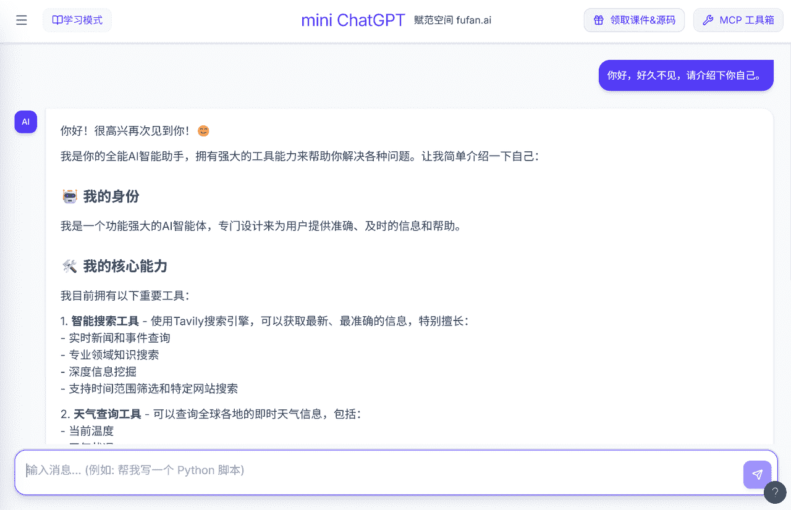

+   多步、多工具调用，边思考边调用工具，确保性能稳定性

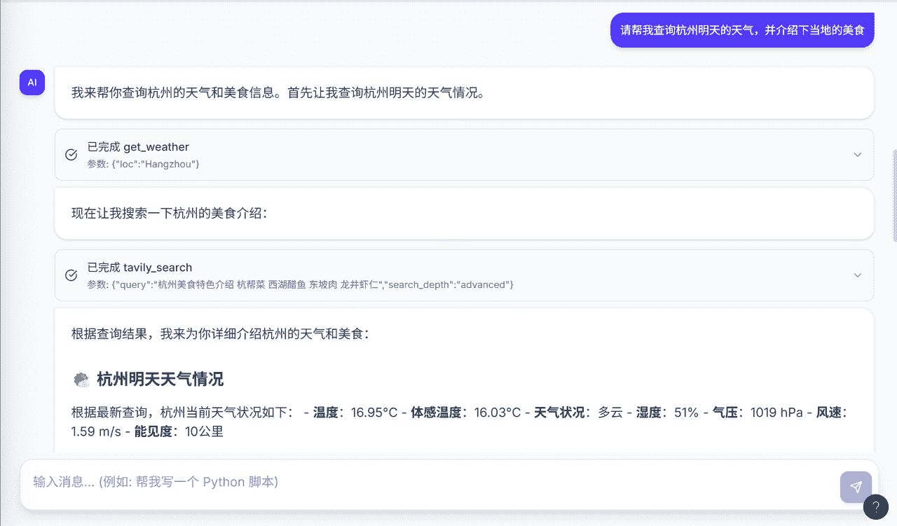

+   持久化记忆存储、对话&记忆自由切换

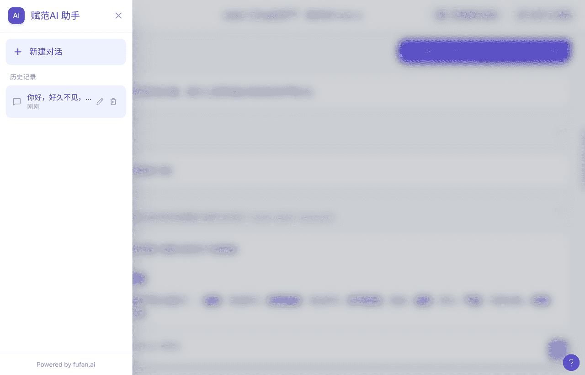

+   一键添加MCP工具

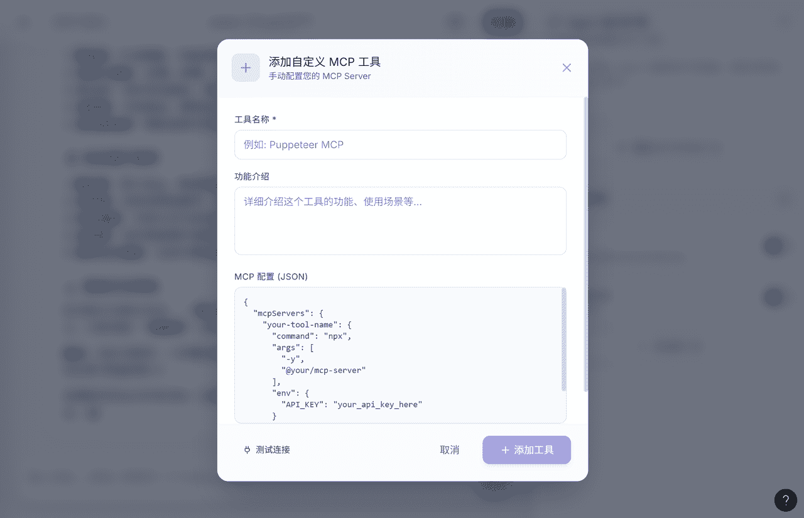

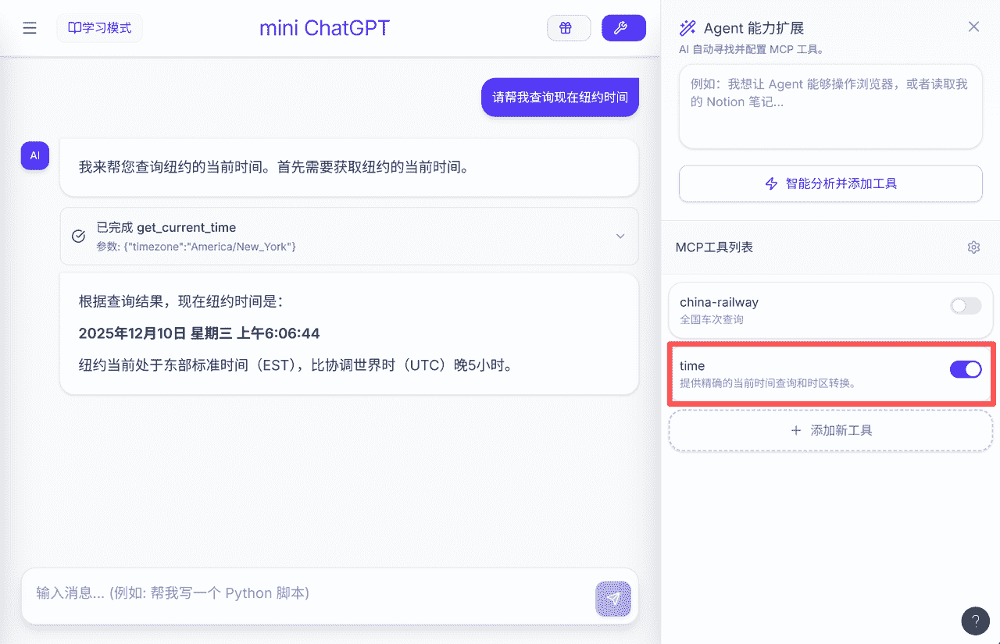

+   启发式添加MCP工具


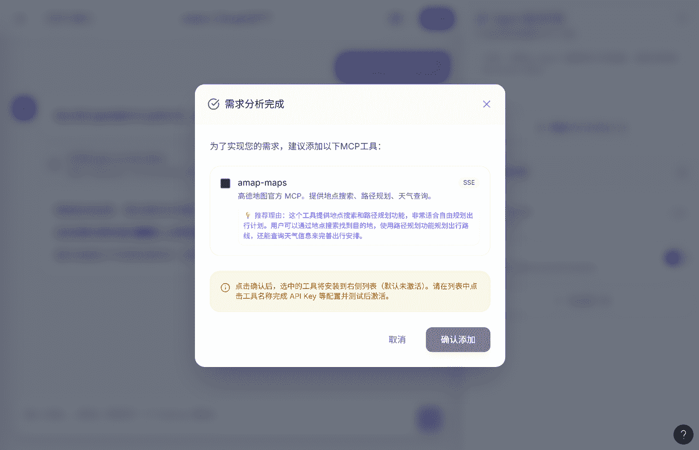

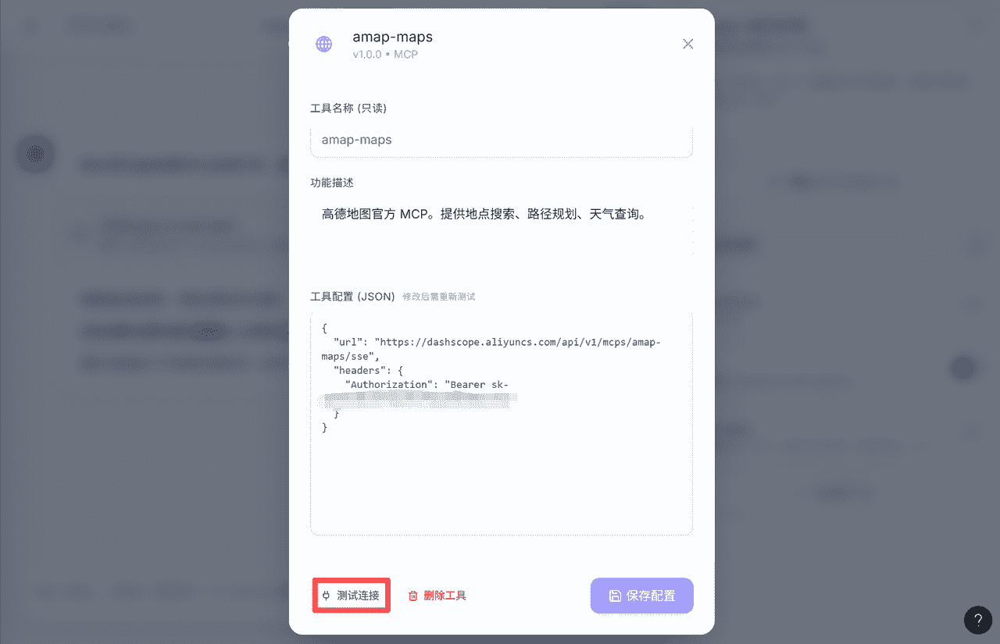

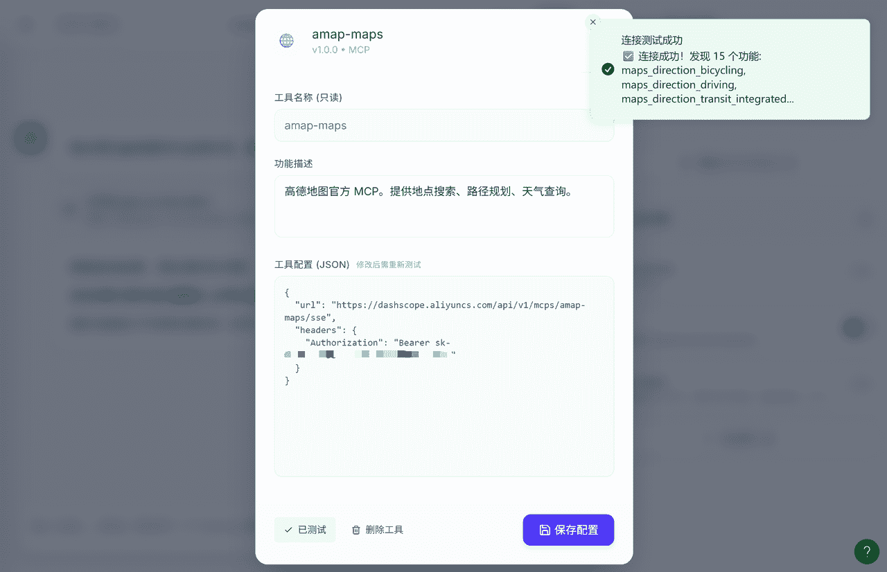

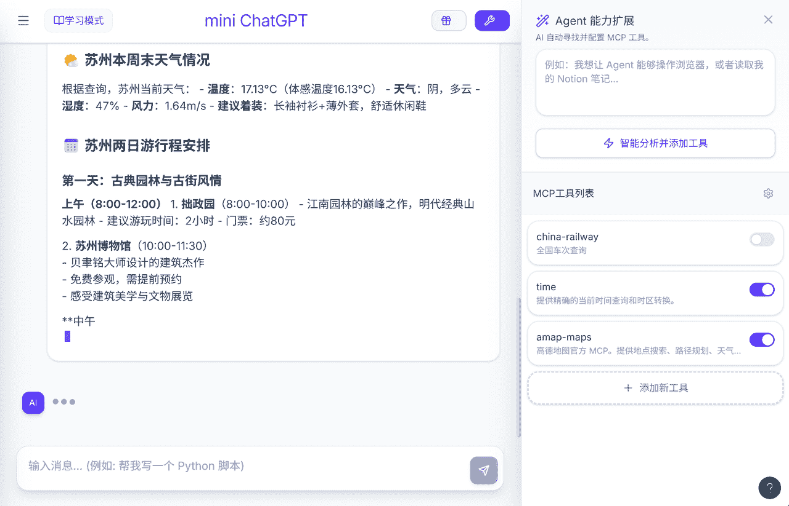

+   开启学习模式

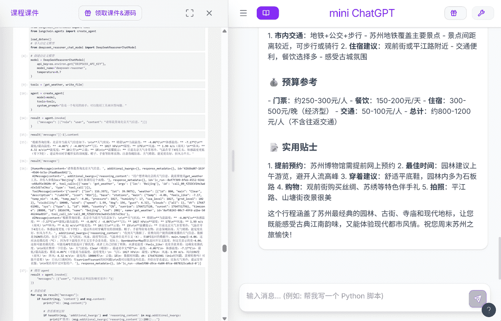

### 3. 项目实战价值：从“API 调包侠”进阶为“全栈 AI 产品工程师”

> **核心理念**：在 AI 编程工具（AI Coding）日益强大的今天，单纯掌握 API 调用已不再是护城河。本项目将带你跳出“写代码”的单一视角，以“产品 + 架构 + 全栈”的上帝视角，完整复盘一个工业级 Agent 产品的诞生过程。

#### 3.1 掌握 2025 年“黄金三角”技术栈实战

我们不教过时的技术。本项目精选了当前最具商业落地价值的技术组合：

+   `LangChain 1.1` (`LangGraph`)：掌握最新的图（Graph）编排架构，而非旧版的链式结构。

+   Model Context Protocol (MCP)：实战未来 3-5 年的通用连接标准，学会如何让 AI 连接万物。

+   DeepSeek-V3.2：深度体验国产最强开源模型的推理能力，掌握在低成本下实现高性能 `Agent` 的秘诀。

+   这套组合被称为 `Agent` 开发的“黄金三角”，掌握它意味着你具备了构建复杂企业级应用的能力。

#### 3.2 沉浸式体验“企业级开发标准”与 Vibe Coding 新范式

拒绝“面条式代码（Spaghetti Code）”，我们完全遵循大厂的工程化标准：

+   **后端模块化架构**：我们将后端严格拆分为 `Server`（接入层）、`Manager`（业务逻辑层）、`Agent`（核心工厂层）与 `History`（持久层）。你将学会如何写出高内聚、低耦合、易维护的代码。

+   前端 Vibe Coding 开发：在前端开发环节，我们将演示“AI 辅助编程（Vibe Coding）”的新范式——你不需要精通 `React`/`Vue` 的每一个细节，只需充当“产品经理 + 技术验收官”，指挥 AI 完成 UI 代码的编写。这是未来全栈开发的主流形态。

#### 3.3 跑通“从 0 到 1”的全链路产品闭环

许多开发者只懂写函数，不懂做产品。本项目将带你完整执行一次标准的产品开发生命周期（SDLC）：

+   **Step 1 产品设计**：从需求出发，规划“MCP 商店”、“流式对话”、“动态配置”等核心功能点。

+   **Step 2 架构/模块规划**：设计数据流向，定义 `mcp_registry.json` 数据结构，规划前后端交互逻辑。

+   **Step 3 核心开发与测试**：分阶段完成后端接口编写，并进行单元测试（如 MCP 连接测试）。

+   **Step 4 前后端联调**：定义清晰的 API 契约（Interface Contract），打通 SSE 流式数据链条，完成最终交付。

#### 3.4 重塑 AI 时代的“产品化思维”

在这个项目中，你学到的不仅是技术，更是一种思维方式的升级：

+   **从“技术思维”到“产品思维”**：不只是关注“这个接口怎么写”，更关注“用户在点击测试连接时，需要什么样的反馈才能安心”。

+   **从“单点突破”到“系统观”**：理解一个 `Agent` 系统是如何通过文件系统、网络协议、大模型推理和前端交互精密咬合在一起的。

这是一份非常符合教学心理学和工程化思维的开发规划。

对于初学者来说，如果一上来就面对 MCP 管理器、动态工厂、流式协议、历史记录等所有概念，认知负荷过重，容易“劝退”。

**“分而治之，迭代演进”** 正是工业级软件开发的核心心法。通过将后端拆分为 MVP（最小可行性产品）阶段 和 Pro（增强版）阶段，不仅降低了学习门槛，还完美模拟了真实产品的迭代过程。

以下是为您编写的详细课件内容：

### 4. mini ChatGPT 开发思路规划

> 核心理念：复杂系统是由简单系统演化而来的。在本次实战中，我们将拒绝“填鸭式”教学，而是模拟真实的互联网大厂开发流程，采用 “MVP（最小可行性产品）   Scale（架构升级）” 的两阶段迭代策略。

> 我们保持前端 UI/交互逻辑不变（一次到位），重点演示后端架构是如何从一个简单的对话系统，进化为支持 MCP 的智能体操作系统。

#### 4.1 总体架构蓝图

我们的后端开发将分为两个里程碑：

+   阶段一（Core Kernel）：构建一个具备“思考-行动-反馈”闭环的标准 `Agent`。它拥有固定的“左膀右臂”（天气查询、联网搜索），能够记忆上下文，并以流式打字机的效果与用户对话。

+   阶段二（Agent OS）：对 `Agent` 进行“手术式”升级，引入 MCP 协议。实现工具的动态热插拔，让 `Agent` 从“硬编码工具”进化为可以安装 APP 的“智能终端”。

#### 4.2 阶段一：构建核心 Agent 内核 (The MVP)

在这一阶段，我们的目标是跑通 `FastAPI` + `LangChain` + DeepSeek 的核心链路。我们将暂时忽略 MCP 的复杂性，专注于解决以下 4 个核心工程问题：

+   **1. 基础服务搭建**：

+   使用 `FastAPI` 搭建 Web 服务器，配置 CORS 跨域，打通前后端连接的“第一公里”。

+   2. 核心大脑构建 (Hardcoded Tools)：

+   基于 `create_agent` API，创建一个标准的 ReAct `Agent`。

+   **关键点**：此时我们的工具（Tools）是“硬编码”在代码里的。我们将手动编写 `get_weather`（查天气）和 `tavily_search`（联网搜索）两个 Python 函数，并绑定给 DeepSeek 模型。

+   3. 沉浸式流式传输 (SSE)：

+   这是用户体验的关键。我们将攻克 Server-Sent Events 协议，实现后端 `astream_events` 到前端打字机效果的透传。

+   4. 记忆持久化 (Memory)：

+   实现基于 JSON 文件的简单数据库，让 `Agent` 能够记住用户的上一句话（Session Management）。

> **阶段一交付物**：一个类似 ChatGPT 网页版的、能够联网、能够查天气、能够流式对话的基础机器人。

#### 4.3 阶段二：引入 MCP 打造智能体操作系统 (The Evolution)

在阶段一的基础上，我们将面临一个新的痛点：“每次想给 `Agent` 加新功能（比如查数据库、查车票），都需要修改代码并重启服务器，太麻烦了！”这正是引入 MCP 的最佳时机。在这一阶段，我们将对后端进行重构，由“静态”转向“动态”：

+   1. 引入 MCP 管理器 (Manager Layer)：

+   开发 `mcp_manager.py`，实现工具的注册、安装、测试、开关。这相当于给 `Agent` 装了一个“应用商店”。

+   2. 实现动态 Agent 工厂 (Dynamic Factory)：

+   改造 `agent.py`。不再使用写死的工具列表，而是改为“每次对话前动态读取配置”。

+   **核心逻辑**：用户在前端勾选了什么工具，`Agent` 在下一秒的对话中就立刻拥有什么能力，无需重启。

+   3. 混合连接架构 (Hybrid Connection)：

+   实现 `StdIO`（本地进程）和 SSE（远程服务）的统一接入，让 `Agent` 既能操作你的本地文件，又能调用云端的 12306 接口。

+   **4. 完善管理接口**：

+   新增 `/mcp/install`、`/mcp/search_ai` 等管理接口，让用户可以通过前端 UI 来管理自己的 AI 助手。

> **阶段二交付物**：一个完整的、可扩展的、支持动态插件的工业级 `Agent` 操作系统（即我们最终的 Mini ChatGPT）。

### 5. 参考资料

+   《LangChain 1.0快速入门教程》

+   《从零到一MCP服务器开发实战》

+   《DeepSeek-V3.2 + LangChain 1.0技术开发入门》

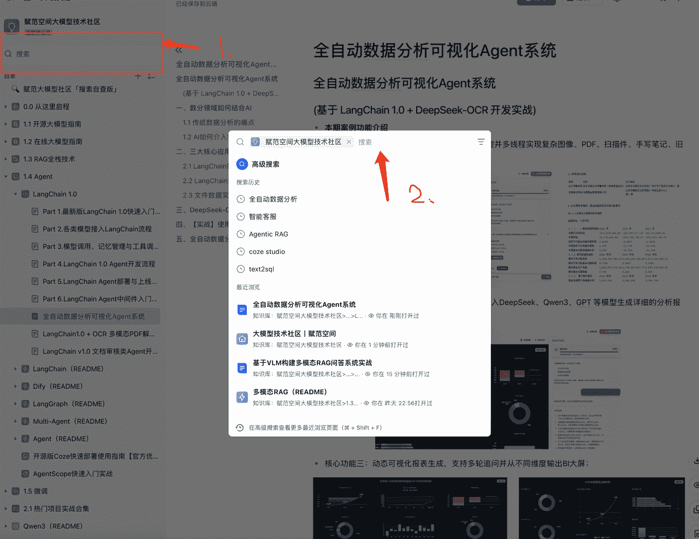

## 三、mini ChatGPT 第一阶段开发实操

> 实战目标：在本节中，我们将不急于编写 Web 后端，而是利用 LangGraph Studio 可视化开发环境，快速构建并调试出我们的第一个“Agent 内核”。

> 核心收益：你将亲眼看到 Agent 是如何“思考”的，它是如何决定调用天气工具，又是如何修正错误的。所见即所得。

### 1. 项目初始化与结构规划

首先，我们需要建立一个符合工业级标准的目录结构。请在你的工作区创建一个名为 `mini_chatgpt` 的文件夹，并按照以下结构创建文件：

```
mini_chatgpt/backend/
├── .env                  # [密钥] 存放 API Key
├── requirements.txt      # [依赖] 项目依赖清单
├── langgraph.json        # [配置] LangGraph Studio 配置文件
│── agent.py              # [核心] Agent 逻辑构建
│── tools.py              # [工具] 硬编码工具定义 (MVP阶段)
```

### 2. 环境与依赖安装

+   创建虚拟环境

```
conda create -n minichatgpt python=3.12
conda activate agent_env
```

+   编写 `requirements.txt`

为了支持可视化调试，我们需要额外安装 `langgraph-cli`。

```
langchain>=1.0.0
langchain-deepseek
langchain-community
langgraph
langgraph-cli[inmem]
langchain-tavily
python-dotenv
```

+   **执行安装命令**

```
# conda activate minichatgpt
pip install -r requirements.txt
```

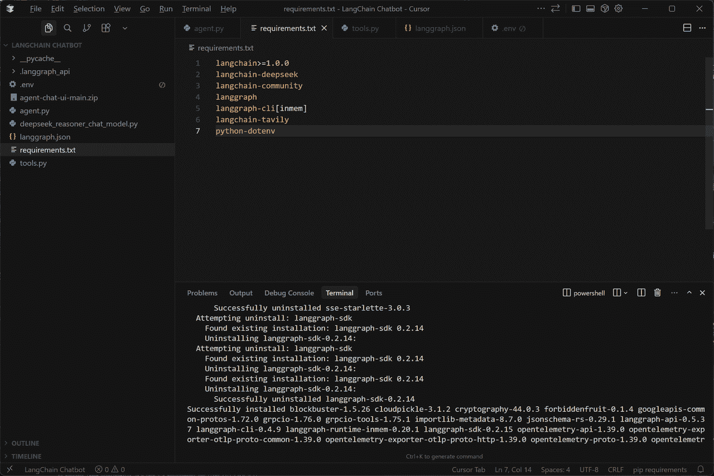

### 3. 密钥配置 (`backend/.env`)

创建 `.env` 文件，填入你的密钥。这是 Agent 连接世界的通行证。

```
DEEPSEEK_API_KEY=sk-xxxxxxx
TAVILY_API_KEY=tvly-xxxxxxx
OPENWEATHER_API_KEY=xxxxxxx
```


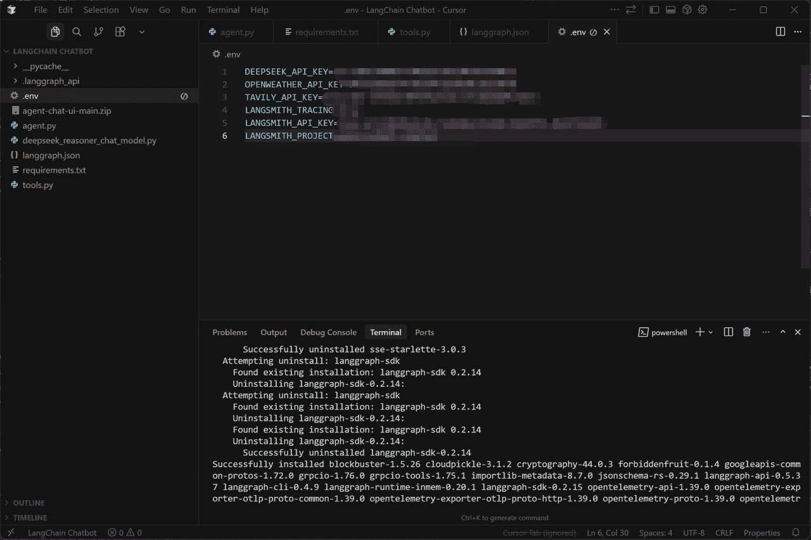

### 4. 编写“硬编码”工具 (`backend/tools.py`)

在 MVP 阶段，我们先不使用 MCP，而是手动编写两个最基础的 Python 函数工具，让 Agent 具备“感知世界”的能力。

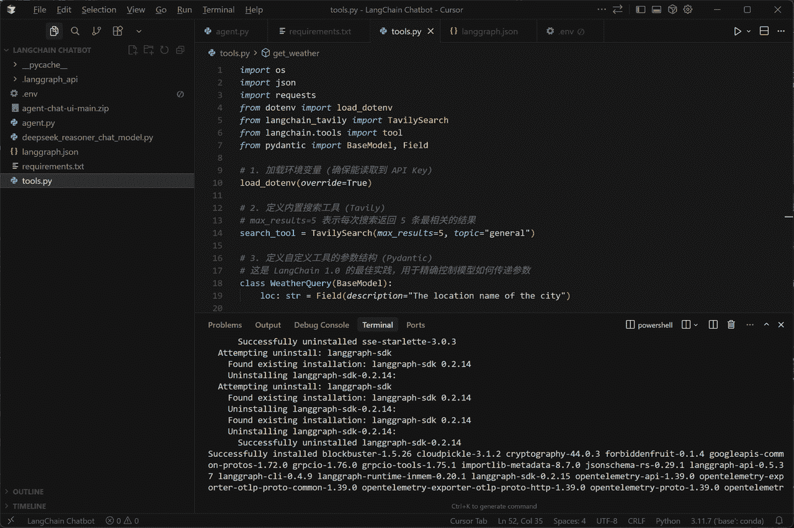

```
import os
import json
import requests
from dotenv import load_dotenv
from langchain_tavily import TavilySearch
from langchain.tools import tool
from pydantic import BaseModel, Field

# 1. 加载环境变量 (确保能读取到 API Key)
load_dotenv(override=True)

# 2. 定义内置搜索工具 (Tavily)
# max_results=5 表示每次搜索返回 5 条最相关的结果
search_tool = TavilySearch(max_results=5, topic="general")

# 3. 定义自定义工具的参数结构 (Pydantic)
# 这是 LangChain 1.0 的最佳实践，用于精确控制模型如何传递参数
class WeatherQuery(BaseModel):
    loc: str = Field(description="The location name of the city")

# 4. 定义自定义天气工具 (OpenWeatherMap)
@tool(args_schema=WeatherQuery)
def get_weather(loc: str):
    """
    查询即时天气函数
    :param loc: 必要参数，字符串类型，用于表示查询天气的具体城市名称。
    注意，中国的城市需要用对应城市的英文名称代替，例如如果需要查询北京市天气，则loc参数需要输入'Beijing'；
    :return: OpenWeather API查询即时天气的结果，返回JSON字符串。
    """
    # Step 1. 构建请求 URL
    url = "https://api.openweathermap.org/data/2.5/weather"

    # Step 2. 设置查询参数
    # 从环境变量中安全读取 API Key
    api_key = os.getenv("OPENWEATHER_API_KEY")
    if not api_key:
        return "Error: 缺少 OPENWEATHER_API_KEY，请检查 .env 文件。"

    params = {
        "q": loc,
        "appid": api_key,
        "units": "metric",   # 使用摄氏度
        "lang": "zh_cn"      # 输出中文描述
    }

    try:
        # Step 3. 发送 GET 请求
        response = requests.get(url, params=params, timeout=5)
        
        # Step 4. 解析响应
        if response.status_code == 200:
            data = response.json()
            # 将字典转换为 JSON 字符串返回，方便大模型阅读
            return json.dumps(data, ensure_ascii=False)
        else:
            return f"查询失败，状态码: {response.status_code}, 错误信息: {response.text}"
            
    except Exception as e:
        return f"网络请求异常: {str(e)}"


# 5. 导出工具列表
# 供 agent.py 统一调用
def get_tools():
    return [search_tool, get_weather]
```

代码核心功能解释如下：

**Pydantic 参数定义 (`class WeatherQuery`)**：

+   **为什么要写这个类？** 大模型本身是很随意的，它可能把城市参数传成 city、location 甚至 address。

+   通过继承 `BaseModel` 并使用 `Field` 描述，我们相当于给大模型下了一道“死命令”：“你必须传一个叫 `loc` 的参数给我，而且它是字符串”。这是保证工具调用成功率的关键。

**`@tool` 装饰器**：

+   这是 LangChain 的魔法糖。它会自动读取函数的文档字符串（Docstring），提取函数的功能描述（"查询即时天气..."）和参数说明。

+   **注意**：`Docstring` 写得越详细，模型调用越准确。

**JSON 字符串返回**：

+   `return json.dumps(...)` 是一个技巧。虽然 Python 可以直接返回字典，但对大模型来说，标准的 JSON 字符串是最通用的数据格式，能减少解析歧义。

### 5. 构建 Agent 内核 (`backend/agent.py`)

这是本节的核心。为了适配 LangGraph Studio 的可视化功能，我们将使用 LangChain 1.0 原生的 `create_agent` 构建图对象。

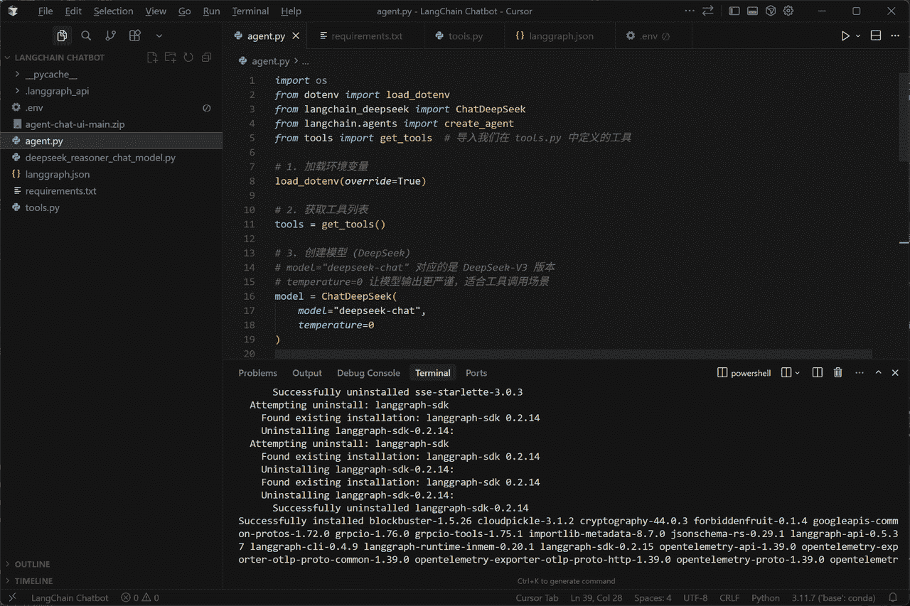

```
import os
from dotenv import load_dotenv
from langchain_deepseek import ChatDeepSeek
from langchain.agents import create_agent
from tools import get_tools  # 导入我们在 tools.py 中定义的工具

# 1. 加载环境变量
load_dotenv(override=True)

# 2. 获取工具列表
tools = get_tools()

# 3. 创建模型 (DeepSeek)
# model="deepseek-chat" 对应的是 DeepSeek-V3 版本
# temperature=0 让模型输出更严谨，适合工具调用场景
model = ChatDeepSeek(
    model="deepseek-chat"
)

# 4. 定义系统提示词 (System Prompt)
# 这是 Agent 的“人设”和“操作手册”
prompt = """
你是一名乐于助人的智能助手，擅长根据用户的问题选择合适的工具来查询信息并回答。

当用户的问题涉及**天气信息**时，你应优先调用`get_weather`工具，查询用户指定城市的实时天气，并在回答中总结查询结果。

当用户的问题涉及**新闻、事件、实时动态**时，你应优先调用`search_tool`工具，检索相关的最新信息，并在回答中简要概述。

如果问题既包含天气又包含新闻，请先使用`get_weather`查询天气，再使用`search_tool`查询新闻，最后将结果合并后回复用户。

所有回答应使用**简体中文**，条理清晰、简洁友好。
"""

# 5. 创建智能体 (Agent Graph)
# create_agent 是 LangChain 1.0 的核心工厂函数
# 它自动完成了以下复杂工作：
#  - 将 Python 工具转换为模型能看懂的 JSON Schema (bind_tools)
#  - 构建 ReAct (思考-行动-观察) 的循环图结构
#  - 注入 System Prompt
agent = create_agent(
    model=model,
    tools=tools,
    system_prompt=prompt
)
```

核心代码解释如下：

1.  **`create_agent` API 的魔力**：

+   在旧版本中，我们需要手动写 Prompt 模板、手动解析 `OutputParser`、手动构建 `Chain`。

+   在 **LangChain 1.0** 中，`create_agent` 帮我们屏蔽了底层所有复杂性。你只需要给它**“模型 + 工具 + 提示词”**，它就还你一个可以直接运行的智能体对象。这个对象本质上是一个编译好的 `LangGraph StateGraph`。

1.  **`Prompt` 的策略性**：

+   我们在 Prompt 中不仅定义了人设，还明确了**“路由逻辑”**（什么时候查天气，什么时候查新闻）。这叫做 In-Context Learning (上下文学习)，虽然 DeepSeek 很聪明，但明确的指令能让它在处理复杂混合任务（如“先查天气再查新闻”）时更加稳定。

1.  **模块化设计**：

+   我们将工具定义剥离到 `tools.py`，`agent.py` 只负责组装。这种**解耦**是企业级开发的标准动作，方便后续维护和扩展（比如第二阶段引入 MCP）。

### 6. 配置可视化环境 (`langgraph.json`)

这是 LangGraph Studio 的入口配置文件。它告诉 CLI 工具去哪里寻找我们定义的 graph 对象。

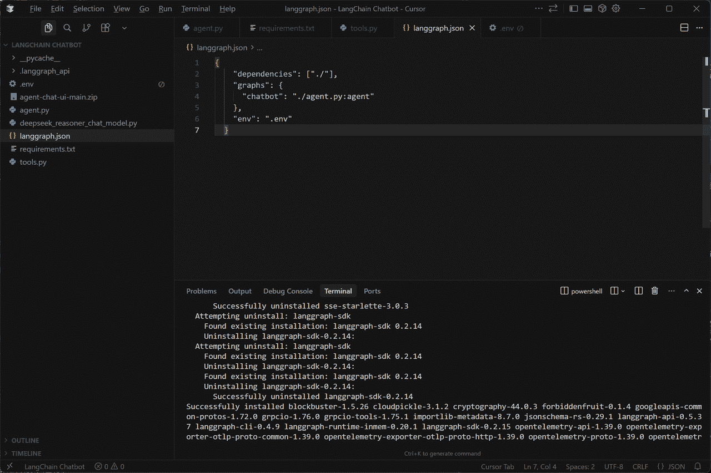

```
{
  "dependencies": ["."],
  "graphs": {
    "agent": "./agent.py:graph"
  },
  "env": ".env"
}
```

+   **解释**：

+   `"agent"`: 是我们在可视化界面中看到的图名称。

+   `"./backend/agent.py:graph"`: 指向文件路径和变量名（即我们在 `agent.py` 最后定义的 `graph` 变量）。

### 7. 启动！见证 Agent 的思考 (实操环节)

现在，激动人心的时刻到了。我们不需要写任何前端代码，直接启动 LangGraph 内置的开发服务器，请在 backend 目录下运行：

```
langgraph dev
```

**预期效果：**

1.  终端会显示 LangGraph Studio Web UI: http://127.0.0.1:2024。

1.  打开浏览器访问该地址。

1.  **你将看到**：

+   **左侧**：一个输入框，你可以输入“北京天气怎么样”。

+   **中间**：一个漂亮的**流程图**！显示 Agent 从 `Start` -> `Agent` -> `Tools` -> `Agent` -> `End` 的跳转逻辑。

+   **右侧**：执行日志。你可以清楚地看到 DeepSeek 生成了什么 `JSON`，工具返回了什么数据。

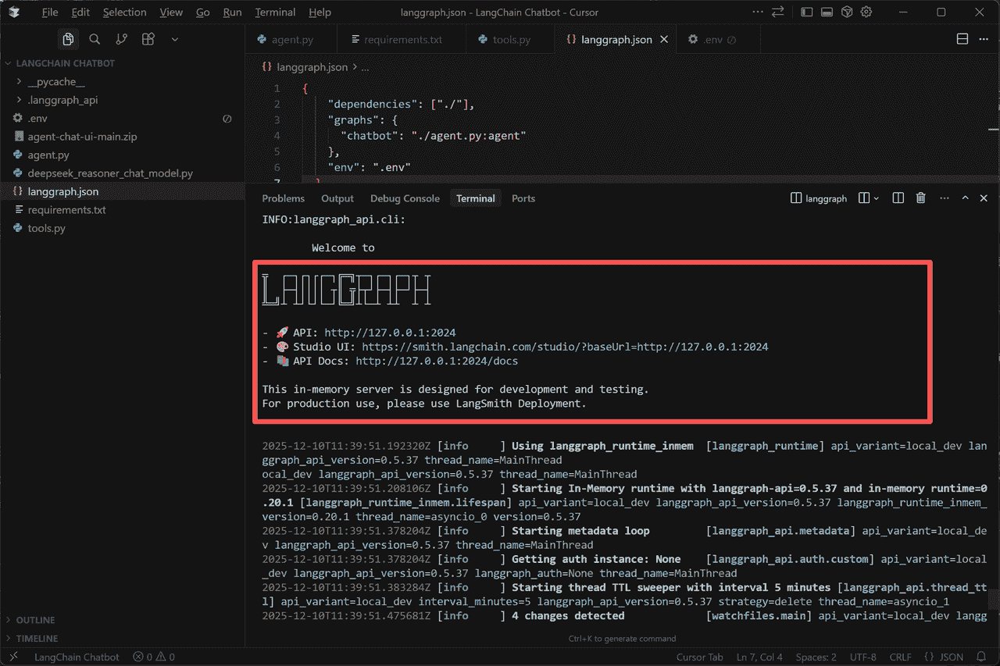

+   langgraph studio：

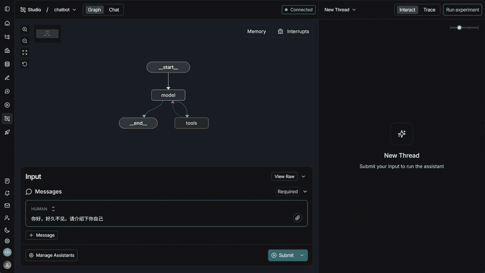

+

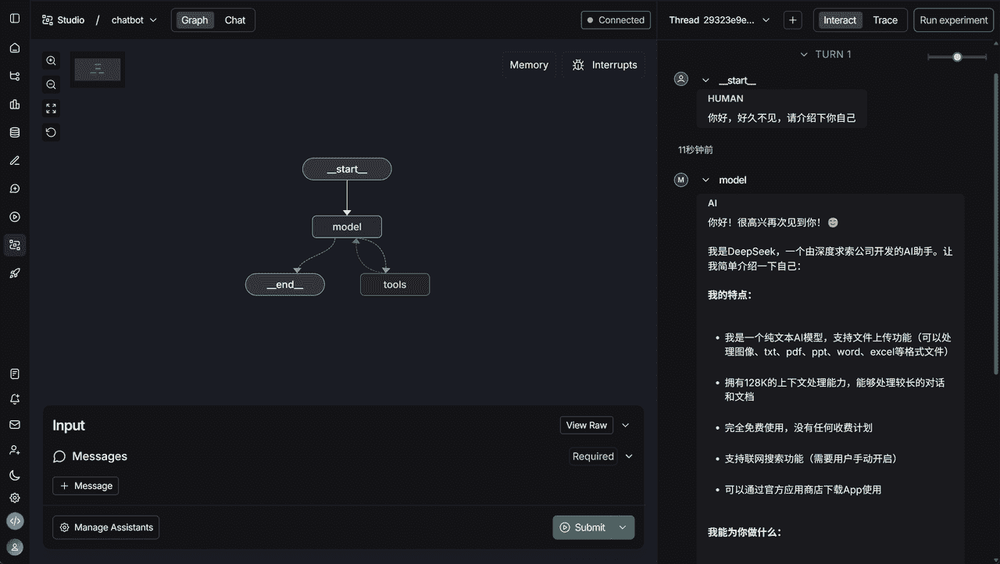

+

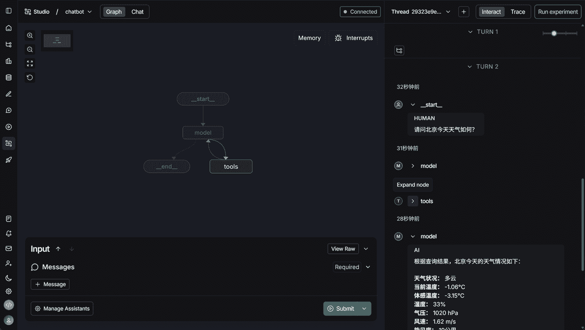

+

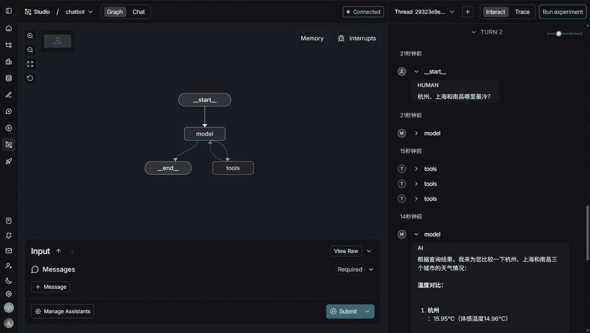

+   后端默认 API 接口：`http://127.0.0.1:2024`

+   后端 API 接口说明：`http://127.0.0.1:2024/docs`

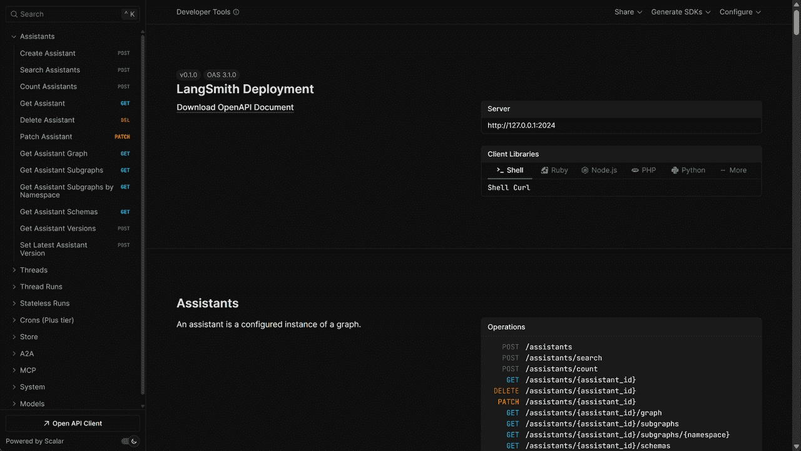

+

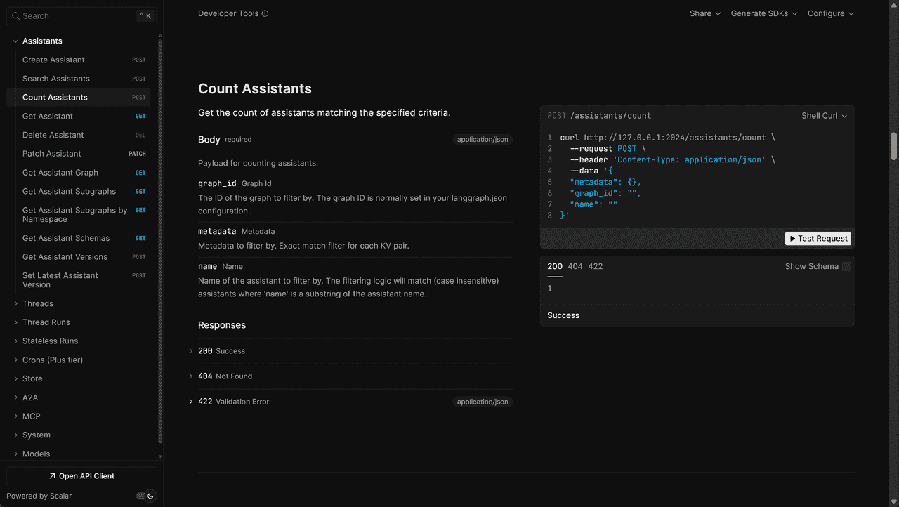

+   运维端口：`https://smith.langchain.com/`

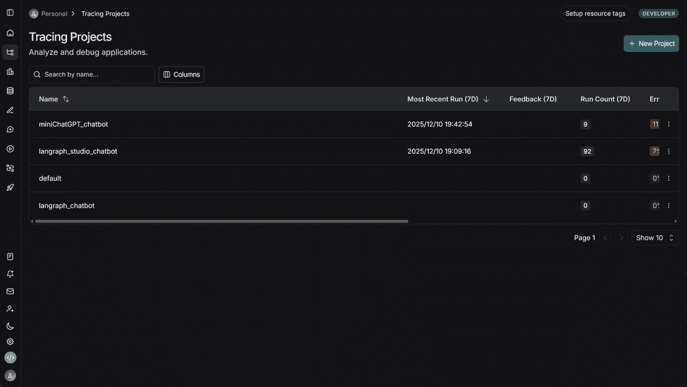

+

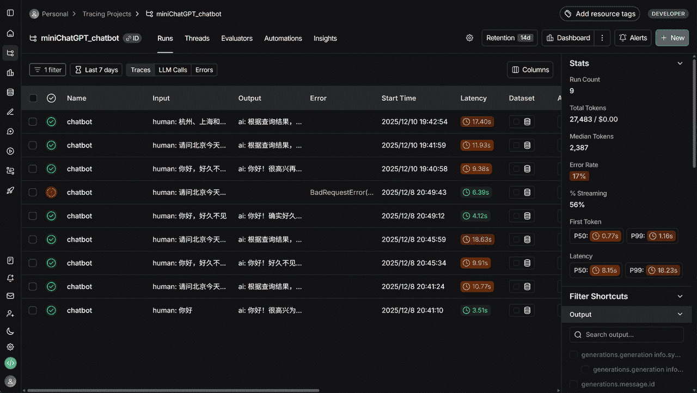

+

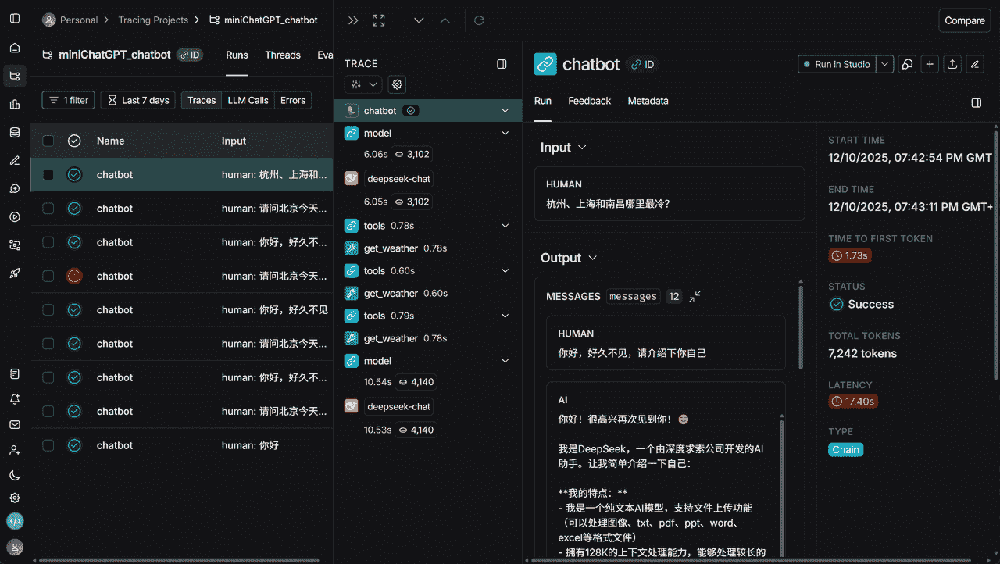

### 8. 【选学】基于 Vide Coding 完成前端功能开发

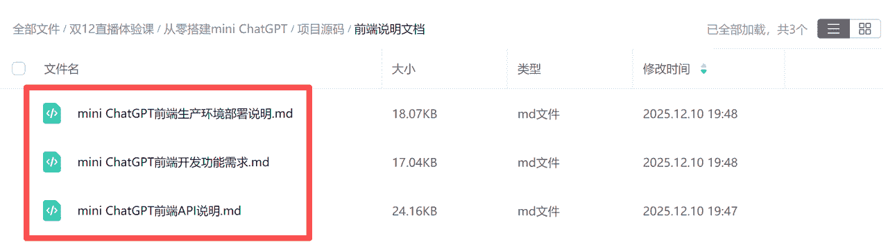

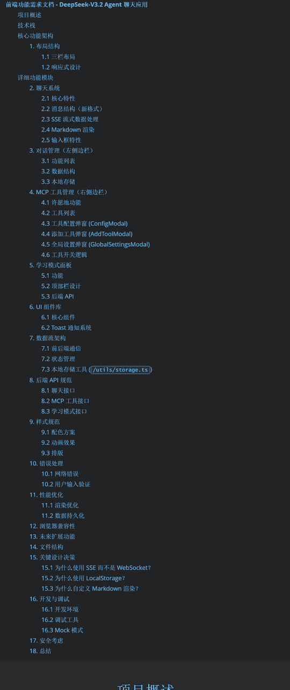


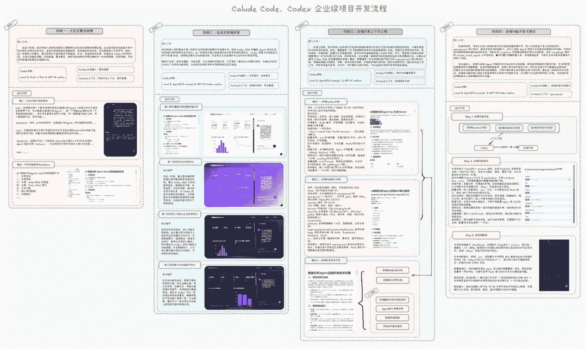

### 9. mini ChatGPT 前端功能开发

+   安装 `node.js`

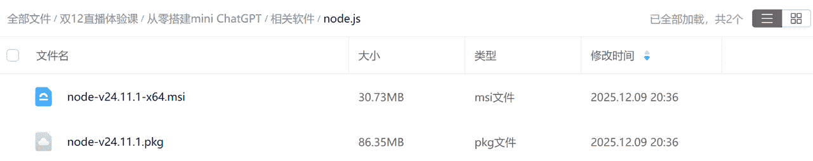

+   安装前端依赖

+   再次打开命令行，进入前端项目文件：

```
cd frontend
```

+   然后安装相关依赖：

```
npm install
```

+   启动前端

```
npm run dev
```

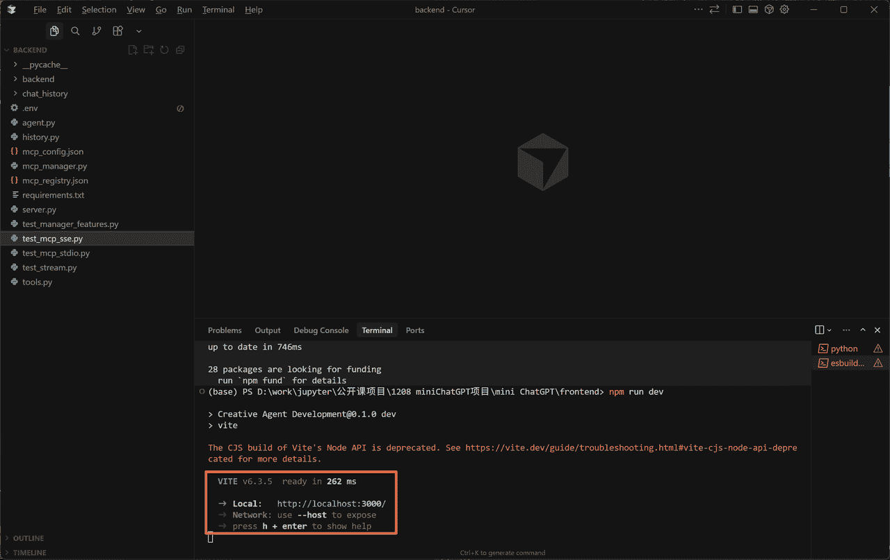

+   在 `localhost:3000` 即可访问

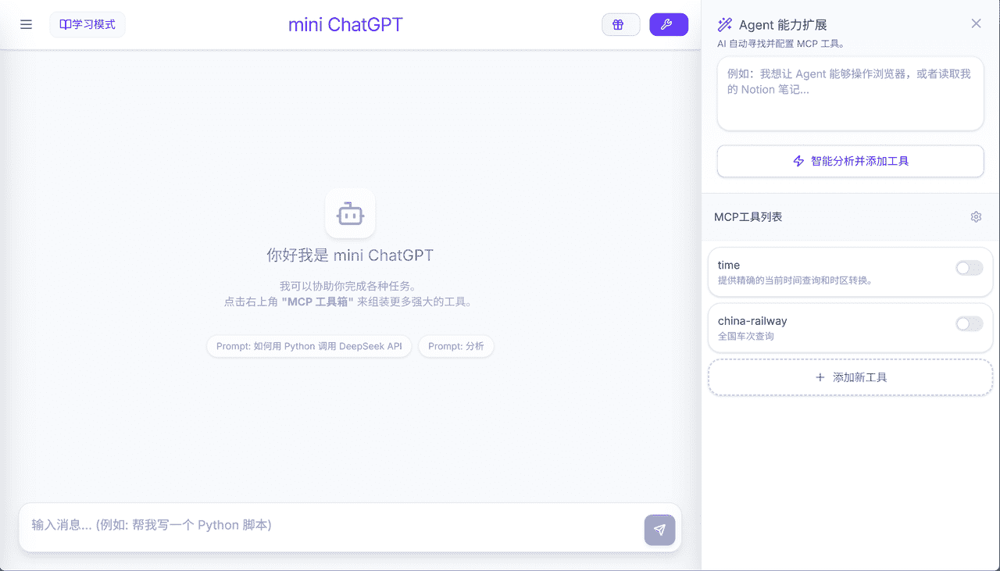

### 10. 消息管理模块开发实战 (The Memory System)

> 设计理念：

> 一个没有记忆的 Agent 只是一个一次性的问答机。在企业级应用中，我们需要一个**“记忆宫殿”**来管理用户的会话上下文。

> 本模块将负责两个核心职责：

1.  持久化 (Persistence)：将对话保存到磁盘，防止服务重启后数据丢失。

1.  上下文窗口控制 (Context Window)：大模型的 Context 是有限且昂贵的。我们需要控制每次发给模型的历史记录数量（例如只发最近 50 条），避免 Token 爆炸。


#### 10.1 创建历史管理脚本 (`backend/history.py`)

接下来在 backend 目录下创建 `history.py`。我们将实现一个基于 JSON 文件的轻量级数据库。

**代码文件：** `./backend/history.py`


```python
import os
import json
import time
import uuid
from typing import List, Dict, Optional
# 引入 LangChain 的标准消息对象，用于后续转换
from langchain_core.messages import messages_from_dict, messages_to_dict, HumanMessage, AIMessage

# 定义历史记录存储目录
HISTORY_DIR = "chat_history"
INDEX_FILE = os.path.join(HISTORY_DIR, "index.json")

# 初始化目录结构
if not os.path.exists(HISTORY_DIR):
    os.makedirs(HISTORY_DIR)
if not os.path.exists(INDEX_FILE):
    with open(INDEX_FILE, 'w', encoding='utf-8') as f:
        json.dump([], f)

class HistoryManager:
    """
    负责管理具体的会话消息以及全局的会话列表索引
    """
    def __init__(self, session_id: str):
        self.session_id = session_id
        # 每个会话对应一个独立的 JSON 文件
        self.file_path = os.path.join(HISTORY_DIR, f"{session_id}.json")

    # --- 核心功能 1: 读取消息 (带上下文截断) ---
    def load_messages(self, limit: int = 50):
        """
        加载当前会话的消息对象，供 Agent 思考使用。
        :param limit: 限制读取最近的 N 条消息 (Token 优化关键点)
        """
        if not os.path.exists(self.file_path):
            return []
        try:
            with open(self.file_path, 'r', encoding='utf-8') as f:
                data = json.load(f)
                # 将 JSON 字典转回 LangChain 的 Message 对象 (HumanMessage, AIMessage 等)
                all_messages = messages_from_dict(data)
                # 核心逻辑：切片操作，只取最后 limit 条
                return all_messages[-limit:]
        except Exception:
            return []

    # --- 核心功能 2: 写入交互 ---
    def save_interaction(self, user_query: str, ai_response: str):
        """保存一轮新的对话（User + AI），并更新索引"""
        # 1. 读取旧数据
        current_data = []
        if os.path.exists(self.file_path):
            try:
                with open(self.file_path, 'r', encoding='utf-8') as f:
                    current_data = json.load(f)
            except: pass
        
        # 2. 构建新消息对
        new_messages = [
            HumanMessage(content=user_query),
            AIMessage(content=ai_response)
        ]
        
        # 3. 追加并保存
        # messages_to_dict 将对象序列化为 JSON 可存储的格式
        updated_data = current_data + messages_to_dict(new_messages)
        
        with open(self.file_path, 'w', encoding='utf-8') as f:
            json.dump(updated_data, f, ensure_ascii=False, indent=2)

        # 4. 更新全局索引 (侧边栏列表)
        self._update_index(user_query)

    # --- 辅助功能: 会话列表索引管理 ---
    def _update_index(self, first_query: str):
        """更新 index.json，如果会话不存在则创建，并自动生成标题"""
        with open(INDEX_FILE, 'r', encoding='utf-8') as f:
            sessions = json.load(f)

        # 检查当前 session_id 是否已存在
        session = next((s for s in sessions if s["id"] == self.session_id), None)
        current_timestamp = int(time.time())

        if session:
            # 老会话：只更新时间
            session["updated_at"] = current_timestamp
        else:
            # 新会话：生成标题（取前20个字）并添加
            title = first_query[:20] + "..." if len(first_query) > 20 else first_query
            new_session = {
                "id": self.session_id,
                "title": title,
                "created_at": current_timestamp,
                "updated_at": current_timestamp
            }
            sessions.append(new_session)

        # 保存索引
        with open(INDEX_FILE, 'w', encoding='utf-8') as f:
            json.dump(sessions, f, ensure_ascii=False, indent=2)

    @staticmethod
    def get_all_sessions() -> List[Dict]:
        """获取所有会话列表（用于前端侧边栏展示）"""
        if not os.path.exists(INDEX_FILE): return []
        with open(INDEX_FILE, 'r', encoding='utf-8') as f:
            sessions = json.load(f)
            # 按时间倒序排列，最近的在上面
            sessions.sort(key=lambda x: x.get("updated_at", 0), reverse=True)
            return sessions
    
    @staticmethod
    def delete_session(session_id: str):
        """删除会话文件及索引"""
        # 1. 删文件
        file_path = os.path.join(HISTORY_DIR, f"{session_id}.json")
        if os.path.exists(file_path): os.remove(file_path)
        
        # 2. 删索引
        with open(INDEX_FILE, 'r', encoding='utf-8') as f:
            sessions = json.load(f)
        sessions = [s for s in sessions if s["id"] != session_id]
        with open(INDEX_FILE, 'w', encoding='utf-8') as f:
            json.dump(sessions, f, ensure_ascii=False, indent=2)

    def get_full_history(self) -> List[Dict]:
        """获取全量历史（前端展示详情用）"""
        if os.path.exists(self.file_path):
            with open(self.file_path, 'r', encoding='utf-8') as f:
                return json.load(f)
        return []
```

## 代码核心思路解读

1. **分层存储**：我们将具体聊天记录 (`xyz.json`) 和会话列表 (`index.json`) 分开。
   - **好处**：当用户刷新侧边栏时，我们只需要读取很小的 `index.json`，而不需要遍历几千个聊天文件，这在高并发场景下能极大地提升性能。

2. **消息序列化**：使用了 LangChain 自带的 `messages_to_dict` 和 `messages_from_dict`。这是为了保证我们的存储格式与 LangChain 生态完全兼容，方便未来迁移到 PostgreSQL 或 Redis。

3. Context Window (上下文窗口)：注意 `load_messages(limit=50)`。在企业开发中，如果不做限制，随着对话变长，Token 消耗会指数级增长，甚至撑爆模型上限。这是一个重要的成本控制策略。

## 11. 借助 FastAPI 自定义后端功能接口

> 设计理念：

> `server.py` 是整个系统的“神经中枢”。它需要承担 HTTP 请求的路由分发、跨域处理 (CORS) 以及最核心的 SSE (Server-Sent Events) 流式协议转换。我们将使用 Python 界性能最强、最现代化的 Web 框架 —— `FastAPI` 来实现。

### 11.1 创建后端服务脚本 (`backend/server.py`)


在 **阶段一**，我们只包含基础对话和会话管理接口，暂不包含 MCP 接口。

**代码文件：**`./backend/server.py`


```
import uvicorn
import os
import json
import asyncio
from typing import List
from dotenv import load_dotenv
from fastapi import FastAPI, HTTPException
from fastapi.middleware.cors import CORSMiddleware
from fastapi.responses import StreamingResponse
from pydantic import BaseModel
from langchain_core.messages import HumanMessage

# 导入本地模块
from history import HistoryManager
# 导入我们在 agent.py 里写的 agent 对象
# 注意：在阶段一，Agent是静态的，所以直接导入对象即可
from agent import agent as static_agent

# 1. 加载环境变量
load_dotenv(override=True)

# 2. 初始化 FastAPI 应用
app = FastAPI(title="Mini ChatGPT Backend", version="1.0 (MVP)")

# 3. 配置 CORS (跨域资源共享) - 关键！
# 允许前端(通常在 localhost:3000 或 5173) 访问此后端
app.add_middleware(
    CORSMiddleware,
    allow_origins=["*"],  # 生产环境建议替换为具体前端域名
    allow_credentials=True,
    allow_methods=["*"],
    allow_headers=["*"],
)

print(f"🚀 Server 初始化完成")

# ==========================================
#        Pydantic 数据模型 (类型安全)
# ==========================================

class ChatRequest(BaseModel):
    query: str       # 用户的问题
    session_id: str  # 会话 ID

class SessionItem(BaseModel):
    id: str
    title: str
    updated_at: int

# ==========================================
#           API 模块 1: 会话管理
# ==========================================

@app.get("/sessions", response_model=List[SessionItem])
async def get_sessions():
    """获取左侧侧边栏的会话列表"""
    return HistoryManager.get_all_sessions()

@app.post("/sessions")
async def create_session():
    """创建一个新的空白会话"""
    import uuid
    import time
    return {
        "id": str(uuid.uuid4()),
        "title": "新对话",
        "updated_at": int(time.time())
    }

@app.delete("/sessions/{session_id}")
async def delete_session(session_id: str):
    """删除指定会话"""
    HistoryManager.delete_session(session_id)
    return {"status": "success"}

@app.get("/history/{session_id}")
async def get_history(session_id: str):
    """点击侧边栏时，加载该会话的历史消息"""
    return HistoryManager(session_id).get_full_history()

# ==========================================
#           API 模块 2: 核心流式对话 (SSE)
# ==========================================

def format_sse(event_type: str, data: dict):
    """辅助函数：封装 SSE 消息格式"""
    # ensure_ascii=False 保证中文正常传输
    return f"data: {json.dumps({'type': event_type, 'data': data}, ensure_ascii=False)}\n\n"

@app.post("/chat_stream")
async def chat_stream(request: ChatRequest):
    """
    核心对话接口：接收用户问题 -> 调用 Agent -> 流式返回结果
    """
    
    # 1. 准备历史上下文
    history_mgr = HistoryManager(request.session_id)
    # 读取最近 40 条记录作为短期记忆
    history_messages = history_mgr.load_messages(limit=40)
    # 拼接当前用户问题
    input_messages = history_messages + [HumanMessage(content=request.query)]
    
    # 2. 定义异步生成器 (核心逻辑)
    async def event_generator():
        final_answer = ""
        try:
            print(f"🔄 [Server] Session {request.session_id} 开始处理: {request.query[:20]}...")
            
            # 调用 Agent 的 astream_events 方法，监听内部事件
            # version="v2" 是 LangChain 推荐的稳定版事件流格式
            async for event in static_agent.astream_events(
                {"messages": input_messages},
                version="v2"
            ):
                kind = event["event"]
                name = event.get("name", "")

                # --- 情况 A: 模型正在生成文本 (打字机效果) ---
                if kind == "on_chat_model_stream" or kind == "on_llm_stream":
                    chunk = event["data"].get("chunk")
                    content = ""
                    # 兼容不同 chunk 格式
                    if hasattr(chunk, "content"): content = chunk.content
                    elif isinstance(chunk, dict): content = chunk.get("content", "")
                    
                    if content:
                        final_answer += content
                        # 推送 token 事件给前端
                        yield format_sse("token", {"content": content})

                # --- 情况 B: 工具开始调用 (展示 Loading) ---
                elif kind == "on_tool_start":
                    print(f"🛠️ [Tool Start] {name}")
                    yield format_sse("tool_start", {
                        "tool_name": name,
                        "input": event["data"].get("input")
                    })

                # --- 情况 C: 工具调用结束 (展示结果) ---
                elif kind == "on_tool_end":
                    print(f"✅ [Tool End] {name}")
                    # 处理输出数据，防止 JSON 序列化错误
                    raw_output = event["data"].get("output")
                    output_str = str(raw_output)
                    if hasattr(raw_output, "content"): 
                        output_str = raw_output.content
                    
                    yield format_sse("tool_end", {
                        "tool_name": name,
                        "output": output_str
                    })

            # 3. 对话结束，保存完整记录到磁盘
            if final_answer:
                history_mgr.save_interaction(request.query, final_answer)
            
            # 发送结束信号
            yield format_sse("finish", {"status": "success"})

        except Exception as e:
            import traceback
            print(f"❌ [Stream Error] {traceback.format_exc()}")
            yield format_sse("error", {"message": str(e)})

    # 返回流式响应，告诉浏览器这是一个 SSE 流
    return StreamingResponse(event_generator(), media_type="text/event-stream")

if __name__ == "__main__":
    print("🚀 启动 Server (Port 8002)...")
    uvicorn.run(app, host="0.0.0.0", port=8002)
```

## 代码核心思路介绍

1. `Pydantic` 类型校验：我们定义了 `ChatRequest` 类。如果前端传来的数据没有 `session_id`，`FastAPI` 会在入口处直接拒绝请求。这体现了“防御性编程”的思想。

2. `SSE` (Server-Sent Events)：

   - 为什么不用 `WebSocket`？因为对于 Chat 这种“一问一答（虽然回答很长）”的场景，`SSE` 比 `WebSocket` 更轻量、更符合 HTTP 语义，且不需要处理复杂的心跳重连。
   - `format_sse` 函数非常关键，它定义了前后端的“通讯协议”。前端只需要监听 `type` 是 `token` 还是 `tool_start`，就能渲染出完全不同的 UI。

3. 事件流映射 (Event Mapping)：

   - `Agent` 内部会产生几十种事件，我们只关心前端需要的（`Token`、`Tool Start`、`Tool End`）。
   - 我们充当了“翻译官”的角色，把 `LangChain` 复杂的内部事件翻译成前端能看懂的简单 `JSON`。

## 12. 启动与验证

现在，阶段一的所有代码都完成了。

1. **启动后端**：

   ```
   cd backend
   python server.py
   ```

   - 终端应显示：Uvicorn running on http://0.0.0.0:8002。

2. **测试 (使用 `curl`)**：

   1. Bash

      ```
      curl -X POST "http://localhost:8002/chat_stream" \
           -H "Content-Type: application/json" \
           -d '{"query": "你好", "session_id": "test_001"}'
      ```

   - 如果你看到终端里像流水一样吐出 `data: {"type": "token", ...}`，说明你的 Mini ChatGPT 核心已经有了心跳！


同时此时前端也已经能够输入消息看到反馈了：


## 四、MCP（model context protocol）技术回顾

### 1. 智能体开发核心技术—MCP

#### 1.1 Function calling 技术回顾

如何快速开发一款智能体应用，最关键的技术难点就在于如何让大模型高效稳定的接入一些外部工具。而在 `MCP` 技术诞生之前，最主流的方法，是借助 `Function calling` 技术来打通大模型和外部工具之间的联系，换而言之，也就是借助 `Function calling`，来让大模型灵活的调用外部工具。

例如一个典型的 `Function calling` 示例，我们希望让大模型能够调用一些天气 `API` 查询即时天气，此时我们就需要创建一个查询天气的外部函数，负责调用天气 `API` 来查询天气，同时将外部函数的说明传递给大模型，使其能够根据用户意图，在必要的时候向外部函数发起调用请求。


> `Function calling` 最早由 OpenAI 与 2023年6月13号 正式提出，该项技术的名字也由此命名：https://openai.com/index/function-calling-and-other-api-updates/


> 此外，`Function calling` 也被称作 `tool use`、`tool call` 等技术。


无疑，Function calling的诞生意义重大，这项技术目前也成为大模型调用外部工具的基本技术范式，哪怕是MCP盛行的今天，底层仍然是Function calling执行流程。

#### 1.2 Function calling公开课介绍

而对于大模型开发者来说，无论是采用何种Agent开发框架或MCP技术，掌握Function calling的实现流程和底层原理至关重要，具体Function calling实现原理可以参考公开课《智能体从何而来？深度详解大模型调用工具底层原理》：https://www.bilibili.com/video/BV1w6dBYxELA/，而关于DeepSeek模型Function calling实现流程，可以参考公开课《DeepSeek智能体开发实战，从零手搓Mini Manus！》：https://www.bilibili.com/video/BV1L3ZDYDEnE/。

#### 1.3 Function calling能力从何而来

不过为了更好的学习本期公开课，需要重点强调的是关于大模型的Function calling的能力如何而来。我们都知道，对于当前大模型来说，有些模型有Function calling能力，如DeepSeek-V3模型，而有些模型没有，如DeepSeek-R1模型：


甚至对于DeepSeek-V3-0324模型来说，还支持工具的并联、串联调用甚至是自动debug：


> 具体代码实现流程可参考公开课《DeepSeek智能体开发实战，从零手搓Mini Manus！》：https://www.bilibili.com/video/BV1L3ZDYDEnE/。

那模型是如何具备Function calling能力的呢？答案是通过模型训练。对于DeepSeek-V3模型来说，由于在训练阶段（指令微调阶段）就带入了大量的类似如下的工具调用对话数据进行训练，因此能够识别外部工具并发起对外部工具调用的请求。而类似的，R1模型的训练过程没有工具调用数据，因此就不具备Function calling能力。


> 更多关于Function calling原理，可以参考公开课《智能体从何而来？深度详解大模型调用工具底层原理》：https://www.bilibili.com/video/BV1w6dBYxELA/，

而Function calling的能力，是大模型顺利开启MCP功能的基础。

#### 1.4 MCP技术本质：Function calling的更高层实现

而近一段时间大火的MCP技术，其实就可以将其理解为Function calling技术的更高层封装和实现。传统的Function calling技术要求围绕不同的外部工具API单独创建一个外部函数，类似一把锁单独配一把钥匙，而一个智能体又往往涉及到多个外部工具设计，因此开发工作量很大。


而MCP技术，全称为Model Context Protocol，模型上下文协议，是一种开发者共同遵守的协议，在这个协议框架下，大家围绕某个API开发的外部工具就能够共用，从而大幅减少重复造轮子的时间。


#### 1.5 MCP技术带来的智能体开发效率革命

举个例子，在我们开设的《大模型原理与实战课程》：https://whakv.xetslk.com/s/3p66pN系列课程中，2023年的第一期课程里曾经讲解过一个Agent实战项目，


其中涉及关于大模型对话长短期记忆存储和管理相关功能实现时，光是编写消息类（`Messages`）对象的各种操作方法以及围绕本地文件夹的各类操作，如创建、删除、写入文档、清空对话、统计文本长度等，就写了300多行代码：

而现在，借助MCP技术，采用别人已经开发好的`Filesystem`工具，仅需几行代码，导入工具配置即可实现完全相同的功能。由此Agent开发效率大幅提高，而这就是MCP技术搭建起来的协作体系的力量。


## 2. MCP服务器接入示例

而在MCP技术大爆发的今天，接入一个MCP工具也是非常简单，以下是一个将高德地图导航MCP（服务器）接入Cherry Studio（客户端）的示例：

> 我们可以暂时把MCP服务器视作MCP工具。

我们能看到，现在如果想要接入一个MCP工具，我们只需要在支持MCP功能的客户端中写入相关配置即可。例如我们只需要在Cherry Studio的MCP配置文档中写入如下字段：

```
"amap-maps": {
  "isActive": true,
  "command": "npx",
  "args": [
    "-y",
    "@amap/amap-maps-mcp-server"
  ],
  "env": {
    "AMAP_MAPS_API_KEY": "YOUR_API_KRY"
  },
  "name": "amap-maps"
}
```


即可让大模型自动关联高德MCP工具（服务器），而一个高德MCP服务器的API有几十种之多：


可以说是覆盖了出行生活的方方面面。而当一个大模型接入高德MCP服务器后，就能瞬间化身出行规划智能体。

> 更多客户端接入服务器方法，详见公开课《零门槛接入MCP！Cursor、阿里云百炼、Open-WebUI、Cherry Studio接入10大最热门MCP工具》：https://www.bilibili.com/video/BV1dCo7YdEgK/

而要知道的是，如果没有MCP工具，我们需要单独围绕这些API将其封装为一个个外部函数，再据此创建一个出行规划智能体，其工作量可想而知。

## 3. MCP工具标准接入流程

在上述示例中，我们不难发现，一个MCP服务器标准接入流程是通过写入一个配置文件来完成的。而在支持MCP功能的客户端（如Cherry Studio）中写入MCP工具的配置，其本质就是先将指定的MCP工具下载到本地，然后在有需要的时候对其进行调用。例如高德MCP配置文件如下：

```
"amap-maps": {
  "isActive": true,
  "command": "npx",
  "args": [
    "-y",
    "@amap/amap-maps-mcp-server"
  ],
  "env": {
    "AMAP_MAPS_API_KEY": "YOUR_API_KRY"
  },
  "name": "amap-maps"
}
```

代表的含义就是我们需要先使用如下命令：

```
npx -y @amap/amap-maps-mcp-server
```

对这个库`@amap/amap-maps-mcp-server`进行下载，然后在本地运行，当有必要的时候调用这个库里面的函数执行相关功能。

而这个`@amap/amap-maps-mcp-server`库是一个托管在https://www.npmjs.com/上的库，


可以使用`npx`命令进行下载。搜索库名即可看到这个库的完整代码，https://www.npmjs.com/package/@amap/amap-maps-mcp-server：


而这种通过配置文件来进行MCP工具下载的方式，最早由Claude（MCP技术的提出者）提出并被广泛接纳。

## 4. MCP服务器与客户端

#### 4.1 MCP服务器（server）与客户端（client）概念介绍

在上面的示例中，Cherry Studio是一个支持MCP功能的客户端，而接入的高德MCP是一个MCP服务器，这里的客户端和服务器又是什么意思呢？

这其实是MCP技术体系中对于大模型和外部工具的另一种划分方式，也就是说在MCP技术体系中，会将外部工具运行脚本称作服务器，而接入这些外部工具的大模型运行环境称作客户端。


一个客户端可以接入多个不同类型的服务器的，但要求是都可以遵循MCP通信协议。简单理解就是MCP服务器的输出内容是一种标准格式的内容，只能被MCP客户端所识别。在客户端和服务器都遵循MCP协议的时候，客户端就能够像Function calling中大模型调用外部工具一样，调用MCP服务器里面的工具。


#### 4.2 MCP服务器集合

暂时抛开底层原理不谈，在MCP技术爆发的这几个月，市面上已经诞生了成百上千的MCP服务器，甚至还出现了大量的MCP服务器集合网站：

+   MCP官方服务器合集：https://github.com/modelcontextprotocol/servers


+   MCP Github热门导航：https://github.com/punkpeye/awesome-mcp-servers


+   Smithery：https://smithery.ai/


+   MCP导航：https://mcp.so/


在实际进行智能体开发过程中，我们可以参考这些网站上的MCP工具，并有选择的对其进行调用。但需要注意的是，无论这些网站的组织形式多么花样百出，但实际上当我们本地调用MCP工具的时候，都是通过`uvx`或者`npx`将对应的库下载到本地，然后再进行运行。

## 5. MCP与Function calling技术对比介绍

此外，我们还需要补充一点的是关于Function calling和MCP技术的关系。通过在MCP运行过程的抓包可知，MCP底层实际上仍然是借助大模型原生的Function calling来完成外部工具调用，只不过进行了更高层的封装。


实际上MCP客户端对MCP服务器上的工具调用流程如下：

+   Step 1. 建立和服务器的通信；
+   Step 2. 查询服务器上总共有多少个外部工具；
+   Step 3. 将外部工具组成列表，带入到当前对话中；
+   Step 4. 借助Function calling进行外部工具调用。

也就是说，如果模型本身不支持Function calling，那么是无法顺利开启MCP功能的。

不过这里也有例外，那就是Open-WebUI和cline作为MCP客户端时，可以使用不具备Function calling功能的DeepSeek-R1模型进行MCP工具调用，这是为何呢？

原因非常简单，那就是这些客户端内置了一些提示词模板，借助提示让大模型输出类似Function call message（调用外部工具的信息）的内容，然后开启Function calling，从而能够调用MCP工具。举个例子，对于cline来说会通过一段非常长的提示词，引导模型输出Function call message：


> cline项目官网：https://github.com/cline/cline

我们可以将其精简为如下形式：

```
system_message = (
    "You are a helpful assistant with access to these tools:\n\n"
    f"{tools_description}\n"
    "Choose the appropriate tool based on the user's question. "
    "If no tool is needed, reply directly.\n\n"
    "IMPORTANT: When you need to use a tool, you must ONLY respond with "
    "the exact JSON object format below, nothing else:\n"
    "{\n"
    '    "tool": "tool-name",\n'
    '    "arguments": {\n'
    '        "argument-name": "value"\n'
    "    }\n"
    "}\n\n"
    "After receiving a tool's response:\n"
    "1. Transform the raw data into a natural, conversational response\n"
    "2. Keep responses concise but informative\n"
    "3. Focus on the most relevant information\n"
    "4. Use appropriate context from the user's question\n"
    "5. Avoid simply repeating the raw data\n\n"
    "Please use only the tools that are explicitly defined above."
)
```

翻译如下：

```
你是一个乐于助人的助手，可以使用以下工具：

{tools_description}

请根据用户的问题选择合适的工具。
如果不需要使用工具，请直接回复。

重要提示：如果需要使用工具，你必须仅以以下精确的 JSON 对象格式进行回复，不要添加其他内容：

{
    "tool": "工具名称",
    "arguments": {
        "参数名称": "参数值"
    }
}

在收到工具返回的结果后：
1. 将原始数据转化为自然、对话式的回答
2. 保持回答简洁但富有信息量
3. 聚焦于最相关的信息
4. 使用用户问题中的相关上下文
5. 避免直接照搬原始数据

请只使用上述明确定义的工具。
```

在这些提示词引导下，一些不具备Function calling的大模型，也能顺利使用MCP工具。不过需要注意的是，借助提示词开启的MCP功能，毕竟不如模型原生能力稳定，因此如果希望搭建企业级应用的Agent，最好还是使用具备Function calling功能的大模型。

## 6. MCP技术生态

最后需要介绍当前MCP完整的技术生态。MCP技术发展至今，已经不再是简单的“协议”，而是一个包含了协议、开发工具和现成的已经开发好的MCP工具所共同组成的完整技术生态。


其中：

+   MCP协议：指的是“虚”的规范，例如大模型和工具调度规范、服务器客户端的通信规范等，遵循这些协议的对象就是MCP服务器或客户端；
+   MCP开发工具：包含多种语言的SDK，也就是开发工具包，开发人员能够使用这些SDK快速完成MCP的服务器和客户端开发；
+   MCP服务器生态：开源的MCP服务器，是基于MCP协议的庞大的技术生态，智能体开发人员可以直接使用开源的MCP工具来加快开发进程。

## 五、mini ChatGPT 第二阶段开发实操：打造智能体操作系统


> 在第一阶段，我们成功构建了一个“能对话、能查天气”的 AI 助手，但它的能力是被**硬编码（Hardcoded）**在代码里的。每次想要增加新功能（比如查股票、操作数据库），都需要修改 `tools.py` 并重启服务。

> 在第二阶段，我们将引入 MCP (Model Context Protocol)，对系统进行“基因重组”，将其升级为一个 Agent OS（智能体操作系统）。

## 核心交付标准 (Requirements)

1. **能力热插拔 (Hot-Swapping)**：用户在前端勾选某个工具，Agent 在毫秒级内即可获得该能力，无需重启后端服务。

2. 混合连接架构 (Hybrid Connectivity)：

   + 本地安全连接 (StdIO)：支持连接本地 Python 脚本或数据库，确保敏感数据不出域。

   + 远程云服务 (SSE)：支持连接互联网上的标准 MCP 服务（如高德地图、12306）。

3. 零代码配置 (No-Code Config)：普通用户可以通过前端界面填写 API Key 或文件路径来配置工具，无需接触 Python 代码。

4. 跨平台兼容 (Cross-Platform)：后端需自动处理 Windows/Mac/Linux 的路径差异，确保配置文件的可移植性。

## 1. 架构设计与数据层构建 (Data Layer)

> 设计理念：任何复杂的系统，都是数据先行。在编写逻辑代码之前，我们需要先定义好**“应用商店（Registry）”和“用户配置（Config）”**的数据结构。这两个 JSON 文件将是整个系统的基石。

### 1.1 核心概念回顾：MCP 的两种连接形态

在设计数据结构前，必须明确 MCP 的两种核心传输协议，因为配置文件的写法完全不同：

+ StdIO (Standard Input/Output)：

+ **原理**：Agent 直接启动一个子进程（Subprocess）。

+ **场景**：本地工具（如 `mcp-server-time`, `sqlite`）。

+ **配置核心**：需要 `command`（执行什么命令，如 `python`）和 `args`（参数）。

+ SSE (Server-Sent Events)：

+ **原理**：Agent 通过 HTTP 长连接与远程服务器通信。

+ **场景**：云端服务（如阿里云百炼 MCP）。

+ **配置核心**：需要 `url`（服务器地址）和 `headers`（鉴权信息）。

### 1.2 构建 MCP 工具知识库 (`mcp_registry.json`)

这是我们的“应用商店”数据源。它是一个只读的 JSON 列表，定义了系统预置了哪些工具，以及它们的默认配置模板。

**操作**：请在 `mini_chatgpt/backend/` 目录下创建 `mcp_registry.json`。


**代码内容：**

```json
[
  {
    "name": "time",
    "category": "Utility",
    "description": "提供精确的当前时间查询和时区转换功能。",
    "type": "stdio",
    "default_config": {
      "command": "python",
      "args": [
        "-m",
        "mcp_server_time"
      ]
    }
  },
  {
    "name": "sqlite",
    "category": "Database",
    "description": "本地 SQLite 数据库工具。支持查看表结构和执行 SQL 查询。",
    "type": "stdio",
    "default_config": {
      "command": "python",
      "args": [
        "-m",
        "mcp_server_sqlite",
        "--db-path",
        "./test.db"
      ]
    }
  },
  {
    "name": "amap-maps",
    "category": "Geo/Travel",
    "description": "高德地图官方 MCP。提供地点搜索、路径规划、天气查询等服务。",
    "type": "sse",
    "default_config": {
      "url": "https://dashscope.aliyuncs.com/api/v1/mcps/amap-maps/sse",
      "headers": {
        "Authorization": "Bearer 你的阿里百炼API-Key"
      }
    }
  }
]
```

josn文档功能解读：

+ `type`: 明确区分了 stdio 和 sse，这是后续 `MCPManager` 决定如何启动客户端的关键依据。

+ `default_config`: 这是一个模板。

+ 对于 `time`，模板里写的是 `python`，我们在后续代码中会将其动态替换为 `sys.executable`（当前环境的 Python），从而实现跨平台。

+ 对于 `amap-maps`，模板里留了 `"Bearer 你的API-Key"`，提示用户在安装时需要填入自己的密钥。

### 1.3 设计用户配置存储 (`mcp_config.json`)

这是用户的个性化存档。它记录了用户到底安装了哪些工具、是否激活、以及具体的配置参数（如真实的 API Key）。

操作：在 `mini_chatgpt/backend/` 目录下创建 `mcp_config.json`。(注意：在实际运行中，这个文件通常由程序自动生成，但为了测试，我们可以先手动创建一个初始版本)

**代码内容：**

```json
{
  "tools": {
    "time": {
      "type": "stdio",
      "description": "提供精确的当前时间查询和时区转换功能。",
      "active": true,
      "config": {
        "command": "python",
        "args": [
          "-m",
          "mcp_server_time"
        ]
      }
    }
  }
}
```

json文件解读：

+ `active`: 这是一个布尔值开关。

+ true: Agent 在启动时会加载这个工具。

+ false: 即使配置存在，Agent 也会忽略它。这实现了“软删除”或“临时禁用”的功能。

+ `config`: 这里存储的是最终执行时的参数。

+ 思考题：这里的 command 写的是 python，但在 Windows 和 Mac 上，Python 的绝对路径是不同的。如果我们把绝对路径写死在这里（例如 `C:\Python312\python.exe`），把文件发给别人就跑不起来了。

+ 伏笔：我们在接下来的 `MCPManager` 开发中，会编写一个“路径自适应”逻辑，在读取配置的瞬间，把这里的 `python` 动态替换为当前环境的绝对路径。这就是工业级开发的细节！

## 2. 核心业务逻辑开发：MCP 管理器 (Business Logic Layer)

> 开发目标：编写 `backend/mcp_manager.py`。我们将在这个文件中实现三大核心能力：

1. 全生命周期管理：工具的增删改查与状态切换。

2. 智能容错机制：处理用户乱填配置（嵌套 JSON）和环境差异（Windows/Mac 路径）的自动纠错。

3. AI 驱动推荐：集成 `DeepSeek` 模型，实现“说人话，找工具”。

### 2.1 依赖导入与 Pydantic 模型定义

首先，我们需要定义 AI 推荐返回的数据结构。在 `LangChain` 1.0 中，使用 Pydantic 定义结构化输出是标准范式。

代码片段 (`mcp_manager.py` 头部)：

```python
import json
import os
import sys
import asyncio
from typing import List, Dict, Tuple, Optional
from dotenv import load_dotenv

from pydantic import BaseModel, Field
from langchain_deepseek import ChatDeepSeek
from langchain_core.prompts import ChatPromptTemplate
from langchain_mcp_adapters.client import MultiServerMCPClient

load_dotenv(override=True)

REGISTRY_FILE = "mcp_registry.json"
CONFIG_FILE = "mcp_config.json"

class ToolRecommendation(BaseModel):
    """单个工具推荐"""
    name: str = Field(description="工具名称，必须与知识库一致")
    reason: str = Field(description="推荐理由")

class RecommendationList(BaseModel):
    """推荐列表容器"""
    recommendations: List[ToolRecommendation]
```

### 2.2 核心类构建与基础 CRUD

接下来是 `MCPManager` 的初始化和基础读写功能。这里的关键点在于列表读取时的格式化。

代码片段 (`MCPManager` 类基础)：

```python
class MCPManager:
    def __init__(self):
        # 初始化时加载配置
        self.config = self._load_config()
        self.registry = self._load_registry()
        # 初始化 DeepSeek (低温度，保证推荐稳定)
        self.llm = ChatDeepSeek(model="deepseek-chat", temperature=0.1)

    # ... (省略 _load_config / _save_config 的标准文件读写代码，与之前一致) ...

    def list_installed_tools(self) -> List[Dict]:
        """
        列出已安装工具。
        关键点：额外返回 config_json 字符串，供前端编辑器直接显示。
        """
        # 每次读取前强制刷新，防止多进程数据不一致
        self.config = self._load_config()
        
        results = []
        for name, data in self.config.get("tools", {}).items():
            raw_config = data.get("config", {})
            results.append({
                "name": name,
                "description": data.get("description", ""),
                "active": data.get("active", True),
                "type": data.get("type"),
                "config": raw_config,
                "config_json": json.dumps(raw_config, ensure_ascii=False, indent=2)
            })
        return results
```

### 2.3 健壮的连接测试 (`test_tool_connection`)

这是本节的“高光时刻”。我们要解决两个让无数开发者头疼的问题：

1. 用户乱填：直接把阿里百炼的文档复制粘贴进去（导致 JSON 嵌套）。

2. 环境差异：Windows 写的配置传给 Mac，路径报错。

代码片段 (`test_tool_connection`)：


```python
async def test_tool_connection(self, name: str, type: str, config_dict: Dict) -> Tuple[bool, str]:
    """
    测试连接：包含 [智能拆包] + [路径自适应] + [超时熔断] 三重保障
    """
    print(f"🧪 [Debug] 收到测试请求: {name}, Type: {type}")

    # --- 第一重保障: 智能拆包 (Anti-Stupidity) ---
    # 针对用户粘贴了包含 "type" 和 "config" 的嵌套 JSON 的情况
    real_config = config_dict
    real_type = type.strip().lower()

    if isinstance(config_dict, dict) and "config" in config_dict:
        print(f"📦 [Auto-Fix] 检测到嵌套配置，正在自动清洗...")
        # 提取内部真实的 type 和 config
        if "type" in config_dict:
            real_type = config_dict["type"].strip().lower()
        real_config = config_dict["config"]

    # --- 第二重保障: 跨平台路径修正 (Cross-Platform) ---
    # 针对本地工具 (stdio)
    if real_type == "stdio":
        args = real_config.get("args", [])
        cmd = str(real_config.get("command", "")).lower()
        
        # 如果是 Python 模块调用 (-m)，强制使用当前环境解释器
        if "-m" in args or "python" in cmd:
            current_python = sys.executable
            print(f"🔄 [Auto-Fix] 路径修正: {current_python}")
            real_config["command"] = current_python

    # --- 构造客户端配置 ---
    client_config = {
        name: {
            "transport": real_type,
            **real_config
        }
    }

    # --- 第三重保障: 超时熔断 (Timeout) ---
    try:
        # 实例化客户端 (LangChain MCP Adapter)
        client = MultiServerMCPClient(client_config)
        # 强制 5秒超时，防止错误的 SSE 地址导致后端无限卡死
        tools = await asyncio.wait_for(client.get_tools(), timeout=5.0)
        
        tool_names = [t.name for t in tools]
        return True, f"✅ 连接成功！发现 {len(tools)} 个工具: {', '.join(tool_names[:3])}..."
        
    except asyncio.TimeoutError:
        return False, "❌ 连接超时 (5s)。请检查网络或 URL。"
    except Exception as e:
        return False, f"❌ 连接错误: {str(e)}"
```

## 代码解读

+   **为什么要“智能拆包”？** 用户不懂什么是“标准格式”，他们只会复制粘贴。后端多写 5 行代码，能减少 90% 的用户配置报错，这就是产品思维。

+   `sys.executable` 的妙用：这行代码让你的配置文件具备了“流动性”。无论你在谁的电脑上跑，它永远指向“当前正在干活的那个 Python”，彻底消灭 File not found。

### 2.4 实现 AI 智能推荐 (`ai_recommend_tools`)

利用 LangChain 1.0 的 `with_structured_output` 能力，让 DeepSeek 变成专业的“工具导购员”。

代码片段：

```python
async def ai_recommend_tools(self, user_query: str) -> List[Dict]:
    """根据用户需求推荐工具"""
    # 1. 压缩知识库 (只取关键字段，省 Token)
    registry_text = json.dumps([
        {"name": t["name"], "desc": t["description"]} 
        for t in self.registry
    ], ensure_ascii=False)

    # 2. 编写 Prompt
    prompt = ChatPromptTemplate.from_template("""
    用户需求："{query}"
    工具库：{registry}
    请挑选最合适的工具（最多3个）。
    """)

    # 3. 结构化输出 (LangChain 1.0 核心特性)
    # 这一步自动完成了 JSON Schema 的生成和解析
    chain = prompt | self.llm.with_structured_output(RecommendationList)

    try:
        res = await chain.ainvoke({"query": user_query, "registry": registry_text})
        
        # 4. 数据回填 (将推荐结果与 registry 里的详细配置合并)
        final_results = []
        for item in res.recommendations:
            original = next((t for t in self.registry if t["name"] == item.name), None)
            if original:
                final_results.append({
                    **original,
                    "recommend_reason": item.reason,
                    "installed": item.name in self.config.get("tools", {})
                })
        return final_results
    except Exception as e:
        print(f"推荐失败: {e}")
        return []
```

### 2.5 运行时配置生成 (`get_active_config`)

最后，我们需要一个方法，把存在磁盘里的配置，变成 `agent.py` 能用的配置字典。

```python
def get_active_config(self) -> Dict:
    """生成给 Agent 使用的运行时配置"""
    # 每次调用都重读文件，确保 Agent 拿到最新状态
    self.config = self._load_config()
    
    final_config = {}
    for name, data in self.config.get("tools", {}).items():
        if data.get("active", True):
            cfg = data["config"].copy()
            # 再次应用路径修正逻辑，确保运行时不出错
            if data["type"] == "stdio" and "-m" in cfg.get("args", []):
                cfg["command"] = sys.executable
            
            final_config[name] = {
                "transport": data["type"],
                **cfg
            }
    return final_config
```

## 3. Agent 核心重构：实现动态工厂模式 (Core Refactoring)

> 开发目标：推翻第一阶段“写死”的 `agent.py`，引入设计模式中的“工厂模式（Factory Pattern）”。

> 我们要实现的目标是：每次用户发起对话时，Agent 都会“睁开眼”看一看自己现在装备了哪些 MCP 工具，然后动态组装自己的大脑和手脚。


### 3.1 核心痛点与架构升级

在第一阶段，我们的 Agent 初始化代码是静态写在文件顶部的：

```python
# 旧代码 (Static)
tools = get_tools() # 程序启动时执行一次，之后永远不变
agent = create_agent(..., tools=tools)
```

这意味着：如果你在运行过程中通过 API 安装了一个新工具（比如 12306 查票），Agent 根本不知道，除非重启服务器。

解决方案：动态工厂函数

我们将编写一个异步函数 `build_dynamic_agent()`。每次调用它时，它都会：

1.  去 `MCPManager` 查询最新激活的工具列表。
1.  尝试连接这些工具（握手）。
1.  动态生成 System Prompt（告诉模型：“你现在拥有查询火车票的能力...”）。
1.  返回一个新的、装备齐全的 Agent 实例。

### 3.2 代码重构实战 (`backend/agent.py`)

请使用以下代码完全覆盖原本的 `backend/agent.py`。


``` 
import asyncio
from typing import List

# 1. 引入 LangChain 和 DeepSeek 组件
from langchain_deepseek import ChatDeepSeek
from langchain.agents import create_agent
from langchain_core.tools import BaseTool

# 2. 引入 MCP 官方适配器 (连接的核心)
from langchain_mcp_adapters.client import MultiServerMCPClient

# 3. 引入本地模块
from tools import get_tools as get_builtin_tools  # 始终存在的内置工具
from mcp_manager import MCPManager

# 全局实例化 Manager
# 注意：这里只是实例化管理类，并不读取具体配置，配置是在函数内动态读取的
mgr = MCPManager()

async def build_dynamic_agent():
    """
    [核心工厂函数]
    每次对话前调用。动态组装【内置工具】+【已激活 MCP 工具】，并生成动态 Prompt。
    """
    
    # ==========================================
    # Step 1: 收集所有工具 (Tools Assembly)
    # ==========================================
    
    # 1.1 获取内置工具 (Weather, Tavily) - 这些永远在线
    tools: List[BaseTool] = get_builtin_tools()
    
    # 1.2 获取当前激活的 MCP 配置 (从 mcp_config.json 读取)
    # mgr.get_active_config() 内部会强制重读文件，确保配置最新
    mcp_config = mgr.get_active_config()
    
    mcp_tools: List[BaseTool] = []
    
    # 1.3 动态挂载 MCP 工具
    if mcp_config:
        try:
            # 建立连接客户端
            # MultiServerMCPClient 会根据 config 自动处理 StdIO/SSE 连接
            client = MultiServerMCPClient(mcp_config)
            
            # 获取工具列表 (增加 3秒 超时控制，防止某个工具卡死拖累整个 Agent)
            # wait_for 是生产环境必须的，防止“一粒老鼠屎坏了一锅粥”
            mcp_tools = await asyncio.wait_for(client.get_tools(), timeout=3.0)
            
            print(f"🔌 [Agent Factory] 已动态挂载 {len(mcp_tools)} 个 MCP 工具")
        except asyncio.TimeoutError:
            print(f"⚠️ [Agent Factory] MCP 挂载超时 (3s)，将降级运行，仅使用内置工具。")
        except Exception as e:
            print(f"⚠️ [Agent Factory] MCP 挂载失败: {e}")
            
    # 合并工具列表：内置 + 外挂
    all_tools = tools + mcp_tools

    # ==========================================
    # Step 2: 动态构建系统提示词 (Dynamic Prompting)
    # ==========================================
    
    # 2.1 生成工具清单字符串
    # 让模型明确知道自己现在能干什么，这比单纯 bind_tools 更有效
    tool_descriptions = []
    for t in all_tools:
        # 提取工具名和第一行描述
        desc = t.description.split('\n')[0] if t.description else "无描述"
        tool_descriptions.append(f"- **{t.name}**: {desc}")
    
    tools_str = "\n".join(tool_descriptions)

    # 2.2 编写动态 Prompt
    # 采用 ReAct 标准结构，并注入工具清单
    system_prompt = f"""
    你是一个功能强大的全能 AI 智能体。
    
    ### 🛠️ 你当前拥有的工具能力：
    {tools_str}
    
    ### 🧠 思考与行动指南：
    1. **优先使用工具**：如果用户的请求可以通过上述工具解决，请务必调用工具。
    2. **内置工具规则**：
       - 查询天气 -> 必须使用 `get_weather`。
       - 搜索新闻/实时信息 -> 必须使用 `search_tool` (Tavily)。
    3. **MCP 工具规则**：
       - 请仔细阅读工具列表。如果用户请求涉及数据库、文件操作或特定服务（如地图），请调用对应的 MCP 工具。
    4. **语言**：始终使用简体中文回答用户。
    
    现在，请根据用户的输入，灵活选择工具开始工作。
    """

    # ==========================================
    # Step 3: 创建并返回 Agent 实例
    # ==========================================
    
    # 显式开启 streaming=True，适配 Mac/Linux 环境
    model = ChatDeepSeek(
        model="deepseek-chat", 
        temperature=0,
        streaming=True
    )
    
    # create_agent 内部会将 all_tools 绑定到模型 (bind_tools)
    agent = create_agent(
        model=model,
        tools=all_tools,
        system_prompt=system_prompt
    )
    
    return agent
```

## 代码解释

### 1. 为什么要用 `asyncio.wait_for`？（生产环境生存法则）

+ **场景**：你配置了一个远程 MCP 工具（如高德地图），但公司网络突然断了，或者对方服务器挂了。

+ **后果**：如果没有超时控制，`client.get_tools()` 可能会无限期挂起（Hang），导致前端用户看到聊天框一直转圈，没有任何反应。

+ **策略**：设置 3 秒超时。连不上就 **“断臂求生”**（降级运行），至少让基础聊天和天气功能还能用，而不是整个系统瘫痪。

### 2. 动态 Prompt 的价值 (Context Awareness)

+ 我们不仅把工具传给了 `bind_tools`（让模型在底层 API 层面知道工具），还在 System Prompt 里用自然语言列了一遍清单。

+ **原理**：DeepSeek 这类模型具有极强的 Context 学习能力。当你明确告诉它“你现在拥有 `sqlite_query` 工具”时，它在 **进行复杂任务规划时（Reasoning）** 会更倾向于使用该工具，从而提高工具调用的召回率（Recall）。

### 3. 混合工具链 (Hybrid Toolchain)

+ `all_tools = tools + mcp_tools`

+ 这行代码体现了架构的 **分层思想**：基础能力（天气/搜索）是 **基建**，雷打不动；MCP 能力是 **插件**，随需而变。这为企业定制化开发提供了极大的灵活性。

## 4. 接口层升级：开放 MCP 管理能力 (Interface Layer)

> 开发目标：目前我们的 `server.py` 还停留在 MVP 阶段，它只认识“聊天”这一个指令。

> 在本节中，我们将把 `server.py` 升级为全功能的 Agent 操作系统网关。我们需要实现两类新接口：

1. 控制面（Control Plane）：用于管理 MCP 工具的安装、测试、搜索和开关。

2. **数据面（Data Plane）**：改造聊天接口，使其支持动态 Agent 的实时加载。


### 4.1 定义数据契约：Pydantic 模型设计

在企业级 API 开发中，**“契约先行”**是铁律。我们需要先定义前端传给我们的数据长什么样。这不仅能自动生成 Swagger 文档，还能防止前端传错参数导致后端崩溃。

请在 `server.py` 的头部（Pydantic 模型区域）追加以下定义：

``` 
# server.py (追加代码)

# --- MCP 管理相关的数据模型 ---

class MCPSearchRequest(BaseModel):
    """用户输入的自然语言需求"""
    query: str 

class MCPInstallRequest(BaseModel):
    """安装/修改单个工具的请求体"""
    name: str
    description: str
    type: str       # "stdio" 或 "sse"
    config: dict    # 包含 command, args, url, headers 等核心参数
    
class MCPBatchInstallRequest(BaseModel):
    """批量安装请求体 (用于 AI 推荐后的批量采纳)"""
    tools: List[MCPInstallRequest]

class MCPToggleRequest(BaseModel):
    """开关状态请求体"""
    active: bool

class MCPTestRequest(BaseModel):
    """连接测试请求体 (不保存，仅运行)"""
    name: str
    type: str
    config: dict
```

代码解读：

+ **为什么需要 `MCPTestRequest`？** 注意它和 `MCPInstallRequest` 结构几乎一样，但业务语义不同。测试请求是无状态的（不写入磁盘），而安装请求是有状态的（写入磁盘）。区分定义有助于未来扩展（比如测试请求可能需要额外的超时参数）。

+ **`config: dict` 的灵活性**：我们没有把 `config` 里的字段（如 `url`, `command`）写死，而是用 `dict`。这是为了兼容 MCP 协议的未来扩展，无论以后 MCP 推出什么新连接方式，这个接口都不用改。

### 4.2 实现管理接口：打造 Agent 的“控制面板”

接下来，我们需要将 `MCPManager` 的功能映射为 HTTP 接口。

**修改动作**：

1. 在 `server.py` 顶部导入 `MCPManager`。

2. 实例化一个全局的 `mcp_manager`。

3. 添加一系列路由函数。


```
# server.py (新增导入与实例)
from mcp_manager import MCPManager

# 初始化全局管理器
mcp_manager = MCPManager()

# ... (API 定义区域) ...

# ==========================================
#           API 模块 2: MCP 工具管理
# ==========================================

@app.get("/mcp/list")
async def list_installed_mcp():
    """
    [查询] 获取当前已安装的所有工具
    前端页面加载时调用，用于渲染'我的工具'列表
    """
    return mcp_manager.list_installed_tools()

@app.post("/mcp/search_ai")
async def search_mcp_ai(req: MCPSearchRequest):
    """
    [智能] AI 推荐工具
    连接 DeepSeek 模型，分析用户需求并查阅 Registry
    """
    return await mcp_manager.ai_recommend_tools(req.query)

@app.post("/mcp/install")
async def install_mcp_tool(req: MCPInstallRequest):
    """
    [写入] 安装或更新单个工具
    包含智能拆包与路径修正逻辑
    """
    try:
        mcp_manager.save_tool(
            name=req.name,
            description=req.description,
            type=req.type,
            config_dict=req.config
        )
        return {"status": "success", "message": f"工具 {req.name} 已保存"}
    except Exception as e:
        raise HTTPException(status_code=500, detail=str(e))

@app.post("/mcp/install_batch")
async def install_mcp_batch(req: MCPBatchInstallRequest):
    """
    [批量写入] 一键安装多个工具
    """
    count = 0
    for tool in req.tools:
        mcp_manager.save_tool(
            name=tool.name,
            description=tool.description,
            type=tool.type,
            config_dict=tool.config
        )
        count += 1
    return {"status": "success", "message": f"已批量添加 {count} 个工具"}

@app.post("/mcp/test_connection")
async def test_mcp_connection(req: MCPTestRequest):
    """
    [测试] 连接试运行
    这是用户体验最关键的一环，确保'先测后存'
    """
    success, msg = await mcp_manager.test_tool_connection(
        name=req.name,
        type=req.type,
        config_dict=req.config
    )
    return {"success": success, "message": msg}

@app.post("/mcp/toggle/{tool_name}")
async def toggle_mcp(tool_name: str, req: MCPToggleRequest):
    """
    [状态] 激活或禁用工具
    """
    mcp_manager.toggle_tool(tool_name, req.active)
    return {"status": "success", "active": req.active}

@app.delete("/mcp/{tool_name}")
async def uninstall_mcp(tool_name: str):
    """
    [删除] 卸载工具
    """
    mcp_manager.delete_tool(tool_name)
    return {"status": "success"}
```

## 4.3 核心重构：聊天接口的“动态化”改造

这是本次升级的**心脏手术**。我们要废弃原来那个静态的`static_agent`，改为在每次请求时调用`build_dynamic_agent()`工厂。

**修改步骤**：

1. **修改导入**：将`from agent import agent`改为`from agent import build_dynamic_agent`。
2. **重写`chat_stream`**：引入异步构建逻辑。

```
# server.py (核心重构部分)

# 1. 导入修正
from agent import build_dynamic_agent  # <--- 关键修改

@app.post("/chat_stream")
async def chat_stream(request: ChatRequest):
    """
    核心对话接口 (动态版)
    每次请求都会重新组装 Agent，从而让新安装的 MCP 工具即时生效。
    """
    
    # ... (历史记录加载逻辑不变) ...
    
    # ==========================================
    # 🚀 核心变化: 动态构建 Agent
    # ==========================================
    try:
        # 调用工厂函数，读取 mcp_config.json，连接所有工具
        # 如果某个工具连不上，工厂内部会自动降级，保证这里不崩
        current_agent = await build_dynamic_agent()
    except Exception as e:
        # 如果连工厂都崩了（极端情况），返回错误流给前端
        print(f"❌ Agent 构建失败: {e}")
        async def error_gen():
            yield format_sse("error", {"message": f"Agent 初始化失败: {str(e)}"})
            yield format_sse("finish", {"status": "error"})
        return StreamingResponse(error_gen(), media_type="text/event-stream")

    # ... (后续的 event_generator 逻辑与之前基本一致) ...
    # 记得加上我们之前修复的 format_sse 序列化补丁
```

## 4.4 完整代码交付：最终版 server.py

**为了方便大家核对代码，这里提供**了融合上述所有修改的最终完整版 server。

```
# server.py
import uvicorn
import os
import json
import asyncio
from typing import List, Dict, Optional
from dotenv import load_dotenv
from fastapi import FastAPI, HTTPException
from fastapi.middleware.cors import CORSMiddleware
from fastapi.responses import StreamingResponse
from pydantic import BaseModel
from langchain_core.messages import HumanMessage
from fastapi.responses import FileResponse  

# --- 导入本地模块 ---
# 请确保 agent.py 中有 build_agent_with_mcp 函数
# 请确保 history.py, mcp_manager.py 文件存在且最新
from history import HistoryManager
from mcp_manager import MCPManager
from agent import build_dynamic_agent

# 1. 加载环境变量
load_dotenv(override=True)

# 2. 初始化 FastAPI
app = FastAPI(title="Creative Agent Backend", version="4.0 (MCP Edition)")

# 3. 配置跨域 (CORS) - 允许前端所有访问
app.add_middleware(
    CORSMiddleware,
    allow_origins=["*"],
    allow_credentials=True,
    allow_methods=["*"],
    allow_headers=["*"],
)

# 4. 初始化核心管理器
# history_manager 在每次请求时动态实例化
mcp_manager = MCPManager()

print(f"🚀 Server 初始化完成")
print(f"📂 历史记录路径: {os.path.abspath('chat_history')}")
print(f"🛠️ MCP 配置文件: {os.path.abspath('mcp_config.json')}")

# ==========================================
#        Pydantic 数据模型定义
# ==========================================

# --- 聊天相关 ---
class ChatRequest(BaseModel):
    query: str
    session_id: str

class RenameRequest(BaseModel):
    title: str

class SessionItem(BaseModel):
    id: str
    title: str
    updated_at: int

# --- MCP 管理相关 ---
class MCPSearchRequest(BaseModel):
    query: str  # 用户输入的自然语言需求

class MCPInstallRequest(BaseModel):
    """用于安装或修改单个 MCP 工具"""
    name: str
    description: str
    type: str       # "stdio" 或 "sse"
    config: dict    # 包含 command, args, url, headers 等
    
class MCPBatchInstallRequest(BaseModel):
    """用于批量安装 (AI推荐列表勾选后一键安装)"""
    tools: List[MCPInstallRequest]

class MCPToggleRequest(BaseModel):
    active: bool

class MCPTestRequest(BaseModel):
    """用于连接测试"""
    name: str
    type: str
    config: dict

# ==========================================
#           API 模块 1: 会话管理
# ==========================================

@app.get("/sessions", response_model=List[SessionItem])
async def get_sessions():
    """获取会话列表"""
    return HistoryManager.get_all_sessions()

@app.post("/sessions")
async def create_session():
    """创建新会话"""
    import uuid
    import time
    return {
        "id": str(uuid.uuid4()),
        "title": "新对话",
        "updated_at": int(time.time())
    }
......
```

### 1. 关于“单例模式”与“工厂模式”的抉择

+ **MVP 阶段（单例）**：我们在程序启动时创建了一个全局 agent 对象。这样做的好处是响应快（不需要每次都初始化），坏处是**“僵化”**——配置改了，`Agent` 不知道。

+ **Pro 阶段（工厂）**：我们在每次请求时`await build_dynamic_agent()`。

+ **质疑**：这样不会慢吗？

+ **回答**：**会，但值得。** MCP 的连接建立通常在毫秒级（本地）或百毫秒级（SSE）。对于一个对话**系统**来说，用户发出消息后等待 0.5 秒再开始生成，完全在可接受范围内。换来的是极致的灵活性——这在企业级架构中被称为“可配置性优先（Configurability First）”。

### 2. 异常处理的艺术

+ 注意看我们在`chat_stream`里加的`try...except`。

+ 在微服务架构中，依赖服务（MCP 工具）的故障不能导致主服务（Chat）的崩溃。如果 12306 的接口挂了，`Agent` 应该报错说“我连不上购票系统”，而不是整个网页白屏。这就是我们在代码中极力保证的鲁棒性（Robustness）。

## 5. 全链路联调与验收 (Integration Testing)

> 实战任务：代码写完了，现在我们要像真正的 QA（测试工程师）一样，验证我们的系统是否达标。

**验证清单：**

1. **场景一：本地能力闭环**

+ 操作：在前端“应用商店”搜索“时间”，点击安装。
+ 验证：发送“现在几点了”。
+ 预期：`Agent` 准确报出当前时间（精确到秒），且日志显示调用了`get_current_time`。

2. **场景二：跨网络能力集成**

+ 操作：手动添加“高德地图”工具（SSE 类型），填入 Key。
+ 验证：点击“测试连接”，看到绿色的成功提示。
+ 验证：发送“查一下西湖周边的咖啡馆”。
+ 预期：`Agent` 返回真实的地理位置信息列表。

3. **场景三：热插拔测试**

+ 操作：在对话中途，去列表里把“时间工具”的开关关掉。
+ 验证：再次问“现在几点了”。
+ 预期：`Agent` 回复“抱歉，我没有查询时间的工具...”（因为它真的失去了这个能力）。这一刻，你将深刻体会到什么是**“动态 Agent”**。


# 体验课介绍

体验课内容节选自《2025大模型Agent智能体开发实战》(12月班)完整版付费课程

体验课时间有限，若想深度学习大模型技术，欢迎大家报名由我主讲的《2025大模型Agent智能体开发实战》(12月班)


《2025大模型Agent智能体开发实战》(12月班)为【100+小时】体系大课，总共20大模块精讲精析，零基础直达大模型企业级应用！

## 课程完整介绍


## 12月新班新增内容


