# LangChain快速入门与Agent开发实战

> 来源：[https://kq4b3vgg5b.feishu.cn/docx/TadKd0y6ro9EsAxzRpacPPV8nUb](https://kq4b3vgg5b.feishu.cn/docx/TadKd0y6ro9EsAxzRpacPPV8nUb)

## 一、LangChain.ai工具生态介绍

本期公开课，我将为大家详细讲解元老级Agent开发工具——LangChain。

### 1. GPT-3时代下第一代大模型开发工具

LangChain可以称之为自2022年底大模型技术爆火以来的第一个真正意义上的大模型开发框架。大模型本质上无法直接解决实际的问题，仅仅是一个能够分析、推理和生成文本的黑盒。直到现在，所有的开发者们仍然在不断探索如何把大模型的强大能力与实际应用场景结合起来，而当时LangChain的出现，直接让大模型开发变得简单起来，它将大模型开发过程中常用的功能、工具、流程等等全部封装成一个个的组件，使开发者可以像搭乐高积木一样，快速的组合出适用于不同场景需求的大模型应用。

LangChain的首个版本于2022年10月开源，直到现在仍然在以一个飞快的速度不断进行迭代升级。从一个开源 Python/TS 框架逐渐发展，形成包括“链”和“代理”等核心组件，现在已走向企业级阶段，发展成了LangChain AI，其拥有目前Agent技术领域最大的开源生态，衍生出了多个开源项目框架，各自都在大模型的技术领域承担着不同的开发任务角色。

从一个形象的角度来说，LangChain的功能定位其实并不是我们现在所谓的Agent开发框架，而是一个大模型功能增强器，借助LangChain，哪怕在GPT-3模型时代，也能让模型完成对话、拥有记忆、甚至是完成结构化输出等功能。

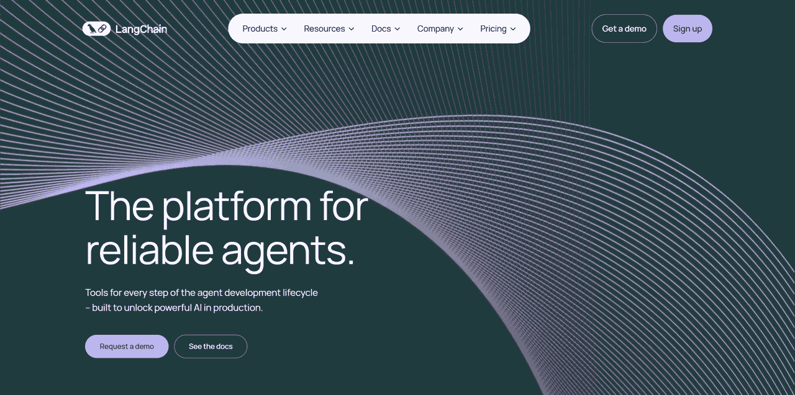

> LangChain官网：https://www.langchain.com/

### 2. **备受争议的工具功能**

虽说LangChain的开源，在短时间内收获了大量的开发者用户，这也一度使得LangChain在2023年成为最受欢迎的大模型开发工具没有之一。但每项技术都会受限于其诞生的时代背景，LangChain也不例外。在GPT-3时代，大模型以补全模型为主，只能以类似“成语接龙”的方式对文本进行补全，并且实际运行效果也非常不稳定。此时LangChain借助一些高层封装的API，能够让模型完成对话、调用外部工具、甚至是结构化输出等功能，这在当时是非常大的进步，也为开发者提供了极大的便利。

但是，伴随着GPT-3.5模型的发布，对话模型正式登上历史的舞台，并逐渐成为主流。而得益于对话模型更强的指令跟随能力，很多GPT-3需要借助LangChain才能完成的工作，已经成为GPT-3.5原生自带的一些功能。而等到GPT-4逐渐普及，包括调用外部工具（Function calling）、结构化输出、系统提示词等功能，都成了模型的基础功能。而对于开发者而言，此时再使用LangChain再对这些功能进行封装就显得多此一举。

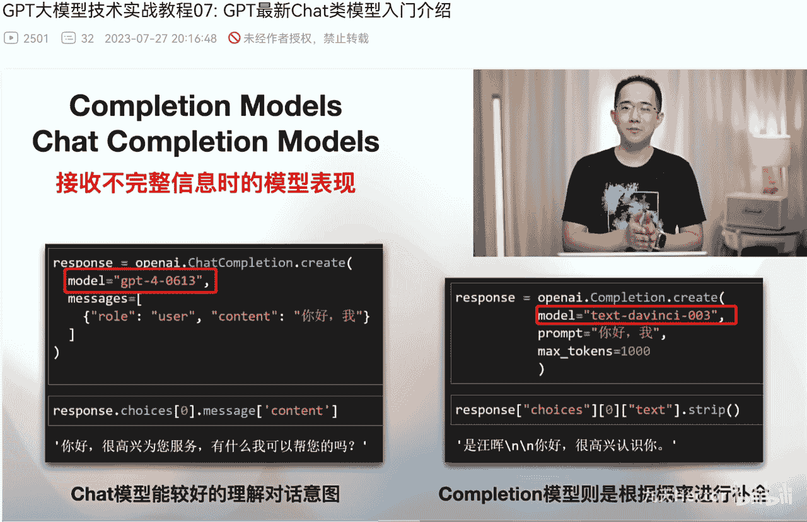

> 【考古】补全模型与对话模型对比介绍：https://www.bilibili.com/video/BV1Vk4y1V76h

因此在2023年下半年起的很长一段时间里，LangChain饱受争议，很多开发者觉得LangChain代码冗余、编写复杂，甚至有开发者觉得LangChain太过于复杂，一个模型调用的过程就涉及到数十个类，一个项目开发动辄就要用到几十个不同的类，而说明文档更是几百个不同的常用类需要记住，其复杂程度不亚于学习一门全新的编程语言。

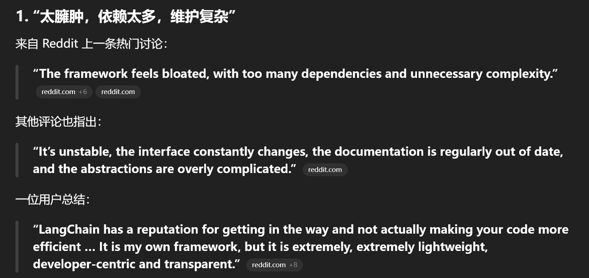

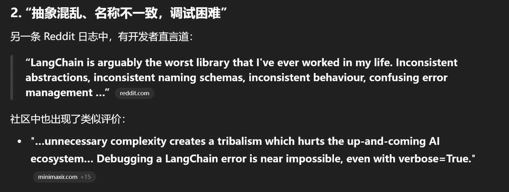

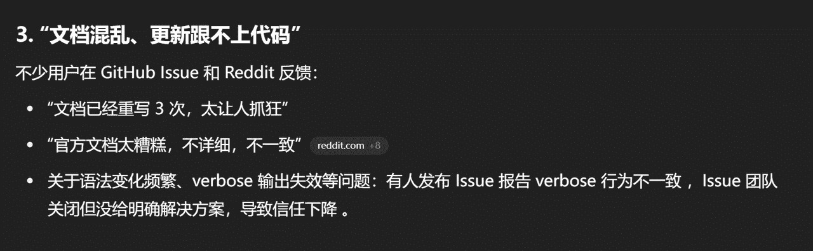

而这也使得在某个时间段，LangChain的开发者大规模流失。

> 举个例子，为了更好的兼容不同模型的调用，谷歌ADK采用了LiteLlm作为底层模型调度框架，一个库即可调用各类模型，而LangChain则为每个主流模型单独封装了一个库，调用不同模型的时候需要导入不同模型对应的库，例如调用DeepSeek就需要安装langchain-deepseek，而调用Gemini则需要安装langchain-google-genai。

### 3. 更加适用于当前Agent开发的LangChain工具生态

在经历了短暂的阵痛后，LangChain果断进行了大刀阔斧的改革。LangChain调整的思路非常简单：

1.  LangChain本身仍然坚守作为“模型能力增强器”的功能定位，并且逐渐稳定更新节奏和频率，虽说实际使用LangChain进行开发的代码量仍然没变，但模块划分更加清晰、功能更加丰富和稳定，逐步达到企业级应用水准。目前最新版LangChain的核心功能如下：

| 模块类别 | 示例功能 |
| --- | --- |
| **模型接口封装** | OpenAI、Claude、Cohere、Qwen 等模型统一调用方式 |
| **输出结构化** | 自动从模型中解析 JSON、Schema、函数签名、文档等 |
| **Memory 管理** | Buffer、Summary、Entity、Conversation Memory 等 |
| **Tool 接入** | Web 搜索、SQL 数据库、Python 执行器、API 代理等 |
| **Agent 架构** | ReAct、Self-Ask、OpenAI Function Agent 等调度机制 |
| **RAG 集成** | 多种 Retriever、Vector Store、文档拆分策略 |
| **Server/API 发布** | 快速将链部署为 Web 服务或 A2A Agent |
| Debug &amp; Callback | Token 使用统计、LangSmith 可视化追踪等 |

1.  ✅ 所以说：**L**angChain 是 LLM 功能开发的「积木工厂」，不是简单框架，而是模型增强器 + 应用组装工具箱。

1.  与2023年下半年开源LangGraph，LangGraph作为基于LangChain的更高层次封装，能够更加便捷的搭建图结构的大模型工作流，也就是现在所谓的Multi-Agent系统，而LangGraph也是目前LangChian家族最核心的Multi-Agent开发框架。同时可以搭配LangGraph-Studio进行实时效果监测，实际效果如下所示：

1.

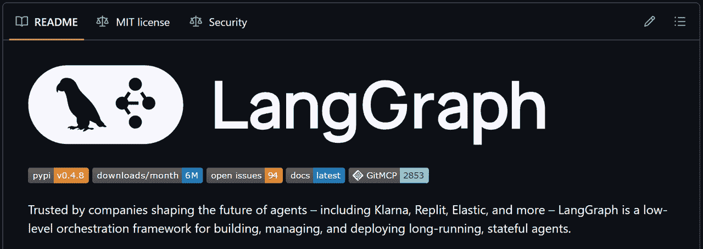

1.  项目官网：https://github.com/langchain-ai/langgraph

1.  需要注意的是，LangGraph底层功能仍然是基于LangChain来实现，简单理解LangGraph本质上其实就是LangChain的流程调度与智能体编排系统

1.  开源大模型工作流（Agent）可视化监控与测试平台LangSmith，借助LangSmith，开发者能够更加简单便捷监控基于LangChain生态的Agent运行流程、测试Agent功能和不同提示词等，从而使得LangChain进一步面向企业级应用开发框架；

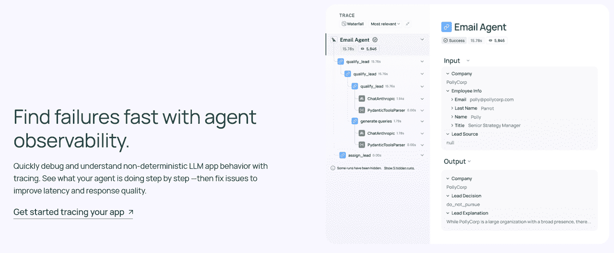

1.  LangSmith官网：https://www.langchain.com/langsmith

1.  同时，考虑到LangChain本身较为复杂这一情况，开源了LangChain的“可视化实现版”——LangFlow，这是一款形式对标Dify、可以通过可视化方式、借助拖拉拽来完成LangChain相同功能的开发工具。

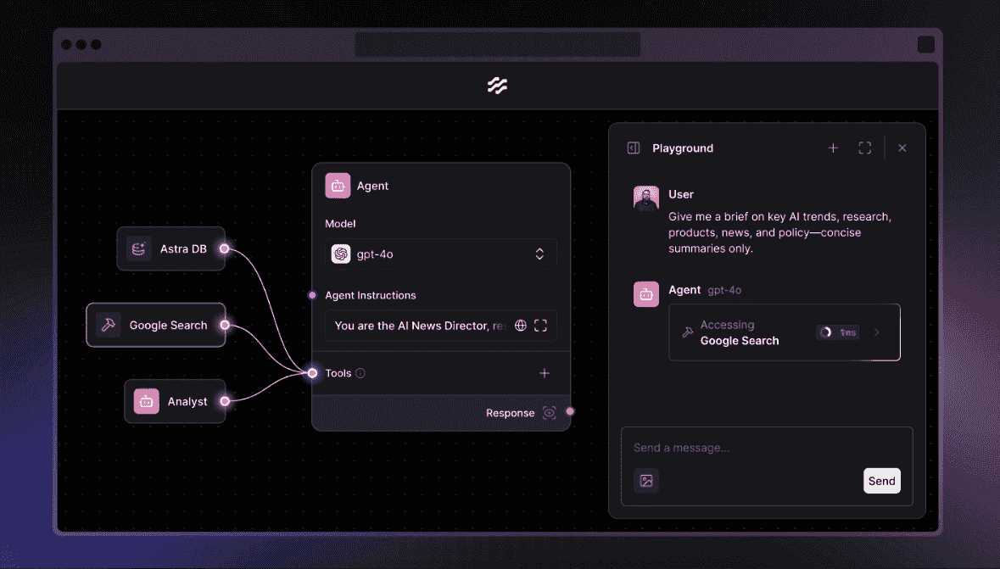

1.  同时，这也是目前LangChain工具家族中，仅次于LangChain（109k stars）第二受欢迎的开发框架，在GitHub上已斩获接近72k stars。

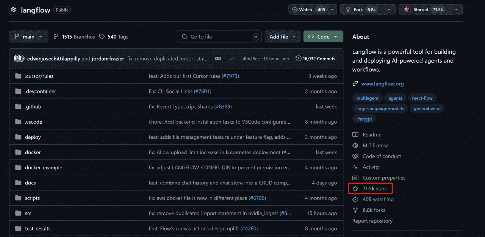

1.  LangFlow官网：https://www.langflow.org/

1.  同时，相比Dify，LangFlow功能更加完善，并且没有任何商业化的计划，可长期稳定使用。

目前LangChain工具生态如图所示：

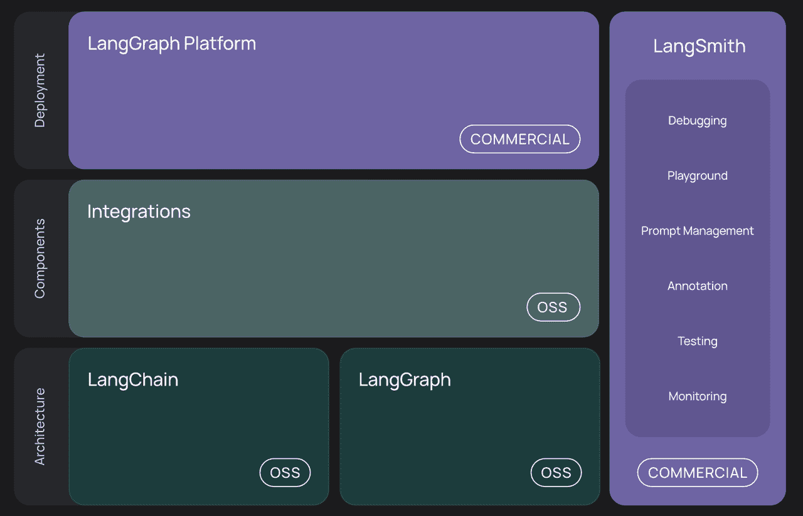

+   此外，作为底层框架本身，LangChain本身仍保持了非常快速的迭代速度，例如就在5月29号，LangChain发布最新版本，新增了目前通用智能体项目非常需要的沙盒环境（SandBox）：

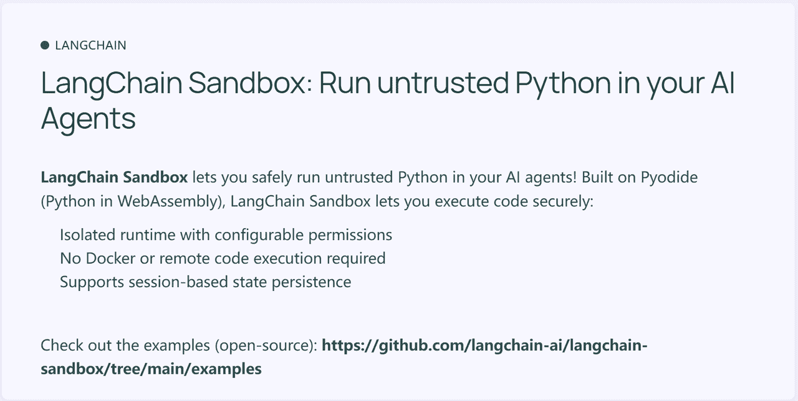

+   同时，LangChain也是最早官宣支持谷歌A2A技术协议的开发框架，这也使得LangChain本身的先进性一直处于整个Agent开发框架的前列。

### 4. 当下大模型开发人员必备技能：LangChain

可以说，经过了近3年的发展，目前LangChain工具生态已经非常全面，能适用于各类不同场景的开发需求，无论是小规模实验、还是大规模商业化部署，无论是使用代码开发、还是偏向使用低代码开发工具，LangChain工具家族都能满足开发者的需求。

也正因如此，LangChain可以说是历经大模型Agent技术发展巨变但仍“屹立不倒”的开发工具，哪怕今年以来OpenAI、谷歌等AI巨头纷纷下场发布全新一代Agent开发框架，但LangChian工具本身仍在很多场景下不可替代。而相比之下，类似AotuGen、CrewAI等工具的适用面，在大模型技术飞速发展的当下，正在逐渐减少。截止目前，LangChain仍然是目前大模型开发岗位应用最广的框架没有之一：

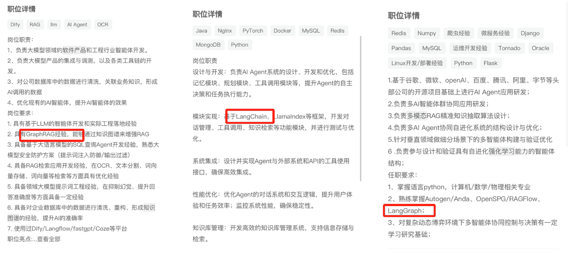

同时LangChain也是很多著名的开源项目的底层开发框架，如字节前端时间开源的Deep Research应用deerflow就是采用了LangChain&LangGraph框架：

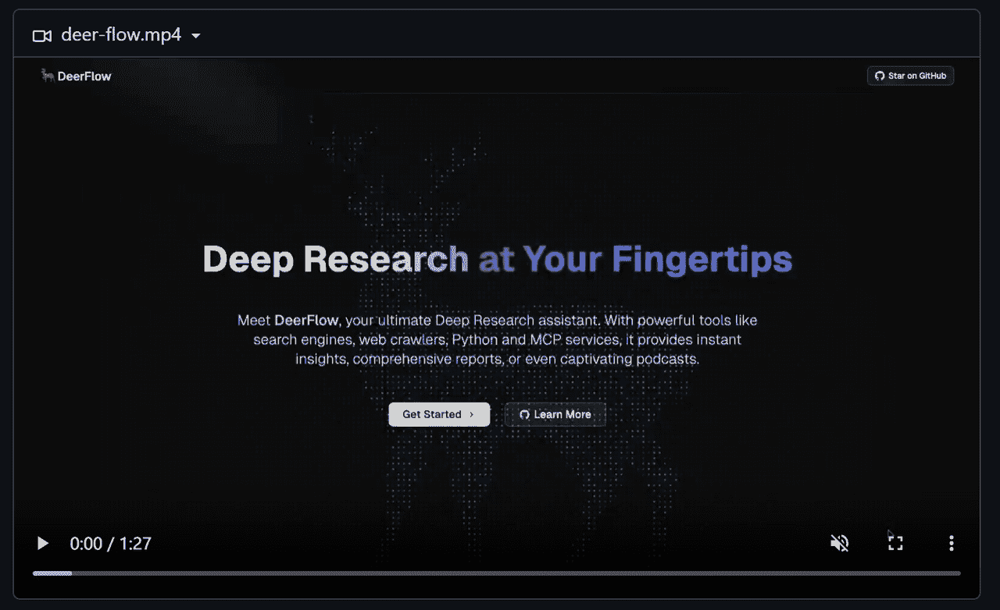

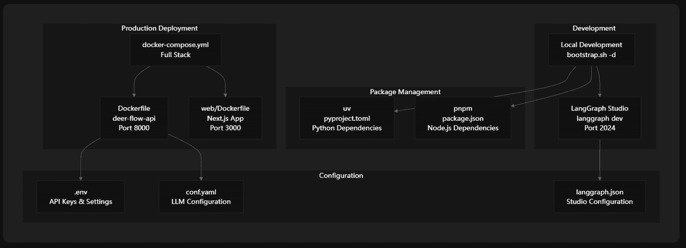

> 项目主页：https://github.com/bytedance/deer-flow

此外如谷歌近期开源的Gemini Fullstack LangGraph Quickstart热门项目，也是使用LangGraph作为基础框架：

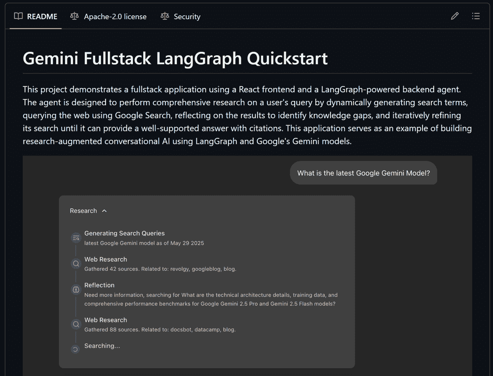

> 项目主页：https://github.com/google-gemini/gemini-fullstack-langgraph-quickstart

### 5. LangChain工具集公开课

基于LangChain丰富的工具生态，接下来我将开设系列公开课为大家详细介绍LangChain和LangGraph从入门到企业级Agent开发完整流程，详细介绍两个框架的核心功能特性，并重点讲解上述框架在RAG知识检索、Python代码解释器、DeepResearch应用、AI数据分析等领域的应用，同时介绍最新技术如MCP、A2A接入方法等，部分公开课成果展示如下：

+   RAG知识库检索：

+   LangChain+MCP工具调用：

+   AI数据分析Agent：

完整公开课课件、代码、脚本以及更多直播视频信息、技术交流等，都将上线至赋范大模型技术社区，欢迎大家扫码即可加入。


> 后续内容见Jupyter代码文档。


```
conda create --name lc python=3.11
conda init
conda activate lc
conda install jupyterlab
conda install ipykernel
python -m ipykernel install --user --name unsloth --display-name &quot;Python lc&quot;
```