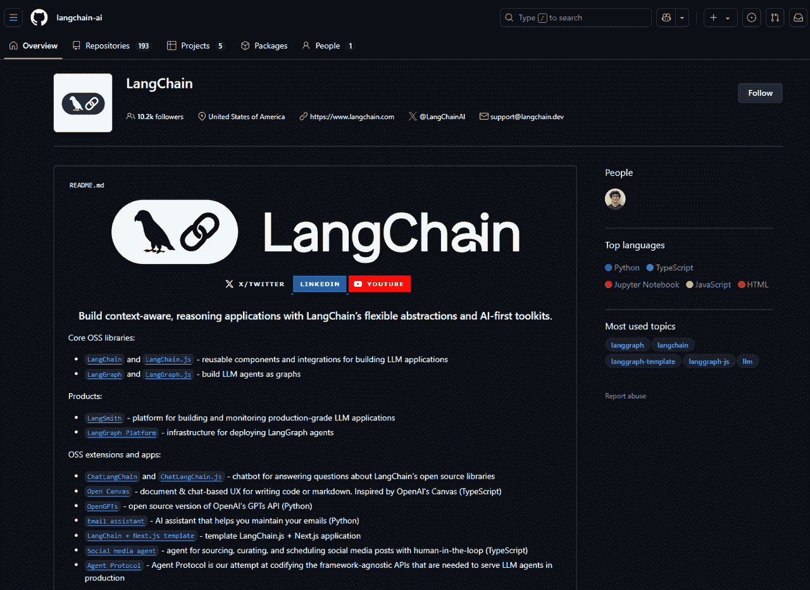
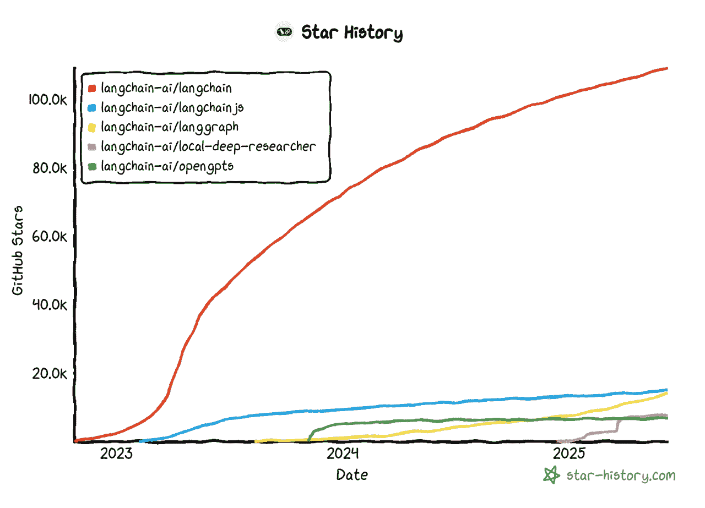
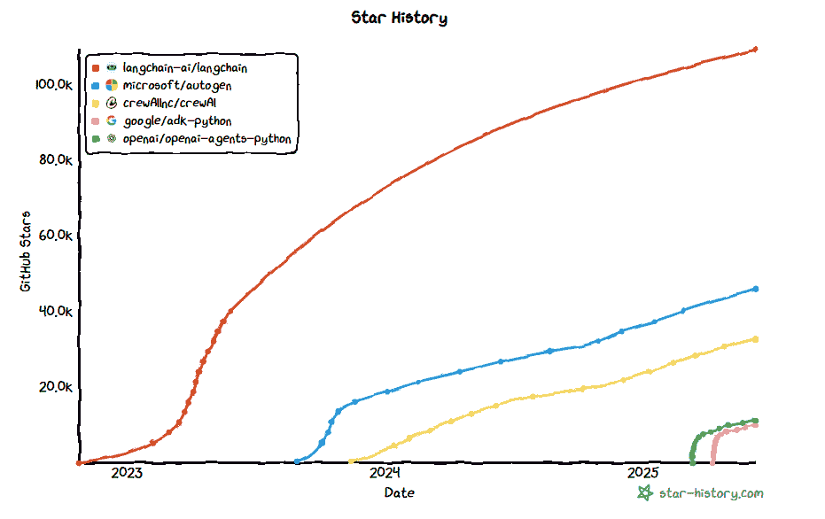
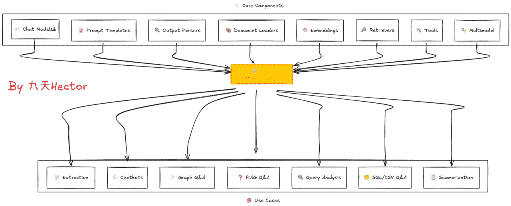
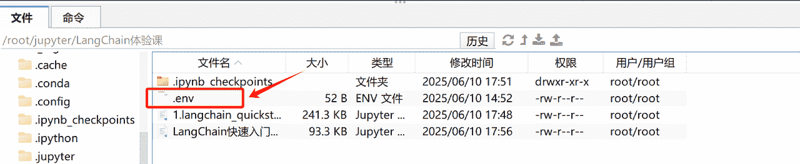
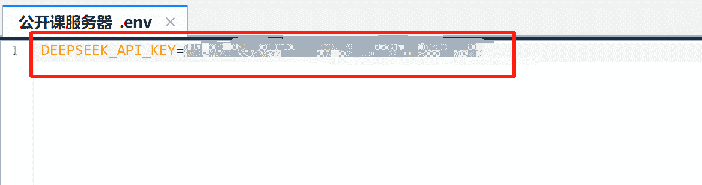
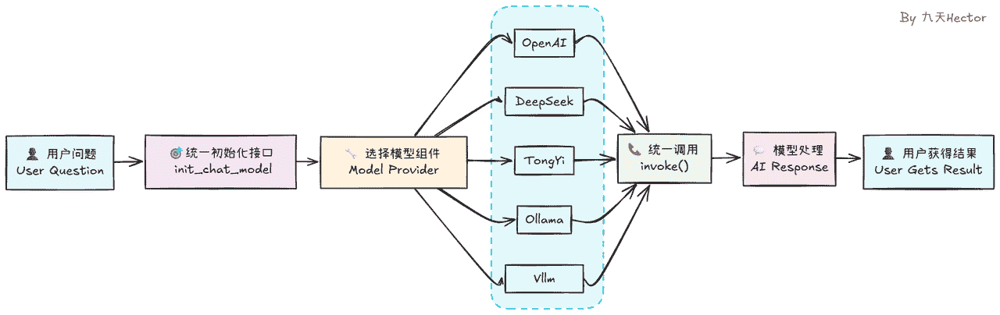
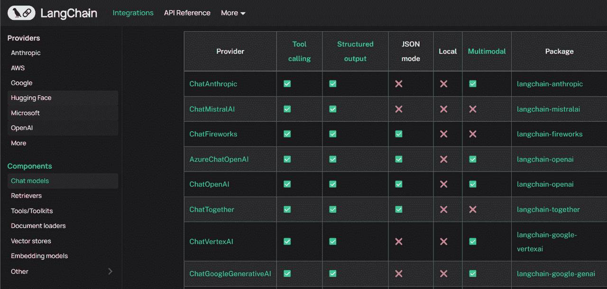
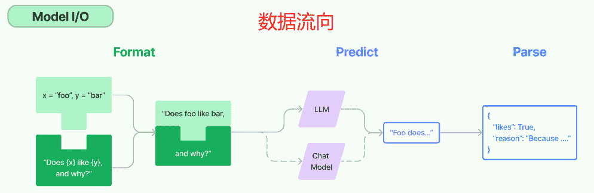

# LangChain快速入门与Agent开发实战2

> 来源：[https://kq4b3vgg5b.feishu.cn/docx/NXwdd5kdZoufaix7TAucYpBqnBf](https://kq4b3vgg5b.feishu.cn/docx/NXwdd5kdZoufaix7TAucYpBqnBf)

## 课程说明

体验课内容节选自《2025大模型Agent智能体开发实战》(夏季班)完整版付费课程

体验课时间有限，若想深度学习大模型技术，欢迎大家报名由我主讲的《2025大模型Agent智能体开发实战》(夏季班)


公开课全套学习资料，已上传至网盘（链接: `https://pan.baidu.com/s/1_TPoisye8HldxiIXiMxM8Q` 提取码: khnp ）

需要更系统深入学习大模型可扫码⬆️添加助教咨询喔～

---

## 《大模型Agent智能体开发实战（夏季班）》体验课

## LangChain快速入门与Agent开发实战-Part 2

### LangChain项目回顾

LangChain可以称之为自2022年底大模型技术爆火以来的第一个真正意义上的大模型开发框架。

大模型本质上无法直接解决实际的问题，仅仅是一个能够分析、推理和生成文本的黑盒。直到现在，所有的开发者们仍然在不断探索如何把大模型的强大能力与实际应用场景结合起来，而当时LangChain的出现，直接让大模型开发变得简单起来，它将大模型开发过程中常用的功能、工具、流程等等全部封装成一个个的组件，使开发者可以像搭乐高积木一样，快速的组合出适用于不同场景需求的大模型应用。

LangChain的首个版本于2022年10月开源，直到现在仍然再以一个飞快的速度不断进行迭代升级。从一个开源 Python/TS 框架逐渐发展，形成包括“链”和“代理”等核心组件，现在已走向企业级阶段，发展成了LangChain AI，其拥有目前Agent技术领域最大的开源生态，衍生出了多个开源项目框架，各自都在大模型的技术领域承担着不同的开发任务角色。

其官方Github地址为：`https://github.com/langchain-ai`



这里我们可以梳理出在LangChain AI中最受关注的项目发展态势，如下图所示：



其中最活跃的项目当属`langchain`，排在前二的分别是`langChain`的Python版本和JavaScript版本。作为LangChain AI发展的基石，`langchain`主要用来支持构建大模型应用的一切，包括链式编排、检索增强生成 (RAG)、嵌入、文档处理、对话系统、代码分析等。而随着业务需求的越来越复杂，LangChain AI也推出了`langgraph`，作为一个基于图结构的 Agent 编排框架，可构建有状态、多步骤、多 Agent 的工作流，从而进一步扩展了LangChain AI自家生态的适用范围。而至于`local‑deep‑researcher`和`opengpts`，则完全是给开发者提供了基于LangChain定制开发出的特定热门应用，也一定程度上能印证LangChain AI的生态繁荣和可实现应用场景的广度。

### LangChain AI 热门开源项目功能介绍

| 项目 | 技术栈 | 核心用途 |
| --- | --- | --- |
| `langchain` | Python/TS | 构建 LLM 应用基础组件 |
| `langchainjs` | JS/TS | 前端/Node 环境中构造 LLM 应用 |
| `langgraph` | Python | 用图编排复杂 agent 流程 |
| `local-deep-researcher` | Python | 自动化、多轮本地 Web 研究工具 |
| `opengpts` | Python + Go + 前端 | 可定制化 GPT 平台，支持 RAG 和 agent 开发 |

对外，LangChain 也是目前大模型技术领域所有AI Agent框架中最热门、最通用的，相较于`AutoGen`、`CrewAI`、`OpenAI Agents SDK`和`Google ADK`，拥有最多的收藏量和活跃的开发者数量。



因此这里大家可以感受到，langChain AI生态的学习，其实最最核心的就是LangChain这个项目。而`langChain`是一个非常全面的开发框架，集成了Agent和RAG两个关键的热门落地方向，通过灵活的模块化组合可以快速的构建适用于私有业务场景的大模型应用，在目前的应用开发中是企业中使用最多的Agent开发框架。其核心架构如下图所示：



从本质上分析，LangChain从大模型角度出发，通过开发人员在实践过程中对大模型能力的深入理解及其在不同场景下的涌现潜力，使用模块化的方式进行高级抽象，设计出统一接口以适配各种大模型。LangChain抽象出最重要的核心模块如下：

1. `Model I/O` ：标准化各个大模型的输入和输出，包含输入模版，模型本身和格式化输出；

1. `Retrieval` ：检索外部数据，然后在执行生成步骤时将其传递到 LLM，包括文档加载、切割、`Embedding`等；

1. `Chains` ：链，LangChain框架中最重要的模块，链接多个模块协同构建应用，是实际运作很多功能的高级抽象；

1. `Memory` ：记忆模块，以各种方式构建历史信息，维护有关实体及其关系的信息；

1. `Agents` ：目前最热门的`Agents`开发实践，未来能够真正实现通用人工智能的落地方案；

1. `Callbacks` ：回调系统，允许连接到 大模型 应用程序的各个阶段。用于日志记录、监控、流传输和其他任务；

从上图中可以看到，LangChain框架涵盖了模型输入输出的标准化、外部工具接入的规范、上下文记忆功能，以及对数据库、SQL、CSV等多种数据源的连接标准。通过核心的`Chain`高级抽象，定义了不同形式下标准的链接方法，这就能够允许开发者根据实际的应用需求和数据流向快速构建出一套完整的应用程序。这个过程类似于搭建积木，可以灵活适应不同的任务需求。

因此本节公开课，我们就围绕LangChain展开详细的讲解，我们会涉及到LangChain框架的整体概览，如何用LangChain搭建智能体和本地知识库问答的完整流程，同时对于比较热门的`MCP`工具如何接入LangChain框架，会做一个重点的说明。

需要说明的，这里我们选择使用 Python 作为开发语言，同时使用目前最新的LangChain 0.3版本，具体的版本说明如下：

+ `Python==3.12`

+ `LangChain>=0.3.25`

+ `langchain-deepseek>=0.1.3`

## 一、LangChain快速入门

### 1. LangChain接入大模型流程

#### LangChain安装流程

如果使用LangChain进行大模型应用开发，需要安装LangChain的依赖包，安装命令如下：

```
! pip install langchain
```


```
Collecting langchain
  Using cached langchain-0.3.25-py3-none-any.whl.metadata (7.8 kB)
Collecting langchain-core<1.0.0,>=0.3.58 (from langchain)
  Using cached langchain_core-0.3.64-py3-none-any.whl.metadata (5.8 kB)
Collecting langchain-text-splitters<1.0.0,>=0.3.8 (from langchain)
  Using cached langchain_text_splitters-0.3.8-py3-none-any.whl.metadata (1.9 kB)
Collecting langsmith<0.4,>=0.1.17 (from langchain)
  Using cached langsmith-0.3.45-py3-none-any.whl.metadata (15 kB)
Collecting pydantic<3.0.0,>=2.7.4 (from langchain)
  Using cached pydantic-2.11.5-py3-none-any.whl.metadata (67 kB)
Collecting SQLAlchemy<3,>=1.4 (from langchain)
  Using cached sqlalchemy-2.0.41-cp312-cp312-win_amd64.whl.metadata (9.8 kB)
Collecting requests<3,>=2 (from langchain)
  Using cached requests-2.32.3-py3-none-any.whl.metadata (4.6 kB)
Collecting PyYAML>=5.3 (from langchain)
  Using cached PyYAML-6.0.2-cp312-cp312-win_amd64.whl.metadata (2.1 kB)
Collecting tenacity!=8.4.0,<10.0.0,>=8.1.0 (from langchain-core<1.0.0,>=0.3.58->langchain)
  Using cached tenacity-9.1.2-py3-none-any.whl.metadata (1.2 kB)
Collecting jsonpatch<2.0,>=1.33 (from langchain-core<1.0.0,>=0.3.58->langchain)
  Using cached jsonpatch-1.33-py2.py3-none-any.whl.metadata (3.0 kB)
Collecting packaging<25,>=23.2 (from langchain-core<1.0.0,>=0.3.58->langchain)
  Using cached packaging-24.2-py3-none-any.whl.metadata (3.2 kB)
Collecting typing-extensions>=4.7 (from langchain-core<1.0.0,>=0.3.58->langchain)
  Using cached typing_extensions-4.14.0-py3-none-any.whl.metadata (3.0 kB)
Collecting jsonpointer>=1.9 (from jsonpatch<2.0,>=1.33->langchain-core<1.0.0,>=0.3.58->langchain)
  Using cached jsonpointer-3.0.0-py2.py3-none-any.whl.metadata (2.3 kB)
Collecting httpx<1,>=0.23.0 (from langsmith<0.4,>=0.1.17->langchain)
  Using cached httpx-0.28.1-py3-none-any.whl.metadata (7.1 kB)
Collecting orjson<4.0.0,>=3.9.14 (from langsmith<0.4,>=0.1.17->langchain)
  Using cached orjson-3.10.18-cp312-cp312-win_amd64.whl.metadata (43 kB)
Collecting requests-toolbelt<2.0.0,>=1.0.0 (from langsmith<0.4,>=0.1.17->langchain)
  Using cached requests_toolbelt-1.0.0-py2.py3-none-any.whl.metadata (14 kB)
Collecting zstandard<0.24.0,>=0.23.0 (from langsmith<0.4,>=0.1.17->langchain)
  Using cached zstandard-0.23.0-cp312-cp312-win_amd64.whl.metadata (3.0 kB)
Collecting anyio (from httpx<1,>=0.23.0->langsmith<0.4,>=0.1.17->langchain)
  Using cached anyio-4.9.0-py3-none-any.whl.metadata (4.7 kB)
Collecting certifi (from httpx<1,>=0.23.0->langsmith<0.4,>=0.1.17->langchain)
  Using cached certifi-2025.4.26-py3-none-any.whl.metadata (2.5 kB)
Collecting httpcore==1.* (from httpx<1,>=0.23.0->langsmith<0.4,>=0.1.17->langchain)
  Using cached httpcore-1.0.9-py3-none-any.whl.metadata (21 kB)
Collecting idna (from httpx<1,>=0.23.0->langsmith<0.4,>=0.1.17->langchain)
  Using cached idna-3.10-py3-none-any.whl.metadata (10 kB)
Collecting h11>=0.16 (from httpcore==1.*->httpx<1,>=0.23.0->langsmith<0.4,>=0.1.17->langchain)
  Using cached h11-0.16.0-py3-none-any.whl.metadata (8.3 kB)
Collecting annotated-types>=0.6.0 (from pydantic<3.0.0,>=2.7.4->langchain)
  Using cached annotated_types-0.7.0-py3-none-any.whl.metadata (15 kB)
Collecting pydantic-core==2.33.2 (from pydantic<3.0.0,>=2.7.4->langchain)
  Using cached pydantic_core-2.33.2-cp312-cp312-win_amd64.whl.metadata (6.9 kB)
Collecting typing-inspection>=0.4.0 (from pydantic<3.0.0,>=2.7.4->langchain)
  Using cached typing_inspection-0.4.1-py3-none-any.whl.metadata (2.6 kB)
Collecting charset-normalizer<4,>=2 (from requests<3,>=2->langchain)
  Using cached charset_normalizer-3.4.2-cp312-cp312-win_amd64.whl.metadata (36 kB)
Collecting urllib3<3,>=1.21.1 (from requests<3,>=2->langchain)
  Using cached urllib3-2.4.0-py3-none-any.whl.metadata (6.5 kB)
Collecting greenlet>=1 (from SQLAlchemy<3,>=1.4->langchain)
  Using cached greenlet-3.2.3-cp312-cp312-win_amd64.whl.metadata (4.2 kB)
Collecting sniffio>=1.1 (from anyio->httpx<1,>=0.23.0->langsmith<0.4,>=0.1.17->langchain)
  Using cached sniffio-1.3.1-py3-none-any.whl.metadata (3.9 kB)
Using cached langchain-0.3.25-py3-none-any.whl (1.0 MB)
Using cached langchain_core-0.3.64-py3-none-any.whl (438 kB)
Using cached jsonpatch-1.33-py2.py3-none-any.whl (12 kB)
Using cached langchain_text_splitters-0.3.8-py3-none-any.whl (32 kB)
Using cached langsmith-0.3.45-py3-none-any.whl (363 kB)
Using cached httpx-0.28.1-py3-none-any.whl (73 kB)
Using cached httpcore-1.0.9-py3-none-any.whl (78 kB)
Using cached orjson-3.10.18-cp312-cp312-win_amd64.whl (134 kB)
Using cached packaging-24.2-py3-none-any.whl (65 kB)
Using cached pydantic-2.11.5-py3-none-any.whl (444 kB)
Using cached pydantic_core-2.33.2-cp312-cp312-win_amd64.whl (2.0 MB)
Using cached requests-2.32.3-py3-none-any.whl (64 kB)
Using cached charset_normalizer-3.4.2-cp312-cp312-win_amd64.whl (105 kB)
Using cached idna-3.10-py3-none-any.whl (70 kB)
Using cached requests_toolbelt-1.0.0-py2.py3-none-any.whl (54 kB)
Using cached sqlalchemy-2.0.41-cp312-cp312-win_amd64.whl (2.1 MB)
Using cached tenacity-9.1.2-py3-none-any.whl (28 kB)
Using cached urllib3-2.4.0-py3-none-any.whl (128 kB)
Using cached zstandard-0.23.0-cp312-cp312-win_amd64.whl (495 kB)
Using cached annotated_types-0.7.0-py3-none-any.whl (13 kB)
Using cached certifi-2025.4.26-py3-none-any.whl (159 kB)
Using cached greenlet-3.2.3-cp312-cp312-win_amd64.whl (297 kB)
Using cached h11-0.16.0-py3-none-any.whl (37 kB)
Using cached jsonpointer-3.0.0-py2.py3-none-any.whl (7.6 kB)
Using cached PyYAML-6.0.2-cp312-cp312-win_amd64.whl (156 kB)
Using cached typing_extensions-4.14.0-py3-none-any.whl (43 kB)
Using cached typing_inspection-0.4.1-py3-none-any.whl (14 kB)
Using cached anyio-4.9.0-py3-none-any.whl (100 kB)
Using cached sniffio-1.3.1-py3-none-any.whl (10 kB)
Installing collected packages: zstandard, urllib3, typing-extensions, tenacity, sniffio, PyYAML, packaging, orjson, jsonpointer, idna, h11, greenlet, charset-normalizer, certifi, annotated-types, typing-inspection, SQLAlchemy, requests, pydantic-core, jsonpatch, httpcore, anyio, requests-toolbelt, pydantic, httpx, langsmith, langchain-core, langchain-text-splitters, langchain

   ---- -----------------------------------  3/29 [tenacity]
  Attempting uninstall: packaging
   ---- -----------------------------------  3/29 [tenacity]
    Found existing installation: packaging 25.0
   ---- -----------------------------------  3/29 [tenacity]
    Uninstalling packaging-25.0:
   ---- -----------------------------------  3/29 [tenacity]
      Successfully uninstalled packaging-25.0
   ---- -----------------------------------  3/29 [tenacity]
   ------------ ---------------------------  9/29 [idna]
   --------------- ------------------------ 11/29 [greenlet]
   ---------------------- ----------------- 16/29 [SQLAlchemy]
   ---------------------- ----------------- 16/29 [SQLAlchemy]
   ---------------------- ----------------- 16/29 [SQLAlchemy]
   ---------------------- ----------------- 16/29 [SQLAlchemy]
   ---------------------- ----------------- 16/29 [SQLAlchemy]
   ---------------------- ----------------- 16/29 [SQLAlchemy]
   ---------------------- ----------------- 16/29 [SQLAlchemy]
   ---------------------- ----------------- 16/29 [SQLAlchemy]
   ----------------------- ---------------- 17/29 [requests]
   ---------------------------- ----------- 21/29 [anyio]
   ------------------------------- -------- 23/29 [pydantic]
   ------------------------------- -------- 23/29 [pydantic]
   ------------------------------- -------- 23/29 [pydantic]
   ---------------------------------- ----- 25/29 [langsmith]
   ---------------------------------- ----- 25/29 [langsmith]
   ----------------------------------- ---- 26/29 [langchain-core]
   ----------------------------------- ---- 26/29 [langchain-core]
   ------------------------------------- -- 27/29 [langchain-text-splitters]
   -------------------------------------- - 28/29 [langchain]
   -------------------------------------- - 28/29 [langchain]
   -------------------------------------- - 28/29 [langchain]
   -------------------------------------- - 28/29 [langchain]
   -------------------------------------- - 28/29 [langchain]
   -------------------------------------- - 28/29 [langchain]
   -------------------------------------- - 28/29 [langchain]
   -------------------------------------- - 28/29 [langchain]
   -------------------------------------- - 28/29 [langchain]
   -------------------------------------- - 28/29 [langchain]
   ---------------------------------------- 29/29 [langchain]

Successfully installed PyYAML-6.0.2 SQLAlchemy-2.0.41 annotated-types-0.7.0 anyio-4.9.0 certifi-2025.4.26 charset-normalizer-3.4.2 greenlet-3.2.3 h11-0.16.0 httpcore-1.0.9 httpx-0.28.1 idna-3.10 jsonpatch-1.33 jsonpointer-3.0.0 langchain-0.3.25 langchain-core-0.3.64 langchain-text-splitters-0.3.8 langsmith-0.3.45 orjson-3.10.18 packaging-24.2 pydantic-2.11.5 pydantic-core-2.33.2 requests-2.32.3 requests-toolbelt-1.0.0 sniffio-1.3.1 tenacity-9.1.2 typing-extensions-4.14.0 typing-inspection-0.4.1 urllib3-2.4.0 zstandard-0.23.0
```


# 环境准备与依赖版本查看

不同的依赖包版本在使用方式上可能存在一些差异，所以建议大家选择和课程一直的依赖包版本进行学习。这里我们采用的是目前最新的`LangChain` 0.3 版本，可以通过如下命令进行查看：

```
! pip show langchain
```

```
Name: langchain
Version: 0.3.25
Summary: Building applications with LLMs through composability
Home-page: 
Author: 
Author-email: 
License: MIT
Location: /root/anaconda3/lib/python3.12/site-packages
Requires: langchain-core, langchain-text-splitters, langsmith, pydantic, PyYAML, requests, SQLAlchemy
Required-by: langchain-community, open-webui
```

# DeepSeek API 调用

## 配置 API 密钥

在进行`LangChain`开发之前，首先需要准备一个可以进行调用的大模型，这里我们选择使用 DeepSeek 的大模型，并使用 DeepSeek 官方的`API_KEK`进行调用。如果初次使用，需要现在 DeepSeek 官网上进行注册并创建一个新的`API_Key`，其官方地址为：https://platform.deepseek.com/usage


注册好 DeepSeek 的`API_KEY`后，首先在项目同级目录下创建一个`env`文件，用于存储 DeepSeek 的`API_KEY`，如下所示：





接下来通过`python-dotenv`库读取`env`文件中的`API_KEY`，使其加载到当前的运行环境中，代码如下：

```
! pip install python-dotenv
```

```
Requirement already satisfied: python-dotenv in /root/anaconda3/lib/python3.12/site-packages (1.0.1)
WARNING: Running pip as the 'root' user can result in broken permissions and conflicting behaviour with the system package manager. It is recommended to use a virtual environment instead: https://pip.pypa.io/warnings/venv
```

```
import os
from dotenv import load_dotenv
load_dotenv(override=True)

DeepSeek_API_KEY = os.getenv("DEEPSEEK_API_KEY")
# print(DeepSeek_API_KEY)  # 可以通过打印查看
```

## 网络连通性测试

我们在当前的运行环境下不使用`LangChain`，直接使用 DeepSeek 的 API 进行网络连通性测试，测试代码如下：

```
! pip install openai
```

```
Requirement already satisfied: openai in /root/anaconda3/lib/python3.12/site-packages (1.78.1)
Requirement already satisfied: anyio<5,>=3.5.0 in /root/anaconda3/lib/python3.12/site-packages (from openai) (4.8.0)
Requirement already satisfied: distro<2,>=1.7.0 in /root/anaconda3/lib/python3.12/site-packages (from openai) (1.9.0)
Requirement already satisfied: httpx<1,>=0.23.0 in /root/anaconda3/lib/python3.12/site-packages (from openai) (0.28.1)
Requirement already satisfied: jiter<1,>=0.4.0 in /root/anaconda3/lib/python3.12/site-packages (from openai) (0.8.2)
Requirement already satisfied: pydantic<3,>=1.9.0 in /root/anaconda3/lib/python3.12/site-packages (from openai) (2.11.4)
Requirement already satisfied: sniffio in /root/anaconda3/lib/python3.12/site-packages (from openai) (1.3.0)
Requirement already satisfied: tqdm>4 in /root/anaconda3/lib/python3.12/site-packages (from openai) (4.66.4)
Requirement already satisfied: typing-extensions<5,>=4.11 in /root/anaconda3/lib/python3.12/site-packages (from openai) (4.13.2)
Requirement already satisfied: idna>=2.8 in /root/anaconda3/lib/python3.12/site-packages (from anyio<5,>=3.5.0->openai) (3.7)
Requirement already satisfied: certifi in /root/anaconda3/lib/python3.12/site-packages (from httpx<1,>=0.23.0->openai) (2024.2.2)
Requirement already satisfied: httpcore==1.* in /root/anaconda3/lib/python3.12/site-packages (from httpx<1,>=0.23.0->openai) (1.0.7)
Requirement already satisfied: h11<0.15,>=0.13 in /root/anaconda3/lib/python3.12/site-packages (from httpcore==1.*->httpx<1,>=0.23.0->openai) (0.14.0)
Requirement already satisfied: annotated-types>=0.6.0 in /root/anaconda3/lib/python3.12/site-packages (from pydantic<3,>=1.9.0->openai) (0.6.0)
Requirement already satisfied: pydantic-core==2.33.2 in /root/anaconda3/lib/python3.12/site-packages (from pydantic<3,>=1.9.0->openai) (2.33.2)
Requirement already satisfied: typing-inspection>=0.4.0 in /root/anaconda3/lib/python3.12/site-packages (from pydantic<3,>=1.9.0->openai) (0.4.0)
WARNING: Running pip as the 'root' user can result in broken permissions and conflicting behaviour with the system package manager. It is recommended to use a virtual environment instead: https://pip.pypa.io/warnings/venv
```

```
from openai import OpenAI

# 初始化 DeepSeek 的 API 客户端
client = OpenAI(api_key=DeepSeek_API_KEY, base_url="https://api.deepseek.com")

# 调用 DeepSeek 的 API，生成回答
response = client.chat.completions.create(
    model="deepseek-chat",
    messages=[
        {"role": "system", "content": "你是乐于助人的助手，请根据用户的问题给出回答"},
        {"role": "user", "content": "你好，请你介绍一下你自己。"},
    ],
)

# 打印模型最终的响应结果
print(response.choices[0].message.content)
```

```
你好！我是一个乐于助人的 AI 助手，随时准备为你提供帮助。我可以回答各种问题、提供建议、协助解决问题，或者陪你聊天。无论是学习、工作还是日常生活，我都会尽力为你提供有用的信息和支持。

我的知识涵盖了多个领域，包括但不限于科技、历史、文化、健康、编程等。如果你有任何疑问或需要帮助，随时告诉我！ 😊

你想了解关于我的具体方面，还是需要其他帮助呢？
```

如果可以正常收到 DeepSeek 模型的响应，则说明 DeepSeek 的 API 已经可以正常使用且网络连通性正常。

# DeepSeek 接入 LangChain

## 安装 DeepSeek 组件

接下来我们要考虑的是，对于这样一个 DeepSeek 官方的 API，如何接入到`LangChain`中呢？其实非常简单，我们只需要使用`LangChain`中的一个 DeepSeek 组件即可向上述代码一样，直接使用相同的 DeepSeek API KEY 与大模型进行交互。因此，我们首先需要安装`LangChain`的 DeepSeek 组件，安装命令如下：

```
! pip install langchain-deepseek
```


## 依赖安装

```text
Collecting langchain-deepseek
  Downloading langchain_deepseek-0.1.3-py3-none-any.whl.metadata (1.1 kB)
Requirement already satisfied: langchain-core<1.0.0,>=0.3.47 in /root/anaconda3/lib/python3.12/site-packages (from langchain-deepseek) (0.3.64)
Collecting langchain-openai<1.0.0,>=0.3.9 (from langchain-deepseek)
  Downloading langchain_openai-0.3.21-py3-none-any.whl.metadata (2.3 kB)
Requirement already satisfied: langsmith<0.4,>=0.3.45 in /root/anaconda3/lib/python3.12/site-packages (from langchain-core<1.0.0,>=0.3.47->langchain-deepseek) (0.3.45)
Requirement already satisfied: tenacity!=8.4.0,<10.0.0,>=8.1.0 in /root/anaconda3/lib/python3.12/site-packages (from langchain-core<1.0.0,>=0.3.47->langchain-deepseek) (8.5.0)
Requirement already satisfied: jsonpatch<2.0,>=1.33 in /root/anaconda3/lib/python3.12/site-packages (from langchain-core<1.0.0,>=0.3.47->langchain-deepseek) (1.33)
Requirement already satisfied: PyYAML>=5.3 in /root/anaconda3/lib/python3.12/site-packages (from langchain-core<1.0.0,>=0.3.47->langchain-deepseek) (6.0.1)
Requirement already satisfied: packaging<25,>=23.2 in /root/anaconda3/lib/python3.12/site-packages (from langchain-core<1.0.0,>=0.3.47->langchain-deepseek) (24.1)
Requirement already satisfied: typing-extensions>=4.7 in /root/anaconda3/lib/python3.12/site-packages (from langchain-core<1.0.0,>=0.3.47->langchain-deepseek) (4.13.2)
Requirement already satisfied: pydantic>=2.7.4 in /root/anaconda3/lib/python3.12/site-packages (from langchain-core<1.0.0,>=0.3.47->langchain-deepseek) (2.11.4)
Requirement already satisfied: openai<2.0.0,>=1.68.2 in /root/anaconda3/lib/python3.12/site-packages (from langchain-openai<1.0.0,>=0.3.9->langchain-deepseek) (1.78.1)
Requirement already satisfied: tiktoken<1,>=0.7 in /root/anaconda3/lib/python3.12/site-packages (from langchain-openai<1.0.0,>=0.3.9->langchain-deepseek) (0.8.0)
Requirement already satisfied: jsonpointer>=1.9 in /root/anaconda3/lib/python3.12/site-packages (from jsonpatch<2.0,>=1.33->langchain-core<1.0.0,>=0.3.47->langchain-deepseek) (2.1)
Requirement already satisfied: httpx<1,>=0.23.0 in /root/anaconda3/lib/python3.12/site-packages (from langsmith<0.4,>=0.3.45->langchain-core<1.0.0,>=0.3.47->langchain-deepseek) (0.28.1)
Requirement already satisfied: orjson<4.0.0,>=3.9.14 in /root/anaconda3/lib/python3.12/site-packages (from langsmith<0.4,>=0.3.45->langchain-core<1.0.0,>=0.3.47->langchain-deepseek) (3.10.13)
Requirement already satisfied: requests<3,>=2 in /root/anaconda3/lib/python3.12/site-packages (from langsmith<0.4,>=0.3.45->langchain-core<1.0.0,>=0.3.47->langchain-deepseek) (2.32.3)
Requirement already satisfied: requests-toolbelt<2.0.0,>=1.0.0 in /root/anaconda3/lib/python3.12/site-packages (from langsmith<0.4,>=0.3.45->langchain-core<1.0.0,>=0.3.47->langchain-deepseek) (1.0.0)
Requirement already satisfied: zstandard<0.24.0,>=0.23.0 in /root/anaconda3/lib/python3.12/site-packages (from langsmith<0.4,>=0.3.45->langchain-core<1.0.0,>=0.3.47->langchain-deepseek) (0.23.0)
Requirement already satisfied: anyio<5,>=3.5.0 in /root/anaconda3/lib/python3.12/site-packages (from openai<2.0.0,>=1.68.2->langchain-openai<1.0.0,>=0.3.9->langchain-deepseek) (4.8.0)
Requirement already satisfied: distro<2,>=1.7.0 in /root/anaconda3/lib/python3.12/site-packages (from openai<2.0.0,>=1.68.2->langchain-openai<1.0.0,>=0.3.9->langchain-deepseek) (1.9.0)
Requirement already satisfied: jiter<1,>=0.4.0 in /root/anaconda3/lib/python3.12/site-packages (from openai<2.0.0,>=1.68.2->langchain-openai<1.0.0,>=0.3.9->langchain-deepseek) (0.8.2)
Requirement already satisfied: sniffio in /root/anaconda3/lib/python3.12/site-packages (from openai<2.0.0,>=1.68.2->langchain-openai<1.0.0,>=0.3.9->langchain-deepseek) (1.3.0)
Requirement already satisfied: tqdm>4 in /root/anaconda3/lib/python3.12/site-packages (from openai<2.0.0,>=1.68.2->langchain-openai<1.0.0,>=0.3.9->langchain-deepseek) (4.66.4)
Requirement already satisfied: annotated-types>=0.6.0 in /root/anaconda3/lib/python3.12/site-packages (from pydantic>=2.7.4->langchain-core<1.0.0,>=0.3.47->langchain-deepseek) (0.6.0)
Requirement already satisfied: pydantic-core==2.33.2 in /root/anaconda3/lib/python3.12/site-packages (from pydantic>=2.7.4->langchain-core<1.0.0,>=0.3.47->langchain-deepseek) (2.33.2)
Requirement already satisfied: typing-inspection>=0.4.0 in /root/anaconda3/lib/python3.12/site-packages (from pydantic>=2.7.4->langchain-core<1.0.0,>=0.3.47->langchain-deepseek) (0.4.0)
Requirement already satisfied: regex>=2022.1.18 in /root/anaconda3/lib/python3.12/site-packages (from tiktoken<1,>=0.7->langchain-openai<1.0.0,>=0.3.9->langchain-deepseek) (2023.10.3)
Requirement already satisfied: idna>=2.8 in /root/anaconda3/lib/python3.12/site-packages (from anyio<5,>=3.5.0->openai<2.0.0,>=1.68.2->langchain-openai<1.0.0,>=0.3.9->langchain-deepseek) (3.7)
Requirement already satisfied: certifi in /root/anaconda3/lib/python3.12/site-packages (from httpx<1,>=0.23.0->langsmith<0.4,>=0.3.45->langchain-core<1.0.0,>=0.3.47->langchain-deepseek) (2024.2.2)
Requirement already satisfied: httpcore==1.* in /root/anaconda3/lib/python3.12/site-packages (from httpx<1,>=0.23.0->langsmith<0.4,>=0.3.45->langchain-core<1.0.0,>=0.3.47->langchain-deepseek) (1.0.7)
Requirement already satisfied: h11<0.15,>=0.13 in /root/anaconda3/lib/python3.12/site-packages (from httpcore==1.*->httpx<1,>=0.23.0->langsmith<0.4,>=0.3.45->langchain-core<1.0.0,>=0.3.47->langchain-deepseek) (0.14.0)
Requirement already satisfied: charset-normalizer<4,>=2 in /root/anaconda3/lib/python3.12/site-packages (from requests<3,>=2->langsmith<0.4,>=0.3.45->langchain-core<1.0.0,>=0.3.47->langchain-deepseek) (2.0.4)
Requirement already satisfied: urllib3<3,>=1.21.1 in /root/anaconda3/lib/python3.12/site-packages (from requests<3,>=2->langsmith<0.4,>=0.3.45->langchain-core<1.0.0,>=0.3.47->langchain-deepseek) (2.2.2)
Downloading langchain_deepseek-0.1.3-py3-none-any.whl (7.1 kB)
Downloading langchain_openai-0.3.21-py3-none-any.whl (65 kB)
Installing collected packages: langchain-openai, langchain-deepseek
Successfully installed langchain-deepseek-0.1.3 langchain-openai-0.3.21
WARNING: Running pip as the 'root' user can result in broken permissions and conflicting behaviour with the system package manager. It is recommended to use a virtual environment instead: https://pip.pypa.io/warnings/venv
```

## 初始化模型

安装好 `LangChain` 集成 `DeepSeek` 模型的依赖包后，需要通过 `init_chat_model()` 函数来初始化大模型，代码如下：

```python
from langchain.chat_models import init_chat_model

model = init_chat_model(model="deepseek-chat", model_provider="deepseek")
```

其中 `model` 用来指定要使用的模型名称，而 `model_provider` 用来指定模型提供者，当写入 `deepseek` 时，会自动加载 `langchain-deepseek` 的依赖包，并使用在 `model` 中指定的模型名称用来进行交互。

```python
question = "你好，请你介绍一下你自己。"

result = model.invoke(question)
print(result.content)
```


# 使用 LangChain 调用 DeepSeek 模型

## 初步体验与模型调用

你好！我是 **DeepSeek Chat**，由深度求索公司（DeepSeek）研发的一款智能AI助手。我可以帮助你解答各种问题，包括学习、工作、编程、写作、生活百科等多个领域。

### 我的特点：
✅ **免费使用**：目前无需付费，你可以随时向我提问！  
✅ **知识丰富**：我的知识截止到 **2024年7月**，可以为你提供较新的信息。  
✅ **超长上下文支持**：可以处理 **128K** 长度的文本，适合分析长文档或复杂问题。  
✅ **文件阅读**：支持上传 **PDF、Word、Excel、PPT、TXT** 等文件，并从中提取信息进行分析。  
✅ **多语言能力**：可以用中文、英文等多种语言交流，帮助你翻译或学习外语。  
✅ **编程助手**：能写代码、调试、优化算法，支持Python、C++、Java等多种编程语言。  

### 我能帮你做什么？  
📖 **学习辅导**：解题思路、论文写作、知识点讲解  
💼 **工作效率**：写邮件、做PPT、总结报告  
💡 **创意灵感**：写故事、起名字、头脑风暴  
📊 **数据分析**：处理表格、绘制图表、解读数据  
🔧 **技术支持**：代码调试、算法优化、技术咨询  

你可以随时向我提问，我会尽力提供最准确、有用的回答！😊 有什么我可以帮你的吗？

```
result
```

```
AIMessage(content='你好！我是 **DeepSeek Chat**，由深度求索公司（DeepSeek）研发的一款智能AI助手。我可以帮助你解答各种问题，包括学习、工作、编程、写作、生活百科等多个领域。  \n\n### **我的特点：**  \n✅ **免费使用**：目前无需付费，你可以随时向我提问！  \n✅ **知识丰富**：我的知识截止到 **2024年7月**，可以为你提供较新的信息。  \n✅ **超长上下文支持**：可以处理 **128K** 长度的文本，适合分析长文档或复杂问题。  \n✅ **文件阅读**：支持上传 **PDF、Word、Excel、PPT、TXT** 等文件，并从中提取信息进行分析。  \n✅ **多语言能力**：可以用中文、英文等多种语言交流，帮助你翻译或学习外语。  \n✅ **编程助手**：能写代码、调试、优化算法，支持Python、C++、Java等多种编程语言。  \n\n### **我能帮你做什么？**  \n📖 **学习辅导**：解题思路、论文写作、知识点讲解  \n💼 **工作效率**：写邮件、做PPT、总结报告  \n💡 **创意灵感**：写故事、起名字、头脑风暴  \n📊 **数据分析**：处理表格、绘制图表、解读数据  \n🔧 **技术支持**：代码调试、算法优化、技术咨询  \n\n你可以随时向我提问，我会尽力提供最准确、有用的回答！😊 有什么我可以帮你的吗？', additional_kwargs={'refusal': None}, response_metadata={'token_usage': {'completion_tokens': 311, 'prompt_tokens': 9, 'total_tokens': 320, 'completion_tokens_details': None, 'prompt_tokens_details': {'audio_tokens': None, 'cached_tokens': 0}, 'prompt_cache_hit_tokens': 0, 'prompt_cache_miss_tokens': 9}, 'model_name': 'deepseek-chat', 'system_fingerprint': 'fp_8802369eaa_prod0425fp8', 'id': 'e3323dc0-46fa-497b-aaf5-83596184f8b2', 'service_tier': None, 'finish_reason': 'stop', 'logprobs': None}, id='run--9f652093-6feb-484f-99f7-0c30e33290ab-0', usage_metadata={'input_tokens': 9, 'output_tokens': 311, 'total_tokens': 320, 'input_token_details': {'cache_read': 0}, 'output_token_details': {}})
```

```
model = init_chat_model(model="deepseek-reasoner", model_provider="deepseek")

result = model.invoke(question)
print(result.content)
```

你好呀！👋我是 **DeepSeek-R1**，由中国的人工智能公司「深度求索」研发。你可以把我当作一个聪明、热心、24小时在线的文字助手～✨

---

### 🌟 我的特点：
- **知识丰富**：截至2024年7月前的各种知识我都有所了解，无论是学习、工作、生活，还是科技、历史、娱乐，我都能帮上忙。
- **超长记忆力**：可以处理长达128K上下文的内容，也就是说，你发给我超长的文件或对话，我也能理解清楚！
- **文件助手**：支持你上传 **PDF、Word、PPT、Excel、图片** 等文件，我能帮你阅读、总结、提取重点。
- **免费使用**（目前是哦！🎉）而且**无需登录**也能畅快聊天（不过登录后能保存历史记录更方便～）

---

### 🛠 我能做什么？
✅ 解答问题（学习、考试、百科）  
✅ 写作助手（作文、小说、文案、邮件）  
✅ 编程帮手（写代码、查bug、讲算法）  
✅ 文件处理（读论文、总结报告、提取数据）  
✅ 生活助手（旅游攻略、美食推荐、情感建议）

---

### 🧠 我的“小限制”：
- 目前是**纯文字模型**，不支持语音或识图（但你可以上传图片文件，我能读取里面的文字）。
- 我的知识截止在 **2024年7月**，之后的新事件就不太清楚啦。
- 我不是真人，但我会尽力用温暖、贴心的方式和你交流 ❤️

---

不管你是学生、上班族、创作者，还是只是好奇想聊聊天——我都在这儿等你！😊  
现在，有什么我可以帮你的吗？比如学习上的难题、工作中的任务，或者生活里的小烦恼？

```
result.additional_kwargs
```

```
{'refusal': None,
 'reasoning_content': '嗯，用户发来一句简单的问候和自我介绍请求。看起来像是初次接触的破冰场景，可能刚打开聊天界面或者第一次使用这类AI助手。\n\n用户语气礼貌但比较笼统，没有具体需求指向。这种开放式问题通常有两种可能：一是真的想了解AI的功能边界，二是测试性提问看AI如何反应。考虑到中文互联网环境里常有用户用“介绍自己”测试机器人，需要同时做好信息传递和破冰互动。\n\n回复策略上应该突出三点：明确身份属性（非人类但能做什么）、消除陌生感（用表情符号和分段提升可读性）、引导后续对话（结尾提问）。要避免机械的术语堆砌，比如不说“基于Transformer架构”而说“能帮你查资料”。\n\n用户没透露任何个人信息，就用中性称呼。最后那个🎉表情可能有点过，不过新用户首次互动需要点活泼感——要是商务场景用户应该会直接问专业问题吧。结尾提问选“学习/工作/生活”三个维度覆盖常见场景，比单问“有什么可以帮你”更易触发具体需求。'}
```

```
result.additional_kwargs['reasoning_content']
```

```
'嗯，用户发来一句简单的问候和自我介绍请求。看起来像是初次接触的破冰场景，可能刚打开聊天界面或者第一次使用这类AI助手。\n\n用户语气礼貌但比较笼统，没有具体需求指向。这种开放式问题通常有两种可能：一是真的想了解AI的功能边界，二是测试性提问看AI如何反应。考虑到中文互联网环境里常有用户用“介绍自己”测试机器人，需要同时做好信息传递和破冰互动。\n\n回复策略上应该突出三点：明确身份属性（非人类但能做什么）、消除陌生感（用表情符号和分段提升可读性）、引导后续对话（结尾提问）。要避免机械的术语堆砌，比如不说“基于Transformer架构”而说“能帮你查资料”。\n\n用户没透露任何个人信息，就用中性称呼。最后那个🎉表情可能有点过，不过新用户首次互动需要点活泼感——要是商务场景用户应该会直接问专业问题吧。结尾提问选“学习/工作/生活”三个维度覆盖常见场景，比单问“有什么可以帮你”更易触发具体需求。'
```

这里可以看到，仅仅通过两行代码，我们便可以在LangChain中顺利调用DeepSeek模型，并得到模型的响应结果。相较于使用DeepSeek的API，使用LangChain调用模型无疑是更加简单的。同时，不仅仅是DeepSeek模型，LangChain还支持其他很多大模型，如OpenAI、Qwen、Gemini等，我们只需要在`init_chat_model`函数中指定不同的模型名称，就可以调用不同的模型。其工作的原理是这样的：



理解了这个基本原理，如果大家想在用LangChain进行开发时使用其他大模型如Qwen3系列，则只需要先获取到Qwen3模型的`API_KEY`，然后安装Tongyi Qwen的第三方依赖包，即可同样通过`init_chat_model`函数来初始化模型，并调用`invoke`方法来得到模型的响应结果。关于LangChain都支持哪些大模型以及每个模型对应的是哪个第三方依赖包，大家可以在LangChain的官方文档中找到，访问链接为：https://python.langchain.com/docs/integrations/chat/



当然，除了在线大模型的接入，langChain也只是使用Ollama、vLLM等框架启动的本地大模型。

## 2. LangChian 核心功能：链式调用实现方法

顾名思义，LangChain之所以被称为LangChain，其核心概念就是Chain。 Chain翻译成中文就是“链”。一个链，指的是可以按照某一种逻辑，按顺序组合成一个流水线的方式。比如我们刚刚实现的问答流程： 用户输入一个问题 --> 发送给大模型 --> 大模型进行推理 --> 将推理结果返回给用户。这个流程就是一个链。

### 链的基本概念

### 尝试搭建一个简单的链

例如，我们这里可以先尝试着搭建一个简单的链，将模型输出结果“过滤”为一个纯字符串格式：

```
from langchain_core.output_parsers import StrOutputParser
from langchain.chat_models import init_chat_model

# 使用 DeepSeek 模型
model = init_chat_model(model="deepseek-chat", model_provider="deepseek")

# 直接使用模型 + 输出解析器搭建一个链
basic_qa_chain = model | StrOutputParser()
```

```
# 查看输出结果
question = "你好，请你介绍一下你自己。"
result = basic_qa_chain.invoke(question)
```

```
result
```

```
'你好！我是 **DeepSeek Chat**，由深度求索（DeepSeek）公司研发的智能 AI 助手。我可以帮助你解答各种问题，包括学习、工作、编程、生活小技巧等，还能处理和分析上传的文件（如 PDF、Word、Excel 等）。  \n\n### **我的特点：**  \n✅ **免费使用**：目前无需付费，你可以随时向我提问。  \n✅ **知识丰富**：我的知识截止到 **2024 年 7 月**，能提供较新的信息。  \n✅ **支持长文本**：上下文可达 **128K**，适合处理复杂问题。  \n✅ **文件阅读**：可以解析上传的文档，提取关键信息。  \n✅ **多语言支持**：能用中文、英文等多种语言交流。  \n\n### **我能帮你做什么？**  \n📚 **学习**：解题思路、论文润色、语言学习  \n💼 **工作**：写邮件、做 PPT、数据分析  \n💻 **编程**：代码调试、算法讲解、项目建议  \n📖 **阅读 & 写作**：书籍推荐、文章润色、创意写作  \n🔍 **信息查询**：科技、历史、新闻、生活百科  \n\n你可以随时向我提问，我会尽力提供准确、有用的回答！😊 有什么我可以帮你的吗？'
```

此时`result`就不再是包含各种模型调用信息的结果，而是纯粹的模型响应的字符串结果。而这里用到的`StrOutputParser()`实际上就是用于构成LangChain中一个链条的一个对象，其核心功能是用于处理模型输出结果。同时我们也能发现，只使用`Model | OutputParser`，即可高效搭建一个链。

类似这种结果解析器还有很多，稍后我们会继续进行介绍。

### 加入提示词模板创建链

接下来我们尝试为当前的执行流程添加一个提示词模板，我们可以借助`ChatPromptTemplate`非常便捷的将一个提示词模板，同样以链的形式加入到当前任务中：

```
from langchain.output_parsers.boolean import BooleanOutputParser
from langchain.prompts import ChatPromptTemplate


prompt_template = ChatPromptTemplate([
    ("system", "你是一个乐意助人的助手，请根据用户的问题给出回答"),
    ("user", "这是用户的问题： {topic}， 请用 yes 或 no 来回答")
])

# 直接使用模型 + 输出解析器
bool_qa_chain = prompt_template | model | StrOutputParser()
# 测试
question = "请问 1 + 1 是否 大于 2？"
result = bool_qa_chain.invoke(question)
```

```
result
```

```
'no'
```

一个最基本的Chain结构，是由`Model`和`OutputParser`两个组件构成的，其中`Model`是用来调用大模型的，`OutputParser`是用来解析大模型的响应结果的。所以一个最简单的`LLMChain`结构，其数据流向正如下图所示：



当我们调用指令跟随能力较强的大模型的时候，借助提示词模板即可实现结构化输出的结果。

### 借助提示词模板和结果解析器实现功能更加复杂的链

至此，我们就搭建了一个非常基础的链。在LangChain中，一个基础的链主要由三部分构成，分别是提示词模板、大模型和结果解析器（结构化解析器）：

用户输入

↓

`PromptTemplate` → `ChatModel` → `OutputParser`

（提示词模板） （大模型） （结构化解析）

↓

构化结果

而相比之下，结构化解析器功能最多，一些核心的结构化解析器功能如下：

| 解析器名称 | 功能描述 | 类型 |
| --- | --- | --- |
| `BooleanOutputParser` | 将LLM输出解析为布尔值 | 基础类型解析 |
| `DatetimeOutputParser` | 将LLM输出解析为日期时间 | 基础类型解析 |
| `EnumOutputParser` | 解析输出为预定义枚举值之一 | 基础类型解析 |
| `RegexParser` | 使用正则表达式解析LLM输出 | 模式匹配解析 |
| `RegexDictParser` | 使用正则表达式将输出解析为字典 | 模式匹配解析 |
| `StructuredOutputParser` | 将LLM输出解析为结构化格式 | 结构化解析 |
| `YamlOutputParser` | 使用Pydantic模型解析YAML输出 | 结构化解析 |
| `PandasDataFrameOutputParser` | 使用Pandas DataFrame格式解析输出 | 数据处理解析 |
| `CombiningOutputParser` | 将多个输出解析器组合为一个 | 组合解析器 |
| `OutputFixingParser` | 包装解析器并尝试修复解析错误 | 错误处理解析 |
| `RetryOutputParser` | 包装解析器并尝试修复解析错误 | 错误处理解析 |
| `RetryWithErrorOutputParser` | 包装解析器并尝试修复解析错误 | 错误处理解析 |
| `ResponseSchema` | 结构化输出解析器的响应模式 | 辅助类 |

一些功能实现如下，例如借助结构化解析器可以将yes or no转化为True or Fasle：


# LangChain 链与输出解析器实践

## 布尔输出解析器示例

```
prompt_template = ChatPromptTemplate([
    ("system", "你是一个乐意助人的助手，请根据用户的问题给出回答"),
    ("user", "这是用户的问题： {topic}， 请用 yes 或 no 来回答")
])

# 直接使用模型 + 输出解析器
bool_qa_chain = prompt_template | model | BooleanOutputParser()
# 测试
question = "请问 1 + 1 是否 大于 2？"
result = bool_qa_chain.invoke(question)
```

```
result
```

```
False
```

```
# 测试
question = "请问 4 + 1 是否 大于 2？"
result = bool_qa_chain.invoke(question)
print(result)
```

```
True
```

## 结构化输出解析器

而`StructuredOutputParser`则可以在文档中提取指定的结构化信息：

```
from langchain_core.prompts import PromptTemplate
```

```
from langchain.output_parsers import ResponseSchema, StructuredOutputParser

schemas = [
    ResponseSchema(name="name", description="用户的姓名"),
    ResponseSchema(name="age", description="用户的年龄")
]
parser = StructuredOutputParser.from_response_schemas(schemas)

prompt = PromptTemplate.from_template(
    "请根据以下内容提取用户信息，并返回 JSON 格式：\n{input}\n\n{format_instructions}"
)

chain = (
    prompt.partial(format_instructions=parser.get_format_instructions())
    | model
    | parser
)

result = chain.invoke({"input": "用户叫李雷，今年25岁，是一名工程师。"})
print(result)  
```

```
{'name': '李雷', 'age': '25'}
```

## 创建复合链

+   创建复合链

```
from langchain_core.prompts import PromptTemplate
from langchain_core.runnables import RunnableSequence
from langchain.output_parsers import ResponseSchema, StructuredOutputParser
```

```
# 第一步：根据标题生成新闻正文
news_gen_prompt = PromptTemplate.from_template(
    "请根据以下新闻标题撰写一段简短的新闻内容（100字以内）：\n\n标题：{title}"
)

# 第一个子链：生成新闻内容
news_chain = news_gen_prompt | model

# 第二步：从正文中提取结构化字段
schemas = [
    ResponseSchema(name="time", description="事件发生的时间"),
    ResponseSchema(name="location", description="事件发生的地点"),
    ResponseSchema(name="event", description="发生的具体事件"),
]
parser = StructuredOutputParser.from_response_schemas(schemas)

summary_prompt = PromptTemplate.from_template(
    "请从下面这段新闻内容中提取关键信息，并返回结构化JSON格式：\n\n{news}\n\n{format_instructions}"
)

# 第二个子链：生成新闻摘要
summary_chain = (
    summary_prompt.partial(format_instructions=parser.get_format_instructions())
    | model
    | parser
)

# 组合成一个复合 Chain
full_chain = news_chain | summary_chain

# 调用复合链
result = full_chain.invoke({"title": "苹果公司在加州发布新款AI芯片"})
print(result)
```

```
{'time': '近日', 'location': '加州总部', 'event': '苹果公司发布全新AI芯片M4，性能较前代提升50%，专为下一代Mac设备设计。该芯片采用3纳米制程工艺，支持更强大的机器学习任务，如图像生成与实时语音处理。CEO库克表示，M4将"重新定义创意生产力"。业内分析指出，此举或进一步巩固苹果在AI硬件领域的领先地位，新品预计2024年末上市。'}
```

```
用户输入（title）

│

▼

┌────────────────────────────┐

│ Chain 1: 生成新闻正文 │

│ Prompt: news_gen_prompt │

│ Model: DeepSeek │

└────────────────────────────┘

│

▼

生成的新闻内容（news）

│

▼

┌───────────────────────────────────────┐

│ Chain 2: 提取结构化字段（摘要） │

│ Prompt: summary_pro mpt │

│ Model: DeepSeek │

│ OutputParser: StructuredOutputParser │

└───────────────────────────────────────┘

│

▼

结化输出（如 JSON：时间、地点、事件）
```

## 借助LangChain适配器设置自定义可运行节点

+   借助`LangChain`适配器设置自定义可运行的节点

```
from langchain_core.runnables import RunnableLambda

# 一个简单的打印函数，调试用
def debug_print(x):
    print("中间结果（新闻正文）:", x)
    return x

debug_node = RunnableLambda(debug_print)

# 插入 debug 节点
full_chain = news_chain | debug_node | summary_chain
```

```
# 调用复合链
result = full_chain.invoke({"title": "苹果公司在加州发布新款AI芯片"})
print(result)
```

```
中间结果（新闻正文）: content='苹果公司近日在加州总部发布全新AI芯片，性能提升显著，专为下一代智能设备设计。该芯片采用先进制程工艺，支持更高效的机器学习任务，有望应用于iPhone、Mac等产品线。分析师指出，此举将强化苹果在AI领域的竞争力，或推动消费电子行业技术升级。公司表示首批搭载该芯片的设备将于2024年底面市。（98字）' additional_kwargs={'refusal': None} response_metadata={'token_usage': {'completion_tokens': 82, 'prompt_tokens': 28, 'total_tokens': 110, 'completion_tokens_details': None, 'prompt_tokens_details': {'audio_tokens': None, 'cached_tokens': 0}, 'prompt_cache_hit_tokens': 0, 'prompt_cache_miss_tokens': 28}, 'model_name': 'deepseek-chat', 'system_fingerprint': 'fp_8802369eaa_prod0425fp8', 'id': '5e9fa296-4120-4361-b5a2-ca3ce6ebc13c', 'service_tier': None, 'finish_reason': 'stop', 'logprobs': None} id='run--6141698f-4ea7-41bf-89ec-1902dd6e5bc2-0' usage_metadata={'input_tokens': 28, 'output_tokens': 82, 'total_tokens': 110, 'input_token_details': {'cache_read': 0}, 'output_token_details': {}}
{'time': '近日', 'location': '加州总部', 'event': '苹果公司发布全新AI芯片，性能提升显著，专为下一代智能设备设计。该芯片采用先进制程工艺，支持更高效的机器学习任务，有望应用于iPhone、Mac等产品线。分析师指出，此举将强化苹果在AI领域的竞争力，或推动消费电子行业技术升级。公司表示首批搭载该芯片的设备将于2024年底面市。'}
```

## LangChain核心组件回顾

通过上述不同的尝试，我们就已经理解了在`langChain`中，如何使用`Model`、`OutputParser`、`ChatPromptTemplate`来构建一个简单的`Chain`。其中：

1.  `ChatPromptTemplate` 是用来构建提示模板的，将输入的问题转化为消息列表，可以设置系统指令，也可以添加一些变量；

1.  `Model` 是用来调用大模型的，可以指定使用不同的模型；

1.  `OutputParser` 是用来解析大模型的响应结果的，可以指定使用不同的解析器。

了解到这里，我们就可以基于`LangChain`来快速开发出一个智能问答机器人。

### 3. 构建流式智能问答系统

在`langChain`中构建一个基本的问答机器人仅需要使用一个`Chain`便可以快速实现，如下所示：

```
from langchain_core.output_parsers import StrOutputParser
from langchain.chat_models import init_chat_model
from langchain.prompts import ChatPromptTemplate


chatbot_prompt = ChatPromptTemplate.from_messages([
    ("system", "你叫小智，是一名乐于助人的助手。"),
    ("user", "{input}")
])

# 使用 DeepSeek 模型
model = init_chat_model(model="deepseek-chat", model_provider="deepseek")  

# 直接使用模型 + 输出解析器
basic_qa_chain = chatbot_prompt | model | StrOutputParser()

# 测试
question = "你好，请你介绍一下你自己。"
result = basic_qa_chain.invoke(question)
print(result)
```

```
你好呀！我是小智，一名乐于助人的AI助手。很高兴认识你！😊

我的主要特点有：
1. **知识丰富** - 我掌握各领域的知识，可以回答各种问题
2. **多语言能力** - 可以用中文、英文等多种语言交流
3. **耐心友善** - 我会认真倾听并尽力提供帮助
4. **持续学习** - 我的知识会不断更新完善
5. **免费服务** - 完全免费为你提供帮助

我可以帮你：
- 解答各类问题
- 提供学习/工作建议
- 协助写作/翻译
- 日常聊天解闷
- 以及其他任何我能帮上忙的事情！

虽然我是AI，但我会用最真诚的态度来帮助你。有什么想问的或需要帮忙的，尽管告诉我吧！✨
```

这其实有一个问题，就是大家经常看到的问答机器人其实都是采用流式传输模式。用户输入问题，等待模型直接返回回答，然后用户再输入问题，模型再返回回答，这样循环下去，用户输入问题和模型返回回答之间的时间间隔太长，导致用户感觉机器人反应很慢。所以`LangChain`提供了一个`astream()`方法，可以实现流式输出，即一旦模型有输出，就立即返回，这样用户就可以看到模型正在思考，而不是等待模型思考完再返回。

实现的方法也非常简单，只需要在调用模型时将`invoke()`方法替换为`astream()`方法，然后使用`async for`循环来获取模型的输出即可。代码如下：

```
from langchain_core.output_parsers import StrOutputParser
from langchain.chat_models import init_chat_model
from langchain.prompts import ChatPromptTemplate


chatbot_prompt = ChatPromptTemplate.from_messages([
    ("system", "你叫小智，是一名乐于助人的助手。"),
    ("user", "{input}")
])

# 使用 DeepSeek 模型
model = init_chat_model(model="deepseek-chat", model_provider="deepseek")  

# 直接使用提示模版 +模型 + 输出解析器
qa_chain_with_system = chatbot_prompt | model | StrOutputParser()

# 异步实现流式输出
async for chunk in qa_chain_with_system.astream({"input": "你好，请你介绍一下你自己"}):
    print(chunk, end="", flush=True)
```

```
你好呀！我是小智，一名由人工智能驱动的虚拟助手。很高兴认识你！😊

我的主要特点包括：
1. **知识丰富** - 掌握各领域的常识性知识，能解答各种问题
2. **多语言能力** - 可以用中文、英文等多种语言交流
3. **24小时在线** - 随时准备为你提供帮助
4. **无偏见** - 保持中立客观的立场
5. **持续学习** - 能力在不断进步和完善

我可以帮助你：
- 解答各类问题
- 提供实用建议
- 协助查找信息
- 进行创意写作
- 语言翻译
- 以及其他各种需要智能协助的任务

虽然我是AI，但我会尽力用温暖、人性化的方式与你交流。有什么我可以帮你的吗？✨
```

如上所示展示的问答效果就是我们在构建大模型应用时需要实现的流式输出效果。接下来我们就进一步地，使用`gradio`来开发一个支持在网页上进行交互的问答机器人。

首先需要安装一下`gradio`的第三方依赖包，

```
# 安装 Gradio
! pip install gradio
```


# Gradio 依赖包安装日志

```
Collecting gradio
  Downloading gradio-5.33.0-py3-none-any.whl.metadata (16 kB)
Collecting aiofiles<25.0,>=22.0 (from gradio)
  Using cached aiofiles-24.1.0-py3-none-any.whl.metadata (10 kB)
Requirement already satisfied: anyio<5.0,>=3.0 in e:\01_木羽研发\11_trafficvideo\langchain_venv\lib\site-packages (from gradio) (4.9.0)
Collecting fastapi<1.0,>=0.115.2 (from gradio)
  Using cached fastapi-0.115.12-py3-none-any.whl.metadata (27 kB)
Collecting ffmpy (from gradio)
  Using cached ffmpy-0.6.0-py3-none-any.whl.metadata (2.9 kB)
Collecting gradio-client==1.10.2 (from gradio)
  Using cached gradio_client-1.10.2-py3-none-any.whl.metadata (7.1 kB)
Collecting groovy~=0.1 (from gradio)
  Using cached groovy-0.1.2-py3-none-any.whl.metadata (6.1 kB)
Requirement already satisfied: httpx>=0.24.1 in e:\01_木羽研发\11_trafficvideo\langchain_venv\lib\site-packages (from gradio) (0.28.1)
Collecting huggingface-hub>=0.28.1 (from gradio)
  Downloading huggingface_hub-0.32.4-py3-none-any.whl.metadata (14 kB)
Collecting jinja2<4.0 (from gradio)
  Using cached jinja2-3.1.6-py3-none-any.whl.metadata (2.9 kB)
Collecting markupsafe<4.0,>=2.0 (from gradio)
  Using cached MarkupSafe-3.0.2-cp312-cp312-win_amd64.whl.metadata (4.1 kB)
Collecting numpy<3.0,>=1.0 (from gradio)
  Downloading numpy-2.3.0-cp312-cp312-win_amd64.whl.metadata (60 kB)
Requirement already satisfied: orjson~=3.0 in e:\01_木羽研发\11_trafficvideo\langchain_venv\lib\site-packages (from gradio) (3.10.18)
Requirement already satisfied: packaging in e:\01_木羽研发\11_trafficvideo\langchain_venv\lib\site-packages (from gradio) (24.2)
Collecting pandas<3.0,>=1.0 (from gradio)
  Downloading pandas-2.3.0-cp312-cp312-win_amd64.whl.metadata (19 kB)
Collecting pillow<12.0,>=8.0 (from gradio)
  Using cached pillow-11.2.1-cp312-cp312-win_amd64.whl.metadata (9.1 kB)
Requirement already satisfied: pydantic<2.12,>=2.0 in e:\01_木羽研发\11_trafficvideo\langchain_venv\lib\site-packages (from gradio) (2.11.5)
Collecting pydub (from gradio)
  Using cached pydub-0.25.1-py2.py3-none-any.whl.metadata (1.4 kB)
Collecting python-multipart>=0.0.18 (from gradio)
  Using cached python_multipart-0.0.20-py3-none-any.whl.metadata (1.8 kB)
Requirement already satisfied: pyyaml<7.0,>=5.0 in e:\01_木羽研发\11_trafficvideo\langchain_venv\lib\site-packages (from gradio) (6.0.2)
Collecting ruff>=0.9.3 (from gradio)
  Downloading ruff-0.11.13-py3-none-win_amd64.whl.metadata (26 kB)
Collecting safehttpx<0.2.0,>=0.1.6 (from gradio)
  Using cached safehttpx-0.1.6-py3-none-any.whl.metadata (4.2 kB)
Collecting semantic-version~=2.0 (from gradio)
  Using cached semantic_version-2.10.0-py2.py3-none-any.whl.metadata (9.7 kB)
Collecting starlette<1.0,>=0.40.0 (from gradio)
  Downloading starlette-0.47.0-py3-none-any.whl.metadata (6.2 kB)
Collecting tomlkit<0.14.0,>=0.12.0 (from gradio)
  Downloading tomlkit-0.13.3-py3-none-any.whl.metadata (2.8 kB)
Collecting typer<1.0,>=0.12 (from gradio)
  Using cached typer-0.16.0-py3-none-any.whl.metadata (15 kB)
Requirement already satisfied: typing-extensions~=4.0 in e:\01_木羽研发\11_trafficvideo\langchain_venv\lib\site-packages (from gradio) (4.14.0)
Collecting uvicorn>=0.14.0 (from gradio)
  Downloading uvicorn-0.34.3-py3-none-any.whl.metadata (6.5 kB)
Collecting fsspec (from gradio-client==1.10.2->gradio)
  Using cached fsspec-2025.5.1-py3-none-any.whl.metadata (11 kB)
Collecting websockets<16.0,>=10.0 (from gradio-client==1.10.2->gradio)
  Using cached websockets-15.0.1-cp312-cp312-win_amd64.whl.metadata (7.0 kB)
Requirement already satisfied: idna>=2.8 in e:\01_木羽研发\11_trafficvideo\langchain_venv\lib\site-packages (from anyio<5.0,>=3.0->gradio) (3.10)
Requirement already satisfied: sniffio>=1.1 in e:\01_木羽研发\11_trafficvideo\langchain_venv\lib\site-packages (from anyio<5.0,>=3.0->gradio) (1.3.1)
Collecting starlette<1.0,>=0.40.0 (from gradio)
  Using cached starlette-0.46.2-py3-none-any.whl.metadata (6.2 kB)
Requirement already satisfied: python-dateutil>=2.8.2 in e:\01_木羽研发\11_trafficvideo\langchain_venv\lib\site-packages (from pandas<3.0,>=1.0->gradio) (2.9.0.post0)
Collecting pytz>=2020.1 (from pandas<3.0,>=1.0->gradio)
  Using cached pytz-2025.2-py2.py3-none-any.whl.metadata (22 kB)
Collecting tzdata>=2022.7 (from pandas<3.0,>=1.0->gradio)
  Using cached tzdata-2025.2-py2.py3-none-any.whl.metadata (1.4 kB)
Requirement already satisfied: annotated-types>=0.6.0 in e:\01_木羽研发\11_trafficvideo\langchain_venv\lib\site-packages (from pydantic<2.12,>=2.0->gradio) (0.7.0)
Requirement already satisfied: pydantic-core==2.33.2 in e:\01_木羽研发\11_trafficvideo\langchain_venv\lib\site-packages (from pydantic<2.12,>=2.0->gradio) (2.33.2)
Requirement already satisfied: typing-inspection>=0.4.0 in e:\01_木羽研发\11_trafficvideo\langchain_venv\lib\site-packages (from pydantic<2.12,>=2.0->gradio) (0.4.1)
Collecting click>=8.0.0 (from typer<1.0,>=0.12->gradio)
  Using cached click-8.2.1-py3-none-any.whl.metadata (2.5 kB)
Collecting shellingham>=1.3.0 (from typer<1.0,>=0.12->gradio)
  Using cached shellingham-1.5.4-py2.py3-none-any.whl.metadata (3.5 kB)
Collecting rich>=10.11.0 (from typer<1.0,>=0.12->gradio)
  Using cached rich-14.0.0-py3-none-any.whl.metadata (18 kB)
Requirement already satisfied: colorama in e:\01_木羽研发\11_trafficvideo\langchain_venv\lib\site-packages (from click>=8.0.0->typer<1.0,>=0.12->gradio) (0.4.6)
Requirement already satisfied: certifi in e:\01_木羽研发\11_trafficvideo\langchain_venv\lib\site-packages (from httpx>=0.24.1->gradio) (2025.4.26)
Requirement already satisfied: httpcore==1.* in e:\01_木羽研发\11_trafficvideo\langchain_venv\lib\site-packages (from httpx>=0.24.1->gradio) (1.0.9)
Requirement already satisfied: h11>=0.16 in e:\01_木羽研发\11_trafficvideo\langchain_venv\lib\site-packages (from httpcore==1.*->httpx>=0.24.1->gradio) (0.16.0)
Collecting filelock (from huggingface-hub>=0.28.1->gradio)
  Using cached filelock-3.18.0-py3-none-any.whl.metadata (2.9 kB)
Requirement already satisfied: requests in e:\01_木羽研发\11_trafficvideo\langchain_venv\lib\site-packages (from huggingface-hub>=0.28.1->gradio) (2.32.3)
Requirement already satisfied: tqdm>=4.42.1 in e:\01_木羽研发\11_trafficvideo\langchain_venv\lib\site-packages (from huggingface-hub>=0.28.1->gradio) (4.67.1)
Requirement already satisfied: six>=1.5 in e:\01_木羽研发\11_trafficvideo\langchain_venv\lib\site-packages (from python-dateutil>=2.8.2->pandas<3.0,>=1.0->gradio) (1.17.0)
Collecting markdown-it-py>=2.2.0 (from rich>=10.11.0->typer<1.0,>=0.12->gradio)
  Using cached markdown_it_py-3.0.0-py3-none-any.whl.metadata (6.9 kB)
Requirement already satisfied: pygments<3.0.0,>=2.13.0 in e:\01_木羽研发\11_trafficvideo\langchain_venv\lib\site-packages (from rich>=10.11.0->typer<1.0,>=0.12->gradio) (2.19.1)
Collecting mdurl~=0.1 (from markdown-it-py>=2.2.0->rich>=10.11.0->typer<1.0,>=0.12->gradio)
  Using cached mdurl-0.1.2-py3-none-any.whl.metadata (1.6 kB)
Requirement already satisfied: charset-normalizer<4,>=2 in e:\01_木羽研发\11_trafficvideo\langchain_venv\lib\site-packages (from requests->huggingface-hub>=0.28.1->gradio) (3.4.2)
Requirement already satisfied: urllib3<3,>=1.21.1 in e:\01_木羽研发\11_trafficvideo\langchain_venv\lib\site-packages (from requests->huggingface-hub>=0.28.1->gradio) (2.4.0)
Downloading gradio-5.33.0-py3-none-any.whl (54.2 MB)
   ---------------------------------------- 0.0/54.2 MB ? eta -:--:--
   ---------------------------------------- 0.0/54.2 MB ? eta -:--:--
   ---------------------------------------- 0.5/54.2 MB 2.4 MB/s eta 0:00:23
   - -------------------------------------- 1.6/54.2 MB 4.0 MB/s eta 0:00:14
   --- ------------------------------------ 4.5/54.2 MB 7.9 MB/s eta 0:00:07
   ------ --------------------------------- 8.4/54.2 MB 11.3 MB/s eta 0:00:05
   --------- ------------------------------ 13.1/54.2 MB 13.7 MB/s eta 0:00:04
   ------------ --------------------------- 17.3/54.2 MB 14.7 MB/s eta 0:00:03
   --------------- ------------------------ 21.5/54.2 MB 15.4 MB/s eta 0:00:03
   ------------------- -------------------- 26.0/54.2 MB 16.3 MB/s eta 0:00:02
   ---------------------- ----------------- 30.4/54.2 MB 16.9 MB/s eta 0:00:02
   ------------------------- -------------- 34.9/54.2 MB 17.3 MB/s eta 0:00:02
   ---------------------------- ----------- 39.1/54.2 MB 17.7 MB/s eta 0:00:01
   -------------------------------- ------- 43.5/54.2 MB 18.0 MB/s eta 0:00:01
   ----------------------------------- ---- 48.2/54.2 MB 18.3 MB/s eta 0:00:01
   -------------------------------------- - 52.4/54.2 MB 18.3 MB/s eta 0:00:01
   ---------------------------------------- 54.2/54.2 MB 18.1 MB/s eta 0:00:00
Using cached gradio_client-1.10.2-py3-none-any.whl (323 kB)
Using cached aiofiles-24.1.0-py3-none-any.whl (15 kB)
Using cached fastapi-0.115.12-py3-none-any.whl (95 kB)
Using cached groovy-0.1.2-py3-none-any.whl (14 kB)
Using cached jinja2-3.1.6-py3-none-any.whl (134 kB)
Using cached MarkupSafe-3.0.2-cp312-cp312-win_amd64.whl (15 kB)
Downloading numpy-2.3.0-cp312-cp312-win_amd64.whl (12.7 MB)
   ---------------------------------------- 0.0/12.7 MB ? eta -:--:--
   ------------------ --------------------- 6.0/12.7 MB 28.4 MB/s eta 0:00:01
   ---------------------------- ----------- 9.2/12.7 MB 24.8 MB/s eta 0:00:01
   ---------------------------------------- 12.7/12.7 MB 20.5 MB/s eta 0:00:00
Downloading pandas-2.3.0-cp312-cp312-win_amd64.whl (11.0 MB)
   ---------------------------------------- 0.0/11.0 MB ? eta -:--:--
   ------------------ --------------------- 5.0/11.0 MB 25.1 MB/s eta 0:00:01
   --------------------------------- ------ 9.2/11.0 MB 24.8 MB/s eta 0:00:01
   ---------------------------------------- 11.0/11.0 MB 21.4 MB/s eta 0:00:00
Using cached pillow-11.2.1-cp312-cp312-win_amd64.whl (2.7 MB)
Using cached safehttpx-0.1.6-py3-none-any.whl (8.7 kB)
Using cached semantic_version-2.10.0-py2.py3-none-any.whl (15 kB)
Using cached starlette-0.46.2-py3-none-any.whl (72 kB)
Downloading tomlkit-0.13.3-py3-none-any.whl (38 kB)
Using cached typer-0.16.0-py3-none-any.whl (46 kB)
Using cached websockets-15.0.1-py3-none-any.whl (176 kB)
Using cached click-8.2.1-py3-none-any.whl (102 kB)
Downloading huggingface_hub-0.32.4-py3-none-any.whl (512 kB)
Using cached fsspec-2025.5.1-py3-none-any.whl (199 kB)
Using cached python_multipart-0.0.20-py3-none-any.whl (24 kB)
Using cached pytz-2025.2-py2.py3-none-any.whl (509 kB)
Using cached rich-14.0.0-py3-none-any.whl (243 kB)
Using cached markdown_it_py-3.0.0-py3-none-any.whl (87 kB)
Using cached mdurl-0.1.2-py3-none-any.whl (10.0 kB)
Downloading ruff-0.11.13-py3-none-win_amd64.whl (11.5 MB)
   ---------------------------------------- 0.0/11.5 MB ? eta -:--:--
   -------------------- ------------------- 6.0/11.5 MB 28.4 MB/s eta 0:00:01
   ------------------------------- -------- 9.2/11.5 MB 25.9 MB/s eta 0:00:01
   ---------------------------------------- 11.5/11.5 MB 22.6 MB/s eta 0:00:00
Using cached shellingham-1.5.4-py2.py3-none-any.whl (9.8 kB)
Using cached tzdata-2025.2-py2.py3-none-any.whl (347 kB)
Downloading uvicorn-0.34.3-py3-none-any.whl (62 kB)
Using cached ffmpy-0.6.0-py3-none-any.whl (5.5 kB)
Using cached filelock-3.18.0-py3-none-any.whl (16 kB)
Using cached pydub-0.25.1-py2.py3-none-any.whl (32 kB)
Installing collected packages: pytz, pydub, websockets, tzdata, tomlkit, shellingham, semantic-version, ruff, python-multipart, pillow, numpy, mdurl, markupsafe, groovy, fsspec, filelock, ffmpy, click, aiofiles, uvicorn, starlette, pandas, markdown-it-py, jinja2, huggingface-hub, safehttpx, rich, gradio-client, fastapi, typer, gradio

   ----------------------------------------  0/31 [pytz]
   --- ------------------------------------  3/31 [tzdata]
   --- ------------------------------------  3/31 [tzdata]
   --------- ------------------------------  7/31 [ruff]
   ----------- ----------------------------  9/31 [pillow]
   ----------- ----------------------------  9/31 [pillow]
   ------------ --------------------------- 10/31 [numpy]
   ------------ --------------------------- 10/31 [numpy]
   ------------ --------------------------- 10/31 [numpy]
   ------------ --------------------------- 10/31 [numpy]
   ------------ --------------------------- 10/31 [numpy]
   ------------ --------------------------- 10/31 [numpy]
   ------------ --------------------------- 10/31 [numpy]
   ------------ --------------------------- 10/31 [numpy]
   ------------ --------------------------- 10/31 [numpy]
   ------------ --------------------------- 10/31 [numpy]
   ------------ --------------------------- 10/31 [numpy]
   ---------------- ----------------------- 13/31 [groovy]
   ------------------ --------------------- 14/31 [fsspec]
   ------------------------ --------------- 19/31 [uvicorn]
   --------------------------- ------------ 21/31 [pandas]
   --------------------------- ------------ 21/31 [pandas]
   --------------------------- ------------ 21/31 [pandas]
   --------------------------- ------------ 21/31 [pandas]
   --------------------------- ------------ 21/31 [pandas]
   --------------------------- ------------ 21/31 [pandas]
   --------------------------- ------------ 21/31 [pandas]
   --------------------------- ------------ 21/31 [pandas]
   --------------------------- ------------ 21/31 [pandas]
   --------------------------- ------------ 21/31 [pandas]
   --------------------------- ------------ 21/31 [pandas]
   --------------------------- ------------ 21/31 [pandas]
   --------------------------- ------------ 21/31 [pandas]
   --------------------------- ------------ 21/31 [pandas]
   --------------------------- ------------ 21/31 [pandas]
   --------------------------- ------------ 21/31 [pandas]
   --------------------------- ------------ 21/31 [pandas]
   --------------------------- ------------ 21/31 [pandas]
   --------------------------- ------------ 21/31 [pandas]
   --------------------------- ------------ 21/31 [pandas]
   --------------------------- ------------ 21/31 [pandas]
   --------------------------- ------------ 21/31 [pandas]
   --------------------------- ------------ 21/31 [pandas]
   --------------------------- ------------ 21/31 [pandas]
   --------------------------- ------------ 21/31 [pandas]
   --------------------------- ------------ 21/31 [pandas]
   --------------------------- ------------ 21/31 [pandas]
   --------------------------- ------------ 21/31 [pandas]
   ---------------------------- ----------- 22/31 [markdown-it-py]
   ------------------------------ --------- 24/31 [huggingface-hub]
   ------------------------------ --------- 24/31 [huggingface-hub]
   -------------------------------- ------- 25/31 [safehttpx]
   --------------------------------- ------ 26/31 [rich]
   ------------------------------------ --- 28/31 [fastapi]
   -------------------------------------- - 30/31 [gradio]
   -------------------------------------- - 30/31 [gradio]
   -------------------------------------- - 30/31 [gradio]
   -------------------------------------- - 30/31 [gradio]
   -------------------------------------- - 30/31 [gradio]
   -------------------------------------- - 30/31 [gradio]
   -------------------------------------- - 30/31 [gradio]
   -------------------------------------- - 30/31 [gradio]
   -------------------------------------- - 30/31 [gradio]
   -------------------------------------- - 30/31 [gradio]
   -------------------------------------- - 30/31 [gradio]
   -------------------------------------- - 30/31 [gradio]
   -------------------------------------- - 30/31 [gradio]
   -------------------------------------- - 30/31 [gradio]
   -------------------------------------- - 30/31 [gradio]
   ---------------------------------------- 31/31 [gradio]

Successfully installed aiofiles-24.1.0 click-8.2.1 fastapi-0.115.12 ffmpy-0.6.0 filelock-3.18.0 fsspec-2025.5.1 gradio-5.33.0 gradio-client-1.10.2 groovy-0.1.2 huggingface-hub-0.32.4 jinja2-3.1.6 markdown-it-py-3.0.0 markupsafe-3.0.2 mdurl-0.1.2 numpy-2.3.0 pandas-2.3.0 pillow-11.2.1 pydub-0.25.1 python-multipart-0.0.20 pytz-2025.2 rich-14.0.0 ruff-0.11.13 safehttpx-0.1.6 semantic-version-2.10.0 shellingham-1.5.4 starlette-0.46.2 tomlkit-0.13.3 typer-0.16.0 tzdata-2025.2 uvicorn-0.34.3 websockets-15.0.1
```


# 完整实现代码

完整实现的代码如下：

```
import gradio as gr
from langchain.chat_models import init_chat_model
from langchain_core.output_parsers import StrOutputParser
from langchain_core.prompts import ChatPromptTemplate

# 初始化模型
model = init_chat_model("deepseek-chat", model_provider="deepseek")

# 创建问答链
system_prompt = ChatPromptTemplate.from_messages([
    ("system", "你叫小智，是一名乐于助人的助手。"),
    ("human", "{input}")
])

qa_chain = system_prompt | model | StrOutputParser()
```

```
"https://cdn.jsdelivr.net/gh/twitter/twemoji@v14.0.2/assets/72x72/1f464.png",

"https://cdn.jsdelivr.net/gh/twitter/twemoji@v14.0.2/assets/72x72/1f916.png"
```

```
# 流式回应函数
async def chat_response(message, history):
    """流式生成AI回应"""
    partial_message = ""
    
    async for chunk in qa_chain.astream({"input": message}):
        partial_message += chunk
        yield partial_message

# 创建 Gradio 界面
def create_chatbot():
    # 自定义CSS样式 - 居中显示
    css = """
    .main-container {
        max-width: 1200px;
        margin: 0 auto;
        padding: 20px;
    }
    .header-text {
        text-align: center;
        margin-bottom: 20px;
    }
    """
    
    with gr.Blocks(title="DeepSeek Chat", css=css) as demo:
        with gr.Column(elem_classes=["main-container"]):
            # 居中显示标题
            gr.Markdown(
                "# 🤖 LangChain B站公开课 By九天Hector ", 
                elem_classes=["header-text"]
            )
            gr.Markdown(
                "基于 LangChain LCEL 构建的流式对话机器人", 
                elem_classes=["header-text"]
            )
            
            chatbot = gr.Chatbot(
                height=500,
                show_copy_button=True,
                avatar_images=(
                ),
                
            )
            
            with gr.Row():
                msg = gr.Textbox(
                    placeholder="请输入您的问题...",
                    container=False,
                    scale=7
                )
                submit = gr.Button("发送", scale=1, variant="primary")
                clear = gr.Button("清空", scale=1)
        
        # 处理消息发送
        async def respond(message, chat_history):
            if not message.strip():
                yield "", chat_history
                return
            
            # 1. 添加用户消息到历史并立即显示
            chat_history = chat_history + [(message, None)]
            yield "", chat_history  # 立即显示用户消息
            
            # 2. 流式生成AI回应
            async for response in chat_response(message, chat_history):
                # 更新最后一条消息的AI回应
                chat_history[-1] = (message, response)
                yield "", chat_history
        
        # 清空对话历史的函数
        def clear_history():
            return [], ""
        
        # 绑定事件
        msg.submit(respond, [msg, chatbot], [msg, chatbot])
        submit.click(respond, [msg, chatbot], [msg, chatbot])
        clear.click(clear_history, outputs=[chatbot, msg])
    
    return demo

# 启动界面
demo = create_chatbot()
demo.launch(
    server_name="0.0.0.0",
    server_port=7860,
    share=False,
    debug=True
)
```

# 运行输出

```
/tmp/ipykernel_1024464/4215246390.py:37: UserWarning: You have not specified a value for the `type` parameter. Defaulting to the 'tuples' format for chatbot messages, but this is deprecated and will be removed in a future version of Gradio. Please set type='messages' instead, which uses openai-style dictionaries with 'role' and 'content' keys.
  chatbot = gr.Chatbot(


* Running on local URL:  http://0.0.0.0:7860
* To create a public link, set `share=True` in `launch()`.
```

```
Keyboard interruption in main thread... closing server.
```

# 使用说明

运行后，在浏览器访问http://127.0.0.1:7860即可进行问答交互。

这只是最简单的问答机器人实现形式，实际上企业应用的问答机器人往往需要更加复杂的逻辑，比如用户权限管理、上下文记忆等，更多内容详见《大模型与Agent开发》课程讲解。
