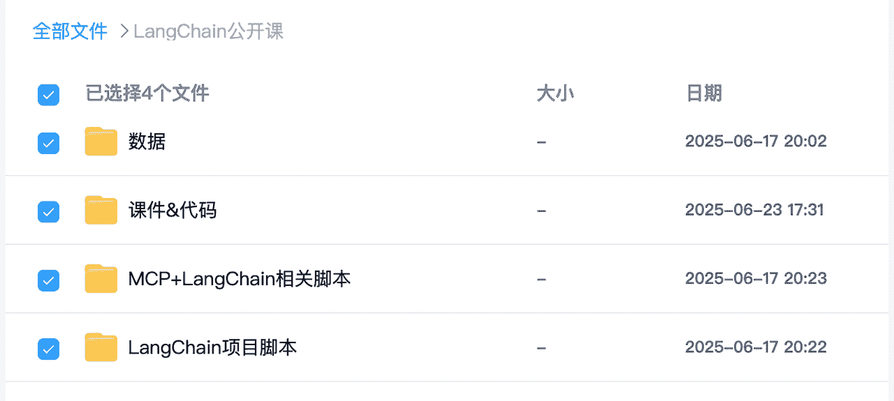
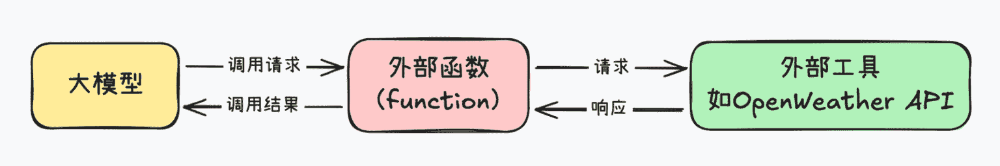
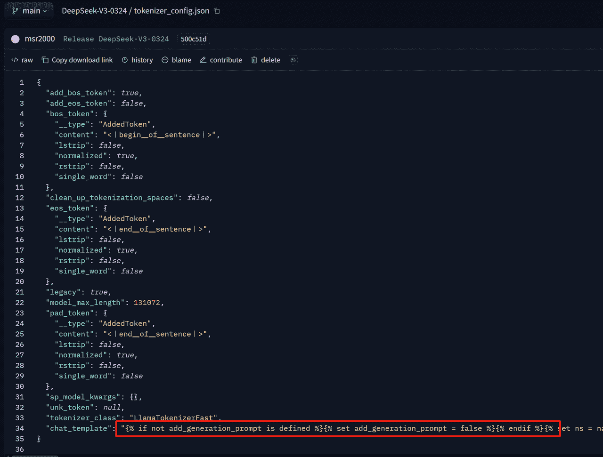
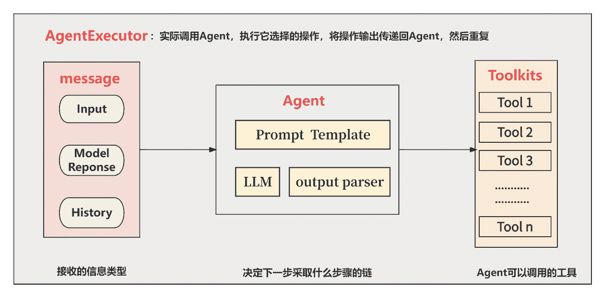
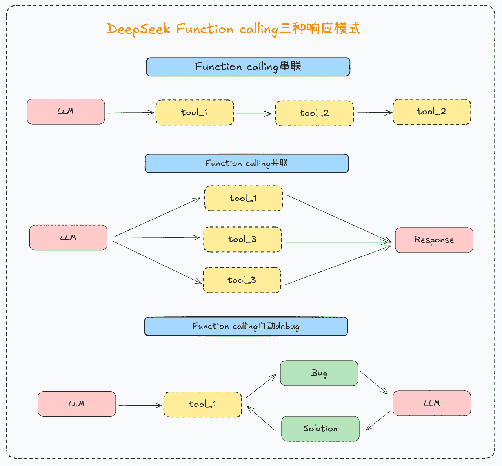
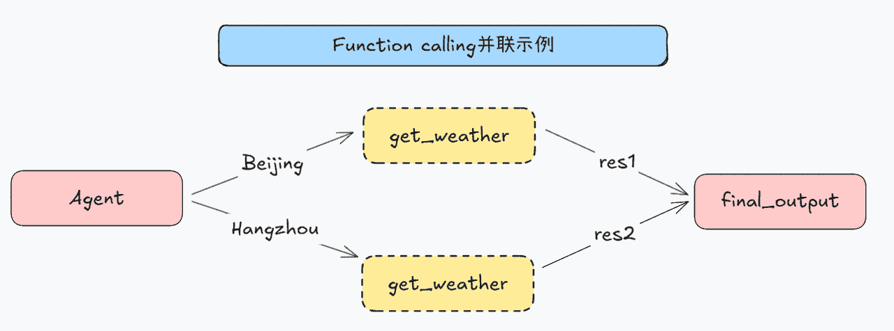
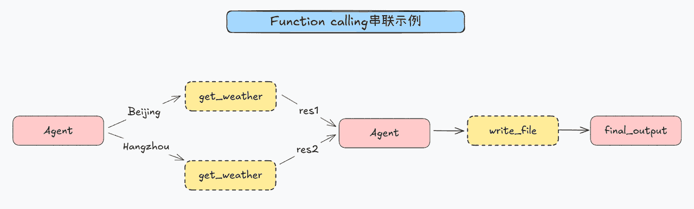
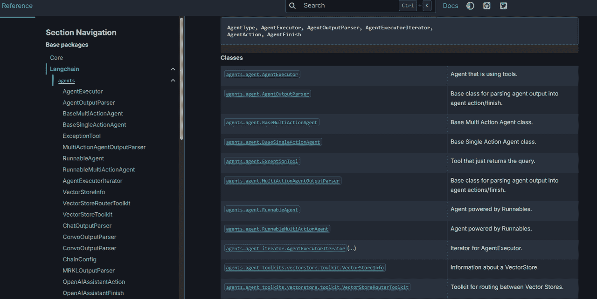
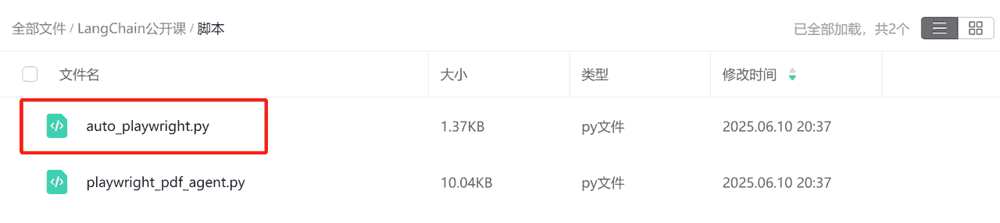
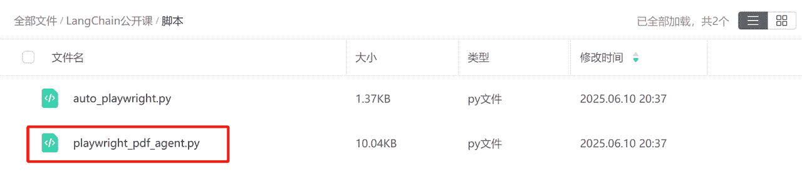

# LangChain快速入门与Agent开发实战3

> 来源：[https://kq4b3vgg5b.feishu.cn/docx/VdTwdJsSaoKTglx3DhJcQ7pLnec](https://kq4b3vgg5b.feishu.cn/docx/VdTwdJsSaoKTglx3DhJcQ7pLnec)

## 课程说明：

+   体验课内容节选自《2025大模型Agent智能体开发实战》(夏季班)完整版付费课程

体验课时间有限，若想深度学习大模型技术，欢迎大家报名由我主讲的《2025大模型Agent智能体开发实战》(夏季班)




公开课全套学习资料，已上传至网盘（链接: https://pan.baidu.com/s/1_TPoisye8HldxiIXiMxM8Q 提取码: khnp ）

需要更系统深入学习大模型可扫码⬆️添加助教咨询喔～

---

# 《大模型Agent智能体开发实战（夏季班）》体验课

# LangChain快速入门与Agent开发实战-Part 3

## 三、LangChain智能体开发实战

### 1. Function calling流程回顾

掌握了LangChain的基本使用方法后，我们需要进一步扩展langChain的进阶应用：Funcation Calling。

我们都知道，能调用外部工具，是大模型进化为智能体Agent的关键，如果不能使用外部工具，大模型就只能是个简单的聊天机器人，甚至连查询天气都做不到。由于底层技术限制啊，大模型本身是无法和外部工具直接通信的，因此Function calling的思路，就是创建一个外部函数（function）作为中介，一边传递大模型的请求，另一边调用外部工具，最终让大模型能够间接的调用外部工具。



例如，当我们要查询当前天气时，让大模型调用外部工具的function calling的过程就如图所示：


而完整的一次Function calling执行流程如下：


> 需要注意的是，对于大模型来说，Function calling的本质，是当模型在特殊情况下的一种特殊响应形式：



### 【选学】外部工具OpenWeather注册及API key获取方法

OpenWeather是一家提供全球范围内的气象数据服务的公司，该公司的服务包括实时天气信息、天气预报、历史天气数据以及各种气象相关的报告等，并且OpenWeather开放了一定使用限度内完全免费的API，即我们可以在代码环境中通过调用OpenWeather API来进行实时天气查询、天气预报等功能，这意味着开发者可以将OpenWeather的天气预报功能加入到他们自己的应用或网站中。

为了能够调用OpenWeather服务，和OpenAI的API使用过程类似，我们首先需要先注册OpenWeather账号，并获取OpenWeather API Key。这里需要注意的是，对于大多数在线服务的API来说，都需要通过API key来进行身份验证，尽管OpenWeather相对更加Open，有非常多的免费使用的次数，但身份验证仍然是必要的防止API被滥用的有效手段。OpenWeather API key获取流程如下：

+   Step 1.登录OpenWeather官网并点击Sign—>create account完成注册。该网站无需魔法即可直接登录，可以使用国内邮箱或者🐧邮箱均可进行注册，官网地址为：https://openweathermap.org/


+   Step 2.获取API-key：注册完成后，即可在API keys页面查看当前账户的API key：


一般来说完成注册后，就会有一个已经激活的API-key。和OpenAI一样，OpenWeather的API key也创建多个。

+   Step 3.将其设置为环境变量：和OpenAI API key类似，为了方便后续调用，我们也可以直接将OpenWeather API key设置为环境变量，变量名为OPENWEATHER_API_KEY。具体设置环境变量的方法参考Ch.1中OpenAI APkey设置环境变量流程，此处不再赘述。


设置完了环境变量之后，接下来即可按照如下方式创建OpenWeather API key变量：

```
open_weather_key = &quot;YOUR_KEY&quot;
```

接下来我们通过一个简单的示例，来介绍如何通过OpenWeather API获取实时天气信息：

```
import requests
import json
```

```
# Step 1.构建请求
url = &quot;https://api.openweathermap.org/data/2.5/weather&quot;

# Step 2.设置查询参数
params = {
    &quot;q&quot;: &quot;Beijing&quot;,               # 查询北京实时天气
    &quot;appid&quot;: open_weather_key,    # 输入API key
    &quot;units&quot;: &quot;metric&quot;,            # 使用摄氏度而不是华氏度
    &quot;lang&quot;:&quot;zh_cn&quot;                # 输出语言为简体中文
}

# Step 3.发送GET请求
response = requests.get(url, params=params)

# Step 4.解析响应
data = response.json()
```

这里需要注意的是，城市名必须输入英文名，否则无法正确识别。接下来查看返回结果。首先我们先查看response结果：

```
response
```

```
&lt;Response [200]&gt;
```

```
type(response)
```

```
requests.models.Response
```

在未解析之前，我们只能查看到基本请求结果状态，这里的200代表成功相应，即本次发送请求获得了对应的响应，且响应内容包含在response中。考虑到默认情况下返回结果是JSON格式，因此后续代码使用了response.json()对其进行解析。解析内容如下：

```
data
```

```
{&#x27;coord&#x27;: {&#x27;lon&#x27;: 116.3972, &#x27;lat&#x27;: 39.9075},
 &#x27;weather&#x27;: [{&#x27;id&#x27;: 804,
   &#x27;main&#x27;: &#x27;Clouds&#x27;,
   &#x27;description&#x27;: &#x27;阴，多云&#x27;,
   &#x27;icon&#x27;: &#x27;04d&#x27;}],
 &#x27;base&#x27;: &#x27;stations&#x27;,
 &#x27;main&#x27;: {&#x27;temp&#x27;: 4.94,
  &#x27;feels_like&#x27;: 1.77,
  &#x27;temp_min&#x27;: 4.94,
  &#x27;temp_max&#x27;: 4.94,
  &#x27;pressure&#x27;: 1020,
  &#x27;humidity&#x27;: 25,
  &#x27;sea_level&#x27;: 1020,
  &#x27;grnd_level&#x27;: 1014},
 &#x27;visibility&#x27;: 10000,
 &#x27;wind&#x27;: {&#x27;speed&#x27;: 4.03, &#x27;deg&#x27;: 300, &#x27;gust&#x27;: 9.43},
 &#x27;clouds&#x27;: {&#x27;all&#x27;: 85},
 &#x27;dt&#x27;: 1736239434,
 &#x27;sys&#x27;: {&#x27;type&#x27;: 1,
  &#x27;id&#x27;: 9609,
  &#x27;country&#x27;: &#x27;CN&#x27;,
  &#x27;sunrise&#x27;: 1736206561,
  &#x27;sunset&#x27;: 1736240684},
 &#x27;timezone&#x27;: 28800,
 &#x27;id&#x27;: 1816670,
 &#x27;name&#x27;: &#x27;Beijing&#x27;,
 &#x27;cod&#x27;: 200}
```

```
def get_weather(loc):
    &quot;&quot;&quot;
    查询即时天气函数
    :param loc: 必要参数，字符串类型，用于表示查询天气的具体城市名称，\
    注意，中国的城市需要用对应城市的英文名称代替，例如如果需要查询北京市天气，则loc参数需要输入&#x27;Beijing&#x27;；
    :return：OpenWeather API查询即时天气的结果，具体URL请求地址为：https://api.openweathermap.org/data/2.5/weather\
    返回结果对象类型为解析之后的JSON格式对象，并用字符串形式进行表示，其中包含了全部重要的天气信息
    &quot;&quot;&quot;
    # Step 1.构建请求
    url = &quot;https://api.openweathermap.org/data/2.5/weather&quot;

    # Step 2.设置查询参数
    params = {
        &quot;q&quot;: loc,               
        &quot;appid&quot;: open_weather_key,    # 输入API key
        &quot;units&quot;: &quot;metric&quot;,            # 使用摄氏度而不是华氏度
        &quot;lang&quot;:&quot;zh_cn&quot;                # 输出语言为简体中文
    }

    # Step 3.发送GET请求
    response = requests.get(url, params=params)
    
    # Step 4.解析响应
    data = response.json()
    return json.dumps(data)
```

### 2. LangChain 调用外部工具流程

大家可以理解到，如果我们手动实现一个Function calling，其实是非常复杂的。但在LangChain中则不需要那么麻烦，只需要几行代码就可以快速接入自定义的外部工具并实现准确的调用。其实现的过程在LangChain中就是一个组件链，由提示模版、大模型、外部工具和输出解析器组成，并利用大模型在循环中反复调用自身以实现复杂的Function calling流程。

这里我们以实时获取天气数据为例。在langChain中，如果想要把一个普通的函数，变成一个可以被大模型调用的工具，只需要将函数包装成一个Tool对象即可。代码如下：

```
import os
from dotenv import load_dotenv 
load_dotenv(override=True)

OPENWEATHER_API_KEY = os.getenv(&quot;OPENWEATHER_API_KEY&quot;)
# print(OPENWEATHER_API_KEY)  # 可以通过打印查看
```

```
import os
import requests
import json
from langchain_core.tools import tool

@tool
def get_weather(loc):
    &quot;&quot;&quot;
    查询即时天气函数
    :param loc: 必要参数，字符串类型，用于表示查询天气的具体城市名称，\
    注意，中国的城市需要用对应城市的英文名称代替，例如如果需要查询北京市天气，则loc参数需要输入&#x27;Beijing&#x27;；
    :return：OpenWeather API查询即时天气的结果，具体URL请求地址为：https://api.openweathermap.org/data/2.5/weather\
    返回结果对象类型为解析之后的JSON格式对象，并用字符串形式进行表示，其中包含了全部重要的天气信息
    &quot;&quot;&quot;
    # Step 1.构建请求
    url = &quot;https://api.openweathermap.org/data/2.5/weather&quot;

    # Step 2.设置查询参数
    params = {
        &quot;q&quot;: loc,               
        &quot;appid&quot;: OPENWEATHER_API_KEY,    # 输入API key
        &quot;units&quot;: &quot;metric&quot;,            # 使用摄氏度而不是华氏度
        &quot;lang&quot;:&quot;zh_cn&quot;                # 输出语言为简体中文
    }

    # Step 3.发送GET请求
    response = requests.get(url, params=params)
    
    # Step 4.解析响应
    data = response.json()
    return json.dumps(data)
```

依然使用DeepSeek模型，如下代码所示：

```
from langchain.chat_models import init_chat_model

# 初始化模型
model = init_chat_model(&quot;deepseek-chat&quot;, model_provider=&quot;deepseek&quot;)
```

接下来，如果想让大模型调用某一个外部工具，需要使用bind_tools方法，将工具绑定到模型上。代码如下：

```
# 定义 天气查询 工具函数
tools = [get_weather]

# 将工具绑定到模型
llm_with_tools = model.bind_tools(tools)
```

接下来，便可以通过新的llm_with_tools模型通过invoke方法来调用模型。代码如下：

```
response = llm_with_tools.invoke(&quot;你好， 请问北京的天气怎么样？&quot;)

print(response)
```

```
content=&#x27;&#x27; additional_kwargs={&#x27;tool_calls&#x27;: [{&#x27;id&#x27;: &#x27;call_0_95fe2256-03fa-4785-817d-a1cd095a94bd&#x27;, &#x27;function&#x27;: {&#x27;arguments&#x27;: &#x27;{&quot;loc&quot;:&quot;Beijing&quot;}&#x27;, &#x27;name&#x27;: &#x27;get_weather&#x27;}, &#x27;type&#x27;: &#x27;function&#x27;, &#x27;index&#x27;: 0}], &#x27;refusal&#x27;: None} response_metadata={&#x27;token_usage&#x27;: {&#x27;completion_tokens&#x27;: 19, &#x27;prompt_tokens&#x27;: 203, &#x27;total_tokens&#x27;: 222, &#x27;completion_tokens_details&#x27;: None, &#x27;prompt_tokens_details&#x27;: {&#x27;audio_tokens&#x27;: None, &#x27;cached_tokens&#x27;: 192}, &#x27;prompt_cache_hit_tokens&#x27;: 192, &#x27;prompt_cache_miss_tokens&#x27;: 11}, &#x27;model_name&#x27;: &#x27;deepseek-chat&#x27;, &#x27;system_fingerprint&#x27;: &#x27;fp_8802369eaa_prod0425fp8&#x27;, &#x27;id&#x27;: &#x27;2faff46e-656f-4fdb-9e77-282a54112dc9&#x27;, &#x27;service_tier&#x27;: None, &#x27;finish_reason&#x27;: &#x27;tool_calls&#x27;, &#x27;logprobs&#x27;: None} id=&#x27;run--31deb275-2d5e-4427-b332-f174f3bbb7de-0&#x27; tool_calls=[{&#x27;name&#x27;: &#x27;get_weather&#x27;, &#x27;args&#x27;: {&#x27;loc&#x27;: &#x27;Beijing&#x27;}, &#x27;id&#x27;: &#x27;call_0_95fe2256-03fa-4785-817d-a1cd095a94bd&#x27;, &#x27;type&#x27;: &#x27;tool_call&#x27;}] usage_metadata={&#x27;input_tokens&#x27;: 203, &#x27;output_tokens&#x27;: 19, &#x27;total_tokens&#x27;: 222, &#x27;input_token_details&#x27;: {&#x27;cache_read&#x27;: 192}, &#x27;output_token_details&#x27;: {}}
```

这会产生一个包含tool_calls 的模型响应，打印如下：

```
response.additional_kwargs
```

```
{&#x27;tool_calls&#x27;: [{&#x27;id&#x27;: &#x27;call_0_95fe2256-03fa-4785-817d-a1cd095a94bd&#x27;,
   &#x27;function&#x27;: {&#x27;arguments&#x27;: &#x27;{&quot;loc&quot;:&quot;Beijing&quot;}&#x27;, &#x27;name&#x27;: &#x27;get_weather&#x27;},
   &#x27;type&#x27;: &#x27;function&#x27;,
   &#x27;index&#x27;: 0}],
 &#x27;refusal&#x27;: None}
```

我们需要调用ToolsAgentOutputParser输出解析器来处理模型响应。

```
from langchain.agents.output_parsers.tools import ToolsAgentOutputParser

# 解析模型响应
agentAction = ToolsAgentOutputParser().invoke(response)

print(agentAction)
```

```
[ToolAgentAction(tool=&#x27;get_weather&#x27;, tool_input={&#x27;loc&#x27;: &#x27;Beijing&#x27;}, log=&quot;\nInvoking: `get_weather` with `{&#x27;loc&#x27;: &#x27;Beijing&#x27;}`\n\n\n&quot;, message_log=[AIMessage(content=&#x27;&#x27;, additional_kwargs={&#x27;tool_calls&#x27;: [{&#x27;id&#x27;: &#x27;call_0_95fe2256-03fa-4785-817d-a1cd095a94bd&#x27;, &#x27;function&#x27;: {&#x27;arguments&#x27;: &#x27;{&quot;loc&quot;:&quot;Beijing&quot;}&#x27;, &#x27;name&#x27;: &#x27;get_weather&#x27;}, &#x27;type&#x27;: &#x27;function&#x27;, &#x27;index&#x27;: 0}], &#x27;refusal&#x27;: None}, response_metadata={&#x27;token_usage&#x27;: {&#x27;completion_tokens&#x27;: 19, &#x27;prompt_tokens&#x27;: 203, &#x27;total_tokens&#x27;: 222, &#x27;completion_tokens_details&#x27;: None, &#x27;prompt_tokens_details&#x27;: {&#x27;audio_tokens&#x27;: None, &#x27;cached_tokens&#x27;: 192}, &#x27;prompt_cache_hit_tokens&#x27;: 192, &#x27;prompt_cache_miss_tokens&#x27;: 11}, &#x27;model_name&#x27;: &#x27;deepseek-chat&#x27;, &#x27;system_fingerprint&#x27;: &#x27;fp_8802369eaa_prod0425fp8&#x27;, &#x27;id&#x27;: &#x27;2faff46e-656f-4fdb-9e77-282a54112dc9&#x27;, &#x27;service_tier&#x27;: None, &#x27;finish_reason&#x27;: &#x27;tool_calls&#x27;, &#x27;logprobs&#x27;: None}, id=&#x27;run--31deb275-2d5e-4427-b332-f174f3bbb7de-0&#x27;, tool_calls=[{&#x27;name&#x27;: &#x27;get_weather&#x27;, &#x27;args&#x27;: {&#x27;loc&#x27;: &#x27;Beijing&#x27;}, &#x27;id&#x27;: &#x27;call_0_95fe2256-03fa-4785-817d-a1cd095a94bd&#x27;, &#x27;type&#x27;: &#x27;tool_call&#x27;}], usage_metadata={&#x27;input_tokens&#x27;: 203, &#x27;output_tokens&#x27;: 19, &#x27;total_tokens&#x27;: 222, &#x27;input_token_details&#x27;: {&#x27;cache_read&#x27;: 192}, &#x27;output_token_details&#x27;: {}})], tool_call_id=&#x27;call_0_95fe2256-03fa-4785-817d-a1cd095a94bd&#x27;)]
```

从结果上我们看到它返回一个 ToolAgentAction，这些操作由AgentExecuter执行（LangChain构建Agent的底层逻辑就是AgentExecutor），并且列表中的每个操作都会返回一个字符串输出。

我们可以从ToolAgentAction中获取工具调用，并手动执行工具调用以获取工具调用的结果。代码如下：

```
# 获取工具调用
for tool_call in response.tool_calls:
    selected_tool = {&quot;get_weather&quot;: get_weather}[tool_call[&quot;name&quot;].lower()]
    tool_output = selected_tool.invoke(tool_call[&quot;args&quot;])
print(tool_output)
```

```
{&quot;coord&quot;: {&quot;lon&quot;: 116.3972, &quot;lat&quot;: 39.9075}, &quot;weather&quot;: [{&quot;id&quot;: 800, &quot;main&quot;: &quot;Clear&quot;, &quot;description&quot;: &quot;\u6674&quot;, &quot;icon&quot;: &quot;01d&quot;}], &quot;base&quot;: &quot;stations&quot;, &quot;main&quot;: {&quot;temp&quot;: 25.94, &quot;feels_like&quot;: 25.53, &quot;temp_min&quot;: 25.94, &quot;temp_max&quot;: 25.94, &quot;pressure&quot;: 1001, &quot;humidity&quot;: 36, &quot;sea_level&quot;: 1001, &quot;grnd_level&quot;: 996}, &quot;visibility&quot;: 10000, &quot;wind&quot;: {&quot;speed&quot;: 9.59, &quot;deg&quot;: 343, &quot;gust&quot;: 12.9}, &quot;clouds&quot;: {&quot;all&quot;: 0}, &quot;dt&quot;: 1749455708, &quot;sys&quot;: {&quot;type&quot;: 1, &quot;id&quot;: 9609, &quot;country&quot;: &quot;CN&quot;, &quot;sunrise&quot;: 1749415551, &quot;sunset&quot;: 1749469297}, &quot;timezone&quot;: 28800, &quot;id&quot;: 1816670, &quot;name&quot;: &quot;Beijing&quot;, &quot;cod&quot;: 200}
```

最后，使用LangChain中的format_to_tool_messages函数，将工具调用转换为工具消息。代码如下：

```
from langchain.agents.format_scratchpad.tools import format_to_tool_messages

format_to_tool_messages(intermediate_steps = [(agentAction[0], tool_output)])
```

```
[AIMessage(content=&#x27;&#x27;, additional_kwargs={&#x27;tool_calls&#x27;: [{&#x27;id&#x27;: &#x27;call_0_95fe2256-03fa-4785-817d-a1cd095a94bd&#x27;, &#x27;function&#x27;: {&#x27;arguments&#x27;: &#x27;{&quot;loc&quot;:&quot;Beijing&quot;}&#x27;, &#x27;name&#x27;: &#x27;get_weather&#x27;}, &#x27;type&#x27;: &#x27;function&#x27;, &#x27;index&#x27;: 0}], &#x27;refusal&#x27;: None}, response_metadata={&#x27;token_usage&#x27;: {&#x27;completion_tokens&#x27;: 19, &#x27;prompt_tokens&#x27;: 203, &#x27;total_tokens&#x27;: 222, &#x27;completion_tokens_details&#x27;: None, &#x27;prompt_tokens_details&#x27;: {&#x27;audio_tokens&#x27;: None, &#x27;cached_tokens&#x27;: 192}, &#x27;prompt_cache_hit_tokens&#x27;: 192, &#x27;prompt_cache_miss_tokens&#x27;: 11}, &#x27;model_name&#x27;: &#x27;deepseek-chat&#x27;, &#x27;system_fingerprint&#x27;: &#x27;fp_8802369eaa_prod0425fp8&#x27;, &#x27;id&#x27;: &#x27;2faff46e-656f-4fdb-9e77-282a54112dc9&#x27;, &#x27;service_tier&#x27;: None, &#x27;finish_reason&#x27;: &#x27;tool_calls&#x27;, &#x27;logprobs&#x27;: None}, id=&#x27;run--31deb275-2d5e-4427-b332-f174f3bbb7de-0&#x27;, tool_calls=[{&#x27;name&#x27;: &#x27;get_weather&#x27;, &#x27;args&#x27;: {&#x27;loc&#x27;: &#x27;Beijing&#x27;}, &#x27;id&#x27;: &#x27;call_0_95fe2256-03fa-4785-817d-a1cd095a94bd&#x27;, &#x27;type&#x27;: &#x27;tool_call&#x27;}], usage_metadata={&#x27;input_tokens&#x27;: 203, &#x27;output_tokens&#x27;: 19, &#x27;total_tokens&#x27;: 222, &#x27;input_token_details&#x27;: {&#x27;cache_read&#x27;: 192}, &#x27;output_token_details&#x27;: {}}),
 ToolMessage(content=&#x27;{&quot;coord&quot;: {&quot;lon&quot;: 116.3972, &quot;lat&quot;: 39.9075}, &quot;weather&quot;: [{&quot;id&quot;: 800, &quot;main&quot;: &quot;Clear&quot;, &quot;description&quot;: &quot;\\u6674&quot;, &quot;icon&quot;: &quot;01d&quot;}], &quot;base&quot;: &quot;stations&quot;, &quot;main&quot;: {&quot;temp&quot;: 25.94, &quot;feels_like&quot;: 25.53, &quot;temp_min&quot;: 25.94, &quot;temp_max&quot;: 25.94, &quot;pressure&quot;: 1001, &quot;humidity&quot;: 36, &quot;sea_level&quot;: 1001, &quot;grnd_level&quot;: 996}, &quot;visibility&quot;: 10000, &quot;wind&quot;: {&quot;speed&quot;: 9.59, &quot;deg&quot;: 343, &quot;gust&quot;: 12.9}, &quot;clouds&quot;: {&quot;all&quot;: 0}, &quot;dt&quot;: 1749455708, &quot;sys&quot;: {&quot;type&quot;: 1, &quot;id&quot;: 9609, &quot;country&quot;: &quot;CN&quot;, &quot;sunrise&quot;: 1749415551, &quot;sunset&quot;: 1749469297}, &quot;timezone&quot;: 28800, &quot;id&quot;: 1816670, &quot;name&quot;: &quot;Beijing&quot;, &quot;cod&quot;: 200}&#x27;, tool_call_id=&#x27;call_0_95fe2256-03fa-4785-817d-a1cd095a94bd&#x27;)]
```

这个过程会返回一个ToolMessage以添加到提示中并用于调用模型生成最终的回复。其完整流程其实是这样的：

```
    agent = (
            RunnablePassthrough.assign(
                agent_scratchpad=lambda x: format_to_tool_messages(x[&quot;intermediate_steps&quot;])
            )
            | prompt
            | llm_with_tools
            | ToolsAgentOutputParser()
        )
```

代理是链（Runnable 序列），它循环运行并调用自身，直到达到最终的目标，或者出现异常才会终止。

+   llm_with_tools：当接收到用户的输入时，大模型可以决定使用工具并返回tool_call；

+   ToolsAgentOutputParser：将这些返回解析为要执行的toolAgentAction;

+   该工具执行后，输出（agent_scratch_pad）, 使用format_to_tool_messages进行处理，以产生一条可再次用于提示chat_history的消息;

+   当大模型不再执行任何工具调用并返回最终输出时，循环结束。

代理是链（Runnable 序列），它循环运行并调用自身，直到达到最终的目标，或者出现异常才会终止。

当然，上述流程是为了帮助大家理解LangChain中代理的实现方式，在实际使用中，我们其实可以直接使用create_tool_calling_agent来快速构建工具调用代理。代码如下：

```
from langchain.agents import create_tool_calling_agent, tool
from langchain_core.prompts import ChatPromptTemplate

#定义工具
tools = [get_weather]

# 构建提示模版
prompt = ChatPromptTemplate.from_messages(
    [
        (&quot;system&quot;, &quot;你是天气助手，请根据用户的问题，给出相应的天气信息&quot;),
        (&quot;human&quot;, &quot;{input}&quot;),
        (&quot;placeholder&quot;, &quot;{agent_scratchpad}&quot;),
    ]
)

# 初始化模型
model = init_chat_model(&quot;deepseek-chat&quot;, model_provider=&quot;deepseek&quot;)

# 直接使用`create_tool_calling_agent`创建代理
agent = create_tool_calling_agent(model, tools, prompt)
```

使用AgentExecutor来执行代理。代码如下：

```
from langchain.agents import AgentExecutor
agent_executor = AgentExecutor(agent=agent, tools=tools, verbose=True)


response = agent_executor.invoke({&quot;input&quot;: &quot;请问今天北京的天气怎么样？&quot;})
print(response)
```

```
&gt; Entering new AgentExecutor chain...

Invoking: `get_weather` with `{&#x27;loc&#x27;: &#x27;Beijing&#x27;}`


{&quot;coord&quot;: {&quot;lon&quot;: 116.3972, &quot;lat&quot;: 39.9075}, &quot;weather&quot;: [{&quot;id&quot;: 800, &quot;main&quot;: &quot;Clear&quot;, &quot;description&quot;: &quot;\u6674&quot;, &quot;icon&quot;: &quot;01d&quot;}], &quot;base&quot;: &quot;stations&quot;, &quot;main&quot;: {&quot;temp&quot;: 25.94, &quot;feels_like&quot;: 25.74, &quot;temp_min&quot;: 25.94, &quot;temp_max&quot;: 25.94, &quot;pressure&quot;: 1001, &quot;humidity&quot;: 44, &quot;sea_level&quot;: 1001, &quot;grnd_level&quot;: 996}, &quot;visibility&quot;: 10000, &quot;wind&quot;: {&quot;speed&quot;: 9.59, &quot;deg&quot;: 343, &quot;gust&quot;: 12.9}, &quot;clouds&quot;: {&quot;all&quot;: 0}, &quot;dt&quot;: 1749456143, &quot;sys&quot;: {&quot;type&quot;: 1, &quot;id&quot;: 9609, &quot;country&quot;: &quot;CN&quot;, &quot;sunrise&quot;: 1749415551, &quot;sunset&quot;: 1749469297}, &quot;timezone&quot;: 28800, &quot;id&quot;: 1816670, &quot;name&quot;: &quot;Beijing&quot;, &quot;cod&quot;: 200}今天北京的天气晴朗，气温为25.94°C，体感温度约为25.74°C。湿度为44%，风速为9.59米/秒，风向为343度（西北风）。能见度良好，达到10000米。气压为1001 hPa。总体来说，今天是一个适合户外活动的好天气！

&gt; Finished chain.
{&#x27;input&#x27;: &#x27;请问今天北京的天气怎么样？&#x27;, &#x27;output&#x27;: &#x27;今天北京的天气晴朗，气温为25.94°C，体感温度约为25.74°C。湿度为44%，风速为9.59米/秒，风向为343度（西北风）。能见度良好，达到10000米。气压为1001 hPa。总体来说，今天是一个适合户外活动的好天气！&#x27;}
```

```
print(response[&quot;output&quot;])
```

```
今天北京的天气晴朗，气温为25.94°C，体感温度约为25.74°C。湿度为44%，风速为9.59米/秒，风向为343度（西北风）。能见度良好，达到10000米。气压为1001 hPa。总体来说，今天是一个适合户外活动的好天气！
```

## 3. LangChain Agents 运行流程

LangChain 中Agents模块的整体架构设计。如下所示：



在Agents的内部结构。每个Agent组件一般会由语言模型 + 提示 + 输出解析器构成，它会作为Agents的大脑去处理用户的输入。Agent能够处理的输入主要来源于三个方面：input代表用户的原始输入，Model Response指的是模型对某一个子任务的响应输出，而History则能携带上下文的信息。其输出部分，则链接到实际的工具库，需要调用哪些工具，将由经过Agent模块后拆分的子任务来决定。

而我们知道，大模型调用外部函数会分为两个过程：识别工具和实际执行。在Message -> Agent -> Toolkits 这个流程中，负责的是将子任务拆解，然后根据这些子任务在工具库中找到相应的工具，提取工具名称及所需参数，这个过程可以视作一种“静态”的执行流程。而将这些决策转化为实际行动的工作，则会交给AgentExecutor。

所以综上需要理解的是：在LangChain的Agents实际架构中，Agent的角色是接收输入并决定采取的操作，但它本身并不直接执行这些操作。这一任务是由AgentExecutor来完成的。将Agent（决策大脑）与AgentExecutor（执行操作的Runtime）结合使用，才构成了完整的Agents（智能体），其中AgentExecutor负责调用代理并执行指定的工具，以此来实现整个智能体的功能。

这也就是为什么create_tool_calling_agent需要通过AgentExecutor才能够实际运行的原因。当然，在这种模式下，AgentExecutor的内部已经自动处理好了关于我们工具调用的所有逻辑，其中包含串行和并行工具调用的两种常用模式。



#### 3.1 多工具并联调用

在大模型中，并行工具调用指的是在大模型调用外部工具时，可以在单次交互过程中可以同时调用多个工具，并行执行以解决用户的问题。如下图所示：


而在create_tool_calling_agent中，已经自动处理了并行工具调用的处理逻辑，并不需要我们在手动处理，比如接下来测试一些复杂的问题：

```
from langchain.agents import create_tool_calling_agent, tool
from langchain_core.prompts import ChatPromptTemplate

#定义工具
tools = [get_weather]

# 构建提示模版
prompt = ChatPromptTemplate.from_messages(
    [
        (&quot;system&quot;, &quot;你是天气助手，请根据用户的问题，给出相应的天气信息&quot;),
        (&quot;human&quot;, &quot;{input}&quot;),
        (&quot;placeholder&quot;, &quot;{agent_scratchpad}&quot;),
    ]
)

# 初始化模型
model = init_chat_model(&quot;deepseek-chat&quot;, model_provider=&quot;deepseek&quot;)

# 直接使用`create_tool_calling_agent`创建代理
agent = create_tool_calling_agent(model, tools, prompt)
```

这里我们在提出的问题中，尝试让大模型同时查询北京和上海两个城市的天气并汇总结果。

```
from langchain.agents import AgentExecutor
agent_executor = AgentExecutor(agent=agent, tools=tools, verbose=True)


response = agent_executor.invoke({&quot;input&quot;: &quot;请问今天北京和杭州的天气怎么样，哪个城市更热？&quot;})
print(response)
```

```
&gt; Entering new AgentExecutor chain...

Invoking: `get_weather` with `{&#x27;loc&#x27;: &#x27;Beijing&#x27;}`


{&quot;coord&quot;: {&quot;lon&quot;: 116.3972, &quot;lat&quot;: 39.9075}, &quot;weather&quot;: [{&quot;id&quot;: 800, &quot;main&quot;: &quot;Clear&quot;, &quot;description&quot;: &quot;\u6674&quot;, &quot;icon&quot;: &quot;01d&quot;}], &quot;base&quot;: &quot;stations&quot;, &quot;main&quot;: {&quot;temp&quot;: 23.94, &quot;feels_like&quot;: 23.54, &quot;temp_min&quot;: 23.94, &quot;temp_max&quot;: 23.94, &quot;pressure&quot;: 1001, &quot;humidity&quot;: 44, &quot;sea_level&quot;: 1001, &quot;grnd_level&quot;: 996}, &quot;visibility&quot;: 10000, &quot;wind&quot;: {&quot;speed&quot;: 9.59, &quot;deg&quot;: 343, &quot;gust&quot;: 12.9}, &quot;clouds&quot;: {&quot;all&quot;: 0}, &quot;dt&quot;: 1749457700, &quot;sys&quot;: {&quot;type&quot;: 1, &quot;id&quot;: 9609, &quot;country&quot;: &quot;CN&quot;, &quot;sunrise&quot;: 1749415551, &quot;sunset&quot;: 1749469297}, &quot;timezone&quot;: 28800, &quot;id&quot;: 1816670, &quot;name&quot;: &quot;Beijing&quot;, &quot;cod&quot;: 200}
Invoking: `get_weather` with `{&#x27;loc&#x27;: &#x27;Hangzhou&#x27;}`


{&quot;coord&quot;: {&quot;lon&quot;: 120.1614, &quot;lat&quot;: 30.2937}, &quot;weather&quot;: [{&quot;id&quot;: 500, &quot;main&quot;: &quot;Rain&quot;, &quot;description&quot;: &quot;\u5c0f\u96e8&quot;, &quot;icon&quot;: &quot;10d&quot;}], &quot;base&quot;: &quot;stations&quot;, &quot;main&quot;: {&quot;temp&quot;: 23.95, &quot;feels_like&quot;: 24.83, &quot;temp_min&quot;: 23.95, &quot;temp_max&quot;: 23.95, &quot;pressure&quot;: 1005, &quot;humidity&quot;: 93, &quot;sea_level&quot;: 1005, &quot;grnd_level&quot;: 1002}, &quot;visibility&quot;: 10000, &quot;wind&quot;: {&quot;speed&quot;: 0.54, &quot;deg&quot;: 101, &quot;gust&quot;: 0.69}, &quot;rain&quot;: {&quot;1h&quot;: 0.75}, &quot;clouds&quot;: {&quot;all&quot;: 100}, &quot;dt&quot;: 1749457874, &quot;sys&quot;: {&quot;type&quot;: 1, &quot;id&quot;: 9651, &quot;country&quot;: &quot;CN&quot;, &quot;sunrise&quot;: 1749416229, &quot;sunset&quot;: 1749466812}, &quot;timezone&quot;: 28800, &quot;id&quot;: 1808926, &quot;name&quot;: &quot;Hangzhou&quot;, &quot;cod&quot;: 200}今天北京的天气晴朗，温度为23.94°C，体感温度为23.54°C，湿度为44%，风速较大，为9.59 m/s。

杭州今天有小雨，温度为23.95°C，体感温度为24.83°C，湿度较高，为93%，风速较低，为0.54 m/s。

从温度来看，两地的气温几乎相同，但杭州的体感温度稍高一些，且湿度较大，可能会感觉更闷热。而北京虽然风速较大，但湿度较低，感觉会更舒适一些。

&gt; Finished chain.
{&#x27;input&#x27;: &#x27;请问今天北京和杭州的天气怎么样，哪个城市更热？&#x27;, &#x27;output&#x27;: &#x27;今天北京的天气晴朗，温度为23.94°C，体感温度为23.54°C，湿度为44%，风速较大，为9.59 m/s。\n\n杭州今天有小雨，温度为23.95°C，体感温度为24.83°C，湿度较高，为93%，风速较低，为0.54 m/s。\n\n从温度来看，两地的气温几乎相同，但杭州的体感温度稍高一些，且湿度较大，可能会感觉更闷热。而北京虽然风速较大，但湿度较低，感觉会更舒适一些。&#x27;}
```

从这个过程中可以明显的看出，一次性发起了同一个外部函数的两次调用请求，并依次获得了北京和杭州两个城市的天气。这就是一次标准的parallel_function_call。



#### 3.2 多工具串联调用

接下来继续尝试进行多工具串联调用测试：


此时我们再定义一个write_file函数，用于将“文本写入本地”：

```
@tool
def write_file(content):
    &quot;&quot;&quot;
    将指定内容写入本地文件。
    :param content: 必要参数，字符串类型，用于表示需要写入文档的具体内容。
    :return：是否成功写入
    &quot;&quot;&quot;
    
    return &quot;已成功写入本地文件。&quot;
```

然后在tools列表中直接添加write_file工具，并修改提示模版，添加write_file工具的使用场景。代码如下所示：

```
from langchain.agents import AgentExecutor, create_tool_calling_agent, tool
from langchain_core.prompts import ChatPromptTemplate


tools = [get_weather, write_file]

prompt = ChatPromptTemplate.from_messages(
    [
        (&quot;system&quot;, &quot;你是天气助手，请根据用户的问题，给出相应的天气信息，如果用户需要将查询结果写入文件，请使用write_file工具&quot;),
        (&quot;human&quot;, &quot;{input}&quot;),
        (&quot;placeholder&quot;, &quot;{agent_scratchpad}&quot;),
    ]
)

# 初始化模型
model = init_chat_model(&quot;deepseek-chat&quot;, model_provider=&quot;deepseek&quot;)

agent = create_tool_calling_agent(model, tools, prompt)
```

接下来尝试运行：

```
agent_executor = AgentExecutor(agent=agent, tools=tools, verbose=True)


agent_executor.invoke({&quot;input&quot;: &quot;查一下北京和杭州现在的温度，并将结果写入本地的文件中。&quot;})
```

```
&gt; Entering new AgentExecutor chain...

Invoking: `get_weather` with `{&#x27;loc&#x27;: &#x27;Beijing&#x27;}`



```

通过中间过程信息的打印，我们能够看到在一次交互过程中依次调用的get_weather查询到北京和杭州的天气，然后又将结果写入到本地的文件中。这就是一个非常典型的串行工具调用的流程，如下图所示：



### 4. 实战：多智能体协作实现浏览器自动化

正如上述我们使用的create_tool_calling_agent方法，它其实在langChain中是一个通用的用来构建工具代理的方法，除此以外，langChain还封装了非常多种不同的Agent实现形式，大家可以在这个链接中查看到所有LangChain中已经集成的Agent实现形式：



每一个Agent的实现都对应着不同的应用场景，而Agent的实现方式也多种多样，比较常用的Agent类型如下表所示：

推荐的Agent创建函数

| 函数名 | 功能描述 | 适用场景 |
| --- | --- | --- |
| create_tool_calling_agent | 创建使用工具的Agent | 通用工具调用 |
| create_openai_tools_agent | 创建OpenAI工具Agent | OpenAI模型专用 |
| create_openai_functions_agent | 创建OpenAI函数Agent | OpenAI函数调用 |
| create_react_agent | 创建ReAct推理Agent | 推理+行动模式 |
| create_structured_chat_agent | 创建结构化聊天Agent | 多输入工具支持 |
| **create_conversati**onal_retrieval_agent | 创建对话检索Agent | 检索增强对话 |
| create_json_chat_agent | 创建JSON聊天Agent | JSON格式交互 |
| create_xml_agent | 创建XML格式Agent | XML逻辑格式 |
| create_self_ask_with_search_agent | 创建自问自答搜索Agent | 自主搜索推理 |

其中比较通用场景的就是我们刚刚使用的create_tool_calling_agent，而对于一些符合OpenAI API RESTFUL API的模型，则同样可以使用create_openai_tools_agent，另外像create_react_agent可以用于一些推理任务，create_conversational_retrieval_agent则可以用于一些对话系统，具体还是需要根据实际需求来选择。

目前来说，在大模型应用开发领域有非常多的需求场景，其中一个比较热门的就是浏览器自动化，通过自动化提取网页内容，然后进行分析，最后生成报告。这样的流程提升效率和收集信息的有效途径。因此接下来，我们就尝试使用尝试使用create_openai_tools_agent来实际开发一个浏览器自动化代理。

首先，执行浏览器自动化代理需要安装一系列的第三方依赖包，如下所示：

```
! pip install playwright lxml langchain_community beautifulsoup4 reportlab
```

```
Requirement already satisfied: playwright in e:\01_木羽研发\11_trafficvideo\langchain_venv\lib\site-packages (1.52.0)
Requirement already satisfied: lxml in e:\01_木羽研发\11_trafficvideo\langchain_venv\lib\site-packages (5.4.0)
Requirement already satisfied: langchain_community in e:\01_木羽研发\11_trafficvideo\langchain_venv\lib\site-packages (0.3.24)
Requirement already satisfied: beautifulsoup4 in e:\01_木羽研发\11_trafficvideo\langchain_venv\lib\site-packages (4.13.4)
Requirement already satisfied: pyee&lt;14,&gt;=13 in e:\01_木羽研发\11_trafficvideo\langchain_venv\lib\site-packages (from playwright) (13.0.0)
Requirement already satisfied: greenlet&lt;4.0.0,&gt;=3.1.1 in e:\01_木羽研发\11_trafficvideo\langchain_venv\lib\site-packages (from playwright) (3.2.3)
Requirement already satisfied: typing-extensions in e:\01_木羽研发\11_trafficvideo\langchain_venv\lib\site-packages (from pyee&lt;14,&gt;=13-&gt;playwright) (4.14.0)
Requirement already satisfied: langchain-core&lt;1.0.0,&gt;=0.3.59 in e:\01_木羽研发\11_trafficvideo\langchain_venv\lib\site-packages (from langchain_community) (0.3.64)
Requirement already satisfied: langchain&lt;1.0.0,&gt;=0.3.25 in e:\01_木羽研发\11_trafficvideo\langchain_venv\lib\site-packages (from langchain_community) (0.3.25)
Requirement already satisfied: SQLAlchemy&lt;3,&gt;=1.4 in e:\01_木羽研发\11_trafficvideo\langchain_venv\lib\site-packages (from langchain_community) (2.0.41)
Requirement already satisfied: requests&lt;3,&gt;=2 in e:\01_木羽研发\11_trafficvideo\langchain_venv\lib\site-packages (from langchain_community) (2.32.3)
Requirement already satisfied: PyYAML&gt;=5.3 in e:\01_木羽研发\11_trafficvideo\langchain_venv\lib\site-packages (from langchain_community) (6.0.2)
Requirement already satisfied: aiohttp&lt;4.0.0,&gt;=3.8.3 in e:\01_木羽研发\11_trafficvideo\langchain_venv\lib\site-packages (from langchain_community) (3.12.11)
Requirement already satisfied: tenacity!=8.4.0,&lt;10,&gt;=8.1.0 in e:\01_木羽研发\11_trafficvideo\langchain_venv\lib\site-packages (from langchain_community) (9.1.2)
Requirement already satisfied: dataclasses-json&lt;0.7,&gt;=0.5.7 in e:\01_木羽研发\11_trafficvideo\langchain_venv\lib\site-packages (from langchain_community) (0.6.7)
Requirement already satisfied: pydantic-settings&lt;3.0.0,&gt;=2.4.0 in e:\01_木羽研发\11_trafficvideo\langchain_venv\lib\site-packages (from langchain_community) (2.9.1)
Requirement already satisfied: langsmith&lt;0.4,&gt;=0.1.125 in e:\01_木羽研发\11_trafficvideo\langchain_venv\lib\site-packages (from langchain_community) (0.3.45)
Requirement already satisfied: httpx-sse&lt;1.0.0,&gt;=0.4.0 in e:\01_木羽研发\11_trafficvideo\langchain_venv\lib\site-packages (from langchain_community) (0.4.0)
Requirement already satisfied: numpy&gt;=1.26.2 in e:\01_木羽研发\11_trafficvideo\langchain_venv\lib\site-packages (from langchain_community) (2.3.0)
Requirement already satisfied: aiohappyeyeballs&gt;=2.5.0 in e:\01_木羽研发\11_trafficvideo\langchain_venv\lib\site-packages (from aiohttp&lt;4.0.0,&gt;=3.8.3-&gt;langchain_community) (2.6.1)
Requirement already satisfied: aiosignal&gt;=1.1.2 in e:\01_木羽研发\11_trafficvideo\langchain_venv\lib\site-packages (from aiohttp&lt;4.0.0,&gt;=3.8.3-&gt;langchain_community) (1.3.2)
Requirement already satisfied: attrs&gt;=17.3.0 in e:\01_木羽研发\11_trafficvideo\langchain_venv\lib\site-packages (from aiohttp&lt;4.0.0,&gt;=3.8.3-&gt;langchain_community) (25.3.0)
Requirement already satisfied: frozenlist&gt;=1.1.1 in e:\01_木羽研发\11_trafficvideo\langchain_venv\lib\site-packages (from aiohttp&lt;4.0.0,&gt;=3.8.3-&gt;langchain_community) (1.6.2)
Requirement already satisfied: multidict&lt;7.0,&gt;=4.5 in e:\01_木羽研发\11_trafficvideo\langchain_venv\lib\site-packages (from aiohttp&lt;4.0.0,&gt;=3.8.3-&gt;langchain_community) (6.4.4)
Requirement already satisfied: propcache&gt;=0.2.0 in e:\01_木羽研发\11_trafficvideo\langchain_venv\lib\site-packages (from aiohttp&lt;4.0.0,&gt;=3.8.3-&gt;langchain_community) (0.3.1)
Requirement already satisfied: yarl&lt;2.0,&gt;=1.17.0 in e:\01_木羽研发\11_trafficvideo\langchain_venv\lib\site-packages (from aiohttp&lt;4.0.0,&gt;=3.8.3-&gt;langchain_community) (1.20.0)
Requirement already satisfied: marshmallow&lt;4.0.0,&gt;=3.18.0 in e:\01_木羽研发\11_trafficvideo\langchain_venv\lib\site-packages (from dataclasses-json&lt;0.7,&gt;=0.5.7-&gt;langchain_community) (3.26.1)
Requirement already satisfied: typing-inspect&lt;1,&gt;=0.4.0 in e:\01_木羽研发\11_trafficvideo\langchain_venv\lib\site-packages (from dataclasses-json&lt;0.7,&gt;=0.5.7-&gt;langchain_community) (0.9.0)
Requirement already satisfied: langchain-text-splitters&lt;1.0.0,&gt;=0.3.8 in e:\01_木羽研发\11_trafficvideo\langchain_venv\lib\site-packages (from langchain&lt;1.0.0,&gt;=0.3.25-&gt;langchain_community) (0.3.8)
Requirement already satisfied: pydantic&lt;3.0.0,&gt;=2.7.4 in e:\01_木羽研发\11_trafficvideo\langchain_venv\lib\site-packages (from langchain&lt;1.0.0,&gt;=0.3.25-&gt;langchain_community) (2.11.5)
Requirement already satisfied: jsonpatch&lt;2.0,&gt;=1.33 in e:\01_木羽研发\11_trafficvideo\langchain_venv\lib\site-packages (from langchain-core&lt;1.0.0,&gt;=0.3.59-&gt;langchain_community) (1.33)
Requirement already satisfied: packaging&lt;25,&gt;=23.2 in e:\01_木羽研发\11_trafficvideo\langchain_venv\lib\site-packages (from langchain-core&lt;1.0.0,&gt;=0.3.59-&gt;langchain_community) (24.2)
Requirement already satisfied: jsonpointer&gt;=1.9 in e:\01_木羽研发\11_trafficvideo\langchain_venv\lib\site-packages (from jsonpatch&lt;2.0,&gt;=1.33-&gt;langchain-core&lt;1.0.0,&gt;=0.3.59-&gt;langchain_community) (3.0.0)
Requirement already satisfied: httpx&lt;1,&gt;=0.23.0 in e:\01_木羽研发\11_trafficvideo\langchain_venv\lib\site-packages (from langsmith&lt;0.4,&gt;=0.1.125-&gt;langchain_community) (0.28.1)
Requirement already satisfied: orjson&lt;4.0.0,&gt;=3.9.14 in e:\01_木羽研发\11_trafficvideo\langchain_venv\lib\site-packages (from langsmith&lt;0.4,&gt;=0.1.125-&gt;langchain_community) (3.10.18)
Requirement already satisfied: requests-toolbelt&lt;2.0.0,&gt;=1.0.0 in e:\01_木羽研发\11_trafficvideo\langchain_venv\lib\site-packages (from langsmith&lt;0.4,&gt;=0.1.125-&gt;langchain_community) (1.0.0)
Requirement already satisfied: zstandard&lt;0.24.0,&gt;=0.23.0 in e:\01_木羽研发\11_trafficvideo\langchain_venv\lib\site-packages (from langsmith&lt;0.4,&gt;=0.1.125-&gt;langchain_community) (0.23.0)
Requirement already satisfied: anyio in e:\01_木羽研发\11_trafficvideo\langchain_venv\lib\site-packages (from httpx&lt;1,&gt;=0.23.0-&gt;langsmith&lt;0.4,&gt;=0.1.125-&gt;langchain_community) (4.9.0)
Requirement already satisfied: certifi in e:\01_木羽研发\11_trafficvideo\langchain_venv\lib\site-packages (from httpx&lt;1,&gt;=0.23.0-&gt;langsmith&lt;0.4,&gt;=0.1.125-&gt;langchain_community) (2025.4.26)
Requirement already satisfied: httpcore==1.* in e:\01_木羽研发\11_trafficvideo\langchain_venv\lib\site-packages (from httpx&lt;1,&gt;=0.23.0-&gt;langsmith&lt;0.4,&gt;=0.1.125-&gt;langchain_community) (1.0.9)
Requirement already satisfied: idna in e:\01_木羽研发\11_trafficvideo\langchain_venv\lib\site-packages (from httpx&lt;1,&gt;=0.23.0-&gt;langsmith&lt;0.4,&gt;=0.1.125-&gt;langchain_community) (3.10)
Requirement already satisfied: h11&gt;=0.16 in e:\01_木羽研发\11_trafficvideo\langchain_venv\lib\site-packages (from httpcore==1.*-&gt;httpx&lt;1,&gt;=0.23.0-&gt;langsmith&lt;0.4,&gt;=0.1.125-&gt;langchain_community) (0.16.0)
Requirement already satisfied: annotated-types&gt;=0.6.0 in e:\01_木羽研发\11_trafficvideo\langchain_venv\lib\site-packages (from pydantic&lt;3.0.0,&gt;=2.7.4-&gt;langchain&lt;1.0.0,&gt;=0.3.25-&gt;langchain_community) (0.7.0)
Requirement already satisfied: pydantic-core==2.33.2 in e:\01_木羽研发\11_trafficvideo\langchain_venv\lib\site-packages (from pydantic&lt;3.0.0,&gt;=2.7.4-&gt;langchain&lt;1.0.0,&gt;=0.3.25-&gt;langchain_community) (2.33.2)
Requirement already satisfied: typing-inspection&gt;=0.4.0 in e:\01_木羽研发\11_trafficvideo\langchain_venv\lib\site-packages (from pydantic&lt;3.0.0,&gt;=2.7.4-&gt;langchain&lt;1.0.0,&gt;=0.3.25-&gt;langchain_community) (0.4.1)
Requirement already satisfied: python-dotenv&gt;=0.21.0 in e:\01_木羽研发\11_trafficvideo\langchain_venv\lib\site-packages (from pydantic-settings&lt;3.0.0,&gt;=2.4.0-&gt;langchain_community) (1.1.0)
Requirement already satisfied: charset-normalizer&lt;4,&gt;=2 in e:\01_木羽研发\11_trafficvideo\langchain_venv\lib\site-packages (from requests&lt;3,&gt;=2-&gt;langchain_community) (3.4.2)
Requirement already satisfied: urllib3&lt;3,&gt;=1.21.1 in e:\01_木羽研发\11_trafficvideo\langchain_venv\lib\site-packages (from requests&lt;3,&gt;=2-&gt;langchain_community) (2.4.0)
Requirement already satisfied: mypy-extensions&gt;=0.3.0 in e:\01_木羽研发\11_trafficvideo\langchain_venv\lib\site-packages (from typing-inspect&lt;1,&gt;=0.4.0-&gt;dataclasses-json&lt;0.7,&gt;=0.5.7-&gt;langchain_community) (1.1.0)
Requirement already satisfied: soupsieve&gt;1.2 in e:\01_木羽研发\11_trafficvideo\langchain_venv\lib\site-packages (from beautifulsoup4) (2.7)
Requirement already satisfied: sniffio&gt;=1.1 in e:\01_木羽研发\11_trafficvideo\langchain_venv\lib\site-packages (from anyio-&gt;httpx&lt;1,&gt;=0.23.0-&gt;langsmith&lt;0.4,&gt;=0.1.125-&gt;langchain_community) (1.3.1)
```

此外，还需要安装 Playwright 浏览器，需要在当前虚拟环境中执行如下命令：

```
! playwright install
```

这个安装过程它会下载并安装 Playwright 支持的浏览器内核（注意：这里不是用我们本机已有的浏览器），包括Chromium（类似 Chrome）、Firefox、WebKit（类似 Safari），并将这些浏览器下载到本地的 .cache/ms-playwright 目录或项目的 ~/.playwright 目录中，以便 Playwright 使用稳定一致的运行环境。

这个案例的核心代码首先是需要用代理工具初始化同步 Playwright 浏览器：

```
    sync_browser = create_sync_playwright_browser()
    toolkit = PlayWrightBrowserToolkit.from_browser(sync_browser=sync_browser)
    tools = toolkit.get_tools()
```

然后再通过create_openai_tools_agent接收初始化的大模型和Playwright工具构建共同构建OpenAI Tools 代理，最后通过AgentExecutor执行代理。

```
    # 通过 LangChain 创建 OpenAI 工具代理
    agent = create_openai_tools_agent(model, tools, prompt)

    # 通过 AgentExecutor 执行代理
    agent_executor = AgentExecutor(agent=agent, tools=tools, verbose=True)
```

完整的代码因为langChian的模块化封装非常简洁，如下所示：

```
    from langchain_community.agent_toolkits import PlayWrightBrowserToolkit
    from langchain_community.tools.playwright.utils import create_sync_playwright_browser
    from langchain import hub
    from langchain.agents import AgentExecutor, create_openai_tools_agent
    from langchain.chat_models import init_chat_model
    import os
    from dotenv import load_dotenv 
    load_dotenv(override=True)


    DeepSeek_API_KEY = os.getenv(&quot;DEEPSEEK_API_KEY&quot;)
    # print(DeepSeek_API_KEY)  # 可以通过打印查看

    # 初始化 Playwright 浏览器：
    sync_browser = create_sync_playwright_browser()
    toolkit = PlayWrightBrowserToolkit.from_browser(sync_browser=sync_browser)
    tools = toolkit.get_tools()

    # 通过 LangChain Hub 拉取提示词模版
    prompt = hub.pull(&quot;hwchase17/openai-tools-agent&quot;)

    # # 初始化模型
    model = init_chat_model(&quot;deepseek-chat&quot;, model_provider=&quot;deepseek&quot;)

    # 通过 LangChain 创建 OpenAI 工具代理
    agent = create_openai_tools_agent(model, tools, prompt)

    # 通过 AgentExecutor 执行代理
    agent_executor = AgentExecutor(agent=agent, tools=tools, verbose=True)


    if __name__ == &quot;__main__&quot;:
        # 定义任务
        command = {
            &quot;input&quot;: &quot;访问这个网站 https://github.com/fufankeji/MateGen/blob/main/README_zh.md 并帮我总结一下这个网站的内容&quot;
        }

        # 执行任务
        response = agent_executor.invoke(command)
        print(response)
```

但需要注意的是：Playwright 工具的初始化过程需要同步执行，在Jupyter Notebook中无法直接使用，需要将代码保存为Python文件运行。这里完整的代码脚本为auto_playwright.py，已经上传到了百度网盘中，大家可以扫码进行领取。




运行效果如下所示：

```
Video(&quot;https://ml2022.oss-cn-hangzhou.aliyuncs.com/%E6%B5%8F%E8%A7%88%E5%99%A8%E6%8A%93%E5%8F%96%E5%AE%9E%E6%97%B6%E6%95%B0%E6%8D%AE%E6%BC%94%E7%A4%BA.mp4&quot;, width=800, height=400)
```

Your browser does not support the video element.

更进一步地，我们还可以将Playwright Agent封装成工具函数，并结合LangChain的LCEL串行链，实现一个更加复杂的浏览器自动化代理。这里定义的工具如下所示：

```

    # 1. 创建网站总结工具
    @tool
    def summarize_website(url: str) -&gt; str:
        &quot;&quot;&quot;访问指定网站并返回内容总结&quot;&quot;&quot;
        try:
            # 创建浏览器实例
            sync_browser = create_sync_playwright_browser()
            toolkit = PlayWrightBrowserToolkit.from_browser(sync_browser=sync_browser)
            tools = toolkit.get_tools()
            
            # 初始化模型和Agent
            model = init_chat_model(&quot;deepseek-chat&quot;, model_provider=&quot;deepseek&quot;)
            prompt = hub.pull(&quot;hwchase17/openai-tools-agent&quot;)
            agent = create_openai_tools_agent(model, tools, prompt)
            agent_executor = AgentExecutor(agent=agent, tools=tools, verbose=False)
            
            # 执行总结任务
            command = {
                &quot;input&quot;: f&quot;访问这个网站 {url} 并帮我详细总结一下这个网站的内容，包括主要功能、特点和使用方法&quot;
            }
            
            result = agent_executor.invoke(command)
            return result.get(&quot;output&quot;, &quot;无法获取网站内容总结&quot;)
            
        except Exception as e:
            return f&quot;网站访问失败: {str(e)}&quot;

    # 2. 创建PDF生成工具
    @tool  
    def generate_pdf(content: str) -&gt; str:
        &quot;&quot;&quot;将文本内容生成为PDF文件&quot;&quot;&quot;
        try:
            # 生成文件名（带时间戳）
            timestamp = datetime.now().strftime(&quot;%Y%m%d_%H%M%S&quot;)
            filename = f&quot;website_summary_{timestamp}.pdf&quot;
            
            # 创建PDF文档
            doc = SimpleDocTemplate(filename, pagesize=A4)
            styles = getSampleStyleSheet()
            
            # 注册中文字体（如果系统有的话）
            try:
                # Windows 系统字体路径
                font_paths = [
                    &quot;C:/Windows/Fonts/simhei.ttf&quot;,  # 黑体
                    &quot;C:/Windows/Fonts/simsun.ttc&quot;,  # 宋体
                    &quot;C:/Windows/Fonts/msyh.ttc&quot;,    # 微软雅黑
                ]
                
                chinese_font_registered = False
                for font_path in font_paths:
                    if os.path.exists(font_path):
                        try:
                            pdfmetrics.registerFont(TTFont(&#x27;ChineseFont&#x27;, font_path))
                            chinese_font_registered = True
                            print(f&quot;✅ 成功注册中文字体: {font_path}&quot;)
                            break
                        except:
                            continue
                            
                if not chinese_font_registered:
                    print(&quot;⚠️ 未找到中文字体，使用默认字体&quot;)
                    
            except Exception as e:
                print(f&quot;⚠️ 字体注册失败: {e}&quot;)
            
            # 自定义样式 - 支持中文
            title_style = ParagraphStyle(
                &#x27;CustomTitle&#x27;,
                parent=styles[&#x27;Heading1&#x27;],
                fontSize=18,
                alignment=TA_CENTER,
                spaceAfter=30,
                fontName=&#x27;ChineseFont&#x27; if &#x27;chinese_font_registered&#x27; in locals() and chinese_font_registered else &#x27;Helvetica-Bold&#x27;
            )
            
            content_style = ParagraphStyle(
                &#x27;CustomContent&#x27;,
                parent=styles[&#x27;Normal&#x27;],
                fontSize=11,
                alignment=TA_JUSTIFY,
                leftIndent=20,
                rightIndent=20,
                spaceAfter=12,
                fontName=&#x27;ChineseFont&#x27; if &#x27;chinese_font_registered&#x27; in locals() and chinese_font_registered else &#x27;Helvetica&#x27;
            )
            
            # 构建PDF内容
            story = []
            
            # 标题
            story.append(Paragraph(&quot;网站内容总结报告&quot;, title_style))
            story.append(Spacer(1, 20))
            
            # 生成时间
            time_text = f&quot;生成时间: {datetime.now().strftime(&#x27;%Y-%m-%d %H:%M:%S&#x27;)}&quot;
            story.append(Paragraph(time_text, styles[&#x27;Normal&#x27;]))
            story.append(Spacer(1, 20))
            
            # 分隔线
            story.append(Paragraph(&quot;=&quot; * 50, styles[&#x27;Normal&#x27;]))
            story.append(Spacer(1, 15))
            
            # 主要内容 - 改进中文处理
            if content:
                # 清理和处理内容
                content = content.replace(&#x27;\r\n&#x27;, &#x27;\n&#x27;).replace(&#x27;\r&#x27;, &#x27;\n&#x27;)
                paragraphs = content.split(&#x27;\n&#x27;)
                
                for para in paragraphs:
                    if para.strip():
                        # 处理特殊字符，确保PDF可以正确显示
                        clean_para = para.strip()
                        # 转换HTML实体
                        clean_para = clean_para.replace(&#x27;&amp;lt;&#x27;, &#x27;&lt;&#x27;).replace(&#x27;&amp;gt;&#x27;, &#x27;&gt;&#x27;).replace(&#x27;&amp;amp;&#x27;, &#x27;&amp;&#x27;)
                        
                        try:
                            story.append(Paragraph(clean_para, content_style))
                            story.append(Spacer(1, 8))
                        except Exception as para_error:
                            # 如果段落有问题，尝试用默认字体
                            try:
                                fallback_style = ParagraphStyle(
                                    &#x27;Fallback&#x27;,
                                    parent=styles[&#x27;Normal&#x27;],
                                    fontSize=10,
                                    leftIndent=20,
                                    rightIndent=20,
                                    spaceAfter=10
                                )
                                story.append(Paragraph(clean_para, fallback_style))
                                story.append(Spacer(1, 8))
                            except:
                                # 如果还是有问题，记录错误但继续
                                print(f&quot;⚠️ 段落处理失败: {clean_para[:50]}...&quot;)
                                continue
            else:
                story.append(Paragraph(&quot;暂无内容&quot;, content_style))
            
            # 页脚信息
            story.append(Spacer(1, 30))
            story.append(Paragraph(&quot;=&quot; * 50, styles[&#x27;Normal&#x27;]))
            story.append(Paragraph(&quot;本报告由 Playwright PDF Agent 自动生成&quot;, styles[&#x27;Italic&#x27;]))
            
            # 生成PDF
            doc.build(story)
            
            # 获取绝对路径
            abs_path = os.path.abspath(filename)
            print(f&quot;📄 PDF文件生成完成: {abs_path}&quot;)
            return f&quot;PDF文件已成功生成: {abs_path}&quot;
            
        except Exception as e:
            error_msg = f&quot;PDF生成失败: {str(e)}&quot;
            print(error_msg)
            return error_msg
```

然后我们可以自定义不同的链路，比如简单的串行链由Playwright Agent和 generate_pdf Agent组成，即先爬取网页的内容，然后将网页中的内容写入到本地的PDF文件中。

```
    # 方法1：简单串行链
    simple_chain = summarize_website | generate_pdf
```

除此以外，我们还可以再定一个摘要工具，在使用Playwright工具访问网页后，根据爬取到的网页内容先使用大模型进行摘要总结，再调用generate_pdf工具将总结内容写入到本地的PDF文件中。代码如下所示：

```
    optimization_prompt = ChatPromptTemplate.from_template(
    &quot;&quot;&quot;请优化以下网站总结内容，使其更适合PDF报告格式：

    原始总结：
    {summary}

    请重新组织内容，包括：
    1. 清晰的标题和结构
    2. 要点总结
    3. 详细说明
    4. 使用要求等

    优化后的内容：&quot;&quot;&quot;
    )

    model = init_chat_model(&quot;deepseek-chat&quot;, model_provider=&quot;deepseek&quot;)

    # 带优化的串行链：网站总结 → LLM优化 → PDF生成
    optimized_chain = (
        summarize_website 
        | (lambda summary: {&quot;summary&quot;: summary})
        | optimization_prompt 
        | model 
        | StrOutputParser() 
        | generate_pdf
    )
```

完整的代码如下所示：

```
    from langchain_community.agent_toolkits import PlayWrightBrowserToolkit
    from langchain_community.tools.playwright.utils import create_sync_playwright_browser
    from langchain import hub
    from langchain.agents import AgentExecutor, create_openai_tools_agent
    from langchain.chat_models import init_chat_model
    from langchain_core.tools import tool
    from langchain_core.prompts import ChatPromptTemplate
    from langchain_core.output_parsers import StrOutputParser
    from reportlab.lib.pagesizes import letter, A4
    from reportlab.platypus import SimpleDocTemplate, Paragraph, Spacer
    from reportlab.lib.styles import getSampleStyleSheet, ParagraphStyle
    from reportlab.lib.enums import TA_JUSTIFY, TA_CENTER
    from reportlab.pdfbase import pdfmetrics
    from reportlab.pdfbase.ttfonts import TTFont
    import os
    from datetime import datetime
    import os
    from dotenv import load_dotenv 
    load_dotenv(override=True)


    DeepSeek_API_KEY = os.getenv(&quot;DEEPSEEK_API_KEY&quot;)

    # 1. 创建网站总结工具
    @tool
    def summarize_website(url: str) -&gt; str:
        &quot;&quot;&quot;访问指定网站并返回内容总结&quot;&quot;&quot;
        try:
            # 创建浏览器实例
            sync_browser = create_sync_playwright_browser()
            toolkit = PlayWrightBrowserToolkit.from_browser(sync_browser=sync_browser)
            tools = toolkit.get_tools()
            
            # 初始化模型和Agent
            model = init_chat_model(&quot;deepseek-chat&quot;, model_provider=&quot;deepseek&quot;)
            prompt = hub.pull(&quot;hwchase17/openai-tools-agent&quot;)
            agent = create_openai_tools_agent(model, tools, prompt)
            agent_executor = AgentExecutor(agent=agent, tools=tools, verbose=False)
            
            # 执行总结任务
            command = {
                &quot;input&quot;: f&quot;访问这个网站 {url} 并帮我详细总结一下这个网站的内容，包括主要功能、特点和使用方法&quot;
            }
            
            result = agent_executor.invoke(command)
            return result.get(&quot;output&quot;, &quot;无法获取网站内容总结&quot;)
            
        except Exception as e:
            return f&quot;网站访问失败: {str(e)}&quot;

    # 2. 创建PDF生成工具
    @tool  
    def generate_pdf(content: str) -&gt; str:
        &quot;&quot;&quot;将文本内容生成为PDF文件&quot;&quot;&quot;
        try:
            # 生成文件名（带时间戳）
            timestamp = datetime.now().strftime(&quot;%Y%m%d_%H%M%S&quot;)
            filename = f&quot;website_summary_{timestamp}.pdf&quot;
            
            # 创建PDF文档
            doc = SimpleDocTemplate(filename, pagesize=A4)
            styles = getSampleStyleSheet()
            
            # 注册中文字体（如果系统有的话）
            try:
                # Windows 系统字体路径
                font_paths = [
                    &quot;C:/Windows/Fonts/simhei.ttf&quot;,  # 黑体
                    &quot;C:/Windows/Fonts/simsun.ttc&quot;,  # 宋体
                    &quot;C:/Windows/Fonts/msyh.ttc&quot;,    # 微软雅黑
                ]
                
                chinese_font_registered = False
                for font_path in font_paths:
                    if os.path.exists(font_path):
                        try:
                            pdfmetrics.registerFont(TTFont(&#x27;ChineseFont&#x27;, font_path))
                            chinese_font_registered = True
                            print(f&quot;✅ 成功注册中文字体: {font_path}&quot;)
                            break
                        except:
                            continue
                            
                if not chinese_font_registered:
                    print(&quot;⚠️ 未找到中文字体，使用默认字体&quot;)
                    
            except Exception as e:
                print(f&quot;⚠️ 字体注册失败: {e}&quot;)
            
            # 自定义样式 - 支持中文
            title_style = ParagraphStyle(
                &#x27;CustomTitle&#x27;,
                parent=styles[&#x27;Heading1&#x27;],
                fontSize=18,
                alignment=TA_CENTER,
                spaceAfter=30,
                fontName=&#x27;ChineseFont&#x27; if &#x27;chinese_font_registered&#x27; in locals() and chinese_font_registered else &#x27;Helvetica-Bold&#x27;
            )
            
            content_style = ParagraphStyle(
                &#x27;CustomContent&#x27;,
                parent=styles[&#x27;Normal&#x27;],
                fontSize=11,
                alignment=TA_JUSTIFY,
                leftIndent=20,
                rightIndent=20,
                spaceAfter=12,
                fontName=&#x27;ChineseFont&#x27; if &#x27;chinese_font_registered&#x27; in locals() and chinese_font_registered else &#x27;Helvetica&#x27;
            )
            
            # 构建PDF内容
            story = []
            
            # 标题
            story.append(Paragraph(&quot;网站内容总结报告&quot;, title_style))
            story.append(Spacer(1, 20))
            
            # 生成时间
            time_text = f&quot;生成时间: {datetime.now().strftime(&#x27;%Y-%m-%d %H:%M:%S&#x27;)}&quot;
            story.append(Paragraph(time_text, styles[&#x27;Normal&#x27;]))
            story.append(Spacer(1, 20))
            
            # 分隔线
            story.append(Paragraph(&quot;=&quot; * 50, styles[&#x27;Normal&#x27;]))
            story.append(Spacer(1, 15))
            
            # 主要内容 - 改进中文处理
            if content:
                # 清理和处理内容
                content = content.replace(&#x27;\r\n&#x27;, &#x27;\n&#x27;).replace(&#x27;\r&#x27;, &#x27;\n&#x27;)
                paragraphs = content.split(&#x27;\n&#x27;)
                
                for para in paragraphs:
                    if para.strip():
                        # 处理特殊字符，确保PDF可以正确显示
                        clean_para = para.strip()
                        # 转换HTML实体
                        clean_para = clean_para.replace(&#x27;&amp;lt;&#x27;, &#x27;&lt;&#x27;).replace(&#x27;&amp;gt;&#x27;, &#x27;&gt;&#x27;).replace(&#x27;&amp;amp;&#x27;, &#x27;&amp;&#x27;)
                        
                        try:
                            story.append(Paragraph(clean_para, content_style))
                            story.append(Spacer(1, 8))
                        except Exception as para_error:
                            # 如果段落有问题，尝试用默认字体
                            try:
                                fallback_style = ParagraphStyle(
                                    &#x27;Fallback&#x27;,
                                    parent=styles[&#x27;Normal&#x27;],
                                    fontSize=10,
                                    leftIndent=20,
                                    rightIndent=20,
                                    spaceAfter=10
                                )
                                story.append(Paragraph(clean_para, fallback_style))
                                story.append(Spacer(1, 8))
                            except:
                                # 如果还是有问题，记录错误但继续
                                print(f&quot;⚠️ 段落处理失败: {clean_para[:50]}...&quot;)
                                continue
            else:
                story.append(Paragraph(&quot;暂无内容&quot;, content_style))
            
            # 页脚信息
            story.append(Spacer(1, 30))
            story.append(Paragraph(&quot;=&quot; * 50, styles[&#x27;Normal&#x27;]))
            story.append(Paragraph(&quot;本报告由 Playwright PDF Agent 自动生成&quot;, styles[&#x27;Italic&#x27;]))
            
            # 生成PDF
            doc.build(story)
            
            # 获取绝对路径
            abs_path = os.path.abspath(filename)
            print(f&quot;📄 PDF文件生成完成: {abs_path}&quot;)
            return f&quot;PDF文件已成功生成: {abs_path}&quot;
            
        except Exception as e:
            error_msg = f&quot;PDF生成失败: {str(e)}&quot;
            print(error_msg)
            return error_msg


    # 3. 创建串行链
    print(&quot;=== 创建串行链：网站总结 → PDF生成 ===&quot;)

    # 方法1：简单串行链
    simple_chain = summarize_website | generate_pdf

    # 方法2：带LLM优化的串行链
    optimization_prompt = ChatPromptTemplate.from_template(
        &quot;&quot;&quot;请优化以下网站总结内容，使其更适合PDF报告格式：

    原始总结：
    {summary}

    请重新组织内容，包括：
    1. 清晰的标题和结构
    2. 要点总结
    3. 详细说明
    4. 使用要求等

    优化后的内容：&quot;&quot;&quot;
    )

    model = init_chat_model(&quot;deepseek-chat&quot;, model_provider=&quot;deepseek&quot;)

    # 带优化的串行链：网站总结 → LLM优化 → PDF生成
    optimized_chain = (
        summarize_website 
        | (lambda summary: {&quot;summary&quot;: summary})
        | optimization_prompt 
        | model 
        | StrOutputParser() 
        | generate_pdf
    )

    # 4. 测试函数
    def test_simple_chain(url: str):
        &quot;&quot;&quot;测试简单串行链&quot;&quot;&quot;
        print(f&quot;\n🔄 开始处理URL: {url}&quot;)
        print(&quot;📝 步骤1: 网站总结...&quot;)
        print(&quot;📄 步骤2: 生成PDF...&quot;)
        
        result = simple_chain.invoke(url)
        print(f&quot;✅ 完成: {result}&quot;)
        return result

    def test_optimized_chain(url: str):
        &quot;&quot;&quot;测试优化串行链&quot;&quot;&quot;
        print(f&quot;\n🔄 开始处理URL (优化版): {url}&quot;)
        print(&quot;📝 步骤1: 网站总结...&quot;)
        print(&quot;🎨 步骤2: 内容优化...&quot;)
        print(&quot;📄 步骤3: 生成PDF...&quot;)
        
        result = optimized_chain.invoke(url)
        print(f&quot;✅ 完成: {result}&quot;)
        return result

    # 5. 创建交互式函数
    def create_website_pdf_report(url: str, use_optimization: bool = True):
        &quot;&quot;&quot;创建网站PDF报告的主函数&quot;&quot;&quot;
        print(&quot;=&quot; * 60)
        print(&quot;🤖 网站内容PDF生成器&quot;)
        print(&quot;=&quot; * 60)
        
        try:
            if use_optimization:
                result = test_optimized_chain(url)
            else:
                result = test_simple_chain(url)
                
            print(&quot;\n&quot; + &quot;=&quot; * 60)
            print(&quot;🎉 任务完成！&quot;)
            print(&quot;=&quot; * 60)
            return result
            
        except Exception as e:
            error_msg = f&quot;❌ 处理失败: {str(e)}&quot;
            print(error_msg)
            return error_msg

    # 6. 主程序入口
    if __name__ == &quot;__main__&quot;:
        # 测试URL
        test_url = &quot;https://github.com/fufankeji/MateGen/blob/main/README_zh.md&quot;
        
        print(&quot;选择处理方式:&quot;)
        print(&quot;1. 简单串行链（直接总结 → PDF）&quot;)
        print(&quot;2. 优化串行链（总结 → 优化 → PDF）&quot;)
        
        choice = input(&quot;请选择 (1/2): &quot;).strip()
        
        if choice == &quot;1&quot;:
            create_website_pdf_report(test_url, use_optimization=False)
        elif choice == &quot;2&quot;:
            create_website_pdf_report(test_url, use_optimization=True)
        else:
            print(&quot;使用默认优化模式...&quot;)
            create_website_pdf_report(test_url, use_optimization=True) 
```

上述完整的代码我们已经上传到百度网盘中playwright_pdf_agent.py文件中，大家可以扫描下方的二维码免费领取。




运行效果如下所示：

```
Video(&quot;https://ml2022.oss-cn-hangzhou.aliyuncs.com/%E6%B5%8F%E8%A7%88%E5%99%A8%E5%A4%9A%E6%99%BA%E8%83%BD%E4%BD%93%E5%8D%8F%E4%BD%9C.mp4&quot;, width=800, height=400)
```

Your browser does not support the video element.