# 各类模型接入LangChain流程

> 来源：`https://kq4b3vgg5b.feishu.cn/docx/Z7RKdhTBzoHHI4xuqWQcvow1nwd`

## 课程说明

体验课内容节选自《2025大模型Agent智能体开发实战》(夏季班)完整版付费课程

体验课时间有限，若想深度学习大模型技术，欢迎大家报名由我主讲的《2025大模型Agent智能体开发实战》(夏季班)


公开课全套学习资料，已上传至网盘（链接: `https://pan.baidu.com/s/1_TPoisye8HldxiIXiMxM8Q` 提取码: khnp ）

需要更系统深入学习大模型可扫码⬆️添加助教咨询喔～

---

# LangChain快速入门与Agent开发实战

## Part 2. 各类模型接入LangChain流程

### LangChain项目回顾

LangChain可以称之为自2022年底大模型技术爆火以来的第一个真正意义上的大模型开发框架。

大模型本质上无法直接解决实际的问题，仅仅是一个能够分析、推理和生成文本的黑盒。直到现在，所有的开发者们仍然在不断探索如何把大模型的强大能力与实际应用场景结合起来，而当时LangChain的出现，直接让大模型开发变得简单起来，它将大模型开发过程中常用的功能、工具、流程等等全部封装成一个个的组件，使开发者可以像搭乐高积木一样，快速的组合出适用于不同场景需求的大模型应用。

LangChain的首个版本于2022年10月开源，直到现在仍然再以一个飞快的速度不断进行迭代升级。从一个开源 Python/TS 框架逐渐发展，形成包括“链”和“代理”等核心组件，现在已走向企业级阶段，发展成了LangChain AI，其拥有目前Agent技术领域最大的开源生态，衍生出了多个开源项目框架，各自都在大模型的技术领域承担着不同的开发任务角色。

其官方Github地址为：`https://github.com/langchain-ai`

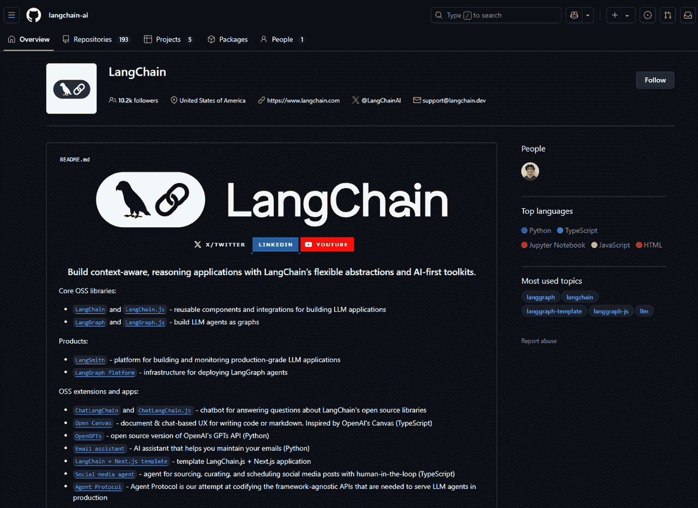

这里我们可以梳理出在LangChain AI中最受关注的项目发展态势，如下图所示：

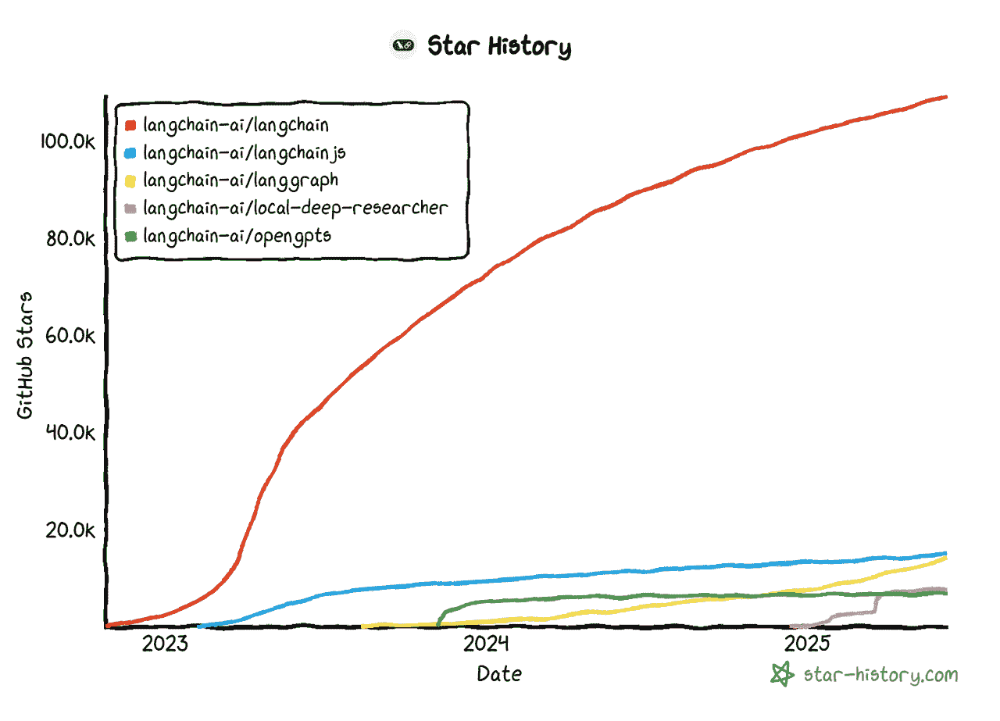

其中最活跃的项目当属`langchain`，排在前二的分别是`langChain`的Python版本和JavaScript版本。作为LangChain AI发展的基石，`langchain`主要用来支持构建大模型应用的一切，包括链式编排、检索增强生成 (RAG)、嵌入、文档处理、对话系统、代码分析等。而随着业务需求的越来越复杂，LangChain AI也推出了`langgraph`，作为一个基于图结构的 Agent 编排框架，可构建有状态、多步骤、多 Agent 的工作流，从而进一步扩展了LangChain AI自家生态的适用范围。而至于`local‑deep‑researcher`和`opengpts`，则完全是给开发者提供了基于LangChain定制开发出的特定热门应用，也一定程度上能印证LangChain AI的生态繁荣和可实现应用场景的广度。

### LangChain AI 热门开源项目功能介绍

| 项目 | 技术栈 | 核心用途 |

| --- | --- | --- |

| `langchain` | Python/TS | 构建 LLM 应用基础组件 |

| `langchainjs` | JS/TS | 前端/Node 环境中构造 LLM 应用 |

| `langgraph` | Python | 用图编排复杂 agent 流程 |

| `local‑deep‑researcher` | Python | 自动化、多轮本地 Web 研究工具 |

| `opengpts` | Python + Go + 前端 | 可定制化 GPT 平台，支持 RAG 和 agent 开发 |

对外，LangChain 也是目前大模型技术领域所有AI Agent框架中最热门、最通用的，相较于`AutoGen`、`CrewAI`、`OpenAI Agents SDK`和`Google ADK`，拥有最多的收藏量和活跃的开发者数量。

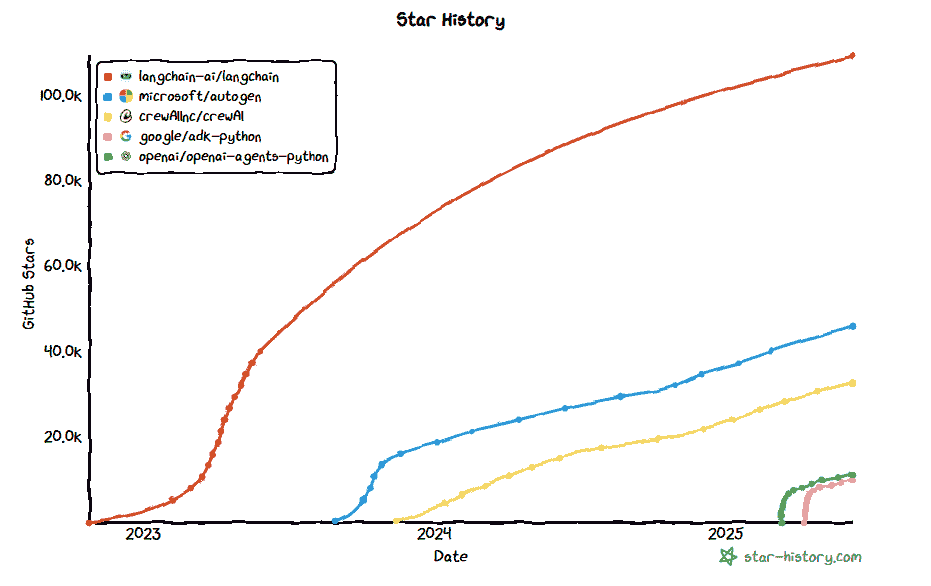

因此这里大家可以感受到，langChain AI生态的学习，其实最最核心的就是LangChain这个项目。而langChain是一个非常全面的开发框架，集成了Agent和RAG两个关键的热门落地方向，通过灵活的模块化组合可以快速的构建适用于私有业务场景的大模型应用，在目前的应用开发中是企业中使用最多的Agent开发框架。其核心架构如下图所示：

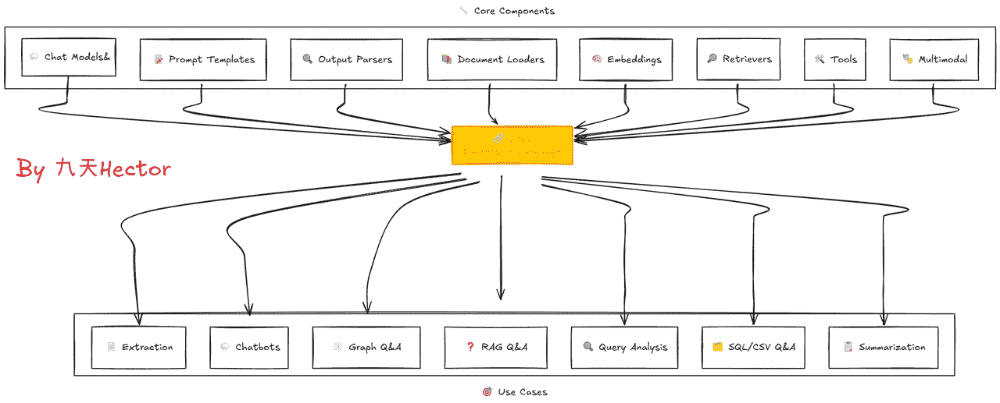

从本质上分析，LangChain从大模型角度出发，通过开发人员在实践过程中对大模型能力的深入理解及其在不同场景下的涌现潜力，使用模块化的方式进行高级抽象，设计出统一接口以适配各种大模型。LangChain抽象出最重要的核心模块如下：

1. `Model I/O` ：标准化各个大模型的输入和输出，包含输入模版，模型本身和格式化输出；

1. `Retrieval` ：检索外部数据，然后在执行生成步骤时将其传递到 LLM，包括文档加载、切割、Embedding等；

1. `Chains` ：链，LangChain框架中最重要的模块，链接多个模块协同构建应用，是实际运作很多功能的高级抽象；

1. `Memory` ： 记忆模块，以各种方式构建历史信息，维护有关实体及其关系的信息；

1. `Agents` ： 目前最热门的Agents开发实践，未来能够真正实现通用人工智能的落地方案；

1. `Callbacks` ：回调系统，允许连接到 大模型 应用程序的各个阶段。用于日志记录、监控、流传输和其他任务；

从上图中可以看到，LangChain框架涵盖了模型输入输出的标准化、外部工具接入的规范、上下文记忆功能，以及对数据库、SQL、CSV等多种数据源的连接标准。通过核心的`Chain`高级抽象，定义了不同形式下标准的链接方法，这就能够允许开发者根据实际的应用需求和数据流向快速构建出一套完整的应用程序。这个过程类似于搭建积木，可以灵活适应不同的任务需求。

因此本节公开课，我们就围绕LangChain展开详细的讲解，我们会涉及到LangChain框架的整体概览，如何用LangChain搭建智能体和本地知识库问答的完整流程，同时对于比较热门的MCP工具如何接入LangChain框架，会做一个重点的说明。

需要说明的，这里我们选择使用Python作为开发语言，同时使用目前最新的LangChain 0.3版本，具体的版本说明如下：

+ `Python==3.12`

+ `LangChain>=0.3.25`

+ `langchain-deepseek>=0.1.3`

### 1. LangChain接入大模型流程

#### LangChain安装流程

如果使用LangChain进行大模型应用开发，需要安装LangChain的依赖包，安装命令如下：

```
! pip install langchain
```


```
Collecting langchain
  Using cached langchain-0.3.25-py3-none-any.whl.metadata (7.8 kB)
Collecting langchain-core<1.0.0,>=0.3.58 (from langchain)
  Using cached langchain_core-0.3.64-py3-none-any.whl.metadata (5.8 kB)
Collecting langchain-text-splitters<1.0.0,>=0.3.8 (from langchain)
  Using cached langchain_text_splitters-0.3.8-py3-none-any.whl.metadata (1.9 kB)
Collecting langsmith<0.4,>=0.1.17 (from langchain)
  Using cached langsmith-0.3.45-py3-none-any.whl.metadata (15 kB)
Collecting pydantic<3.0.0,>=2.7.4 (from langchain)
  Using cached pydantic-2.11.5-py3-none-any.whl.metadata (67 kB)
Collecting SQLAlchemy<3,>=1.4 (from langchain)
  Using cached sqlalchemy-2.0.41-cp312-cp312-win_amd64.whl.metadata (9.8 kB)
Collecting requests<3,>=2 (from langchain)
  Using cached requests-2.32.3-py3-none-any.whl.metadata (4.6 kB)
Collecting PyYAML>=5.3 (from langchain)
  Using cached PyYAML-6.0.2-cp312-cp312-win_amd64.whl.metadata (2.1 kB)
Collecting tenacity!=8.4.0,<10.0.0,>=8.1.0 (from langchain-core<1.0.0,>=0.3.58->langchain)
  Using cached tenacity-9.1.2-py3-none-any.whl.metadata (1.2 kB)
Collecting jsonpatch<2.0,>=1.33 (from langchain-core<1.0.0,>=0.3.58->langchain)
  Using cached jsonpatch-1.33-py2.py3-none-any.whl.metadata (3.0 kB)
Collecting packaging<25,>=23.2 (from langchain-core<1.0.0,>=0.3.58->langchain)
  Using cached packaging-24.2-py3-none-any.whl.metadata (3.2 kB)
Collecting typing-extensions>=4.7 (from langchain-core<1.0.0,>=0.3.58->langchain)
  Using cached typing_extensions-4.14.0-py3-none-any.whl.metadata (3.0 kB)
Collecting jsonpointer>=1.9 (from jsonpatch<2.0,>=1.33->langchain-core<1.0.0,>=0.3.58->langchain)
  Using cached jsonpointer-3.0.0-py2.py3-none-any.whl.metadata (2.3 kB)
Collecting httpx<1,>=0.23.0 (from langsmith<0.4,>=0.1.17->langchain)
  Using cached httpx-0.28.1-py3-none-any.whl.metadata (7.1 kB)
Collecting orjson<4.0.0,>=3.9.14 (from langsmith<0.4,>=0.1.17->langchain)
  Using cached orjson-3.10.18-cp312-cp312-win_amd64.whl.metadata (43 kB)
Collecting requests-toolbelt<2.0.0,>=1.0.0 (from langsmith<0.4,>=0.1.17->langchain)
  Using cached requests_toolbelt-1.0.0-py2.py3-none-any.whl.metadata (14 kB)
Collecting zstandard<0.24.0,>=0.23.0 (from langsmith<0.4,>=0.1.17->langchain)
  Using cached zstandard-0.23.0-cp312-cp312-win_amd64.whl.metadata (3.0 kB)
Collecting anyio (from httpx<1,>=0.23.0->langsmith<0.4,>=0.1.17->langchain)
  Using cached anyio-4.9.0-py3-none-any.whl.metadata (4.7 kB)
Collecting certifi (from httpx<1,>=0.23.0->langsmith<0.4,>=0.1.17->langchain)
  Using cached certifi-2025.4.26-py3-none-any.whl.metadata (2.5 kB)
Collecting httpcore==1.* (from httpx<1,>=0.23.0->langsmith<0.4,>=0.1.17->langchain)
  Using cached httpcore-1.0.9-py3-none-any.whl.metadata (21 kB)
Collecting idna (from httpx<1,>=0.23.0->langsmith<0.4,>=0.1.17->langchain)
  Using cached idna-3.10-py3-none-any.whl.metadata (10 kB)
Collecting h11>=0.16 (from httpcore==1.*->httpx<1,>=0.23.0->langsmith<0.4,>=0.1.17->langchain)
  Using cached h11-0.16.0-py3-none-any.whl.metadata (8.3 kB)
Collecting annotated-types>=0.6.0 (from pydantic<3.0.0,>=2.7.4->langchain)
  Using cached annotated_types-0.7.0-py3-none-any.whl.metadata (15 kB)
Collecting pydantic-core==2.33.2 (from pydantic<3.0.0,>=2.7.4->langchain)
  Using cached pydantic_core-2.33.2-cp312-cp312-win_amd64.whl.metadata (6.9 kB)
Collecting typing-inspection>=0.4.0 (from pydantic<3.0.0,>=2.7.4->langchain)
  Using cached typing_inspection-0.4.1-py3-none-any.whl.metadata (2.6 kB)
Collecting charset-normalizer<4,>=2 (from requests<3,>=2->langchain)
  Using cached charset_normalizer-3.4.2-cp312-cp312-win_amd64.whl.metadata (36 kB)
Collecting urllib3<3,>=1.21.1 (from requests<3,>=2->langchain)
  Using cached urllib3-2.4.0-py3-none-any.whl.metadata (6.5 kB)
Collecting greenlet>=1 (from SQLAlchemy<3,>=1.4->langchain)
  Using cached greenlet-3.2.3-cp312-cp312-win_amd64.whl.metadata (4.2 kB)
Collecting sniffio>=1.1 (from anyio->httpx<1,>=0.23.0->langsmith<0.4,>=0.1.17->langchain)
  Using cached sniffio-1.3.1-py2.py3-none-any.whl.metadata (3.9 kB)
Using cached langchain-0.3.25-py3-none-any.whl (1.0 MB)
Using cached langchain_core-0.3.64-py3-none-any.whl (438 kB)
Using cached jsonpatch-1.33-py2.py3-none-any.whl (12 kB)
Using cached langchain_text_splitters-0.3.8-py3-none-any.whl (32 kB)
Using cached langsmith-0.3.45-py3-none-any.whl (363 kB)
Using cached httpx-0.28.1-py3-none-any.whl (73 kB)
Using cached httpcore-1.0.9-py3-none-any.whl (78 kB)
Using cached orjson-3.10.18-cp312-cp312-win_amd64.whl (134 kB)
Using cached packaging-24.2-py3-none-any.whl (65 kB)
Using cached pydantic-2.11.5-py3-none-any.whl (444 kB)
Using cached pydantic_core-2.33.2-cp312-cp312-win_amd64.whl (2.0 MB)
Using cached requests-2.32.3-py3-none-any.whl (64 kB)
Using cached charset_normalizer-3.4.2-cp312-cp312-win_amd64.whl (105 kB)
Using cached idna-3.10-py3-none-any.whl (70 kB)
Using cached requests_toolbelt-1.0.0-py2.py3-none-any.whl (54 kB)
Using cached sqlalchemy-2.0.41-cp312-cp312-win_amd64.whl (2.1 MB)
Using cached tenacity-9.1.2-py3-none-any.whl (28 kB)
Using cached urllib3-2.4.0-py3-none-any.whl (128 kB)
Using cached zstandard-0.23.0-cp312-cp312-win_amd64.whl (495 kB)
Using cached annotated_types-0.7.0-py3-none-any.whl (13 kB)
Using cached certifi-2025.4.26-py3-none-any.whl (159 kB)
Using cached greenlet-3.2.3-cp312-cp312-win_amd64.whl (297 kB)
Using cached h11-0.16.0-py3-none-any.whl (37 kB)
Using cached jsonpointer-3.0.0-py2.py3-none-any.whl (7.6 kB)
Using cached PyYAML-6.0.2-cp312-cp312-win_amd64.whl (156 kB)
Using cached typing_extensions-4.14.0-py3-none-any.whl (43 kB)
Using cached typing_inspection-0.4.1-py3-none-any.whl (14 kB)
Using cached anyio-4.9.0-py3-none-any.whl (100 kB)
Using cached sniffio-1.3.1-py2.py3-none-any.whl.metadata (10 kB)
Installing collected packages: zstandard, urllib3, typing-extensions, tenacity, sniffio, PyYAML, packaging, orjson, jsonpointer, idna, h11, greenlet, charset-normalizer, certifi, annotated-types, typing-inspection, SQLAlchemy, requests, pydantic-core, jsonpatch, httpcore, anyio, requests-toolbelt, pydantic, httpx, langsmith, langchain-core, langchain-text-splitters, langchain

   ---- -----------------------------------  3/29 [tenacity]
  Attempting uninstall: packaging
   ---- -----------------------------------  3/29 [tenacity]
    Found existing installation: packaging 25.0
   ---- -----------------------------------  3/29 [tenacity]
    Uninstalling packaging-25.0:
   ---- -----------------------------------  3/29 [tenacity]
      Successfully uninstalled packaging-25.0
   ---- -----------------------------------  3/29 [tenacity]
   ------------ ---------------------------  9/29 [idna]
   --------------- ------------------------ 11/29 [greenlet]
   ---------------------- ----------------- 16/29 [SQLAlchemy]
   ---------------------- ----------------- 16/29 [SQLAlchemy]
   ---------------------- ----------------- 16/29 [SQLAlchemy]
   ---------------------- ----------------- 16/29 [SQLAlchemy]
   ---------------------- ----------------- 16/29 [SQLAlchemy]
   ---------------------- ----------------- 16/29 [SQLAlchemy]
   ---------------------- ----------------- 16/29 [SQLAlchemy]
   ---------------------- ----------------- 16/29 [SQLAlchemy]
   ----------------------- ---------------- 17/29 [requests]
   ---------------------------- ----------- 21/29 [anyio]
   ------------------------------- -------- 23/29 [pydantic]
   ------------------------------- -------- 23/29 [pydantic]
   ------------------------------- -------- 23/29 [pydantic]
   ---------------------------------- ----- 25/29 [langsmith]
   ---------------------------------- ----- 25/29 [langsmith]
   ----------------------------------- ---- 26/29 [langchain-core]
   ----------------------------------- ---- 26/29 [langchain-core]
   ------------------------------------- -- 27/29 [langchain-text-splitters]
   -------------------------------------- - 28/29 [langchain]
   -------------------------------------- - 28/29 [langchain]
   -------------------------------------- - 28/29 [langchain]
   -------------------------------------- - 28/29 [langchain]
   -------------------------------------- - 28/29 [langchain]
   -------------------------------------- - 28/29 [langchain]
   -------------------------------------- - 28/29 [langchain]
   -------------------------------------- - 28/29 [langchain]
   -------------------------------------- - 28/29 [langchain]
   -------------------------------------- - 28/29 [langchain]
   ---------------------------------------- 29/29 [langchain]

Successfully installed PyYAML-6.0.2 SQLAlchemy-2.0.41 annotated-types-0.7.0 anyio-4.9.0 certifi-2025.4.26 charset-normalizer-3.4.2 greenlet-3.2.3 h11-0.16.0 httpcore-1.0.9 httpx-0.28.1 idna-3.10 jsonpatch-1.33 jsonpointer-3.0.0 langchain-0.3.25 langchain-core-0.3.64 langchain-text-splitters-0.3.8 langsmith-0.3.45 orjson-3.10.18 packaging-24.2 pydantic-2.11.5 pydantic-core-2.33.2 requests-2.32.3 requests-toolbelt-1.0.0 sniffio-1.3.1 tenacity-9.1.2 typing-extensions-4.14.0 typing-inspection-0.4.1 urllib3-2.4.0 zstandard-0.23.0
```


# LangChain 环境准备与 DeepSeek 接入

不同的依赖包版本在使用方式上可能存在一些差异，所以建议大家选择和课程一直的依赖包版本进行学习。这里我们采用的是目前最新的 `LangChain` 0.3 版本，可以通过如下命令进行查看：

```bash
! pip show langchain
```

```text
Name: langchain
Version: 0.3.25
Summary: Building applications with LLMs through composability
Home-page: 
Author: 
Author-email: 
License: MIT
Location: /root/anaconda3/lib/python3.12/site-packages
Requires: langchain-core, langchain-text-splitters, langsmith, pydantic, PyYAML, requests, SQLAlchemy
Required-by: langchain-community, open-webui
```

## 尝试调用 DeepSeek

在进行 `LangChain` 开发之前，首先需要准备一个可以进行调用的大模型，这里我们选择使用DeepSeek的大模型，并使用DeepSeek官方的 `API_KEK` 进行调用。如果初次使用，需要在DeepSeek官网上进行注册并创建一个新的 `API_Key`，其官方地址为：https://platform.deepseek.com/usage


### 配置 API 密钥

注册好DeepSeek的 `API_KEY` 后，首先在项目同级目录下创建一个 `env` 文件，用于存储DeepSeek的 `API_KEY`，如下所示：

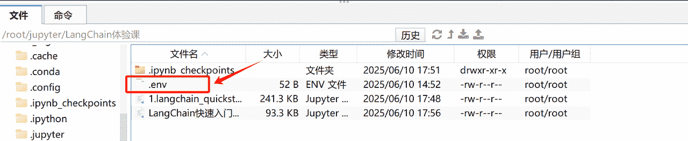

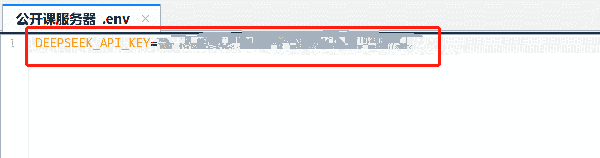

接下来通过 `python-dotenv` 库读取 `env` 文件中的 `API_KEY`，使其加载到当前的运行环境中，代码如下：

```bash
! pip install python-dotenv
```

```text
Requirement already satisfied: python-dotenv in /root/anaconda3/lib/python3.12/site-packages (1.0.1)
WARNING: Running pip as the 'root' user can result in broken permissions and conflicting behaviour with the system package manager. It is recommended to use a virtual environment instead: https://pip.pypa.io/warnings/venv
```

```python
import os
from dotenv import load_dotenv 
load_dotenv(override=True)

DeepSeek_API_KEY = os.getenv("DEEPSEEK_API_KEY")
# print(DeepSeek_API_KEY)  # 可以通过打印查看
```

### 网络连通性测试

我们在当前的运行环境下不使用 `LangChain`，直接使用DeepSeek的API进行网络连通性测试，测试代码如下：

```bash
! pip install openai
```

```text
Requirement already satisfied: openai in /root/anaconda3/lib/python3.12/site-packages (1.78.1)
Requirement already satisfied: anyio<5,>=3.5.0 in /root/anaconda3/lib/python3.12/site-packages (from openai) (4.8.0)
Requirement already satisfied: distro<2,>=1.7.0 in /root/anaconda3/lib/python3.12/site-packages (from openai) (1.9.0)
Requirement already satisfied: httpx<1,>=0.23.0 in /root/anaconda3/lib/python3.12/site-packages (from openai) (0.28.1)
Requirement already satisfied: jiter<1,>=0.4.0 in /root/anaconda3/lib/python3.12/site-packages (from openai) (0.8.2)
Requirement already satisfied: pydantic<3,>=1.9.0 in /root/anaconda3/lib/python3.12/site-packages (from openai) (2.11.4)
Requirement already satisfied: sniffio in /root/anaconda3/lib/python3.12/site-packages (from openai) (1.3.0)
Requirement already satisfied: tqdm>4 in /root/anaconda3/lib/python3.12/site-packages (from openai) (4.66.4)
Requirement already satisfied: typing-extensions<5,>=4.11 in /root/anaconda3/lib/python3.12/site-packages (from openai) (4.13.2)
Requirement already satisfied: idna>=2.8 in /root/anaconda3/lib/python3.12/site-packages (from anyio<5,>=3.5.0->openai) (3.7)
Requirement already satisfied: certifi in /root/anaconda3/lib/python3.12/site-packages (from httpx<1,>=0.23.0->openai) (2024.2.2)
Requirement already satisfied: httpcore==1.* in /root/anaconda3/lib/python3.12/site-packages (from httpx<1,>=0.23.0->openai) (1.0.7)
Requirement already satisfied: h11<0.15,>=0.13 in /root/anaconda3/lib/python3.12/site-packages (from httpcore==1.*->httpx<1,>=0.23.0->openai) (0.14.0)
Requirement already satisfied: annotated-types>=0.6.0 in /root/anaconda3/lib/python3.12/site-packages (from pydantic<3,>=1.9.0->openai) (0.6.0)
Requirement already satisfied: pydantic-core==2.33.2 in /root/anaconda3/lib/python3.12/site-packages (from pydantic<3,>=1.9.0->openai) (2.33.2)
Requirement already satisfied: typing-inspection>=0.4.0 in /root/anaconda3/lib/python3.12/site-packages (from pydantic<3,>=1.9.0->openai) (0.4.0)
WARNING: Running pip as the 'root' user can result in broken permissions and conflicting behaviour with the system package manager. It is recommended to use a virtual environment instead: https://pip.pypa.io/warnings/venv
```

```python
from openai import OpenAI

# 初始化DeepSeek的API客户端
client = OpenAI(api_key=DeepSeek_API_KEY, base_url="https://api.deepseek.com")

# 调用DeepSeek的API，生成回答
response = client.chat.completions.create(
    model="deepseek-chat",
    messages=[
        {"role": "system", "content": "你是乐于助人的助手，请根据用户的问题给出回答"},
        {"role": "user", "content": "你好，请你介绍一下你自己。"},
    ],
)

# 打印模型最终的响应结果
print(response.choices[0].message.content)
```

```text
你好！我是一个乐于助人的AI助手，随时准备为你提供帮助。我可以回答各种问题、提供建议、协助解决问题，或者陪你聊天。无论是学习、工作还是日常生活，我都会尽力为你提供有用的信息和支持。 

我的知识涵盖了多个领域，包括但不限于科技、历史、文化、健康、编程等。如果你有任何疑问或需要帮助，随时告诉我！ 😊 

你想了解关于我的具体方面，还是需要其他帮助呢？
```

如果可以正常收到DeepSeek模型的响应，则说明DeepSeek的API已经可以正常使用且网络连通性正常。

## DeepSeek 接入 LangChain 流程

接下来我们要考虑的是，对于这样一个DeepSeek官方的API，如何接入到 `LangChain` 中呢？其实非常简单，我们只需要使用 `LangChain` 中的一个DeepSeek组件即可向像述代码一样，直接使用相同的DeepSeek API KEY与大模型进行交互。因此，我们首先需要安装 `LangChain` 的DeepSeek组件，安装命令如下：

```bash
! pip install langchain-deepseek
```


# 依赖包安装

```
Collecting langchain-deepseek
  Downloading langchain_deepseek-0.1.3-py3-none-any.whl.metadata (1.1 kB)
Requirement already satisfied: langchain-core<1.0.0,>=0.3.47 in /root/anaconda3/lib/python3.12/site-packages (from langchain-deepseek) (0.3.64)
Collecting langchain-openai<1.0.0,>=0.3.9 (from langchain-deepseek)
  Downloading langchain_openai-0.3.21-py3-none-any.whl.metadata (2.3 kB)
Requirement already satisfied: langsmith<0.4,>=0.3.45 in /root/anaconda3/lib/python3.12/site-packages (from langchain-core<1.0.0,>=0.3.47->langchain-deepseek) (0.3.45)
Requirement already satisfied: tenacity!=8.4.0,<10.0.0,>=8.1.0 in /root/anaconda3/lib/python3.12/site-packages (from langchain-core<1.0.0,>=0.3.47->langchain-deepseek) (8.5.0)
Requirement already satisfied: jsonpatch<2.0,>=1.33 in /root/anaconda3/lib/python3.12/site-packages (from langchain-core<1.0.0,>=0.3.47->langchain-deepseek) (1.33)
Requirement already satisfied: PyYAML>=5.3 in /root/anaconda3/lib/python3.12/site-packages (from langchain-core<1.0.0,>=0.3.47->langchain-deepseek) (6.0.1)
Requirement already satisfied: packaging<25,>=23.2 in /root/anaconda3/lib/python3.12/site-packages (from langchain-core<1.0.0,>=0.3.47->langchain-deepseek) (24.1)
Requirement already satisfied: typing-extensions>=4.7 in /root/anaconda3/lib/python3.12/site-packages (from langchain-core<1.0.0,>=0.3.47->langchain-deepseek) (4.13.2)
Requirement already satisfied: pydantic>=2.7.4 in /root/anaconda3/lib/python3.12/site-packages (from langchain-core<1.0.0,>=0.3.47->langchain-deepseek) (2.11.4)
Requirement already satisfied: openai<2.0.0,>=1.68.2 in /root/anaconda3/lib/python3.12/site-packages (from langchain-openai<1.0.0,>=0.3.9->langchain-deepseek) (1.78.1)
Requirement already satisfied: tiktoken<1,>=0.7 in /root/anaconda3/lib/python3.12/site-packages (from langchain-openai<1.0.0,>=0.3.9->langchain-deepseek) (0.8.0)
Requirement already satisfied: jsonpointer>=1.9 in /root/anaconda3/lib/python3.12/site-packages (from jsonpatch<2.0,>=1.33->langchain-core<1.0.0,>=0.3.47->langchain-deepseek) (2.1)
Requirement already satisfied: httpx<1,>=0.23.0 in /root/anaconda3/lib/python3.12/site-packages (from langsmith<0.4,>=0.3.45->langchain-core<1.0.0,>=0.3.47->langchain-deepseek) (0.28.1)
Requirement already satisfied: orjson<4.0.0,>=3.9.14 in /root/anaconda3/lib/python3.12/site-packages (from langsmith<0.4,>=0.3.45->langchain-core<1.0.0,>=0.3.47->langchain-deepseek) (3.10.13)
Requirement already satisfied: requests<3,>=2 in /root/anaconda3/lib/python3.12/site-packages (from langsmith<0.4,>=0.3.45->langchain-core<1.0.0,>=0.3.47->langchain-deepseek) (2.32.3)
Requirement already satisfied: requests-toolbelt<2.0.0,>=1.0.0 in /root/anaconda3/lib/python3.12/site-packages (from langsmith<0.4,>=0.3.45->langchain-core<1.0.0,>=0.3.47->langchain-deepseek) (1.0.0)
Requirement already satisfied: zstandard<0.24.0,>=0.23.0 in /root/anaconda3/lib/python3.12/site-packages (from langsmith<0.4,>=0.3.45->langchain-core<1.0.0,>=0.3.47->langchain-deepseek) (0.23.0)
Requirement already satisfied: anyio<5,>=3.5.0 in /root/anaconda3/lib/python3.12/site-packages (from openai<2.0.0,>=1.68.2->langchain-openai<1.0.0,>=0.3.9->langchain-deepseek) (4.8.0)
Requirement already satisfied: distro<2,>=1.7.0 in /root/anaconda3/lib/python3.12/site-packages (from openai<2.0.0,>=1.68.2->langchain-openai<1.0.0,>=0.3.9->langchain-deepseek) (1.9.0)
Requirement already satisfied: jiter<1,>=0.4.0 in /root/anaconda3/lib/python3.12/site-packages (from openai<2.0.0,>=1.68.2->langchain-openai<1.0.0,>=0.3.9->langchain-deepseek) (0.8.2)
Requirement already satisfied: sniffio in /root/anaconda3/lib/python3.12/site-packages (from openai<2.0.0,>=1.68.2->langchain-openai<1.0.0,>=0.3.9->langchain-deepseek) (1.3.0)
Requirement already satisfied: tqdm>4 in /root/anaconda3/lib/python3.12/site-packages (from openai<2.0.0,>=1.68.2->langchain-openai<1.0.0,>=0.3.9->langchain-deepseek) (4.66.4)
Requirement already satisfied: annotated-types>=0.6.0 in /root/anaconda3/lib/python3.12/site-packages (from pydantic>=2.7.4->langchain-core<1.0.0,>=0.3.47->langchain-deepseek) (0.6.0)
Requirement already satisfied: pydantic-core==2.33.2 in /root/anaconda3/lib/python3.12/site-packages (from pydantic>=2.7.4->langchain-core<1.0.0,>=0.3.47->langchain-deepseek) (2.33.2)
Requirement already satisfied: typing-inspection>=0.4.0 in /root/anaconda3/lib/python3.12/site-packages (from pydantic>=2.7.4->langchain-core<1.0.0,>=0.3.47->langchain-deepseek) (0.4.0)
Requirement already satisfied: regex>=2022.1.18 in /root/anaconda3/lib/python3.12/site-packages (from tiktoken<1,>=0.7->langchain-openai<1.0.0,>=0.3.9->langchain-deepseek) (2023.10.3)
Requirement already satisfied: idna>=2.8 in /root/anaconda3/lib/python3.12/site-packages (from anyio<5,>=3.5.0->openai<2.0.0,>=1.68.2->langchain-openai<1.0.0,>=0.3.9->langchain-deepseek) (3.7)
Requirement already satisfied: certifi in /root/anaconda3/lib/python3.12/site-packages (from httpx<1,>=0.23.0->langsmith<0.4,>=0.3.45->langchain-core<1.0.0,>=0.3.47->langchain-deepseek) (2024.2.2)
Requirement already satisfied: httpcore==1.* in /root/anaconda3/lib/python3.12/site-packages (from httpx<1,>=0.23.0->langsmith<0.4,>=0.3.45->langchain-core<1.0.0,>=0.3.47->langchain-deepseek) (1.0.7)
Requirement already satisfied: h11<0.15,>=0.13 in /root/anaconda3/lib/python3.12/site-packages (from httpcore==1.*->httpx<1,>=0.23.0->langsmith<0.4,>=0.3.45->langchain-core<1.0.0,>=0.3.47->langchain-deepseek) (0.14.0)
Requirement already satisfied: charset-normalizer<4,>=2 in /root/anaconda3/lib/python3.12/site-packages (from requests<3,>=2->langsmith<0.4,>=0.3.45->langchain-core<1.0.0,>=0.3.47->langchain-deepseek) (2.0.4)
Requirement already satisfied: urllib3<3,>=1.21.1 in /root/anaconda3/lib/python3.12/site-packages (from requests<3,>=2->langsmith<0.4,>=0.3.45->langchain-core<1.0.0,>=0.3.47->langchain-deepseek) (2.2.2)
Downloading langchain_deepseek-0.1.3-py3-none-any.whl (7.1 kB)
Downloading langchain_openai-0.3.21-py3-none-any.whl (65 kB)
[2K   [90m━━━━━━━━━━━━━━━━━━━━━━━━━━━━━━━━━━━━━━[0m [32m65.2/65.2 kB[0m [31m4.9 kB/s[0m eta [36m0:00:00[0ma [36m0:00:09[0m
[?25hInstalling collected packages: langchain-openai, langchain-deepseek
Successfully installed langchain-deepseek-0.1.3 langchain-openai-0.3.21
[33mWARNING: Running pip as the 'root' user can result in broken permissions and conflicting behaviour with the system package manager. It is recommended to use a virtual environment instead: https://pip.pypa.io/warnings/venv[0m[33m
[0m
```

# 模型初始化

安装好`LangChain`集成`DeepSeek`模型的依赖包后，需要通过一个`init_chat_model`函数来初始化大模型，代码如下：

```
from langchain.chat_models import init_chat_model

model = init_chat_model(model="deepseek-chat", model_provider="deepseek")  
```

其中`model`用来指定要使用的模型名称，而`model_provider`用来指定模型提供者，当写入`deepseek`时，会自动加载`langchain-deepseek`的依赖包，并使用在`model`中指定的模型名称用来进行交互。

# 调用示例

```
question = "你好，请你介绍一下你自己。"

result = model.invoke(question)
print(result.content)
```


# DeepSeek AI 助手介绍与 LangChain 使用指南

## DeepSeek Chat 功能介绍

你好！我是 DeepSeek Chat，由深度求索公司（DeepSeek）研发的一款智能AI助手。我可以帮助你解答各种问题，包括学习、工作、编程、写作、生活百科等多个领域。

### 我的特点

✅ 免费使用：目前无需付费，你可以随时向我提问！
✅ 知识丰富：我的知识截止到 2024年7月，可以为你提供较新的信息。
✅ 超长上下文支持：可以处理 128K 长度的文本，适合分析长文档或复杂问题。
✅ 文件阅读：支持上传 PDF、Word、Excel、PPT、TXT 等文件，并从中提取信息进行分析。
✅ 多语言能力：可以用中文、英文等多种语言交流，帮助你翻译或学习外语。
✅ 编程助手：能写代码、调试、优化算法，支持Python、C++、Java等多种编程语言。

### 我能帮你做什么

📖 学习辅导：解题思路、论文写作、知识点讲解
💼 工作效率：写邮件、做PPT、总结报告
💡 创意灵感：写故事、起名字、头脑风暴
📊 数据分析：处理表格、绘制图表、解读数据
🔧 技术支持：代码调试、算法优化、技术咨询

你可以随时向我提问，我会尽力提供最准确、有用的回答！😊 有什么我可以帮你的吗？

`result`

```
AIMessage(content='你好！我是 DeepSeek Chat，由深度求索公司（DeepSeek）研发的一款智能AI助手。我可以帮助你解答各种问题，包括学习、工作、编程、写作、生活百科等多个领域。  \n\n### 我的特点：  \n✅ 免费使用：目前无需付费，你可以随时向我提问！  \n✅ 知识丰富：我的知识截止到 2024年7月，可以为你提供较新的信息。  \n✅ 超长上下文支持：可以处理 128K 长度的文本，适合分析长文档或复杂问题。  \n✅ 文件阅读：支持上传 PDF、Word、Excel、PPT、TXT 等文件，并从中提取信息进行分析。  \n✅ 多语言能力：可以用中文、英文等多种语言交流，帮助你翻译或学习外语。  \n✅ 编程助手：能写代码、调试、优化算法，支持Python、C++、Java等多种编程语言。  \n\n### 我能帮你做什么？  \n📖 学习辅导：解题思路、论文写作、知识点讲解  \n💼 工作效率：写邮件、做PPT、总结报告  \n💡 创意灵感：写故事、起名字、头脑风暴  \n📊 数据分析：处理表格、绘制图表、解读数据  \n🔧 技术支持：代码调试、算法优化、技术咨询  \n\n你可以随时向我提问，我会尽力提供最准确、有用的回答！😊 有什么我可以帮你的吗？', additional_kwargs={'refusal': None}, response_metadata={'token_usage': {'completion_tokens': 311, 'prompt_tokens': 9, 'total_tokens': 320, 'completion_tokens_details': None, 'prompt_tokens_details': {'audio_tokens': None, 'cached_tokens': 0}, 'prompt_cache_hit_tokens': 0, 'prompt_cache_miss_tokens': 9}, 'model_name': 'deepseek-chat', 'system_fingerprint': 'fp_8802369eaa_prod0425fp8', 'id': 'e3323dc0-46fa-497b-aaf5-83596184f8b2', 'service_tier': None, 'finish_reason': 'stop', 'logprobs': None}, id='run--9f652093-6feb-484f-99f7-0c30e33290ab-0', usage_metadata={'input_tokens': 9, 'output_tokens': 311, 'total_tokens': 320, 'input_token_details': {'cache_read': 0}, 'output_token_details': {}})
```

```
model = init_chat_model(model="deepseek-reasoner", model_provider="deepseek")  

result = model.invoke(question)
print(result.content)
```

## DeepSeek-R1 功能介绍

你好呀！👋我是 DeepSeek-R1，由中国的人工智能公司「深度求索」研发。你可以把我当作一个聪明、热心、24小时在线的文字助手～✨

---

### 我的特点

- 知识丰富：截至2024年7月前的各种知识我都有所了解，无论是学习、工作、生活，还是科技、历史、娱乐，我都能帮上忙。
- 超长记忆力：可以处理长达128K上下文的内容，也就是说，你发给我超长的文件或对话，我也能理解清楚！
- 文件助手：支持你上传 PDF、Word、PPT、Excel、图片 等文件，我能帮你阅读、总结、提取重点。
- 免费使用（目前是哦！🎉）而且无需登录也能畅快聊天（不过登录后能保存历史记录更方便～）

---

### 我能做什么

✅ 解答问题（学习、考试、百科）  
✅ 写作助手（作文、小说、文案、邮件）  
✅ 编程帮手（写代码、查bug、讲算法）  
✅ 文件处理（读论文、总结报告、提取数据）  
✅ 生活助手（旅游攻略、美食推荐、情感建议）

---

### 我的“小限制”

- 目前是纯文字模型，不支持语音或识图（但你可以上传图片文件，我能读取里面的文字）。
- 我的知识截止在 2024年7月，之后的新事件就不太清楚啦。
- 我不是真人，但我会尽力用温暖、贴心的方式和你交流 ❤️

---

不管你是学生、上班族、创作者，还是只是好奇想聊聊天——我都在这儿等你！😊  
现在，有什么我可以帮你的吗？比如学习上的难题、工作中的任务，或者生活里的小烦恼？

`result.additional_kwargs`

```
{'refusal': None,
 'reasoning_content': '嗯，用户发来一句简单的问候和自我介绍请求。看起来像是初次接触的破冰场景，可能刚打开聊天界面或者第一次使用这类AI助手。\n\n用户语气礼貌但比较笼统，没有具体需求指向。这种开放式问题通常有两种可能：一是真的想了解AI的功能边界，二是测试性提问看AI如何反应。考虑到中文互联网环境里常有用户用“介绍自己”测试机器人，需要同时做好信息传递和破冰互动。\n\n回复策略上应该突出三点：明确身份属性（非人类但能做什么）、消除陌生感（用表情符号和分段提升可读性）、引导后续对话（结尾提问）。要避免机械的术语堆砌，比如不说“基于Transformer架构”而说“能帮你查资料”。\n\n用户没透露任何个人信息，就用中性称呼。最后那个🎉表情可能有点过，不过新用户首次互动需要点活泼感——要是商务场景用户应该会直接问专业问题吧。结尾提问选“学习/工作/生活”三个维度覆盖常见场景，比单问“有什么可以帮你”更易触发具体需求。'}
```

`result.additional_kwargs['reasoning_content']`

```
'嗯，用户发来一句简单的问候和自我介绍请求。看起来像是初次接触的破冰场景，可能刚打开聊天界面或者第一次使用这类AI助手。\n\n用户语气礼貌但比较笼统，没有具体需求指向。这种开放式问题通常有两种可能：一是真的想了解AI的功能边界，二是测试性提问看AI如何反应。考虑到中文互联网环境里常有用户用“介绍自己”测试机器人，需要同时做好信息传递和破冰互动。\n\n回复策略上应该突出三点：明确身份属性（非人类但能做什么）、消除陌生感（用表情符号和分段提升可读性）、引导后续对话（结尾提问）。要避免机械的术语堆砌，比如不说“基于Transformer架构”而说“能帮你查资料”。\n\n用户没透露任何个人信息，就用中性称呼。最后那个🎉表情可能有点过，不过新用户首次互动需要点活泼感——要是商务场景用户应该会直接问专业问题吧。结尾提问选“学习/工作/生活”三个维度覆盖常见场景，比单问“有什么可以帮你”更易触发具体需求。'
```

## 在 LangChain 中调用 DeepSeek 模型

这里可以看到，仅仅通过两行代码，我们便可以在LangChain中顺利调用DeepSeek模型，并得到模型的响应结果。相较于使用DeepSeek的API，使用LangChain调用模型无疑是更加简单的。同时，不仅仅是DeepSeek模型，LangChain还支持其他很多大模型，如OpenAI、Qwen、Gemini等，我们只需要在`init_chat_model`函数中指定不同的模型名称，就可以调用不同的模型。其工作的原理是这样的：

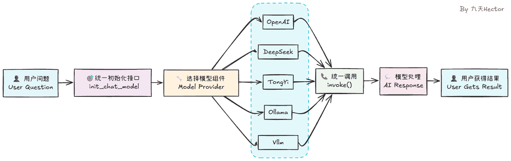

理解了这个基本原理，如果大家想在用LangChain进行开发时使用其他大模型如Qwen3系列，则只需要先获取到`API_KEY`，然后安装Tongyi Qwen的第三方依赖包，即可同样通过`init_chat_model`函数来初始化模型，并调用`invoke`方法来得到模型的响应结果。关于LangChain都支持哪些大模型以及每个模型对应的是哪个第三方依赖包，大家可以在LangChain的官方文档中找到，访问链接为：https://python.langchain.com/docs/integrations/chat/

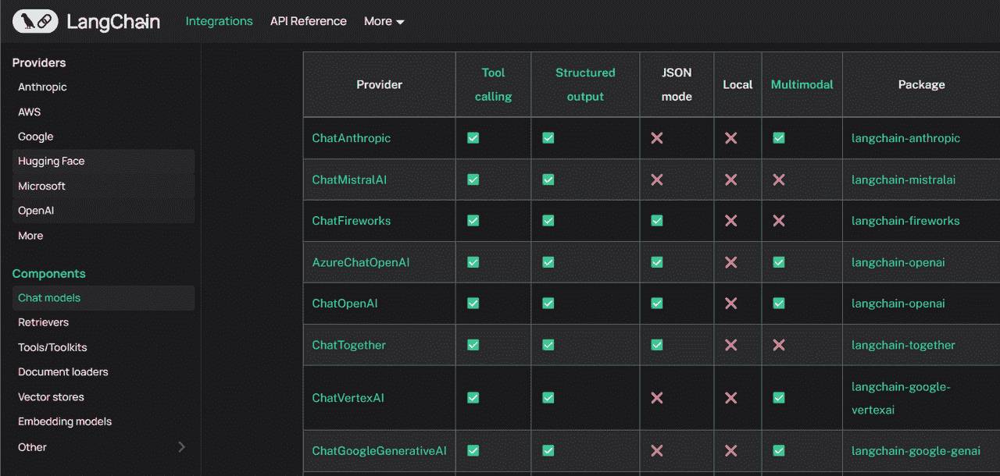

### 【补充】LangChain接入OpenAI模型

```
! pip install langchain-openai
```


# 环境依赖安装

```text
Requirement already satisfied: langchain-openai in /root/anaconda3/lib/python3.12/site-packages (0.3.21)
Requirement already satisfied: langchain-core<1.0.0,>=0.3.64 in /root/anaconda3/lib/python3.12/site-packages (from langchain-openai) (0.3.64)
Requirement already satisfied: openai<2.0.0,>=1.68.2 in /root/anaconda3/lib/python3.12/site-packages (from langchain-openai) (1.78.1)
Requirement already satisfied: tiktoken<1,>=0.7 in /root/anaconda3/lib/python3.12/site-packages (from langchain-openai) (0.8.0)
Requirement already satisfied: langsmith<0.4,>=0.3.45 in /root/anaconda3/lib/python3.12/site-packages (from langchain-core<1.0.0,>=0.3.64->langchain-openai) (0.3.45)
Requirement already satisfied: tenacity!=8.4.0,<10.0.0,>=8.1.0 in /root/anaconda3/lib/python3.12/site-packages (from langchain-core<1.0.0,>=0.3.64->langchain-openai) (8.5.0)
Requirement already satisfied: jsonpatch<2.0,>=1.33 in /root/anaconda3/lib/python3.12/site-packages (from langchain-core<1.0.0,>=0.3.64->langchain-openai) (1.33)
Requirement already satisfied: PyYAML>=5.3 in /root/anaconda3/lib/python3.12/site-packages (from langchain-core<1.0.0,>=0.3.64->langchain-openai) (6.0.1)
Requirement already satisfied: packaging<25,>=23.2 in /root/anaconda3/lib/python3.12/site-packages (from langchain-core<1.0.0,>=0.3.64->langchain-openai) (24.1)
Requirement already satisfied: typing-extensions>=4.7 in /root/anaconda3/lib/python3.12/site-packages (from langchain-core<1.0.0,>=0.3.64->langchain-openai) (4.13.2)
Requirement already satisfied: pydantic>=2.7.4 in /root/anaconda3/lib/python3.12/site-packages (from langchain-core<1.0.0,>=0.3.64->langchain-openai) (2.11.4)
Requirement already satisfied: anyio<5,>=3.5.0 in /root/anaconda3/lib/python3.12/site-packages (from openai<2.0.0,>=1.68.2->langchain-openai) (4.8.0)
Requirement already satisfied: distro<2,>=1.7.0 in /root/anaconda3/lib/python3.12/site-packages (from openai<2.0.0,>=1.68.2->langchain-openai) (1.9.0)
Requirement already satisfied: httpx<1,>=0.23.0 in /root/anaconda3/lib/python3.12/site-packages (from openai<2.0.0,>=1.68.2->langchain-openai) (0.28.1)
Requirement already satisfied: jiter<1,>=0.4.0 in /root/anaconda3/lib/python3.12/site-packages (from openai<2.0.0,>=1.68.2->langchain-openai) (0.8.2)
Requirement already satisfied: sniffio in /root/anaconda3/lib/python3.12/site-packages (from openai<2.0.0,>=1.68.2->langchain-openai) (1.3.0)
Requirement already satisfied: tqdm>4 in /root/anaconda3/lib/python3.12/site-packages (from openai<2.0.0,>=1.68.2->langchain-openai) (4.66.4)
Requirement already satisfied: regex>=2022.1.18 in /root/anaconda3/lib/python3.12/site-packages (from tiktoken<1,>=0.7->langchain-openai) (2023.10.3)
Requirement already satisfied: requests>=2.26.0 in /root/anaconda3/lib/python3.12/site-packages (from tiktoken<1,>=0.7->langchain-openai) (2.32.3)
Requirement already satisfied: idna>=2.8 in /root/anaconda3/lib/python3.12/site-packages (from anyio<5,>=3.5.0->openai<2.0.0,>=1.68.2->langchain-openai) (3.7)
Requirement already satisfied: certifi in /root/anaconda3/lib/python3.12/site-packages (from httpx<1,>=0.23.0->openai<2.0.0,>=1.68.2->langchain-openai) (2024.2.2)
Requirement already satisfied: httpcore==1.* in /root/anaconda3/lib/python3.12/site-packages (from httpx<1,>=0.23.0->openai<2.0.0,>=1.68.2->langchain-openai) (1.0.7)
Requirement already satisfied: h11<0.15,>=0.13 in /root/anaconda3/lib/python3.12/site-packages (from httpcore==1.*->httpx<1,>=0.23.0->openai<2.0.0,>=1.68.2->langchain-openai) (0.14.0)
Requirement already satisfied: jsonpointer>=1.9 in /root/anaconda3/lib/python3.12/site-packages (from jsonpatch<2.0,>=1.33->langchain-core<1.0.0,>=0.3.64->langchain-openai) (2.1)
Requirement already satisfied: orjson<4.0.0,>=3.9.14 in /root/anaconda3/lib/python3.12/site-packages (from langsmith<0.4,>=0.3.45->langchain-core<1.0.0,>=0.3.64->langchain-openai) (3.10.13)
Requirement already satisfied: requests-toolbelt<2.0.0,>=1.0.0 in /root/anaconda3/lib/python3.12/site-packages (from langsmith<0.4,>=0.3.45->langchain-core<1.0.0,>=0.3.64->langchain-openai) (1.0.0)
Requirement already satisfied: zstandard<0.24.0,>=0.23.0 in /root/anaconda3/lib/python3.12/site-packages (from langsmith<0.4,>=0.3.45->langchain-core<1.0.0,>=0.3.64->langchain-openai) (0.23.0)
Requirement already satisfied: annotated-types>=0.6.0 in /root/anaconda3/lib/python3.12/site-packages (from pydantic>=2.7.4->langchain-core<1.0.0,>=0.3.64->langchain-openai) (0.6.0)
Requirement already satisfied: pydantic-core==2.33.2 in /root/anaconda3/lib/python3.12/site-packages (from pydantic>=2.7.4->langchain-core<1.0.0,>=0.3.64->langchain-openai) (2.33.2)
Requirement already satisfied: typing-inspection>=0.4.0 in /root/anaconda3/lib/python3.12/site-packages (from pydantic>=2.7.4->langchain-core<1.0.0,>=0.3.64->langchain-openai) (0.4.0)
Requirement already satisfied: charset-normalizer<4,>=2 in /root/anaconda3/lib/python3.12/site-packages (from requests>=2.26.0->tiktoken<1,>=0.7->langchain-openai) (2.0.4)
Requirement already satisfied: urllib3<3,>=1.21.1 in /root/anaconda3/lib/python3.12/site-packages (from requests>=2.26.0->tiktoken<1,>=0.7->langchain-openai) (2.2.2)
WARNING: Running pip as the 'root' user can result in broken permissions and conflicting behaviour with the system package manager. It is recommended to use a virtual environment instead: https://pip.pypa.io/warnings/venv
```

# 快速开始

## 使用 LangChain 调用模型

```python
from langchain.chat_models import init_chat_model

model = init_chat_model("gpt-4o-mini", model_provider="openai")

question = "你好，请你介绍一下你自己。"

result = model.invoke(question)
print(result.content)
```

```
你好！我是一个人工智能助手，旨在帮助用户解答问题、提供信息和支持。我可以处理各种主题的询问，比如科技、历史、文化、语言学习等。如果你有任何问题或需要帮助的地方，请随时问我！
```

## 注意事项

> 注1：使用OpenAI模型前需要设置好网络环境。

> 注2：更多OpenAI、Claude、Gemini模型接入指南，详见赋范大模型技术社区文档：

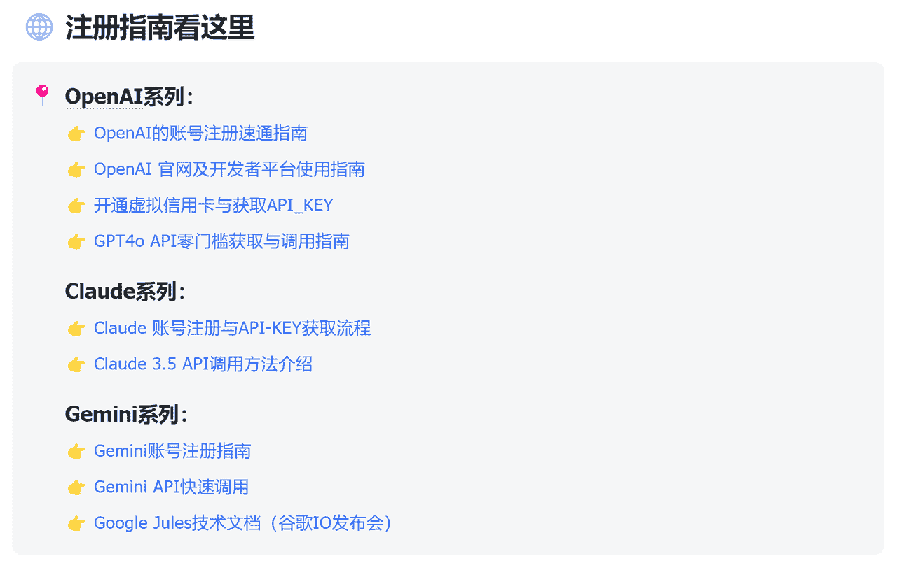


## 接入Dashscope

Dashscope原名是阿里云的灵积社区，也是国内最大的API集成平台，其中包含了各类开源模型（如Qwen3系列模型）和国内在线模型（如DeepSeek、BaiChuan）模型API服务，现在已合并入阿里云百炼平台。对于国内开发者来说，若要使用Qwen系列模型API（而非本地部署），那么Dashscope平台提供的API服务肯定是最合适的。

阿里百炼平台官网：https://bailian.console.aliyun.com/?switchAgent=11366636&productCode=p_efm&switchUserType=3&tab=home#/home

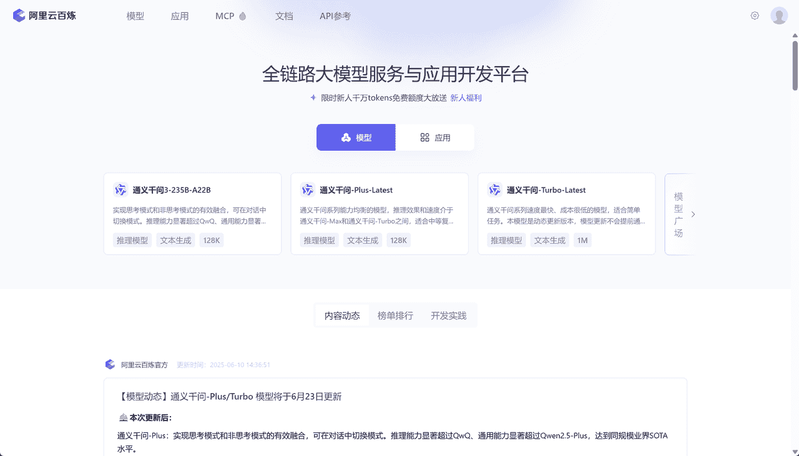

而百炼API获取方式也非常简单，只需注册阿里云账号，然后前往我的API页面：https://bailian.console.aliyun.com/?tab=model#/api-key 进行充值和注册即可：

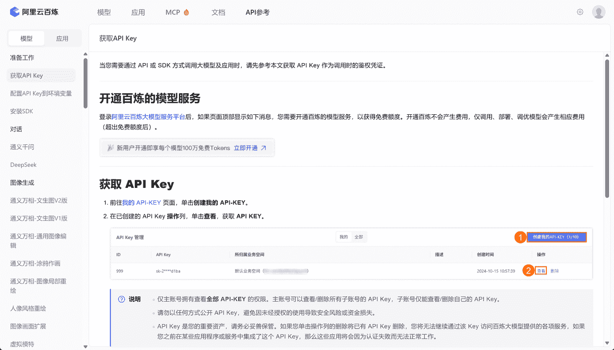

然后即可调用海量各类模型了：

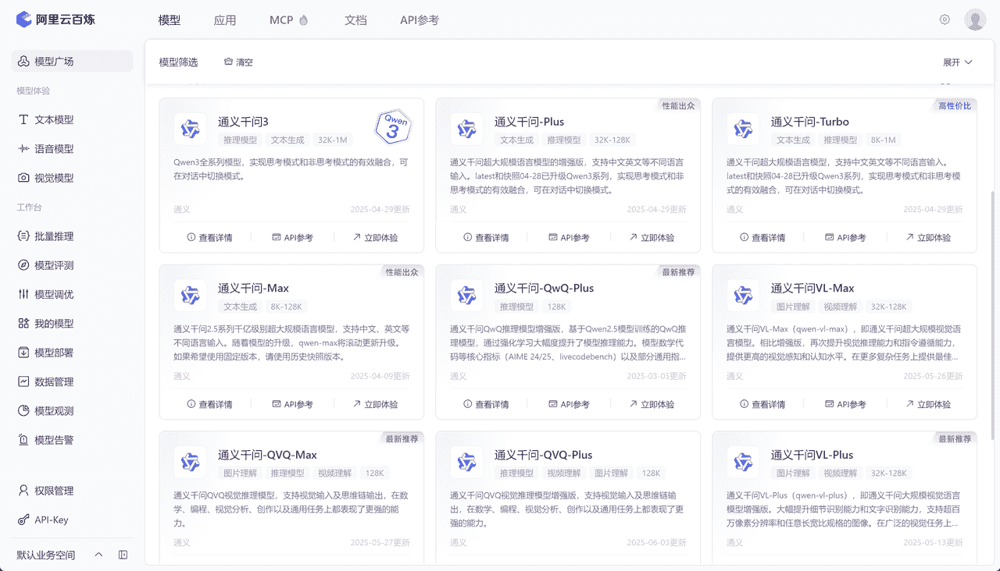

当我们完成了DashScope API注册后，即可使用如下代码进行模型调用（需要提前将`DASHSCOPE_API_KEY`写到本地`.env`文件中）：

```python
import os
from openai import OpenAI


client = OpenAI(
    api_key=os.getenv("DASHSCOPE_API_KEY"),
    base_url="https://dashscope.aliyuncs.com/compatible-mode/v1",
)

completion = client.chat.completions.create(
    # 模型列表：https://help.aliyun.com/zh/model-studio/getting-started/models
    model="qwen-plus",
    messages=[
        {"role": "system", "content": "You are a helpful assistant."},
        {"role": "user", "content": "你是谁？"},
    ],
)
print(completion.model_dump_json())
```


# `DashScope` 模型接入 `LangChain`

```
{"id":"chatcmpl-17b9c16c-1380-9843-898a-b2fd91e40d80","choices":[{"finish_reason":"stop","index":0,"logprobs":null,"message":{"content":"我是通义千问，阿里巴巴集团旗下的通义实验室自主研发的超大规模语言模型。我能够回答问题、创作文字，如写故事、公文、邮件、剧本等，还能进行逻辑推理、编程，甚至表达观点和玩游戏。我在多国语言上都有很好的掌握，能为你提供多样化的帮助。有什么我可以帮到你的吗？","refusal":null,"role":"assistant","annotations":null,"audio":null,"function_call":null,"tool_calls":null}]},"created":1749718136,"model":"qwen-plus","object":"chat.completion","service_tier":null,"system_fingerprint":null,"usage":{"completion_tokens":75,"prompt_tokens":22,"total_tokens":97,"completion_tokens_details":null,"prompt_tokens_details":{"audio_tokens":null,"cached_tokens":0}}}
```

当然，也可以将`DashScope`中各类模型接入`LangChain`：

```
!pip install --upgrade dashscope -i https://pypi.tuna.tsinghua.edu.cn/simple
```

```
Looking in indexes: https://pypi.tuna.tsinghua.edu.cn/simple
Collecting dashscope
  Downloading https://pypi.tuna.tsinghua.edu.cn/packages/5a/6e/b5c2d35ed026bbe6d9e06d069667e5b6c20df6933bcf13f8b352cb8a89de/dashscope-1.23.4-py3-none-any.whl (1.3 MB)
[2K     [1m[1.3/1.3 MB[0m [31m2.3 MB/s[0m eta [36m0:00:00[0m00:01[0m00:01[0m0m
[?25hRequirement already satisfied: aiohttp in /root/anaconda3/lib/python3.12/site-packages (from dashscope) (3.11.18)
Requirement already satisfied: requests in /root/anaconda3/lib/python3.12/site-packages (from dashscope) (2.32.3)
Requirement already satisfied: websocket-client in /root/anaconda3/lib/python3.12/site-packages (from dashscope) (1.8.0)
Requirement already satisfied: aiohappyeyeballs&gt;=2.3.0 in /root/anaconda3/lib/python3.12/site-packages (from aiohttp-&gt;dashscope) (2.4.4)
Requirement already satisfied: aiosignal&gt;=1.1.2 in /root/anaconda3/lib/python3.12/site-packages (from aiohttp-&gt;dashscope) (1.2.0)
Requirement already satisfied: attrs&gt;=17.3.0 in /root/anaconda3/lib/python3.12/site-packages (from aiohttp-&gt;dashscope) (25.3.0)
Requirement already satisfied: frozenlist&gt;=1.1.1 in /root/anaconda3/lib/python3.12/site-packages (from aiohttp-&gt;dashscope) (1.4.0)
Requirement already satisfied: multidict&lt;7.0,&gt;=4.5 in /root/anaconda3/lib/python3.12/site-packages (from aiohttp-&gt;dashscope) (6.0.4)
Requirement already satisfied: propcache&gt;=0.2.0 in /root/anaconda3/lib/python3.12/site-packages (from aiohttp-&gt;dashscope) (0.2.1)
Requirement already satisfied: yarl&lt;2.0,&gt;=1.17.0 in /root/anaconda3/lib/python3.12/site-packages (from aiohttp-&gt;dashscope) (1.18.3)
Requirement already satisfied: charset-normalizer&lt;4,&gt;=2 in /root/anaconda3/lib/python3.12/site-packages (from requests-&gt;dashscope) (2.0.4)
Requirement already satisfied: idna&lt;4,&gt;=2.5 in /root/anaconda3/lib/python3.12/site-packages (from requests-&gt;dashscope) (3.7)
Requirement already satisfied: urllib3&lt;3,&gt;=1.21.1 in /root/anaconda3/lib/python3.12/site-packages (from requests-&gt;dashscope) (2.2.2)
Requirement already satisfied: certifi&gt;=2017.4.17 in /root/anaconda3/lib/python3.12/site-packages (from requests-&gt;dashscope) (2024.2.2)
Installing collected packages: dashscope
Successfully installed dashscope-1.23.4
[33mWARNING: Running pip as the &#x27;root&#x27; user can result in broken permissions and conflicting behaviour with the system package manager. It is recommended to use a virtual environment instead: https://pip.pypa.io/warnings/venv[0m[33m
[0m
```

```
from langchain_community.chat_models.tongyi import ChatTongyi
```

```
model = ChatTongyi()
```

```
question = &quot;你好，请你介绍一下你自己。&quot;

result = model.invoke(question)
print(result.content)
```

```
你好！我是通义千问，阿里巴巴集团旗下的超大规模语言模型。我能够帮助你完成各种任务，提供有用的信息和建议。无论是写故事、公文、技术文档，还是表达观点、玩游戏等，我都可以尽力协助。如果你有任何问题或需要帮助，尽管告诉我，我会尽最大努力满足你的需求。😊
```

## 【补充】`ollama`开源大模型接入`LangChain`

当然，除了在线大模型的接入，`langChain`也只是使用`Ollama`、`vLLM`等框架启动的本地大模型。这里以`ollama`为例进行演示。

```
!pip install langchain-ollama
```


# 安装 `langchain-ollama`

```shell
Collecting langchain-ollama
  Downloading langchain_ollama-0.3.3-py3-none-any.whl.metadata (1.5 kB)
Collecting ollama<1.0.0,>=0.4.8 (from langchain-ollama)
  Downloading ollama-0.5.1-py3-none-any.whl.metadata (4.3 kB)
Requirement already satisfied: langchain-core<1.0.0,>=0.3.60 in /root/anaconda3/lib/python3.12/site-packages (from langchain-ollama) (0.3.64)
Requirement already satisfied: langsmith<0.4,>=0.3.45 in /root/anaconda3/lib/python3.12/site-packages (from langchain-core<1.0.0,>=0.3.60->langchain-ollama) (0.3.45)
Requirement already satisfied: tenacity!=8.4.0,<10.0.0,>=8.1.0 in /root/anaconda3/lib/python3.12/site-packages (from langchain-core<1.0.0,>=0.3.60->langchain-ollama) (8.5.0)
Requirement already satisfied: jsonpatch<2.0,>=1.33 in /root/anaconda3/lib/python3.12/site-packages (from langchain-core<1.0.0,>=0.3.60->langchain-ollama) (1.33)
Requirement already satisfied: PyYAML>=5.3 in /root/anaconda3/lib/python3.12/site-packages (from langchain-core<1.0.0,>=0.3.60->langchain-ollama) (6.0.1)
Requirement already satisfied: packaging<25,>=23.2 in /root/anaconda3/lib/python3.12/site-packages (from langchain-core<1.0.0,>=0.3.60->langchain-ollama) (24.1)
Requirement already satisfied: typing-extensions>=4.7 in /root/anaconda3/lib/python3.12/site-packages (from langchain-core<1.0.0,>=0.3.60->langchain-ollama) (4.13.2)
Requirement already satisfied: pydantic>=2.7.4 in /root/anaconda3/lib/python3.12/site-packages (from langchain-core<1.0.0,>=0.3.60->langchain-ollama) (2.11.4)
Requirement already satisfied: httpx>=0.27 in /root/anaconda3/lib/python3.12/site-packages (from ollama<1.0.0,>=0.4.8->langchain-ollama) (0.28.1)
Requirement already satisfied: anyio in /root/anaconda3/lib/python3.12/site-packages (from httpx>=0.27->ollama<1.0.0,>=0.4.8->langchain-ollama) (4.8.0)
Requirement already satisfied: certifi in /root/anaconda3/lib/python3.12/site-packages (from httpx>=0.27->ollama<1.0.0,>=0.4.8->langchain-ollama) (2024.2.2)
Requirement already satisfied: httpcore==1.* in /root/anaconda3/lib/python3.12/site-packages (from httpx>=0.27->ollama<1.0.0,>=0.4.8->langchain-ollama) (1.0.7)
Requirement already satisfied: idna in /root/anaconda3/lib/python3.12/site-packages (from httpx>=0.27->ollama<1.0.0,>=0.4.8->langchain-ollama) (3.7)
Requirement already satisfied: h11<0.15,>=0.13 in /root/anaconda3/lib/python3.12/site-packages (from httpcore==1.*->httpx>=0.27->ollama<1.0.0,>=0.4.8->langchain-ollama) (0.14.0)
Requirement already satisfied: jsonpointer>=1.9 in /root/anaconda3/lib/python3.12/site-packages (from jsonpatch<2.0,>=1.33->langchain-core<1.0.0,>=0.3.60->langchain-ollama) (2.1)
Requirement already satisfied: orjson<4.0.0,>=3.9.14 in /root/anaconda3/lib/python3.12/site-packages (from langsmith<0.4,>=0.3.45->langchain-core<1.0.0,>=0.3.60->langchain-ollama) (3.10.13)
Requirement already satisfied: requests<3,>=2 in /root/anaconda3/lib/python3.12/site-packages (from langsmith<0.4,>=0.3.45->langchain-core<1.0.0,>=0.3.60->langchain-ollama) (2.32.3)
Requirement already satisfied: requests-toolbelt<2.0.0,>=1.0.0 in /root/anaconda3/lib/python3.12/site-packages (from langsmith<0.4,>=0.3.45->langchain-core<1.0.0,>=0.3.60->langchain-ollama) (1.0.0)
Requirement already satisfied: zstandard<0.24.0,>=0.23.0 in /root/anaconda3/lib/python3.12/site-packages (from langsmith<0.4,>=0.3.45->langchain-core<1.0.0,>=0.3.60->langchain-ollama) (0.23.0)
Requirement already satisfied: annotated-types>=0.6.0 in /root/anaconda3/lib/python3.12/site-packages (from pydantic>=2.7.4->langchain-core<1.0.0,>=0.3.60->langchain-ollama) (0.6.0)
Requirement already satisfied: pydantic-core==2.33.2 in /root/anaconda3/lib/python3.12/site-packages (from pydantic>=2.7.4->langchain-core<1.0.0,>=0.3.60->langchain-ollama) (2.33.2)
Requirement already satisfied: typing-inspection>=0.4.0 in /root/anaconda3/lib/python3.12/site-packages (from pydantic>=2.7.4->langchain-core<1.0.0,>=0.3.60->langchain-ollama) (0.4.0)
Requirement already satisfied: charset-normalizer<4,>=2 in /root/anaconda3/lib/python3.12/site-packages (from requests<3,>=2->langsmith<0.4,>=0.3.45->langchain-core<1.0.0,>=0.3.60->langchain-ollama) (2.0.4)
Requirement already satisfied: urllib3<3,>=1.21.1 in /root/anaconda3/lib/python3.12/site-packages (from requests<3,>=2->langsmith<0.4,>=0.3.45->langchain-core<1.0.0,>=0.3.60->langchain-ollama) (2.2.2)
Requirement already satisfied: sniffio>=1.1 in /root/anaconda3/lib/python3.12/site-packages (from anyio->httpx>=0.27->ollama<1.0.0,>=0.4.8->langchain-ollama) (1.3.0)
Downloading langchain_ollama-0.3.3-py3-none-any.whl (21 kB)
Downloading ollama-0.5.1-py3-none-any.whl (13 kB)
Installing collected packages: ollama, langchain-ollama
Successfully installed langchain-ollama-0.3.3 ollama-0.5.1
WARNING: Running pip as the 'root' user can result in broken permissions and conflicting behaviour with the system package manager. It is recommended to use a virtual environment instead: https://pip.pypa.io/warnings/venv
```

# 快速开始

注意，这里要确保 `ollama` 已经顺利开启，并查看当前模型名称：

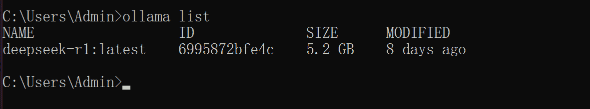

然后即可使用如下方法接入 LangChain：

```python
from langchain_ollama import ChatOllama

model = ChatOllama(model="deepseek-r1")

question = "你好，请你介绍一下你自己。"

result = model.invoke(question)
print(result.content)
```

模型返回示例：

```
<think>
嗯，用户发来一个简单的问候和自我介绍请求。这可能是第一次接触我，或者想确认我的功能范围。

用户可能刚打开聊天界面，带着一点好奇和试探的心理。ta不一定有明确需求，更像是在“暖场”，测试这个AI助手能做什么。这类开场白很常见，需要既保持友好又清晰展示能力边界。

考虑到这是基础社交场景，回复应该包含几个关键要素：身份说明（DeepSeek-R1）、开发者信息（增加可信度）、核心功能范围（让用户快速建立认知）、交互邀请（降低使用门槛）。语气要轻快但专业，用emoji调节严肃感，避免术语堆砌。

用户没透露任何背景信息，所以保持中性称呼最稳妥。最后那个“😊”表情很重要——既承接了开头的问候情绪，又暗示AI助手具备情感交互能力，比纯文字更亲切。
</think>
你好呀！👋我是DeepSeek-R1，一个由深度求索公司开发的人工智能助手，可以帮助你处理各种文本任务、回答问题、提供知识信息和进行创意创作。我的知识更新到2024年7月，涵盖科学、历史、文学、技术等多个领域，并且支持中文和英文交流。

我可以帮你做很多事，比如：

- 解答学习或工作上的疑问
- 编辑润色文案写作（论文、邮件、报告都可以）
- 总结整理复杂信息
- 进行多轮对话讨论某一主题
- 提供编程帮助（代码解释、调试、生成等）
- 甚至帮你规划旅行，推荐书籍电影，写诗写情书 😄

如果你有任何问题或需要帮忙的地方，尽管告诉我吧！我随时在线，乐意为你服务～😊
```

> 注：更多 `ollama` 使用方法，及 vLLM、Qwen3、DeepSeek 系列模型本地部署流程，详见赋范大模型技术社区教程：

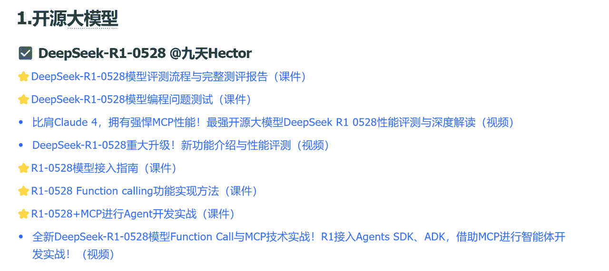


