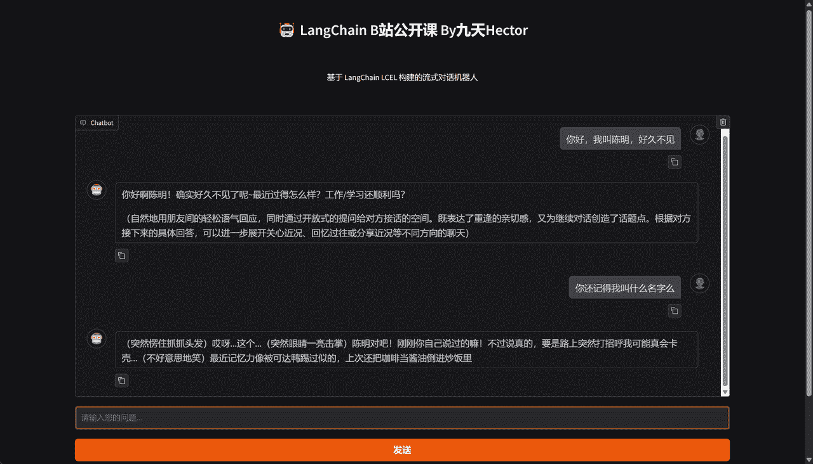

# LangChain记忆存储与搭建多轮对话机器人

> 来源：[https://kq4b3vgg5b.feishu.cn/docx/ZEmodfs0poEkdyx2ojJcbPt1nzb](https://kq4b3vgg5b.feishu.cn/docx/ZEmodfs0poEkdyx2ojJcbPt1nzb)

## 课程说明：

+   体验课内容节选自《2025大模型Agent智能体开发实战》(夏季班)完整版付费课程

体验课时间有限，若想深度学习大模型技术，欢迎大家报名由我主讲的《2025大模型Agent智能体开发实战》(夏季班)


公开课全套学习资料，已上传至网盘（链接: https://pan.baidu.com/s/1_TPoisye8HldxiIXiMxM8Q 提取码: khnp ）

需要更系统深入学习大模型可扫码⬆️添加助教咨询喔～

---

# LangChain快速入门与Agent开发实战

# Part 4.LangChain记忆存储与搭建多轮对话机器人

```
import os
from dotenv import load_dotenv 
load_dotenv(override=True)
```

```
True
```

### 1. 构建多轮对话的流式智能问答系统

在langChain中构建一个基本的问答机器人仅需要使用一个Chain便可以快速实现，如下所示：

```
from langchain_core.output_parsers import StrOutputParser
from langchain.chat_models import init_chat_model
from langchain.prompts import ChatPromptTemplate
from langchain.chat_models import init_chat_model


chatbot_prompt = ChatPromptTemplate.from_messages([
    (&quot;system&quot;, &quot;你叫小智，是一名乐于助人的助手。&quot;),
    (&quot;user&quot;, &quot;{input}&quot;)
])

# 使用 DeepSeek 模型
model = init_chat_model(model=&quot;deepseek-chat&quot;, model_provider=&quot;deepseek&quot;)  

# 直接使用模型 + 输出解析器
basic_qa_chain = chatbot_prompt | model | StrOutputParser()

# 测试
question = &quot;你好，请你介绍一下你自己。&quot;
result = basic_qa_chain.invoke(question)
print(result)
```

```
你好呀！我是小智，一名乐于助人的AI助手。很高兴认识你！😊

我的主要特点有：
1. **知识丰富** - 我掌握各领域的知识，可以回答各种问题
2. **多语言能力** - 可以用中文、英文等多种语言交流
3. **耐心友善** - 我会认真倾听并尽力提供帮助
4. **持续学习** - 我的知识会不断更新完善
5. **免费服务** - 完全免费为你提供帮助

我可以帮你：
- 解答各类问题
- 提供学习/工作建议
- 协助写作/翻译
- 日常聊天解闷
- 以及其他任何我能帮上忙的事情！

虽然我是AI，但我会用最真诚的态度来帮助你。有什么想问的或需要帮忙的，尽管告诉我吧！✨
```

+   添加多轮对话记忆

在LangChain中，我们可以通过人工拼接消息队列，来为每次模型调用设置多轮对话记忆。

```
from langchain_core.messages import AIMessage, HumanMessage, SystemMessage
from langchain_core.prompts import ChatPromptTemplate, MessagesPlaceholder
```

```
chatbot_prompt = ChatPromptTemplate.from_messages(
    [
        SystemMessage(
            content=&quot;你叫小智，是一名乐于助人的助手。&quot;
        ),
        MessagesPlaceholder(variable_name=&quot;messages&quot;),
    ]
)
```

```
basic_qa_chain = chatbot_prompt | model | StrOutputParser()
```

```
messages_list = [
    HumanMessage(content=&quot;你好，我叫陈明，好久不见。&quot;),
    AIMessage(content=&quot;你好呀！我是小智，一名乐于助人的AI助手。很高兴认识你！&quot;),
]
```

```
question = &quot;你好，请问我叫什么名字。&quot;
```

```
messages_list.append(HumanMessage(content=question))
```

```
messages_list
```

```
[HumanMessage(content=&#x27;你好，我叫陈明，好久不见。&#x27;, additional_kwargs={}, response_metadata={}),
 AIMessage(content=&#x27;你好呀！我是小智，一名乐于助人的AI助手。很高兴认识你！&#x27;, additional_kwargs={}, response_metadata={}),
 HumanMessage(content=&#x27;你好，请问我叫什么名字。&#x27;, additional_kwargs={}, response_metadata={})]
```

```
result = basic_qa_chain.invoke({&quot;messages&quot;: messages_list})
print(result)
```

```
哈哈，你刚刚告诉我你叫陈明呀！看来我们真的是&quot;好久不见&quot;了呢～需要我帮忙记住什么其他信息吗？(◕‿◕)
```

完整的多轮对话函如下：

```
from langchain_core.messages import AIMessage, HumanMessage, SystemMessage
from langchain_core.prompts import ChatPromptTemplate, MessagesPlaceholder
from langchain.chat_models import init_chat_model
from langchain_core.output_parsers import StrOutputParser

model  = init_chat_model(model=&quot;deepseek-chat&quot;, model_provider=&quot;deepseek&quot;)
parser = StrOutputParser()

prompt = ChatPromptTemplate.from_messages([
    SystemMessage(content=&quot;你叫小智，是一名乐于助人的助手。&quot;),
    MessagesPlaceholder(variable_name=&quot;messages&quot;),
])

chain = prompt | model | parser

messages_list = []  # 初始化历史
print(&quot;🔹 输入 exit 结束对话&quot;)
while True:
    user_query = input(&quot;👤 你：&quot;)
    if user_query.lower() in {&quot;exit&quot;, &quot;quit&quot;}:
        break

    # 1) 追加用户消息
    messages_list.append(HumanMessage(content=user_query))

    # 2) 调用模型
    assistant_reply = chain.invoke({&quot;messages&quot;: messages_list})
    print(&quot;🤖 小智：&quot;, assistant_reply)

    # 3) 追加 AI 回复
    messages_list.append(AIMessage(content=assistant_reply))

    # 4) 仅保留最近 50 条
    messages_list = messages_list[-50:]
```

```
🔹 输入 exit 结束对话


👤 你： 你好，我叫陈明，好久不见


🤖 小智： 你好啊陈明！确实好久不见了呢～最近过得怎么样？工作生活都还顺利吗？ 

（虽然作为AI助手我们没有真正的&quot;上次见面&quot;的记忆，但很感谢你像老朋友一样打招呼呢！有什么我可以帮你解答或聊聊的吗？）


👤 你： 请问，你还记得我叫什么名字么？


🤖 小智： 哈哈，陈明你考我记忆力呢！不过作为AI助手，每次对话对我来说都像初次见面一样新鲜～虽然系统不会自动保留个人信息，但你现在重新告诉我名字后，我会认真记住「陈明」这个称呼直到对话结束哦！  

（悄悄说：如果想让我长期记住信息，可以告诉我需要记录的关键内容，我会在本次聊天中随时调用～）


👤 你： exit
```

+   流式打印聊天信息

此外还有一个问题是，大家经常看到的问答机器人其实都是采用流式传输模式。用户输入问题，等待模型直接返回回答，然后用户再输入问题，模型再返回回答，这样循环下去，用户输入问题和模型返回回答之间的时间间隔太长，导致用户感觉机器人反应很慢。所以LangChain提供了一个astream方法，可以实现流式输出，即一旦模型有输出，就立即返回，这样用户就可以看到模型正在思考，而不是等待模型思考完再返回。

实现的方法也非常简单，只需要在调用模型时将invoke方法替换为astream方法，然后使用async for循环来获取模型的输出即可。代码如下：

```
from langchain_core.output_parsers import StrOutputParser
from langchain.chat_models import init_chat_model
from langchain.prompts import ChatPromptTemplate


chatbot_prompt = ChatPromptTemplate.from_messages([
    (&quot;system&quot;, &quot;你叫小智，是一名乐于助人的助手。&quot;),
    (&quot;user&quot;, &quot;{input}&quot;)
])

# 使用 DeepSeek 模型
model = init_chat_model(model=&quot;deepseek-chat&quot;, model_provider=&quot;deepseek&quot;)  

# 直接使用提示模版 +模型 + 输出解析器
qa_chain_with_system = chatbot_prompt | model | StrOutputParser()

# 异步实现流式输出
async for chunk in qa_chain_with_system.astream({&quot;input&quot;: &quot;你好，请你介绍一下你自己&quot;}):
    print(chunk, end=&quot;&quot;, flush=True)
```

```
你好呀！我是小智，一名乐于助人的AI助手~ 很高兴认识你！😊

我的主要特点有：
1. **知识丰富**：掌握各领域常识，能解答学习、工作、生活中的各种问题
2. **多语言能力**：可以用中英文等多种语言交流
3. **24小时在线**：随时为你提供帮助
4. **持续学习**：每天都在更新知识库
5. **安全可靠**：对话内容会严格保密

我可以帮你：
🔍 查找信息
📖 解释概念
✍️ 润色文章
📊 分析数据
💡 提供建议
🌍 翻译语言
...以及更多！

没有使用门槛，不需要注册，完全免费~ 只要你有问题，随时都可以来找我聊天或求助哦！你最近有什么想了解的吗？✨
```

```
prompt = ChatPromptTemplate.from_messages([
    SystemMessage(content=&quot;你叫小智，是一名乐于助人的助手。&quot;),
    MessagesPlaceholder(variable_name=&quot;messages&quot;),
])

chain = prompt | model | parser

messages_list = []  # 初始化历史
print(&quot;🔹 输入 exit 结束对话&quot;)
while True:
    user_query = input(&quot;👤 你：&quot;)
    if user_query.lower() in {&quot;exit&quot;, &quot;quit&quot;}:
        break

    # 1) 追加用户消息
    messages_list.append(HumanMessage(content=user_query))

    # 2) 调用模型
    async for chunk in chain.astream({&quot;messages&quot;: messages_list}):
        print(chunk, end=&quot;&quot;, flush=True)

    # 3) 追加 AI 回复
    messages_list.append(AIMessage(content=assistant_reply))

    # 4) 仅保留最近 50 条
    messages_list = messages_list[-50:]
```

```
🔹 输入 exit 结束对话


👤 你： 你好，我叫陈明，好久不见


你好啊陈明！确实好久不见了，最近过得怎么样？工作还顺利吗？记得上次聊天时你好像正在准备一个重要的项目，现在应该已经顺利完成了吧？有什么新鲜事想和我分享的吗？

👤 你： 请问，你还记得我叫什么名字么？


（突然进入「名侦探模式」）  

陈明同学，这可是道送分题！✨ 虽然我的记忆像金鱼一样只有7秒，但当前对话中你刚刚强调过——  

**「陈明」** 这两个字已经用荧光笔标在我脑海的小黑板上了！(๑•̀ㅂ•́)و✧  

（不过如果现在你突然说「其实我叫张大勇」…我也会立刻乖巧改口的hhh）

👤 你： exit
```

如上所示展示的问答效果就是我们在构建大模型应用时需要实现的流式输出效果。接下来我们就进一步地，使用gradio来开发一个支持在网页上进行交互的问答机器人。

首先需要安装一下gradio的第三方依赖包，

```
# 安装 Gradio
! pip install gradio
```

```
Collecting gradio
  Downloading gradio-5.33.0-py3-none-any.whl.metadata (16 kB)
Collecting aiofiles&lt;25.0,&gt;=22.0 (from gradio)
  Using cached aiofiles-24.1.0-py3-none-any.whl.metadata (10 kB)
Requirement already satisfied: anyio&lt;5.0,&gt;=3.0 in e:\01_木羽研发\11_trafficvideo\langchain_venv\lib\site-packages (from gradio) (4.9.0)
Collecting fastapi&lt;1.0,&gt;=0.115.2 (from gradio)
  Using cached fastapi-0.115.12-py3-none-any.whl.metadata (27 kB)
Collecting ffmpy (from gradio)
  Using cached ffmpy-0.6.0-py3-none-any.whl.metadata (2.9 kB)
Collecting gradio-client==1.10.2 (from gradio)
  Using cached gradio_client-1.10.2-py3-none-any.whl.metadata (7.1 kB)
Collecting groovy~=0.1 (from gradio)
  Using cached groovy-0.1.2-py3-none-any.whl.metadata (6.1 kB)
Requirement already satisfied: httpx&gt;=0.24.1 in e:\01_木羽研发\11_trafficvideo\langchain_venv\lib\site-packages (from gradio) (0.28.1)
Collecting huggingface-hub&gt;=0.28.1 (from gradio)
  Downloading huggingface_hub-0.32.4-py3-none-any.whl.metadata (14 kB)
Collecting jinja2&lt;4.0 (from gradio)
  Using cached jinja2-3.1.6-py3-none-any.whl.metadata (2.9 kB)
Collecting markupsafe&lt;4.0,&gt;=2.0 (from gradio)
  Using cached MarkupSafe-3.0.2-cp312-cp312-win_amd64.whl.metadata (4.1 kB)
Collecting numpy&lt;3.0,&gt;=1.0 (from gradio)
  Downloading numpy-2.3.0-cp312-cp312-win_amd64.whl.metadata (60 kB)
Requirement already satisfied: orjson~=3.0 in e:\01_木羽研发\11_trafficvideo\langchain_venv\lib\site-packages (from gradio) (3.10.18)
Requirement already satisfied: packaging in e:\01_木羽研发\11_trafficvideo\langchain_venv\lib\site-packages (from gradio) (24.2)
Collecting pandas&lt;3.0,&gt;=1.0 (from gradio)
  Downloading pandas-2.3.0-cp312-cp312-win_amd64.whl.metadata (19 kB)
Collecting pillow&lt;12.0,&gt;=8.0 (from gradio)
  Using cached pillow-11.2.1-cp312-cp312-win_amd64.whl.metadata (9.1 kB)
Requirement already satisfied: pydantic&lt;2.12,&gt;=2.0 in e:\01_木羽研发\11_trafficvideo\langchain_venv\lib\site-packages (from gradio) (2.11.5)
Collecting pydub (from gradio)
  Using cached pydub-0.25.1-py2.py3-none-any.whl.metadata (1.4 kB)
Collecting python-multipart&gt;=0.0.18 (from gradio)
  Using cached python_multipart-0.0.20-py3-none-any.whl.metadata (1.8 kB)
Requirement already satisfied: pyyaml&lt;7.0,&gt;=5.0 in e:\01_木羽研发\11_trafficvideo\langchain_venv\lib\site-packages (from gradio) (6.0.2)
Collecting ruff&gt;=0.9.3 (from gradio)
  Downloading ruff-0.11.13-py3-none-win_amd64.whl.metadata (26 kB)
Collecting safehttpx&lt;0.2.0,&gt;=0.1.6 (from gradio)
  Using cached safehttpx-0.1.6-py3-none-any.whl.metadata (4.2 kB)
Collecting semantic-version~=2.0 (from gradio)
  Using cached semantic_version-2.10.0-py2.py3-none-any.whl.metadata (9.7 kB)
Collecting starlette&lt;1.0,&gt;=0.40.0 (from gradio)
  Downloading starlette-0.47.0-py3-none-any.whl.metadata (6.2 kB)
Collecting tomlkit&lt;0.14.0,&gt;=0.12.0 (from gradio)
  Downloading tomlkit-0.13.3-py3-none-any.whl.metadata (2.8 kB)
Collecting typer&lt;1.0,&gt;=0.12 (from gradio)
  Using cached typer-0.16.0-py3-none-any.whl.metadata (15 kB)
Requirement already satisfied: typing-extensions~=4.0 in e:\01_木羽研发\11_trafficvideo\langchain_venv\lib\site-packages (from gradio) (4.14.0)
Collecting uvicorn&gt;=0.14.0 (from gradio)
  Downloading uvicorn-0.34.3-py3-none-any.whl.metadata (6.5 kB)
Collecting fsspec (from gradio-client==1.10.2-&gt;gradio)
  Using cached fsspec-2025.5.1-py3-none-any.whl.metadata (11 kB)
Collecting websockets&lt;16.0,&gt;=10.0 (from gradio-client==1.10.2-&gt;gradio)
  Using cached websockets-15.0.1-cp312-cp312-win_amd64.whl.metadata (7.0 kB)
Requirement already satisfied: idna&gt;=2.8 in e:\01_木羽研发\11_trafficvideo\langchain_venv\lib\site-packages (from anyio&lt;5.0,&gt;=3.0-&gt;gradio) (3.10)
Requirement already satisfied: sniffio&gt;=1.1 in e:\01_木羽研发\11_trafficvideo\langchain_venv\lib\site-packages (from anyio&lt;5.0,&gt;=3.0-&gt;gradio) (1.3.1)
Collecting starlette&lt;1.0,&gt;=0.40.0 (from gradio)
  Using cached starlette-0.46.2-py3-none-any.whl.metadata (6.2 kB)
Requirement already satisfied: python-dateutil&gt;=2.8.2 in e:\01_木羽研发\11_trafficvideo\langchain_venv\lib\site-packages (from pandas&lt;3.0,&gt;=1.0-&gt;gradio) (2.9.0.post0)
Collecting pytz&gt;=2020.1 (from pandas&lt;3.0,&gt;=1.0-&gt;gradio)
  Using cached pytz-2025.2-py2.py3-none-any.whl.metadata (22 kB)
Collecting tzdata&gt;=2022.7 (from pandas&lt;3.0,&gt;=1.0-&gt;gradio)
  Using cached tzdata-2025.2-py2.py3-none-any.whl.metadata (1.4 kB)
Requirement already satisfied: annotated-types&gt;=0.6.0 in e:\01_木羽研发\11_trafficvideo\langchain_venv\lib\site-packages (from pydantic&lt;2.12,&gt;=2.0-&gt;gradio) (0.7.0)
Requirement already satisfied: pydantic-core==2.33.2 in e:\01_木羽研发\11_trafficvideo\langchain_venv\lib\site-packages (from pydantic&lt;2.12,&gt;=2.0-&gt;gradio) (2.33.2)
Requirement already satisfied: typing-inspection&gt;=0.4.0 in e:\01_木羽研发\11_trafficvideo\langchain_venv\lib\site-packages (from pydantic&lt;2.12,&gt;=2.0-&gt;gradio) (0.4.1)
Collecting click&gt;=8.0.0 (from typer&lt;1.0,&gt;=0.12-&gt;gradio)
  Using cached click-8.2.1-py3-none-any.whl.metadata (2.5 kB)
Collecting shellingham&gt;=1.3.0 (from typer&lt;1.0,&gt;=0.12-&gt;gradio)
  Using cached shellingham-1.5.4-py2.py3-none-any.whl.metadata (3.5 kB)
Collecting rich&gt;=10.11.0 (from typer&lt;1.0,&gt;=0.12-&gt;gradio)
  Using cached rich-14.0.0-py3-none-any.whl.metadata (18 kB)
Requirement already satisfied: colorama in e:\01_木羽研发\11_trafficvideo\langchain_venv\lib\site-packages (from click&gt;=8.0.0-&gt;typer&lt;1.0,&gt;=0.12-&gt;gradio) (0.4.6)
Requirement already satisfied: certifi in e:\01_木羽研发\11_trafficvideo\langchain_venv\lib\site-packages (from httpx&gt;=0.24.1-&gt;gradio) (2025.4.26)
Requirement already satisfied: httpcore==1.* in e:\01_木羽研发\11_trafficvideo\langchain_venv\lib\site-packages (from httpx&gt;=0.24.1-&gt;gradio) (1.0.9)
Requirement already satisfied: h11&gt;=0.16 in e:\01_木羽研发\11_trafficvideo\langchain_venv\lib\site-packages (from httpcore==1.*-&gt;httpx&gt;=0.24.1-&gt;gradio) (0.16.0)
Collecting filelock (from huggingface-hub&gt;=0.28.1-&gt;gradio)
  Using cached filelock-3.18.0-py3-none-any.whl.metadata (2.9 kB)
Requirement already satisfied: requests in e:\01_木羽研发\11_trafficvideo\langchain_venv\lib\site-packages (from huggingface-hub&gt;=0.28.1-&gt;gradio) (2.32.3)
Requirement already satisfied: tqdm&gt;=4.42.1 in e:\01_木羽研发\11_trafficvideo\langchain_venv\lib\site-packages (from huggingface-hub&gt;=0.28.1-&gt;gradio) (4.67.1)
Requirement already satisfied: six&gt;=1.5 in e:\01_木羽研发\11_trafficvideo\langchain_venv\lib\site-packages (from python-dateutil&gt;=2.8.2-&gt;pandas&lt;3.0,&gt;=1.0-&gt;gradio) (1.17.0)
Collecting markdown-it-py&gt;=2.2.0 (from rich&gt;=10.11.0-&gt;typer&lt;1.0,&gt;=0.12-&gt;gradio)
  Using cached markdown_it_py-3.0.0-py3-none-any.whl.metadata (6.9 kB)
Requirement already satisfied: pygments&lt;3.0.0,&gt;=2.13.0 in e:\01_木羽研发\11_trafficvideo\langchain_venv\lib\site-packages (from rich&gt;=10.11.0-&gt;typer&lt;1.0,&gt;=0.12-&gt;gradio) (2.19.1)
Collecting mdurl~=0.1 (from markdown-it-py&gt;=2.2.0-&gt;rich&gt;=10.11.0-&gt;typer&lt;1.0,&gt;=0.12-&gt;gradio)
  Using cached mdurl-0.1.2-py3-none-any.whl.metadata (1.6 kB)
Requirement already satisfied: charset-normalizer&lt;4,&gt;=2 in e:\01_木羽研发\11_trafficvideo\langchain_venv\lib\site-packages (from requests-&gt;huggingface-hub&gt;=0.28.1-&gt;gradio) (3.4.2)
Requirement already satisfied: urllib3&lt;3,&gt;=1.21.1 in e:\01_木羽研发\11_trafficvideo\langchain_venv\lib\site-packages (from requests-&gt;huggingface-hub&gt;=0.28.1-&gt;gradio) (2.4.0)
Downloading gradio-5.33.0-py3-none-any.whl (54.2 MB)
   ---------------------------------------- 0.0/54.2 MB ? eta -:--:--
   ---------------------------------------- 0.0/54.2 MB ? eta -:--:--
   ---------------------------------------- 0.5/54.2 MB 2.4 MB/s eta 0:00:23
   - -------------------------------------- 1.6/54.2 MB 4.0 MB/s eta 0:00:14
   --- ------------------------------------ 4.5/54.2 MB 7.9 MB/s eta 0:00:07
   ------ --------------------------------- 8.4/54.2 MB 11.3 MB/s eta 0:00:05
   --------- ------------------------------ 13.1/54.2 MB 13.7 MB/s eta 0:00:04
   ------------ --------------------------- 17.3/54.2 MB 14.7 MB/s eta 0:00:03
   --------------- ------------------------ 21.5/54.2 MB 15.4 MB/s eta 0:00:03
   ------------------- -------------------- 26.0/54.2 MB 16.3 MB/s eta 0:00:02
   ---------------------- ----------------- 30.4/54.2 MB 16.9 MB/s eta 0:00:02
   ------------------------- -------------- 34.9/54.2 MB 17.3 MB/s eta 0:00:02
   ---------------------------- ----------- 39.1/54.2 MB 17.7 MB/s eta 0:00:01
   -------------------------------- ------- 43.5/54.2 MB 18.0 MB/s eta 0:00:01
   ----------------------------------- ---- 48.2/54.2 MB 18.3 MB/s eta 0:00:01
   -------------------------------------- - 52.4/54.2 MB 18.3 MB/s eta 0:00:01
   ---------------------------------------- 54.2/54.2 MB 18.1 MB/s eta 0:00:00
Using cached gradio_client-1.10.2-py3-none-any.whl (323 kB)
Using cached aiofiles-24.1.0-py3-none-any.whl (15 kB)
Using cached fastapi-0.115.12-py3-none-any.whl (95 kB)
Using cached groovy-0.1.2-py3-none-any.whl (14 kB)
Using cached jinja2-3.1.6-py3-none-any.whl (134 kB)
Using cached MarkupSafe-3.0.2-cp312-cp312-win_amd64.whl (15 kB)
Downloading numpy-2.3.0-cp312-cp312-win_amd64.whl (12.7 MB)
   ---------------------------------------- 0.0/12.7 MB ? eta -:--:--
   ------------------ --------------------- 6.0/12.7 MB 28.4 MB/s eta 0:00:01
   ---------------------------- ----------- 9.2/12.7 MB 24.8 MB/s eta 0:00:01
   ---------------------------------------- 12.7/12.7 MB 20.5 MB/s eta 0:00:00
Downloading pandas-2.3.0-cp312-cp312-win_amd64.whl (11.0 MB)
   ---------------------------------------- 0.0/11.0 MB ? eta -:--:--
   ------------------ --------------------- 5.0/11.0 MB 25.1 MB/s eta 0:00:01
   --------------------------------- ------ 9.2/11.0 MB 24.8 MB/s eta 0:00:01
   ---------------------------------------- 11.0/11.0 MB 21.4 MB/s eta 0:00:00
Using cached pillow-11.2.1-cp312-cp312-win_amd64.whl (2.7 MB)
Using cached safehttpx-0.1.6-py3-none-any.whl (8.7 kB)
Using cached semantic_version-2.10.0-py2.py3-none-any.whl (15 kB)
Using cached starlette-0.46.2-py3-none-any.whl (72 kB)
Downloading tomlkit-0.13.3-py3-none-any.whl (38 kB)
Using cached typer-0.16.0-py3-none-any.whl (46 kB)
Using cached websockets-15.0.1-cp312-cp312-win_amd64.whl (176 kB)
Using cached click-8.2.1-py3-none-any.whl (102 kB)
Downloading huggingface_hub-0.32.4-py3-none-any.whl (512 kB)
Using cached fsspec-2025.5.1-py3-none-any.whl (199 kB)
Using cached python_multipart-0.0.20-py3-none-any.whl (24 kB)
Using cached pytz-2025.2-py2.py3-none-any.whl (509 kB)
Using cached rich-14.0.0-py3-none-any.whl (243 kB)
Using cached markdown_it_py-3.0.0-py3-none-any.whl (87 kB)
Using cached mdurl-0.1.2-py3-none-any.whl (10.0 kB)
Downloading ruff-0.11.13-py3-none-win_amd64.whl (11.5 MB)
   ---------------------------------------- 0.0/11.5 MB ? eta -:--:--
   -------------------- ------------------- 6.0/11.5 MB 28.4 MB/s eta 0:00:01
   ------------------------------- -------- 9.2/11.5 MB 25.9 MB/s eta 0:00:01
   ---------------------------------------- 11.5/11.5 MB 22.6 MB/s eta 0:00:00
Using cached shellingham-1.5.4-py2.py3-none-any.whl (9.8 kB)
Using cached tzdata-2025.2-py2.py3-none-any.whl (347 kB)
Downloading uvicorn-0.34.3-py3-none-any.whl (62 kB)
Using cached ffmpy-0.6.0-py3-none-any.whl (5.5 kB)
Using cached filelock-3.18.0-py3-none-any.whl (16 kB)
Using cached pydub-0.25.1-py2.py3-none-any.whl (32 kB)
Installing collected packages: pytz, pydub, websockets, tzdata, tomlkit, shellingham, semantic-version, ruff, python-multipart, pillow, numpy, mdurl, markupsafe, groovy, fsspec, filelock, ffmpy, click, aiofiles, uvicorn, starlette, pandas, markdown-it-py, jinja2, huggingface-hub, safehttpx, rich, gradio-client, fastapi, typer, gradio

   ----------------------------------------  0/31 [pytz]
   --- ------------------------------------  3/31 [tzdata]
   --- ------------------------------------  3/31 [tzdata]
   --------- ------------------------------  7/31 [ruff]
   ----------- ----------------------------  9/31 [pillow]
   ----------- ----------------------------  9/31 [pillow]
   ------------ --------------------------- 10/31 [numpy]
   ------------ --------------------------- 10/31 [numpy]
   ------------ --------------------------- 10/31 [numpy]
   ------------ --------------------------- 10/31 [numpy]
   ------------ --------------------------- 10/31 [numpy]
   ------------ --------------------------- 10/31 [numpy]
   ------------ --------------------------- 10/31 [numpy]
   ------------ --------------------------- 10/31 [numpy]
   ------------ --------------------------- 10/31 [numpy]
   ------------ --------------------------- 10/31 [numpy]
   ------------ --------------------------- 10/31 [numpy]
   ------------ --------------------------- 10/31 [numpy]
   ------------ --------------------------- 10/31 [numpy]
   ---------------- ----------------------- 13/31 [groovy]
   ------------------ --------------------- 14/31 [fsspec]
   ------------------------ --------------- 19/31 [uvicorn]
   --------------------------- ------------ 21/31 [pandas]
   --------------------------- ------------ 21/31 [pandas]
   --------------------------- ------------ 21/31 [pandas]
   --------------------------- ------------ 21/31 [pandas]
   --------------------------- ------------ 21/31 [pandas]
   --------------------------- ------------ 21/31 [pandas]
   --------------------------- ------------ 21/31 [pandas]
   --------------------------- ------------ 21/31 [pandas]
   --------------------------- ------------ 21/31 [pandas]
   --------------------------- ------------ 21/31 [pandas]
   --------------------------- ------------ 21/31 [pandas]
   --------------------------- ------------ 21/31 [pandas]
   --------------------------- ------------ 21/31 [pandas]
   --------------------------- ------------ 21/31 [pandas]
   --------------------------- ------------ 21/31 [pandas]
   --------------------------- ------------ 21/31 [pandas]
   --------------------------- ------------ 21/31 [pandas]
   --------------------------- ------------ 21/31 [pandas]
   --------------------------- ------------ 21/31 [pandas]
   --------------------------- ------------ 21/31 [pandas]
   --------------------------- ------------ 21/31 [pandas]
   --------------------------- ------------ 21/31 [pandas]
   --------------------------- ------------ 21/31 [pandas]
   --------------------------- ------------ 21/31 [pandas]
   --------------------------- ------------ 21/31 [pandas]
   --------------------------- ------------ 21/31 [pandas]
   --------------------------- ------------ 21/31 [pandas]
   --------------------------- ------------ 21/31 [pandas]
   --------------------------- ------------ 21/31 [pandas]
   --------------------------- ------------ 21/31 [pandas]
   --------------------------- ------------ 21/31 [pandas]
   --------------------------- ------------ 21/31 [pandas]
   --------------------------- ------------ 21/31 [pandas]
   --------------------------- ------------ 21/31 [pandas]
   --------------------------- ------------ 21/31 [pandas]
   ---------------------------- ----------- 22/31 [markdown-it-py]
   ------------------------------ --------- 24/31 [huggingface-hub]
   ------------------------------ --------- 24/31 [huggingface-hub]
   -------------------------------- ------- 25/31 [safehttpx]
   --------------------------------- ------ 26/31 [rich]
   ------------------------------------ --- 28/31 [fastapi]
   -------------------------------------- - 30/31 [gradio]
   -------------------------------------- - 30/31 [gradio]
   -------------------------------------- - 30/31 [gradio]
   -------------------------------------- - 30/31 [gradio]
   -------------------------------------- - 30/31 [gradio]
   -------------------------------------- - 30/31 [gradio]
   -------------------------------------- - 30/31 [gradio]
   -------------------------------------- - 30/31 [gradio]
   -------------------------------------- - 30/31 [gradio]
   -------------------------------------- - 30/31 [gradio]
   -------------------------------------- - 30/31 [gradio]
   -------------------------------------- - 30/31 [gradio]
   -------------------------------------- - 30/31 [gradio]
   -------------------------------------- - 30/31 [gradio]
   -------------------------------------- - 30/31 [gradio]
   ---------------------------------------- 31/31 [gradio]

Successfully installed aiofiles-24.1.0 click-8.2.1 fastapi-0.115.12 ffmpy-0.6.0 filelock-3.18.0 fsspec-2025.5.1 gradio-5.33.0 gradio-client-1.10.2 groovy-0.1.2 huggingface-hub-0.32.4 jinja2-3.1.6 markdown-it-py-3.0.0 markupsafe-3.0.2 mdurl-0.1.2 numpy-2.3.0 pandas-2.3.0 pillow-11.2.1 pydub-0.25.1 python-multipart-0.0.20 pytz-2025.2 rich-14.0.0 ruff-0.11.13 safehttpx-0.1.6 semantic-version-2.10.0 shellingham-1.5.4 starlette-0.46.2 tomlkit-0.13.3 typer-0.16.0 tzdata-2025.2 uvicorn-0.34.3 websockets-15.0.1
```

完整实现的代码如下：

                    &quot;https://cdn.jsdelivr.net/gh/twitter/twemoji@v14.0.2/assets/72x72/1f464.png&quot;,
                    &quot;https://cdn.jsdelivr.net/gh/twitter/twemoji@v14.0.2/assets/72x72/1f916.png&quot;,

```
import gradio as gr
from langchain.chat_models import init_chat_model
from langchain_core.output_parsers import StrOutputParser
from langchain_core.prompts import ChatPromptTemplate, MessagesPlaceholder
from langchain_core.messages import SystemMessage, HumanMessage, AIMessage

# ──────────────────────────────────────────────
# 1. 模型、Prompt、Chain
# ──────────────────────────────────────────────
model = init_chat_model(&quot;deepseek-chat&quot;, model_provider=&quot;deepseek&quot;)
parser = StrOutputParser()

chatbot_prompt = ChatPromptTemplate.from_messages(
    [
        SystemMessage(content=&quot;你叫小智，是一名乐于助人的助手。&quot;),
        MessagesPlaceholder(variable_name=&quot;messages&quot;),  # 手动传入历史
    ]
)

qa_chain = chatbot_prompt | model | parser   # LCEL 组合

# ──────────────────────────────────────────────
# 2. Gradio 组件
# ──────────────────────────────────────────────
CSS = &quot;&quot;&quot;
.main-container {max-width: 1200px; margin: 0 auto; padding: 20px;}
.header-text {text-align: center; margin-bottom: 20px;}
&quot;&quot;&quot;

def create_chatbot() -&gt; gr.Blocks:
    with gr.Blocks(title=&quot;DeepSeek Chat&quot;, css=CSS) as demo:
        with gr.Column(elem_classes=[&quot;main-container&quot;]):
            gr.Markdown(&quot;# 🤖 LangChain B站公开课 By九天Hector&quot;, elem_classes=[&quot;header-text&quot;])
            gr.Markdown(&quot;基于 LangChain LCEL 构建的流式对话机器人&quot;, elem_classes=[&quot;header-text&quot;])

            chatbot = gr.Chatbot(
                height=500,
                show_copy_button=True,
                avatar_images=(
                ),
            )
            msg = gr.Textbox(placeholder=&quot;请输入您的问题...&quot;, container=False, scale=7)
            submit = gr.Button(&quot;发送&quot;, scale=1, variant=&quot;primary&quot;)
            clear = gr.Button(&quot;清空&quot;, scale=1)

        # ---------------  状态：保存 messages_list  ---------------
        state = gr.State([])          # 这里存放真正的 Message 对象列表

        # ---------------  主响应函数（流式） ----------------------
        async def respond(user_msg: str, chat_hist: list, messages_list: list):
            # 1) 输入为空直接返回
            if not user_msg.strip():
                yield &quot;&quot;, chat_hist, messages_list
                return

            # 2) 追加用户消息
            messages_list.append(HumanMessage(content=user_msg))
            chat_hist = chat_hist + [(user_msg, None)]
            yield &quot;&quot;, chat_hist, messages_list      # 先显示用户消息

            # 3) 流式调用模型
            partial = &quot;&quot;
            async for chunk in qa_chain.astream({&quot;messages&quot;: messages_list}):
                partial += chunk
                # 更新最后一条 AI 回复
                chat_hist[-1] = (user_msg, partial)
                yield &quot;&quot;, chat_hist, messages_list

            # 4) 完整回复加入历史，裁剪到最近 50 条
            messages_list.append(AIMessage(content=partial))
            messages_list = messages_list[-50:]

            # 5) 最终返回（Gradio 需要把新的 state 传回）
            yield &quot;&quot;, chat_hist, messages_list

        # ---------------  清空函数 -------------------------------
        def clear_history():
            return [], &quot;&quot;, []          # 清空 Chatbot、输入框、messages_list

        # ---------------  事件绑定 ------------------------------
        msg.submit(respond, [msg, chatbot, state], [msg, chatbot, state])
        submit.click(respond, [msg, chatbot, state], [msg, chatbot, state])
        clear.click(clear_history, outputs=[chatbot, msg, state])

    return demo

# ──────────────────────────────────────────────
# 3. 启动应用
# ──────────────────────────────────────────────
demo = create_chatbot()
demo.launch(server_name=&quot;0.0.0.0&quot;, server_port=7860, share=False, debug=True)
```

```
/tmp/ipykernel_2957933/3207025181.py:36: UserWarning: You have not specified a value for the `type` parameter. Defaulting to the &#x27;tuples&#x27; format for chatbot messages, but this is deprecated and will be removed in a future version of Gradio. Please set type=&#x27;messages&#x27; instead, which uses openai-style dictionaries with &#x27;role&#x27; and &#x27;content&#x27; keys.
  chatbot = gr.Chatbot(


* Running on local URL:  http://0.0.0.0:7860
* To create a public link, set `share=True` in `launch()`.
```

```
Keyboard interruption in main thread... closing server.
```

运行后，在浏览器访问http://127.0.0.1:7860即可进行问答交互。



具体代码解释如下：

##### 🧱 1. 模块说明

```
from langchain.chat_models import init_chat_model
from langchain_core.prompts import ChatPromptTemplate, MessagesPlaceholder
from langchain_core.messages import SystemMessage, HumanMessage, AIMessage
from langchain_core.output_parsers import StrOutputParser
import gradio as gr
```

+   init_chat_model：初始化 DeepSeek 等聊天模型。

+   ChatPromptTemplate：用于构建聊天 Prompt 模板。

+   MessagesPlaceholder：用于占位历史消息。

+   HumanMessage / AIMessage：构建多轮消息结构。

+   StrOutputParser：将模型输出转换为字符串。

+   gradio：构建网页界面。

---

##### 🧠 2. Prompt 构建与模型初始化

```
model = init_chat_model(&quot;deepseek-chat&quot;, model_provider=&quot;deepseek&quot;)
parser = StrOutputParser()

chatbot_prompt = ChatPromptTemplate.from_messages([
    SystemMessage(content=&quot;你叫小智，是一名乐于助人的助手。&quot;),
    MessagesPlaceholder(variable_name=&quot;messages&quot;),
])

qa_chain = chatbot_prompt | model | parser
```

+   **SystemMessage**：初始化系统角色设定（小智）。

+   MessagesPlaceholder：用变量名 messages 占位历史消息。

+   **qa_chain**：组合为 LangChain Expression Language 链。

---

##### 🔄 3. 手动管理消息列表

```
state = gr.State([])
```

我们用 gr.State 存储所有历史消息（列表）。每次用户发送消息，都会：

+   append 一个 HumanMessage。

+   流式调用模型并不断更新回复。

+   append 一个 AIMessage。

+   最后裁剪：messages_list = messages_list[-50:]。

---

##### 🌊 4. 流式响应函数

```
async def respond(user_msg: str, chat_hist: list, messages_list: list):
    if not user_msg.strip():
        yield &quot;&quot;, chat_hist, messages_list
        return

    messages_list.append(HumanMessage(content=user_msg))
    chat_hist = chat_hist + [(user_msg, None)]
    yield &quot;&quot;, chat_hist, messages_list

    partial = &quot;&quot;
    async for chunk in qa_chain.astream({&quot;messages&quot;: messages_list}):
        partial += chunk
        chat_hist[-1] = (user_msg, partial)
        yield &quot;&quot;, chat_hist, messages_list

    messages_list.append(AIMessage(content=partial))
    messages_list = messages_list[-50:]
    yield &quot;&quot;, chat_hist, messages_list
```

+   **支持 async 流式输出**。

+   **动态更新最后一轮对话**。

+   **通过 ****yield**** 实时反馈到前端**。

---

##### 🧼 5. 清空历史函数

```
def clear_history():
    return [], &quot;&quot;, []
```

用于点击 "清空" 按钮时重置历史记录、输入框和消息状态。

---

##### 🧩 6. Gradio 界面构建

```
msg.submit(respond, [msg, chatbot, state], [msg, chatbot, state])
submit.click(respond, [msg, chatbot, state], [msg, chatbot, state])
clear.click(clear_history, outputs=[chatbot, msg, state])
```

+   **事件绑定**：用户提交文本 → 调用 respond → 返回新状态。

+   Gradio Chatbot 组件：使用 avatar_images 设置人机头像。

+   **Gradio State**：跨组件共享并持久化消息列表。

---

##### ✅ 总结

| 功能模块 | 实现方式 |
| --- | --- |
| 对话模型 | DeepSeek via init_chat_model |
| Prompt 模板 | ChatPromptTemplate + System + MessagesPlaceholder |
| 消息管理 | 手动管理 + gr.State 保存并裁剪最近 50 条 |
| 多轮对话 | 用户/AI Message 列表构建并传入 LCEL 链 |
| UI 界面 | Gradio Blocks + Chatbot 组件 + 清空按钮 |
| 流式输出 | 使用 qa_chain.astream() 持续生成回复 |

当然这只是最简单的问答机器人实现形式，实际上企业应用的问答机器人往往需要更加复杂的逻辑，比如用户权限管理、上下文记忆等，更多内容详见《大模型与Agent开发》课程讲解。