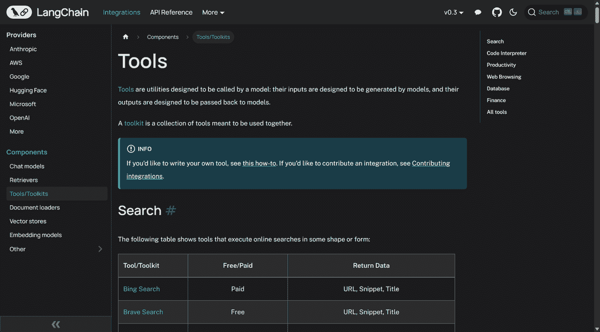
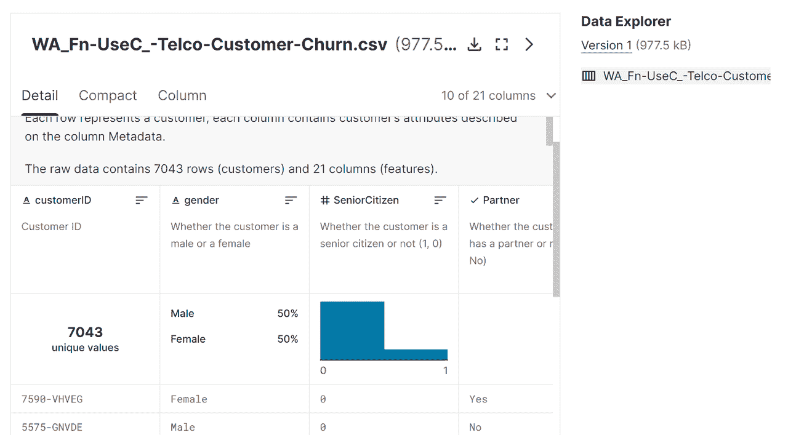
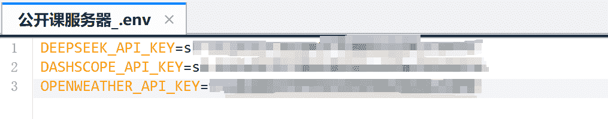
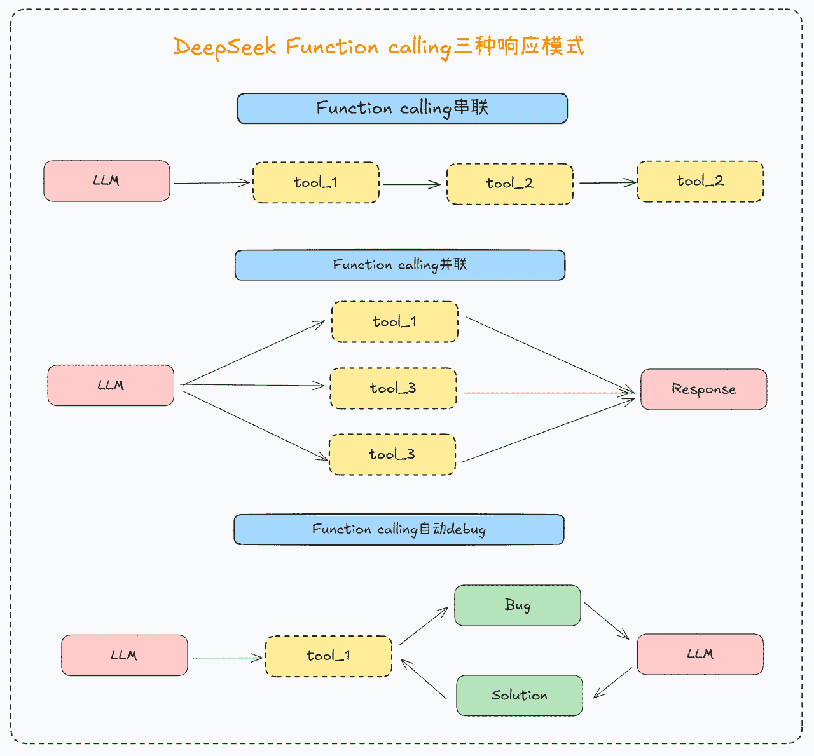
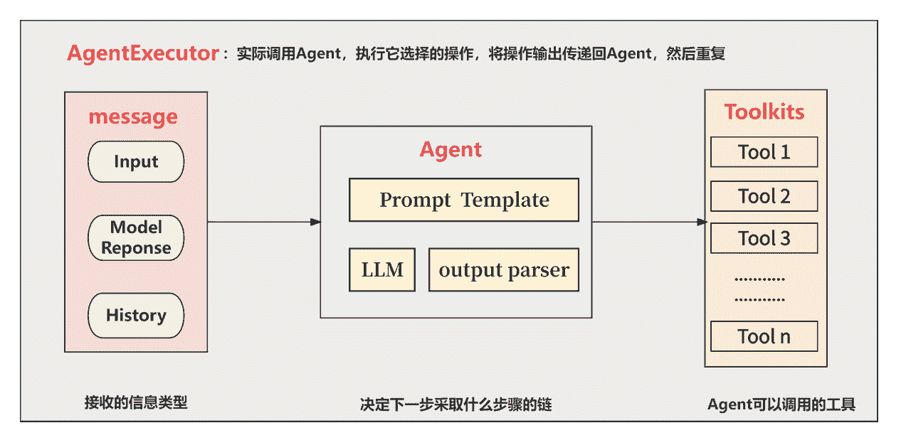
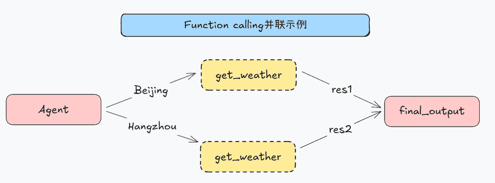
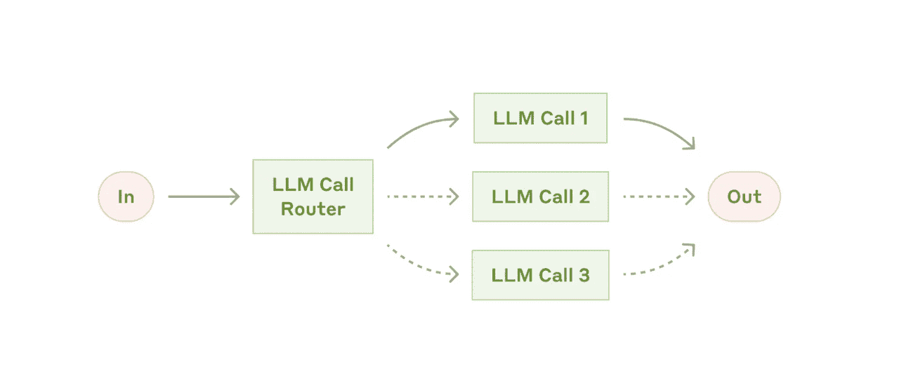
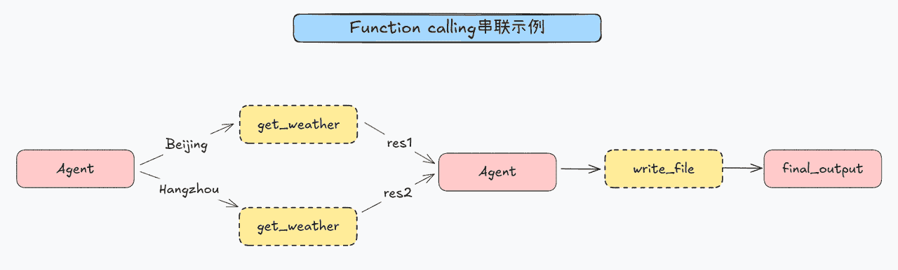

# LangChain接入工具流程

> 来源：[https://kq4b3vgg5b.feishu.cn/docx/MshDdl2LNoLUSZx0HE5c8KcSn1c](https://kq4b3vgg5b.feishu.cn/docx/MshDdl2LNoLUSZx0HE5c8KcSn1c)

## 课程说明：

+   体验课内容节选自《2025大模型Agent智能体开发实战》(夏季班)完整版付费课程

体验课时间有限，若想深度学习大模型技术，欢迎大家报名由我主讲的《2025大模型Agent智能体开发实战》(夏季班)


公开课全套学习资料，已上传至网盘（链接: https://pan.baidu.com/s/1_TPoisye8HldxiIXiMxM8Q 提取码: khnp ）

需要更系统深入学习大模型可扫码⬆️添加助教咨询喔～

---

# LangChain快速入门与Agent开发实战

# Part 5.LangChain接入工具流程

```
import os
from dotenv import load_dotenv 
load_dotenv(override=True)
```

```
True
```

在LangChain生态中，即有海量丰富的内置工具，同时也能接入自定义工具，不仅能通过搭建一个个链（Chain）将工具封装在对应的工作流中，也能借助LangChain Agent功能，实时灵活创建不同的Chain来完成复杂工具调用，甚至还可以使用更高级的LangGraph进行工作流编排。

本小节我们将首先介绍如何在LangChain中接入外部工具，然后从下一小节开始，我们会进一步介绍如何使用LangChain Agent库来搭建更加复杂的工作流。

### 1. LangChain接入工具基本流程

这里我们首先介绍一个最基本的LangChain接入工具流程。在MCP爆火之前，LangChian生态中就已经内置集成了非常多的实用工具，开发者可以快速调用这些工具完成更加复杂工作流的开发。

+   LangChain内置工具列表：https://python.langchain.com/docs/integrations/tools/



我们就以其中代码解释器为例，来介绍如何将内置工具接入LangChain的工作流中。

```
!pip install -qU langchain-community langchain-experimental pandas -i https://pypi.tuna.tsinghua.edu.cn/simple
```

```
WARNING: Running pip as the &#x27;root&#x27; user can result in broken permissions and conflicting behaviour with the system package manager. It is recommended to use a virtual environment instead: https://pip.pypa.io/warnings/venv

```

+   数据集介绍

在此前验证ChatGPT代码解释器和Open interpreter功能时，我们曾简单介绍过Telco数据集，该数据集是Kaggle分享的一个高分数据集（1788 votes），是Kaggle平台上非常经典的围绕偏态数据集建模的数据集。该数据源自IBM商业社区（IBM Business Analytics Community）上分享的数据集，用于社区成员内部学习使用。


根[据IBM商业社区分享团队描](https://www.kaggle.com/blastchar/telco-customer-churn)述，该数据集为某电信公司在加利福尼亚为7000余位用户（个人/家庭）提供电话和互联网服务的相关记录。由于该数据集并不是竞赛数据集，因此数据集的下载方式相对容易，官网也只提供了网页下载一种选项（无法通过命令行直接下载）。我们可以在该数据集的Kaggle主页看到数据集的相关信息以及下载地址。此处我们简单介绍关于Kaggle数据集页面的基本功能，既Kaggle平台的基本使用方法，在后续的课程学习中，若是Kaggle案例，我们也将频繁借助Kaggle主页来获取帮助。当然，熟练使用Kaggle主页获取数据和挖掘信息（而不是借助第三方渠道），也是算法工程师必备技能之一。

+   数据集主页

首先是数据集主页：




此处我们能大致看到数据集基本信息，如总共只有一个数据文件（在其他很多情况下，一个建模目标可能会包含多个数据集），总共21列，7043条数据，以及其他各列的一些基本统计信息等。

当然，在数据集主页上，我们可以直接点击下载按钮进行数据集下载。下载完成后将其放到当前操作主目录下进行读取：

```
import numpy as np
import pandas as pd
```

```
dataset = pd.read_csv(&#x27;WA_Fn-UseC_-Telco-Customer-Churn.csv&#x27;)
```

```
pd.set_option(&#x27;max_colwidth&#x27;,200)

dataset.head(5)
```

|  | customerID | gender | SeniorCitizen | Partner | Dependents | tenure | PhoneService | MultipleLines | InternetService | OnlineSecurity | ... | DeviceProtection | TechSupport | StreamingTV | StreamingMovies | Contract | PaperlessBilling | PaymentMethod | MonthlyCharges | TotalCharges | Churn |
| --- | --- | --- | --- | --- | --- | --- | --- | --- | --- | --- | --- | --- | --- | --- | --- | --- | --- | --- | --- | --- | --- |
| 0 | 7590-VHVEG | Female | 0 | Yes | No | 1 | No | No phone service | DSL | No | ... | No | No | No | No | Month-to-month | Yes | Electronic check | 29.85 | 29.85 | No |
| 1 | 5575-GNVDE | Male | 0 | No | No | 34 | Yes | No | DSL | Yes | ... | Yes | No | No | No | One year | No | Mailed check | 56.95 | 1889.5 | No |
| 2 | 3668-QPYBK | Male | 0 | No | No | 2 | Yes | No | DSL | Yes | ... | No | No | No | No | Month-to-month | Yes | Mailed check | 53.85 | 108.15 | Yes |
| 3 | 7795-CFOCW | Male | 0 | No | No | 45 | No | No phone service | DSL | Yes | ... | Yes | Yes | No | No | One year | No | Bank transfer (automatic) | 42.30 | 1840.75 | No |
| 4 | 9237-HQITU | Female | 0 | No | No | 2 | Yes | No | Fiber optic | No | ... | No | No | No | No | Month-to-month | Yes | Electronic check | 70.70 | 151.65 | Yes |

5 rows × 21 columns

```
dataset.info()
```

```
&lt;class &#x27;pandas.core.frame.DataFrame&#x27;&gt;
RangeIndex: 7043 entries, 0 to 7042
Data columns (total 21 columns):
 #   Column            Non-Null Count  Dtype  
---  ------            --------------  -----  
 0   customerID        7043 non-null   object 
 1   gender            7043 non-null   object 
 2   SeniorCitizen     7043 non-null   int64  
 3   Partner           7043 non-null   object 
 4   Dependents        7043 non-null   object 
 5   tenure            7043 non-null   int64  
 6   PhoneService      7043 non-null   object 
 7   MultipleLines     7043 non-null   object 
 8   InternetService   7043 non-null   object 
 9   OnlineSecurity    7043 non-null   object 
 10  OnlineBackup      7043 non-null   object 
 11  DeviceProtection  7043 non-null   object 
 12  TechSupport       7043 non-null   object 
 13  StreamingTV       7043 non-null   object 
 14  StreamingMovies   7043 non-null   object 
 15  Contract          7043 non-null   object 
 16  PaperlessBilling  7043 non-null   object 
 17  PaymentMethod     7043 non-null   object 
 18  MonthlyCharges    7043 non-null   float64
 19  TotalCharges      7043 non-null   object 
 20  Churn             7043 non-null   object 
dtypes: float64(1), int64(2), object(18)
memory usage: 1.1+ MB
```

其中数据集各字段解释如下：

| 字段 | 解释 |
| --- | --- |
| customerID | 用户ID |
| gender | 性别 |
| SeniorCitizen | 是否是老年人（1代表是） |
| Partner | 是否有配偶（Yes or No） |
| Dependents | 是否经济独立（Yes or No） |
| tenure | 用户入网时间 |
| PhoneService | 是否开通电话业务（Yes or No） |
| MultipleLines | 是否开通多条电话业务（Yes 、 No or No phoneservice） |
| InternetService | 是否开通互联网服务（No、DSL数字网络或filber potic光线网络） |
| OnlineSecurity | 是否开通网络安全服务（Yes、No or No internetservice） |
| OnlineBackup | 是否开通在线备份服务（Yes、No or No internetservice） |
| DeviceProtection | 是否开通设备保护服务（Yes、No or No internetservice） |
| TechSupport | 是否开通技术支持业务（Yes、No or No internetservice） |
| StreamingTV | 是否开通网络电视（Yes、No or No internetservice） |
| StreamingMovies | 是否开通网络电影（Yes、No or No internetservice） |
| Contract | 合同签订方式（按月、按年或者两年） |
| PaperlessBilling | 是否开通电子账单（Yes or No） |
| PaymentMethod | 付款方式（bank transfer、credit card、electronic check、mailed check） |
| MonthlyCharges | 月度费用 |
| TotalCharges | 总费用 |
| Churn | 是否流失（Yes or No） |

+   测试LangChain内置代码解释器工具功能

```
import pandas as pd
from langchain_core.prompts import ChatPromptTemplate
from langchain_experimental.tools import PythonAstREPLTool
```

```
df = pd.read_csv(&#x27;WA_Fn-UseC_-Telco-Customer-Churn.csv&#x27;)
tool = PythonAstREPLTool(locals={&quot;df&quot;: df})
tool.invoke(&quot;df[&#x27;SeniorCitizen&#x27;].mean()&quot;)
```

```
0.1621468124378816
```

```
df[&#x27;MonthlyCharges&#x27;].mean()
```

```
64.76169246059918
```

+   创建LangChain工作流并绑定内置工具

```
import os
from dotenv import load_dotenv 
load_dotenv(override=True)

from langchain_core.messages import AIMessage, HumanMessage, SystemMessage
from langchain_core.prompts import ChatPromptTemplate, MessagesPlaceholder
from langchain.chat_models import init_chat_model
from langchain_core.output_parsers import StrOutputParser
```

```
model  = init_chat_model(model=&quot;deepseek-chat&quot;, model_provider=&quot;deepseek&quot;)
```

```
llm_with_tools = model.bind_tools([tool])
```

```
response = llm_with_tools.invoke(
    &quot;我有一张表，名为&#x27;df&#x27;，请帮我计算MonthlyCharges字段的均值。&quot;
)
response
```

```
AIMessage(content=&#x27;&#x27;, additional_kwargs={&#x27;tool_calls&#x27;: [{&#x27;id&#x27;: &#x27;call_0_78151639-647e-4205-b8d5-2e223cda1b3d&#x27;, &#x27;function&#x27;: {&#x27;arguments&#x27;: &#x27;{&quot;query&quot;:&quot;df[\&#x27;MonthlyCharges\&#x27;].mean()&quot;}&#x27;, &#x27;name&#x27;: &#x27;python_repl_ast&#x27;}, &#x27;type&#x27;: &#x27;function&#x27;, &#x27;index&#x27;: 0}], &#x27;refusal&#x27;: None}, response_metadata={&#x27;token_usage&#x27;: {&#x27;completion_tokens&#x27;: 29, &#x27;prompt_tokens&#x27;: 173, &#x27;total_tokens&#x27;: 202, &#x27;completion_tokens_details&#x27;: None, &#x27;prompt_tokens_details&#x27;: {&#x27;audio_tokens&#x27;: None, &#x27;cached_tokens&#x27;: 0}, &#x27;prompt_cache_hit_tokens&#x27;: 0, &#x27;prompt_cache_miss_tokens&#x27;: 173}, &#x27;model_name&#x27;: &#x27;deepseek-chat&#x27;, &#x27;system_fingerprint&#x27;: &#x27;fp_8802369eaa_prod0425fp8&#x27;, &#x27;id&#x27;: &#x27;ee3a42c6-cb19-4570-b68d-246a046e4542&#x27;, &#x27;service_tier&#x27;: None, &#x27;finish_reason&#x27;: &#x27;tool_calls&#x27;, &#x27;logprobs&#x27;: None}, id=&#x27;run--6035ee7e-8397-45a7-a727-21209b35e9db-0&#x27;, tool_calls=[{&#x27;name&#x27;: &#x27;python_repl_ast&#x27;, &#x27;args&#x27;: {&#x27;query&#x27;: &quot;df[&#x27;MonthlyCharges&#x27;].mean()&quot;}, &#x27;id&#x27;: &#x27;call_0_78151639-647e-4205-b8d5-2e223cda1b3d&#x27;, &#x27;type&#x27;: &#x27;tool_call&#x27;}], usage_metadata={&#x27;input_tokens&#x27;: 173, &#x27;output_tokens&#x27;: 29, &#x27;total_tokens&#x27;: 202, &#x27;input_token_details&#x27;: {&#x27;cache_read&#x27;: 0}, &#x27;output_token_details&#x27;: {}})
```

此时我们发现，LangChain回复的结果就不不再式简单的文字内容，而是一条调用外部工具的消息。我们可以使用如下方法将这条消息里面涉及到代码运行的核心参数提取出来：

```
from langchain_core.output_parsers.openai_tools import JsonOutputKeyToolsParser
```

```
parser = JsonOutputKeyToolsParser(key_name=tool.name, first_tool_only=True)
```

```
llm_chain = llm_with_tools | parser
```

```
llm_chain.invoke(&quot;我有一张表，名为&#x27;df&#x27;，请帮我计算MonthlyCharges字段的均值。&quot;)
```

```
{&#x27;query&#x27;: &quot;df[&#x27;MonthlyCharges&#x27;].mean()&quot;}
```

同时，通过设置提示词模板，让模型知道目前运行环境，从而无需反复提示df表：

```
system = f&quot;&quot;&quot;
你可以访问一个名为 `df` 的 pandas 数据框，你可以使用df.head().to_markdown() 查看数据集的基本信息， \
请根据用户提出的问题，编写 Python 代码来回答。只返回代码，不返回其他内容。只允许使用 pandas 和内置库。
&quot;&quot;&quot;
```

```
prompt = ChatPromptTemplate([
    (&quot;system&quot;, system),
    (&quot;user&quot;, &quot;{question}&quot;)
])
```

```
code_chain = prompt | llm_with_tools | parser
```

```
code_chain.invoke({&quot;question&quot;: &quot;请帮我计算MonthlyCharges字段的均值。&quot;})
```

```
{&#x27;query&#x27;: &quot;df[&#x27;MonthlyCharges&#x27;].mean()&quot;}
```

然后，我们再在当前链中加入一个tool外部函数的环节，即可让大模型输出的参数直接带入到tool中进行运行：

```
chain = prompt | llm_with_tools | parser | tool
chain.invoke({&quot;question&quot;: &quot;请帮我计算MonthlyCharges字段的均值。&quot;})
```

```
64.76169246059918
```

```
chain.invoke({&quot;question&quot;: &quot;请帮我分析gender、SeniorCitizen和Churn三个字段之间的相关关系。&quot;})
```

```
(Churn     No  Yes
 gender           
 Female  2549  939
 Male    2625  930,
 Churn            No   Yes
 SeniorCitizen            
 0              4508  1393
 1               666   476,
 SeniorCitizen     0    1
 gender                  
 Female         2920  568
 Male           2981  574)
```

同时，按照此前介绍的，我们还可以在链条中加入一个打印的环节，让模型将编写的Python代码进行打印：

```
def code_print(res):
    print(&quot;即将运行Python代码:&quot;, res[&#x27;query&#x27;])
    return res
```

```
res = code_chain.invoke({&quot;question&quot;: &quot;请帮我计算MonthlyCharges字段的均值。&quot;})
```

```
res
```

```
{&#x27;query&#x27;: &quot;df[&#x27;MonthlyCharges&#x27;].mean()&quot;}
```

```
res[&#x27;query&#x27;]
```

```
&quot;df[&#x27;MonthlyCharges&#x27;].mean()&quot;
```

```
print(&quot;即将运行Python代码:&quot;, res[&#x27;query&#x27;])
```

```
即将运行Python代码: df[&#x27;MonthlyCharges&#x27;].mean()
```

```
from langchain_core.runnables import RunnableLambda

def code_print(res):
    print(&quot;即将运行Python代码:&quot;, res[&#x27;query&#x27;])
    return res

print_node = RunnableLambda(code_print)
```

```
print_code_chain = prompt | llm_with_tools | parser | print_node | tool
print_code_chain.invoke({&quot;question&quot;: &quot;请帮我计算MonthlyCharges字段的均值。&quot;})
```

```
即将运行Python代码: df[&#x27;MonthlyCharges&#x27;].mean()


64.76169246059918
```

```
df[&#x27;MonthlyCharges&#x27;].mean()
```

```
64.76169246059918
```

```
print_code_chain = prompt | llm_with_tools | parser | print_node | tool
print_code_chain.invoke({&quot;question&quot;: &quot;请问MonthlyCharges取值最高的用户ID是？&quot;})
```

```
即将运行Python代码: df.loc[df[&#x27;MonthlyCharges&#x27;].idxmax(), &#x27;customerID&#x27;]


&#x27;7569-NMZYQ&#x27;
```

至此，一个简单的包含官方内置工具的代码解释器工作流就搭建完成了。

### 2. LangChain接入自定义外部工作流程

这里我们以实时获取天气数据为例，尝试创建一个外部函数，并将其封装为LangChian的一项基础工作。在langChain中，如果想要把一个普通的函数，变成一个可以被大模型调用的工具，只需要将函数包装成一个Tool对象即可。

这里我们首先需要获取OpenWeather API Key，并写入.env文件中，方便后续进行天气查询。



然后先尝试创建这个外部函数：

```
import os
from dotenv import load_dotenv 
load_dotenv(override=True)

OPENWEATHER_API_KEY = os.getenv(&quot;OPENWEATHER_API_KEY&quot;)
```

```
import requests,json
```

```
def get_weather(loc):
    &quot;&quot;&quot;
    查询即时天气函数
    :param loc: 必要参数，字符串类型，用于表示查询天气的具体城市名称，\
    注意，中国的城市需要用对应城市的英文名称代替，例如如果需要查询北京市天气，则loc参数需要输入&#x27;Beijing&#x27;；
    :return：OpenWeather API查询即时天气的结果，具体URL请求地址为：https://api.openweathermap.org/data/2.5/weather\
    返回结果对象类型为解析之后的JSON格式对象，并用字符串形式进行表示，其中包含了全部重要的天气信息
    &quot;&quot;&quot;
    # Step 1.构建请求
    url = &quot;https://api.openweathermap.org/data/2.5/weather&quot;

    # Step 2.设置查询参数
    params = {
        &quot;q&quot;: loc,               
        &quot;appid&quot;: os.getenv(&quot;OPENWEATHER_API_KEY&quot;),    # 输入API key
        &quot;units&quot;: &quot;metric&quot;,            # 使用摄氏度而不是华氏度
        &quot;lang&quot;:&quot;zh_cn&quot;                # 输出语言为简体中文
    }

    # Step 3.发送GET请求
    response = requests.get(url, params=params)
    
    # Step 4.解析响应
    data = response.json()
    return json.dumps(data)
```

```
get_weather(&quot;Beijing&quot;)
```

```
&#x27;{&quot;coord&quot;: {&quot;lon&quot;: 116.3972, &quot;lat&quot;: 39.9075}, &quot;weather&quot;: [{&quot;id&quot;: 803, &quot;main&quot;: &quot;Clouds&quot;, &quot;description&quot;: &quot;\\u591a\\u4e91&quot;, &quot;icon&quot;: &quot;04d&quot;}], &quot;base&quot;: &quot;stations&quot;, &quot;main&quot;: {&quot;temp&quot;: 34.94, &quot;feels_like&quot;: 33.83, &quot;temp_min&quot;: 34.94, &quot;temp_max&quot;: 34.94, &quot;pressure&quot;: 1003, &quot;humidity&quot;: 26, &quot;sea_level&quot;: 1003, &quot;grnd_level&quot;: 996}, &quot;visibility&quot;: 10000, &quot;wind&quot;: {&quot;speed&quot;: 6.87, &quot;deg&quot;: 176, &quot;gust&quot;: 10.02}, &quot;clouds&quot;: {&quot;all&quot;: 74}, &quot;dt&quot;: 1749724093, &quot;sys&quot;: {&quot;type&quot;: 1, &quot;id&quot;: 9609, &quot;country&quot;: &quot;CN&quot;, &quot;sunrise&quot;: 1749674728, &quot;sunset&quot;: 1749728589}, &quot;timezone&quot;: 28800, &quot;id&quot;: 1816670, &quot;name&quot;: &quot;Beijing&quot;, &quot;cod&quot;: 200}&#x27;
```

紧接着将其封装为LangChain能够识别的外部函数：

```
from langchain_core.tools import tool
```

```
@tool
def get_weather(loc):
    &quot;&quot;&quot;
    查询即时天气函数
    :param loc: 必要参数，字符串类型，用于表示查询天气的具体城市名称，\
    注意，中国的城市需要用对应城市的英文名称代替，例如如果需要查询北京市天气，则loc参数需要输入&#x27;Beijing&#x27;；
    :return：OpenWeather API查询即时天气的结果，具体URL请求地址为：https://api.openweathermap.org/data/2.5/weather\
    返回结果对象类型为解析之后的JSON格式对象，并用字符串形式进行表示，其中包含了全部重要的天气信息
    &quot;&quot;&quot;
    # Step 1.构建请求
    url = &quot;https://api.openweathermap.org/data/2.5/weather&quot;

    # Step 2.设置查询参数
    params = {
        &quot;q&quot;: loc,               
        &quot;appid&quot;: os.getenv(&quot;OPENWEATHER_API_KEY&quot;),    # 输入API key
        &quot;units&quot;: &quot;metric&quot;,            # 使用摄氏度而不是华氏度
        &quot;lang&quot;:&quot;zh_cn&quot;                # 输出语言为简体中文
    }

    # Step 3.发送GET请求
    response = requests.get(url, params=params)
    
    # Step 4.解析响应
    data = response.json()
    return json.dumps(data)
```

```
print(get_weather.name)
print(get_weather.description)
print(get_weather.args)
```

```
get_weather
查询即时天气函数
:param loc: 必要参数，字符串类型，用于表示查询天气的具体城市名称，    注意，中国的城市需要用对应城市的英文名称代替，例如如果需要查询北京市天气，则loc参数需要输入&#x27;Beijing&#x27;；
:return：OpenWeather API查询即时天气的结果，具体URL请求地址为：https://api.openweathermap.org/data/2.5/weather    返回结果对象类型为解析之后的JSON格式对象，并用字符串形式进行表示，其中包含了全部重要的天气信息
{&#x27;loc&#x27;: {&#x27;title&#x27;: &#x27;Loc&#x27;}}
```

然后继续使用DeepSeek模型，如下代码所示：

```
from langchain.chat_models import init_chat_model

# 初始化模型
model = init_chat_model(&quot;deepseek-chat&quot;, model_provider=&quot;deepseek&quot;)
```

接下来，如果想让大模型调用某一个外部工具，需要使用bind_tools方法，将工具绑定到模型上。代码如下：

```
# 定义 天气查询 工具函数
tools = [get_weather]

# 将工具绑定到模型
llm_with_tools = model.bind_tools(tools)
```

接下来，便可以通过新的llm_with_tools模型通过invoke方法来调用模型。代码如下：

```
response = llm_with_tools.invoke(&quot;你好， 请问北京的天气怎么样？&quot;)

print(response)
```

```
content=&#x27;&#x27; additional_kwargs={&#x27;tool_calls&#x27;: [{&#x27;id&#x27;: &#x27;call_0_ccca5fbb-1ae0-4603-91a4-e33916f62241&#x27;, &#x27;function&#x27;: {&#x27;arguments&#x27;: &#x27;{&quot;loc&quot;:&quot;Beijing&quot;}&#x27;, &#x27;name&#x27;: &#x27;get_weather&#x27;}, &#x27;type&#x27;: &#x27;function&#x27;, &#x27;index&#x27;: 0}], &#x27;refusal&#x27;: None} response_metadata={&#x27;token_usage&#x27;: {&#x27;completion_tokens&#x27;: 19, &#x27;prompt_tokens&#x27;: 203, &#x27;total_tokens&#x27;: 222, &#x27;completion_tokens_details&#x27;: None, &#x27;prompt_tokens_details&#x27;: {&#x27;audio_tokens&#x27;: None, &#x27;cached_tokens&#x27;: 0}, &#x27;prompt_cache_hit_tokens&#x27;: 0, &#x27;prompt_cache_miss_tokens&#x27;: 203}, &#x27;model_name&#x27;: &#x27;deepseek-chat&#x27;, &#x27;system_fingerprint&#x27;: &#x27;fp_8802369eaa_prod0425fp8&#x27;, &#x27;id&#x27;: &#x27;329ef1c1-cf46-4732-aa57-6502f78aec64&#x27;, &#x27;service_tier&#x27;: None, &#x27;finish_reason&#x27;: &#x27;tool_calls&#x27;, &#x27;logprobs&#x27;: None} id=&#x27;run--a9403fc2-376f-4ab7-bd32-fb2491db38c0-0&#x27; tool_calls=[{&#x27;name&#x27;: &#x27;get_weather&#x27;, &#x27;args&#x27;: {&#x27;loc&#x27;: &#x27;Beijing&#x27;}, &#x27;id&#x27;: &#x27;call_0_ccca5fbb-1ae0-4603-91a4-e33916f62241&#x27;, &#x27;type&#x27;: &#x27;tool_call&#x27;}] usage_metadata={&#x27;input_tokens&#x27;: 203, &#x27;output_tokens&#x27;: 19, &#x27;total_tokens&#x27;: 222, &#x27;input_token_details&#x27;: {&#x27;cache_read&#x27;: 0}, &#x27;output_token_details&#x27;: {}}
```

这会产生一个包含tool_calls 的模型响应，打印如下：

```
response.additional_kwargs
```

```
{&#x27;tool_calls&#x27;: [{&#x27;id&#x27;: &#x27;call_0_ccca5fbb-1ae0-4603-91a4-e33916f62241&#x27;,
   &#x27;function&#x27;: {&#x27;arguments&#x27;: &#x27;{&quot;loc&quot;:&quot;Beijing&quot;}&#x27;, &#x27;name&#x27;: &#x27;get_weather&#x27;},
   &#x27;type&#x27;: &#x27;function&#x27;,
   &#x27;index&#x27;: 0}],
 &#x27;refusal&#x27;: None}
```

我们继续调用JsonOutputKeyToolsParser输出解析器来处理模型响应。

```
from langchain_core.output_parsers.openai_tools import JsonOutputKeyToolsParser
```

```
parser = JsonOutputKeyToolsParser(key_name=get_weather.name, first_tool_only=True)
```

```
llm_chain = llm_with_tools | parser
```

```
llm_chain.invoke(&quot;请问北京今天天气如何？&quot;)
```

```
{&#x27;loc&#x27;: &#x27;Beijing&#x27;}
```

```
get_weather_chain = prompt | llm_with_tools | parser | get_weather
```

```
get_weather_chain.invoke(&quot;请问北京今天天气如何？&quot;)
```

```
&#x27;{&quot;coord&quot;: {&quot;lon&quot;: 116.3972, &quot;lat&quot;: 39.9075}, &quot;weather&quot;: [{&quot;id&quot;: 803, &quot;main&quot;: &quot;Clouds&quot;, &quot;description&quot;: &quot;\\u591a\\u4e91&quot;, &quot;icon&quot;: &quot;04d&quot;}], &quot;base&quot;: &quot;stations&quot;, &quot;main&quot;: {&quot;temp&quot;: 34.94, &quot;feels_like&quot;: 33.23, &quot;temp_min&quot;: 34.94, &quot;temp_max&quot;: 34.94, &quot;pressure&quot;: 1002, &quot;humidity&quot;: 22, &quot;sea_level&quot;: 1002, &quot;grnd_level&quot;: 997}, &quot;visibility&quot;: 10000, &quot;wind&quot;: {&quot;speed&quot;: 6.23, &quot;deg&quot;: 175, &quot;gust&quot;: 9.33}, &quot;clouds&quot;: {&quot;all&quot;: 74}, &quot;dt&quot;: 1749724384, &quot;sys&quot;: {&quot;type&quot;: 1, &quot;id&quot;: 9609, &quot;country&quot;: &quot;CN&quot;, &quot;sunrise&quot;: 1749674728, &quot;sunset&quot;: 1749728589}, &quot;timezone&quot;: 28800, &quot;id&quot;: 1816670, &quot;name&quot;: &quot;Beijing&quot;, &quot;cod&quot;: 200}&#x27;
```

能够看到，此时Chain就能顺利的将用户的需求转化为天气查询，并完成外部工具的自动运行。但只有这一步还不够，我们还需要将其转化为一个模型的问答：

```
from langchain.prompts import PromptTemplate
from langchain_core.output_parsers import StrOutputParser
```

```
from langchain.prompts import PromptTemplate
from langchain_core.output_parsers import StrOutputParser

# Prompt 模板
output_prompt = PromptTemplate.from_template(
    &quot;&quot;&quot;你将收到一段 JSON 格式的天气数据，请用简洁自然的方式将其转述给用户。
以下是天气 JSON 数据：

```json
{weather_json}
```

请将其转换为中文天气描述，例如：

“北京当前天气晴，气温为 23°C，湿度 58%，风速 2.1 米/秒。”

只返回一句话描述，不要其他说明或解释。"""

)

```


```python
output_chain = output_prompt | model | StrOutputParser()
```

```
weather_json = &#x27;{&quot;coord&quot;: {&quot;lon&quot;: 116.3972, &quot;lat&quot;: 39.9075}, &quot;weather&quot;: [{&quot;id&quot;: 803, &quot;main&quot;: &quot;Clouds&quot;, &quot;description&quot;: &quot;\\u591a\\u4e91&quot;, &quot;icon&quot;: &quot;04d&quot;}], &quot;base&quot;: &quot;stations&quot;, &quot;main&quot;: {&quot;temp&quot;: 34.94, &quot;feels_like&quot;: 33.23, &quot;temp_min&quot;: 34.94, &quot;temp_max&quot;: 34.94, &quot;pressure&quot;: 1002, &quot;humidity&quot;: 22, &quot;sea_level&quot;: 1002, &quot;grnd_level&quot;: 997}, &quot;visibility&quot;: 10000, &quot;wind&quot;: {&quot;speed&quot;: 6.23, &quot;deg&quot;: 175, &quot;gust&quot;: 9.33}, &quot;clouds&quot;: {&quot;all&quot;: 74}, &quot;dt&quot;: 1749724384, &quot;sys&quot;: {&quot;type&quot;: 1, &quot;id&quot;: 9609, &quot;country&quot;: &quot;CN&quot;, &quot;sunrise&quot;: 1749674728, &quot;sunset&quot;: 1749728589}, &quot;timezone&quot;: 28800, &quot;id&quot;: 1816670, &quot;name&quot;: &quot;Beijing&quot;, &quot;cod&quot;: 200}&#x27;

result = output_chain.invoke({&quot;weather_json&quot;: weather_json})
print(result)
```

```
北京当前天气多云，气温为 34.94°C，体感温度 33.23°C，湿度 22%，风速 6.23 米/秒。
```

而最终，我们将这两个Chain进行拼接，即可构成完整的外部工具调用流程：

```
full_chain = get_weather_chain | output_chain
response = full_chain.invoke(&quot;请问北京今天的天气如何？&quot;)
print(response)
```

```
北京当前天气多云，气温为 33.94°C，体感温度 32.21°C，湿度 23%，风速 6.23 米/秒。
```

### 3. LangChain接入自定义外部工作流程

+   Function calling基本原理

我们都知道，能调用外部工具，是大模型进化为智能体Agent的关键，如果不能使用外部工具，大模型就只能是个简单的聊天机器人，甚至连查询天气都做不到。由于底层技术限制啊，大模型本身是无法和外部工具直接通信的，因此Function calling的思路，就是创建一个外部函数（function）作为中介，一边传递大模型的请求，另一边调用外部工具，最终让大模型能够间接的调用外部工具。


例如，当我们要查询当前天气时，让大模型调用外部工具的function calling的过程就如图所示：


而完整的一次Function calling执行流程如下：


+   存在问题



在实际使用中，我们其实可以直接使用create_tool_calling_agent来快速构建工具调用代理。代码如下：

```
from langchain.agents import create_tool_calling_agent, tool
from langchain_core.prompts import ChatPromptTemplate

#定义工具
tools = [get_weather]

# 构建提示模版
prompt = ChatPromptTemplate.from_messages(
    [
        (&quot;system&quot;, &quot;你是天气助手，请根据用户的问题，给出相应的天气信息&quot;),
        (&quot;human&quot;, &quot;{input}&quot;),
        (&quot;placeholder&quot;, &quot;{agent_scratchpad}&quot;),
    ]
)

# 初始化模型
model = init_chat_model(&quot;deepseek-chat&quot;, model_provider=&quot;deepseek&quot;)

# 直接使用`create_tool_calling_agent`创建代理
agent = create_tool_calling_agent(model, tools, prompt)
```

使用AgentExecutor来执行代理。代码如下：

```
from langchain.agents import AgentExecutor
agent_executor = AgentExecutor(agent=agent, tools=tools, verbose=True)


response = agent_executor.invoke({&quot;input&quot;: &quot;请问今天北京的天气怎么样？&quot;})
print(response)
```

```
&gt; Entering new AgentExecutor chain...

Invoking: `get_weather` with `{&#x27;loc&#x27;: &#x27;Beijing&#x27;}`


{&quot;coord&quot;: {&quot;lon&quot;: 116.3972, &quot;lat&quot;: 39.9075}, &quot;weather&quot;: [{&quot;id&quot;: 800, &quot;main&quot;: &quot;Clear&quot;, &quot;description&quot;: &quot;\u6674&quot;, &quot;icon&quot;: &quot;01d&quot;}], &quot;base&quot;: &quot;stations&quot;, &quot;main&quot;: {&quot;temp&quot;: 25.94, &quot;feels_like&quot;: 25.74, &quot;temp_min&quot;: 25.94, &quot;temp_max&quot;: 25.94, &quot;pressure&quot;: 1001, &quot;humidity&quot;: 44, &quot;sea_level&quot;: 1001, &quot;grnd_level&quot;: 996}, &quot;visibility&quot;: 10000, &quot;wind&quot;: {&quot;speed&quot;: 9.59, &quot;deg&quot;: 343, &quot;gust&quot;: 12.9}, &quot;clouds&quot;: {&quot;all&quot;: 0}, &quot;dt&quot;: 1749456143, &quot;sys&quot;: {&quot;type&quot;: 1, &quot;id&quot;: 9609, &quot;country&quot;: &quot;CN&quot;, &quot;sunrise&quot;: 1749415551, &quot;sunset&quot;: 1749469297}, &quot;timezone&quot;: 28800, &quot;id&quot;: 1816670, &quot;name&quot;: &quot;Beijing&quot;, &quot;cod&quot;: 200}今天北京的天气晴朗，气温为25.94°C，体感温度约为25.74°C。湿度为44%，风速为9.59米/秒，风向为343度（西北风）。能见度良好，达到10000米。气压为1001 hPa。总体来说，今天是一个适合户外活动的好天气！

&gt; Finished chain.
{&#x27;input&#x27;: &#x27;请问今天北京的天气怎么样？&#x27;, &#x27;output&#x27;: &#x27;今天北京的天气晴朗，气温为25.94°C，体感温度约为25.74°C。湿度为44%，风速为9.59米/秒，风向为343度（西北风）。能见度良好，达到10000米。气压为1001 hPa。总体来说，今天是一个适合户外活动的好天气！&#x27;}
```

```
print(response[&quot;output&quot;])
```

```
今天北京的天气晴朗，气温为25.94°C，体感温度约为25.74°C。湿度为44%，风速为9.59米/秒，风向为343度（西北风）。能见度良好，达到10000米。气压为1001 hPa。总体来说，今天是一个适合户外活动的好天气！
```

### 4. LangChain Agents 运行流程

LangChain 中Agents模块的整体架构设计。如下所示：



在Agents的内部结构。每个Agent组件一般会由语言模型 + 提示 + 输出解析器构成，它会作为Agents的大脑去处理用户的输入。Agent能够处理的输入主要来源于三个方面：input代表用户的原始输入，Model Response指的是模型对某一个子任务的响应输出，而History则能携带上下文的信息。其输出部分，则链接到实际的工具库，需要调用哪些工具，将由经过Agent模块后拆分的子任务来决定。

而我们知道，大模型调用外部函数会分为两个过程：识别工具和实际执行。在Message -> Agent -> Toolkits 这个流程中，负责的是将子任务拆解，然后根据这些子任务在工具库中找到相应的工具，提取工具名称及所需参数，这个过程可以视作一种“静态”的执行流程。而将这些决策转化为实际行动的工作，则会交给AgentExecutor。

所以综上需要理解的是：在LangChain的Agents实际架构中，Agent的角色是接收输入并决定采取的操作，但它本身并不直接执行这些操作。这一任务是由AgentExecutor来完成的。将Agent（决策大脑）与AgentExecutor（执行操作的Runtime）结合使用，才构成了完整的Agents（智能体），其中AgentExecutor负责调用代理并执行指定的工具，以此来实现整个智能体的功能。

这也就是为什么create_tool_calling_agent需要通过AgentExecutor才能够实际运行的原因。当然，在这种模式下，AgentExecutor的内部已经自动处理好了关于我们工具调用的所有逻辑，其中包含串行和并行工具调用的两种常用模式。


#### 3.1 多工具并联调用

在大模型中，并行工具调用指的是在大模型调用外部工具时，可以在单次交互过程中可以同时调用多个工具，并行执行以解决用户的问题。如下图所示：


而在create_tool_calling_agent中，已经自动处理了并行工具调用的处理逻辑，并不需要我们在手动处理，比如接下来测试一些复杂的问题：

```
from langchain.agents import create_tool_calling_agent, tool
from langchain_core.prompts import ChatPromptTemplate

#定义工具
tools = [get_weather]

# 构建提示模版
prompt = ChatPromptTemplate.from_messages(
    [
        (&quot;system&quot;, &quot;你是天气助手，请根据用户的问题，给出相应的天气信息&quot;),
        (&quot;human&quot;, &quot;{input}&quot;),
        (&quot;placeholder&quot;, &quot;{agent_scratchpad}&quot;),
    ]
)

# 初始化模型
model = init_chat_model(&quot;deepseek-chat&quot;, model_provider=&quot;deepseek&quot;)

# 直接使用`create_tool_calling_agent`创建代理
agent = create_tool_calling_agent(model, tools, prompt)
```

这里我们在提出的问题中，尝试让大模型同时查询北京和上海两个城市的天气并汇总结果。

```
from langchain.agents import AgentExecutor
agent_executor = AgentExecutor(agent=agent, tools=tools, verbose=True)


response = agent_executor.invoke({&quot;input&quot;: &quot;请问今天北京和杭州的天气怎么样，哪个城市更热？&quot;})
print(response)
```

```
&gt; Entering new AgentExecutor chain...

Invoking: `get_weather` with `{&#x27;loc&#x27;: &#x27;Beijing&#x27;}`


{&quot;coord&quot;: {&quot;lon&quot;: 116.3972, &quot;lat&quot;: 39.9075}, &quot;weather&quot;: [{&quot;id&quot;: 800, &quot;main&quot;: &quot;Clear&quot;, &quot;description&quot;: &quot;\u6674&quot;, &quot;icon&quot;: &quot;01d&quot;}], &quot;base&quot;: &quot;stations&quot;, &quot;main&quot;: {&quot;temp&quot;: 23.94, &quot;feels_like&quot;: 23.54, &quot;temp_min&quot;: 23.94, &quot;temp_max&quot;: 23.94, &quot;pressure&quot;: 1001, &quot;humidity&quot;: 44, &quot;sea_level&quot;: 1001, &quot;grnd_level&quot;: 996}, &quot;visibility&quot;: 10000, &quot;wind&quot;: {&quot;speed&quot;: 9.59, &quot;deg&quot;: 343, &quot;gust&quot;: 12.9}, &quot;clouds&quot;: {&quot;all&quot;: 0}, &quot;dt&quot;: 1749457700, &quot;sys&quot;: {&quot;type&quot;: 1, &quot;id&quot;: 9609, &quot;country&quot;: &quot;CN&quot;, &quot;sunrise&quot;: 1749415551, &quot;sunset&quot;: 1749469297}, &quot;timezone&quot;: 28800, &quot;id&quot;: 1816670, &quot;name&quot;: &quot;Beijing&quot;, &quot;cod&quot;: 200}
Invoking: `get_weather` with `{&#x27;loc&#x27;: &#x27;Hangzhou&#x27;}`


{&quot;coord&quot;: {&quot;lon&quot;: 120.1614, &quot;lat&quot;: 30.2937}, &quot;weather&quot;: [{&quot;id&quot;: 500, &quot;main&quot;: &quot;Rain&quot;, &quot;description&quot;: &quot;\u5c0f\u96e8&quot;, &quot;icon&quot;: &quot;10d&quot;}], &quot;base&quot;: &quot;stations&quot;, &quot;main&quot;: {&quot;temp&quot;: 23.95, &quot;feels_like&quot;: 24.83, &quot;temp_min&quot;: 23.95, &quot;temp_max&quot;: 23.95, &quot;pressure&quot;: 1005, &quot;humidity&quot;: 93, &quot;sea_level&quot;: 1005, &quot;grnd_level&quot;: 1002}, &quot;visibility&quot;: 10000, &quot;wind&quot;: {&quot;speed&quot;: 0.54, &quot;deg&quot;: 101, &quot;gust&quot;: 0.69}, &quot;rain&quot;: {&quot;1h&quot;: 0.75}, &quot;clouds&quot;: {&quot;all&quot;: 100}, &quot;dt&quot;: 1749457874, &quot;sys&quot;: {&quot;type&quot;: 1, &quot;id&quot;: 9651, &quot;country&quot;: &quot;CN&quot;, &quot;sunrise&quot;: 1749416229, &quot;sunset&quot;: 1749466812}, &quot;timezone&quot;: 28800, &quot;id&quot;: 1808926, &quot;name&quot;: &quot;Hangzhou&quot;, &quot;cod&quot;: 200}今天北京的天气晴朗，温度为23.94°C，体感温度为23.54°C，湿度为44%，风速较大，为9.59 m/s。

杭州今天有小雨，温度为23.95°C，体感温度为24.83°C，湿度较高，为93%，风速较低，为0.54 m/s。

从温度来看，两地的气温几乎相同，但杭州的体感温度稍高一些，且湿度较大，可能会感觉更闷热。而北京虽然风速较大，但湿度较低，感觉会更舒适一些。

&gt; Finished chain.
{&#x27;input&#x27;: &#x27;请问今天北京和杭州的天气怎么样，哪个城市更热？&#x27;, &#x27;output&#x27;: &#x27;今天北京的天气晴朗，温度为23.94°C，体感温度为23.54°C，湿度为44%，风速较大，为9.59 m/s。\n\n杭州今天有小雨，温度为23.95°C，体感温度为24.83°C，湿度较高，为93%，风速较低，为0.54 m/s。\n\n从温度来看，两地的气温几乎相同，但杭州的体感温度稍高一些，且湿度较大，可能会感觉更闷热。而北京虽然风速较大，但湿度较低，感觉会更舒适一些。&#x27;}
```

从这个过程中可以明显的看出，一次性发起了同一个外部函数的两次调用请求，并依次获得了北京和杭州两个城市的天气。这就是一次标准的parallel_function_call。



#### 3.2 多工具串联调用

接下来继续尝试进行多工具串联调用测试：



此时我们再定义一个write_file函数，用于将“文本写入本地”：

```
@tool
def write_file(content):
    &quot;&quot;&quot;
    将指定内容写入本地文件。
    :param content: 必要参数，字符串类型，用于表示需要写入文档的具体内容。
    :return：是否成功写入
    &quot;&quot;&quot;
    
    return &quot;已成功写入本地文件。&quot;
```

然后在tools列表中直接添加write_file工具，并修改提示模版，添加write_file工具的使用场景。代码如下所示：

```
from langchain.agents import AgentExecutor, create_tool_calling_agent, tool
from langchain_core.prompts import ChatPromptTemplate


tools = [get_weather, write_file]

prompt = ChatPromptTemplate.from_messages(
    [
        (&quot;system&quot;, &quot;你是天气助手，请根据用户的问题，给出相应的天气信息，如果用户需要将查询结果写入文件，请使用write_file工具&quot;),
        (&quot;human&quot;, &quot;{input}&quot;),
        (&quot;placeholder&quot;, &quot;{agent_scratchpad}&quot;),
    ]
)

# 初始化模型
model = init_chat_model(&quot;deepseek-chat&quot;, model_provider=&quot;deepseek&quot;)

agent = create_tool_calling_agent(model, tools, prompt)
```

接下来尝试运行：

```
agent_executor = AgentExecutor(agent=agent, tools=tools, verbose=True)


agent_executor.invoke({&quot;input&quot;: &quot;查一下北京和杭州现在的温度，并将结果写入本地的文件中。&quot;})
```

```
&gt; Entering new AgentExecutor chain...

Invoking: `get_weather` with `{&#x27;loc&#x27;: &#x27;Beijing&#x27;}`



```

通过中间过程信息的打印，我们能够看到在一次交互过程中依次调用的get_weather查询到北京和杭州的天气，然后又将结果写入到本地的文件中。这就是一个非常典型的串行工具调用的流程，如下图所示：



```

```

```

```

```

```