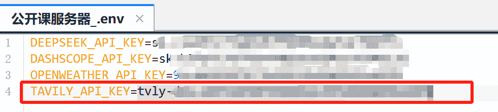
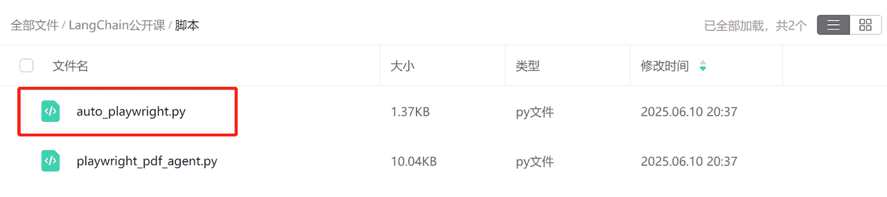
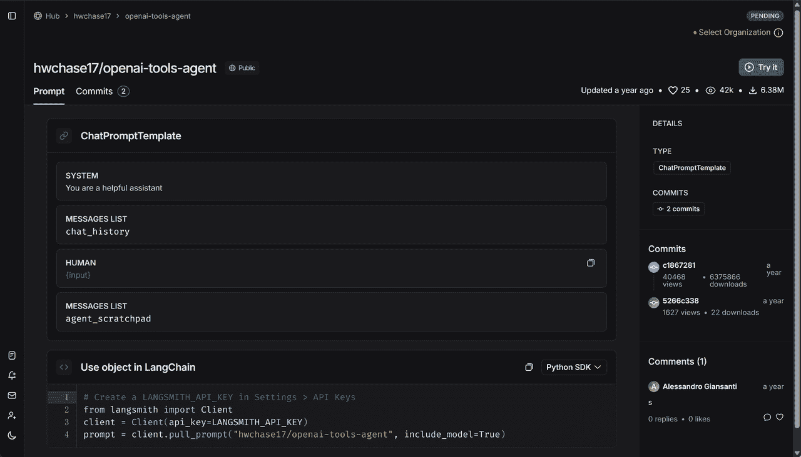
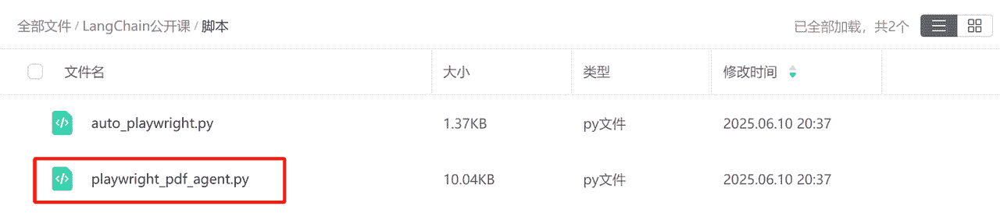
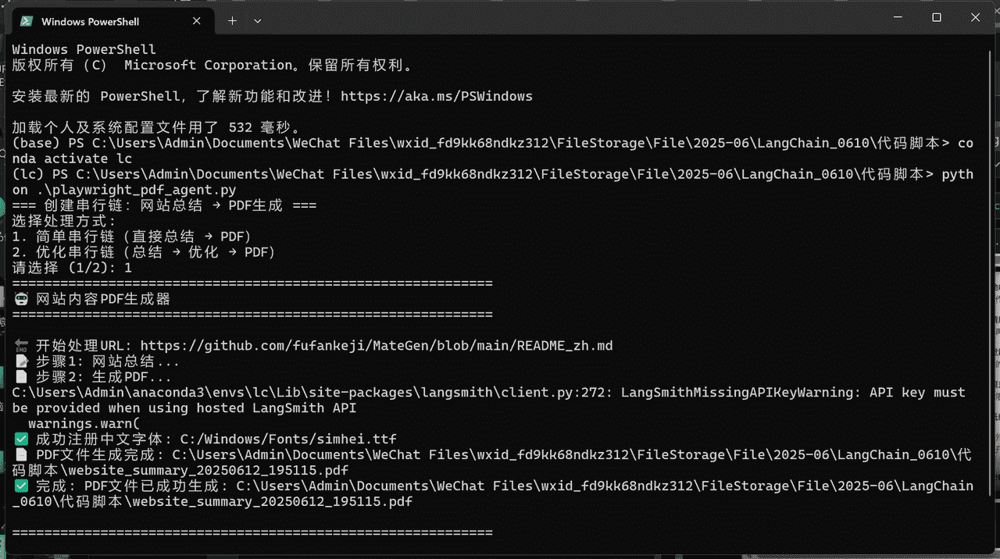

# LangChain快速入门与Agent开发实战

## Part 6. LangChain Agent进阶功能介绍

> 来源：[https://kq4b3vgg5b.feishu.cn/docx/L2J3dEFqBoPyGSxdRjzcVRFonhd](https://kq4b3vgg5b.feishu.cn/docx/L2J3dEFqBoPyGSxdRjzcVRFonhd)

### 课程说明

体验课内容节选自《2025大模型Agent智能体开发实战》(夏季班)完整版付费课程

体验课时间有限，若想深度学习大模型技术，欢迎大家报名由我主讲的《2025大模型Agent智能体开发实战》(夏季班)


公开课全套学习资料，已上传至网盘（链接: https://pan.baidu.com/s/1_TPoisye8HldxiIXiMxM8Q 提取码: khnp ）

需要更系统深入学习大模型可扫码⬆️添加助教咨询喔～

### 1. 借助LangChain Agent+内置工具快速搭建智能体

既然LangChain Agent能更加灵活调用外部工具，LangChain Agent+LangChain内置工具也能更加快速的完成复杂Agent开发。

+   第三方工具：https://python.langchain.com/docs/integrations/tools/

+   LangChain工具：https://python.langchain.com/docs/integrations/tools/tavily_search/

```
!pip install -qU langchain-tavily -i https://pypi.tuna.tsinghua.edu.cn/simple
```

WARNING: Running pip as the 'root' user can result in broken permissions and conflicting behaviour with the system package manager. It is recommended to use a virtual environment instead: https://pip.pypa.io/warnings/venv



```
import os
from dotenv import load_dotenv 
load_dotenv(override=True)
```

```
True
```

```
from langchain_community.tools.tavily_search import TavilySearchResults
```

```
search = TavilySearchResults(max_results=2)
```

```
C:\Users\Admin\AppData\Local\Temp\ipykernel_26100\2306380504.py:1: LangChainDeprecationWarning: The class `TavilySearchResults` was deprecated in LangChain 0.3.25 and will be removed in 1.0. An updated version of the class exists in the :class:`~langchain-tavily package and should be used instead. To use it run `pip install -U :class:`~langchain-tavily` and import as `from :class:`~langchain_tavily import TavilySearch``.
  search = TavilySearchResults(max_results=2)
```

```
search.invoke("苹果2025WWDC发布会")
```

'content': '加利福尼亚州，库比提诺 Apple 今日宣布将于北京时间 2025 年 6 月 10 日至 14 日在线举行年度全球开发者大会（WWDC）。开发者与学生们将有机会于大会开幕当天参与在 Apple Park 举办的线下特别活动。\n\nWWDC25 将聚焦 Apple 软件的最新发展，向所有开发者免费开放。Apple 长期致力于向开发者提供支持。作为这项承诺的一部分，大会将为他们提供机会与 Apple 专家交流，深入了解新工具、新框架和新功能。\n\n“我们无比期待与我们的全球开发者社区再次共度精彩非凡的 WWDC。”Apple 全球开发者关系副总裁 Susan Prescott 表示，“我们迫不及待地希望分享最新工具与技术，赋能开发者，帮助他们持续开拓创新。” [...] *   新闻文章\n    \n    2025 年 3 月 25 日\n    \n    新闻稿\n    \n    Apple 全球开发者大会定于北京时间 6 月 10 日回归\n    \n    WWDC25 将全程在线举行，供所有开发者免费参加\n    \n    加利福尼亚州，库比提诺 Apple 今日宣布将于北京时间 2025 年 6 月 10 日至 14 日在线举行年度全球开发者大会（WWDC）。开发者与学生们将有机会于大会开幕当天参与在 Apple Park 举办的线下特别活动。\n    \n    WWDC25 将聚焦 Apple 软件的最新发展，向所有开发者免费开放。Apple 长期致力于向开发者提供支持。作为这项承诺的一部分，大会将为他们提供机会与 Apple 专家交流，深入了解新工具、新框架和新功能。\n    \n    “我们无比期待与我们的全球开发者社区再次共度精彩非凡的 WWDC。”Apple 全球开发者关系副总裁 Susan Prescott 表示，“我们迫不及待地希望分享最新工具与技术，赋能开发者，帮助他们持续开拓创新。” [...] 新闻稿 2025 年 3 月 25 日\n\nApple 全球开发者大会定于北京时间 6 月 10 日回归\n==============================\n\nWWDC25 将全程在线举行，供所有开发者免费参加\n\n  \n\n[](https://www.apple.com.cn/newsroom/images/2025/03/apples-worldwide-developers-conference-returns-the-week-of-june-9/article/Apple-WWDC25-event-branding.zip)',
  'content': '*   [概览](https://developer.apple.com/cn/wwdc25/)\n*   [特别活动](https://developer.apple.com/cn/wwdc25/special-event/)\n\n\xa0\n\n    \n\n技术和创意活动交织的一周精彩盛宴\n================\n\n**太平洋时间 2025 年 6 月 9 日至 13 日** [...] 亲眼见证 Apple 最新工具、框架和功能的发布。通过 Apple\xa0工程师和设计师主持的视频讲座，了解如何提升 App 和游戏的体验。在实验室中与 Apple\xa0专家互动交流，并与全球开发者社区建立联系。以上活动均免费在线举行。\n\n[添加到日历](https://developer.apple.com/wwdc25/WWDC2025.ics)\n\n##### 体验 WWDC25 的无限精彩\n\n访问 Apple\xa0Developer App、Apple\xa0开发者网站以及 Apple 开发者微信公众号，参与我们的特别活动。\n\n[下载 Apple Developer App](https://apps.apple.com/cn/app/apple-developer/id640199958)\n\n[关注 Apple 开发者微信公众号](https://mp.weixin.qq.com/s/slhQ1RBYUpJ71gwEUlwSTg)\n\n##### WWDC25 将在 Apple\xa0Park 拉开帷幕\n\n申请亲临现场，与我们一起庆祝太平洋时间 6 月 9 日 (周一) 的 WWDC25 开幕日。',

```
[{'title': 'Apple 全球开发者大会定于北京时间6 月10 日回归',
  'url': 'https://www.apple.com.cn/newsroom/2025/03/apples-worldwide-developers-conference-returns-the-week-of-june-9/',
  'score': 0.9047265},
 {'title': 'WWDC25 - Apple 开发者',
  'url': 'https://developer.apple.com/cn/wwdc25/',
  'score': 0.854509}]
```

```
from langchain.agents import AgentExecutor, create_tool_calling_agent, tool
from langchain_core.prompts import ChatPromptTemplate
from langchain.chat_models import init_chat_model

tools = [search]

prompt = ChatPromptTemplate.from_messages(
    [
        ("system", "你是一名助人为乐的助手，并且可以调用工具进行网络搜索，获取实时信息。"),
        ("human", "{input}"),
        ("placeholder", "{agent_scratchpad}"),
    ]
)

# 初始化模型
model = init_chat_model("deepseek-chat", model_provider="deepseek")

agent = create_tool_calling_agent(model, tools, prompt)
```

```
agent_executor = AgentExecutor(agent=agent, tools=tools, verbose=True)

agent_executor.invoke({"input": "请问苹果2025WWDC发布会召开的时间是？"})
```

```
> Entering new AgentExecutor chain...
Invoking: `tavily_search_results_json` with `{'query': '苹果2025WWDC发布会时间'}`

[{'title': '苹果WWDC 2025开发者大会 - 新浪财经', 'url': 'https://finance.sina.com.cn/tech/roll/2025-06-09/doc-ineznafq9993908.shtml', 'content': '苹果公司正式宣布，2025 年全球开发者大会（WWDC 2025）将于太平洋时间6 月9 日至13 日（北京时间6 月10 日至14 日）举行。本届大会将继续以线上形式为主，', 'score': 0.93898576}, {'title': '以下是苹果WWDC 2025 活动在您当地时区的开始时间 - cnBeta.COM', 'url': 'https://www.cnbeta.com.tw/articles/tech/1505364.htm', 'content': '苹果的WWDC 2025 大会即将到来，正式发布iOS 26、iPadOS 26、macOS 26 及其他更新只是时间问题。大会将于6 月9 日星期一拉开帷幕，并将在Apple Park', 'score': 0.91435975}]苹果2025年全球开发者大会（WWDC 2025）将于太平洋时间6月9日至13日（北京时间6月10日至14日）举行。大会将以线上形式为主。
> Finished chain.
```

{'input': '请问苹果2025WWDC发布会召开的时间是？',
 'output': '苹果2025年全球开发者大会（WWDC 2025）将于太平洋时间6月9日至13日（北京时间6月10日至14日）举行。大会将以线上形式为主。'}

### 2. 实战：多智能体协作实现浏览器自动化

正如上述我们使用的`create_tool_calling_agent`方法，它其实在`langChain`中是一个通用的用来构建工具代理的方法，除此以外，`langChain`还封装了非常多种不同的Agent实现形式，大家可以在这个链接中查看到所有LangChain中已经集成的Agent实现形式：

推荐的Agent创建函数

| 函数名 | 功能描述 | 适用场景 |
| --- | --- | --- |
| `create_tool_calling_agent` | 创建使用工具的Agent | 通用工具调用 |
| `create_openai_tools_agent` | 创建OpenAI工具Agent | OpenAI模型专用 |
| `create_openai_functions_agent` | 创建OpenAI函数Agent | OpenAI函数调用 |
| `create_react_agent` | 创建ReAct推理Agent | 推理+行动模式 |
| `create_structured_chat_agent` | 创建结构化聊天Agent | 多输入工具支持 |
| `create_conversational_retrieval_agent` | 创建对话检索Agent | 检索增强对话 |
| `create_json_chat_agent` | 创建JSON聊天Agent | JSON格式交互 |
| `create_xml_agent` | 创建XML格式Agent | XML逻辑格式 |
| `create_self_ask_with_search_agent` | 创建自问自答搜索Agent | 自主搜索推理 |

其中比较通用场景的就是我们刚刚使用的`create_tool_calling_agent`，而对于一些符合OpenAI API RESTFUL API的模型，则同样可以使用`create_openai_tools_agent`，另外像`create_react_agent`可以用于一些推理任务，`create_conversational_retrieval_agent`则可以用于一些对话系统，具体还是需要根据实际需求来选择。

目前来说，在大模型应用开发领域有非常多的需求场景，其中一个比较热门的就是浏览器自动化，通过自动化提取网页内容，然后进行分析，最后生成报告。这样的流程提升效率和收集信息的有效途径。因此接下来，我们就尝试使用`create_openai_tools_agent`来实际开发一个浏览器自动化代理。

首先，执行浏览器自动化代理需要安装一系列的第三方依赖包，如下所示：

```
! pip install playwright lxml langchain_community beautifulsoup4 reportlab
```


```
Requirement already satisfied: playwright in e:\01_木羽研发\11_trafficvideo\langchain_venv\lib\site-packages (1.52.0)
Requirement already satisfied: lxml in e:\01_木羽研发\11_trafficvideo\langchain_venv\lib\site-packages (5.4.0)
Requirement already satisfied: langchain_community in e:\01_木羽研发\11_trafficvideo\langchain_venv\lib\site-packages (0.3.24)
Requirement already satisfied: beautifulsoup4 in e:\01_木羽研发\11_trafficvideo\langchain_venv\lib\site-packages (4.13.4)
Requirement already satisfied: pyee<14,>=13 in e:\01_木羽研发\11_trafficvideo\langchain_venv\lib\site-packages (from playwright) (13.0.0)
Requirement already satisfied: greenlet<4.0.0,>=3.1.1 in e:\01_木羽研发\11_trafficvideo\langchain_venv\lib\site-packages (from playwright) (3.2.3)
Requirement already satisfied: typing-extensions in e:\01_木羽研发\11_trafficvideo\langchain_venv\lib\site-packages (from pyee<14,>=13->playwright) (4.14.0)
Requirement already satisfied: langchain-core<1.0.0,>=0.3.59 in e:\01_木羽研发\11_trafficvideo\langchain_venv\lib\site-packages (from langchain_community) (0.3.64)
Requirement already satisfied: langchain<1.0.0,>=0.3.25 in e:\01_木羽研发\11_trafficvideo\langchain_venv\lib\site-packages (from langchain_community) (0.3.25)
Requirement already satisfied: SQLAlchemy<3,>=1.4 in e:\01_木羽研发\11_trafficvideo\langchain_venv\lib\site-packages (from langchain_community) (2.0.41)
Requirement already satisfied: requests<3,>=2 in e:\01_木羽研发\11_trafficvideo\langchain_venv\lib\site-packages (from langchain_community) (2.32.3)
Requirement already satisfied: PyYAML>=5.3 in e:\01_木羽研发\11_trafficvideo\langchain_venv\lib\site-packages (from langchain_community) (6.0.2)
Requirement already satisfied: aiohttp<4.0.0,>=3.8.3 in e:\01_木羽研发\11_trafficvideo\langchain_venv\lib\site-packages (from langchain_community) (3.12.11)
Requirement already satisfied: tenacity!=8.4.0,<10,>=8.1.0 in e:\01_木羽研发\11_trafficvideo\langchain_venv\lib\site-packages (from langchain_community) (9.1.2)
Requirement already satisfied: dataclasses-json<0.7,>=0.5.7 in e:\01_木羽研发\11_trafficvideo\langchain_venv\lib\site-packages (from langchain_community) (0.6.7)
Requirement already satisfied: pydantic-settings<3.0.0,>=2.4.0 in e:\01_木羽研发\11_trafficvideo\langchain_venv\lib\site-packages (from langchain_community) (2.9.1)
Requirement already satisfied: langsmith<0.4,>=0.1.125 in e:\01_木羽研发\11_trafficvideo\langchain_venv\lib\site-packages (from langchain_community) (0.3.45)
Requirement already satisfied: httpx-sse<1.0.0,>=0.4.0 in e:\01_木羽研发\11_trafficvideo\langchain_venv\lib\site-packages (from langchain_community) (0.4.0)
Requirement already satisfied: numpy>=1.26.2 in e:\01_木羽研发\11_trafficvideo\langchain_venv\lib\site-packages (from langchain_community) (2.3.0)
Requirement already satisfied: aiohappyeyeballs>=2.5.0 in e:\01_木羽研发\11_trafficvideo\langchain_venv\lib\site-packages (from aiohttp<4.0.0,>=3.8.3->langchain_community) (2.6.1)
Requirement already satisfied: aiosignal>=1.1.2 in e:\01_木羽研发\11_trafficvideo\langchain_venv\lib\site-packages (from aiohttp<4.0.0,>=3.8.3->langchain_community) (1.3.2)
Requirement already satisfied: attrs>=17.3.0 in e:\01_木羽研发\11_trafficvideo\langchain_venv\lib\site-packages (from aiohttp<4.0.0,>=3.8.3->langchain_community) (25.3.0)
Requirement already satisfied: frozenlist>=1.1.1 in e:\01_木羽研发\11_trafficvideo\langchain_venv\lib\site-packages (from aiohttp<4.0.0,>=3.8.3->langchain_community) (1.6.2)
Requirement already satisfied: multidict<7.0,>=4.5 in e:\01_木羽研发\11_trafficvideo\langchain_venv\lib\site-packages (from aiohttp<4.0.0,>=3.8.3->langchain_community) (6.4.4)
Requirement already satisfied: propcache>=0.2.0 in e:\01_木羽研发\11_trafficvideo\langchain_venv\lib\site-packages (from aiohttp<4.0.0,>=3.8.3->langchain_community) (0.3.1)
Requirement already satisfied: yarl<2.0,>=1.17.0 in e:\01_木羽研发\11_trafficvideo\langchain_venv\lib\site-packages (from aiohttp<4.0.0,>=3.8.3->langchain_community) (1.20.0)
Requirement already satisfied: marshmallow<4.0.0,>=3.18.0 in e:\01_木羽研发\11_trafficvideo\langchain_venv\lib\site-packages (from dataclasses-json<0.7,>=0.5.7->langchain_community) (3.26.1)
Requirement already satisfied: typing-inspect<1,>=0.4.0 in e:\01_木羽研发\11_trafficvideo\langchain_venv\lib\site-packages (from dataclasses-json<0.7,>=0.5.7->langchain_community) (0.9.0)
Requirement already satisfied: langchain-text-splitters<1.0.0,>=0.3.8 in e:\01_木羽研发\11_trafficvideo\langchain_venv\lib\site-packages (from langchain<1.0.0,>=0.3.25->langchain_community) (0.3.8)
Requirement already satisfied: pydantic<3.0.0,>=2.7.4 in e:\01_木羽研发\11_trafficvideo\langchain_venv\lib\site-packages (from langchain<1.0.0,>=0.3.25->langchain_community) (2.11.5)
Requirement already satisfied: jsonpatch<2.0,>=1.33 in e:\01_木羽研发\11_trafficvideo\langchain_venv\lib\site-packages (from langchain-core<1.0.0,>=0.3.59->langchain_community) (1.33)
Requirement already satisfied: packaging<25,>=23.2 in e:\01_木羽研发\11_trafficvideo\langchain_venv\lib\site-packages (from langchain-core<1.0.0,>=0.3.59->langchain_community) (24.2)
Requirement already satisfied: jsonpointer>=1.9 in e:\01_木羽研发\11_trafficvideo\langchain_venv\lib\site-packages (from jsonpatch<2.0,>=1.33->langchain-core<1.0.0,>=0.3.59->langchain_community) (3.0.0)
Requirement already satisfied: httpx<1,>=0.23.0 in e:\01_木羽研发\11_trafficvideo\langchain_venv\lib\site-packages (from langsmith<0.4,>=0.1.125->langchain_community) (0.28.1)
Requirement already satisfied: orjson<4.0.0,>=3.9.14 in e:\01_木羽研发\11_trafficvideo\langchain_venv\lib\site-packages (from langsmith<0.4,>=0.1.125->langchain_community) (3.10.18)
Requirement already satisfied: requests-toolbelt<2.0.0,>=1.0.0 in e:\01_木羽研发\11_trafficvideo\langchain_venv\lib\site-packages (from langsmith<0.4,>=0.1.125->langchain_community) (1.0.0)
Requirement already satisfied: zstandard<0.24.0,>=0.23.0 in e:\01_木羽研发\11_trafficvideo\langchain_venv\lib\site-packages (from langsmith<0.4,>=0.1.125->langchain_community) (0.23.0)
Requirement already satisfied: anyio in e:\01_木羽研发\11_trafficvideo\langchain_venv\lib\site-packages (from httpx<1,>=0.23.0->langsmith<0.4,>=0.1.125->langchain_community) (4.9.0)
Requirement already satisfied: certifi in e:\01_木羽研发\11_trafficvideo\langchain_venv\lib\site-packages (from httpx<1,>=0.23.0->langsmith<0.4,>=0.1.125->langchain_community) (2025.4.26)
Requirement already satisfied: httpcore==1.* in e:\01_木羽研发\11_trafficvideo\langchain_venv\lib\site-packages (from httpx<1,>=0.23.0->langsmith<0.4,>=0.1.125->langchain_community) (1.0.9)
Requirement already satisfied: idna in e:\01_木羽研发\11_trafficvideo\langchain_venv\lib\site-packages (from httpx<1,>=0.23.0->langsmith<0.4,>=0.1.125->langchain_community) (3.10)
Requirement already satisfied: h11>=0.16 in e:\01_木羽研发\11_trafficvideo\langchain_venv\lib\site-packages (from httpcore==1.*->httpx<1,>=0.23.0->langsmith<0.4,>=0.1.125->langchain_community) (0.16.0)
Requirement already satisfied: annotated-types>=0.6.0 in e:\01_木羽研发\11_trafficvideo\langchain_venv\lib\site-packages (from pydantic<3.0.0,>=2.7.4->langchain<1.0.0,>=0.3.25->langchain_community) (0.7.0)
Requirement already satisfied: pydantic-core==2.33.2 in e:\01_木羽研发\11_trafficvideo\langchain_venv\lib\site-packages (from pydantic<3.0.0,>=2.7.4->langchain<1.0.0,>=0.3.25->langchain_community) (2.33.2)
Requirement already satisfied: typing-inspection>=0.4.0 in e:\01_木羽研发\11_trafficvideo\langchain_venv\lib\site-packages (from pydantic<3.0.0,>=2.7.4->langchain<1.0.0,>=0.3.25->langchain_community) (0.4.1)
Requirement already satisfied: python-dotenv>=0.21.0 in e:\01_木羽研发\11_trafficvideo\langchain_venv\lib\site-packages (from pydantic-settings<3.0.0,>=2.4.0->langchain_community) (1.1.0)
Requirement already satisfied: charset-normalizer<4,>=2 in e:\01_木羽研发\11_trafficvideo\langchain_venv\lib\site-packages (from requests<3,>=2->langchain_community) (3.4.2)
Requirement already satisfied: urllib3<3,>=1.21.1 in e:\01_木羽研发\11_trafficvideo\langchain_venv\lib\site-packages (from requests<3,>=2->langchain_community) (2.4.0)
Requirement already satisfied: mypy-extensions>=0.3.0 in e:\01_木羽研发\11_trafficvideo\langchain_venv\lib\site-packages (from typing-inspect<1,>=0.4.0->dataclasses-json<0.7,>=0.5.7->langchain_community) (1.1.0)
Requirement already satisfied: soupsieve>1.2 in e:\01_木羽研发\11_trafficvideo\langchain_venv\lib\site-packages (from beautifulsoup4) (2.7)
Requirement already satisfied: sniffio>=1.1 in e:\01_木羽研发\11_trafficvideo\langchain_venv\lib\site-packages (from anyio->httpx<1,>=0.23.0->langsmith<0.4,>=0.1.125->langchain_community) (1.3.1)
```


# Playwright 浏览器安装与初始化

## 安装 Playwright 浏览器

此外，还需要安装 Playwright 浏览器，需要在当前虚拟环境中执行如下命令：

```
! playwright install
```

这个安装过程会下载并安装 Playwright 支持的浏览器内核（注意：这里不是用本机已有的浏览器），包括 Chromium（类似 Chrome）、Firefox、WebKit（类似 Safari），并将这些浏览器下载到本地的 `.cache/ms-playwright` 目录或项目的 `~/.playwright` 目录中，以便 Playwright 使用稳定一致的运行环境。

## 初始化同步 Playwright 浏览器

这个案例的核心代码首先是需要用代理工具初始化同步 Playwright 浏览器：

```
sync_browser = create_sync_playwright_browser()
toolkit = PlayWrightBrowserToolkit.from_browser(sync_browser=sync_browser)
tools = toolkit.get_tools()
```

## 构建 OpenAI Tools 代理

然后再通过 `create_openai_tools_agent` 接收初始化的大模型和 Playwright 工具构建 OpenAI Tools 代理，最后通过 `AgentExecutor` 执行代理。

```
# 通过 LangChain 创建 OpenAI 工具代理
agent = create_openai_tools_agent(model, tools, prompt)

# 通过 AgentExecutor 执行代理
agent_executor = AgentExecutor(agent=agent, tools=tools, verbose=True)
```

## 完整代码示例

完整的代码因为 LangChain 的模块化封装非常简洁，如下所示：

```
from langchain_community.agent_toolkits import PlayWrightBrowserToolkit
from langchain_community.tools.playwright.utils import create_sync_playwright_browser
from langchain import hub
from langchain.agents import AgentExecutor, create_openai_tools_agent
from langchain.chat_models import init_chat_model
import os
from dotenv import load_dotenv
load_dotenv(override=True)

DeepSeek_API_KEY = os.getenv("DEEPSEEK_API_KEY")
# print(DeepSeek_API_KEY)  # 可以通过打印查看

# 初始化 Playwright 浏览器：
sync_browser = create_sync_playwright_browser()
toolkit = PlayWrightBrowserToolkit.from_browser(sync_browser=sync_browser)
tools = toolkit.get_tools()

# 通过 LangChain Hub 拉取提示词模版
prompt = hub.pull("hwchase17/openai-tools-agent")

# # 初始化模型
model = init_chat_model("deepseek-chat", model_provider="deepseek")

# 通过 LangChain 创建 OpenAI 工具代理
agent = create_openai_tools_agent(model, tools, prompt)

# 通过 AgentExecutor 执行代理
agent_executor = AgentExecutor(agent=agent, tools=tools, verbose=True)


if __name__ == "__main__":
    # 定义任务
    command = {
        "input": "访问这个网站 https://github.com/fufankeji/MateGen/blob/main/README_zh.md 并帮我总结一下这个网站的内容"
    }

    # 执行任务
    response = agent_executor.invoke(command)
    print(response)
```

## 注意事项

但需要注意的是：Playwright 工具的初始化过程需要同步执行，在 Jupyter Notebook 中无法直接使用，需要将代码保存为 Python 文件运行。这里完整的代码脚本为 `auto_playwright.py`，已经上传到了百度网盘中，大家可以扫码进行领取。




## 提示词模板介绍

+ `hwchase17/openai-tools-agent` 提示词模板介绍



## 运行效果

运行效果如下所示：

```
Video("https://ml2022.oss-cn-hangzhou.aliyuncs.com/2025-06-12%2019-36-48.mp4", width=800, height=400)
```

Your browser does not support the video element.

## 封装浏览器自动化代理工具

更进一步地，我们还可以将 Playwright Agent 封装成工具函数，并结合 LangChain 的 LCEL 串行链，实现一个更加复杂的浏览器自动化代理。这里定义的工具如下所示：


```python
# 1. 创建网站总结工具
@tool
def summarize_website(url: str) -> str:
    """访问指定网站并返回内容总结"""
    try:
        # 创建浏览器实例
        sync_browser = create_sync_playwright_browser()
        toolkit = PlayWrightBrowserToolkit.from_browser(sync_browser=sync_browser)
        tools = toolkit.get_tools()
        
        # 初始化模型和Agent
        model = init_chat_model("deepseek-chat", model_provider="deepseek")
        prompt = hub.pull("hwchase17/openai-tools-agent")
        agent = create_openai_tools_agent(model, tools, prompt)
        agent_executor = AgentExecutor(agent=agent, tools=tools, verbose=False)
        
        # 执行总结任务
        command = {
            "input": f"访问这个网站 {url} 并帮我详细总结一下这个网站的内容，包括主要功能、特点和使用方法"
        }
        
        result = agent_executor.invoke(command)
        return result.get("output", "无法获取网站内容总结")
        
    except Exception as e:
        return f"网站访问失败: {str(e)}"
```

```python
# 2. 创建PDF生成工具
@tool  
def generate_pdf(content: str) -> str:
    """将文本内容生成为PDF文件"""
    try:
        # 生成文件名（带时间戳）
        timestamp = datetime.now().strftime("%Y%m%d_%H%M%S")
        filename = f"website_summary_{timestamp}.pdf"
        
        # 创建PDF文档
        doc = SimpleDocTemplate(filename, pagesize=A4)
        styles = getSampleStyleSheet()
        
        # 注册中文字体（如果系统有的话）
        try:
            # Windows 系统字体路径
            font_paths = [
                "C:/Windows/Fonts/simhei.ttf",  # 黑体
                "C:/Windows/Fonts/simsun.ttc",  # 宋体
                "C:/Windows/Fonts/msyh.ttc",    # 微软雅黑
            ]
            
            chinese_font_registered = False
            for font_path in font_paths:
                if os.path.exists(font_path):
                    try:
                        pdfmetrics.registerFont(TTFont('ChineseFont', font_path))
                        chinese_font_registered = True
                        print(f"✅ 成功注册中文字体: {font_path}")
                        break
                    except:
                        continue
                        
            if not chinese_font_registered:
                print("⚠️ 未找到中文字体，使用默认字体")
                
        except Exception as e:
            print(f"⚠️ 字体注册失败: {e}")
        
        # 自定义样式 - 支持中文
        title_style = ParagraphStyle(
            'CustomTitle',
            parent=styles['Heading1'],
            fontSize=18,
            alignment=TA_CENTER,
            spaceAfter=30,
            fontName='ChineseFont' if 'chinese_font_registered' in locals() and chinese_font_registered else 'Helvetica-Bold'
        )
        
        content_style = ParagraphStyle(
            'CustomContent',
            parent=styles['Normal'],
            fontSize=11,
            alignment=TA_JUSTIFY,
            leftIndent=20,
            rightIndent=20,
            spaceAfter=12,
            fontName='ChineseFont' if 'chinese_font_registered' in locals() and chinese_font_registered else 'Helvetica'
        )
        
        # 构建PDF内容
        story = []
        
        # 标题
        story.append(Paragraph("网站内容总结报告", title_style))
        story.append(Spacer(1, 20))
        
        # 生成时间
        time_text = f"生成时间: {datetime.now().strftime('%Y-%m-%d %H:%M:%S')}"
        story.append(Paragraph(time_text, styles['Normal']))
        story.append(Spacer(1, 20))
        
        # 分隔线
        story.append(Paragraph("=" * 50, styles['Normal']))
        story.append(Spacer(1, 15))
        
        # 主要内容 - 改进中文处理
        if content:
            # 清理和处理内容
            content = content.replace('\r\n', '\n').replace('\r', '\n')
            paragraphs = content.split('\n')
            
            for para in paragraphs:
                if para.strip():
                    # 处理特殊字符，确保PDF可以正确显示
                    clean_para = para.strip()
                    # 转换HTML实体
                    clean_para = clean_para.replace('&lt;', '<').replace('&gt;', '>').replace('&amp;', '&')
                    
                    try:
                        story.append(Paragraph(clean_para, content_style))
                        story.append(Spacer(1, 8))
                    except Exception as para_error:
                        # 如果段落有问题，尝试用默认字体
                        try:
                            fallback_style = ParagraphStyle(
                                'Fallback',
                                parent=styles['Normal'],
                                fontSize=10,
                                leftIndent=20,
                                rightIndent=20,
                                spaceAfter=10
                            )
                            story.append(Paragraph(clean_para, fallback_style))
                            story.append(Spacer(1, 8))
                        except:
                            # 如果还是有问题，记录错误但继续
                            print(f"⚠️ 段落处理失败: {clean_para[:50]}...")
                            continue
        else:
            story.append(Paragraph("暂无内容", content_style))
        
        # 页脚信息
        story.append(Spacer(1, 30))
        story.append(Paragraph("=" * 50, styles['Normal']))
        story.append(Paragraph("本报告由 Playwright PDF Agent 自动生成", styles['Italic']))
        
        # 生成PDF
        doc.build(story)
        
        # 获取绝对路径
        abs_path = os.path.abspath(filename)
        print(f"📄 PDF文件生成完成: {abs_path}")
        return f"PDF文件已成功生成: {abs_path}"
        
    except Exception as e:
        error_msg = f"PDF生成失败: {str(e)}"
        print(error_msg)
        return error_msg
```

然后我们可以自定义不同的链路，比如简单的串行链由`Playwright Agent`和`generate_pdf` Agent组成，即先爬取网页的内容，然后将网页中的内容写入到本地的PDF文件中。

```python
# 方法1：简单串行链
simple_chain = summarize_website | generate_pdf
```

除此以外，我们还可以再定一个摘要工具，在使用`Playwright`工具访问网页后，根据爬取到的网页内容先使用大模型进行摘要总结，再调用`generate_pdf`工具将总结内容写入到本地的PDF文件中。代码如下所示：

```python
optimization_prompt = ChatPromptTemplate.from_template(
    """请优化以下网站总结内容，使其更适合PDF报告格式：

    原始总结：
    {summary}

    请重新组织内容，包括：
    1. 清晰的标题和结构
    2. 要点总结
    3. 详细说明
    4. 使用要求等

    优化后的内容："""
)

model = init_chat_model("deepseek-chat", model_provider="deepseek")

# 带优化的串行链：网站总结 → LLM优化 → PDF生成
optimized_chain = (
    summarize_website 
    | (lambda summary: {"summary": summary})
    | optimization_prompt 
    | model 
    | StrOutputParser() 
    | generate_pdf
)
```

完整的代码如下所示：


# 网站内容PDF生成器

## 导入依赖与环境配置

```python
from langchain_community.agent_toolkits import PlayWrightBrowserToolkit
from langchain_community.tools.playwright.utils import create_sync_playwright_browser
from langchain import hub
from langchain.agents import AgentExecutor, create_openai_tools_agent
from langchain.chat_models import init_chat_model
from langchain_core.tools import tool
from langchain_core.prompts import ChatPromptTemplate
from langchain_core.output_parsers import StrOutputParser
from reportlab.lib.pagesizes import letter, A4
from reportlab.platypus import SimpleDocTemplate, Paragraph, Spacer
from reportlab.lib.styles import getSampleStyleSheet, ParagraphStyle
from reportlab.lib.enums import TA_JUSTIFY, TA_CENTER
from reportlab.pdfbase import pdfmetrics
from reportlab.pdfbase.ttfonts import TTFont
import os
from datetime import datetime
from dotenv import load_dotenv

load_dotenv(override=True)

DeepSeek_API_KEY = os.getenv("DEEPSEEK_API_KEY")
```

## 1. 创建网站总结工具

```python
@tool
def summarize_website(url: str) -> str:
    """访问指定网站并返回内容总结"""
    try:
        # 创建浏览器实例
        sync_browser = create_sync_playwright_browser()
        toolkit = PlayWrightBrowserToolkit.from_browser(sync_browser=sync_browser)
        tools = toolkit.get_tools()

        # 初始化模型和Agent
        model = init_chat_model("deepseek-chat", model_provider="deepseek")
        prompt = hub.pull("hwchase17/openai-tools-agent")
        agent = create_openai_tools_agent(model, tools, prompt)
        agent_executor = AgentExecutor(agent=agent, tools=tools, verbose=False)

        # 执行总结任务
        command = {
            "input": f"访问这个网站 {url} 并帮我详细总结一下这个网站的内容，包括主要功能、特点和使用方法"
        }

        result = agent_executor.invoke(command)
        return result.get("output", "无法获取网站内容总结")

    except Exception as e:
        return f"网站访问失败: {str(e)}"
```

## 2. 创建PDF生成工具

```python
@tool
def generate_pdf(content: str) -> str:
    """将文本内容生成为PDF文件"""
    try:
        # 生成文件名（带时间戳）
        timestamp = datetime.now().strftime("%Y%m%d_%H%M%S")
        filename = f"website_summary_{timestamp}.pdf"

        # 创建PDF文档
        doc = SimpleDocTemplate(filename, pagesize=A4)
        styles = getSampleStyleSheet()

        # 注册中文字体（如果系统有的话）
        try:
            # Windows 系统字体路径
            font_paths = [
                "C:/Windows/Fonts/simhei.ttf",  # 黑体
                "C:/Windows/Fonts/simsun.ttc",  # 宋体
                "C:/Windows/Fonts/msyh.ttc",    # 微软雅黑
            ]

            chinese_font_registered = False
            for font_path in font_paths:
                if os.path.exists(font_path):
                    try:
                        pdfmetrics.registerFont(TTFont('ChineseFont', font_path))
                        chinese_font_registered = True
                        print(f"✅ 成功注册中文字体: {font_path}")
                        break
                    except:
                        continue

            if not chinese_font_registered:
                print("⚠️ 未找到中文字体，使用默认字体")

        except Exception as e:
            print(f"⚠️ 字体注册失败: {e}")

        # 自定义样式 - 支持中文
        title_style = ParagraphStyle(
            'CustomTitle',
            parent=styles['Heading1'],
            fontSize=18,
            alignment=TA_CENTER,
            spaceAfter=30,
            fontName='ChineseFont' if 'chinese_font_registered' in locals() and chinese_font_registered else 'Helvetica-Bold'
        )

        content_style = ParagraphStyle(
            'CustomContent',
            parent=styles['Normal'],
            fontSize=11,
            alignment=TA_JUSTIFY,
            leftIndent=20,
            rightIndent=20,
            spaceAfter=12,
            fontName='ChineseFont' if 'chinese_font_registered' in locals() and chinese_font_registered else 'Helvetica'
        )

        # 构建PDF内容
        story = []

        # 标题
        story.append(Paragraph("网站内容总结报告", title_style))
        story.append(Spacer(1, 20))

        # 生成时间
        time_text = f"生成时间: {datetime.now().strftime('%Y-%m-%d %H:%M:%S')}"
        story.append(Paragraph(time_text, styles['Normal']))
        story.append(Spacer(1, 20))

        # 分隔线
        story.append(Paragraph("=" * 50, styles['Normal']))
        story.append(Spacer(1, 15))

        # 主要内容 - 改进中文处理
        if content:
            # 清理和处理内容
            content = content.replace('\r\n', '\n').replace('\r', '\n')
            paragraphs = content.split('\n')

            for para in paragraphs:
                if para.strip():
                    # 处理特殊字符，确保PDF可以正确显示
                    clean_para = para.strip()
                    # 转换HTML实体
                    clean_para = clean_para.replace('&lt;', '<').replace('&gt;', '>').replace('&amp;', '&')

                    try:
                        story.append(Paragraph(clean_para, content_style))
                        story.append(Spacer(1, 8))
                    except Exception as para_error:
                        # 如果段落有问题，尝试用默认字体
                        try:
                            fallback_style = ParagraphStyle(
                                'Fallback',
                                parent=styles['Normal'],
                                fontSize=10,
                                leftIndent=20,
                                rightIndent=20,
                                spaceAfter=10
                            )
                            story.append(Paragraph(clean_para, fallback_style))
                            story.append(Spacer(1, 8))
                        except:
                            # 如果还是有问题，记录错误但继续
                            print(f"⚠️ 段落处理失败: {clean_para[:50]}...")
                            continue
        else:
            story.append(Paragraph("暂无内容", content_style))

        # 页脚信息
        story.append(Spacer(1, 30))
        story.append(Paragraph("=" * 50, styles['Normal']))
        story.append(Paragraph("本报告由 Playwright PDF Agent 自动生成", styles['Italic']))

        # 生成PDF
        doc.build(story)

        # 获取绝对路径
        abs_path = os.path.abspath(filename)
        print(f"📄 PDF文件生成完成: {abs_path}")
        return f"PDF文件已成功生成: {abs_path}"

    except Exception as e:
        error_msg = f"PDF生成失败: {str(e)}"
        print(error_msg)
        return error_msg
```

## 3. 创建串行链

```python
print("=== 创建串行链：网站总结 → PDF生成 ===")

# 方法1：简单串行链
simple_chain = summarize_website | generate_pdf

# 方法2：带LLM优化的串行链
optimization_prompt = ChatPromptTemplate.from_template(
    """请优化以下网站总结内容，使其更适合PDF报告格式：

原始总结：
{summary}

请重新组织内容，包括：
1. 清晰的标题和结构
2. 要点总结
3. 详细说明
4. 使用要求等

优化后的内容："""
)

model = init_chat_model("deepseek-chat", model_provider="deepseek")

# 带优化的串行链：网站总结 → LLM优化 → PDF生成
optimized_chain = (
    summarize_website
    | (lambda summary: {"summary": summary})
    | optimization_prompt
    | model
    | StrOutputParser()
    | generate_pdf
)
```

## 4. 测试函数

```python
def test_simple_chain(url: str):
    """测试简单串行链"""
    print(f"\n🔄 开始处理URL: {url}")
    print("📝 步骤1: 网站总结...")
    print("📄 步骤2: 生成PDF...")

    result = simple_chain.invoke(url)
    print(f"✅ 完成: {result}")
    return result

def test_optimized_chain(url: str):
    """测试优化串行链"""
    print(f"\n🔄 开始处理URL (优化版): {url}")
    print("📝 步骤1: 网站总结...")
    print("🎨 步骤2: 内容优化...")
    print("📄 步骤3: 生成PDF...")

    result = optimized_chain.invoke(url)
    print(f"✅ 完成: {result}")
    return result
```

## 5. 创建交互式函数

```python
def create_website_pdf_report(url: str, use_optimization: bool = True):
    """创建网站PDF报告的主函数"""
    print("=" * 60)
    print("🤖 网站内容PDF生成器")
    print("=" * 60)

    try:
        if use_optimization:
            result = test_optimized_chain(url)
        else:
            result = test_simple_chain(url)

        print("\n" + "=" * 60)
        print("🎉 任务完成！")
        print("=" * 60)
        return result

    except Exception as e:
        error_msg = f"❌ 处理失败: {str(e)}"
        print(error_msg)
        return error_msg
```

## 6. 主程序入口

```python
if __name__ == "__main__":
    # 测试URL
    test_url = "https://github.com/fufankeji/MateGen/blob/main/README_zh.md"

    print("选择处理方式:")
    print("1. 简单串行链（直接总结 → PDF）")
    print("2. 优化串行链（总结 → 优化 → PDF）")

    choice = input("请选择 (1/2): ").strip()

    if choice == "1":
        create_website_pdf_report(test_url, use_optimization=False)
    elif choice == "2":
        create_website_pdf_report(test_url, use_optimization=True)
    else:
        print("使用默认优化模式...")
        create_website_pdf_report(test_url, use_optimization=True)
```


上述完整的代码我们已经上传到百度网盘中`playwright_pdf_agent.py`文件中，大家可以扫描下方的二维码免费领取。




运行效果如下所示：

```
https://ml2022.oss-cn-hangzhou.aliyuncs.com/2025-06-12%2019-36-48.mp4
```

```
Video(&quot;https://ml2022.oss-cn-hangzhou.aliyuncs.com/%E6%B5%8F%E8%A7%88%E5%99%A8%E5%A4%9A%E6%99%BA%E8%83%BD%E4%BD%93%E5%8D%8F%E4%BD%9C.mp4&quot;, width=800, height=400)
```

Your browser does not support the video element.


