# LangChain接入MCP完整实现流程

> 来源：[https://kq4b3vgg5b.feishu.cn/docx/TVVXdN3XmoV1PQxPuUwc6O6Tnaf](https://kq4b3vgg5b.feishu.cn/docx/TVVXdN3XmoV1PQxPuUwc6O6Tnaf)

## 课程说明：

体验课内容节选自《2025大模型Agent智能体开发实战》(夏季班)完整版付费课程

体验课时间有限，若想深度学习大模型技术，欢迎大家报名由我主讲的《2025大模型Agent智能体开发实战》(夏季班)


公开课全套学习资料，已上传至网盘（链接: https://pan.baidu.com/s/1_TPoisye8HldxiIXiMxM8Q 提取码: khnp ）

需要更系统深入学习大模型可扫码⬆️添加助教咨询喔～

---

## LangChain快速入门与Agent开发实战

## Part 7.LangChain接入MCP技术实现流程

MCP，全称是Model Context Protocol，模型上下文协议，由Claude母公司Anthropic于去年11月正式提出。


+   Anthropic MCP发布通告：https://www.anthropic.com/news/model-context-protocol

+   MCP GitHub主页：https://github.com/modelcontextprotocol

MCP的核心作用，是统一了Agent开发过程中，大模型调用外部工具的技术实现流程，从而大幅提高Agent开发效率。在MCP诞生之前，不同的外部工具各有不同的调用方法，要连接这些外部工具开发Agent，就必须“每一把锁单独配一把钥匙”，开发工作非常繁琐：


而MCP的诞生，则统一了这些外部工具的调用流程，使得无论什么样的工具，都可以借助MCP技术按照统一的一个流程快速接入到大模型中，从而大幅加快Agent开发效率。这就好比现在很多设备都可以使用type-c和电脑连接类似。


从技术实现角度来看，我们可以将MCP看成是Function calling的一种封装，通过server-client架构和一整套开发工具，来规范化Function calling开发流程。


此前我开设过很多MCP相关公开课，在学习本节内容前，建议先简单了解MCP完整技术体系，可以选择以下公开课进行参考：

+   《7分钟讲清楚MCP是什么？》：https://www.bilibili.com/video/BV1uXQzYaEpJ/?

+   《MCP技术开发入门实战！》：https://www.bilibili.com/video/BV1NLXCYTEbj/

+   《MCP企业级智能体开发实战！》：https://www.bilibili.com/video/BV1n1ZuYjEzf/

+   《主流客户端接入MCP实战》：https://www.bilibili.com/video/BV1dCo7YdEgK/

+   《从零到一开发&部署专属MCP工具》：https://www.bilibili.com/video/BV1VHL6zsE5F/

+   《流式HTTP MCP服务器开发流程》：https://www.bilibili.com/video/BV1P7VSzwEXL/

MCP技术参考资料详见大模型技术社区。


### 一、MCP基础实现流程

`langchain-mcp-adapters` 项目主要为LangChain和LangGraph提供MCP的接入和兼容接口，其工作流程主要如下图所示：

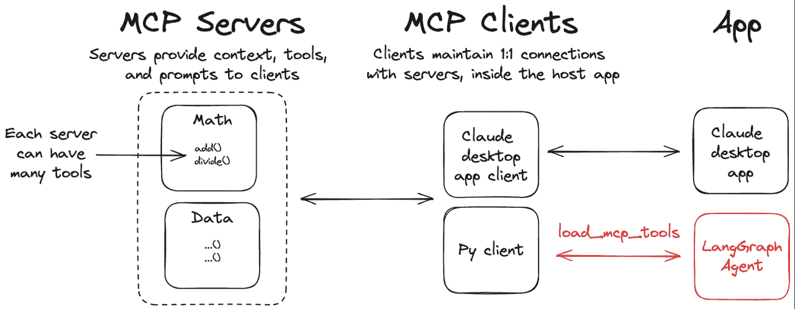

实际上`load_mcp_tools()`返回的是标准的 LangChain 工具，所以是完全可以直接在LangChain环境中进行使用的。同时，完全支持`stdio`、`Http SSE`和`Streamable HTTP`三种不同的通讯协议。

接下来，我们先尝试手动实现一遍MCP实践流程，然后再考虑将已经部署好的`server`带入中，作为`tools`进行调用。

一个极简的天气查询MCP调用流程如下：

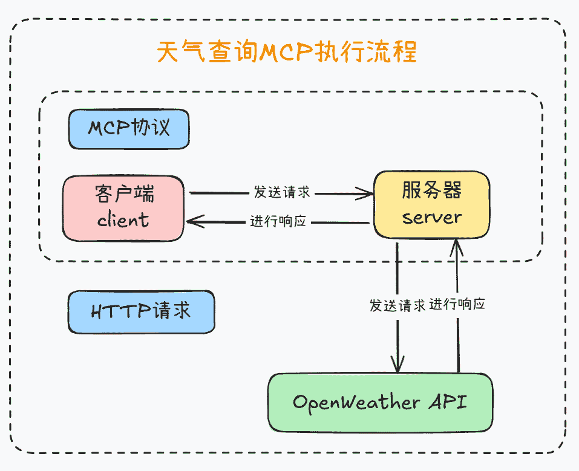

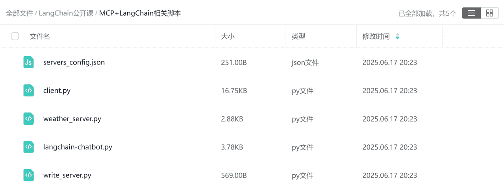


+   借助`uv`创建`MCP`运行环境

方法 1：使用`pip`安装（适用于已安装`pip`的系统）

```bash
pip install uv
```

方法 2：使用`curl`直接安装

如果你的系统没有 `pip`，可以直接运行：

```bash
curl -LsSf https://astral.sh/uv/install.sh | sh
```

这会自动下载 `uv` 并安装到 `/usr/local/bin`。

+   创建 `MCP` 客户端项目

```bash
# 创建项目目录
uv init mcp-client
cd mcp-client
```

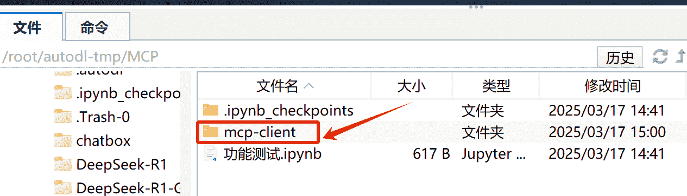

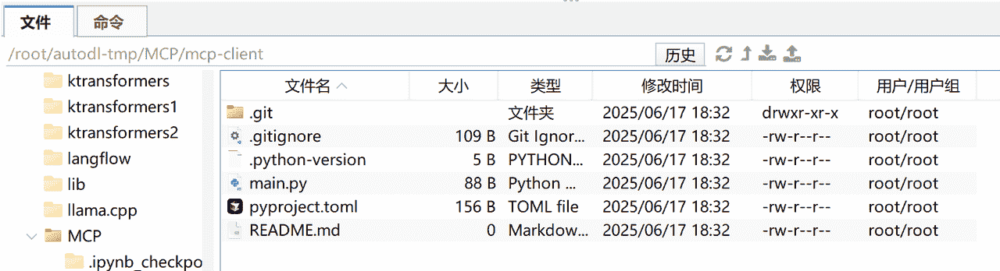

+   创建`MCP`客户端虚拟环境

```bash
# 创建虚拟环境
uv venv

# 激活虚拟环境
source .venv/bin/activate
```

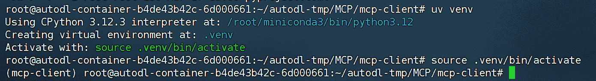

然后即可通过`add`方法在虚拟环境中安装相关的库。

```bash
# 安装 MCP SDK
uv add mcp openai python-dotenv httpx
```

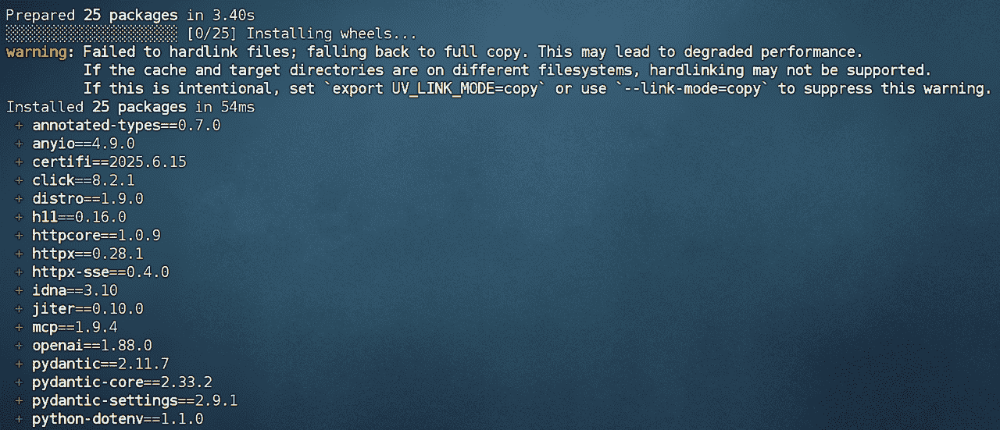

+   编写用于天气查询的`server`服务器代码：

这里我们需要在服务器上创建一个`server.py`，并写入如下代码：

```python
import json
import httpx
from typing import Any
from mcp.server.fastmcp import FastMCP

# 初始化 MCP 服务器
mcp = FastMCP("WeatherServer")

# OpenWeather API 配置
OPENWEATHER_API_BASE = "https://api.openweathermap.org/data/2.5/weather"
API_KEY = "YOUR_API_KEY"  # 请替换为你自己的 OpenWeather API Key
USER_AGENT = "weather-app/1.0"

async def fetch_weather(city: str) -> dict[str, Any] | None:
    """
    从 OpenWeather API 获取天气信息。
    :param city: 城市名称（需使用英文，如 Beijing）
    :return: 天气数据字典；若出错返回包含 error 信息的字典
    """
    params = {
        "q": city,
        "appid": API_KEY,
        "units": "metric",
        "lang": "zh_cn"
    }
    headers = {"User-Agent": USER_AGENT}

    async with httpx.AsyncClient() as client:
        try:
            response = await client.get(OPENWEATHER_API_BASE, params=params, headers=headers, timeout=30.0)
            response.raise_for_status()
            return response.json()  # 返回字典类型
        except httpx.HTTPStatusError as e:
            return {"error": f"HTTP 错误: {e.response.status_code}"}
        except Exception as e:
            return {"error": f"请求失败: {str(e)}"}

def format_weather(data: dict[str, Any] | str) -> str:
    """
    将天气数据格式化为易读文本。
    :param data: 天气数据（可以是字典或 JSON 字符串）
    :return: 格式化后的天气信息字符串
    """
    # 如果传入的是字符串，则先转换为字典
    if isinstance(data, str):
        try:
            data = json.loads(data)
        except Exception as e:
            return f"无法解析天气数据: {e}"

    # 如果数据中包含错误信息，直接返回错误提示
    if "error" in data:
        return f"⚠️ {data['error']}"

    # 提取数据时做容错处理
    city = data.get("name", "未知")
    country = data.get("sys", {}).get("country", "未知")
    temp = data.get("main", {}).get("temp", "N/A")
    humidity = data.get("main", {}).get("humidity", "N/A")
    wind_speed = data.get("wind", {}).get("speed", "N/A")
    # weather 可能为空列表，因此用 [0] 前先提供默认字典
    weather_list = data.get("weather", [{}])
    description = weather_list[0].get("description", "未知")

    return (
        f"🌍 {city}, {country}\n"
        f"🌡 温度: {temp}°C\n"
        f"💧 湿度: {humidity}%\n"
        f"🌬 风速: {wind_speed} m/s\n"
        f"🌤 天气: {description}\n"
    )

@mcp.tool()
async def query_weather(city: str) -> str:
    """
    输入指定城市的英文名称，返回今日天气查询结果。
    :param city: 城市名称（需使用英文）
    :return: 格式化后的天气信息
    """
    data = await fetch_weather(city)
    return format_weather(data)

if __name__ == "__main__":
    # 以标准 I/O 方式运行 MCP 服务器
    mcp.run(transport='stdio')
```

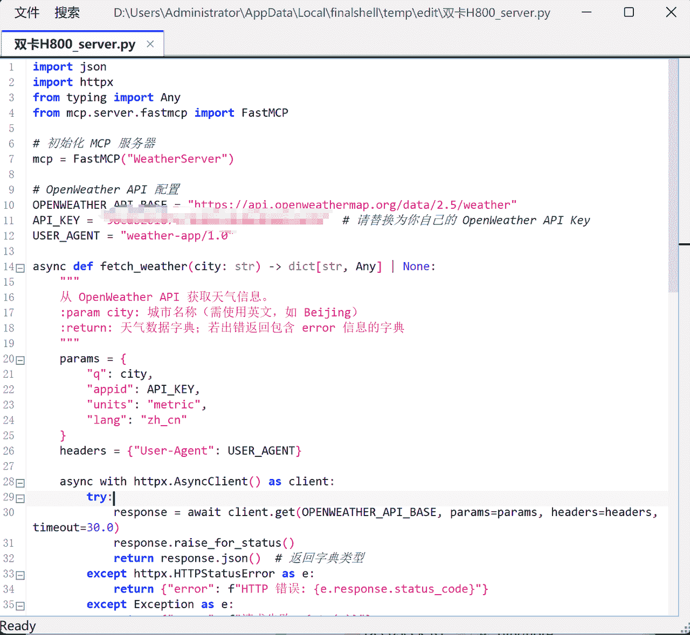

+   创建`write_server.py`

为了更好的测试多MCP工具调用流程，这里我们继续创建一个`write_server.py`服务器：

```python
import json
import httpx
from typing import Any
from mcp.server.fastmcp import FastMCP

# 初始化 MCP 服务器
mcp = FastMCP("WriteServer")
USER_AGENT = "write-app/1.0"

@mcp.tool()
async def write_file(content: str) -> str:
    """
    将指定内容写入本地文件。
    :param content: 必要参数，字符串类型，用于表示需要写入文档的具体内容。
    :return：是否成功写入
    """
    return "已成功写入本地文件。"

if __name__ == "__main__":
    # 以标准 I/O 方式运行 MCP 服务器
    mcp.run(transport='stdio')
```

+   天气查询客户端`client`创建流程

然后创建一个可以和`server`进行通信的客户端，需要注意的是，该客户端需要包含大模型调用的基础信息。我们需要编写一个`client.py`脚本，这个脚本内容非常复杂，完整代码如下：


```python
import asyncio
import json
import logging
import os
import shutil
from contextlib import AsyncExitStack
from typing import Any, Dict, List, Optional

import httpx
from dotenv import load_dotenv
from openai import OpenAI  # OpenAI Python SDK
from mcp import ClientSession, StdioServerParameters
from mcp.client.stdio import stdio_client

# Configure logging
logging.basicConfig(
    level=logging.INFO, format="%(asctime)s - %(levelname)s - %(message)s"
)


# =============================
# 配置加载类（支持环境变量及配置文件）
# =============================
class Configuration:
    """管理 MCP 客户端的环境变量和配置文件"""

    def __init__(self) -> None:
        load_dotenv()
        # 从环境变量中加载 API key, base_url 和 model
        self.api_key = os.getenv("LLM_API_KEY")
        self.base_url = os.getenv("BASE_URL")
        self.model = os.getenv("MODEL")
        if not self.api_key:
            raise ValueError("❌ 未找到 LLM_API_KEY，请在 .env 文件中配置")

    @staticmethod
    def load_config(file_path: str) -> Dict[str, Any]:
        """
        从 JSON 文件加载服务器配置
        
        Args:
            file_path: JSON 配置文件路径
        
        Returns:
            包含服务器配置的字典
        """
        with open(file_path, "r") as f:
            return json.load(f)


# =============================
# MCP 服务器客户端类
# =============================
class Server:
    """管理单个 MCP 服务器连接和工具调用"""

    def __init__(self, name: str, config: Dict[str, Any]) -> None:
        self.name: str = name
        self.config: Dict[str, Any] = config
        self.session: Optional[ClientSession] = None
        self.exit_stack: AsyncExitStack = AsyncExitStack()
        self._cleanup_lock = asyncio.Lock()

    async def initialize(self) -> None:
        """初始化与 MCP 服务器的连接"""
        # command 字段直接从配置获取
        command = self.config["command"]
        if command is None:
            raise ValueError("command 不能为空")

        server_params = StdioServerParameters(
            command=command,
            args=self.config["args"],
            env={**os.environ, **self.config["env"]} if self.config.get("env") else None,
        )
        try:
            stdio_transport = await self.exit_stack.enter_async_context(
                stdio_client(server_params)
            )
            read_stream, write_stream = stdio_transport
            session = await self.exit_stack.enter_async_context(
                ClientSession(read_stream, write_stream)
            )
            await session.initialize()
            self.session = session
        except Exception as e:
            logging.error(f"Error initializing server {self.name}: {e}")
            await self.cleanup()
            raise

    async def list_tools(self) -> List[Any]:
        """获取服务器可用的工具列表

        Returns:
            工具列表
        """
        if not self.session:
            raise RuntimeError(f"Server {self.name} not initialized")
        tools_response = await self.session.list_tools()
        tools = []
        for item in tools_response:
            if isinstance(item, tuple) and item[0] == "tools":
                for tool in item[1]:
                    tools.append(Tool(tool.name, tool.description, tool.inputSchema))
        return tools

    async def execute_tool(
        self, tool_name: str, arguments: Dict[str, Any], retries: int = 2, delay: float = 1.0
    ) -> Any:
        """执行指定工具，并支持重试机制

        Args:
            tool_name: 工具名称
            arguments: 工具参数
            retries: 重试次数
            delay: 重试间隔秒数

        Returns:
            工具调用结果
        """
        if not self.session:
            raise RuntimeError(f"Server {self.name} not initialized")
        attempt = 0
        while attempt < retries:
            try:
                logging.info(f"Executing {tool_name} on server {self.name}...")
                result = await self.session.call_tool(tool_name, arguments)
                return result
            except Exception as e:
                attempt += 1
                logging.warning(
                    f"Error executing tool: {e}. Attempt {attempt} of {retries}."
                )
                if attempt < retries:
                    logging.info(f"Retrying in {delay} seconds...")
                    await asyncio.sleep(delay)
                else:
                    logging.error("Max retries reached. Failing.")
                    raise

    async def cleanup(self) -> None:
        """清理服务器资源"""
        async with self._cleanup_lock:
            try:
                await self.exit_stack.aclose()
                self.session = None
            except Exception as e:
                logging.error(f"Error during cleanup of server {self.name}: {e}")


# =============================
# 工具封装类
# =============================
class Tool:
    """封装 MCP 返回的工具信息"""

    def __init__(self, name: str, description: str, input_schema: Dict[str, Any]) -> None:
        self.name: str = name
        self.description: str = description
        self.input_schema: Dict[str, Any] = input_schema

    def format_for_llm(self) -> str:
        """生成用于 LLM 提示的工具描述"""
        args_desc = []
        if "properties" in self.input_schema:
            for param_name, param_info in self.input_schema["properties"].items():
                arg_desc = f"- {param_name}: {param_info.get('description', 'No description')}"
                if param_name in self.input_schema.get("required", []):
                    arg_desc += " (required)"
                args_desc.append(arg_desc)
        return f"""
Tool: {self.name}
Description: {self.description}
Arguments:
{chr(10).join(args_desc)}
"""


# =============================
# LLM 客户端封装类（使用 OpenAI SDK）
# =============================
class LLMClient:
    """使用 OpenAI SDK 与大模型交互"""

    def __init__(self, api_key: str, base_url: Optional[str], model: str) -> None:
        self.client = OpenAI(api_key=api_key, base_url=base_url)
        self.model = model

    def get_response(self, messages: List[Dict[str, Any]], tools: Optional[List[Dict[str, Any]]] = None) -> Any:
        """
        发送消息给大模型 API，支持传入工具参数（function calling 格式）
        """
        payload = {
            "model": self.model,
            "messages": messages,
            "tools": tools,
        }
        try:
            response = self.client.chat.completions.create(**payload)
            return response
        except Exception as e:
            logging.error(f"Error during LLM call: {e}")
            raise


# =============================
# 多服务器 MCP 客户端类（集成配置文件、工具格式转换与 OpenAI SDK 调用）
# =============================
class MultiServerMCPClient:
    def __init__(self) -> None:
        """
        管理多个 MCP 服务器，并使用 OpenAI Function Calling 风格的接口调用大模型
        """
        self.exit_stack = AsyncExitStack()
        config = Configuration()
        self.openai_api_key = config.api_key
        self.base_url = config.base_url
        self.model = config.model
        self.client = LLMClient(self.openai_api_key, self.base_url, self.model)
        # (server_name -> Server 对象)
        self.servers: Dict[str, Server] = {}
        # 各个 server 的工具列表
        self.tools_by_server: Dict[str, List[Any]] = {}
        self.all_tools: List[Dict[str, Any]] = []

    async def connect_to_servers(self, servers_config: Dict[str, Any]) -> None:
        """
        根据配置文件同时启动多个服务器并获取工具
        servers_config 的格式为：
        {
          "mcpServers": {
              "sqlite": { "command": "uvx", "args": [ ... ] },
              "puppeteer": { "command": "npx", "args": [ ... ] },
              ...
          }
        }
        """
        mcp_servers = servers_config.get("mcpServers", {})
        for server_name, srv_config in mcp_servers.items():
            server = Server(server_name, srv_config)
            await server.initialize()
            self.servers[server_name] = server
            tools = await server.list_tools()
            self.tools_by_server[server_name] = tools

            for tool in tools:
                # 统一重命名：serverName_toolName
                function_name = f"{server_name}_{tool.name}"
                self.all_tools.append({
                    "type": "function",
                    "function": {
                        "name": function_name,
                        "description": tool.description,
                        "input_schema": tool.input_schema
                    }
                })

        # 转换为 OpenAI Function Calling 所需格式
        self.all_tools = await self.transform_json(self.all_tools)

        logging.info("\n✅ 已连接到下列服务器:")
        for name in self.servers:
            srv_cfg = mcp_servers[name]
            logging.info(f"  - {name}: command={srv_cfg['command']}, args={srv_cfg['args']}")
        logging.info("\n汇总的工具:")
        for t in self.all_tools:
            logging.info(f"  - {t['function']['name']}")

    async def transform_json(self, json_data: List[Dict[str, Any]]) -> List[Dict[str, Any]]:
        """
        将工具的 input_schema 转换为 OpenAI 所需的 parameters 格式，并删除多余字段
        """
        result = []
        for item in json_data:
            if not isinstance(item, dict) or "type" not in item or "function" not in item:
                continue
            old_func = item["function"]
            if not isinstance(old_func, dict) or "name" not in old_func or "description" not in old_func:
                continue
            new_func = {
                "name": old_func["name"],
                "description": old_func["description"],
                "parameters": {}
            }
            if "input_schema" in old_func and isinstance(old_func["input_schema"], dict):
                old_schema = old_func["input_schema"]
                new_func["parameters"]["type"] = old_schema.get("type", "object")
                new_func["parameters"]["properties"] = old_schema.get("properties", {})
                new_func["parameters"]["required"] = old_schema.get("required", [])
            new_item = {
                "type": item["type"],
                "function": new_func
            }
            result.append(new_item)
        return result

    async def chat_base(self, messages: List[Dict[str, Any]]) -> Any:
        """
        使用 OpenAI 接口进行对话，并支持多次工具调用（Function Calling）。
        如果返回 finish_reason 为 "tool_calls"，则进行工具调用后再发起请求。
        """
        response = self.client.get_response(messages, tools=self.all_tools)
        # 如果模型返回工具调用
        if response.choices[0].finish_reason == "tool_calls":
            while True:
                messages = await self.create_function_response_messages(messages, response)
                response = self.client.get_response(messages, tools=self.all_tools)
                if response.choices[0].finish_reason != "tool_calls":
                    break
        return response

    async def create_function_response_messages(self, messages: List[Dict[str, Any]], response: Any) -> List[Dict[str, Any]]:
        """
        将模型返回的工具调用解析执行，并将结果追加到消息队列中
        """
        function_call_messages = response.choices[0].message.tool_calls
        messages.append(response.choices[0].message.model_dump())
        for function_call_message in function_call_messages:
            tool_name = function_call_message.function.name
            tool_args = json.loads(function_call_message.function.arguments)
            # 调用 MCP 工具
            function_response = await self._call_mcp_tool(tool_name, tool_args)
            # 🔍 打印返回值及其类型
            # print(f"[DEBUG] tool_name: {tool_name}")
            # print(f"[DEBUG] tool_args: {tool_args}")
            # print(f"[DEBUG] function_response: {function_response}")
            # print(f"[DEBUG] type(function_response): {type(function_response)}")
            messages.append({
                "role": "tool",
                "content": function_response,
                "tool_call_id": function_call_message.id,
            })
        return messages

    async def process_query(self, user_query: str) -> str:
        """
        OpenAI Function Calling 流程：
         1. 发送用户消息 + 工具信息
         2. 若模型返回 finish_reason 为 "tool_calls"，则解析并调用 MCP 工具
         3. 将工具调用结果返回给模型，获得最终回答
        """
        messages = [{"role": "user", "content": user_query}]
        response = self.client.get_response(messages, tools=self.all_tools)
        content = response.choices[0]
        logging.info(content)
        if content.finish_reason == "tool_calls":
            tool_call = content.message.tool_calls[0]
            tool_name = tool_call.function.name
            tool_args = json.loads(tool_call.function.arguments)
            logging.info(f"\n[ 调用工具: {tool_name}, 参数: {tool_args} ]\n")
            result = await self._call_mcp_tool(tool_name, tool_args)
            messages.append(content.message.model_dump())
            messages.append({
                "role": "tool",
                "content": result,
                "tool_call_id": tool_call.id,
            })
            response = self.client.get_response(messages, tools=self.all_tools)
            return response.choices[0].message.content
        return content.message.content

    async def _call_mcp_tool(self, tool_full_name: str, tool_args: Dict[str, Any]) -> str:
        """
        根据 "serverName_toolName" 格式调用相应 MCP 工具
        """
        parts = tool_full_name.split("_", 1)
        if len(parts) != 2:
            return f"无效的工具名称: {tool_full_name}"
        server_name, tool_name = parts
        server = self.servers.get(server_name)
        if not server:
            return f"找不到服务器: {server_name}"
        resp = await server.execute_tool(tool_name, tool_args)
        
        # 🛠️ 修复点：提取 TextContent 中的文本（或转成字符串）
        content = resp.content
        if isinstance(content, list):
            # 提取所有 TextContent 对象中的 text 字段
            texts = [c.text for c in content if hasattr(c, "text")]
            return "\n".join(texts)
        elif isinstance(content, dict) or isinstance(content, list):
            # 如果是 dict 或 list，但不是 TextContent 类型
            return json.dumps(content, ensure_ascii=False)
        elif content is None:
            return "工具执行无输出"
        else:
            return str(content)

    async def chat_loop(self) -> None:
        """多服务器 MCP + OpenAI Function Calling 客户端主循环"""
        logging.info("\n🤖 多服务器 MCP + Function Calling 客户端已启动！输入 'quit' 退出。")
        messages: List[Dict[str, Any]] = []
        while True:
            query = input("\n你: ").strip()
            if query.lower() == "quit":
                break
            try:
                messages.append({"role": "user", "content": query})
                messages = messages[-20:]  # 保持最新 20 条上下文
                response = await self.chat_base(messages)
                messages.append(response.choices[0].message.model_dump())
                result = response.choices[0].message.content
                # logging.info(f"\nAI: {result}")
                print(f"\nAI: {result}")
            except Exception as e:
                print(f"\n⚠️  调用过程出错: {e}")

    async def cleanup(self) -> None:
        """关闭所有资源"""
        await self.exit_stack.aclose()


# =============================
# 主函数
# =============================
async def main() -> None:
    # 从配置文件加载服务器配置
    config = Configuration()
    servers_config = config.load_config("servers_config.json")
    client = MultiServerMCPClient()
    try:
        await client.connect_to_servers(servers_config)
        await client.chat_loop()
    finally:
        try:
            await asyncio.sleep(0.1)
            await client.cleanup()
        except RuntimeError as e:
            # 如果是因为退出 cancel scope 导致的异常，可以选择忽略
            if "Attempted to exit cancel scope" in str(e):
                logging.info("退出时检测到 cancel scope 异常，已忽略。")
            else:
                raise

if __name__ == "__main__":
    asyncio.run(main())
```


## 3.3 MCP 基础执行流程

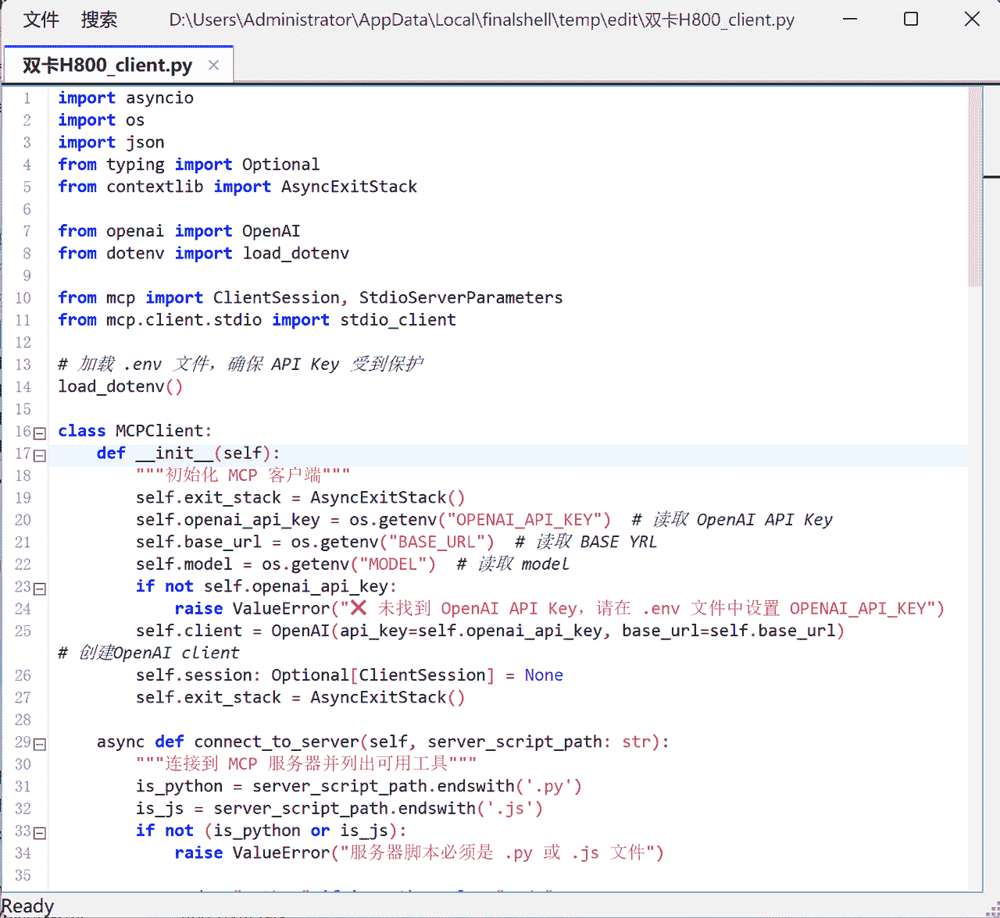

+   创建 `.env` 文件

接下来继续创建一个 `.env` 文件，来保存大模型调用的 API-KEY

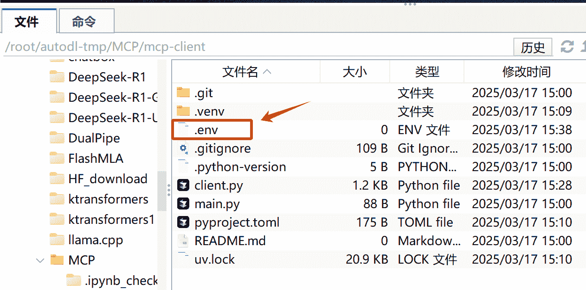

并写入如下内容：

```
BASE_URL=https://api.deepseek.com
MODEL=deepseek-chat
OPENAI_API_KEY=YOUR_DEEPSEEK_API_KEY
```

+   创建 `servers_config.json` 文件

接下来继续创建 `servers_config.json` 文件，用于保存 MCP 工具基本信息：

```json
{
  "mcpServers": {
    "weather": {
      "command": "python",
      "args": ["weather_server.py"],
      "transport": "stdio"
    },
    "write": {
      "command": "python",
      "args": ["write_server.py"],
      "transport": "stdio"
    }
  }
}
```

此时完整项目结构如下：

<center></center>

- 运行 MCP 客户端+服务器

最后在命令行中执行如下命令，即可开启对话：

```bash
uv run client.py
```

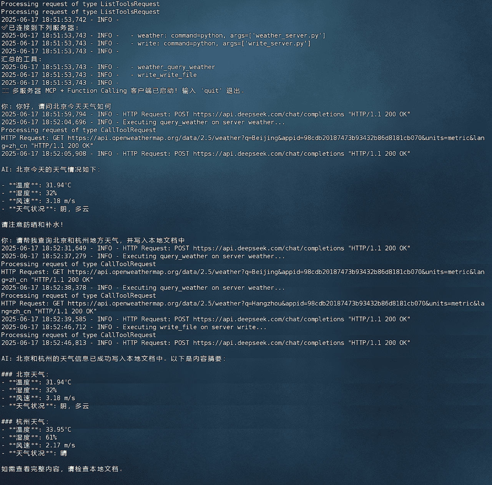

至此，即完成了一次简单的 MCP 执行流程。

## 3.4 MCP+LangChain基础调用流程

LangChain 调用 MCP 是可以将 MCP 的工具直接转换为 LangChain 的工具，然后通过预定义的 `MCP_Client` 实现与外部 MCP 的读写操作，换而言之就是我们需要改写原先的 `client`，将原先的 Function calling 调用逻辑修改为 LangChain 调用逻辑：

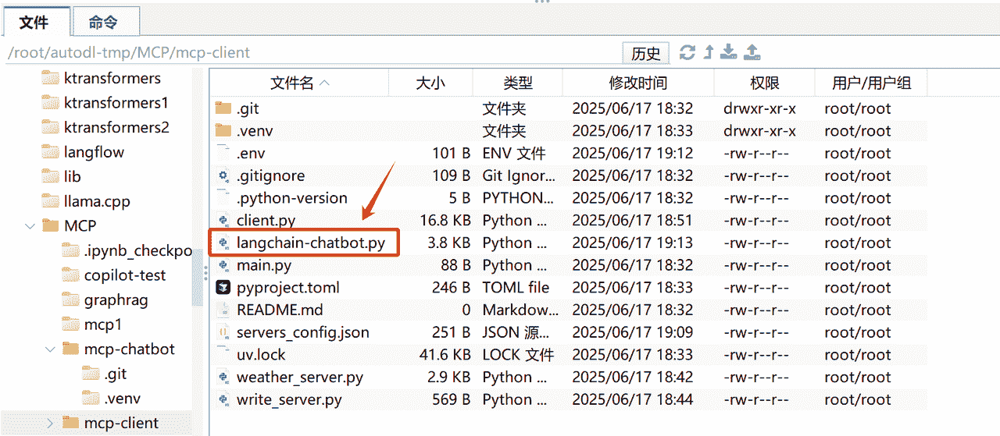

```
"""
多服务器 MCP + LangChain Agent 示例
---------------------------------
1. 读取 .env 中的 LLM_API_KEY / BASE_URL / MODEL
2. 读取 servers_config.json 中的 MCP 服务器信息
3. 启动 MCP 服务器（支持多个）
4. 将所有工具注入 LangChain Agent，由大模型自动选择并调用
"""

import asyncio
import json
import logging
import os
from typing import Any, Dict, List

from dotenv import load_dotenv
from langchain import hub
from langchain.agents import AgentExecutor, create_openai_tools_agent
from langchain.chat_models import init_chat_model
from langchain_mcp_adapters.client import MultiServerMCPClient
from langchain_mcp_adapters.tools import load_mcp_tools

# ────────────────────────────
# 环境配置
# ────────────────────────────

class Configuration:
    """读取 .env 与 servers_config.json"""

    def __init__(self) -> None:
        load_dotenv()
        self.api_key: str = os.getenv("LLM_API_KEY") or ""
        self.base_url: str | None = os.getenv("BASE_URL")  # DeepSeek 用 https://api.deepseek.com
        self.model: str = os.getenv("MODEL") or "deepseek-chat"
        if not self.api_key:
            raise ValueError("❌ 未找到 LLM_API_KEY，请在 .env 中配置")

    @staticmethod
    def load_servers(file_path: str = "servers_config.json") -> Dict[str, Any]:
        with open(file_path, "r", encoding="utf-8") as f:
            return json.load(f).get("mcpServers", {})

# ────────────────────────────
# 主逻辑
# ────────────────────────────
async def run_chat_loop() -> None:
    """启动 MCP-Agent 聊天循环"""
    cfg = Configuration()
    os.environ["DEEPSEEK_API_KEY"] = os.getenv("LLM_API_KEY", "")
    if cfg.base_url:
        os.environ["DEEPSEEK_API_BASE"] = cfg.base_url
    servers_cfg = Configuration.load_servers()

    # 把 key 注入环境，LangChain-OpenAI / DeepSeek 会自动读取
    os.environ["OPENAI_API_KEY"] = cfg.api_key
    if cfg.base_url:  # 对 DeepSeek 之类的自定义域名很有用
        os.environ["OPENAI_BASE_URL"] = cfg.base_url

    # 1️⃣ 连接多台 MCP 服务器
    mcp_client = MultiServerMCPClient(servers_cfg)

    tools = await mcp_client.get_tools()         # LangChain Tool 对象列表

    logging.info(f"✅ 已加载 {len(tools)} 个 MCP 工具： {[t.name for t in tools]}")

    # 2️⃣ 初始化大模型（DeepSeek / OpenAI / 任意兼容 OpenAI 协议的模型）
    llm = init_chat_model(
        model=cfg.model,
        model_provider="deepseek" if "deepseek" in cfg.model else "openai",
    )

    # 3️⃣ 构造 LangChain Agent（用通用 prompt）
    prompt = hub.pull("hwchase17/openai-tools-agent")
    agent = create_openai_tools_agent(llm, tools, prompt)
    agent_executor = AgentExecutor(agent=agent, tools=tools, verbose=True)

    # 4️⃣ CLI 聊天
    print("\n🤖 MCP Agent 已启动，输入 'quit' 退出")
    while True:
        user_input = input("\n你: ").strip()
        if user_input.lower() == "quit":
            break
        try:
            result = await agent_executor.ainvoke({"input": user_input})
            print(f"\nAI: {result['output']}")
        except Exception as exc:
            print(f"\n⚠️  出错: {exc}")

    # 5️⃣ 清理
    await mcp_client.cleanup()
    print("🧹 资源已清理，Bye!")

# ────────────────────────────
# 入口
# ────────────────────────────
if __name__ == "__main__":
    logging.basicConfig(level=logging.INFO, format="%(asctime)s - %(levelname)s - %(message)s")
    asyncio.run(run_chat_loop())
```

LangChain 接入 MCP 的核心原理为： `weather_server.py` → 启动为子进程 → stdio 通信 → MCP 协议 → 转换为 LangChain 工具 → LangChain Agent 执行读写，核心转换过程为：：

1.  `@mcp.tool()` → 标准 LangChain Tool

1.  `stdio_client()` → 自动处理 read/write 流，其中 `read` 表示从 MCP 服务器读取响应的流，`write` 表示向 MCP 服务器发送请求的流，对于 `stdio weather_server.py`，它们就是子进程的 `stdout` 和 `stdin`

1.  `load_mcp_tools()` → 一键转换所有工具

实际对话过程如下所示：

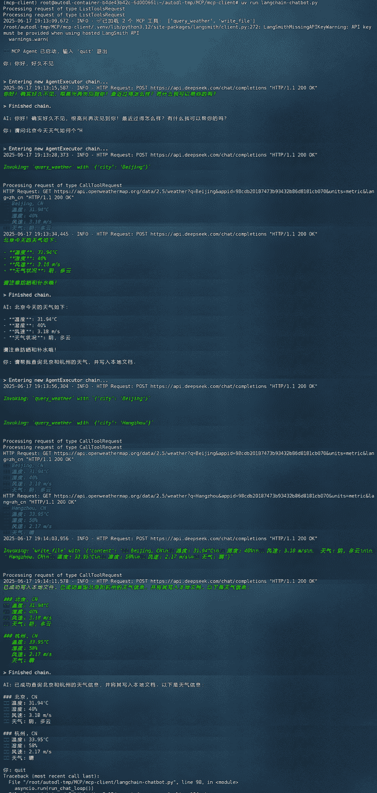

完整的代码已经上传至百度网盘中的 `langchain_rag.py` 文件中，大家可以扫描下方二维码免费领取

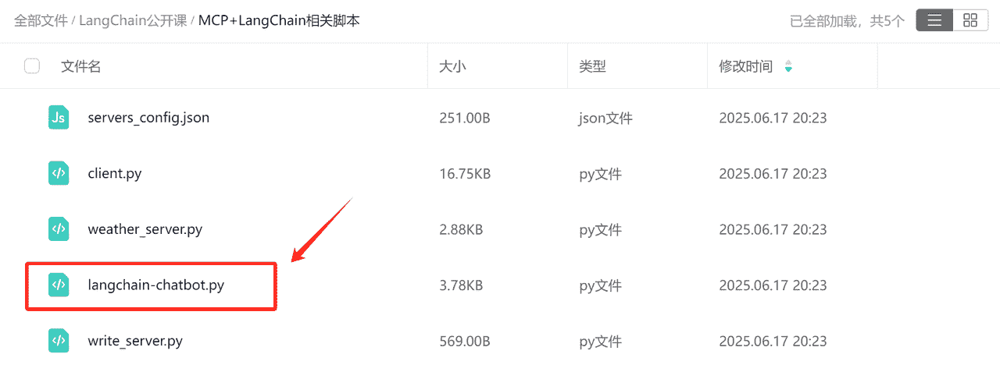


