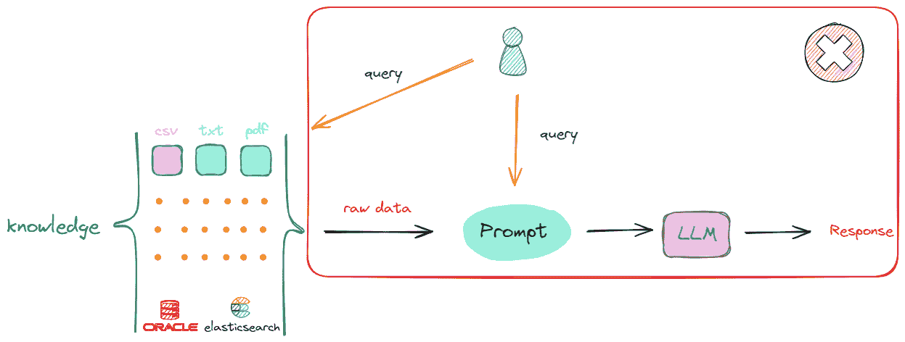
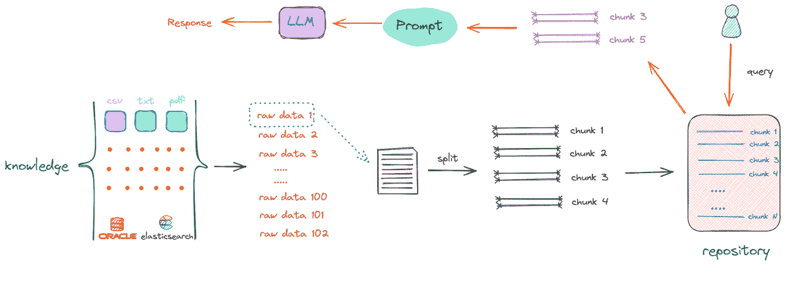
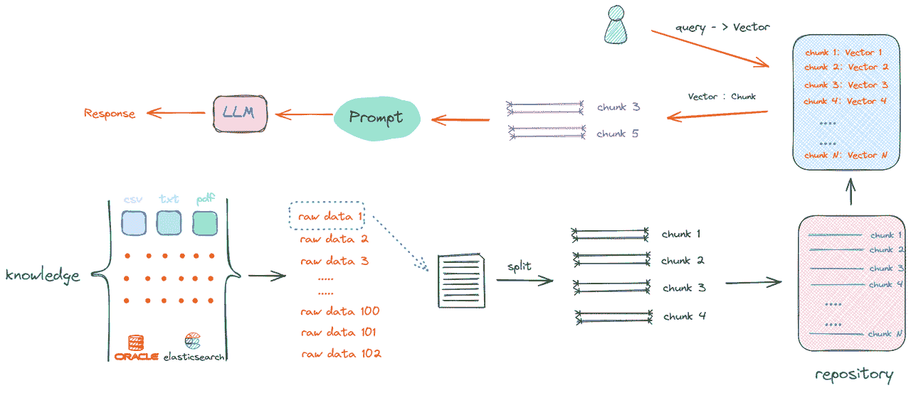
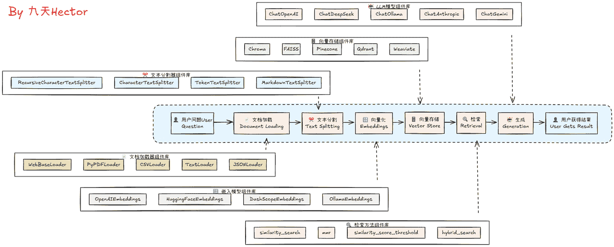
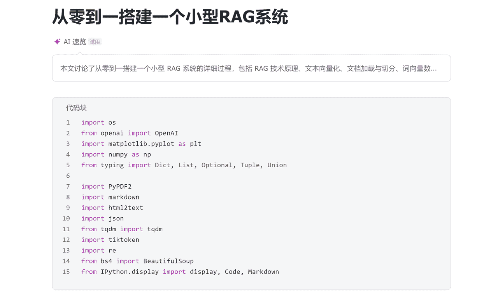
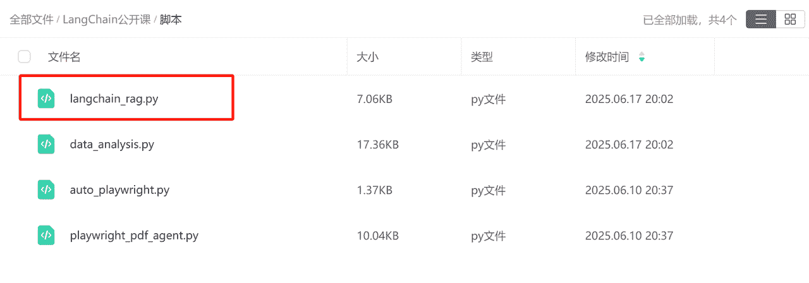

# LangChain+RAG技术实战

> 来源：[https://kq4b3vgg5b.feishu.cn/docx/S1QddoIXjonfj5xL5eacYNornog](https://kq4b3vgg5b.feishu.cn/docx/S1QddoIXjonfj5xL5eacYNornog)

## 课程说明：

+   体验课内容节选自《2025大模型Agent智能体开发实战》(夏季班)完整版付费课程

体验课时间有限，若想深度学习大模型技术，欢迎大家报名由我主讲的《2025大模型Agent智能体开发实战》(夏季班)


公开课全套学习资料，已上传至网盘（链接: https://pan.baidu.com/s/1_TPoisye8HldxiIXiMxM8Q 提取码: khnp ）

需要更系统深入学习大模型可扫码⬆️添加助教咨询喔～

---

# LangChain快速入门与Agent开发实战

# Part 8.LangChain RAG知识库检索系统开发实战

## 一、LangChain 实现本地知识库问答

供Agents在处理复杂任务的某个阶段使用，这其实是一种更为复杂的应用架构——Agent + RAG。

## 1.1 RAG基础概念入门

假设现在我们有一个偌大的知识库，当想从该知识库中去检索最相关的内容时，最简单的方法是：接收到一个查询（Query），就直接在知识库中进行搜索。这种做法其实是可行的，但存在两个关键的问题：

1.  假设提问的Query的答案出现在一篇文章中，去知识库中找到一篇与用户输入相关的文章是很容易的，但是我们将检索到的这整篇文章直接放入Prompt中并不是最优的选择，因为其中一定会包含非常多无关的信息，而无效信息越多，对大模型后续的推理影响越大。

1.  任何一个大模型都存在最大输入的Token限制，一个流程中可能涉及多次检索，每次检索都会产生相应的上下文，无法容纳如此多的信息。



解决上述两个问题的方式是：把存放着原始数据的知识库（Knowledge）中的每一个raw data，切分成一个一个的小块，这些小块可以是一个段落，也可以是数据库中某个索引对应的值。这个切分过程被称为“分块”（chunking），如下述流程所示：



以第一个原始数据为例（raw data 1），通过一些特定的方法进行切分，一个完整的内容会被分割成 chunk1 ~ chunk4。采取相同的方法，继续对raw data 2、raw data 3直至raw data n进行切分。完成这一过程后，我们最终得到的是一个充满分块数据（chunks）的新的知识库（repository），其中每一项都是一个单独的chunk。例如，如果原始文档共有10个，那么经过切分，可能会产生出100个chunks。

完成这一转化后，当再次接收到一个查询（Query）时，就会在更新后的知识库（repository）中进行搜索，这时检索的范围就不再是某个完整的文档，而是其中的某一个部分，返回的是一个或多个特定的chunk，这样返回的信息量就会更小且更精确。随后，这些被检索到的chunk会被加入到Prompt中，作为上下文信息与用户原始的Query共同输入到大模型进行处理，以生成最终的回答。

在上述将原始数据（raw data）转化为chunk的过程中，就会包含构建RAG的第一部分开发工作：这包括如果做数据清洗，如去除停用词、标点符号等。此外，还涉及如何选择合适的split方法来进行数据切分的一系列技术。

接下来面临的问题是，尽管所有数据已经被切割成一个个chunk，其存储形式还是以字符串形式存在，如果想从repository中匹配到与输入的query相关的chunks，比较两句话是否相似，看一句话中相同字有几个，这显然是行不通的。我们需要获取的是句子所蕴含的深层含义，而非仅仅是表面的字面相似度。因此，大家也能想到，在NLP中去计算文本相似度的有效的方法就是Embedding，即将这些chunks转换成向量（vector）形式。所以流程会丰富如下：



如上所示，解决搜索效率和计算相似度优化算法的答案就是：向量数据库。同时也产生了构建RAG的第三部分工作：我们要去了解和学习如何选择、使用向量数据库。

最终整体流程就如上图所示，一个基础的RAG架构会只要包含以下几方面的开发工作：

1.  如何将原始数据转化成chunks；

1.  如何将chunks转化成Vector；

1.  如何选择计算向量相似度的算法；

1.  如何利用向量数据库提升搜索效率；

1.  如何把找到的chunks与原始query拼接在一起，产生最终的Prompt；

而上述流程，其实更像是一个自由拼接的结果，比如不同的文档类型可以选择不同的文档解析器，也可以选择不同的Vector数据库，甚至可以自由选择Embedding模型和Vector数据库的组合。其自由程度非常高，如下图所示：



## 1.2 从零到一搭建小型RAG系统入门教程




## 1.3 实战：支持 PDF 文件解析的智能RAG 问答

理解了在LangChain中构建RAG的基本原理后，我们就可以开始动手实践了。接下来的案例中，我们通过 Streamlit 前端界面，结合 LangChain 框架 与 DashScope 向量嵌入服务，实现了一个轻量化的 RAG（Retrieval-Augmented Generation） 智能问答系统，支持上传多个 PDF 文档，系统将自动完成文本提取、分块、向量化，并构建基于 FAISS 的检索数据库。用户随后可以在页面中输入任意问题，系统会调用大语言模型（如 DeepSeek-Chat）对 PDF 内容进行语义理解和回答生成。

其完整代码如下所示：

```
# ! pip install streamlit PyPDF2 dashscope faiss-cpu
```

```
    import streamlit as st
    from PyPDF2 import PdfReader
    from langchain.text_splitter import RecursiveCharacterTextSplitter
    from langchain_core.prompts import ChatPromptTemplate
    from langchain_community.vectorstores import FAISS
    from langchain.tools.retriever import create_retriever_tool
    from langchain.agents import AgentExecutor, create_tool_calling_agent
    from langchain_community.embeddings import DashScopeEmbeddings
    from langchain.chat_models import init_chat_model
    import os
    from dotenv import load_dotenv 
    load_dotenv(override=True)


    DeepSeek_API_KEY = os.getenv(&quot;DEEPSEEK_API_KEY&quot;)
    dashscope_api_key = os.getenv(&quot;dashscope_api_key&quot;)

    os.environ[&quot;KMP_DUPLICATE_LIB_OK&quot;]=&quot;TRUE&quot;


    embeddings = DashScopeEmbeddings(
        model=&quot;text-embedding-v1&quot;, dashscope_api_key=dashscope_api_key
    )

    def pdf_read(pdf_doc):
        text = &quot;&quot;
        for pdf in pdf_doc:
            pdf_reader = PdfReader(pdf)
            for page in pdf_reader.pages:
                text += page.extract_text()
        return text


    def get_chunks(text):
        text_splitter = RecursiveCharacterTextSplitter(chunk_size=1000, chunk_overlap=200)
        chunks = text_splitter.split_text(text)
        return chunks

    def vector_store(text_chunks):
        vector_store = FAISS.from_texts(text_chunks, embedding=embeddings)
        vector_store.save_local(&quot;faiss_db&quot;)

    def get_conversational_chain(tools, ques):
        llm = init_chat_model(&quot;deepseek-chat&quot;, model_provider=&quot;deepseek&quot;)
        prompt = ChatPromptTemplate.from_messages([
            (
                &quot;system&quot;,
                &quot;&quot;&quot;你是AI助手，请根据提供的上下文回答问题，确保提供所有细节，如果答案不在上下文中，请说&quot;答案不在上下文中&quot;，不要提供错误的答案&quot;&quot;&quot;,
            ),
            (&quot;placeholder&quot;, &quot;{chat_history}&quot;),
            (&quot;human&quot;, &quot;{input}&quot;),
            (&quot;placeholder&quot;, &quot;{agent_scratchpad}&quot;),
        ])
        
        tool = [tools]
        agent = create_tool_calling_agent(llm, tool, prompt)
        agent_executor = AgentExecutor(agent=agent, tools=tool, verbose=True)
        
        response = agent_executor.invoke({&quot;input&quot;: ques})
        print(response)
        st.write(&quot;🤖 回答: &quot;, response[&#x27;output&#x27;])

    def check_database_exists():
        &quot;&quot;&quot;检查FAISS数据库是否存在&quot;&quot;&quot;
        return os.path.exists(&quot;faiss_db&quot;) and os.path.exists(&quot;faiss_db/index.faiss&quot;)

    def user_input(user_question):
        # 检查数据库是否存在
        if not check_database_exists():
            st.error(&quot;❌ 请先上传PDF文件并点击&#x27;Submit &amp; Process&#x27;按钮来处理文档！&quot;)
            st.info(&quot;💡 步骤：1️⃣ 上传PDF → 2️⃣ 点击处理 → 3️⃣ 开始提问&quot;)
            return
        
        try:
            # 加载FAISS数据库
            new_db = FAISS.load_local(&quot;faiss_db&quot;, embeddings, allow_dangerous_deserialization=True)
            
            retriever = new_db.as_retriever()
            retrieval_chain = create_retriever_tool(retriever, &quot;pdf_extractor&quot;, &quot;This tool is to give answer to queries from the pdf&quot;)
            get_conversational_chain(retrieval_chain, user_question)
            
        except Exception as e:
            st.error(f&quot;❌ 加载数据库时出错: {str(e)}&quot;)
            st.info(&quot;请重新处理PDF文件&quot;)

    def main():
        st.set_page_config(&quot;🤖 LangChain B站公开课 By九天Hector&quot;)
        st.header(&quot;🤖 LangChain B站公开课 By九天Hector&quot;)
        
        # 显示数据库状态
        col1, col2 = st.columns([3, 1])
        
        with col1:
            if check_database_exists():
            pass
            else:
                st.warning(&quot;⚠️ 请先上传并处理PDF文件&quot;)
        
        with col2:
            if st.button(&quot;🗑️ 清除数据库&quot;):
                try:
                    import shutil
                    if os.path.exists(&quot;faiss_db&quot;):
                        shutil.rmtree(&quot;faiss_db&quot;)
                    st.success(&quot;数据库已清除&quot;)
                    st.rerun()
                except Exception as e:
                    st.error(f&quot;清除失败: {e}&quot;)

        # 用户问题输入
        user_question = st.text_input(&quot;💬 请输入问题&quot;, 
                                    placeholder=&quot;例如：这个文档的主要内容是什么？&quot;,
                                    disabled=not check_database_exists())

        if user_question:
            if check_database_exists():
                with st.spinner(&quot;🤔 AI正在分析文档...&quot;):
                    user_input(user_question)
            else:
                st.error(&quot;❌ 请先上传并处理PDF文件！&quot;)

        # 侧边栏
        with st.sidebar:
            st.title(&quot;📁 文档管理&quot;)
            
            # 显示当前状态
            if check_database_exists():
                st.success(&quot;✅ 数据库状态：已就绪&quot;)
            else:
                st.info(&quot;📝 状态：等待上传PDF&quot;)
            
            st.markdown(&quot;---&quot;)
            
            # 文件上传
            pdf_doc = st.file_uploader(
                &quot;📎 上传PDF文件&quot;, 
                accept_multiple_files=True,
                type=[&#x27;pdf&#x27;],
                help=&quot;支持上传多个PDF文件&quot;
            )
            
            if pdf_doc:
                st.info(f&quot;📄 已选择 {len(pdf_doc)} 个文件&quot;)
                for i, pdf in enumerate(pdf_doc, 1):
                    st.write(f&quot;{i}. {pdf.name}&quot;)
            
            # 处理按钮
            process_button = st.button(
                &quot;🚀 提交并处理&quot;, 
                disabled=not pdf_doc,
                use_container_width=True
            )
            
            if process_button:
                if pdf_doc:
                    with st.spinner(&quot;📊 正在处理PDF文件...&quot;):
                        try:
                            # 读取PDF内容
                            raw_text = pdf_read(pdf_doc)
                            
                            if not raw_text.strip():
                                st.error(&quot;❌ 无法从PDF中提取文本，请检查文件是否有效&quot;)
                                return
                            
                            # 分割文本
                            text_chunks = get_chunks(raw_text)
                            st.info(f&quot;📝 文本已分割为 {len(text_chunks)} 个片段&quot;)
                            
                            # 创建向量数据库
                            vector_store(text_chunks)
                            
                            st.success(&quot;✅ PDF处理完成！现在可以开始提问了&quot;)
                            st.balloons()
                            st.rerun()
                            
                        except Exception as e:
                            st.error(f&quot;❌ 处理PDF时出错: {str(e)}&quot;)
                else:
                    st.warning(&quot;⚠️ 请先选择PDF文件&quot;)
            
            # 使用说明
            with st.expander(&quot;💡 使用说明&quot;):
                st.markdown(&quot;&quot;&quot;
                **步骤：**
                1. 📎 上传一个或多个PDF文件
                2. 🚀 点击&quot;Submit &amp; Process&quot;处理文档
                3. 💬 在主页面输入您的问题
                4. 🤖 AI将基于PDF内容回答问题
                
                **提示：**
                - 支持多个PDF文件同时上传
                - 处理大文件可能需要一些时间
                - 可以随时清除数据库重新开始
                &quot;&quot;&quot;)

    if __name__ == &quot;__main__&quot;:
        main()
```

基于此，我们能够实现：

+   LangChain 的多模块能力（向量搜索 + Agent工具）

+   **Streamlit 前端交互**

+   **FAISS 向量数据库**

+   DashScope Embedding + DeepSeek 模型接入

+   并完成了完整的 RAG（检索增强生成）流程

以下是各部分功能实现代码讲解：

#### 🔧 1. 导入库 & 环境初始化

```
import streamlit as st
from PyPDF2 import PdfReader
from langchain.text_splitter import RecursiveCharacterTextSplitter
...
load_dotenv(override=True)
```

+   Streamlit 用于构建网页界面。

+   PyPDF2 用来读取 PDF 文本。

+   load_dotenv() 加载 .env 中的 API Key，例如：

```
DEEPSEEK_API_KEY=sk-xxx
DASHSCOPE_API_KEY=xxx
```

---

#### 🔐 2. 加载 API 密钥与设置环境变量

```
DeepSeek_API_KEY = os.getenv(&quot;DEEPSEEK_API_KEY&quot;)
dashscope_api_key = os.getenv(&quot;dashscope_api_key&quot;)
os.environ[&quot;KMP_DUPLICATE_LIB_OK&quot;]=&quot;TRUE&quot;
```

+   从环境变量中读取 DashScope 和 DeepSeek API。

+   设置 KMP_DUPLICATE_LIB_OK 避免某些 MKL 多线程报错。

---

#### 🧠 3. 初始化向量 Embedding 模型

```
embeddings = DashScopeEmbeddings(
    model=&quot;text-embedding-v1&quot;, dashscope_api_key=dashscope_api_key
)
```

+   用阿里云 DashScope 提供的 text-embedding-v1 将文本转为向量表示，用于相似度搜索。

---

#### 📄 4. 处理 PDF 文本与向量化逻辑

```
def pdf_read(pdf_doc):
    ...
def get_chunks(text):
    ...
def vector_store(text_chunks):
    ...
```

+   pdf_read：逐页读取 PDF 内容并拼接。

+   get_chunks：将长文本切片为多个段落（chunk），每段 1000 字，重叠 200 字。

+   vector_store：用 FAISS 建立向量索引，并保存到本地 faiss_db/。

---

#### 🔁 5. Agent对话链 + 工具调用（核心 RAG）

```
def get_conversational_chain(tools, ques):
    llm = init_chat_model(&quot;deepseek-chat&quot;, model_provider=&quot;deepseek&quot;)
    ...
    agent_executor = AgentExecutor(...)
    response = agent_executor.invoke({&quot;input&quot;: ques})
    ...
```

+   初始化 DeepSeek 模型为 Agent。

+   使用 LangChain 的 create_tool_calling_agent 构造 Agent，输入：

+   prompt（你设定的系统角色）

+   工具（retriever 工具）

+   AgentExecutor.invoke：LangChain 自动判断是否调用工具，完成“读取上下文 → 查询 → 回答”流程。

---

#### 🔍 6. 用户提问逻辑（调用 FAISS）

```
def user_input(user_question):
    ...
    new_db = FAISS.load_local(&quot;faiss_db&quot;, embeddings, ...)
    retriever = new_db.as_retriever()
    retrieval_chain = create_retriever_tool(retriever, &quot;pdf_extractor&quot;, ...)
    get_conversational_chain(retrieval_chain, user_question)
```

+   加载本地 FAISS 向量库；

+   将其转为 LangChain 的检索工具；

+   交由 Agent 调用完成回答。

---

#### 🧠 7. 检查数据库是否存在

```
def check_database_exists():
    return os.path.exists(&quot;faiss_db&quot;) and os.path.exists(&quot;faiss_db/index.faiss&quot;)
```

简单检查本地是否已有向量化数据。

---

#### 🌐 8. 主界面逻辑（Streamlit）

```
def main():
    st.set_page_config(...)
    ...
```

+   页面标题与界面配置。

+   st.columns 分栏：左边显示提示，右边放置“清空数据库”按钮。

+   主输入框：st.text_input("请输入问题")

+   只有当数据库存在时才能提问。

+   侧边栏：

+   PDF 上传器；

+   提交按钮（处理上传的 PDF → 分片 → 向量化 → 存储）。

---

#### 🎯 9. 提交 PDF 后执行的逻辑

```
if process_button:
    raw_text = pdf_read(pdf_doc)
    ...
    text_chunks = get_chunks(raw_text)
    vector_store(text_chunks)
```

+   当点击“提交并处理”后：

1.  读取上传的 PDF；

1.  切片文本；

1.  向量化入库；

1.  弹出气球提示，并 st.rerun() 刷新页面状态。

---

#### 📎 项目结构总结

| 模块 | 说明 |
| --- | --- |
| 🧾 PDF解析 | 读取用户上传的 PDF |
| ✂️ 文本切片 | 按段落分割内容 |
| 📊 向量化 | DashScope Embedding + FAISS 建库 |
| 🔁 查询接口 | 用户输入 → 召回相关 chunk |
| 🤖 DeepSeek Agent | 调用检索工具并给出回答 |
| 💻 UI层 | Streamlit 实现全部交互 |

其中LangChain RAG核心功能相关代码如下：

+   Step 1：PDF 文件上传与文本提取

使用 st.file_uploader() 组件支持多文件上传，并通过 PyPDF2.PdfReader 对每页内容进行提取，组合为整体文本。

```
    def pdf_read(pdf_doc):
        text = &quot;&quot;
        for pdf in pdf_doc:
            pdf_reader = PdfReader(pdf)
            for page in pdf_reader.pages:
                text += page.extract_text()
        return text
```

+   Step 2：文本分块与向量数据库构建

使用 RecursiveCharacterTextSplitter 将长文档切割为固定长度（1000字）+ 重叠（200字）的小块，将文本块通过 DashScopeEmbeddings 嵌入为向量，使用 FAISS 本地存储向量数据库。

```
    chunks = text_splitter.split_text(text)
    vector_store = FAISS.from_texts(chunks, embedding=embeddings)
    vector_store.save_local(&quot;faiss_db&quot;)
```

+   Step 3：用户提问与语义检索

通过 Streamlit 获取用户输入问题，如果向量数据库存在，则加载 FAISS 检索器，使用 create_retriever_tool() 构建 LangChain 工具，交由 AgentExecutor 执行，自动调用检索器并生成答案。

```
    retrieval_chain = create_retriever_tool(retriever, ...)
    agent = create_tool_calling_agent(llm, [retrieval_chain], prompt)
    response = agent_executor.invoke({&quot;input&quot;: ques})
```

完整的代码已经上传至百度网盘中的langchain_rag.py文件中，大家可以扫描下方二维码免费领取




项目运行效果如下所示：

```
from IPython.display import Video
```

```
Video(&quot;https://ml2022.oss-cn-hangzhou.aliyuncs.com/LangChain%20RAG.mp4&quot;, width=800, height=400)
```

Your browser does not support the video element.