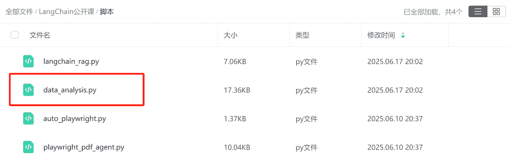

# LangChain搭建AI数据分析助手

> 来源：[https://kq4b3vgg5b.feishu.cn/docx/QNO2d7AWyoT8nYxdqM0cIlrKnIc](https://kq4b3vgg5b.feishu.cn/docx/QNO2d7AWyoT8nYxdqM0cIlrKnIc)

## 课程说明：

+   体验课内容节选自《2025大模型Agent智能体开发实战》(夏季班)完整版付费课程

体验课时间有限，若想深度学习大模型技术，欢迎大家报名由我主讲的《2025大模型Agent智能体开发实战》(夏季班)


公开课全套学习资料，已上传至网盘（链接: https://pan.baidu.com/s/1_TPoisye8HldxiIXiMxM8Q 提取码: khnp ）

需要更系统深入学习大模型可扫码⬆️添加助教咨询喔～

---

# LangChain快速入门与Agent开发实战

# Part 9.基于LangChain搭建AI数据分析智能体Data Agent

## 实战：智能数据分析可视化系统

接下来，我们进一步丰富智能问答系统的功能，接下来的案例中，我们构建一个基于 Streamlit + LangChain + DashScope + DeepSeek 的智能化数据分析助手，融合两个典型的企业级大模型应用场景：

+   PDF 智能问答：支持上传多个 PDF 文档，自动完成内容提取、文本切块、语义向量化，并构建 FAISS 本地检索库，结合大模型进行问答；

+   CSV 数据智能分析：通过自然语言指令分析结构化数据，包括统计查询、代码生成与图表绘制；

完整代码如下所示：

```
# ! pip install langchain_experimental matplotlib tabulate
```

```
    import streamlit as st
    import pandas as pd
    import os
    from PyPDF2 import PdfReader
    from langchain.text_splitter import RecursiveCharacterTextSplitter
    from langchain_core.prompts import ChatPromptTemplate
    from langchain_community.vectorstores import FAISS
    from langchain.tools.retriever import create_retriever_tool
    from langchain.agents import AgentExecutor, create_tool_calling_agent
    from langchain_community.embeddings import DashScopeEmbeddings
    from langchain.chat_models import init_chat_model
    from langchain_experimental.tools import PythonAstREPLTool
    import matplotlib
    matplotlib.use(&#x27;Agg&#x27;)
    import os
    from dotenv import load_dotenv 
    load_dotenv(override=True)


    DeepSeek_API_KEY = os.getenv(&quot;DEEPSEEK_API_KEY&quot;)
    dashscope_api_key = os.getenv(&quot;dashscope_api_key&quot;)

    # 设置环境变量
    os.environ[&quot;KMP_DUPLICATE_LIB_OK&quot;] = &quot;TRUE&quot;

    # 页面配置
    st.set_page_config(
        page_title=&quot;By九天Hector&quot;,
        page_icon=&quot;🤖&quot;,
        layout=&quot;wide&quot;,
        initial_sidebar_state=&quot;expanded&quot;
    )

    # 自定义CSS样式
    st.markdown(&quot;&quot;&quot;
    &lt;style&gt;
        /* 主题色彩 */
        :root {
            --primary-color: #1f77b4;
            --secondary-color: #ff7f0e;
            --success-color: #2ca02c;
            --warning-color: #ff9800;
            --error-color: #d62728;
            --background-color: #f8f9fa;
        }
        
        /* 隐藏默认的Streamlit样式 */
        #MainMenu {visibility: hidden;}
        footer {visibility: hidden;}
        header {visibility: hidden;}
        
        /* 标题样式 */
        .main-header {
            background: linear-gradient(90deg, #1f77b4, #ff7f0e);
            -webkit-background-clip: text;
            -webkit-text-fill-color: transparent;
            font-size: 3rem;
            font-weight: bold;
            text-align: center;
            margin-bottom: 2rem;
        }
        
        /* 卡片样式 */
        .info-card {
            background: white;
            padding: 1.5rem;
            border-radius: 10px;
            box-shadow: 0 2px 10px rgba(0,0,0,0.1);
            margin: 1rem 0;
            border-left: 4px solid var(--primary-color);
        }
        
        .success-card {
            background: linear-gradient(135deg, #e8f5e8, #f0f8f0);
            border-left: 4px solid var(--success-color);
        }
        
        .warning-card {
            background: linear-gradient(135deg, #fff8e1, #fffbf0);
            border-left: 4px solid var(--warning-color);
        }
        
        /* 按钮样式 */
        .stButton &gt; button {
            background: linear-gradient(45deg, #1f77b4, #2196F3);
            color: white;
            border: none;
            border-radius: 8px;
            padding: 0.5rem 1rem;
            font-weight: 600;
            transition: all 0.3s ease;
            box-shadow: 0 2px 8px rgba(31, 119, 180, 0.3);
        }
        
        .stButton &gt; button:hover {
            transform: translateY(-2px);
            box-shadow: 0 4px 12px rgba(31, 119, 180, 0.4);
        }
        
        /* Tab样式 */
        .stTabs [data-baseweb=&quot;tab-list&quot;] {
            gap: 8px;
            background-color: #f8f9fa;
            border-radius: 10px;
            padding: 0.5rem;
        }
        
        .stTabs [data-baseweb=&quot;tab&quot;] {
            height: 60px;
            background-color: white;
            border-radius: 8px;
            padding: 0 24px;
            font-weight: 600;
            border: 2px solid transparent;
            transition: all 0.3s ease;
        }
        
        .stTabs [aria-selected=&quot;true&quot;] {
            background: linear-gradient(45deg, #1f77b4, #2196F3);
            color: white !important;
            border: 2px solid #1f77b4;
        }
        
        /* 侧边栏样式 */
        .css-1d391kg {
            background: linear-gradient(180deg, #f8f9fa, #ffffff);
        }
        
        /* 文件上传区域 */
        .uploadedFile {
            background: #f8f9fa;
            border: 2px dashed #1f77b4;
            border-radius: 10px;
            padding: 1rem;
            text-align: center;
            margin: 1rem 0;
        }
        
        /* 状态指示器 */
        .status-indicator {
            display: inline-flex;
            align-items: center;
            gap: 0.5rem;
            padding: 0.5rem 1rem;
            border-radius: 20px;
            font-weight: 600;
            font-size: 0.9rem;
        }
        
        .status-ready {
            background: #e8f5e8;
            color: #2ca02c;
            border: 1px solid #2ca02c;
        }
        
        .status-waiting {
            background: #fff8e1;
            color: #ff9800;
            border: 1px solid #ff9800;
        }
    &lt;/style&gt;
    &quot;&quot;&quot;, unsafe_allow_html=True)

    # 初始化embeddings
    @st.cache_resource
    def init_embeddings():
        return DashScopeEmbeddings(
            model=&quot;text-embedding-v1&quot;, 
            dashscope_api_key=dashscope_api_key
        )

    # 初始化LLM
    @st.cache_resource
    def init_llm():
        return init_chat_model(&quot;deepseek-chat&quot;, model_provider=&quot;deepseek&quot;)

    # 初始化会话状态
    def init_session_state():
        if &#x27;pdf_messages&#x27; not in st.session_state:
            st.session_state.pdf_messages = []
        if &#x27;csv_messages&#x27; not in st.session_state:
            st.session_state.csv_messages = []
        if &#x27;df&#x27; not in st.session_state:
            st.session_state.df = None

    # PDF处理函数
    def pdf_read(pdf_doc):
        text = &quot;&quot;
        for pdf in pdf_doc:
            pdf_reader = PdfReader(pdf)
            for page in pdf_reader.pages:
                text += page.extract_text()
        return text

    def get_chunks(text):
        text_splitter = RecursiveCharacterTextSplitter(chunk_size=1000, chunk_overlap=200)
        chunks = text_splitter.split_text(text)
        return chunks

    def vector_store(text_chunks):
        embeddings = init_embeddings()
        vector_store = FAISS.from_texts(text_chunks, embedding=embeddings)
        vector_store.save_local(&quot;faiss_db&quot;)

    def check_database_exists():
        return os.path.exists(&quot;faiss_db&quot;) and os.path.exists(&quot;faiss_db/index.faiss&quot;)

    def get_pdf_response(user_question):
        if not check_database_exists():
            return &quot;❌ 请先上传PDF文件并点击&#x27;Submit &amp; Process&#x27;按钮来处理文档！&quot;
        
        try:
            embeddings = init_embeddings()
            llm = init_llm()
            
            new_db = FAISS.load_local(&quot;faiss_db&quot;, embeddings, allow_dangerous_deserialization=True)
            retriever = new_db.as_retriever()
            
            prompt = ChatPromptTemplate.from_messages([
                (&quot;system&quot;, &quot;&quot;&quot;你是AI助手，请根据提供的上下文回答问题，确保提供所有细节，如果答案不在上下文中，请说&quot;答案不在上下文中&quot;，不要提供错误的答案&quot;&quot;&quot;),
                (&quot;placeholder&quot;, &quot;{chat_history}&quot;),
                (&quot;human&quot;, &quot;{input}&quot;),
                (&quot;placeholder&quot;, &quot;{agent_scratchpad}&quot;),
            ])
            
            retrieval_chain = create_retriever_tool(retriever, &quot;pdf_extractor&quot;, &quot;This tool is to give answer to queries from the pdf&quot;)
            agent = create_tool_calling_agent(llm, [retrieval_chain], prompt)
            agent_executor = AgentExecutor(agent=agent, tools=[retrieval_chain], verbose=True)
            
            response = agent_executor.invoke({&quot;input&quot;: user_question})
            return response[&#x27;output&#x27;]
            
        except Exception as e:
            return f&quot;❌ 处理问题时出错: {str(e)}&quot;

    # CSV处理函数
    def get_csv_response(query: str) -&gt; str:
        if st.session_state.df is None:
            return &quot;请先上传CSV文件&quot;
        
        llm = init_llm()
        locals_dict = {&#x27;df&#x27;: st.session_state.df}
        tools = [PythonAstREPLTool(locals=locals_dict)]
        
        system = f&quot;&quot;&quot;Given a pandas dataframe `df` answer user&#x27;s query.
        Here&#x27;s the output of `df.head().to_markdown()` for your reference, you have access to full dataframe as `df`:
        ```
        {st.session_state.df.head().to_markdown()}
        ```
        Give final answer as soon as you have enough data, otherwise generate code using `df` and call required tool.
        If user asks you to make a graph, save it as `plot.png`, and output GRAPH:&lt;graph title&gt;.
        Example:
        ```
        plt.hist(df[&#x27;Age&#x27;])
        plt.xlabel(&#x27;Age&#x27;)
        plt.ylabel(&#x27;Count&#x27;)
        plt.title(&#x27;Age Histogram&#x27;)
        plt.savefig(&#x27;plot.png&#x27;)
        ``` output: GRAPH:Age histogram
        Query:&quot;&quot;&quot;

        prompt = ChatPromptTemplate.from_messages([
            (&quot;system&quot;, system),
            (&quot;placeholder&quot;, &quot;{chat_history}&quot;),
            (&quot;human&quot;, &quot;{input}&quot;),
            (&quot;placeholder&quot;, &quot;{agent_scratchpad}&quot;),
        ])

        agent = create_tool_calling_agent(llm=llm, tools=tools, prompt=prompt)
        agent_executor = AgentExecutor(agent=agent, tools=tools, verbose=True)
        
        return agent_executor.invoke({&quot;input&quot;: query})[&#x27;output&#x27;]

    def main():
        init_session_state()
        
        # 主标题
        st.markdown(&#x27;&lt;h1 class=&quot;main-header&quot;&gt;🤖 LangChain B站公开课 By九天Hector&lt;/h1&gt;&#x27;, unsafe_allow_html=True)
        st.markdown(&#x27;&lt;div style=&quot;text-align: center; margin-bottom: 2rem; color: #666;&quot;&gt;集PDF问答与数据分析于一体的智能助手&lt;/div&gt;&#x27;, unsafe_allow_html=True)
        
        # 创建两个主要功能的标签页
        tab1, tab2 = st.tabs([&quot;📄 PDF智能问答&quot;, &quot;📊 CSV数据分析&quot;])
        
        # PDF问答模块
        with tab1:
            col1, col2 = st.columns([2, 1])
            
            with col1:
                st.markdown(&quot;### 💬 与PDF文档对话&quot;)
                
                # 显示数据库状态
                if check_database_exists():
                    st.markdown(&#x27;&lt;div class=&quot;info-card success-card&quot;&gt;&lt;span class=&quot;status-indicator status-ready&quot;&gt;✅ PDF数据库已准备就绪&lt;/span&gt;&lt;/div&gt;&#x27;, unsafe_allow_html=True)
                else:
                    st.markdown(&#x27;&lt;div class=&quot;info-card warning-card&quot;&gt;&lt;span class=&quot;status-indicator status-waiting&quot;&gt;⚠️ 请先上传并处理PDF文件&lt;/span&gt;&lt;/div&gt;&#x27;, unsafe_allow_html=True)
                
                # 聊天界面
                for message in st.session_state.pdf_messages:
                    with st.chat_message(message[&quot;role&quot;]):
                        st.markdown(message[&quot;content&quot;])
                
                # 用户输入
                if pdf_query := st.chat_input(&quot;💭 向PDF提问...&quot;, disabled=not check_database_exists()):
                    st.session_state.pdf_messages.append({&quot;role&quot;: &quot;user&quot;, &quot;content&quot;: pdf_query})
                    with st.chat_message(&quot;user&quot;):
                        st.markdown(pdf_query)
                    
                    with st.chat_message(&quot;assistant&quot;):
                        with st.spinner(&quot;🤔 AI正在分析文档...&quot;):
                            response = get_pdf_response(pdf_query)
                        st.markdown(response)
                        st.session_state.pdf_messages.append({&quot;role&quot;: &quot;assistant&quot;, &quot;content&quot;: response})
            
            with col2:
                st.markdown(&quot;### 📁 文档管理&quot;)
                
                # 文件上传
                pdf_docs = st.file_uploader(
                    &quot;📎 上传PDF文件&quot;,
                    accept_multiple_files=True,
                    type=[&#x27;pdf&#x27;],
                    help=&quot;支持上传多个PDF文件&quot;
                )
                
                if pdf_docs:
                    st.success(f&quot;📄 已选择 {len(pdf_docs)} 个文件&quot;)
                    for i, pdf in enumerate(pdf_docs, 1):
                        st.write(f&quot;• {pdf.name}&quot;)
                
                # 处理按钮
                if st.button(&quot;🚀 上传并处理PDF文档&quot;, disabled=not pdf_docs, use_container_width=True):
                    with st.spinner(&quot;📊 正在处理PDF文件...&quot;):
                        try:
                            raw_text = pdf_read(pdf_docs)
                            if not raw_text.strip():
                                st.error(&quot;❌ 无法从PDF中提取文本&quot;)
                                return
                            
                            text_chunks = get_chunks(raw_text)
                            st.info(f&quot;📝 文本已分割为 {len(text_chunks)} 个片段&quot;)
                            
                            vector_store(text_chunks)
                            st.success(&quot;✅ PDF处理完成！&quot;)
                            st.balloons()
                            st.rerun()
                            
                        except Exception as e:
                            st.error(f&quot;❌ 处理PDF时出错: {str(e)}&quot;)
                
                # 清除数据库
                if st.button(&quot;🗑️ 清除PDF数据库&quot;, use_container_width=True):
                    try:
                        import shutil
                        if os.path.exists(&quot;faiss_db&quot;):
                            shutil.rmtree(&quot;faiss_db&quot;)
                        st.session_state.pdf_messages = []
                        st.success(&quot;数据库已清除&quot;)
                        st.rerun()
                    except Exception as e:
                        st.error(f&quot;清除失败: {e}&quot;)
        
        # CSV数据分析模块
        with tab2:
            col1, col2 = st.columns([2, 1])
            
            with col1:
                st.markdown(&quot;### 📈 数据分析对话&quot;)
                
                # 显示数据状态
                if st.session_state.df is not None:
                    st.markdown(&#x27;&lt;div class=&quot;info-card success-card&quot;&gt;&lt;span class=&quot;status-indicator status-ready&quot;&gt;✅ 数据已加载完成&lt;/span&gt;&lt;/div&gt;&#x27;, unsafe_allow_html=True)
                else:
                    st.markdown(&#x27;&lt;div class=&quot;info-card warning-card&quot;&gt;&lt;span class=&quot;status-indicator status-waiting&quot;&gt;⚠️ 请先上传CSV文件&lt;/span&gt;&lt;/div&gt;&#x27;, unsafe_allow_html=True)
                
                # 聊天界面
                for message in st.session_state.csv_messages:
                    with st.chat_message(message[&quot;role&quot;]):
                        if message[&quot;type&quot;] == &quot;dataframe&quot;:
                            st.dataframe(message[&quot;content&quot;])
                        elif message[&quot;type&quot;] == &quot;image&quot;:
                            st.write(message[&quot;content&quot;])
                            if os.path.exists(&#x27;plot.png&#x27;):
                                st.image(&#x27;plot.png&#x27;)
                        else:
                            st.markdown(message[&quot;content&quot;])
                
                # 用户输入
                if csv_query := st.chat_input(&quot;📊 分析数据...&quot;, disabled=st.session_state.df is None):
                    st.session_state.csv_messages.append({&quot;role&quot;: &quot;user&quot;, &quot;content&quot;: csv_query, &quot;type&quot;: &quot;text&quot;})
                    with st.chat_message(&quot;user&quot;):
                        st.markdown(csv_query)
                    
                    with st.chat_message(&quot;assistant&quot;):
                        with st.spinner(&quot;🔄 正在分析数据...&quot;):
                            response = get_csv_response(csv_query)
                        
                        if isinstance(response, pd.DataFrame):
                            st.dataframe(response)
                            st.session_state.csv_messages.append({&quot;role&quot;: &quot;assistant&quot;, &quot;content&quot;: response, &quot;type&quot;: &quot;dataframe&quot;})
                        elif &quot;GRAPH&quot; in str(response):
                            text = str(response)[str(response).find(&quot;GRAPH&quot;)+6:]
                            st.write(text)
                            if os.path.exists(&#x27;plot.png&#x27;):
                                st.image(&#x27;plot.png&#x27;)
                            st.session_state.csv_messages.append({&quot;role&quot;: &quot;assistant&quot;, &quot;content&quot;: text, &quot;type&quot;: &quot;image&quot;})
                        else:
                            st.markdown(response)
                            st.session_state.csv_messages.append({&quot;role&quot;: &quot;assistant&quot;, &quot;content&quot;: response, &quot;type&quot;: &quot;text&quot;})
            
            with col2:
                st.markdown(&quot;### 📊 数据管理&quot;)
                
                # CSV文件上传
                csv_file = st.file_uploader(&quot;📈 上传CSV文件&quot;, type=&#x27;csv&#x27;)
                if csv_file:
                    st.session_state.df = pd.read_csv(csv_file)
                    st.success(f&quot;✅ 数据加载成功!&quot;)
                    
                    # 显示数据预览
                    with st.expander(&quot;👀 数据预览&quot;, expanded=True):
                        st.dataframe(st.session_state.df.head())
                        st.write(f&quot;📏 数据维度: {st.session_state.df.shape[0]} 行 × {st.session_state.df.shape[1]} 列&quot;)
                
                # 数据信息
                if st.session_state.df is not None:
                    if st.button(&quot;📋 显示数据信息&quot;, use_container_width=True):
                        with st.expander(&quot;📊 数据统计信息&quot;, expanded=True):
                            st.write(&quot;**基本信息:**&quot;)
                            st.text(f&quot;行数: {st.session_state.df.shape[0]}&quot;)
                            st.text(f&quot;列数: {st.session_state.df.shape[1]}&quot;)
                            st.write(&quot;**列名:**&quot;)
                            st.write(list(st.session_state.df.columns))
                            st.write(&quot;**数据类型:**&quot;)
                            # 修复：将dtypes转换为字符串格式显示
                            dtype_info = pd.DataFrame({
                                &#x27;列名&#x27;: st.session_state.df.columns,
                                &#x27;数据类型&#x27;: [str(dtype) for dtype in st.session_state.df.dtypes]
                            })
                            st.dataframe(dtype_info, use_container_width=True)
                
                # 清除数据
                if st.button(&quot;🗑️ 清除CSV数据&quot;, use_container_width=True):
                    st.session_state.df = None
                    st.session_state.csv_messages = []
                    if os.path.exists(&#x27;plot.png&#x27;):
                        os.remove(&#x27;plot.png&#x27;)
                    st.success(&quot;数据已清除&quot;)
                    st.rerun()
        
        # 底部信息
        st.markdown(&quot;---&quot;)
        col1, col2, col3 = st.columns(3)
        with col1:
            st.markdown(&quot;**🔧 技术栈:**&quot;)
            st.markdown(&quot;• LangChain • Streamlit • FAISS • DeepSeek&quot;)
        with col2:
            st.markdown(&quot;**✨ 功能特色:**&quot;)
            st.markdown(&quot;• PDF智能问答 • 数据可视化分析&quot;)
        with col3:
            st.markdown(&quot;**💡 使用提示:**&quot;)
            st.markdown(&quot;• 支持多文件上传 • 实时对话交互&quot;)

    if __name__ == &quot;__main__&quot;:
        main() 
```

基于上述代码，我们能够实现如下功能：

> 📄 P**DF 智能问答 **+ 📊 CS**V 数据分析与可视化

> ✔** 采用 LangChain 工具调用（Agent）

> ✔ 集成 FAISS 检索（RAG）与 Pandas 代码执行

> ✔ 前端使用 Streamlit 高度美化，体验完整

---

以下是各段代码解释：

---

#### 🧩 1. 模块导入与全局设置

```
import streamlit as st
import pandas as pd
import os
from dotenv import load_dotenv
...
```

+   引入必要的模块：

+   streamlit: 构建 Web 应用前端。

+   pandas: 用于 CSV 数据分析。

+   PdfReader: 提取 PDF 文本。

+   langchain 相关模块用于智能问答 / 工具调用。

+   加载 .env 的 API key；

+   设置 os.environ["KMP_DUPLICATE_LIB_OK"] 避免 MKL 多线程冲突。

---

#### 🎨 2. 页面配置与自定义 CSS

```
st.set_page_config(...)
st.markdown(&quot;&quot;&quot;&lt;style&gt; ... &lt;/style&gt;&quot;&quot;&quot;, unsafe_allow_html=True)
```

+   设置网页标题、图标、布局。

+   自定义 CSS 美化：主题色、按钮动画、卡片式提示框、Tabs 标签样式等。

📌 说明：这些样式让用户体验更加现代化，比如“PDF 已准备 ✅”就是用 .info-card.success-card 显示。

---

#### 🔧 3. 初始化 Embedding、LLM 与 Session

```
@st.cache_resource
def init_embeddings():
    return DashScopeEmbeddings(...)

@st.cache_resource
def init_llm():
    return init_chat_model(...)

def init_session_state():
    ...
```

+   init_embeddings：使用阿里 DashScope 提供的 text-embedding-v1。

+   init_llm：初始化 DeepSeek 大模型。

+   init_session_state：使用 st.session_state 保存对话历史与 CSV 数据。

---

#### 📄 4. PDF 文档处理逻辑

```
def pdf_read(pdf_doc): ...
def get_chunks(text): ...
def vector_store(text_chunks): ...
```

+   提取上传 PDF 内容 → 文本切片 → 向量存储。

+   使用 FAISS 本地数据库持久化保存向量。

+   check_database_exists() 用于确认是否已有 FAISS 数据库。

---

#### 🧠 5. PDF 智能问答：RAG + Agent

```
def get_pdf_response(user_question):
    ...
    prompt = ChatPromptTemplate(...)
    retriever_tool = create_retriever_tool(...)
    agent = create_tool_calling_agent(...)
    ...
```

+   加载 FAISS 向量 → 构建 retriever_tool；

+   设置 system prompt（要求准确、不要乱猜）；

+   创建 LangChain Agent；

+   调用大模型：用户输入问题 → Agent 判断是否用工具 → 检索 + 生成回答。

---

#### 📊 6. CSV 数据分析：代码执行工具 + 可视化

```
def get_csv_response(query):
    ...
    locals_dict = {&quot;df&quot;: st.session_state.df}
    tools = [PythonAstREPLTool(locals=locals_dict)]
    ...
```

+   用 PythonAstREPLTool 将 Pandas dataframe 注入 Agent 可调用作用域；

+   支持“代码生成 + 执行 + 输出图表”；

+   若结果中包含 GRAPH:图名，就显示 plot.png 图像；

+   对应 chat_message 中 text / dataframe / image 三类消息渲染。

---

#### 🖥 7. Streamlit 主界面（Tabs 切换）

```
tab1, tab2 = st.tabs([&quot;📄 PDF智能问答&quot;, &quot;📊 CSV数据分析&quot;])
```

##### tab1：PDF 问答

+   左侧：

+   聊天历史（markdown）

+   输入框（chat_input）

+   实时调用 get_pdf_response

+   右侧：

+   上传 PDF

+   点击“上传并处理”

+   分片、向量化、持久化存储

+   清除数据库

---

##### tab2：CSV 分析

+   左侧：

+   聊天历史 + 输入

+   如果回答为图表或表格会高亮展示

+   右侧：

+   上传 CSV，存入 session

+   显示预览

+   显示表结构 / 列类型

+   清除 CSV / 图像缓存

---

#### 📌 8. 页面底部说明

```
st.markdown(&quot;---&quot;)
```

+   技术栈说明（LangChain、Streamlit、FAISS、DeepSeek）；

+   提示说明；

+   使用说明（支持多文件上传、图像分析等）。

---

#### ✅ 总结（核心功能架构）

| 模块 | 技术组件 | 说明 |
| --- | --- | --- |
| PDF 问答 | FAISS + Retriever Tool | 构成 RAG 检索增强流程 |
| CSV 分析 | PythonAstREPLTool + Pandas | 实现代码生成 + 可视化 |
| LLM | DeepSeek Chat | 统一 Agent 调用 |
| 向量库 | DashScope Embedding + FAISS | 支持中文语义匹配 |
| UI | Streamlit + 自定义 CSS | 提供多 Tab 页面与交互式聊天 |
| 状态管理 | st.session_state | 管理历史、数据、图片等上下文 |

这里不再重复赘述PDF智能问答的流程，重点说明CSV数据智能分析的流程。

+   Step 1. CSV 文件上传与 DataFrame 显示

用户上传 .csv 文件后由 pandas.read_csv() 加载为 DataFrame，实时预览数据行列、列名、类型等信息。

```
    st.session_state.df = pd.read_csv(csv_file)
    st.dataframe(st.session_state.df.head())
```

+   Step 2. 构建代码执行工具 Agent

构建系统提示，注入 DataFrame 的 .head() 输出增强语境理解，使用 PythonAstREPLTool 工具允许模型执行基于 df 的代码分析，通过 create_tool_calling_agent 构建分析 Agent，可执行筛选、分组、聚合等 pandas 操作，图表绘制（保存为 plot.png，关键词识别后渲染）。

```
    tools = [PythonAstREPLTool(locals={&quot;df&quot;: st.session_state.df})]
```

+   Step 3. 图表识别与自动展示

若模型返回内容中包含 "GRAPH:"，则自动读取 plot.png 并展示；支持 plt.hist()、plt.bar() 等可视化命令；会话记录中分类保存文本、图像与表格类型内容。

完整的代码已经上传至百度网盘中的data_analysis.py文件中，大家可以扫描下方二维码免费领取




项目运行效果如下所示：

```
from IPython.display import Video
```

```
Video(&quot;https://ml2022.oss-cn-hangzhou.aliyuncs.com/LangChain%20%E6%95%B0%E6%8D%AE%E5%88%86%E6%9E%90%E5%8F%AF%E8%A7%86%E5%8C%96.mp4&quot;, width=800, height=400)
```

Your browser does not support the video element.

至此，我们就使用LangChain快速构建了很多比较符合企业应用的智能应用示例，公开课时间有限，我们也仅能浅尝辄止，给大家提供一个快速上手LangChain的思路。而实际上企业应用的需求会更加复杂和多元化，比如对我们现在构建的智能分析助手，需要手动切换是进行PDF还是CSV的分析，而实际上往往需要根据用户上传的文件类型或者用户提出的问题，由系统自动判断是进行PDF还是CSV的分析，并自动调用相应的工具。当然这种架构会带来更多的复杂性设计，比如下面的这个案例：

```
Video(&quot;https://ml2022.oss-cn-hangzhou.aliyuncs.com/%E6%99%BA%E8%83%BD%E5%AE%A2%E6%9C%8D%E6%A1%88%E4%BE%8B%E8%A7%86%E9%A2%91.mp4&quot;, width=800, height=400)
```

Your browser does not support the video element.

```

```