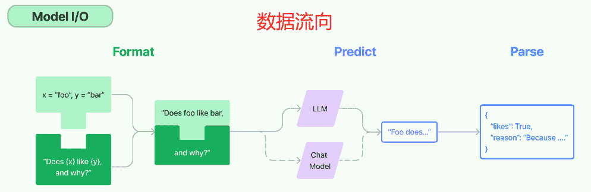

# LangChain链条创建与LCEL语法

> 来源：[https://kq4b3vgg5b.feishu.cn/docx/XvJjdZv21omzpHxxKQEc23G3ncf](https://kq4b3vgg5b.feishu.cn/docx/XvJjdZv21omzpHxxKQEc23G3ncf)

## 课程说明：

+   体验课内容节选自《2025大模型Agent智能体开发实战》(夏季班)完整版付费课程

体验课时间有限，若想深度学习大模型技术，欢迎大家报名由我主讲的《2025大模型Agent智能体开发实战》(夏季班)


公开课全套学习资料，已上传至网盘（链接: https://pan.baidu.com/s/1_TPoisye8HldxiIXiMxM8Q 提取码: khnp ）

需要更系统深入学习大模型可扫码⬆️添加助教咨询喔～

---

# LangChain快速入门与Agent开发实战

# Part 3.LangChain链条创建与LCEL语法

```
import os
from dotenv import load_dotenv 
load_dotenv(override=True)
```

```
True
```

### 1. LangChian核心功能：链式调用实现方法

顾名思义，LangChain之所以被称为LangChain，其核心概念就是Chain。 Chain翻译成中文就是“链”。一个链，指的是可以按照某一种逻辑，按顺序组合成一个流水线的方式。比如我们刚刚实现的问答流程： 用户输入一个问题 --> 发送给大模型 --> 大模型进行推理 --> 将推理结果返回给用户。这个流程就是一个链。

+   尝试搭建一个简单的链

例如，我们这里可以先尝试着搭建一个简单的链，将模型输出结果“过滤”为一个纯字符串格式：

```
from langchain_core.output_parsers import StrOutputParser
from langchain.chat_models import init_chat_model

# 使用 DeepSeek 模型
model = init_chat_model(model=&quot;deepseek-chat&quot;, model_provider=&quot;deepseek&quot;)  

# 直接使用模型 + 输出解析器搭建一个链
basic_qa_chain = model | StrOutputParser()
```

```
# 查看输出结果
question = &quot;你好，请你介绍一下你自己。&quot;
result = basic_qa_chain.invoke(question)
```

```
result
```

```
&#x27;你好！我是 **DeepSeek Chat**，由深度求索（DeepSeek）公司研发的智能 AI 助手。我可以帮助你解答各种问题，包括学习、工作、编程、生活小技巧等，还能处理和分析上传的文件（如 PDF、Word、Excel 等）。  \n\n### **我的特点：**  \n✅ **免费使用**：目前无需付费，你可以随时向我提问。  \n✅ **知识丰富**：我的知识截止到 **2024 年 7 月**，能提供较新的信息。  \n✅ **支持长文本**：上下文可达 **128K**，适合处理复杂问题。  \n✅ **文件阅读**：可以解析上传的文档，提取关键信息。  \n✅ **多语言支持**：能用中文、英文等多种语言交流。  \n\n### **我能帮你做什么？**  \n📚 **学习**：解题思路、论文润色、语言学习  \n💼 **工作**：写邮件、做 PPT、数据分析  \n💻 **编程**：代码调试、算法讲解、项目建议  \n📖 **阅读 &amp; 写作**：书籍推荐、文章润色、创意写作  \n🔍 **信息查询**：科技、历史、新闻、生活百科  \n\n你可以随时向我提问，我会尽力提供准确、有用的回答！😊 有什么我可以帮你的吗？&#x27;
```

此时result就不再是包含各种模型调用信息的结果，而是纯粹的模型响应的字符串结果。而这里用到的StrOutputParser()实际上就是用于构成LangChain中一个链条的一个对象，其核心功能是用于处理模型输出结果。同时我们也能发现，只需要使用Model | OutputParser，即可高效搭建一个链。

类似这种结果解析器还有很多，稍后我们会继续进行介绍。

+   加入提示词模板创建链

接下来我们尝试为当前的执行流程添加一个提示词模板，我们可以借助ChatPromptTemplate非常便捷的将一个提示词模板，同样以链的形式加入到当前任务中：

```
from langchain.output_parsers.boolean import BooleanOutputParser
from langchain.prompts import ChatPromptTemplate


prompt_template = ChatPromptTemplate([
    (&quot;system&quot;, &quot;你是一个乐意助人的助手，请根据用户的问题给出回答&quot;),
    (&quot;user&quot;, &quot;这是用户的问题： {topic}， 请用 yes 或 no 来回答&quot;)
])

# 直接使用模型 + 输出解析器
bool_qa_chain = prompt_template | model | StrOutputParser()
# 测试
question = &quot;请问 1 + 1 是否 大于 2？&quot;
result = bool_qa_chain.invoke(question)
```

```
result
```

```
&#x27;no&#x27;
```

一个最基本的Chain结构，是由Model和OutputParser两个组件构成的，其中Model是用来调用大模型的，OutputParser是用来解析大模型的响应结果的。所以一个最简单的LLMChain结构，其数据流向正如下图所示：



当我们调用指令跟随能力较强的大模型的时候，借助提示词模板即可实现结构化输出的结果。

+   借助提示词模板和结果解析器实现功能更加复杂的链

至此，我们就搭建了一个非常基础的链。在LangChain中，一个基础的链主要由三部分构成，分别是提示词模板、大模型和结果解析器（结构化解析器）：

用户输入

↓

PromptTemplate → ChatModel → OutputParser

（提示词模板） （大模型） （结构化解析）

↓

构化结果

而相比之下，结构化解析器功能最多，一些核心的结构化解析器功能如下：

| 解析器名称 | 功能描述 | 类型 |
| --- | --- | --- |
| BooleanOutputParser | 将LLM输出解析为布尔值 | 基础类型解析 |
| DatetimeOutputParser | 将LLM输出解析为日期时间 | 基础类型解析 |
| EnumOutputParser | 解析输出为预定义枚举值之一 | 基础类型解析 |
| **RegexParser** | 使用正则表达式解析LLM输出 | 模式匹配解析 |
| **RegexDictParser** | 使用正则表达式将输出解析为字典 | 模式匹配解析 |
| StructuredOutputParser | 将LLM输出解析为结构化格式 | 结构化解析 |
| YamlOutputParser | 使用Pydantic模型解析YAML输出 | 结构化解析 |
| PandasDataFrameOutputParser | 使用Pandas DataFrame格式解析输出 | 数据处理解析 |
| CombiningOutputParser | 将多个输出解析器组合为一个 | 组合解析器 |
| OutputFixingParser | 包装解析器并尝试修复解析错误 | 错误处理解析 |
| RetryOutputParser | 包装解析器并尝试修复解析错误 | 错误处理解析 |
| RetryWithErrorOutputParser | 包装解析器并尝试修复解析错误 | 错误处理解析 |
| **ResponseSchema** | 结构化输出解析器的响应模式 | 辅助类 |

一些功能实现如下，例如借助结构化解析器可以将yes or no转化为True or Fasle：

```
prompt_template = ChatPromptTemplate([
    (&quot;system&quot;, &quot;你是一个乐意助人的助手，请根据用户的问题给出回答&quot;),
    (&quot;user&quot;, &quot;这是用户的问题： {topic}， 请用 yes 或 no 来回答&quot;)
])

# 直接使用模型 + 输出解析器
bool_qa_chain = prompt_template | model | BooleanOutputParser()
# 测试
question = &quot;请问 1 + 1 是否 大于 2？&quot;
result = bool_qa_chain.invoke(question)
```

```
result
```

```
False
```

```
# 测试
question = &quot;请问 4 + 1 是否 大于 2？&quot;
result = bool_qa_chain.invoke(question)
print(result)
```

```
True
```

而StructuredOutputParser则可以在文档中提取指定的结构化信息：

```
from langchain_core.prompts import PromptTemplate
```

```
from langchain.output_parsers import ResponseSchema, StructuredOutputParser

schemas = [
    ResponseSchema(name=&quot;name&quot;, description=&quot;用户的姓名&quot;),
    ResponseSchema(name=&quot;age&quot;, description=&quot;用户的年龄&quot;)
]
parser = StructuredOutputParser.from_response_schemas(schemas)

prompt = PromptTemplate.from_template(
    &quot;请根据以下内容提取用户信息，并返回 JSON 格式：\n{input}\n\n{format_instructions}&quot;
)

chain = (
    prompt.partial(format_instructions=parser.get_format_instructions())
    | model
    | parser
)

result = chain.invoke({&quot;input&quot;: &quot;用户叫李雷，今年25岁，是一名工程师。&quot;})
print(result)  
```

```
{&#x27;name&#x27;: &#x27;李雷&#x27;, &#x27;age&#x27;: &#x27;25&#x27;}
```

这里我们在 PromptTemplate 中，你定义了两个占位符变量：

+   {input} → 将由用户传入的文本替换（如 "用户叫李雷，今年25岁..."）

+   {format_instructions} → 会通过 partial(...) 提前绑定结构化格式说明

而格式化说明使用format_instructions进行标识其实也是一种约定俗称的方法，上述代码也就是相当于在创建Chain的时候，我们就输入了{format_instructions}对应的字符串，我们也可以通过如下代码进行打印查看：

```
print(parser.get_format_instructions())
```

```
The output should be a markdown code snippet formatted in the following schema, including the leading and trailing &quot;```json&quot; and &quot;```&quot;:

```json
{
        &quot;name&quot;: string  // 用户的姓名
        &quot;age&quot;: string  // 用户的年龄
}
```
```

+   创建复合链

```
from langchain_core.prompts import PromptTemplate
from langchain_core.runnables import RunnableSequence
from langchain.output_parsers import ResponseSchema, StructuredOutputParser
```

```
# 第一步：根据标题生成新闻正文
news_gen_prompt = PromptTemplate.from_template(
    &quot;请根据以下新闻标题撰写一段简短的新闻内容（100字以内）：\n\n标题：{title}&quot;
)

# 第一个子链：生成新闻内容
news_chain = news_gen_prompt | model

# 第二步：从正文中提取结构化字段
schemas = [
    ResponseSchema(name=&quot;time&quot;, description=&quot;事件发生的时间&quot;),
    ResponseSchema(name=&quot;location&quot;, description=&quot;事件发生的地点&quot;),
    ResponseSchema(name=&quot;event&quot;, description=&quot;发生的具体事件&quot;),
]
parser = StructuredOutputParser.from_response_schemas(schemas)

summary_prompt = PromptTemplate.from_template(
    &quot;请从下面这段新闻内容中提取关键信息，并返回结构化JSON格式：\n\n{news}\n\n{format_instructions}&quot;
)

# 第二个子链：生成新闻摘要
summary_chain = (
    summary_prompt.partial(format_instructions=parser.get_format_instructions())
    | model
    | parser
)

# 组合成一个复合 Chain
full_chain = news_chain | summary_chain

# 调用复合链
result = full_chain.invoke({&quot;title&quot;: &quot;苹果公司在加州发布新款AI芯片&quot;})
print(result)
```

```
{&#x27;time&#x27;: &#x27;近日&#x27;, &#x27;location&#x27;: &#x27;加州总部&#x27;, &#x27;event&#x27;: &#x27;苹果公司发布全新AI芯片M4，性能较前代提升50%，专为下一代Mac设备设计。该芯片采用3纳米制程工艺，支持更强大的机器学习任务，如图像生成与实时语音处理。CEO库克表示，M4将&quot;重新定义创意生产力&quot;。业内分析指出，此举或进一步巩固苹果在AI硬件领域的领先地位，新品预计2024年末上市。&#x27;}
```

用户输入（title）

│

▼

┌────────────────────────────┐

│ Chain 1: 生成新闻正文 │

│ Prompt: news_gen_prompt │

│ Model: DeepSeek │

└────────────────────────────┘

│

▼

生成的新闻内容（news）

│

▼

┌───────────────────────────────────────┐

│ Chain 2: 提取结构化字段（摘要） │

│ Prompt: summary_pro mpt │

│ Model: DeepSeek │

│ OutputParser: StructuredOutputParser │

└───────────────────────────────────────┘

│

▼

结化输出（如 JSON：时间、地点、事件）

+   借助LangChain适配器设置自定义可运行的节点

```
from langchain_core.runnables import RunnableLambda

# 一个简单的打印函数，调试用
def debug_print(x):
    print(&quot;中间结果（新闻正文）:&quot;, x)
    return x

debug_node = RunnableLambda(debug_print)

# 插入 debug 节点
full_chain = news_chain | debug_node | summary_chain
```

```
# 调用复合链
result = full_chain.invoke({&quot;title&quot;: &quot;苹果公司在加州发布新款AI芯片&quot;})
print(result)
```

```
中间结果（新闻正文）: content=&#x27;苹果公司近日在加州总部发布全新AI芯片，性能提升显著，专为下一代智能设备设计。该芯片采用先进制程工艺，支持更高效的机器学习任务，有望应用于iPhone、Mac等产品线。分析师指出，此举将强化苹果在AI领域的竞争力，或推动消费电子行业技术升级。公司表示首批搭载该芯片的设备将于2024年底面市。（98字）&#x27; additional_kwargs={&#x27;refusal&#x27;: None} response_metadata={&#x27;token_usage&#x27;: {&#x27;completion_tokens&#x27;: 82, &#x27;prompt_tokens&#x27;: 28, &#x27;total_tokens&#x27;: 110, &#x27;completion_tokens_details&#x27;: None, &#x27;prompt_tokens_details&#x27;: {&#x27;audio_tokens&#x27;: None, &#x27;cached_tokens&#x27;: 0}, &#x27;prompt_cache_hit_tokens&#x27;: 0, &#x27;prompt_cache_miss_tokens&#x27;: 28}, &#x27;model_name&#x27;: &#x27;deepseek-chat&#x27;, &#x27;system_fingerprint&#x27;: &#x27;fp_8802369eaa_prod0425fp8&#x27;, &#x27;id&#x27;: &#x27;5e9fa296-4120-4361-b5a2-ca3ce6ebc13c&#x27;, &#x27;service_tier&#x27;: None, &#x27;finish_reason&#x27;: &#x27;stop&#x27;, &#x27;logprobs&#x27;: None} id=&#x27;run--6141698f-4ea7-41bf-89ec-1902dd6e5bc2-0&#x27; usage_metadata={&#x27;input_tokens&#x27;: 28, &#x27;output_tokens&#x27;: 82, &#x27;total_tokens&#x27;: 110, &#x27;input_token_details&#x27;: {&#x27;cache_read&#x27;: 0}, &#x27;output_token_details&#x27;: {}}
{&#x27;time&#x27;: &#x27;近日&#x27;, &#x27;location&#x27;: &#x27;加州总部&#x27;, &#x27;event&#x27;: &#x27;苹果公司发布全新AI芯片，性能提升显著，专为下一代智能设备设计。该芯片采用先进制程工艺，支持更高效的机器学习任务，有望应用于iPhone、Mac等产品线。分析师指出，此举将强化苹果在AI领域的竞争力，或推动消费电子行业技术升级。公司表示首批搭载该芯片的设备将于2024年底面市。&#x27;}
```

通过上述不同的尝试，我们就已经理解了在langChain中，如何使用Model、OutputParser、ChatPromptTemplate来构建一个简单的Chain。其中：

1.  ChatPromptTemplate 是用来构建提示模板的，将输入的问题转化为消息列表，可以设置系统指令，也可以添加一些变量；

1.  Model 是用来调用大模型的，可以指定使用不同的模型；

1.  OutputParser 是用来解析大模型的响应结果的，可以指定使用不同的解析器。

了解到这里，我们就可以基于LangChain来快速开发出一个智能问答机器人。

【补充】LCEL关键概念介绍

##### 什么是 LCEL？——LangChain Expression Language 详解

在现代大语言模型（LLM）应用的构建中，LangChain 提供了一种全新的表达范式，被称为 LCEL（LangChain Expression Language）。它不仅简化了模型交互的编排过程，还增强了组合的灵活性和可维护性。本文将从概念、设计目的、核心特性和实际价值几个方面，系统性地介绍 LCEL 的本质。

---

##### 一、LCEL 的定义

LCEL，全称为 LangChain Expression Language，是一种专为 LangChain 框架设计的表达语言。它通过一种链式组合的方式，允许开发者使用清晰、声明式的语法来构建语言模型驱动的应用流程。

简单来说，LCEL 是一种“函数式管道风格”的组件组合机制，用于连接各种可执行单元（Runnable）。这些单元包括提示模板、语言模型、输出解析器、工具函数等。

---

##### 二、设计目的

LCEL 的设计初衷在于：

1.  **模块化构建**：将模型调用流程拆解为独立、可重用的组件。

1.  **逻辑可视化**：通过语法符号（如管道符 |）呈现出明确的数据流路径。

1.  **统一运行接口**：所有 LCEL 组件都实现了 .invoke()、.stream()、.batch() 等标准方法，便于在同步、异步或批处理环境下调用。

1.  **脱离框架限制**：相比传统的 Chain 类和 Agent 架构，LCEL 更轻量、更具表达力，减少依赖的“黑盒”逻辑。

---

##### 三、核心组成

###### 1. Runnable 接口

LCEL 的一切基础单元都是 Runnable 对象，它是一种统一的可调用接口，支持如下形式：

+   .invoke(input)：同步调用

+   .stream(input)：流式生成

+   .batch(inputs)：批量执行

###### 2. 管道运算符 |

这是 LCEL 最具特色的语法符号。多个 Runnable 对象可以通过 | 串联起来，形成清晰的数据处理链。例如：

```
prompt | model | parser
```

表示数据将依次传入提示模板、模型和输出解析器，最终输出结构化结果。

###### 3. PromptTemplate 与 OutputParser

LCEL 强调组件之间的职责明确，Prompt 只负责模板化输入，Parser 只负责格式化输出，Model 只负责推理。

---

##### 四、典型优势

| 特性 | 描述 |  |
| --- | --- | --- |
| 简洁语法 | 使用 ` | ` 运算符提升可读性 |
| 灵活组合 | 可任意组合 Prompt、模型、工具、函数等组件 |  |
| 明确边界 | 每个步骤职责分明，方便调试与重用 |  |
| 可嵌套扩展 | 支持函数包装、自定义中间组件和流式拓展 |  |
| 与 Gradio/FastAPI 集成良好 | 可用于构建 API、UI 聊天等多种场景 |  |

---

##### 五、总结

LCEL 是 LangChain 在 2024 年末引入的一项重要特性，标志着从传统 Agent 架构向“声明式、组合式”开发范式的转变。它不仅让开发者能以更清晰的方式组织 LLM 工作流，也大大提高了系统的可维护性与可测试性。