# Part 1.Dify快速入门与聊天助手搭建流程

> 来源：[https://kq4b3vgg5b.feishu.cn/docx/CKZUdOGwbo833vxstecc2fkunBb](https://kq4b3vgg5b.feishu.cn/docx/CKZUdOGwbo833vxstecc2fkunBb)

# Dify Agent开发实战

# Part 1.Dify快速入门与聊天助手搭建流程


## 一、低代码Agent开发框架入门介绍

在 Agent 开发需求日益旺盛的今天，如何选择一项适合的 Agent 开发工具，是摆在所有开发者面前的首要问题。而在所有的 Agent 开发工具中，主要可以分为两大类：

第一类是以 LangCh**ain 与 LangGrap**h 为代表的 代码类 Agent 开发框架。这类工具更偏向开发者群体，通过编写 Python 或 JavaScript 等编程语言的代码来完成智能体的逻辑设计与功能扩展。其优点在于灵活度高、可扩展性强，适合需要深度定制和大规模工程化的场景，但也对开发者的编程能力提出了较高要求。

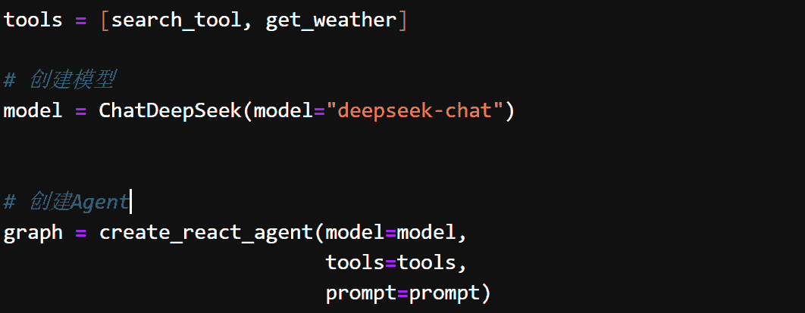

**       ** 另一类则是基于 低代码开发工具 的方式。借助可视化的界面和模块化的配置，开发者几乎无需编写代码即可完成智能体的搭建与部署，这就是所谓的低代码开发工具。目前较为主流的低代码 Agent 开发工具包括 Dify、Coze、n8n 和 LangFlow。它们各自具有不同的特点，例如：

+   **Dify**：开源、社区活跃，主打通用的 Agent 与应用开发，兼顾个人与企业需求；

+   **Coze**：由字节跳动推出，集成了强大的工作流编排能力，尤其适合社交和内容分发场景；

+   **n8n**：侧重于自动化任务编排和工具集成，具备丰富的插件生态；

+   **LangFlow**：在 LangChain 生态基础上提供可视化界面，使复杂的链式调用更直观易用。

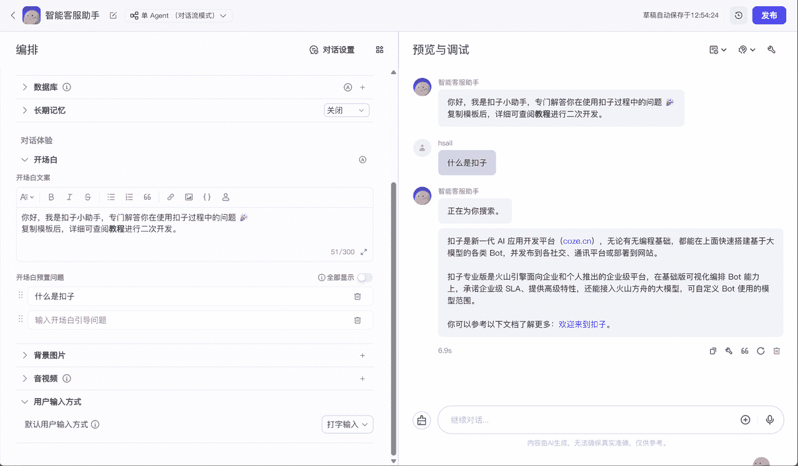

### 1. 集大成者的低代码开发框架：Dify

Dify 是由开源社区主导开发的一款低代码 大模型应用与 Agent 开发框架，旨在帮助用户以更少的代码和更直观的方式构建、部署和管理基于大语言模型（LLM, Large Language Model）的智能应用。对于没有深厚编程经验的用户而言，Dify 提供了图形化的操作界面以及灵活的工作流设计工具，使其能够快速完成从模型调用、知识库管理到工具接入的全流程开发。

**在整体定位上，Di**fy 既可以看作是一**个 大模型应用开发平台，也可以**看作是一个 低代码的 Agent 编排框架。它的核心价值体现在以下几个方面：

+   **低门槛**：通过可视化界面与简单配置，用户可以快速构建对话式应用或智能体，而无需编写大量复杂代码。

+   **可扩展**：支持主流的大语言模型（如 OpenAI、Anthropic、DeepSeek 等），同时允许用户自定义工具与外部 API，满足不同业务场景的扩展需求。

+   **知识库增强**：内置文档上传与知识检索功能，支持通过检索增强生成（RAG）提升模型回答的准确性与专业性。

+   **企业级应用场景**：Dify 不仅适合个人开发者实验，还面向企业级部署，提供多用户管理、权限控制以及可观测性工具，帮助团队更好地在生产环境中落地大模型应用。

总体而言，Dify 项目的目标是降低大模型技术的使用门槛，让更多开发者和组织能够专注于业务逻辑和应用场景本身，而不是被底层的模型调用与工程实现所困扰。这使得 Dify 成为当前低代码 Agent 开发领域中颇具代表性和实用性的开源框架之一。

+   Dify官网：https://dify.ai/


#### 1.1 强大的Agent开发功能

Dify作为23年4月开源的第一代Agent开发框架，发展至今，已涵盖了各方面非常完整的低代码Agent开发功能。

+   网页Agent开发工具

+           Dify 提供了直观的网页端开发界面，用户只需通过浏览器即可完成 Agent 的构建与配置。整个过程无需安装复杂的开发环境，也不需要编写大段代码。界面通常包含输入框、参数设置区以及工具调用配置区域，使得用户能够快速定义模型调用方式和对话逻辑。对于初学者而言，这种“所见即所得”的交互方式，大大降低了上手难度


+   画布Agent开发工具

+           在网页端的基础上，Dify 还提供了可视化的画布工具。用户可以通过拖拽节点、连接流程的方式，完成复杂智能体的逻辑编排。每一个节点可以代表模型调用、API 接口或逻辑判断，节点之间通过连线实现数据与控制流的传递。这种方式让复杂的 Agent 工作流更加直观，特别适合用于教学、原型设计以及团队协作场景。


+   Agent一键发布

+           当 Agent 开发完成后，Dify 支持一键发布功能。用户可以直接将构建好的 Agent 应用生成可访问的 Web 页面，或者以小部件（Widget）的形式嵌入到现有系统中。这意味着开发者无需再耗费大量时间处理前端与后端的部署，只需点击一次，即可将智能体推送到生产环境，供终端用户使用。


+   后端API功能

+           除了网页与画布工具外，Dify 还提供了完善的后端 API 支持。开发者可以通过标准化的 API 接口，将 Dify 中配置好的 Agent 集成到外部系统或应用中。例如，可以将 Agent 功能嵌入企业内部的客服系统，或者与现有的数据平台进行对接。API 接口通常包含调用模型、传入上下文、返回结果等功能，为开发者提供了高度的灵活性与可扩展性。


#### 1.2 完善的开发者生态

除了拥有非常强大 Agent开发功能之外，Dify最核心的特色就是拥有非常完善的开发者生态，包括工具（封装好的一个个功能模块）、插件（Agent框架必备的功能增强模块）和MCP工具。

+   Dify插件集

+           Dify 提供了丰富的插件机制，允许用户在不修改核心代码的情况下，为 Agent 应用增加额外功能。这些插件可以是通用的功能增强模块，例如数据存储、身份验证、日志追踪等；也可以是专门针对某一类业务场景的扩展，如金融计算、文本分析或图像处理。插件的出现大大提升了框架的灵活性，使得用户能够根据业务需要进行“按需装配”，而不必从零开始开发。


+   Dify第三方工具集

+   **     **   除了官方插件，Dify 社区还支持接入 第三方工具。这些工具往往是由开发者或企业提供的功能模块，能够与 Dify 的 Agent 进行无缝衔接。例如，用户可以集成外部的搜索引擎 API、企业内部的知识库系统，或者常见的业务应用（如 CRM、ERP、工单系统）。第三方工具的加入，极大地拓展了 Dify 在不同行业和场景中的应用可能性，使其不仅是一个框架，更是一个开放的生态平台。


+   Dify MCP工具

+           在最新的生态布局中，Dify 还引入了 MCP（Model Context Protocol）工具。这是近年来新兴的一种标准化协议，旨在为不同的大模型与外部系统之间提供高效、安全的交互方式。通过 MCP，Dify 能够将外部的数据源、API 服务以及应用逻辑，以一种统一的形式暴露给 Agent 使用。这样一来，开发者无需关心底层的兼容性问题，只需按照 MCP 协议接入工具，就能立即被 Dify 的 Agent 调用。这不仅大大降低了集成成本，也让 Dify 能够快速适配未来不断涌现的新型大模型与外部服务。

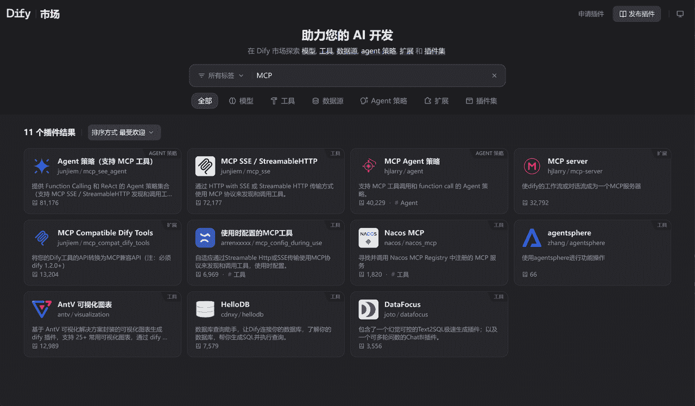

#### 1.3 开源部署与商业化应用双轨并行

Dify不仅提供了完整的开源的社区版本，也提供面向企业级场景的商业化解决方案。这种模式既保证了技术的开放性，又满足了不同用户群体在实际应用中的差异化需求。

+   **开源版 Dify**

+           开源版是 Dify 的核心基础，任何人都可以在 GitHub 上免费下载和部署。用户可以选**择在本地环境、云服务器**或者容器化平台（如 Docker、Kubernetes）中运行，灵活性极高。开源版的最大优势在于 免费、可定制、社区驱动：

+   **免费使用**：用户无需支付任何授权费用，即可构建和部署完整的 Agent 应用；

+   **高度自由**：开发者可以根据自身需求修改源码，定制功能，甚至贡献代码回馈社区；

+   **社区支持**：Dify 拥有活跃的开源社区，开发者可以从中获取文档、示例和插件，也能与其他用户交流经验。
开源版特别适合个人开发者、中小型团队以及对数据安全有严格要求的场景，例如希望将数据完全掌握在自己服务器中的企业。

+   **商业版 Dify**

+   **        与开**源版不同，商业版 Dify 更加注重 企业级落地与运维需求。在功能上，商业版不仅保留了开源版本的所有能力，还提供了以下增强特性：

+   **多用户与权限管理**：支持企业内的团队协作，不同角色可以分配不同权限，保障项目安全；

+   **企业级可观测性**：内置监控与日志系统，方便管理员跟踪 Agent 的运行情况，提升系统稳定性；

+   **服务级别保障（SLA）**：商业版通常会提供官方的技术支持与维护，帮助企业快速解决问题；

+   **一站式部署与运维**：简化的部署流程和管理面板，使企业能够更加高效地在生产环境中运行。
商业版 Dify 的定位是面向中大型企业、科研机构以及需要在生产系统中稳定运行智能体的组织，为其提供高可靠性与可扩展的解决方案。

开源版与商业版的双轨并行**模式，**使 D**ify** 在生态建设上兼顾了 开放性 与 商业化。对于普通开发者而言，可以通过开源版本低成本地进行学习与实验；而对于企业用户，则可以通过商业版本获得更完善的运维保障和企业级特性。这种双轨机制，也让 Dify 在开源生态与企业市场中形成了良性循环：开源社区推动了产品迭代，而商业版为生态提供了可持续发展的动力。

+   Dify商业版和社区版对比

| 对比维度 | Dify 社区版（开源版） | Dify 商业版 |
| --- | --- | --- |
| **费用** | 免费使用，无需支付授权费用 | 付费订阅或授权，提供不同套餐模式 |
| **部署方式** | 自行部署（本地、云服务器、Docker、Kubernetes 等），灵活但需自管 | 官方提供托管服务或企业级部署方案，支持一键化运维与升级 |
| **功能覆盖** | 核心 Agent 开发功能、插件支持、第三方工具集成 | 在社区版基础上增加企业级功能（权限管理、团队协作、SLA） |
| **可扩展性** | 可自由修改源码，适合个性化定制 | 提供官方插件市场和企业扩展支持，适合大规模应用 |
| **安全性与合规性** | 数据完全由用户掌控，需自行保障安全与合规 | 提供企业级安全策略、合规支持和数据隔离能力 |
| **可观测性** | 基本日志与监控，依赖社区插件 | 内置全面监控、日志审计、性能分析工具 |
| **支持服务** | 社区支持（文档、论坛、GitHub Issue） | 官方技术支持（7×24 小时响应）、企业服务级别协议（SLA） |
| **适用人群** | 个人开发者、初创团队、教育或科研场景 | 中大型企业、科研机构、生产环境对稳定性要求高的组织 |

### 2. 其他热门商业化低代码开发工具

#### 2.1 Coze

+   Coze官网地址：https://www.coze.cn/


Coze是字节旗下的低代码Agent开发工具，也是最早进行商业化尝试的在线闭源的低代码开发工具。早年的Coze功能非常简单，上手门槛极低，借助官方提供的知识库系统、在线模型API、和一些在线调用的工具（如网络搜索工具等），开发者只需要在网页端设置好聊天机器人的系统指令、开场白、以及关联的工具，无需编写代码，即可完成Agent开发。


很明显，Coze的最初定位是打造人人可用的Agent开发工具，并依托低代码的特性吸引开发者，同时构建Agent工具插件、商店等应用产品生态，意图对标早年OpenAI的GPTs。


但是，伴随着Agent开发需求逐步深入，这种开发模式无法满足更加深入灵活的开发需求，同时在线商店的Agent性能也显得过于简单、甚至存在大量的玩具Agent，这也导致开发者大量流失。

因此，Coze也随即进行调整，推出了工作流画布模式，即开发者可以借助画布构建更加灵活的工作流，通过不同节点不同功能的搭配，开发者能够更加灵活的创建功能各异的Agent，但于此同时该模式下对开发者技能要求也有进一步的提升。


同时不断完善在线Agent的发布流程与后端API功能，方便开发者一键发布已经开发好的Agent，并且借助Coze在线服务提供的后端API，将借助Coze开发的Agent进行快速的部署上线。

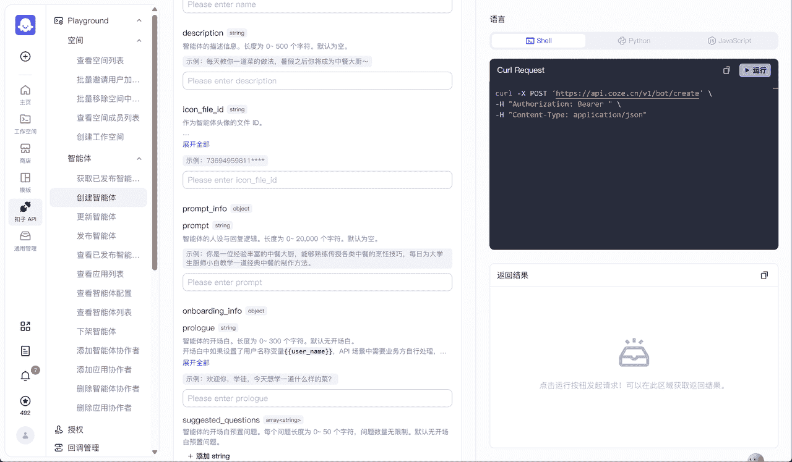

同时在今年7月推出Coze开源版，从而进一步笼络更加专业的开发者用户。

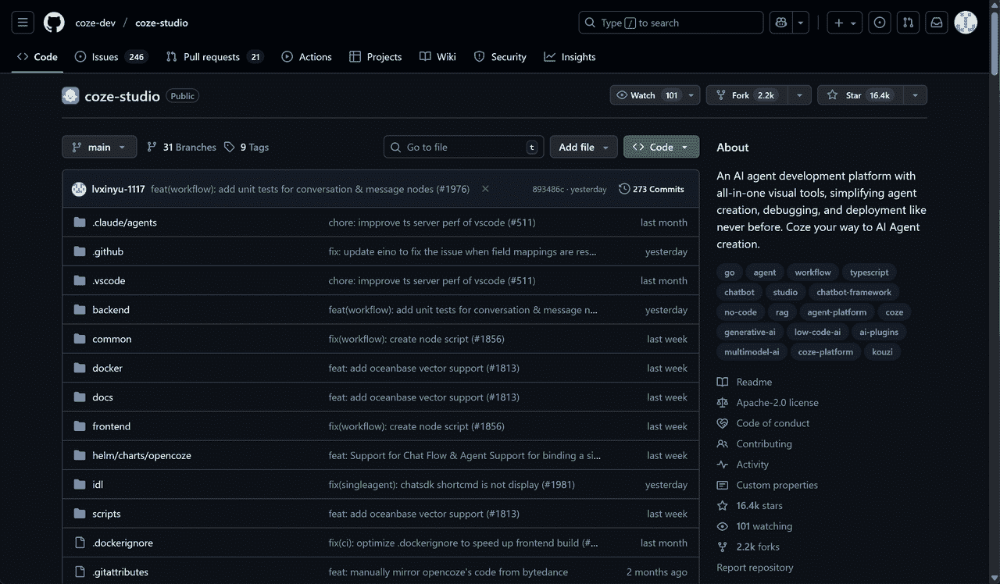

而相比之下，Dify则从最一开始就更像是“歪打正着”，选择了一条长期来看正确的发展道路。

#### 2.2 n8n

+   n8n官网地址：https://n8n.io/

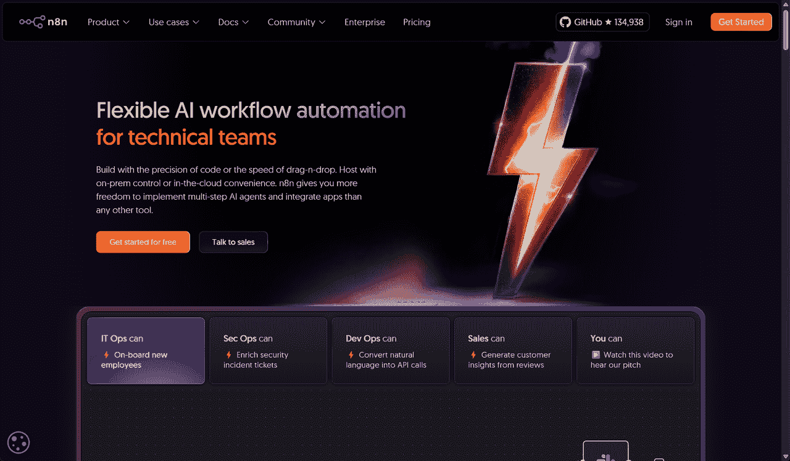

n8n 是一款来自德国的开源低代码自动化工具，最初的定位并非单纯的 Agent 开发，而是更接近于“自动化工作流引擎”。它通过图形化的节点拖拽和连接，让用户能够将不同的服务、应用和 API 串联在一起，实现类似 Zapier 的自动化逻辑。与 Coze 相比，n8n 在设计理念上更加开放与灵活，不依赖于某一家模型服务，而是强调工具链和数据流的可编排性。

**     在** n8n 中，用户可以通过画布构建工作流。每一个节点（Node）都代表一个具体的功能模块，例如：发送邮件、调用外部 API、执行数据库操作、甚至是调用大语言模型 API。用户只需将这些节点组合起来，就能实现复杂的业务逻辑。这种模式的优势在于 极强的扩展性 ——n8n 已经内置了数百种常用服务的连接器，同时还支持用户自定义节点，几乎可以覆盖所有常见的自动化需求。

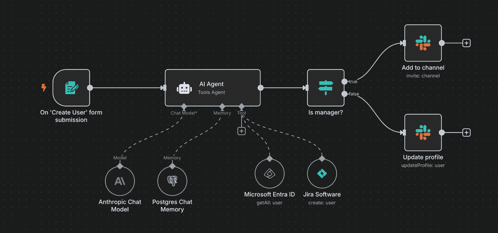

**        **随着大语言模型的兴起，n8n 逐渐被开发者用于 Agent 开发。例如，可以在工作流中嵌入 OpenAI、Anthropic、DeepSeek 等模型节点，再结合搜索引擎、数据库、Webhook 等外部工具，快速搭建一个具备多工具调用能力的智能体。虽然它不像 Dify 那样专注于 Agent 开发场景，但凭借强大的工具集成能力，n8n 成为不少开发者在构建企业自动化 Agent 时的首选框架之一。

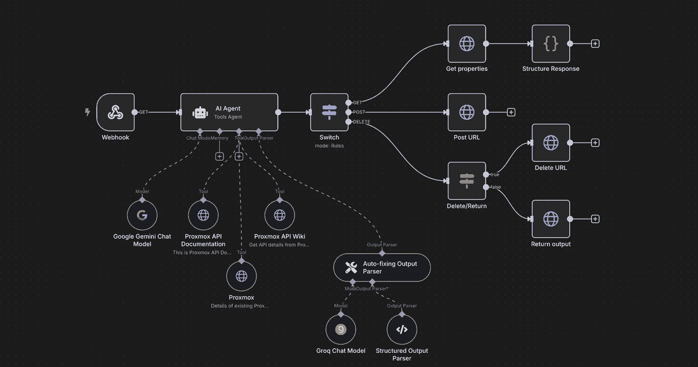

**        **在商业化方面，n8n 采用了 开源 + 云服务 的双轨模式。开源版本允许用户自由部署，适合个人开发者与小团队使用；而商业版本则提供云端托管、企业级支持和 SLA 保证，主要面向中大型组织，帮助他们在更大规模和更高稳定性的环境下运行复杂的工作流与 Agent。

**        总体来看，n8**n 的核心优势在于 高度模块化、可扩展的工作流引擎。它并不像 Coze 或 Dify 那样直接面向“对话式 Agent”场景，但凭借强大的第三方服务集成能力与灵活的节点设计，n8n 已经成为低代码生态中极具代表性的自动化与智能体开发工具。

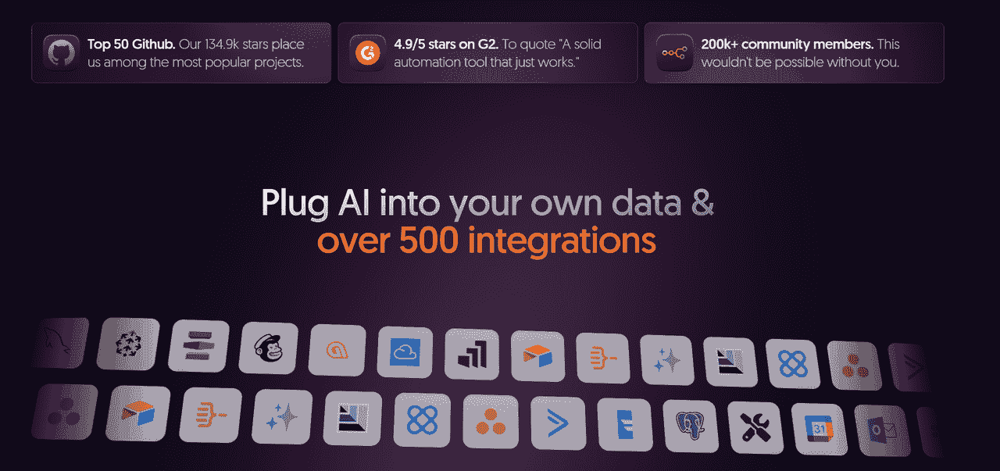

#### 2.3 LangFlow

+   LangFlow官网地址：https://www.langflow.org/

**        Lang**Flow 是一款基于 LangChain 生态 的低代码可视化开发工具，主要目标是降低 LangChain 在实际应用中的使用门槛。由于 LangChain 本身定位为“代码优先”的开发框架，对于缺乏编程经验的用户而言，上手难度较高，而 LangFlow 则提供了一个图形化的画布界面，让开发者能够通过拖拽与配置的方式，快速搭建对话应用与智能体。

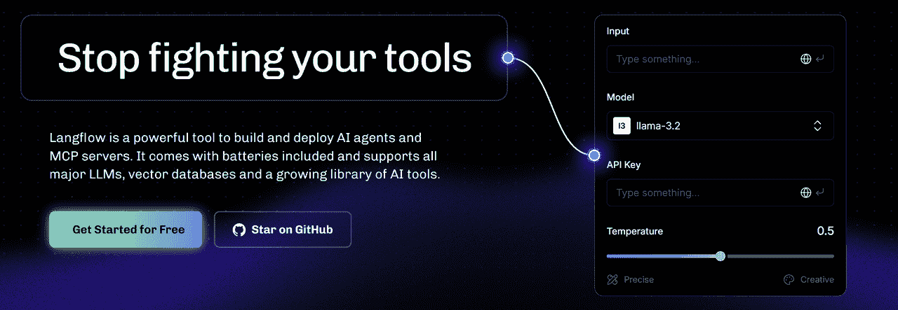

在 LangFlow 中，每一个功能模块（如 模型调用、提示**词模板、记**忆管理、工具调用 等）都被抽象为一个个可视化的节点。开发者可以通过拖拽节点并进行连线，将这些功能组合成一个完整的工作流。与 n8n 类似，LangFlow 的优势也体现在“所见即所得”，但不同的是，它深度绑定 LangChain 的核心功能，使得原本复杂的链式调用逻辑变得直观且易于理解。

例如，用户可以在画布上快速创建一个由 文档加载 → 向量化存储 → 检索增强生成（RAG） → 模型输出 组成的工作流，而无需编写 Python 代码即可实现完整的 RAG 应用。这对于科研人员、教学场景以及快速原型设计尤其有价值。

**      **  在商业化方面，LangFlow 目前依托其 开源社区版本 为主，同时也提供云端托管与企业服务。开源版本完全免费，用户可以自行部署；而云端版本则提供更便捷的在线体验，适合团队协作与快速验证。虽然它的企业支持体系尚不如 Coze 或 Dify 完整，但凭借其紧密依赖 LangChain 生态的特性，LangFlow 依旧吸引了大量开发者和研究者。

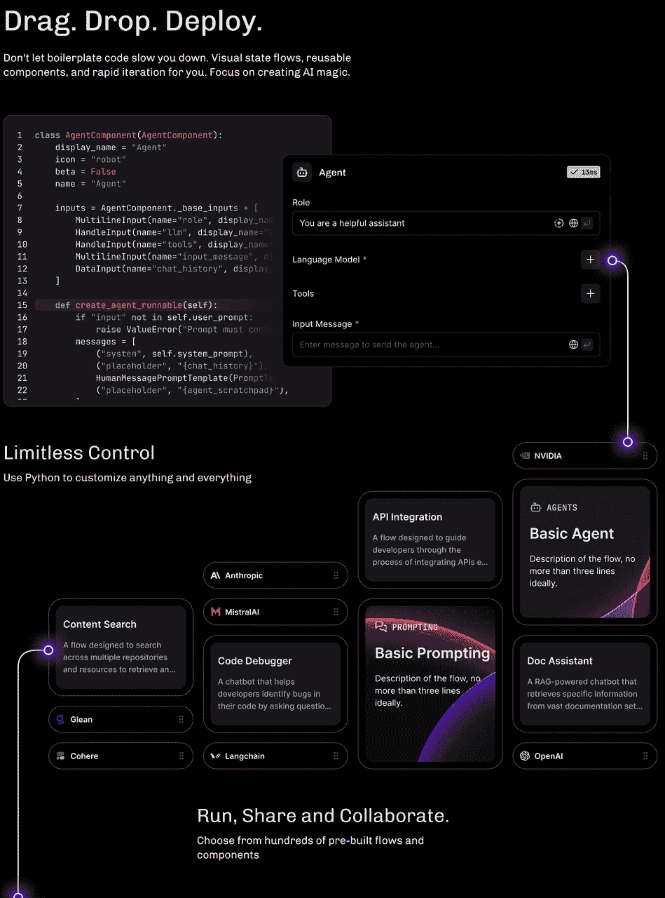

总体而言，LangFlow 的定位非常明确：它是 LangChain 的低代码可视化伴侣，适合对 LangChain 感兴趣但不擅长写代码的用户。与 Coze 和 n8n 相比，LangFlow 在“对话式 Agent 与知识增强”方向更加聚焦，但在工具集成和自动化广度方面略显不足。

### 3. Coze、n8n、LangFlow、Dify 四款热门低代码 Agent 开发工具的对比表

| 对比维度 | **Coze** | **n8n** | **LangFlow** | **Dify** |
| --- | --- | --- | --- | --- |
| **定位** | 字节旗下的在线低代码 Agent 平台，注重商业化和生态 | 开源自动化工作流引擎，强调应用/服务集成 | LangChain 的可视化伴侣，专注对话与 RAG 应用 | 开源低代码 Agent 开发框架，兼顾个人与企业 |
| **是否开源** | 商业化闭源为主，2024 年起推出开源版 | 完全开源，社区活跃 | 开源，社区驱动 | 完全开源，企业版提供商业化支持 |
| **上手门槛** | 极低，网页端配置即可 | 中等，需要理解节点与工作流逻辑 | 中等，需理解 LangChain 思路 | 较低，网页 + 画布双模式，适合不同层次用户 |
| **核心工作流引擎** | 网页端配置 + 画布模式 | 节点式自动化工作流引擎 | 节点化 LangChain 工作流 | 网页表单 + 可视化画布双引擎 |
| **模型支持范围** | 内置部分模型（如字节自研模型、OpenAI） | 支持调用任何 LLM API，需手动配置 | 深度绑定 LangChain，支持所有 LangChain 接入的模型 | 支持 OpenAI、Anthropic、DeepSeek 等主流模型，并可扩展 |
| **插件/工具生态** | 内置工具市场（搜索、知识库、在线工具） | 内置数百个服务连接器，支持自定义节点 | 节点有限，依赖 LangChain 插件生态 | 插件集 + 第三方工具集 + MCP 工具生态 |
| **API 能力** | 提供后端 API，支持一键部署上线 | 强调外部 API 调用与自动化 | 提供简单 API 接口，能力有限 | 完整 API 支持，便于与企业系统集成 |
| **商业化模式** | 商业化闭源 + 开源版双轨 | 开源 + 云托管双轨 | 开源 + 云服务试点 | 开源版 + 商业版双轨并行，企业级支持完整 |
| **适用人群** | 初学者、内容创作者、中小企业 | 自动化需求强的开发者、企业团队 | 想用 LangChain 但不熟悉代码的研究者、教学场景 | 个人开发者、初创团队、大中型企业、科研机构 |
| **典型优势** | 极简上手、内置生态、快速发布 | 工具集成广泛、自动化能力强 | LangChain 可视化、RAG 流程直观 | 功能完备、生态丰富、开源与商业兼顾 |
| **典型劣势** | 灵活性不足，商店 Agent 偏“玩具化” | 不专注对话式 Agent，需较强逻辑设计能力 | 功能聚焦单一，对工具集成广度不足 | 功能多但学习曲线略陡，生态尚在快速成长 |

### 4. 关于Dify的四大误区

+   免费开源，完全本地部署，商业化应用无需额外费用：实际上，Dify 的开源社区版确实免费，但功能覆盖有限，更适合个人开发者和小团队实验使用。对于需要多用户管理、权限控制、企业级监控与 SLA 支持的场景，依然需要选择商业版或付费服务。

+   国内团队，100%国产，国内企业适配性很强：Dify 虽然由国内团队主导开发，但并非严格意义上的“纯国产”方案。在实际使用过程中，其部分依赖和官方云服务仍需要访问海外节点，这意味着在国内环境下常常需要借助🪜才能顺畅使用。

+   最简单的Agent开发工具，易于上手，拖拉拽即可完成Agent开发：低代码框架的确降低了入门门槛，用户可以通过图形化界面快速上手。但要真正开发一个复杂、稳定且可商用的 Agent，仍需要理解 Dify 的工作流逻辑、工具调用机制、知识库配置以及 API 集成方式。对于复杂应用而言，其学习曲线并不比 LangChain、LangGraph 等代码类框架低多少。

+   生态闭环完善，能够完全替代传统开发模式
Dify 的插件、工具集和 MCP 协议生态正在快速发展，但仍处于完善阶段，距离“全功能闭环”还有差距。尤其是在某些行业专用工具或企业内部系统对接上，仍需要额外的二次开发和定制工作。因此，Dify 更适合作为“低代码加速器”，而不是完全替代传统 Agent 开发模式的工具。

## 二、Dify接入指南

+   Dify GitHub项目地址：https://github.com/langgenius/dify

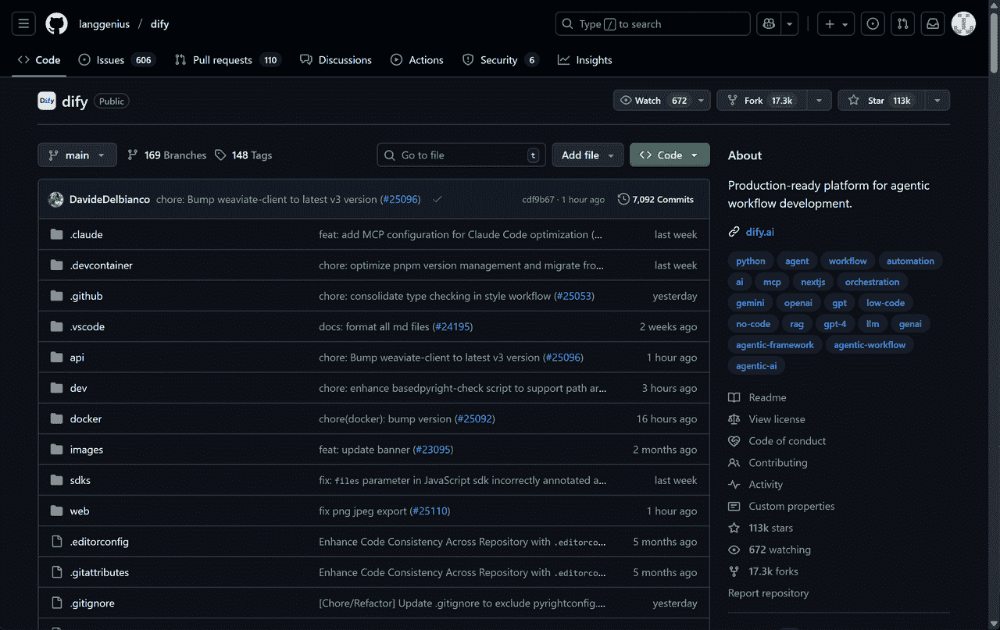

+   Dify官网：https://dify.ai/

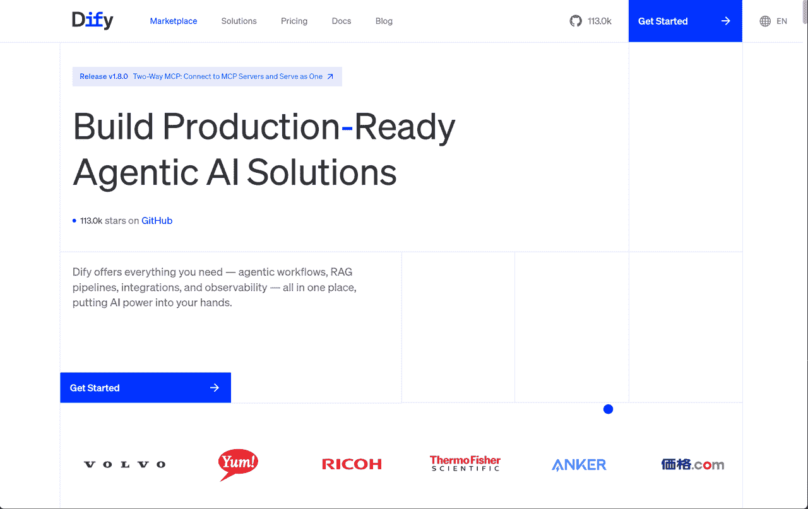

+   Dify官方使用指南：https://docs.dify.ai/zh-hans/introduction

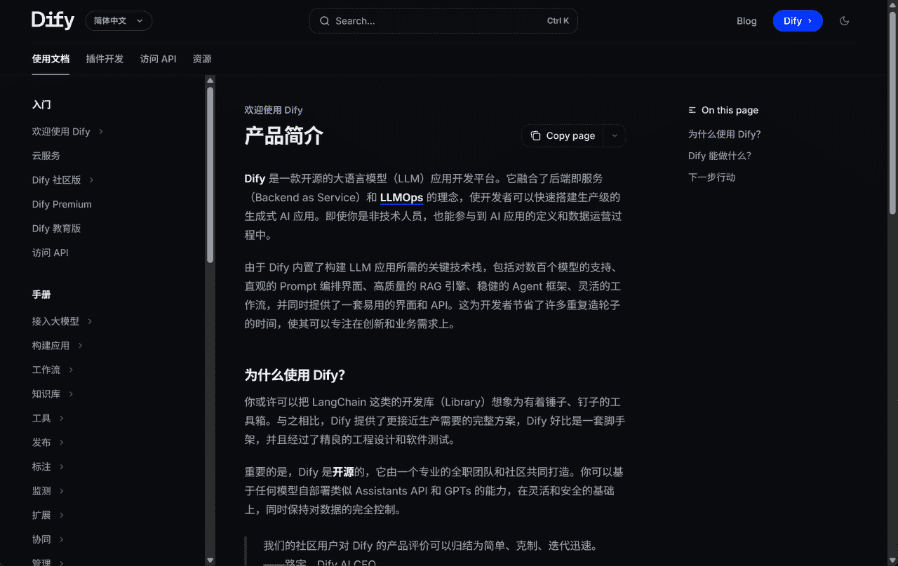

### 1. Dify云服务接入流程

+   在线云服务登录地址：https://cloud.dify.ai/ （需要🪜）


Dify 官方提供了基于云端托管的在线服务，用户无需在本地进行复杂的环境搭建，即可直接通过浏览器使用 Dify 的完整功能。对于初学者而言，这是最快速体验 Dify 的方式。

进入上述网址后，系统会要求用户进行登录。Dify 支持多种登录方式：

1.  **邮箱注册与登录**：用户可以通过常用邮箱进行注册，并使用邮箱+密码完成登录。

1.  **第三方账号登录**：部分情况下可支持 GitHub、Google 等第三方平台账号一键登录。

在注册/登录完成后，用户即可进入 Dify 的管理控制台。这一步标志着云服务接入流程的基本完成，后续便可以在控制台中创建应用、配置 Agent、上传知识库文档等。

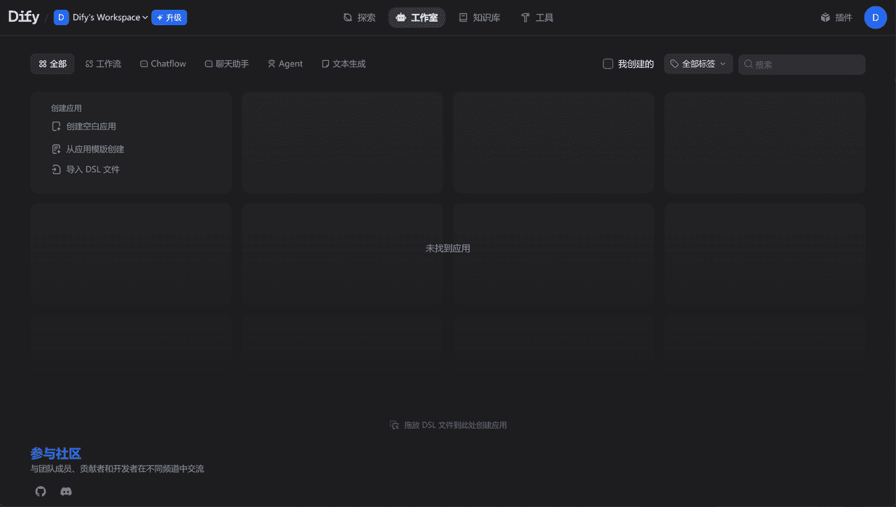

在完成登录后，用户即可进入 Dify 的云端**控制台。然而，作为一项 Sa**aS 服务，Dify 云服务并非完全免费，而是采用了“基础免费 + 分级付费”的模式，为不同类型的用户提供对应的套餐选择。

+   云服务套餐模式

1.  **Sandbox（免费版）**

+   每月 200 条消息额度，适合个人体验和小规模试用。

+   支持接入主流大模型（OpenAI、Anthropic、Llama2、Azure OpenAI、Hugging Face、Replicate）。

+   1 个团队空间，1 名团队成员，最多可创建 5 个应用程序。

+   知识库上传与调用有限制，例如 50 个文档、50MB 容量、10 Q/分钟的调用速率。

+   日志保存 30 天，适合临时测试或教学演示场景。

1.  Pro**fessional（**专业版） – $59/月/团队空间

+   每月 5,000 条消息额度，面向独立开发者或小团队。

+   3 名团队成员，50 个应用程序。

+   知识库上限大幅提升（500 文档、5GB 容量），API 调用速率也更高（100 Q/分钟）。

+   支持 API 请求频率无限制，日志无限保存，适合长期迭代开发的场景。

1.  **Team（团队版）** – **$159/月/团队空间**

+   每月 10,000 条消息额度，面向中小型团队。

+   50 名团队成员，200 个应用程序。

+   知识库支持 1,000 文档上传，容量 20GB，API 调用速率可达 1,000 Q/分钟。

+   提供最高优先级模型处理能力，适合需要多人协作与更高并发的企业团队。

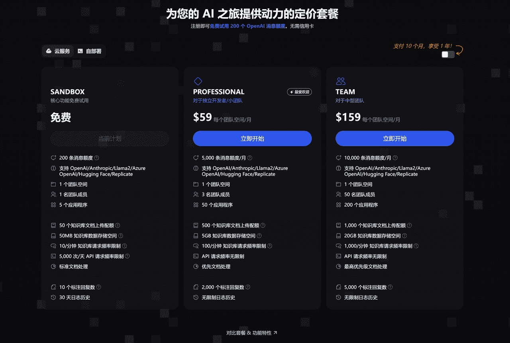

+   自部署与企业级方案

**除了标准的云服务套餐，**Dify 还提供 自部署与企业级拓展服务：

1.  Community（社区版，自部署）

+   免费使用，适合个人用户、小团队或非商业项目。

+   提供所有核心功能，单一工作空间，符合 Dify 开源许可证。

1.  **Premium（高级版）**

+   可通过 AWS Marketplace 获取，也即将在 Azure、Google Cloud 提供。

+   在社区版功能的基础上，增加云服务的可靠性保证、自定义品牌与 WebApp、优先支持。

+   适合中型组织或希望获得更高 SLA 的用户。

1.  **Enterprise（企业版）**

+   定制收费，按年计费。

+   包含 Premium 版的所有功能，并增加：企业级扩展部署方案、商业许可证、多个工作空间与企业级管理、单点登录（SSO）、专属技术支持与官方维护更新等。

+   面向需要高安全性、合规性与可控性的中大型企业。

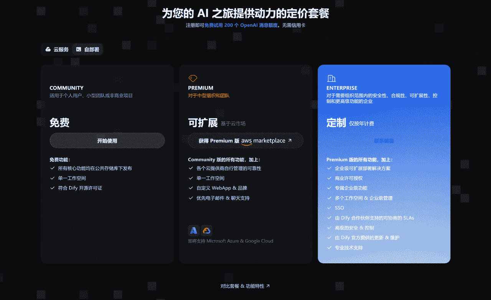

### 2. Dify阿里云计算巢部署与使用流程

#### 2.1 阿里云计算巢简介

阿里云计算巢（Compute Nest） 是阿里云推出的一项服务编排与应用交付平台。它可以将复杂的软件系统或应用封装为“服务实例”，用户只需通过几步简单操作，即可在阿里云上快速部署和运行这些应用，而无需关心底层资源配置与繁琐的环境搭建。

+   阿里云计算巢地址：https://computenest.console.aliyun.com/service/market/cn-hangzhou


与传统的“手动购买 ECS、配置数据库、安装依赖”相比，计算巢的优势主要体现在：

+   **一键部署**：通过控制台即可完成完整应用的交付，节省部署时间；

+   **开箱即用**：应用模板由官方或社区提供，已内置必要的依赖环境，部署完成即可使用；

+   **自动运维**：支持应用的生命周期管理，包括启动、停止、升级与监控；

+   **社区生态**：开发者和厂商可以将自己的应用模板发布到计算巢社区，供其他用户一键使用。

因此，阿里云计算巢可以理解为一个 “云端应用商店 + 自动化部署平台”，用户在这里不仅能找到包括 Dify 在内的各种开源项目的快速部署方案，还能享受到云平台带来的弹性和可扩展能力。

#### 2.2 通过计算巢部署 Dify

目前，Dify 已经在阿里云计算巢社区中提供了现成的部署模板，用户可以通过以下步骤完成安装：

1.  **访问部署页面**
打开链接：Dify 社区版（阿里云计算巢），进入 Dify 部署向导页面。


1.  **选择地域与资源**
在控制台中，用户需要选择要部署的地域（如华东 1、华北 2 等），以及所需的计算资源（ECS 实例规格、存储、带宽等）。

1.  **填写配置信息**
部署向导会要求用户输入一些必要参数，例如实例名称、管理员账号、初始密码等。这些参数将直接用于部署好的 Dify 环境。


1.  **确认并创建**
完成配置后，点击** “立即创建**”，系统将自动拉起所需的云资源并部署 Dify。整个过程完全自动化，大约几分钟即可完成。

1.  **登录与使用**
部署完成后，用户会在控制台看到实例的访问地址。通过该地址即可进入 Dify 的 Web 管理界面，进行后续的应用开发与配置。


1.

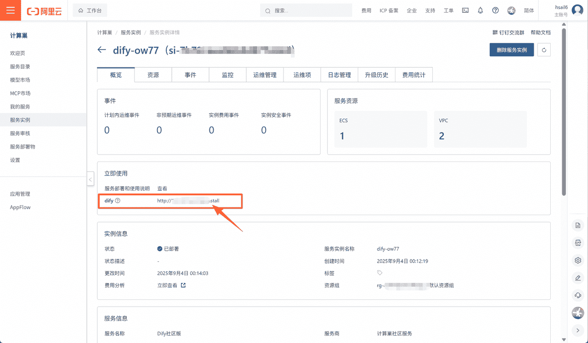

1.


1.

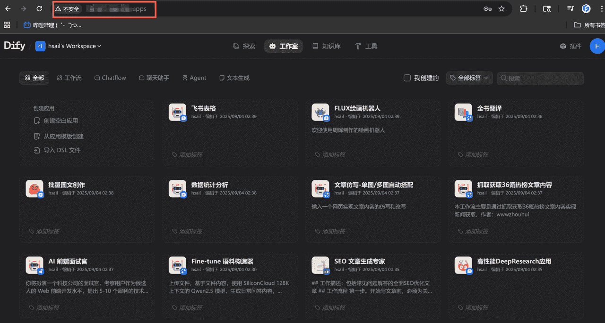

#### 2.3 使用计算巢部署的优势

相比本地部署或 Docker 部署，利用阿里云计算巢部署 Dify 具有以下优势：

+   无需手动配置服务器环境，节省大量部署时间；

+   完全运行在阿里云上，享受云端稳定性和弹性扩展；

+   配置参数标准化，适合对运维经验不足的小白用户；

+   支持后续的在线升级与扩展，适合企业快速落地实验或试点项目。

### 3. Dify Docker部署流程

#### 3.1 Docker 与 Docker Compose 简介

在开始部署之前，需要先了解 **Docker** 与 **Docker Compose** 这两个核心概念：

+   **Docker**：
Docker 是一种流行的容器化平台，它可以将应用及其依赖环境打包到一个轻量级的“容器”中。这样一来，无论应用运行在本地、云服务器还是不同操作系统上，都能保证环境一致，避免“在我电脑上能跑，在你电脑上就报错”的问题。

+   **Docker Compose**：
Docker Compose 是一个基于 YAML 文件的多容器编排工具。在实际项目中，一个完整的系统通常不仅需要应用本身，还依赖数据库、缓存、消息队列等多个服务。Compose 可以让用户通过一份 docker-compose.yml 文件，将这些服务统一定义，并一键启动或关闭，大幅简化了部署流程。

在 Dify 项目中，Docker 与 Docker Compose 是推荐的部署方式，因为它能快速拉起 Dify 所需的 Web 服务、Worker、数据库、向量存储服务等多个组件，并且保证环境的统一性。

> 注：Dify 官方提供了完整的 Docker 部署方案，代码托管在 GitHub 仓库：https://github.com/langgenius/dify/tree/main

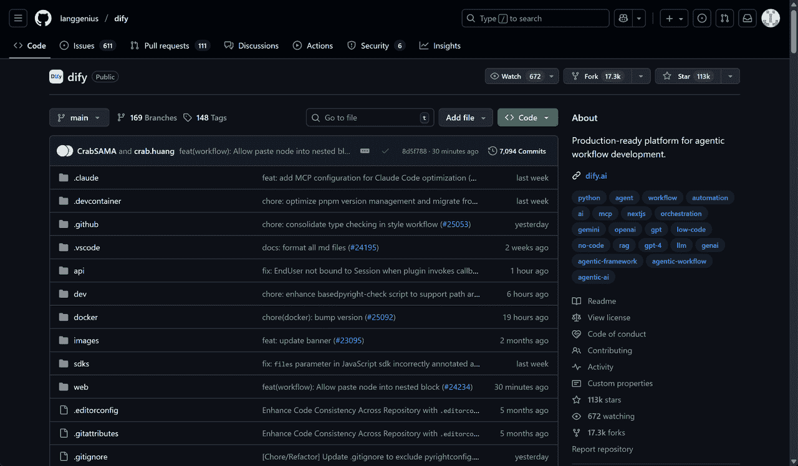

此外，安装 Dify 之前, 请确保服务器已满足最低安装要求：

+   CPU >= 2 Core

+   RAM >= 4 GiB（使用docker部署则需要至少8G内存）

#### 3.2 在 Linux（Ubuntu 22.04）上部署

1.  安装 Docker 与 Docker Compose
在 Ubuntu 22.04 系统中，可以通过以下命令安装：

+   更新系统依赖

```
sudo apt update

sudo apt install -y apt-transport-https ca-certificates curl gnupg lsb-release
```


+   添加 Docker 官方 GPG key

```
sudo mkdir -p /etc/apt/keyrings
curl -fsSL https://mirrors.aliyun.com/docker-ce/linux/ubuntu/gpg | sudo gpg --dearmor -o /etc/apt/keyrings/docker.gpg
```

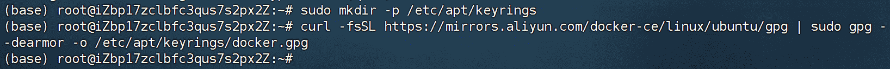

+   添加 Docker 软件源（阿里云源）

```
echo \
  &quot;deb [arch=$(dpkg --print-architecture) signed-by=/etc/apt/keyrings/docker.gpg] https://mirrors.aliyun.com/docker-ce/linux/ubuntu \
  $(lsb_release -cs) stable&quot; | sudo tee /etc/apt/sources.list.d/docker.list &gt; /dev/null
```

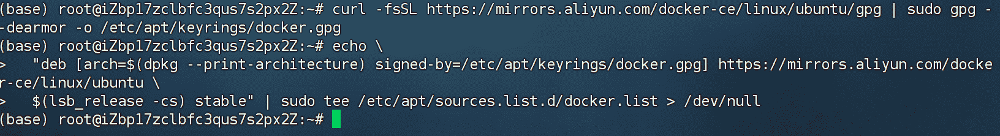

+   安装 Docker

```
sudo apt update
sudo apt install -y docker-ce docker-ce-cli containerd.io docker-buildx-plugin docker-compose-plugin
```

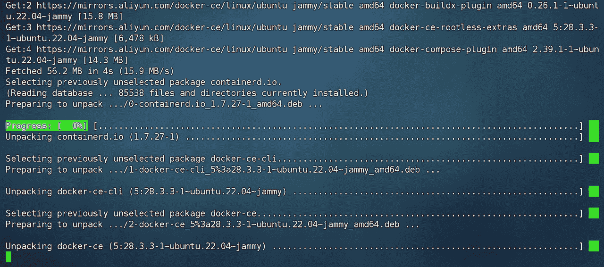

+   验证安装

```
docker --version
```

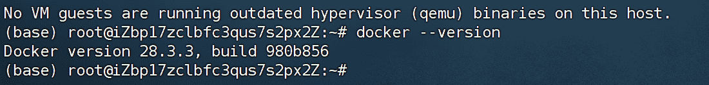

1.  **克隆 Dify 项目代码**

```
git clone https://github.com/langgenius/dify.git
cd dify/docker
```

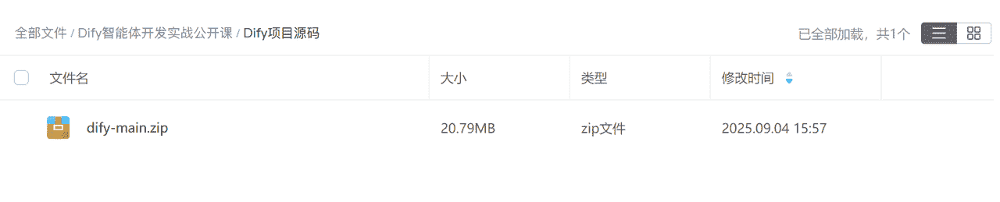


1.  **启动服务**
官方在 docker 目录下提供了 docker-compose.yaml 配置文件，可以直接执行：

```
docker compose up -d
```

1.  **这**将会自动拉取所需镜像，并启动 Web、API、Worker、数据库（PostgreSQL）、向量数据库（Weaviate/PGVector）、插件服务 等组件。

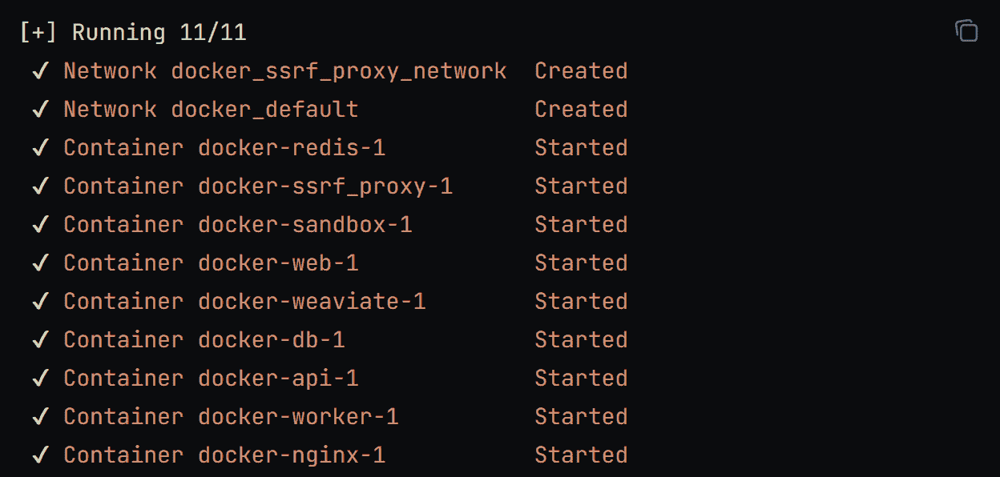

1.  **访问服务**
部署完成后，在浏览器中访问 http://<服务器IP>/install 即可进入 Dify 的 Web 管理界面。


#### 3.3 在 Windows 系统上部署

Windows 系统同**样支持 Docker 部署，**但推荐安装 Docker Desktop，以获得图形化和命令行双重体验。

1.  安装 Docker Desktop

+   访问 Docker Desktop 官方下载页面，下载适用于 Windows 的安装包。

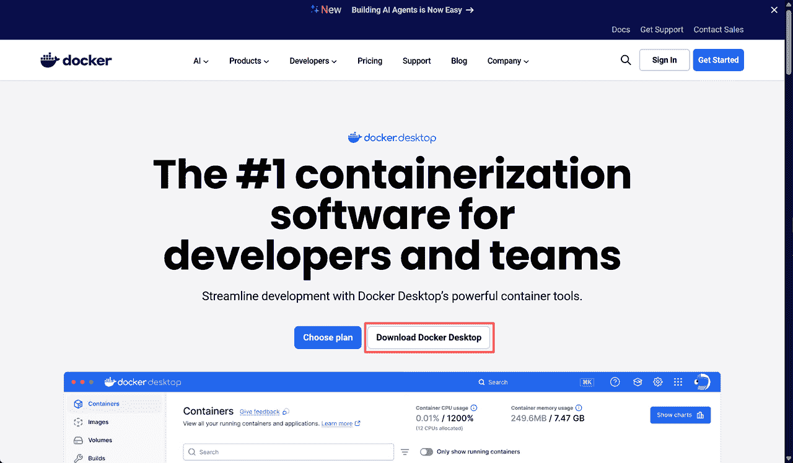

+

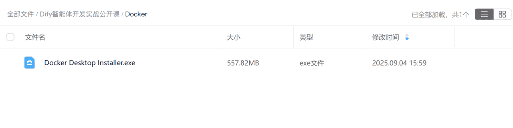

+   安装过程中需启用 **WSL 2**（Windows Subsystem for Linux 2），这是 Windows 下运行 Linux 容器的必备条件。

1.  **验证安装**
打开 PowerShell 或 CMD，输入以下命令：

```
docker --version
docker compose version
```

1.  若能显示版本号，则说明安装成功。

1.  **下载 Dify 项目代码**
在 PowerShell 中执行：

```
git clone https://github.com/langgenius/dify.git
cd dify\docker
```


1.  **启动服务**
在项目目录下运行：

```
docker compose up -d
```

1.  Windows 下执行方式与 Linux 一致，Docker Compose 会自动拉取镜像并启动所有组件。

1.  **访问服务**
打开浏览器，访问 http://localhost/install 即可进入 Dify 的控制台界面。

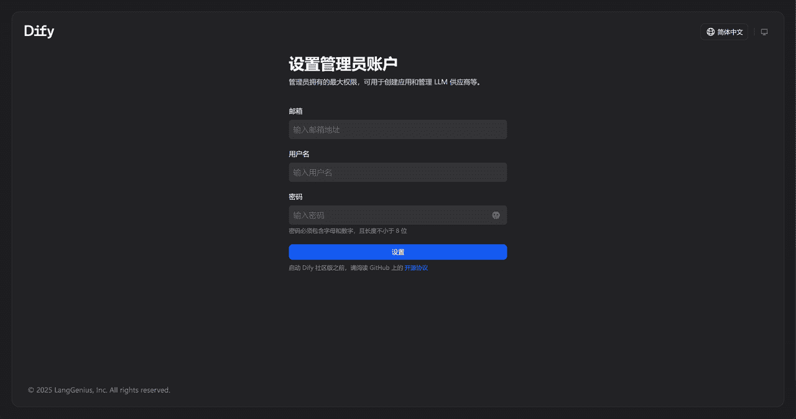

### 4. Dify企业级源码部署流程

**     ** **  Dify 除了提**供 云**服务接入、阿里云计**算巢一键部署 与 D**ocker** 部署 等方式外，还支持 源码级部署。源码部署适合需要对系统进行深度定制的企业级用户，例如调整底层服务架构、对接自研组件、或对安全合规有特殊要求的场景。

其基本流程通常包括：

1.  从 GitHub 仓库拉取 Dify 源码；

1.  配置运行环境（Python、Node.js、Redis、PostgreSQL、向量数据库等）；

1.  依次安装并启动前端、后端与 Worker 服务；

1.  结合 Nginx、负载均衡与安全策略进行企业级部署。

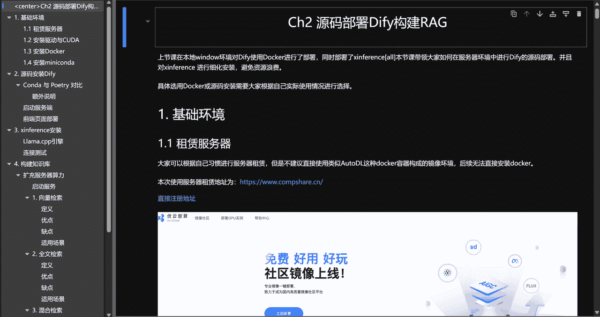

由于源码部署环节涉及 **较多组件的安装与配置**，整体流程相对复杂，对于初学者来说并不友好。为了避免读者在尝试过程中遇到大量环境问题，我们不在本教程中展开。

👉 如果你希望系统掌握源码部署的完整流程与最佳实践，我们将在付费课程 《2025大模型Agent智能体开发实战》中进行详细讲解，并配备手把手的环境配置与运维案例。


## 三、Dify Agent开发核心功能详解

### 1. Dify 5大类AI应用介绍

Dify 作为一款低代**码 Agent 开发**框架，为用户预设了 5 大类应用开发模式。这五类应用覆盖了从入门到进阶的不同层次，既能帮助初学者快速上手，也为进阶用户提供了构建复杂智能体的能力。

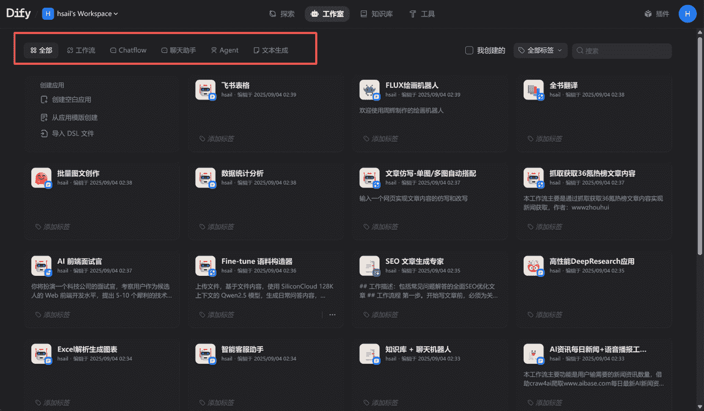

#### 1.1 聊天助手（Chatbot）

**     ** ** 这是**最基础**、最**常见的应用类型。用户可以通过 Dify 快速创建一个对话式助手，为其配置 提示词模板、知识库 和 工具，从而完成一个具备问答能力的聊天机器人。例如，FAQ 问答机器人、课程助教、企业内部知识助手等，都属于这一类。

+   **特点**：上手简单，主要依赖提示词和知识库。

+   **适用场景**：客服问答、学习助教、信息检索。

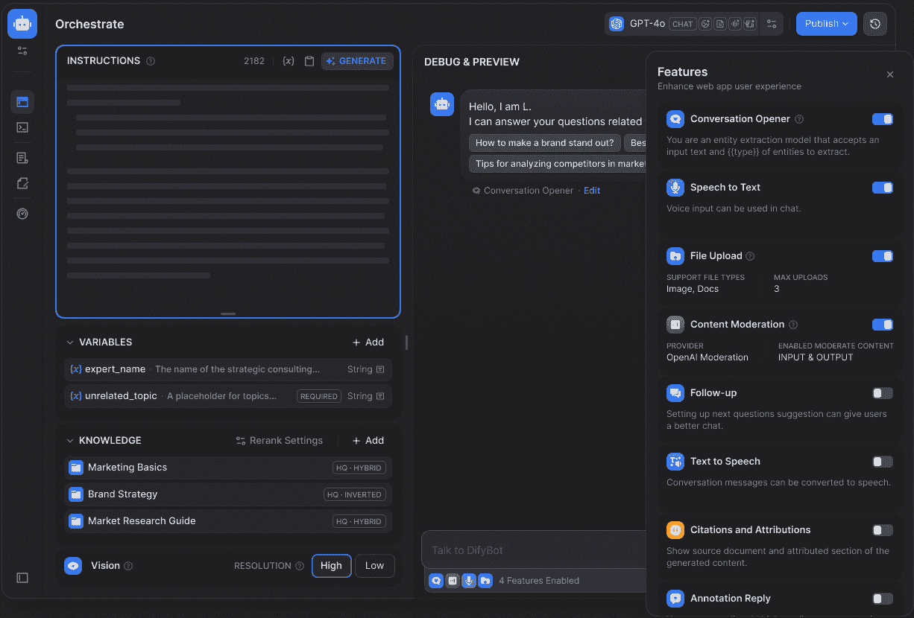

#### 1.2 Agent（智能体）

Agent 模式相比普**通聊天助手更**进一步，允许用户为模型配置 工具调用能力，即模型在对话中可以根据需要调用外部 API 或功能模块，从而完成更复杂的任务。

+   **特点**：不仅能回答问题，还能“做事”。

+   **适用场景**：智能办公助手、自动化任务处理、信息检索与执行。

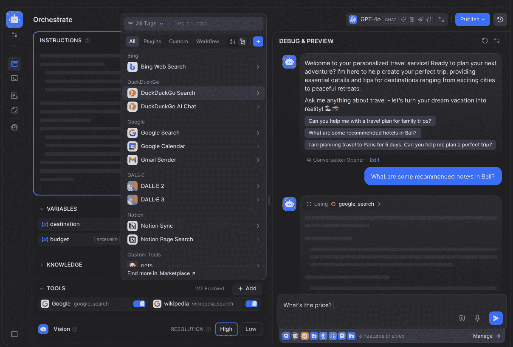

#### 1.3 文本生成助手（Text Generator）

该类型应用主要用于生成类任务，例如写作、代码生成、文案优化、翻译等。用户可以配置输入/输出格式，结合提示词模板，快速构建一个结构化的生成工具。

+   **特点**：专注内容生成，结果可控性强。

+   **适用场景**：文章生成、代码片段生成、广告文案撰写。

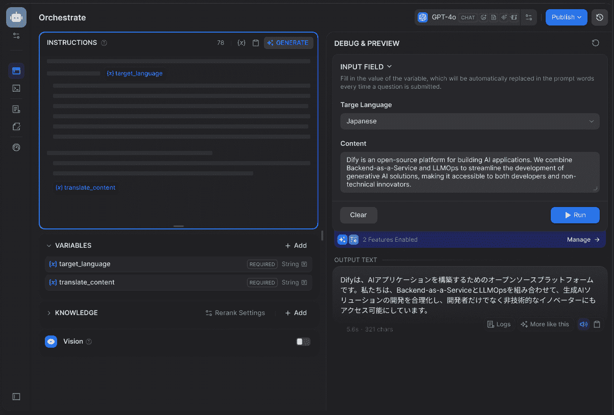

#### 1.4 工作流（Workflow）

**      **  工作流属于进阶应用类型，用户可以在画布中 编排多步任务，让模型与工具按照设定的逻辑依次执行。例如：先从知识库检索，再调用 API 获取数据，最后进行结果总结。

+   **特点**：多步骤串联，逻辑清晰。

+   **适用场景**：业务流程自动化、企业内部审批流、跨部门数据处理。

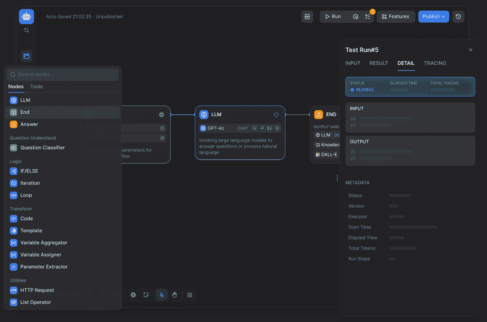

#### 1.5 Chatflow

**        **Chatflow 可以理解为 聊天助手的进阶版，它将聊天机器人与工作流编排结合在一起。用户不仅可以与机器人自然对话，还能触发复杂的工作流逻辑。这使得 Chatflow 在交互性和自动化方面更为强大。

+   **特点**：融合对话与流程，兼具灵活性与复杂度。

+   **适用场景**：智能客服中心、企业内部知识管理、跨系统综合智能体。

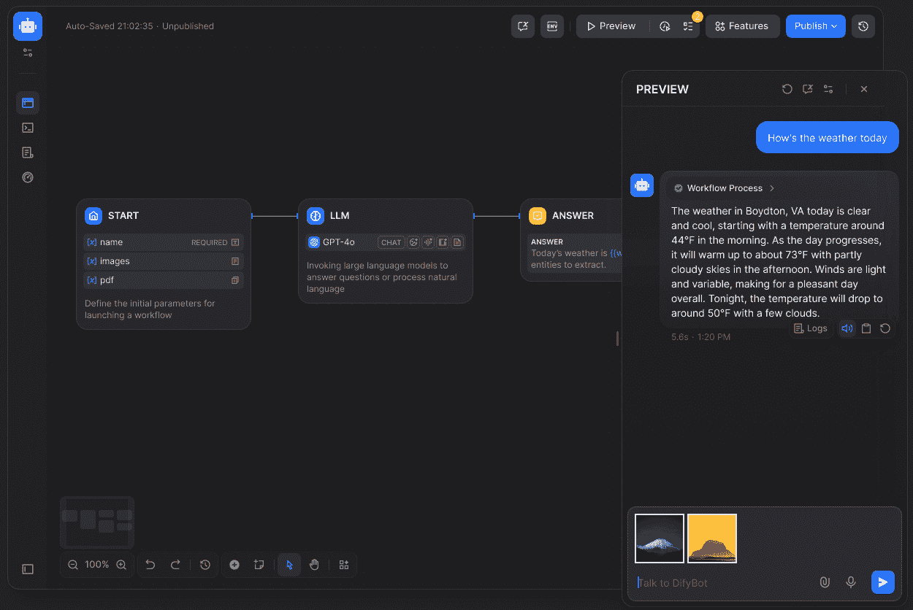

**在接下来的章节中，**我们将通过一个 智能助教聊天机器人 的完整案例，带大家从零开始搭建 Dify 应用，逐步体验上述功能在实际中的应用方式。

### 2. 从零到一搭建智能助教聊天机器人

**        接**下来，我们以“智能助教（Teaching Assistant）”为示例，带你从零开始在 Dify 中搭建一个基于 PDF 课件知识库 的聊天助手。该机器人能够围绕同学的问题进行检索式问答（RAG），并展示引用出处。流程涵盖：创建应用 → 构建并接入知识库 → 配置提示词与开场白 → 调参与测试 → 基础优化与质检。发布与后端 API 调用将在本章第 3、4 节展开。

> 注：为了更好完成智能助教创建工作，我们需要准备好OpenAI API KEY与Deepseek API KEY。

#### 步骤一：新建「聊天助手」应用

1.  进入工作区，选择 **创建应用** → 聊天助手（Conversation Application）。


1.


1.  首次创建聊天助手时，会提示进行模型配置，并安装相应模型调用的插件。和LangChain类似，Dify中和系统功能相关的功能模块（比如基座模型接入方法），也都是单独封装的一个个功能模块，然后根据需求进行安装。


1.  然后先安装OpenAI插件：


1.


1.  安装完成后点击设置：


1.  输入API-KEY和API Base：


1.  其中API-Base为我们团队为大家专门准备的国内反向代理地址，无需任何网络门槛，即可直连OpenAI官方服务器（因此API-KEY需要输入官方API-KEY，而不能输入中转API-KEY）：https://ai.devtool.tech/proxy

1.  然后点击显示模型，即可看到导入的全部OpenAI模型：


1.  然后继续添加DeepSeek插件：


1.


1.  然后输入API-KEY


1.


1.  然后查看DeepSeek可用的模型：


1.  同时，还可以设置默认的系统模型：


1.  然后回到智能助教创建页面，点击右上方选择模型，并编写简单系统提示词：“你叫小智，是一名助人为乐的课程助教。”


1.  在“模型与参数”面板中，选择你已配置好的模型提供方与具体模型；根据需要调整 Temperature / Top-p / Max Tokens 等生成参数。一般情况下保持默认即可。


1.  简单对话测试


1.  能够发现，聊天助手天然具备流式响应和多轮对话功能。

1.  开启视觉功能

1.  同时由于GPT-5具备视觉功能，所以当开启视觉功能时，可以上传图片让模型对其进行识别：


1.

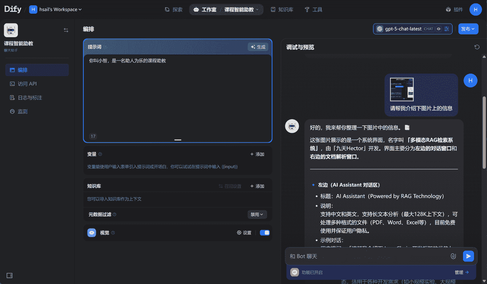

> 识别图片：

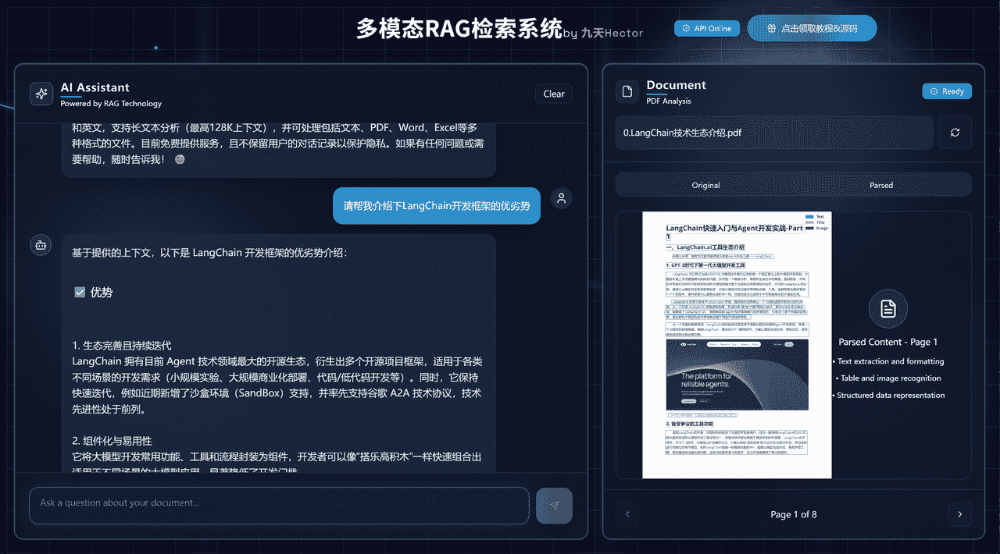

#### 步骤二：构建课程知识库（上传 PDF 并建立索引）

作为一名智能助教，还需要能够围绕课件里的内容进行问答，Dify中为聊天助手增加知识库问答功能非常简单，只需要关联一项知识库即可。而在首次使用时，我们需要手动创建这项知识库。

1.  打开 知识库（Knowledge Base / Datasets），新建一个知识库。


1.  在该知识库的“文档”页中上传 **PDF 课件**（亦可同步外部源，如 Notion、网页等；此处以直传文件《谷歌ADK项目实战》为例）。


1.

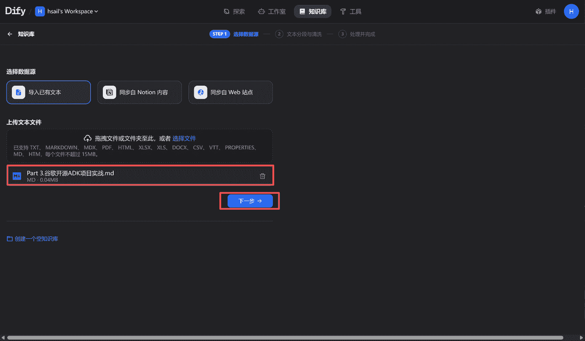

1.

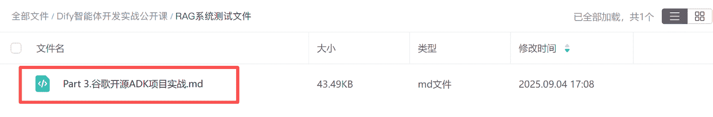

1.


1.  设置文档策略

1.  接下来继续设置文档切分策略，这里就以默认的滑动窗口切分为例，同时为保证检索质量，优先使用“高质量（High Quality）索引模式”（相比“Economical”召回更稳、引用更准）；


1.  在 Dify 中，**混合检索** 是一种结合 **语义检索** 与 **关键词检索** 的高级检索方式。其工作机制是：系统会同时执行基于向量的语义相似度查询和基于关键字的精确匹配查询，然后通过权重分配或重排序模型（Rerank Model）对结果进行二次整合，最终返回与用户问题最匹配的答案。

+   **权重设置**：用户可以通过调整语义检索与关键词检索的权重比例，决定系统更偏向语义理解还是关键词匹配，从而灵活适应不同场景。

+   **Rerank 模型**：系统会根据候选结果与用户问题的相关性，对结果进行重新排序，保证最符合语义的答案排在前列。

+   **参数调节**：还可以设置 Top K（召回条目数）、Score 阈值（最低相似度分数）等参数，以进一步控制召回范围与结果精度。

1.  这种检索方式兼顾了 **语义理解** 与 **精确匹配** 的优势，既能捕捉到语义相近的答案，又能避免遗漏关键字完全匹配的结果，非常适合课程问答、技术文档查询、FAQ 系统等对准确性和覆盖率都有较高要求的场景。


1.  等待解析与切分完成。


+   文档召回测试

+   接下来即可进行召回测试，即测试任意问题能否检索和关联到相关文档：


+


#### 步骤三：在应用内接入知识库并设置检索

1.  回到你的**聊天助手应用**，在“知识”或“检索”面板中，**连接刚创建的知识库**：


1.


1.


1.  尝试进行问答测试

1.  当询问到相关问题时候，会自动检索和回答：


1.  同时也能查看检索关联的文档片段：


1.  注意，在 Dify 的 **聊天助手（Co**nversation Application） 中，无论用户的问题是否与知识库内容直接相关，系统都会先 调用知识库检索，然后再将检索结果与用户输入一并送入大模型，生成最终回答。而在其他高级模式下，可以根据问题情况决定是否检索。

#### 步骤四：设计提示词模板（System Prompt / 模板变量）

**    ** **  最后**让**我们设计**这**个智能助**教**提示词模****板。的良好的**提示词能显著提升教学场景的可用性与稳定性。建议将“角色定位、回答结构、引用规范、不会编造、互动策略”写入系统提示词，并配合变量做课程定制。例如实例提示词如下：

```
你叫小智，你是一名严谨耐心的“智能助教”。你的任务是基于课程《{{course_name}}》的课件知识库，用中文为学生解答问题。

要求：
1）必须优先基于已连接的知识库检索结果作答，无法从资料中得到的内容要明确说明“资料未覆盖”，不得编造，若问题不在资料中，则可以用自己原始知识库进行回答；
2）请在答案末尾给出【引用】列表（含文档名和页码/段落标识），若没关联文档片段，则不需要输出【引用】列表；
3）如问题含糊，先用2-3个要点追问以澄清，再给出可能的方向与对应课件位置；
4）回答时，先用一句话概括结论，再给出分点推理与关键定义；
5）面向初学者，术语首次出现需给出简明解释。

变量：
- 课程名：{{course_name}}
```

在 Dify 里，**提示词（Prompt）**** 是定义智能体角色和行为的重要**配置，而 关联变量（Variables） 则是提示词中的动态占位符。通过在提示词里引入变量，可以让应用在运行时根据用户输入或外部参数，动态替换提示词中的内容，从而生成更个性化、更上下文相关的回答。

+   **变量的形式**：通常写成 {{变量名}}，比如 {{course_name}}、{{student_name}}。

+   **使用方式**：在提示词中写入这些变量，应用运行时会自动替换为实际值。例如：

```
你是一名《{{course_name}}》课程的智能助教，请用中文解答学生 {{student_name}} 的问题。
```

+   当用户在 WebApp 端选择课程为《线性代数》，输入姓名为“小王”，最终提示词会被渲染为：

```
你是一名《线性代数》课程的智能助教，请用中文解答学生小王的问题。
```

+   **绑定方式**：关联变量可以在应用的 WebA**pp 设置 / **开聊前变量 或者 API 调用参数 中配置。用户在开始对话前填写这些变量，Dify 就会自动将值注入到提示词中。


功能测试无误后，即可进行发布（保存）：


#### 步骤五：多课程问答助教系统设计

**     而在真实的教学场景**中，往往不止一门课程需要智能助教支持。比如一位老师可能同时开设《DB-GPT 项目课程》和《ADK 项目实战课程》，如果每一门课程都单独创建一个聊天助手应用，既增加了运维成本，也会给学生带来体验割裂。为此，我们可以利用 Dify 的 多知识库绑定 + 提示词变量 功能，搭建一个支持多课程切换的统一智能助教。

**第一步：关联多个知识库**

在应用的“知识”设置页面中，可以一次性绑定多个知识库。例如，将《DB-GPT 课程》与《ADK 课程》的课件资料都添加进来。此时，Dify 默认会在用户提问时同时检索这两个知识库，并将相关结果一并传递给大模型。


然后回到主页面，添加新的知识库


**第二步：设置下拉菜单变量****

为了让系统**能够区分不同课程，需要在 WebApp 设置中添加一个 下拉选项变量（如 course_name）。在选项中列出所有已绑定的课程，例如“DB-GPT 课程”“ADK 课程”。这样一来，当用户开始对话前，必须先选择自己所在的课程，变量值就会注入到提示词中。


**第三步：优化提示词模板**

在系统提示词中引入 {{course_name}} 变量，并明确要求模型只基于所选课程的资料进行回答。例如：

```
你叫小智，你是一名严谨耐心的“智能助教”。你的任务是基于课程《{{course_name}}》的课件知识库，用中文为学生解答问题。

规则要求：
1）在检索到的知识库文档中，**必须优先使用与课程《{{course_name}}》最相关的文档片段**来回答。如果检索结果包含多个课程内容，只能引用与《{{course_name}}》相关的部分。
2）如果没有检索到与《{{course_name}}》相关的文档片段，请明确说明“资料未覆盖”，并避免编造内容。在这种情况下，你可以基于模型自身知识补充回答，但需提示“以下内容来自模型知识，而非课件资料”。
3）回答必须在末尾附加【引用】列表（包括文档名和页码/段落标识），仅当回答使用了课件资料时才需要输出【引用】列表。
4）如问题表达含糊，请先列出 2-3 个澄清要点，并提示学生选择或补充说明，然后再给出可能的方向与对应课件位置。
5）回答时，必须先用一句话概括结论，再以分点形式给出推理、定义或解释。
6）面向初学者，术语首次出现时需要给出简明解释。

变量：
- 课程名：{{course_name}}
```

然后即可进行对话测试：


最后记得点击发布（保存）。


到这里，我们已经完成了一个**可用的智能助教聊天机器人**：它能读懂你的课程 PDF、进行知识检索并输出带引用的结构化答案。

### 3. Dify智能助教聊天机器人发布与使用

**     **   本节将把上一节做好的“课程智能助教”真正用起来：先在 Dify 自带的前端里对话测试，然后一键发布（自动完成部署），最后认识“访问 API”页面里为你准备好的后端接口与示例代码。

#### 3.1 相关核心概念解释

+   **发布（Publish）**：把你在「工作台」里编辑的草稿版本，升级为可对外使用的正式版本。

+   **部署（Deploy）**：让应用在云端/服务器**长期稳定运行**，并生成可访问的前端页面与后端接口。Dify 在**你点击“发布”时**会自动完成这一步，所以你无需自己搭服务器。

+   Dify 自带前端（WebApp）：Dify 自动生成的对话页面（带气泡聊天框、开场白、变量填写区、引用展示等），你可以直接发送给学生使用。

+   **后端 API**：给开发者/系统调用的接口。别人不进网页，也能通过 HTTPS 请求让机器人回答问题。

#### 3.2 在自带前端中「运行」与预览对话

1.  **打开应用（课程智**能助教），“右上角”找到 运行 / Run


1.  **进入运行**页面后，你会看到一个完整的对话界面：

+   左侧/顶部是**变量填写区**（比如 course_name 下拉菜单）；

+   中间是**聊天窗口**；


1.  在这里我们可以像终端用户一样提问，验证开场白、提示词约束、知识库检索、引用展示等是否符合预期。


1.

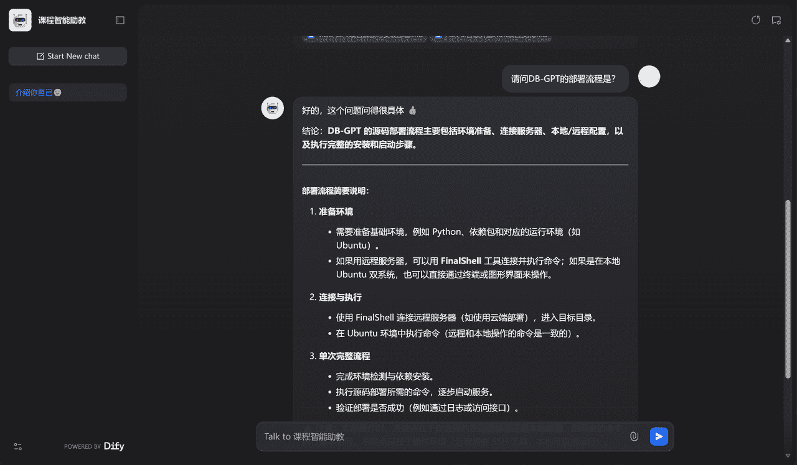

1.  **每次你修**改了提示词/知识库配置，记得点击 发布更新，运行页才会同步最新逻辑。

#### 3.3 「运行」= 自动部署+前端调用后端API

##### 1）发布 = 自动完成后端部署 + 内置 WebApp 更新

**        当**你在编排区点下 「发布/发布更新」 时，Dify 会把此刻的应用配置（提示词、知识库检索策略、变量、开场白等）固化成一个可供外部访问的版本，同时：

+   **后端接口**会被就绪/更新（应用的对话、变量、流式返回等 API 统一在「访问 API」页可查看与调用）；

+   **内置 WebApp（自带前端）** 的内容也会根据当前配置同步更新。换句话**说，你无需**再去“搭前端 + 配服务器”，发布即上线。

> 实操提示：发布后的 WebApp 链接可以直接发给学生使用；需要嵌入你的官网，也可以在发布菜单选择「嵌入网站」获取代码片段（不同页面名可能略有差异）。

##### 2）运行 = 打开 Dify 内置的对话前端做「所见即所得」测试

点 **「运行/Run」** 时，Dify 会打开它 **托管的内置前端**，用刚刚那套后端接口让你即时对话、看引用、测变**量、做冒烟测试。这个前端就是**我们常说的 “自带前端（WebApp）”：

+   有对话气泡、开聊前变量（如课程下拉）、引用与归因展示等常用 UI；

+   使用的是你应用当前版本的后端配置（未发布时相当于“预览”，发布后即对齐线上版本）。

##### 3）官方前端模板

+   地址：https://github.com/langgenius/webapp-conversation

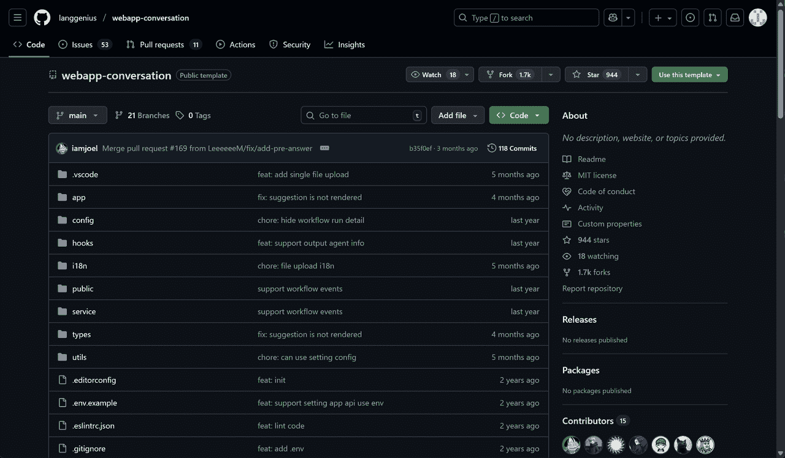

如果需要二次开发，则可以借助官方开源的Dify自带前端模板进行开发。

#### 3.4 「访问 API」：认识自动生成的后端接口

**      **  点击右上角菜单里的 访问 API，则会进入一个为本应用自动生成的开发者页面。


其中包含了完整的聊天助手后端服务端口说明：


也就是说，Dify本质实际上是开发+部署一体的工具，并且集成了完整的后端开发功能，当用户使用网页完成聊天机器人或者智能体开发的同时，也会自动进行部署，并生成后端接口。其中所有接口包含以下几类：

1.  **认证方式**

+   通常会有一个**应用级凭证**（或工作区级、应用 Token 等，具体以页面展示为准）。

+   这是调用 API 的“钥匙”，请妥善保管，不要在公开网页或前端代码中泄露。

1.  **请求示例**

+   页面会提供 cURL、Pyth**on、JavaScript **的调用样例，包含请求地址、请求头、请求体结构。

+   典型字段（不同版本命名可能略有差异，以页面为准）：

+   **inputs**：传入提示词变量（如 {"course_name":"DB-GPT课程"}）。

+   query / messages：用户消息正文。

+   response_mode / stream：是否流式返回。

+   **conversation_id**（可选）：用于保持上下文的会话标识。

+   files / attachments（可选）：上传图片/PDF 等辅助材料。

1.  **返回结果**

+   通常包含**模型回答文本**、可选的**引用段落/文档标识**、以及**token 用量/耗时**等元信息，便于日志与计费统计。

+   如果你启用了“引用与归因”，响应里也会给出引用片段或可用于拼装引用的结构化信息。

#### 3.5 测试后端服务连接


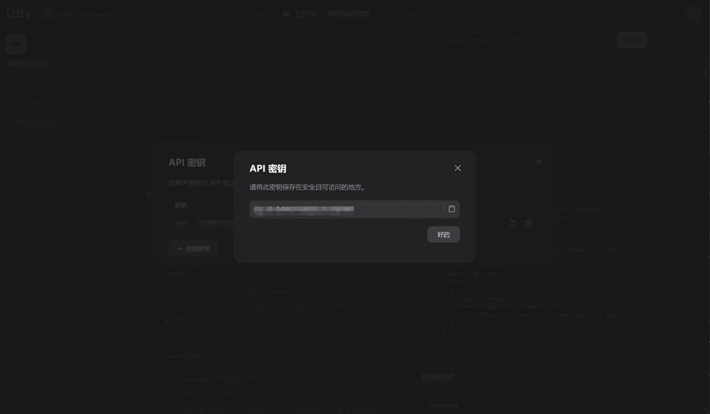

然后在任意主机上使用cURL进行后端服务测试：

```
    curl -X POST &#x27;http://&lt;服务器地址&gt;/v1/chat-messages&#x27; \
--header &#x27;Authorization: Bearer &lt;API-KEY&gt;&#x27; \
--header &#x27;Content-Type: application/json&#x27; \
--data-raw &#x27;{
    &quot;inputs&quot;: {&quot;course_name&quot;: &quot;DB-GPT课程&quot;},
    &quot;query&quot;: &quot;请帮我解释一下DB-GPT的安装步骤&quot;,
    &quot;response_mode&quot;: &quot;streaming&quot;,
    &quot;conversation_id&quot;: &quot;&quot;,
    &quot;user&quot;: &quot;abc-123&quot;
}&#x27;
```

能看到响应结果如下：

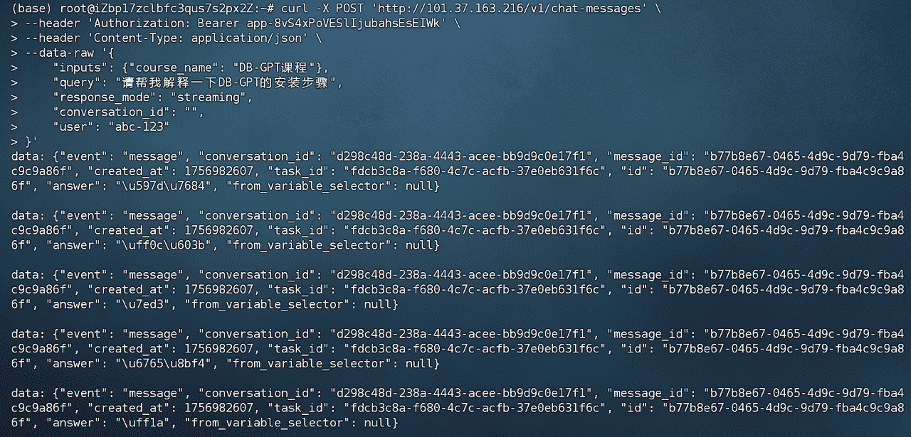

完整接口如下：

| 分类 | 方法 | 路径 | 作用 | 关键请求参数（类型｜要点） | 成功返回（摘要） | 常见错误 / 备注 |
| --- | --- | --- | --- | --- | --- | --- |
| 对话 | POST | /chat-messages | 发送对话消息（支持会话续聊与多模态图片） | query(string) 用户问题；inputs(object) 变量，默认{}；response_mode(string) streaming/blocking；user(string) 终端用户唯一ID；conversation_id(string) 续聊用；files(array) 图片（remote_url/local_file）；auto_generate_name(bool) 默认true；workflow_id(string)；trace_id(string 或Header/Query传） | blocking：ChatCompletionResponse（event/message_id/conversation_id/answer/usage/retriever_resources/...）； streaming：SSE 块（见下表） | 404 对话不存在；400 invalid_param / app_unavailable / provider_not_initialize / provider_quota_exceeded / model_currently_not_support / workflow_* / completion_request_error；500 |
| 对话（流控） | POST | /chat-messages/:task_id/stop | 停止正在流式的响应 | user(string) 必填 | { &quot;result&quot;: &quot;success&quot; } | 仅流式有效；task_id 来自流式块 |
| 文件 | POST | /files/upload | 上传图片文件（png/jpg/jpeg/webp/gif）供消息使用 | multipart/form-data：file（必填）；user(string) 与对话相同 | 返回 id/name/size/extension/mime_type/created_by/created_at | 400 no_file_uploaded/too_many_files/unsupported_；413 file_too_large；503 s3_ |
| 文件 | GET | /files/:file_id/preview | 预览或下载上传文件 | 路径 file_id；Query as_attachment=true 可下载 | 直接返回文件流（含Content-Type/Length/Disposition等） | 400 invalid_param；403 file_access_denied；404 file_not_found；500 |
| 反馈 | POST | /messages/:message_id/feedbacks | 终端用户对消息点赞/点踩/撤销 | rating(string) like/dislike/null；user(string)；content(string) | { &quot;result&quot;: &quot;success&quot; } | —— |
| 反馈 | GET | /app/feedbacks | 获取APP的消息点赞与反馈 | page(string，默认1)；limit(string，默认20) | data(list) 反馈记录数组 | —— |
| 建议问法 | GET | /messages/{message_id}/suggested | 获取下一轮建议问题 | Path message_id；Query user | { result:&quot;success&quot;, data:[...建议问题] } | —— |
| 历史消息 | GET | /messages | 滚动获取历史聊天记录（倒序） | conversation_id(string)；user(string)；first_id(string)；limit(int, 默认20) | data 数组（query/answer/message_files/agent_thoughts/retriever_resources/feedback/...）；has_more/limit | —— |
| 会话 | GET | /conversations | 获取用户会话列表 | user(string)；last_id(string)；limit(int, 默认20, 1~100)；sort_by(string，默认-updated_at) | data 会话列表（id/name/inputs/status/created_at/updated_at）；has_more/limit | sort_by 支持：created_at, -created_at, updated_at, -updated_at |
| 会话 | DELETE | /conversations/:conversation_id | 删除会话 | Body：user(string) | 204 No Content | —— |
| 会话 | POST | /conversations/:conversation_id/name | 会话重命名/自动生成标题 | name(string，可空)；auto_generate(bool，默认false)；user(string) | 返回会话对象（id/name/inputs/status/introduction/created_at/updated_at） | 若 auto_generate=true 可不传 name |
| 会话变量 | GET | /conversations/:conversation_id/variables | 获取对话变量 | user(string)；last_id(string)；limit(int)；（可选）variable_name 过滤 | data 变量列表：id/name/value_type/value/description/created_at/updated_at；has_more/limit | 404 conversation_not_exists |
| 会话变量 | PUT | /conversations/:conversation_id/variables/:variable_id | 更新对话变量的值 | value(any) 必须匹配类型；user(string) | 返回更新后的变量对象 | 400 Type mismatch；404 conversation_not_exists / conversation_variable_not_exists |
| 语音 | POST | /audio-to-text | 语音转文字 | multipart/form-data：file（mp3/mp4/mpeg/mpga/m4a/wav/webm，≤15MB）；user | { &quot;text&quot;: &quot;...&quot; } | —— |
| 语音 | POST | /text-to-audio | 文字转语音（或传 message_id 复用已生成文本） | message_id(str) 优先；text(str)；user(str) | 音频流（Content-Type: audio/wav） | 同时传入时优先使用 message_id |
| 元信息 | GET | /info | 获取应用基本信息 | — | name/description/tags/mode/author_name | —— |
| 参数 | GET | /parameters | 获取应用参数与表单/上传限制等 | — | introduction、user_input_form（控件配置）、file_upload/image/audio/video/custom、system_parameters（大小上限）等 | 文档/图片/音频/视频各自数量与传输方式限制 |
| 元信息 | GET | /meta | 获取工具 icon（Meta） | — | tool_icons：工具名→图标（URL 或 {background, content}） | **路径虽**写“POST”于示例处，实际为 GET |
| WebApp | GET | /site | 获取应用 WebApp 设置 | — | title/chat_color_theme/icon/icon_url/description/copyright/privacy_policy/custom_disclaimer/default_language/show_workflow_steps/use_icon_as_answer_icon | —— |

不过**需要注意的是，社区版**虽然同样提供了完整的后端服务，开发者在本地或服务器上部署后，即可拥有应用接口、对话管理、知识库检索等核心能力。但需要注意的是，这些后端服务的默认部署方式往往基于 单机或轻量级容器编排，更适合个人体验、小规模团队试用，无法在架构层面保证高并发场景下的稳定性。一旦进入企业级应用环境，面对大量并发请求和复杂的任务调度，社区版后端容易出现性能瓶颈，例如响应延迟增加、任务队列堆积、数据库负载过高等问题。因此，社区版更多是“能跑起来”的起点，而要实现“高并发、可扩展、可观测”的目标，则必须依赖更完善的工程化部署方案，或者直接选择具备企业支持的商业版本。

#### 3.7 Dify运维监控

当一个智能助教应用真正上线后，运维就成为绕不开的话题。开发者需要随时了解应用的运**行情况，**既要能**追踪用户**的实际提问与 AI 的响应过程，也要能掌握系统在性能层面的表现。Dify 在社区版中就已经提供了 日志记录 与 监控面板 两大功能，帮助开发者对应用进行基础运维。

**（1）日志与标注**

在“日志与标注”页面，可以看到所有用户会话的输入与 AI 的回答记录，每一条交互都会被保存下来。

+   **用途一：回溯问题** —— 如果学生反馈“机器人回答有误”，开发者可以在日志里快速定位到该问题和对应回答，便于分析是知识库缺失还是提示词设计不当。

+   **用途二：质量优化** —— 日志不仅能看到用户的原始问题，还能直观呈现哪些类型的提问频率高、哪些回答命中率低，方便后续补充知识库或优化提示词。

+   **用途三：人工标注** —— 部分场景下，可以对日志进行标注，作为后续优化模型或进行效果评估的数据来源。


**（2）监控面板**

在“监控”页面，Dify 会自动生成一系列可视化指标：

+   **会话总数与活跃用户数**：衡量应用的真实使用规模；

+   **平均会话互动数**：反映用户在应用内停留和交互的深度；

+   **Token 输出速度**：衡量模型生成速度和响应效率；

+   **Token 消耗与费用统计**：方便开发者控制调用成本，避免预算超支。

通过这些监控数据，开发者能够更全面地把握应用的运行状态。比如，若某一时间段 Token 输出速度骤降，说明模型响应可能出现延迟；若活跃用户数激增，可能需要考虑后端的扩容与负载均衡。

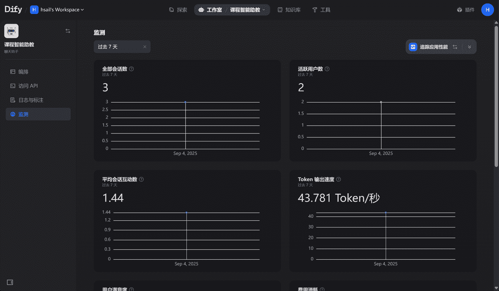

Dify 提供的运维监控功能，已经覆盖了小规模应用在日常管理中最常见的需求。对于个人和小团队而言，这些工具足以保证应用的基本可用性与可维护性。但在企业级场景下，往往还需要更强的监控与告警体系（如接入 Prometheus、Grafana、集中日志平台），才能在高并发环境下保持 SLA 水平。

---