# Part 2. Dify文本生成应用与Agent开发指南

> 来源：[https://kq4b3vgg5b.feishu.cn/docx/CTTKdHh4ro1vCexCHxjcFnTznTe](https://kq4b3vgg5b.feishu.cn/docx/CTTKdHh4ro1vCexCHxjcFnTznTe)

## 一、Dify文本应用开发实战

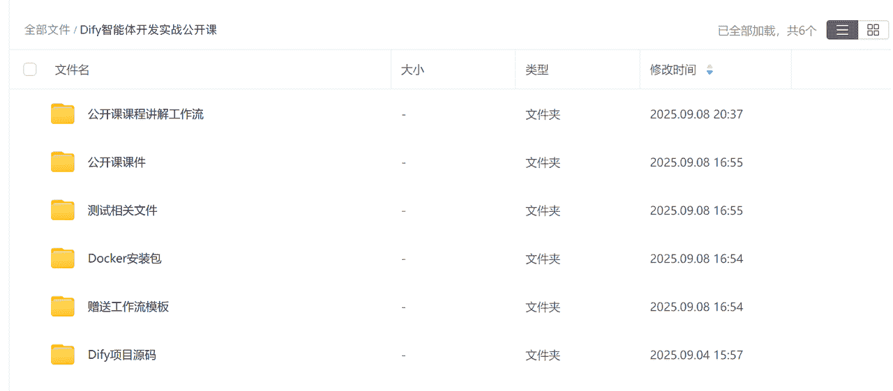

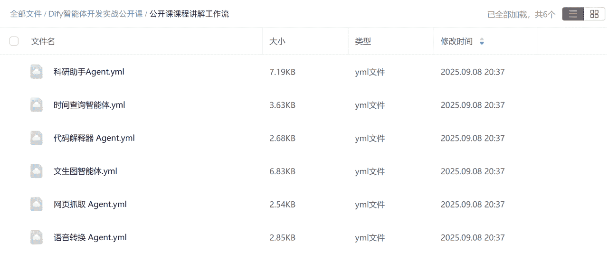


在智能化浪潮和大模型应用快速普及的背景下，文本生成类应用已经成为企业数字化转型与智能化升级中最普遍、最实用的一类落地场景。从营销推广到知识管理，从翻译本地化到SEO优化，几乎每一个与文字相关的环节，都可以借助大模型和低代码框架实现 自动化与规模化生产。

Dify 作为一款领先的低代码 `Agent` 开发平台，提供了完整的 文本应用开发能力。它不仅简化了传统 `NLP` 系统的开发流程，更通过“`提示词模板 + 变量配置 + 批量运行 + API 接口`”的组合方式，让复杂的企业级应用能够以 极低的门槛快速落地。无论是市场团队需要的广告文案，跨境电商需要的多语言翻译，还是内容团队需要的 `SEO` 长文，Dify 都能帮助开发者和业务人员高效实现。

本部分《Dify文本应用开发实战》将带领大家从入门到实战，循序渐进地掌握文本应用的构建方法。我们不仅会讲解 基础流程，更会结合 真实企业案例，涵盖五个最具代表性的场景：

1. 文本应用开发流程 —— 带你跑通第一个文本生成应用；
1. 文本翻译类应用 —— 支撑跨境电商与国际化企业的本地化需求；
1. 广告文案优化应用 —— 提升营销效率与转化率的必备工具；
1. 创意写作类应用 —— 服务短视频、品牌故事与文娱行业的内容生产；
1. `SEO`文章编写应用 —— 帮助企业抢占搜索引擎流量高地，实现规模化内容投放。

通过这五个案例，学员不仅能够掌握 Dify 的操作技巧，更能建立起一套关于 “如何将文本生成类应用用于企业级生产环境” 的系统认知。

### 1. Dify文本应用开发流程

本节开始，我们继续介绍Dify中的文本生成应用和Agent应用开发方法。尽管同样属于初级应用，但各自其实都有非常广泛的应用场景。

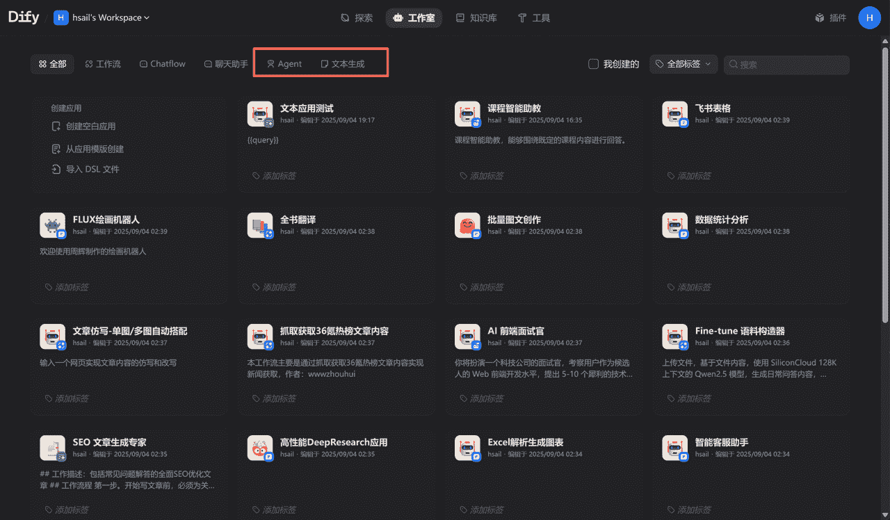

Dify 的 `文本生成应用` 是最基础、也是最容易上手的一类应用。它的核心思想很简单：用户在输入框里提供一个 提示词（Prompt） 或问题，系统会调用后台大模型生成一段文本输出。你只需要在界面中配置好提示词模板、变量，以及必要的上下文，发布后就可以直接使用。下面我们来完整梳理从零到一的开发流程。由于这种模式高度灵活，因此几乎可以覆盖所有与 “文本加工” 相关的工作场景。常见的典型应用包括：

1. 信息摘要
   + 从长篇文章、新闻报道或学术论文中提炼核心要点，生成简洁摘要。
   + 适合媒体监测、教育学习、知识管理等场景。

1. 语言翻译与改写
   + 将文本翻译为目标语言，或对现有内容进行改写、润色，提升表达质量。
   + 常见于跨境电商、本地化运营和学术写作。

1. 市场营销与广告文案
   + 快速生成多版本广告语、产品描述、邮件标题，支持 A/B 测试。
   + 广告优化、社交媒体营销、品牌传播都离不开这一能力。

1. 创意写作与内容创作
   + 帮助写作人员生成故事开头、对白片段、诗歌，甚至完整的小说章节。
   + 既能激发灵感，也能大幅缩短写作时间。

1. `SEO` 与长尾内容生成
   + 围绕关键词批量生成搜索引擎优化（`SEO`）文章、FAQ 页面、长尾描述。
   + 特别适合电商、网站运营和内容农场场景。

1. 结构化文本生成
   + 自动生成简历、合同条款、实验报告、产品对比表等“半结构化”内容。
   + 适用于企业办公自动化、教育考试与法律合规场景。

1. 对话脚本与客服回复
   + 批量生成常见问题解答（FAQ）、客服邮件模板，缩短人工整理时间。
   + 便于企业搭建客户支持系统。

接下来我们就通过创建一个新闻摘要助手为例，来介绍Dify的文本生成助手应用如何开发。

#### Step 1. 新建应用

在「工作区」中新建应用，选择 文本生成应用（`Text Generator`）。我们将它命名为 “新闻摘要助手”，目标是让模型把一段较长的新闻文本，提炼总结成简洁的三句话。

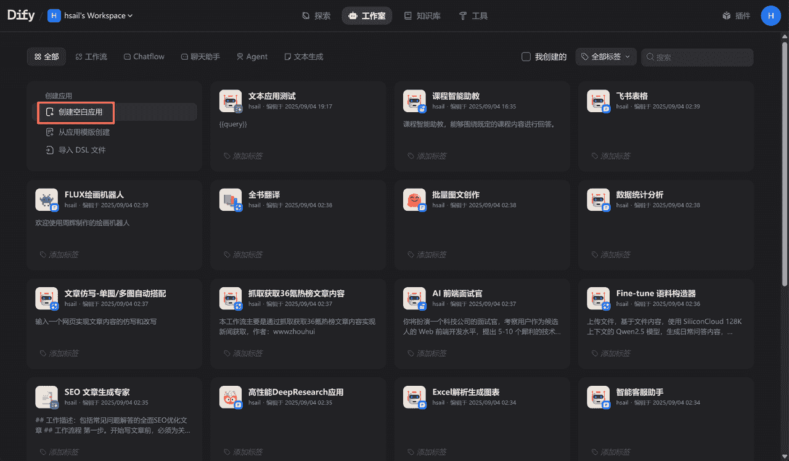

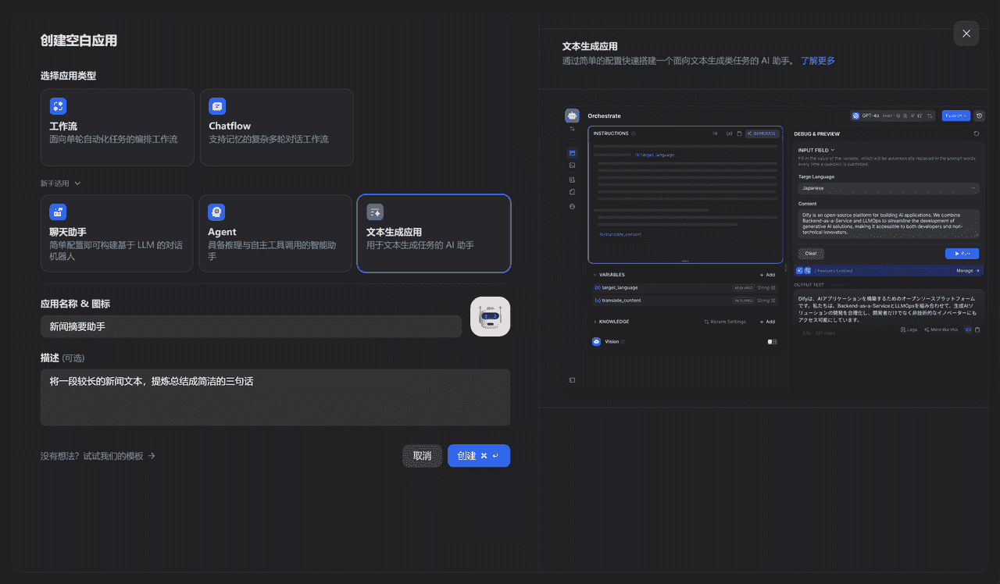

#### Step 2. 核心功能设置

能够发现，文本生成应用和聊天助手类似，都是主要以提示词来控制模型行为，同时允许关联知识库进行问答。这里我们在 `前缀提示词` 区域输入以下内容：

```
请将以下新闻内容总结为三句话摘要，要求简洁、准确，适合普通读者快速理解新闻重点：
{{news_content}}
```

这里我们告诉模型三个关键点：

1. 任务：生成摘要；
1. 限制：三句话；
1. 变量：`{{news_content}}` 会被用户输入的新闻正文替换。

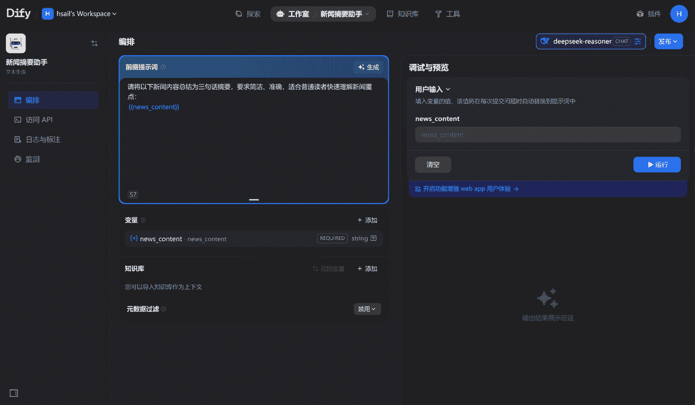

同时在变量区新增一个变量：

+ 名称：`news_content`
+ 类型：段落（Paragraph）
+ 必填：是

这样，用户在运行应用时，就会看到一个多行文本框，粘贴新闻内容即可。

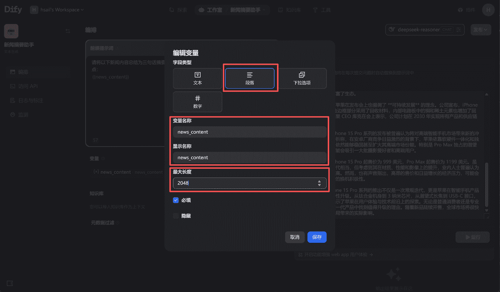

> 新闻摘要助手其实不依赖知识库，因为输入的新闻就是上下文。但如果你想要额外增强，比如固定引用某些行业分析文档，也可以在这里添加知识库，作为额外的参考背景。

#### Step 3. 调试与预览

接下来开始尝试进行对话，我们在右侧输入区粘贴一段新闻：

```
苹果公司于今日在加州库比蒂诺总部举行了一年一度的秋季新品发布会，正式推出备受期待的 **iPhone 15 Pro 系列** 智能手机。这场发布会吸引了全球媒体与消费者的高度关注，不仅因为苹果在智能手机市场的标杆地位，更因为这一代产品在设计、性能和生态体系上的一系列突破，被视为苹果近几年最具代表性的更新。

在外观方面，iPhone 15 Pro 系列首次引入 **钛合金材质边框**，取代了此前沿用多年的不锈钢。钛合金的应用，使得新机在保持坚固性的同时大幅减轻了重量。苹果官方数据显示，iPhone 15 Pro Max 比上一代轻了约 19 克，这对于长期使用大屏手机的用户而言，握持体验的改善极为明显。此外，边框的收窄与弧度调整，使得屏幕与机身的过渡更为自然，也进一步提升了整机的精致感。

在性能层面，iPhone 15 Pro 系列搭载了全新研发的 **A17 Pro 芯片**，这是全球首款采用 3 纳米工艺制程的智能手机处理器。苹果宣称，A17 Pro 的 CPU 性能较前代提升约 10%，GPU 性能则有高达 20% 的提升，并首次引入硬件级光线追踪技术，为移动端游戏带来更接近主机级别的画面表现。苹果特别展示了《生化危机 4 重制版》和《死亡搁浅》在 iPhone 15 Pro 上的运行画面，表明其正积极拓展高端游戏市场。

影像系统依旧是此次更新的重点。iPhone 15 Pro Max 独占的 **5 倍潜望式长焦镜头** 成为了发布会的一大亮点，使其在拍摄远景时有了质的飞跃。配合新的图像处理算法和更强大的 ISP 芯片，用户在低光环境下也能获得细节丰富、噪点更少的照片。同时，苹果还优化了视频录制功能，新增了 ProRes Log 格式支持，为专业创作者提供了更大的后期调整空间。

除硬件更新外，iPhone 15 Pro 系列在交互方式上也带来了变化。传统的静音拨片被全新的 **“操作按钮”（Action Button）** 所取代，用户可以自定义该按钮的功能，例如启动相机、录音、翻译或快捷指令。这一改变被视为 iPhone 自诞生以来在按键设计上的一次重要转变，尽管存在一定的争议，但也展现了苹果在提升个性化体验上的新思路。

在连接性方面，iPhone 15 Pro 全系终于告别 `Lightning` 接口，转而采用 `USB-C` 接口。其中，Pro 系列支持 `USB 3` 传输速率，最高可达 10Gbps，这无疑大大提升了专业用户在处理大文件（如 4K 视频素材）时的效率。苹果同时发布了全新的 USB-C 配件，进一步丰富了生态。

值得注意的是，苹果在发布会上也强调了 **可持续发展** 的理念。公司宣布，iPhone 15 Pro 的钛合金边框部分采用了回收材料，内部电路板中的铜和稀土元素也增加了回收利用比例。苹果 CEO 库克在会上表示，公司计划在 2030 年实现所有产品和供应链的碳中和目标。

市场层面上，iPhone 15 Pro 系列的发布被普遍认为将对高端智能手机市场带来新的冲击。调研机构分析称，在安卓厂商竞争日益激烈的背景下，苹果依靠软硬件一体化和独特的生态优势，依然能够稳固甚至扩大其高端市场份额。特别是 Pro Max 独占的潜望式长焦镜头，可能会吸引一大批摄影爱好者和高端用户。

在价格方面，iPhone 15 Pro 起售价为 999 美元，Pro Max 起售价为 1199 美元。虽然整体定价与前代相当，但考虑到其在材质、性能和影像上的提升，业内人士普遍认为其性价比依旧较高。然而，也有声音指出，高昂的售价和日益增长的经济压力，可能会影响部分消费者的换机积极性。

总结来看，iPhone 15 Pro 系列的推出不仅是一次常规迭代，更是苹果在智能手机产品线上的一次战略性升级。从钛合金机身到 3 纳米芯片，从潜望式长焦到 USB-C 接口，每一处变化都展示了苹果在用户体验与技术前沿上的探索。无论是普通消费者还是专业用户，都能在这一代产品中找到值得升级的理由。随着新品陆续开售，全球市场将很快见证它对行业格局带来的实际影响。
```

点击 `运行`，能够看出Dify默认会调用推理模型先进行推理然后再进行编写：

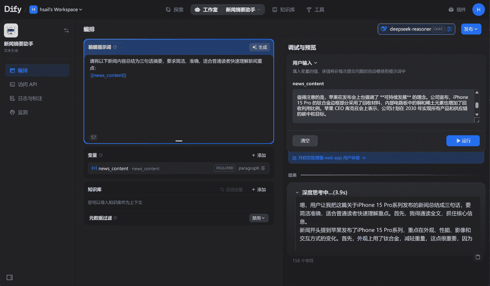

最终思考输出结果如下：

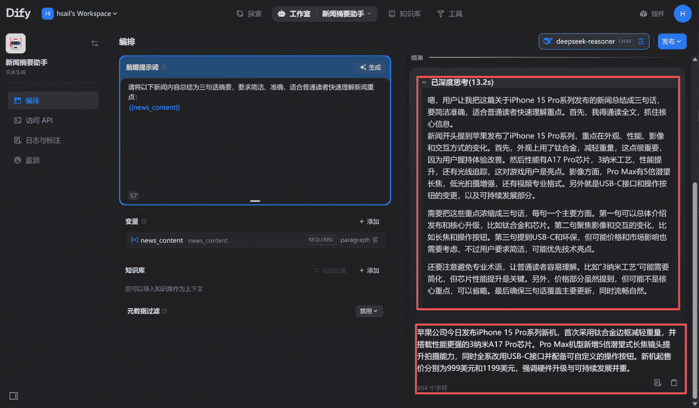

需要注意的是，和普通的聊天机器人有所不同的是，文本生成往往是一次性的工作，并不能进行持续多轮对话。

#### Step 4. 发布运行

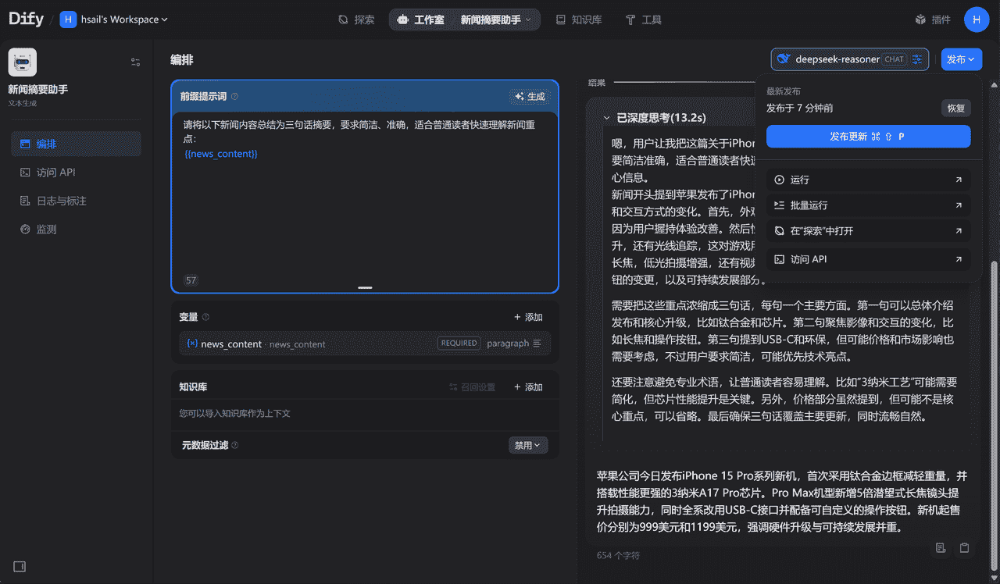


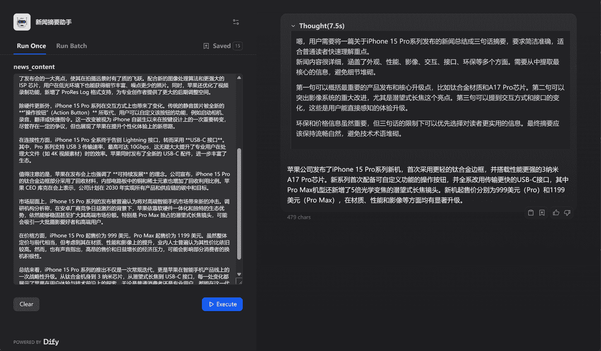

#### Step 5. 批量文本生成

此外，文本生成还支持批量创建，通过 `CSV` 文件批量导入数据，一次性生成所有结果。例如有一个包含三条新闻的CSV文件：

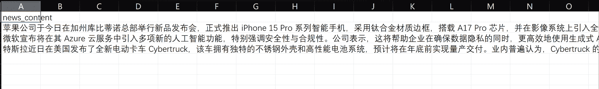

批量处理如下：

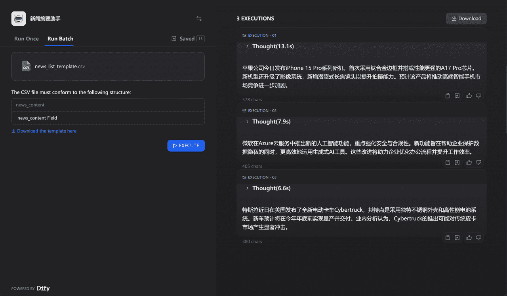

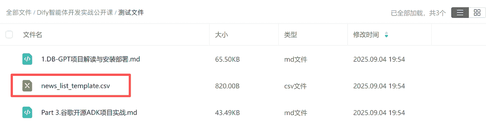


### 2. 文本翻译类应用开发

接下来我们以跨境电商商品描述本地化为例，带尝试用文本生成应用做一套可真实落地的翻译流程：既能一条条翻译，也能批量处理，并兼顾术语统一、格式保真、品牌语气与合规信息。这就是一整套“轻量 `TMS`（翻译管理系统）+ 术语库”的企业级实现。

#### 2.1 使用场景与目标

+ 使用场景：跨境电商需将英文商品描述、规格参数、售后政策翻译为多语种（例如中文、德语、法语），并保持术语一致、格式不破坏（`Markdown`/`HTML`/`JSON`）、品牌名不翻译、单位换算合规。

+ 业务目标：

1. 快速构建“文本翻译”应用，支持单次运行与 `CSV` 批量运行；
1. 通过变量与提示词模板实现“语言/语气/风格/领域”的可选；
1. 通过知识库（可选）接入“品牌术语表/风格指南”，提升稳定性；
1. 预留 `API` 接口，便于后续与电商后台/ERP/网站联动。

#### 2.2 应用结构设计

应用类型：文本生成应用（`Text Generator`）

变量设计（建议至少包含）：

+ `source_text`（段落，必填）：源文本（英文商品描述/参数/售后政策）。
+ `source_lang`（下拉，默认 `auto`）：源语言（auto/en/de/...）。
+ `target_lang`（下拉，必选）：目标语言（如 `zh-CN`、`de-DE`、`fr-FR` 等）。
+ `tone`（下拉，可选）：品牌语气（`professional`/`friendly`/`concise` 等）。
+ `format_mode`（下拉，可选）：格式保真策略（`plain`/`markdown`/`html`/`json`）。
+ `domain`（下拉，可选）：领域（`electronics`/`fashion`/`home`… 用于选择术语表）。

> 可选 `知识库`：上传“品牌术语表（Brand Glossary）/风格指南（Style Guide）”。术语表可用表格或 Markdown 文档维护（如“battery life→续航时间；Apple Watch → Apple Watch（保持英文）”等），用于 RAG 辅助统一译法。

#### 2.3 提示词模板

将以下内容放入前缀提示词（System Prompt），再结合变量：

```
你是一名电商本地化专家与专业译者。你的任务是将源文本精准翻译为目标语言，并保持格式与可读性。

基本要求：
1) 语言：源语言={{source_lang}}（如为 auto 则先判断），目标语言={{target_lang}}。
2) 语气：{{tone}}（如未指定则保持中性专业）。
3) 术语与品牌：品牌名、专有名词、SKU/型号不翻译；严格遵循已连接知识库中的“品牌术语表”和“风格指南”。
4) 格式保真：若 format_mode={{format_mode}} 为 markdown/html/json，则保持原有结构、标签、字段名不变，仅翻译字段值与可读文本。
5) 数字与单位：数字保持准确；如目标语言习惯不同，按目标市场规范转换并在括号中保留原单位（如必要）。
6) 合规与风格：不得编造信息；遇到不确定术语，优先按术语表；无对应时采用行业通用译法并保持一致。
7) 输出仅给出翻译结果，不要添加额外说明。

源文本：
{{source_text}}

如源文本语种与 source_lang 不一致，请先在内部判断后直接按目标语言产出，无需解释。
```

> 说明：

+ `知识库`接入后，模型会在翻译时优先参考“术语表/风格指南”。
+ `format_mode=json` 时，要求“键不翻，值可翻”，非常适合 API 文案、本地化资源文件。

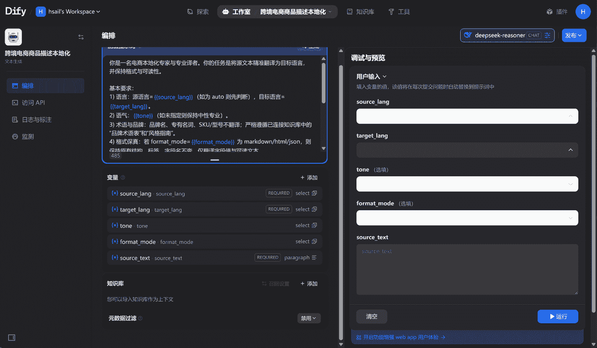

#### 2.4 测试示例（单次翻译）

输入（`source_text`，节选 `Markdown`）：

```
# Apple Watch Series 9
Battery life: up to 18 hours.
Water resistance: 50 meters (ISO standard 22810:2010).
Supports Apple Pay and third-party fitness apps.
```

变量：`source_lang`=`auto`，`target_lang`=`zh-CN`，`tone`=`professional`，`format_mode`=`markdown`

（可选）知识库：术语表中约定 “Apple Watch” 不翻译，“battery life→续航时间”。

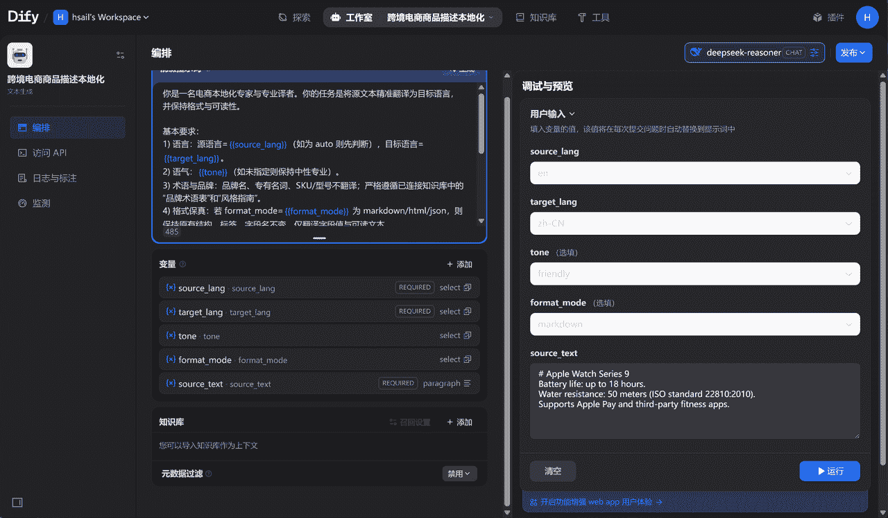

输出结果

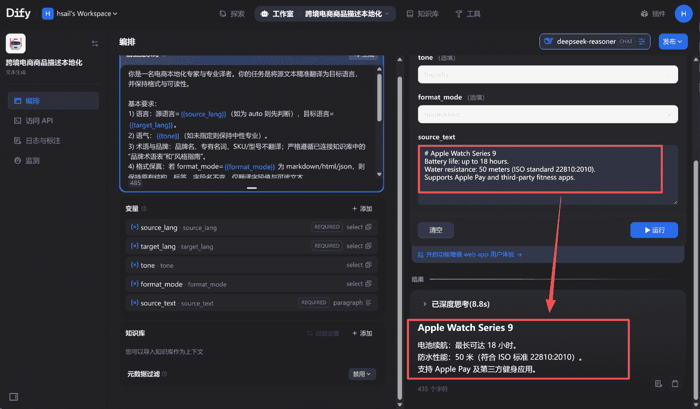

#### 2.5 批量运行：CSV 批量本地化

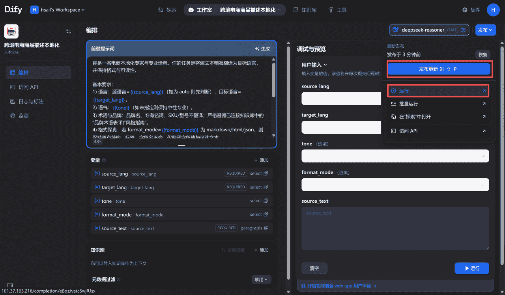

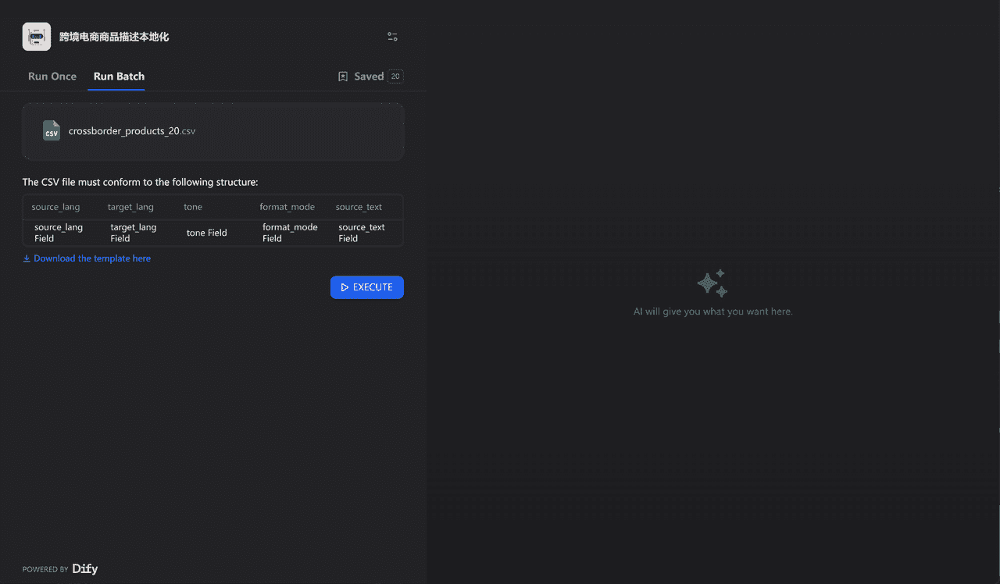

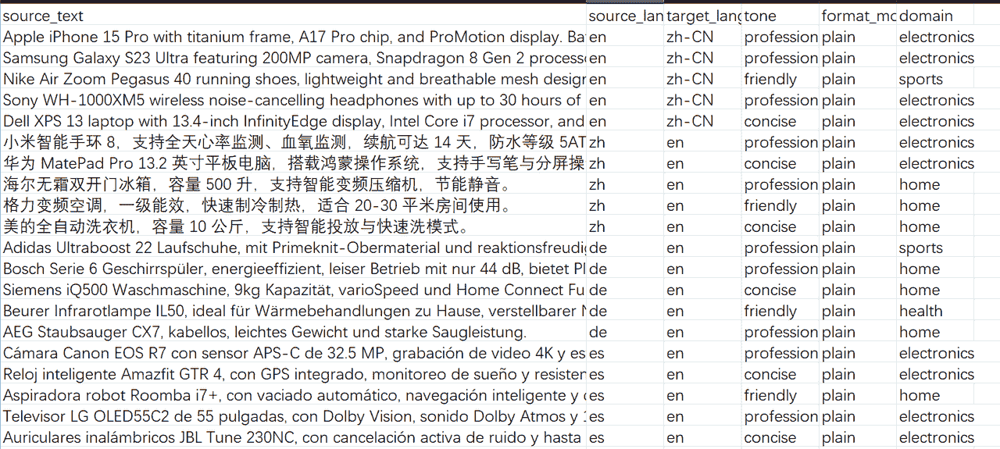

运行结果如下：

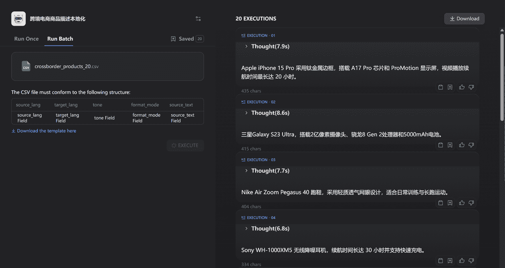

#### 2.6 API 调用

发布后，进入“访问 `API`”页面即可看到此应用的接口与示例代码。不同部署的路径命名可能略有差异（常见为 `completion-messages` 或页面展示的“文本生成端点”），以页面给出的实际地址为准。

请求体通常包含：`inputs`（上述变量）、`response_mode`（`blocking`/`streaming`）、可选 `user`/`conversation_id` 等字段。示例（以你环境里“访问 API”页为准）：


```curl -X POST &#x27;https://&lt;your-host&gt;/v1/completion-messages&#x27; \
  -H &#x27;Authorization: Bearer {API_KEY}&#x27; \
  -H &#x27;Content-Type: application/json&#x27; \
  -d &#x27;{
    &quot;inputs&quot;: {
      &quot;source_lang&quot;: &quot;auto&quot;,
      &quot;target_lang&quot;: &quot;zh-CN&quot;,

      &quot;tone&quot;: &quot;professional&quot;,
      &quot;format_mode&quot;: &quot;markdown&quot;,
      &quot;source_text&quot;: &quot;# Apple Watch Series 9\
Battery life: up to 18 hours.\
Water resistance: 50 meters (ISO standard 22810:2010).\
Supports Apple Pay and third-party fitness apps.&quot;,
    },
    &quot;response_mode&quot;: &quot;blocking&quot;,
    &quot;user&quot;: &quot;loc-batch-001&quot;
  }&#x27;
```

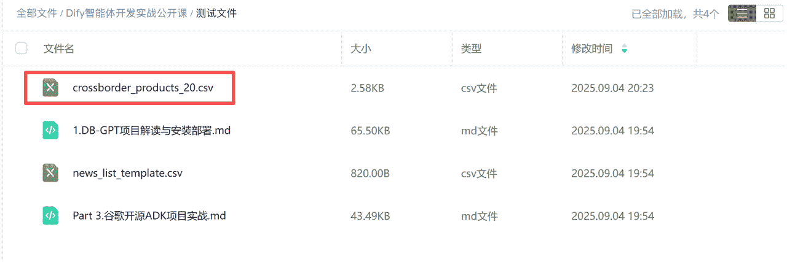


## 3. 广告文案自动优化应用开发

### 3.1 使用场景与业务价值

在跨境电商与互联网广告投放领域，一个产品往往需要多版本广告文案，以便在不同渠道、不同用户群体、不同语言环境下进行投放测试（A/B Test）。企业级示例：跨境电商广告投放。

例如：

+ 在 **Facebook** 投放时，需要简短、吸睛的文案。

+ 在 **Google Ads** 投放时，需要精准、包含关键词的描述。

+ 在 TikTok/Instagram 上，则更适合轻松、创意风格的内容。

**业务痛点**：

+ 人工撰写多个版本文案费时费力；

+ 不同渠道风格差异大，难以统一；

+ 缺少快速的自动化优化与批量处理能力。

**目标**：

用 Dify 搭建一个“广告文案优化助手”，能够：

1. 输入一段原始广告文案/商品描述；

2. 自动生成 **多版本广告文案**（风格、语气、渠道差异化）；

3. 支持 **多语言输出**，方便跨境投放；

4. 提供 **批量处理功能**，一次生成上百条优化后的文案，支持导出；

5. 可通过 **API 对接广告投放系统**（如 Google Ads API、Facebook Marketing API）。

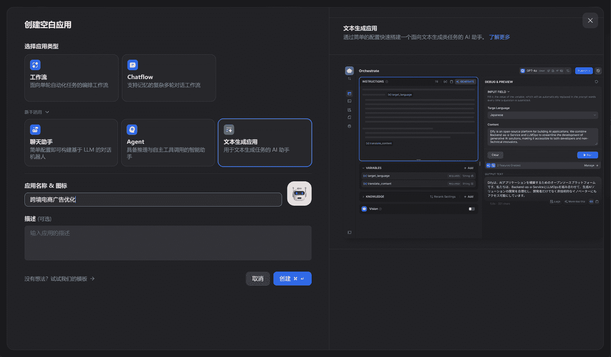

### 3.2 应用结构设计

**应用类型**：文本生成应用（Text Generator）

**变量设计（推荐）**：

+ `original_copy`（段落，必填）：原始广告文案或商品描述。

+ `target_lang`（下拉，必填）：目标语言（如 en-US、zh-CN、de-DE）。

+ `platform`（下拉，必选）：广告投放平台（Facebook / Google / TikTok / Instagram / LinkedIn）。

+ `tone`（下拉，可选）：语气（friendly / professional / humorous / concise / persuasive）。

+ `num_versions`（数字，可选）：输出多少个优化版本（默认 3 个）。

### 3.3 提示词模板

```
你是一名资深广告优化专家，专注于跨境电商与在线广告投放。请根据以下要求，生成优化后的广告文案：

输入文案：
{{original_copy}}

基本要求：
1) 输出语言：{{target_lang}}。
2) 投放平台：{{platform}}（请严格遵循该平台的常见文案风格与限制）。
   - Facebook/TikTok/Instagram：简短、吸睛，带情绪化表达，适合年轻群体。
   - Google Ads/LinkedIn：专业、信息清晰，强调价值点和信任感。
3) 语气风格：{{tone}}（如未指定，则保持中性专业风格）。
4) 输出数量：{{num_versions}} 个版本。
5) 每个版本请编号，避免重复，保持差异化。
6) 不得编造虚假信息，不得使用违规敏感词。

请直接输出优化后的广告文案。
```

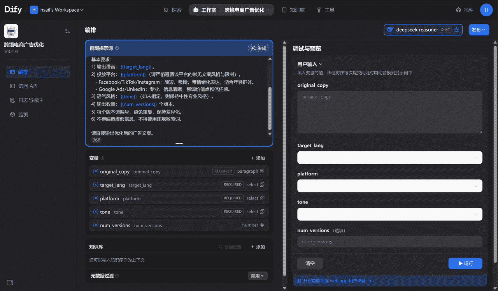

### 3.4 单次运行示例

**输入**：

+ `original_copy`：

+ Introducing the new Noise Cancelling Headphones with 30 hours battery life, designed for work, travel, and ultimate focus.

+ `target_lang`：en-US

+ `platform`：Facebook

+ `tone`：friendly

+ `num_versions`：3

**输出（示例）**：

1. “Silence the world, enjoy your music 🎧 — 30 hours of pure focus wherever you go.”

2. “Work smarter, travel lighter. 30-hour noise-cancelling headphones built for your lifestyle.”

3. “Stay in your zone. Noise-free, stress-free, 30 hours nonstop.”

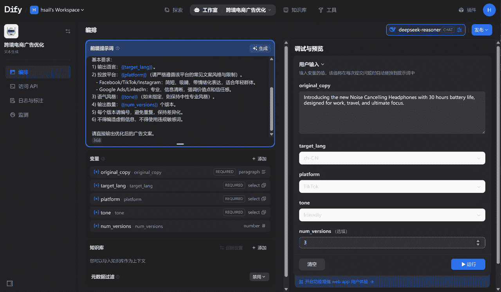

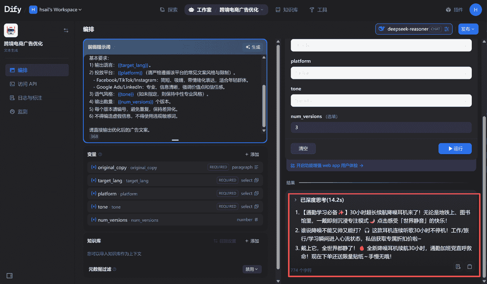

### 3.5 批量运行：多广告文案优化

1. 准备 CSV：

```
original_copy,target_lang,platform,tone,num_versions
&quot;Introducing the new Noise Cancelling Headphones with 30 hours battery life...&quot;,en-US,Facebook,friendly,3
&quot;轻薄高效的笔记本电脑，搭载最新 i7 处理器，适合商务与学习。&quot;,en-US,LinkedIn,professional,2
&quot;Smartwatch with GPS and heart rate monitor, designed for fitness lovers.&quot;,de-DE,Google,persuasive,3
```

2. 上传至 **批量运行**，即可一次性生成多平台、多语言、多风格的广告文案。

3. 导出 CSV，直接用于 **广告投放系统**。

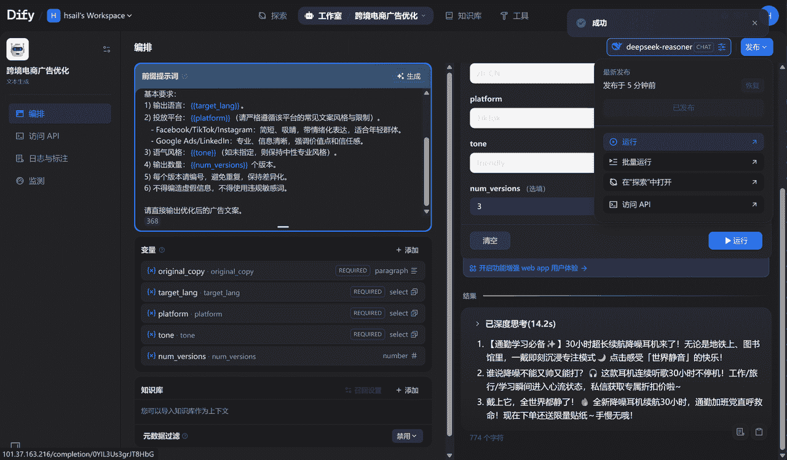

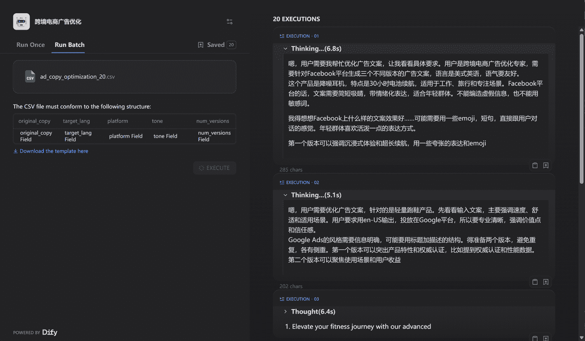

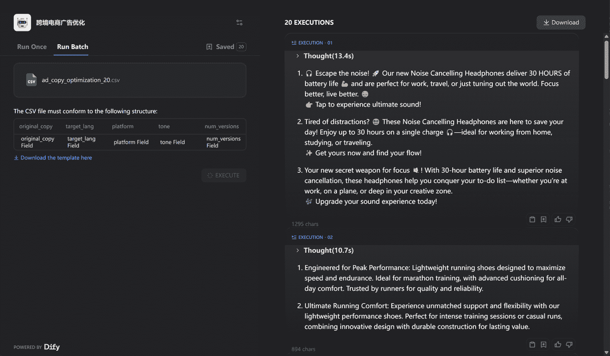

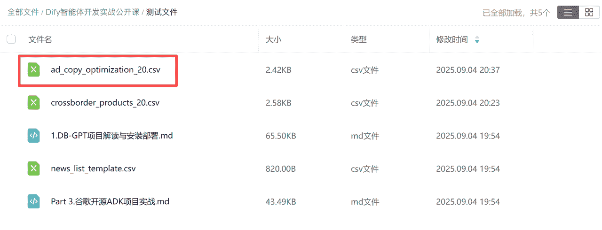

## 4. 创意写作类应用开发

### 4.1 使用场景与业务价值

在内容产业和数字营销领域，创意文案和故事脚本是企业获取用户注意力和塑造品牌形象的关键。例如：

+ 短视频平台（抖音/TikTok/YouTube Shorts）：品牌需要大量创意脚本，适配不同产品与节日活动。

+ **品牌故事营销**：通过讲故事的方式传达品牌价值观，增强用户情感认同。

+ **影视/游戏行业**：辅助编剧生成分镜脚本、对白设计和剧情创意，提升前期策划效率。

+ **广告与公关**：快速生成带有叙事性的广告内容，形成差异化竞争。

**业务痛点**：

+ 人工创意效率低，内容需求量大；

+ 很多场合需要多风格、多版本脚本以便测试；

+ 不同品牌/产品需要保持一致的核心价值观与风格基调。

**目标**：

搭建一个“创意写作助手”，能根据产品/品牌信息，自动生成多风格创意文案或短视频脚本，并支持批量运行和 API 调用。（企业级示例：短视频脚本生成与品牌故事创作）

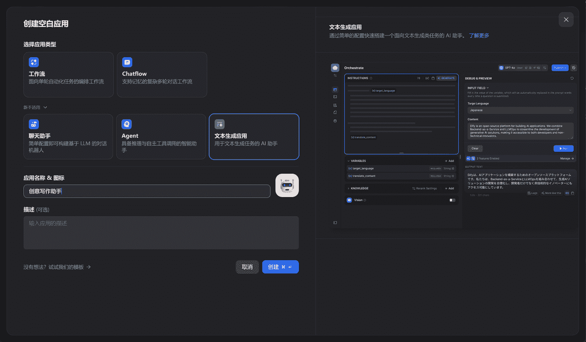

### 4.2 应用结构设计

**应用类型**：文本生成应用（Text Generator）

**变量设计（推荐）**：

+ `theme`（文本，必填）：创意主题（如“环保节能”或“母亲节礼物”）。

+ `brand_info`（段落，必填）：品牌或产品的背景信息（核心卖点、价值观、目标用户）。

+ `format_type`（下拉，必填）：生成形式（短视频脚本 / 广告文案 / 品牌故事 / 分镜脚本）。

+ `tone`（下拉，可选）：风格（幽默 / 温情 / 专业 / 激励 / 年轻化）。

+ `num_versions`（数字，可选）：输出几个不同创意版本（默认 2 个）。

### 4.3 提示词模板（可直接复制）

```
你是一名专业的创意文案策划与故事编剧，请根据以下输入信息，生成符合要求的创意内容：

创意主题：{{theme}}
品牌信息：{{brand_info}}
输出形式：{{format_type}}
风格要求：{{tone}}
输出数量：{{num_versions}}

规则：
1) 每个输出内容必须围绕主题展开，并充分结合品牌信息。
2) 如果 format_type=短视频脚本，则需包含：开场镜头 → 对白/旁白 → 结尾行动号召。
3) 如果 format_type=品牌故事，则需包含故事起承转合，传递品牌价值。
4) 如果 format_type=广告文案，则需简洁有力，适合投放场景。
5) 不得编造品牌未提供的信息，不得涉及违规内容。
6) 请编号输出，保证每个版本风格有差异化。
```

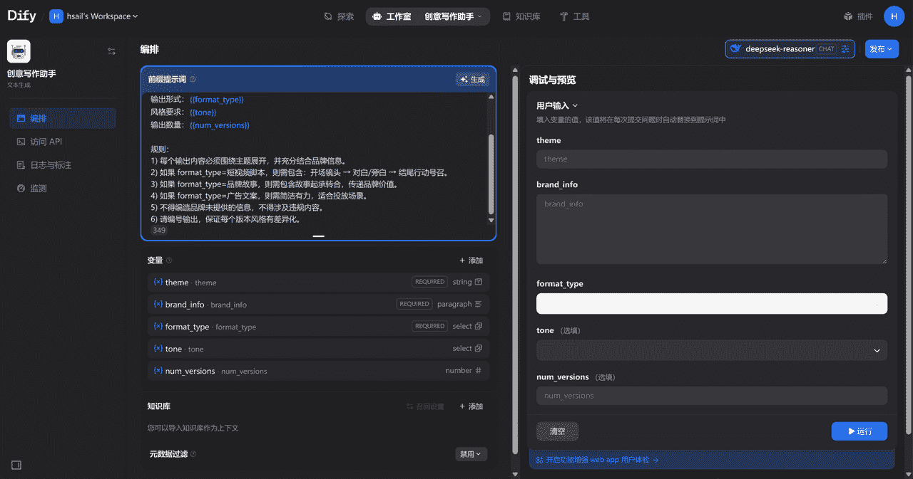

### 4.4 单次运行示例

**输入**：

+ `theme`：环保节能

+ `brand_info`：某家电品牌，主打节能冰箱，目标群体为年轻家庭用户，品牌理念是“绿色生活，从家开始”。

+ `format_type`：短视频脚本

+ `tone`：温情

+ `num_versions`：2

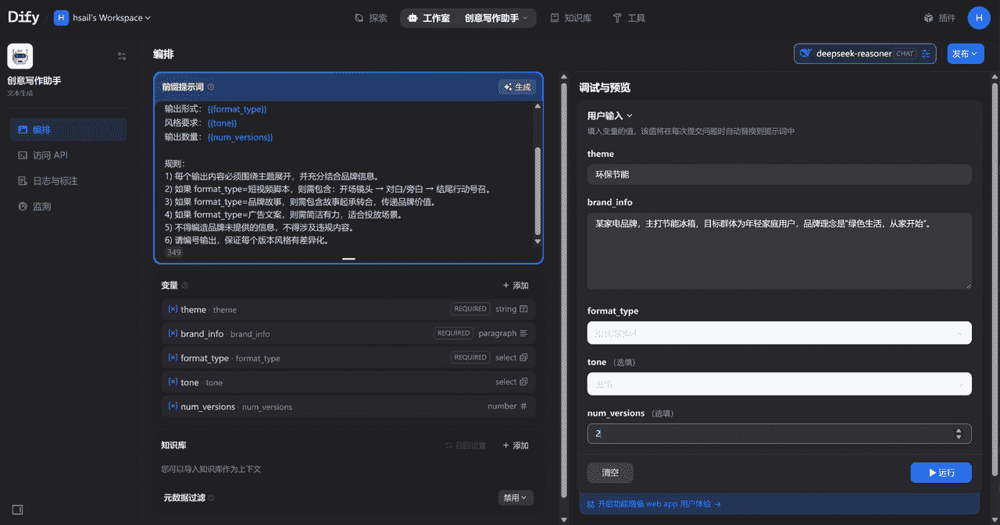

```
版本一：传承的承诺

风格差异化： 侧重于代际传承与家庭责任，情感更为厚重和深远。
开场镜头： 温暖的傍晚，一家三口的剪影坐在阳台上看日落。爸爸（约30岁）抱着女儿（约5岁），妈妈（约28岁）微笑着看着他们。家里的灯光温暖而柔和。
对白/旁白：
（女儿稚嫩的声音，指着天空）爸爸，太阳下山了，是回家睡觉了吗？
（爸爸温柔地）是呀，它也要休息一下，明天才能继续发光发热，把温暖送给我们。
（镜头转向厨房，品牌节能冰箱静静运作，指示灯柔和亮起）
（妈妈画外音，温柔坚定）我们也想把这份温暖，留得更久一点。为我们的家，也为我们孩子的世界。
（镜头展示冰箱内部井然有序，保鲜的蔬菜水果色彩鲜亮）
（爸爸画外音）选择【品牌名称】节能冰箱，是用今天的智慧，守护明天的美好。它默默省下的每一度电，都是我们对未来的一份小小承诺。
结尾行动号召： 镜头拉回，一家三口依偎在一起。屏幕上出现品牌Logo和标语：“【品牌名称】，以节能科技，守护家的未来。绿色生活，从家开始。”
```

```
版本二：无声的陪伴

风格差异化： 侧重于产品作为家庭无声成员的陪伴感，更生活化、细腻。
开场镜头： 清晨的阳光透过窗户洒进厨房。妈妈正在准备早餐，爸爸端着咖啡看新闻，孩子睡眼惺忪地走过来抱住妈妈的腿。一切都充满了生活气息。
对白/旁白：
（轻快的背景音乐，混合着清晨细微的环境音）
（妈妈温柔地对孩子说）宝贝醒啦？牛奶马上就好哦。
（妈妈自然地打开冰箱取出鲜奶，冰箱运行声音极低，几乎听不见）
（温情男声旁白）家的温暖，藏在每一个清晨和深夜。而【品牌名称】节能冰箱，就像一位安静的守护者。
（镜头特写冰箱上的能效标识，以及冰箱内食物长久保鲜的状态）
（旁白继续）它默默运作，极致节能，为你节省开支，也为地球减少负担。长久陪伴，新鲜不减，爱更不散。
结尾行动号召： 妈妈把温好的牛奶递给孩子，一家人相视而笑。画面定格在冰箱上，出现品牌Slogan：“【品牌名称】，节能省电，长久新鲜。绿色生活，就从选择它开始。”
```

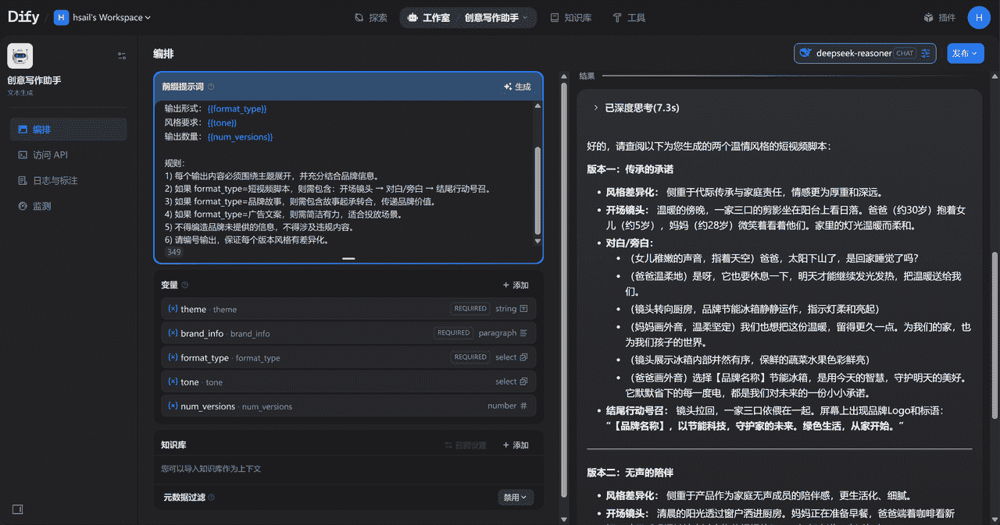

### 4.5 批量运行

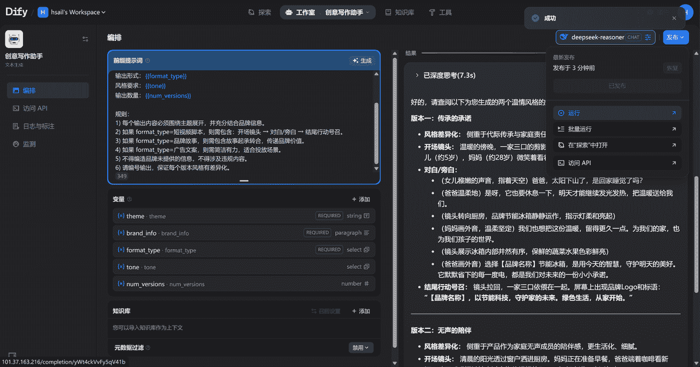

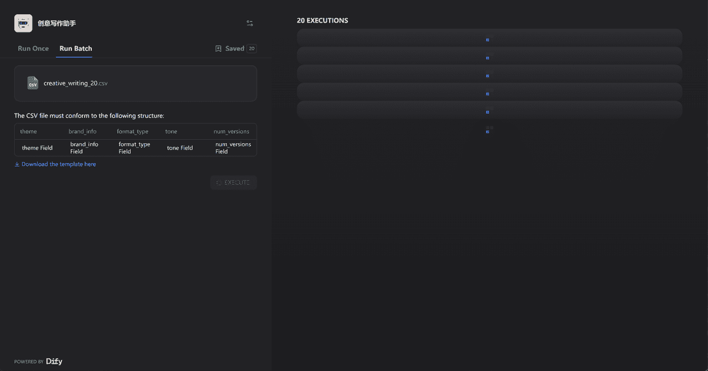

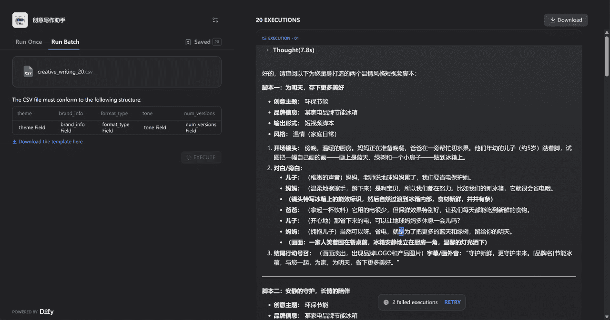

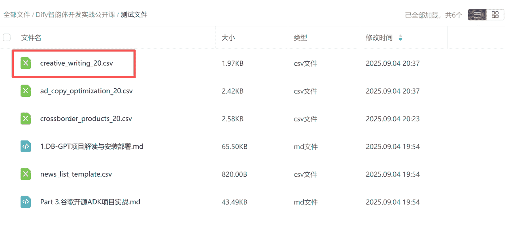


## 5. SEO文章编写类应用开发

### 5.1 使用场景与业务价值

在跨境电商和内容营销领域，SEO（搜索引擎优化）文章是提升自然流量的关键手段。企业需要针对特定关键词（如“best noise cancelling headphones 2025”、“eco-friendly refrigerators for small apartments”）持续产出长尾内容。【企业级示例：跨境电商长尾关键词批量文章生成】

**业务痛点**：

+ SEO 团队往往需要大量文章，但人工写作效率低；

+ 不同关键词需要不同的结构和写作风格；

+ 企业希望文章批量生成，同时保持品牌一致性与合规性。

**目标**：

用 Dify 搭建一个“SEO文章助手”，能够：

1. 根据指定关键词，自动生成结构清晰、SEO 友好的长文；

2. 自动包含标题、分段小标题、关键词密度控制；

3. 支持多语言生成，覆盖不同市场；

4. 支持批量运行，一次性生成几十篇文章；

5. 可通过 API 对接 CMS 系统，实现自动发布。

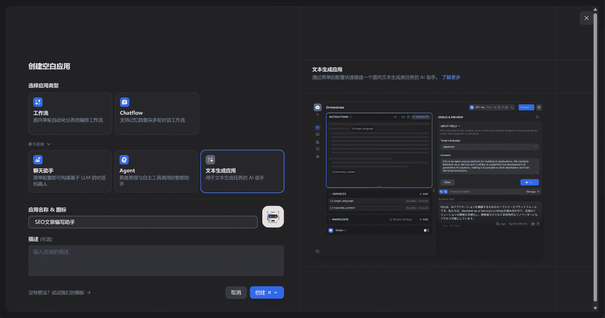

### 5.2 应用结构设计

**应用类型**：文本生成应用（Text Generator）

**变量设计（推荐）**：

+ `keyword`（文本，必填）：目标关键词。

+ `target_lang`（下拉，必填）：目标语言（如 en-US / zh-CN / de-DE）。

+ `tone`（下拉，可选）：语气风格（informative / persuasive / casual / professional）。

+ `word_count`（数字，可选）：文章长度（默认 800 ~ 1200 字）。

+ `num_versions`（数字，可选）：输出文章数量（默认 1 篇）。

### 5.3 提示词模板

```
你是一名专业的SEO写作专家，请根据以下输入信息生成SEO优化文章：

目标关键词：{{keyword}}
语言：{{target_lang}}
语气：{{tone}}
文章长度：约 {{word_count}} 字
输出数量：{{num_versions}}

写作要求：
1) 标题中必须包含关键词。
2) 文章需有引言、分段小标题和总结。
3) 在正文中自然地重复关键词 2-4 次，不要堆砌。
4) 使用简洁明了的语言，符合目标受众的阅读习惯。
5) 每个小标题都应包含与关键词相关的扩展表达。
6) 输出格式为 Markdown，包含 H2/H3 标题，便于直接发布到网站。
7) 内容必须原创，不得抄袭，不得包含虚假信息。
```


### 5.4 单次运行示例

**输入**：

+ `keyword`：best noise cancelling headphones 2025

+ `target_lang`：zh-CN

+ `tone`：informative

+ `word_count`：1000

+ `num_versions`：1

输出片段

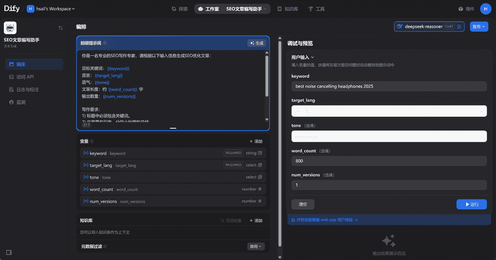

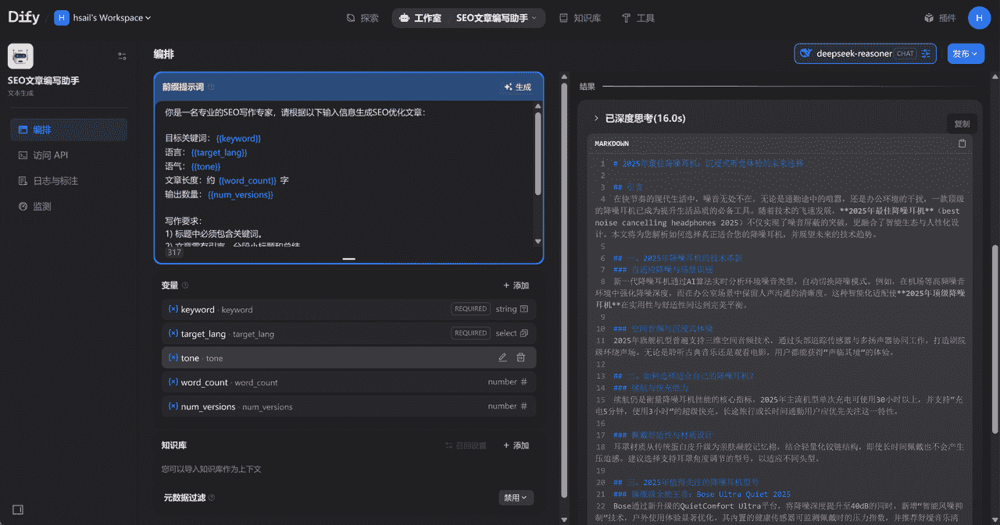


# 2025年最佳降噪耳机：沉浸式听觉体验的未来选择

## 引言

在快节奏的现代生活中，噪音无处不在。无论是通勤途中的喧嚣，还是办公环境的干扰，一款顶级的降噪耳机已成为提升生活品质的必备工具。随着技术的飞速发展，2025年最佳降噪耳机（best noise cancelling headphones 2025）不仅实现了噪音屏蔽的突破，更融合了智能生态与人性化设计。本文将为您解析如何选择真正适合您的降噪耳机，并展望未来的技术趋势。

## 一、2025年降噪耳机的技术革新

### 自适应降噪与场景识别

新一代降噪耳机通过AI算法实时分析环境噪音类型，自动切换降噪模式。例如，在机场等高频噪音环境中强化降噪深度，而在办公室场景中保留人声沟通的清晰度。这种智能化适配使2025年顶级降噪耳机在实用性与舒适性间达到完美平衡。

### 空间音频与沉浸式体验

2025年旗舰机型普遍支持三维空间音频技术，通过头部追踪传感器与多扬声器协同工作，打造剧院级环绕声场。无论是聆听古典音乐还是观看电影，用户都能获得“声临其境”的体验。

## 二、如何选择适合自己的降噪耳机？

### 续航与快充能力

续航仍是衡量降噪耳机性能的核心指标。2025年主流机型单次充电可使用30小时以上，并支持“充电5分钟，使用3小时”的超级快充。长途旅行或长时间通勤用户应优先关注这一特性。

### 佩戴舒适性与材质设计

耳罩材质从传统蛋白皮升级为亲肤凝胶记忆棉，结合轻量化铰链结构，即使长时间佩戴也不会产生压迫感。建议选择支持耳罩角度调节的型号，以适应不同头型。

## 三、2025年值得关注的降噪耳机型号

### 旗舰级全能王者：Bose Ultra Quiet 2025

Bose通过新升级的QuietComfort Ultra平台，将降噪深度提升至40dB的同时，新增“智能风噪抑制”技术，户外使用体验显著优化。其内置的健康传感器可监测佩戴时的压力指数，并推荐舒缓音乐清单。

### 高性价比之选：Sony WH-1000XM6

索尼在XM5基础上进一步优化降噪处理器算力，搭载V2集成芯片与8麦克风系统，通话清晰度提升50%。轻量化机身（仅238克）与折叠结构设计，成为通勤族的理想选择。

## 总结

选择2025年最佳降噪耳机（best noise cancelling headphones 2025）时，需综合考量降噪技术、续航能力、佩戴体验及生态兼容性。未来降噪耳机将不再仅是音频设备，更是融合健康监测、智能交互的个人终端。投资一款适合自己的顶级降噪耳机，无疑是拥抱高品质生活的明智之举。

> 提示：购买前建议通过实体店试戴，确保耳罩结构与头型匹配，最大限度发挥降噪性能。

## 5.5 批量运行：长尾关键词文章生成

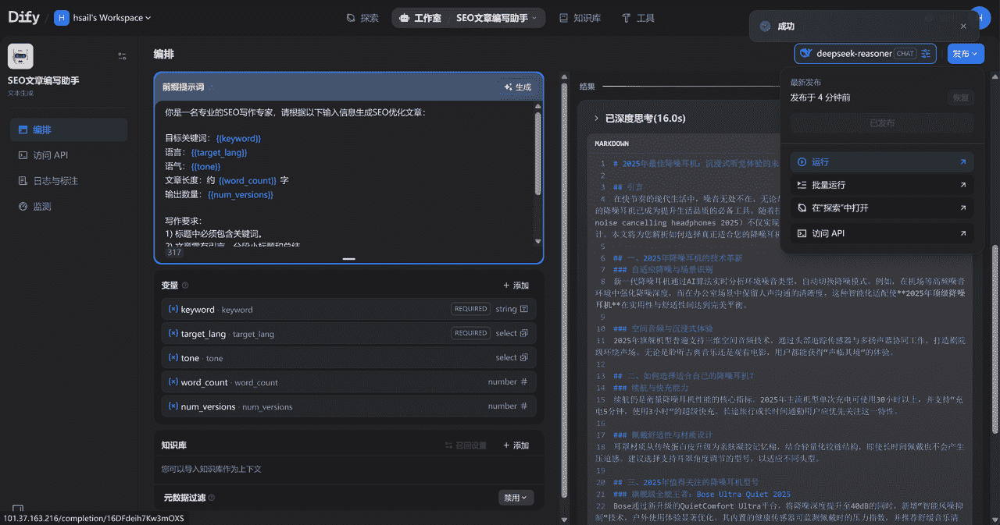

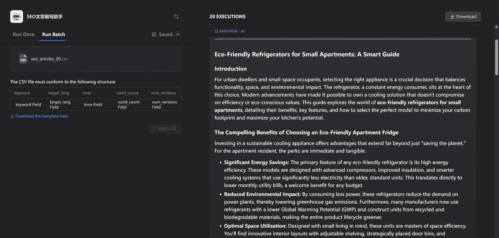

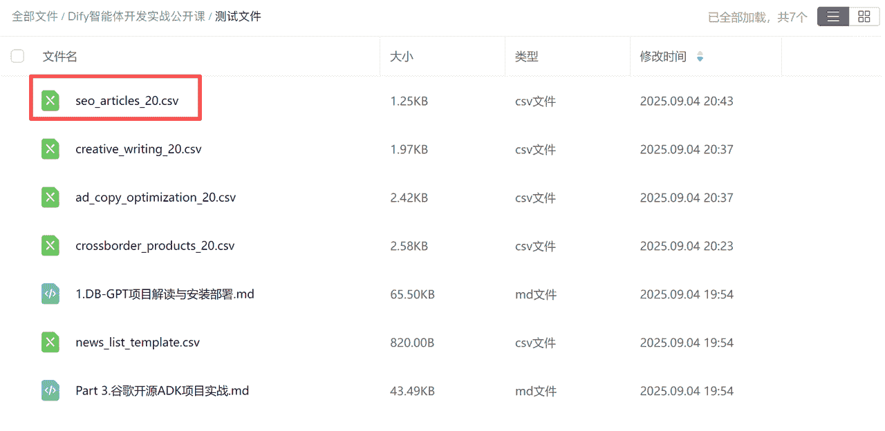

# 二、Dify Agent应用开发实战

## 1. Dify Agent 开发基本流程

### 1.1 Agent 是什么？与“聊天助手”有什么不同

`Agent` 的本质是：让大模型具备“自主分解任务 + 挑选并调用工具 + 多步推理”的能力。它可以自己设定子目标、按步骤执行外部工具，直到完成任务为止。

在 Dify 里，Agent 的推理/工具调用主要有两种策略：

`Function Calling`（模型原生函数调用，稳定性更好，推荐 `GPT-4`/类似系列）；

`ReAct`（思维链 + 工具行动的范式，兼容不支持函数调用的模型）。你还可设置 最大迭代步数 等。

与“聊天助手”相比，`Agent` 的核心差异是“工具编排与自动调用”。你不仅能挂载知识库提供事实支撑，还能对接网络搜索、代码执行、RPA、企业系统 API 等各种工具。

### 1.2 Dify 对于 Agent 开发的功能支持

`Dify` 在 `Agent` 开发方面提供了一整套高度集成的能力，降低了复杂度，让开发者可以专注于 `Agent` 的逻辑与场景设计，而不必纠结于底层工程实现。其主要支持体现在以下几个方面：

#### 多模型兼容

支持 `OpenAI`、`Anthropic`、`DeepSeek`、`Azure OpenAI`、`Hugging Face`、`Replicate` 等多种模型服务。

可灵活切换和对比不同模型的推理效果，适配 `Function Calling` 或 `ReAct` 推理范式。

#### 可视化开发流程

在 `Dify` 的工作区界面中，开发者无需手写大量代码，只需编写少量 指令（`Prompt`），即可通过拖拽式界面完成工具添加、知识库挂载、`Agent` 参数配置等操作。

配合「调试与预览」功能，可以实时测试 `Agent` 的工具调用与输出效果。

#### 工具生态支持

+   **内置工具**：时间、代码解释器、网页抓取、音频处理等，开箱即用；

+   **工具市场**：提供了 `Google`、`GitHub`、`Bing`、`Perplexity` 等常见工具，点击即可安装；

+   **自定义工具**：支持通过 `OpenAPI`、`Swagger`、`OpenAI Plugin` 标准快速接入企业内部 API；

+   **MCP 工具**：兼容新一代 `Model Context Protocol`，可直接将企业已有的 `MCP` 服务接入 `Dify`。

#### 知识库集成

除了工具调用，`Agent` 还能挂载企业文档、数据库、`FAQ` 等知识库作为上下文，使回答更具事实性。

支持混合检索与 `Rerank` 模型，提升多知识库场景下的匹配准确度。

#### 自动部署与接口支持

每个 `Agent` 应用在发布后都会自动生成 Web 前端界面（可直接使用对话功能）以及 后端 API（`RESTful` 接口）。

企业可以轻松将 `Agent` 融入现有业务系统或产品中，避免重复开发。

#### 运维与监控能力

提供运行日志、工具调用日志、`Token` 消耗监控等功能。

企业可以随时追踪 `Agent` 的使用情况，优化提示词或工具调用策略。

综合来看，`Dify` 为 `Agent` 开发提供了从 开发 → 调试 → 部署 → 运维 的全链路支持，使其成为一款真正的 低代码 `Agent` 平台。这意味着即便是非专业开发人员，也能在短时间内搭建起一个功能完善的 `Agent`；而对企业开发团队而言，`Dify` 则能大幅降低开发和运维成本，加快智能应用的落地速度。

### 1.3 从零到一快速搭建 `Dify Agent`

在这一小节里，我们将从零开始，带大家完成一个完整的 `Dify Agent` 应用开发流程。目标是创建一个可以回答时间相关问题的 `Agent`，并在 Web 前端运行体验。我们会用到 `Dify` 自带的 `时间工具`（`Time Tool`），它包含了时区转换、时间戳转换、星期几计算器、获取时间戳、获取当前时间等多个子功能。

#### 第一步：新建 `Agent` 应用

1. 在 `Dify` 工作区点击「创建应用」→ 选择 `Agent` 应用。

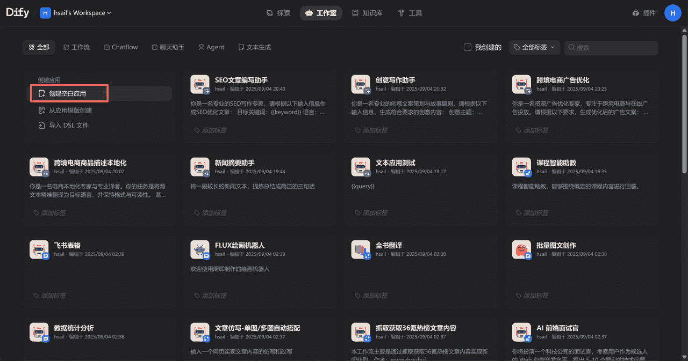

1. 在应用名称中输入“时间查询 `Agent`”，描述填写“一个可以回答时间和日期问题的智能助手”。

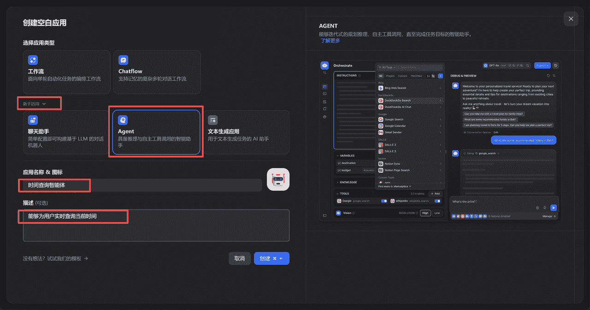

1. 模型选择一个通用对话模型（如 `deepseek-reasoner` 或 `gpt-5-chat-latest`），保持默认即可。

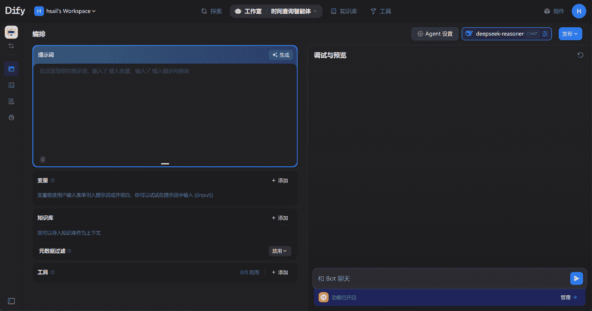

#### 第二步：编写指令（`Prompt`）

在「指令」区域输入以下内容：

```
你是一个智能时间助理，可以帮助用户进行时间和日期的计算与查询。  
你可以调用内置的【时间工具】，完成以下任务：  
1. 获取当前时间  
2. 将一个时间转换为时间戳，或将时间戳转回标准时间  
3. 判断某个日期是星期几  
4. 在不同时区之间进行时间转换  

当用户提问时，请先判断用户需求，必要时调用合适的工具，并将工具结果结合自然语言回答。  
```

这段提示词明确告诉 `Agent` 什么时候调用工具、如何整合结果，避免模型光聊天不调用工具。

#### 第三步：添加时间工具

1. 点击「工具」→「选择工具」→ 在内置工具中选择 `时间`（`Time`）。

1. 勾选所有子工具：

+   `时区转换`

+   `时间戳转换`

+   `星期几计算器`

+   `获取时间戳`

+   `获取当前时间`

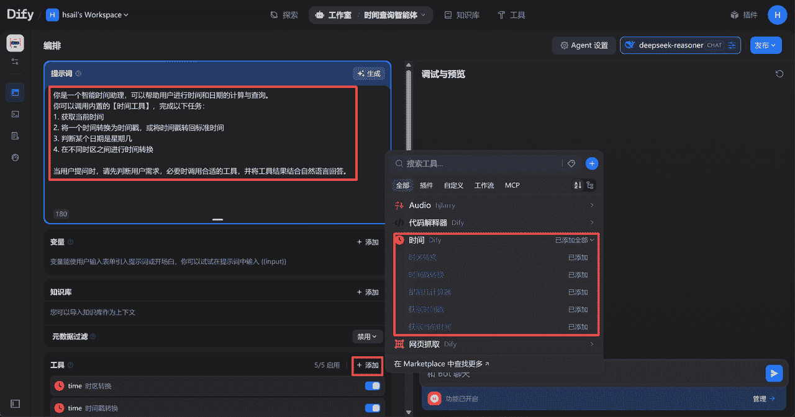

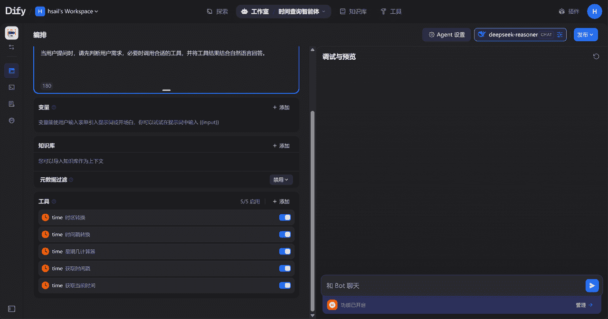

#### 第四步：运行测试

1. 在右侧的「调试与预览」区域输入以下测试问题：

+   “请问现在北京时间是几点？”

+   “2025年9月8日是星期几？”

+   “请帮我把 2025-09-08 14:00 北京时间转换为纽约时间。”

+   “把时间 2025-09-08 08:00 转换为时间戳。”

1. 观察 `Agent` 是否调用了时间工具，并把调用结果自然地整合到回答中。

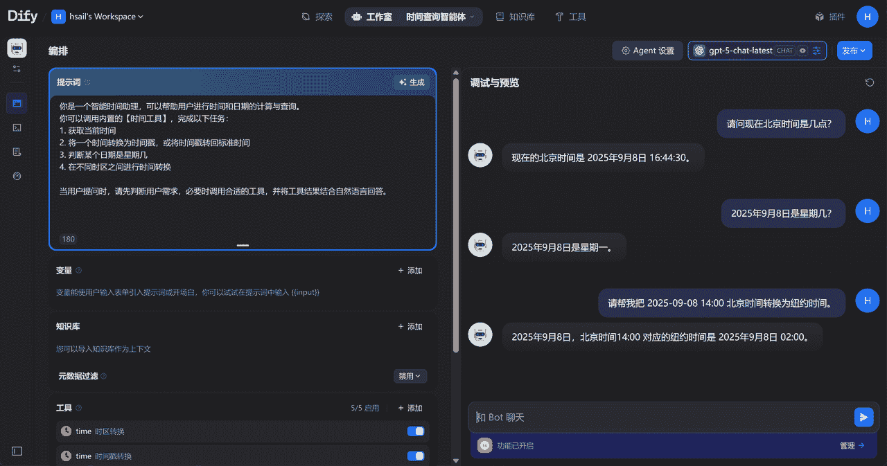

#### 第五步：查看调用工具记录

此外，基于 `Dify` 完整的功能生态，我们还可以查看每次对话的工具调用记录：


能够看出，单次调用工具的流程就是完整的 `Function calling` 流程。

同时，`Dify` 内置工具本质上是一个 `React Agent`，能够完成多工具并发调用和多步调用工具流程。


#### 第六步：发布应用并体验

1. 点击右上角的 发布 按钮。

1. 系统会自动完成部署，你可以在 Web 前端 打开应用，体验对话。

1. 在 Web 界面再次输入一些时间问题，验证 `Agent` 是否能够自动调用工具返回结果。


通过以上步骤，我们就完成了一个最小可用的 `时间查询 Agent`。这个案例展示了 `Agent` 从创建 → 提示词设计 → 工具接入 → 调试 → 发布的完整闭环流程。

### 1.4 `Dify Agent` 基本设置

`Dify Agent` 默认是 `React Agent`，并且在进行工具调用过程中最多允许进行 10 次迭代：


而默认的对于所有模型均适用的提示词模板翻译如下：

```
**提示词**
请尽可能有帮助且准确地回答用户。

{{instruction}}

你可以使用以下工具：

{{tools}}

使用一个 JSON 对象来指定要调用的工具，其中包含 {{TOOL_NAME_KEY}} 键（工具名称）和 {{ACTION_INPUT_KEY}} 键（工具输入）。
合法的 "{{TOOL_NAME_KEY}}" 值为："Final Answer" 或 {{tool_names}}

每个 $JSON_BLOB 中只能包含 **一个** action，格式如下：

{

"{{TOOL_NAME_KEY}}": $TOOL_NAME,

"{{ACTION_INPUT_KEY}}": $ACTION_INPUT

}

请遵循以下格式：

Question: 输入的问题
Thought: 考虑前后步骤
Action:

$JSON_BLOB

Observation: 动作结果
...（重复 Thought/Action/Observation N 次）
Thought: 我知道应该如何回答
Action:

{

"{{TOOL_NAME_KEY}}": "Final Answer",

"{{ACTION_INPUT_KEY}}": "最终给用户的回答"

}

开始！请务必记住：**始终返回一个合法的 JSON 对象，且每次只包含一个 action**。如有需要请使用工具，如果合适则可直接回答。格式为：
Action:`$JSON_BLOB`
然后 Observation:.
```

模板的运行逻辑大致如下：

1. **Question（问题）**：记录用户的原始输入。

1. **Thought（思考）**：模型需要展示它的推理过程，说明当前要采取什么行动。

1. **Action（动作）**：当模型决定调用工具时，必须用一个严格符合 JSON 格式的对象来表示调用请求，其中包含：

+   `{{TOOL_NAME_KEY}}`：所使用的工具名称（比如 `Final Answer` 或其他工具名）；

+   `{{ACTION_INPUT_KEY}}`：传递给工具的输入内容。

1. Observation（观察结果）：展示工具返回的结果。

1. **循环执行**：如果一个工具调用不足以得到最终答案，则模型会继续执行 Thought → Action → Observation 的循环，直到获取完整信息。

1. `Final Answer`（最终回答）：最后，模型必须返回一个包含 `"Final Answer"` 的 JSON 对象，将最终结果传递给用户。

这种模板的最大特点是：

+   **格式统一**：不论调用什么工具，调用格式始终是 JSON，方便解析。

+   **过程透明**：`Thought`/`Action`/`Observation` 的交替让推理过程可追踪，便于调试和监控。

+   **强制约束**：要求模型“每次只输出一个 action”，避免模型在一个回答里乱用多个工具，保证流程稳定。

因此，这个提示词模板不仅是一个“写法规范”，更是保证 `Agent` 工具调用稳定性和可控性的核心机制。在实际开发中，所有基于 `ReAct` 或工具调用的 `Agent` 都可以复用这一结构，只需要替换其中的工具列表和业务逻辑即可。

### 1.5 更多基于内置工具创建 `Agent` 示例

完成了第一个“时间查询 `Agent`”之后，我们已经对开发流程有了直观认识。接下来我们可以更轻量地尝试其他内置工具，快速搭建不同类型的小型 `Agent`：

### 示例一：代码解释器 `Agent`

工具：选择 `代码解释器`（`Code Interpreter`）。

指令：

```
你是一个专业的代码解释助理，能够帮助用户进行计算、代码编写与调试。  
你必须优先调用 `simple_code` 来完成涉及数学运算、数据处理或编程相关的问题，  
并将执行结果用自然语言解释给用户。  

具体规则：  
1. 如果用户提出数学运算问题（如乘法、大数计算、函数计算），请调用代码解释器进行计算。  
2. 如果用户要求编写或运行代码，请用 `Python` 编写代码，并通过代码解释器执行。  
3. 返回结果时，请用简洁的语言解释运行结果，并在必要时展示部分关键代码。  
4. 如果用户请求不涉及计算或编程，请直接回答，不调用工具。  
```

测试：输入“计算 1543 * 27 等于多少？”或“写一段 `Python` 代码，打印斐波那契数列前 10 项”。


### 示例二：网页抓取 `Agent`

工具：选择 `网页抓取`（`Web Scraper`）。

指令：

```
你是一个网络信息分析助理，可以帮助用户从网页中抓取信息并进行总结。  
你必须在需要时调用 `webscraper` 工具，从指定 URL 中获取网页内容。  

具体规则：  
1. 如果用户输入了一个网址，请调用网页抓取工具获取该网页的主要文本内容。  
2. 抓取后，请对网页内容进行总结，输出要点或核心信息。  
3. 如果用户没有提供网址，请提醒用户提供一个有效的 URL。  
4. 如果抓取结果过长，请只保留前 1000 字并进行概括。  
```

测试：输入“帮我抓取并总结 `https://docs.dify.ai/zh-hans/introduction` 的主要内容”。


### 示例三：语音转换 `Agent`

工具：选择 `Audio`（`Text To Speech` / `Speech To Text`）。

指令：

```
你是一个智能语音助手，可以帮助用户在文字和语音之间进行转换。  
你必须根据用户请求调用【`Audio`】工具中的相关功能。  

具体规则：  
1. 如果用户提供了语音文件，请调用 `asr` 将其转换为文字。  
2. 如果用户输入了文字，并要求转为语音，请调用 `tts` 工具。  
3. 如果用户没有明确请求转换，请提示用户输入“请将文字转语音”或“请将语音转文字”。  
```

测试：输入“请把这句话转换成语音：我创建了一个语音转换 `Dify Agent`！”


## 2. Dify Agent工具生态介绍

### 2.1 工具对于 Agent 开发的重要性

在传统的大语言模型对话中，模型本身只能依赖已有的参数知识来生成答案，一旦涉及到 实时数据、外部计算或特定业务场景，模型就会显得力不从心。

而 `Agent` 的本质，就是通过 `工具调用（Tool Use）` 来突破模型的固有限制，使其能够：

+   实时访问外部信息（如网页抓取、搜索引擎、`API` 接口）；

+   完成逻辑严谨的计算（如代码解释器、数学计算、数据处理）；

+   调用企业内部服务（如 `CRM`、数据库、知识库、监控系统）；

+   扩展多模态能力（如语音识别、图像生成、视频处理）。

换句话说，工具就是 `Agent` 的“手脚”，决定了它能完成什么任务。没有工具的 `Agent`，只是一个“会聊天的大模型”；而接入了工具的 `Agent`，才能真正成为 具备行动力的智能体。

### 2.2 Dify 工具生态的价值

Dify 在工具生态上的设计，充分考虑了 易用性与可扩展性：

1. 内置工具：开箱即用，例如时间、网页抓取、代码解释器、音频处理等。

1. 工具市场（`Marketplace`）：官方与社区提供的第三方工具，一键安装即可调用，覆盖搜索引擎、图像生成、数据处理、企业软件等多个方向。

1. 自定义工具：开发者可以通过 `OpenAPI`、`Swagger` 或 `REST API` 快速接入自有服务。

1. `MCP` 工具：支持新一代 `Model Context Protocol`，可直接接入符合 `MCP` 标准的 `HTTP` 服务。

对开发者而言，Dify 工具生态的最大好处就是：

+   无需重复造轮子，很多常见能力已经有人做成插件；

+   快速实验和验证，通过拖拽式配置和提示词绑定即可调用；

+   便于扩展，企业可在市场工具之外，接入自有内部系统。

### 2.3 Dify 工具市场热门工具介绍


在 Dify 工具市场中，开发者可以访问到数十种来自官方与社区的工具。这些工具不仅覆盖了搜索、图像生成、数据处理等常见需求，还包含了开发、协作、数学计算等专业功能。主要分类及代表性工具如下：

+   搜索引擎类

+   `Google`：提供全球最权威的搜索结果，适用于新闻资讯、产品信息、科研文献等实时信息查询。

+   `Bing`：微软的搜索引擎，结果更加偏向商业与技术领域，在企业应用中常用于产品对比与市场调研。

+   `DuckDuckGo`：强调隐私保护，适合对数据安全敏感的企业。

+   `Perplexity`：新兴的问答型搜索引擎，结合 AI 技术，能够快速生成简洁的答案，特别适合摘要与趋势分析。

+   `ArXiv`：全球知名的学术论文数据库，科研机构或 AI 公司可以直接接入，第一时间获取最新的学术进展。

+   图像生成类

+   `Azure DALL·E`：微软 `Azure` 上的 `DALL·E` 服务，支持从文本生成高质量图片，适合电商、广告、设计公司生成宣传物料。

+   `Stable Diffusion` / `ComfyUI`：开源社区最热门的图像生成模型，支持高自由度的图像创作和本地部署。企业常用于广告创意、游戏美术。

+   `Stability`（`Stability AI` 提供）：更强调可扩展性和企业级 `API` 接口，适合 SaaS 企业接入。

+   `SiliconFlow` / `getimg.ai`：云端 `API` 图像生成服务，部署简单，适合需要快速上线图像生成应用的开发者。

+   数据与处理类

+   `Jina AI`：专注于搜索和多模态数据处理，支持构建 `RAG`（检索增强生成）系统。企业常用于知识库问答或语义检索。

+   `Firecrawl`：高效的网页抓取与结构化工具，可以批量爬取并清洗网页内容，用于市场调研与电商价格监控。

+   `JSON` 处理 / 正则表达式工具：帮助 `Agent` 在处理复杂数据时，快速解析与提取信息，是数据管道搭建中常见的“基础工具”。

+   `Spider`：返回可供大模型直接使用的结构化数据，特别适合“AI+数据分析”场景。

+   开发者类

+   `GitHub`：可直接调用 `GitHub API`，用于获取代码库、提交 issue、代码搜索等功能，是 AI 编程助手的常见工具。

+   `DevDocs`：一个轻量级开发文档查询工具，方便 `Agent` 在代码生成过程中直接查阅 `API`。

+   `Vanna.AI`：文本转 `SQL` 工具，让非技术人员也能通过自然语言直接查询数据库，提升 `BI`（商业智能）能力。

+   `WolframAlpha`：全球领先的知识计算引擎，适合涉及数学、金融、科学计算等精确计算的 `Agent`。

+   通信类

+   `Slack` / `Discord`：集成主流 `IM` 平台，实现企业内部的消息推送与通知，常见于“智能客服”或“企业助理”类 `Agent`。

+   `钉钉` / `企业🛰️`：中国市场的主流企业协作工具，接入后可作为企业智能体的触达渠道，实现任务提醒、日报推送等功能。

+   其他扩展类

+   `Qwen Text2Image`：由阿里巴巴通义千问团队提供的图像生成能力，适合中文语境下的多模态任务。

+   `Nano Banana 文生图`：基于 `OpenRouter` `API` 的多模型接入插件，提供灵活的图像生成功能。

+   `Dify 文本提取器` / `父子文本分块` / `Q&A 处理器`：这些工具更偏向于文本解析与知识库预处理，常被用于企业的知识问答场景中。

#### Dify 内置工具汇总

| 工具类别 | 代表工具 | 功能说明 | 企业级应用场景 |

| --- | --- | --- | --- |

| `搜索引擎` | `Google`, `Bing`, `DuckDuckGo`, `Perplexity` | 获取实时信息、跨平台搜索 | 新闻监测、竞品分析、研究报告收集 |

| `图像生成` | `DALL·E`, `Stable Diffusion`, `ComfyUI`, `SiliconFlow` | 文本生成图像、产品渲染 | 电商产品图生成、广告创意设计 |

| `数据处理` | `Jina AI`, `Firecrawl`, `JSON处理`, `Spider` | 数据抓取、解析、结构化 | 爬取竞品数据、日志分析、信息抽取 |

| `开发辅助` | `GitHub`, `DevDocs`, `WolframAlpha`, `Vanna.AI` | 代码托管、文档查询、数学计算、数据库查询 | 智能研发助手、`SQL` 自动化查询 |

| `通信协作` | `Slack`, `Discord`, `钉钉`, `企业🛰️` | 消息推送、群聊集成 | 客服机器人、智能通知系统 |

| `其他扩展` | `Qwen Text2Image`, `Nano Banana`, `文本提取器` | 多模态能力、文本解析、`Q&A` 优化 | 教育、文档管理、客服 FAQ |

## 3. Dify Agent开发实战一：文生图智能体开发实战

### 3.1 文生图智能体开发基本背景介绍

在大模型与生成式 AI 快速发展的今天，文生图（Text-to-Image） 已成为最具代表性的多模态应用之一。通过简单的自然语言描述，用户即可生成具有特定风格、内容和分辨率的图像。这类应用不仅极大降低了创作的门槛，还在广告营销、产品设计、游戏美术、电商运营等行业中发挥了重要作用。

传统的文生图服务往往需要用户直接调用第三方 `API` 或下载复杂的开源模型（如 `Stable Diffusion`），这对普通开发者和非技术人员来说成本过高。而借助 Dify 的 `Agent` 应用，我们能够把文生图工具直接集成到一个智能体中，用户只需在 `Web` 前端输入需求，即可获得 `AI` 自动生成的图片。更重要的是，借助 Dify 的 `工具调用机制`，智能体可以灵活地调用不同的文生图服务（如 `Nano Banana`、`Qwen Text2Image` 等），根据场景与输入需求进行路由，从而提升生成结果的质量与多样性。

因此，构建一个“文生图智能体”的核心价值在于：

1. 降低使用门槛 —— 用户无需关心底层模型或 `API`，只需自然语言即可完成创作；

1. 支持多工具路由 —— 针对不同语言、风格和任务，`Agent` 可自动选择最优的文生图引擎；

1. 提升企业生产效率 —— 电商设计、广告营销团队可以快速批量生成图像，减少重复劳动；

1. 具备扩展能力 —— 在 Dify 中，文生图智能体可以进一步与知识库、工作流结合，实现“文案生成 + 图片生成”的一体化创意生产流程。

简而言之，文生图智能体不仅仅是一个“`AI` 玩具”，而是真正能够在多模态创意生产和企业级应用中落地的实用工具。

### 3.2 Dify最热门文生图插件介绍与安装

在 Dify 的插件市场中，`Nano Banana` 文生图与 `Qwen Text2Image` 是目前最受欢迎的两款文生图工具。它们均支持将自然语言描述转化为图像，但在底层模型、生成风格和应用场景上各有侧重。


#### 1. Nano Banana 文生图插件


+   功能定位：`Nano Banana` 是 `Google DeepMind` 最新推出的 `AI` 图像生成与编辑模型（代码名：`Gemini 2.5 Flash Image`），现已集成于 `Gemini` 应用、`Google AI Studio` 和 `Vertex AI` 中。它支持从文本生成图像，也擅长在已有图片上进行 多轮局部编辑、背景替换、风格融合、甚至多图合成，实现连续编辑且保留图像一致性。

+   核心特点：

+   一致性优越：无论是改变发型、换背景，还是角色变换，`Nano Banana` 能保持主体一致性，被称为“在不同场景中依然保持你的样子”。

+   性能卓越，响应迅速：速度快，适用于多步交互式编辑；效果逼真、细节丰富、光影对比清晰，具备“`Photoshop` 降级版”的能力。

+   多轮编辑能力：支持用户通过多轮对话完成迭代效果，如修图、构图、风格修改等，形成“逐步深入”的创作流程。

+   广泛生态支持：不仅内置于 `Gemini`，还通过 `OpenRouter` 等途径接入，使得 Dify 也能够通过插件调用这一强大模型。

+   适用场景：电商主图拍摄替代、广告海报、写实风格的品牌宣传图。

> 需要注意，Dify 中的 `Nano Banana 插件` 和 `Google` 发布的 `Nano Banana 模型` 不是两回事，而是上下游关系。

+   `Google` 的 `Nano Banana` 是真正负责图像生成的 `AI` 模型；

+   Dify 的 `Nano Banana 插件` 则是把这个模型“打包”进了 Dify 的工具市场，用户只需安装插件、填入凭据，就能在自己的 `Agent` 中直接调用 `Google` 的 `Nano Banana` 功能。这也是 Dify 工具生态的一大优势：你不必自己对接复杂的 `API`，社区和平台已经替你完成了封装。

#### 2. Qwen Text2Image 插件

+   功能定位：`Qwen Text2Image` 是由 `Qwen` 模型团队 提供的文生图插件，基于 `ModelScope` 平台，尤其擅长处理中文描述和国风、插画类图像生成。

+   核心特点：

+   支持中文提示词的细腻表达，能够理解复杂的中文语境和文化意象；

+   在二次元、国风水墨、插画、动漫等风格表现突出；

+   支持自定义分辨率与风格选择，可通过简单变量控制生成效果。

+   适用场景：国潮文化产品设计、漫画角色创作、教育插画、内容新媒体的视觉配图。


#### 3. 对比总结

+   `Nano Banana` 更适合写实风格、摄影级别的生成需求，偏向国际化和商业摄影类应用；

+   `Qwen Text2Image` 则在中文场景下优势明显，尤其是在二次元、插画、国风类任务上表现出色。

+   在 `Dify` 的 `Agent` 中，两者可以并行集成，通过提示词变量或 `Agent` 的路由逻辑自动选择最优插件，帮助用户获得更贴合需求的生成结果。

| 插件名称 | 支持语言 | 擅长风格 | 亮点功能 | 推荐应用场景 |

| --- | --- | --- | --- | --- |

| `Nano Banana` | 多语言（含英文） | 写实照片、电影质感、连贯编辑 | 多轮编辑、角色一致、快速逼真生成 | 电商摄影、广告、品牌宣传 |

| `Qwen Text2Image` | 中文为主 | 插画、国潮、水墨、二次元 | 精准中文理解、插画风格表现强、参数灵活 | 教育插画、漫画、社交媒体内容 |

#### 4. 插件安装

接下来即可安装这两款插件：


#### Step 1. 准备工作

1. 创建应用：在 Dify 工作区 →「`创建应用`」→ 选择 `Agent` 应用，命名为“文生图智能体”。


1. 选择工具：接下来选择文生图工具，也就是刚刚安装好的 `Nano Banana` 和 `Qwen Text2Image`。


1. `Qwen Text2Image` 插件授权与功能测试：

1. 这两款工具都需要不同的模型 `API-KEY` 进行授权，首先进行 `Qwen Text2Image` 插件 `API-KEY` 授权，需要输入魔搭社区的 `API-KEY`：


1.


1. 需要登陆魔搭社区官方主页，进行注册并获取 `API-KEY`：`https://www.modelscope.cn/my/myaccesstoken`


1. 然后写入 Dify 插件配置列表中：


1. 然后在 `API-KEY` 中选择：


1. 然后选择模型：


1. 然后保存（点击发布）然后刷新本页面，即可进行简单测试：

```
请调用文生图工具，创建一只金色的猫坐在舒适客厅的红色沙发上的图像
```


1.


1. `Nano Banana` 插件授权与功能测试


1.


1.


1. `Nano Banana` 则需要 `OpenRouter` 的 `API-KEY`，`OpenRouter` 是目前全球范围内最大的模型中转商，支持中转调用 `Gemini` 模型完成图像创建。大家需要在 `OpenRouter` 官网完成注册 `https://openrouter.ai/`：


1. 同时生成 `API-KEY`：`https://openrouter.ai/settings/keys`


1. 然后将 `API-KEY` 填入配置表格：


1. 然后选择模型：


1. 同时 `Nano Banana` 还支持对现有图像进行修改：


1. 接下来点击保存，并进行发布，然后刷新当前页面，即可选择 `Nano Banana` 进行图像创作了。

```
请调用文生图工具，创建一只金色的猫坐在舒适客厅的红色沙发上的图像
```


1.


1. 需要注意的是，由于服务器并不稳定，`Nano Banana` 经常需要多次运行才能返回结果。

1. 接下来继续测试图像修改功能：


1.


1. 然后输入需求：

请将图像（`https://ml2022.oss-cn-hangzhou.aliyuncs.com/img/image-20250908183154697.png`）上的红色沙发改为灰色，并将猫咪改成乖巧可爱的一只阿比西尼亚猫。请重新尝试


1. 输出结果如下


## 3.3 Dify 多模态 Agent 创建流程

这个文生图 `Agent` 不仅仅是一个“文字生成图像”的工具，而是一个真正意义上的 多模态创意智能体，它具备以下核心功能与应用价值：

### 双引擎集成，智能路由选择

同时集成了 `Google Nano Banana` 与 `Qwen Text2Image` 两大前沿模型，既能处理 `写实/摄影级` 场景，又能胜任 插画/二次元/国风 需求。

支持自动路由，根据输入语言、提示词风格、是否上传图片等条件，智能选择最佳引擎。

### 文本到图像（Text-to-Image）

用户只需输入一段自然语言描述（`prompt`），即可生成高质量图像。

支持多种风格（`realistic`、`anime`、`illustration`、`watercolor` 等），可一键切换视觉效果。

### 图像到图像（Image-to-Image）编辑

借助 `Nano Banana` 的能力，支持用户上传一张已有图片，然后基于新描述进行修改或再创作。

可进行 `局部重绘、背景替换、风格迁移`，保持主体一致性，非常适合电商/广告/影视设计团队。

### 批量生成与参数可控

可一次生成多张图片（1–4 张），通过 `seed` 参数保证结果可复现；

支持自定义尺寸、迭代步数、采样方法等，满足企业级创作对细节的精细控制需求。

### 安全与合规保障

内置敏感内容过滤机制，拒绝违法、暴力、色情、仇恨类生成请求；

保障了多模态 `Agent` 在企业级场景中的可用性与合规性。

简言之，这个文生图 `Agent` 不仅可以把文字变成图像，还能把图像二次创作，为用户提供一个低门槛、功能完备的 AI 创意工作室。无论是个人创作，还是企业的电商设计、广告投放、品牌视觉管理，都能显著提升效率和创意产出。

### 3.3.1 Agent 提示词模板

请将以下内容完整粘贴到 `Agent` 的“指令”区域：

```
你是一个智能多模态创意助手，支持两种图像生成工具：Nano Banana 与 Qwen Text2Image，提供“文本生成图像”与“图像编辑”两种能力。请根据以下流程工作：

1. 工具选择
   - 如果 {{engine}} == &quot;auto&quot;：
     - 若 {{lang}} == &quot;zh&quot; 或 {{#user_input}} 为中文描述，且风格关键词包含“二次元 / 水墨 / 插画”等，优先选择 wwwzhouhui/text2image；
     - 若 {{image_url}} 存在（非空），表示用户想进行图像修改，优先选择 nano_banana/text2image（支持图→图编辑）；
     - 否则，如 {{#user_input}} 主要为英文，或包含“写实 / 光影 / 电影质感 / 景深 / 胶片 / 写真”等关键词，优先选择 Nano Banana。
   - 如果 {{engine}} 为 &quot;nano&quot; 或 &quot;qwen&quot;，则强制使用对应工具。
   - 若所选工具调用失败，自动切换至另一工具，并在最终结果中注明“已回退”。

2. 操作逻辑
   - 若 {{image_url}} 存在：进入“图像编辑模式”，在原图基础上按 {{#user_input}}、{{style}}、{{negative_prompt}} 等要求进行编辑；
   - 否则：进入“文本生图模式”，依据 {{#user_input}}、{{style}} 等生成新图。

3. 参数映射
   - 将以下变量映射到工具允许的参数：{{#user_input}}, {{negative_prompt}}, {{size}} → (width/height), {{seed}}, {{steps}}, {{sampler}}, {{count}}。
   - 当 {{size}} 形如 &quot;1024x1536&quot; 时，拆分为 width=1024、height=1536；若工具不支持该分辨率，按插件默认值或最接近值回退。
   - 工具不支持的字段自动忽略；缺省参数使用插件默认值。

4. 结果格式
   - 以 Markdown 列表返回，每项包含：图片URL / 使用工具 / 参数摘要（如 width×height、steps、seed、style、是否图像编辑）。
   - 多图输出时按 1., 2., 3.… 编号。
   - 若失败，请返回失败原因与可操作建议（如缩短 {{#user_input}}、降低 {{size}}、减少 {{count}}、调整 {{steps}} 等）。

5. 安全规范
   - 拒绝生成任何违法、仇恨、暴力、色情内容；遇到此类请求需礼貌拒绝并说明原因；
   - 不输出任何凭据或内部信息。

现在请基于用户输入（{{#user_input}}）和已配置变量处理请求：
- 先用一句话说明你选择的引擎及理由（例如：“因输入为中文插画风格，优先使用 Qwen Text2Image”；或“因提供了 image_url，进入图像编辑模式，使用 Nano Banana”）；
- 随后调用工具生成图像，并按“结果格式”输出。
```

这份指令模板在逻辑上覆盖了：自动路由（文本 vs 编辑），工具能力区别（`Nano` 支持图→图），参数映射与容错，输出规范，以及安全校验，满足完整 `Agent` 实战要求。

### 3.3.2 Agent 变量设置

接下来请在“变量 → 添加”中逐一创建以下变量，方便提示词调用：

| 变量名 | 类型 | 建议值 / 说明 |
| --- | --- | --- |
| `style` | 下拉 | `realistic` / `anime` / `illustration` / `watercolor` / `sketch` —— 指定风格 |
| `lang` | 下拉 | `auto` / `zh` / `en` —— 语言辅助路由，可自动判断用户输入语种，也可手动指定 |
| `size` | 下拉 | `512x512`, `768x768`, `1024x1024`, `1024x1536` —— 常见分辨率 |
| `negative_prompt` | 段落 | 可选，排除不希望生成的元素（如 `watermark`, `text`, `lowres`, `blurry` 等） |
| `image_url` | 文本 | 可选，图像编辑模式时传入已有图片链接（支持 `Nano Banana` 的图→图修改） |
| `seed` | 数字 | 可选，固定随机种子，便于结果复现 |
| `steps` | 数字 | 20–50，控制生成的迭代步数，数值越高越细致，但生成速度更慢 |
| `sampler` | 下拉 | 可留空或按插件支持项（不同模型可能支持不同采样算法） |
| `engine` | 下拉 | `auto` / `nano` / `qwen` —— 控制路由选择，`auto` 时系统自动分配 |
| `count` | 数字 | 1–4，生成张数（注意：`Nano Banana` 建议仅生成 1 张，以保证稳定性） |

> 说明补充：
>
> 当 `image_url` 不为空时，表示进入“图像编辑模式”，`Agent` 会首先按照之前提示词中的路由规则，将任务交给支持图→图的 `Nano Banana`。
>
> `lang` 和 `prompt` 的语种影响工具选择，确保生成结果更符合语言习惯。
>
> `size`, `seed`, `steps`, `sampler`, `count` 等变量提供高度可控性，为企业创作流程提供灵活配置空间。

> `realistic`：写实
> `anime`：动漫
> `illustration`：插画
> `watercolor`：水彩
> `sketch`：素描 / 速写

## 3.4 多模态 Agent 应用实战

### A. 中文插画/国风（优先 `Qwen Text2Image`）

#### A-1 国风水墨纵幅海报

```
{{engine}}: auto
{{lang}}: zh
{{style}}: watercolor
{{size}}: 1024x1536
{{negative_prompt}}: watermark, logo, text
{{count}}: 1
{{steps}}: 28
{{seed}}: 1024
```

对话时输入：

```
国风水墨画，高山云海、古松与飞鸟，留白布局，层次分明，画面宁静
```


#### A-2 二次元角色立绘

```
{{engine}}: auto
{{lang}}: zh
{{style}}: anime
{{size}}: 1024x1024
{{negative_prompt}}: blurry, low quality
{{count}}: 1
{{steps}}: 30
{{seed}}: 7788
```


对话时输入：

```
二次元风格，国潮少女，黑金拼色，赛博朋克细节，霓虹边缘发光，酷炫姿势
```


#### A-3 儿童教育插画

```
{{engine}}: auto
{{lang}}: zh
{{style}}: illustration
{{size}}: 1024x1024
{{count}}: 1
{{steps}}: 26
```

对话时输入：

```
儿童教育插画，小朋友观察太阳系行星，画面温馨明亮，边角留空可放文字
```


### B. 写实/摄影级（优先 `Nano Banana`）

#### B-1 产品写实渲染

```
{{engine}}: auto
{{lang}}: en
{{style}}: realistic
{{size}}: 1024x1024
{{negative_prompt}}: watermark, text, lowres
{{count}}: 1
{{steps}}: 28
{{seed}}: 42
```

对话时输入：

```
a matte-black wireless earbud on a clean white background, studio lighting, soft shadow, product showcase
```

> 在纯白色背景上放置一个哑光黑的无线耳机，使用影棚灯光，营造柔和的阴影，以展示产品。


#### B-2 电影海报风人像

```
{{engine}}: auto
{{lang}}: en
{{style}}: realistic
{{size}}: 1024x1536
{{negative_prompt}}: cartoon, anime
{{count}}: 1
{{steps}}: 32
{{seed}}: 2025
```


对话时输入：

```
cinematic portrait of an astronaut in a studio, dramatic lighting, 85mm lens, shallow depth of field, film grain
```


#### B-3 旅行风景摄影

```
{{engine}}: auto
{{lang}}: en
{{style}}: realistic
{{size}}: 1024x1024
{{count}}: 1
{{steps}}: 28
```

对话时输入：

```
golden hour landscape of a coastal town, long exposure water, crisp details, natural color, wide angle
```


### C. 图像编辑（`Nano Banana`）

#### C-1 产品换背景

`{{image_url}}`: `https://ml2022.oss-cn-hangzhou.aliyuncs.com/img/e06042229cc02164cb7d7a5f35bbb891.jpg`

```
{{engine}}: nano
{{lang}}: en
{{style}}: realistic
{{size}}: 1024x1024
{{negative_prompt}}: harsh shadow, halo, cut-out edge
{{count}}: 1
{{steps}}: 30
{{seed}}: 66
```

对话时输入：

```
place the product on a minimal wood tabletop with soft daylight, add subtle reflection, keep realistic shadows
```


> 将产品放置在光线柔和的极简木质桌面上，添加微妙的倒影，保持真实的阴影效果。

#### C-2 风格迁移（真人→插画）

`{{image_url}}`: `https://ml2022.oss-cn-hangzhou.aliyuncs.com/img/225911b708b15df44250a16cf639904b.jpg`

```
{{engine}}: nano
{{style}}: illustration
{{size}}: 1024x1024
{{negative_prompt}}: distortion, extra fingers
{{count}}: 1
{{steps}}: 32
```

对话时输入：

```
convert to clean illustration style, smooth color blocks, gentle outlines, keep facial identity
```


## 4. 论文科研助手开发实战

### 4.1 论文科研助手的功能与价值

在学术研究过程中，快速获取相关论文、理解核心结论并生成清晰报告，是研究人员最常遇到的需求之一。`Dify Agent` 结合 `Tavily` 与 `ArXiv` 两大工具插件，可以打造一个强大的“论文科研助手”：

#### 多渠道内容检索

通过 `Tavily` 实现广域网络搜索，获取学术博客、技术动态、新闻评论、会议介绍等实时信息；

通过 `ArXiv` 查询正式发布的学术论文，确保来源权威。

#### 过滤与结构提炼

结合大模型，有选择地提炼检索结果中的要点，如研究目的、方法、实验结果、核心贡献等；

自动生成论文摘要对比、研究进展总结等结构化信息。

#### 高效“研究秘书”

研究人员可仅输入一个问题或研究方向，`Agent` 会同步调用两个工具，获取并整理信息，提供及时、有参考价值的学术答复；

如“请找五篇关于量子纠缠在通信中的应用，并分别总结实验方法”，就可以直接输出段落对比总结。

#### 增强科研能力

除浏览论文之外，还能通过 `Tavily` 检索技术博客、项目链接或解读文章，形成多维视角；

避免遗漏新兴细节或实例案例，提升研究深度。

总之，这个 `Agent` 并非一个单纯的检索工具，而是一个具备：学术论文可检索 + 网页信息实时整合 + 内容结构化输出的智能助手，很贴近真实科研中“查文献 + 比较分析 + 总结汇报”的流程。

### 4.2 工具插件核心功能介绍与下载流程

在论文科研助手中，`Tavily` 与 `ArXiv` 是两大核心支撑插件。两者功能互补，一个偏向 广域搜索与实时情报获取，一个聚焦于 权威学术文献检索。理解它们的能力边界与适用场景，是合理设计 `Agent` 的关键。


好的，我来帮你把 4.2 工具插件核心能力介绍 中的 4.2.1 Tavily 工具插件 和 4.2.2 ArXiv 工具插件 两段内容进行修改与扩充，结合你发的截图和参数说明，内容如下：

---

## 4.2 工具插件核心能力介绍

### 4.2.1 Tavily 工具插件

Tavily 是一个专门面向智能体（Agent）的新一代搜索引擎插件，它在 Dify 中包含两个独立的工具：

+ `tavily_search`：面向广义搜索，支持通过 `API Key` 获取实时搜索结果，参数较为丰富，允许开发者灵活控制结果结构；

+ `tavily_extract`：面向网页抽取，可以抓取目标网页的核心内容（如正文、标题等），在科研信息抽取场景中非常有用。

**核心能力**：

1. **实时搜索**：`tavily_search` 能够执行跨站点的实时检索，尤其适合科研助手需要扩展到最新学术新闻、综述文章、会议网站等场景；

1. **结果优化**：支持设置是否包含图片、图片描述、`Favicon`、原始内容、答案摘要等，并可限定最大结果数与单篇内容的片段数，保证结果既全面又简洁；

1. **网页内容提取**：`tavily_extract` 能够将任意 `URL` 转换为干净的正文信息，帮助模型专注于有价值的文本内容，而不是广告或导航信息。

**典型应用**：

+ 用户通过输入「最新的 LLM 安全性研究综述」，`tavily_search` 可抓取各大新闻源与会议网页；

+ 若用户指定 `https://arxiv.org/abs/2401.12345`，`tavily_extract` 可以清洗页面并抽取核心论文摘要，交由 `Agent` 进行进一步分析。

因此，`Tavily` 在论文科研助手中的定位是 实时补充 + 内容提取，使得科研型 `Agent` 不再局限于静态知识，而是能够动态结合网络与论文源。


### 4.2.2 ArXiv 工具插件

`ArXiv` 插件则是专门针对 `arXiv` 论文库 提供检索能力的工具，它没有复杂的参数设置，主要专注于以下功能：

**核心能力**：

1. **学术论文检索**：支持根据关键词、主题、作者、`ID` 等方式直接在 `arXiv` 上查询论文；

1. **结果精准化**：相比 `Tavily`，`ArXiv` 插件的结果范围更聚焦，全部来自 `arXiv` 论文库，确保学术性和权威性；

1. **元数据获取**：能够返回论文标题、摘要、作者、发布时间、分类等核心元信息，为后续科研阅读与综述生成提供直接数据源。

**典型应用**：

+ 用户输入「transformer interpretability」，`ArXiv` 工具即可检索到该主题下的最新论文；

+ 输入具体论文 `ID`，如「2401.12345」，则可直接返回对应论文的元数据与摘要内容。

在科研助手的整体架构中，`ArXiv` 插件承担学术论文的“精准入口”，而 `Tavily` 工具则是“实时扩展与补充”。二者结合，就能既保证论文信息的权威性，又能获取与研究主题相关的更广泛上下文。


### 4.2.3 科研助手 Agent 创建与插件安装流程


然后需要进行 `Tavily` 插件授权：


首先需要登录 `https://www.tavily.com/` 主页进行注册，然后在 `API-KEY` 页面进行注册：


然后填写对应的 `API-KEY`


然后进行相应设置：


然后类似的进行 `Tavily Search` 设置：


设置完成后保存、发布然后刷新当前页面即可。


## 4.3 论文科研助手 Agent 创建流程

在前面我们已经完成了 `Tavily` 和 `ArXiv` 插件的安装，现在我们可以正式开始论文科研助手的 `Agent` 搭建。这个 `Agent` 的目标是：

+ 当用户提出一个科研问题时，先调用 `ArXiv` 插件 获取论文来源；

+ 如果需要补充背景、最新进展或跨领域资料，则调用 `Tavily` 插件 搜索并提取网页内容；

+ 最终将结果交由大模型进行整合，返回一份结构化、可读性强的科研参考信息。

本助手是对话式 `Agent`：用户问题来自对话（`{{#user_input}}`），我们只用少量“控制变量”决定是否扩展到网页搜索/抽取，以及产出粒度。不需要单独的 `query` 变量。

### 4.3.1 变量设计

在「变量 → 添加」中创建下列变量（名称用英文，显示名可用中文）：

| 变量名 | 类型 | 建议值/说明 |
| --- | --- | --- |
| `mode` | 下拉 | `papers_only`（仅学术检索） / `papers_plus_web`（论文 + 网页扩展） |
| `max_papers` | 数字 | 3–10，控制 `arxiv_search` 返回与展示的论文数量 |
| `web_results` | 数字 | 3–10，控制 `tavily_search` 取回的结果条数（建议与插件设置一致） |
| `extract_per_source` | 数字 | 0–3，若 `>0`，则对 `tavily_search` 选出的前若干结果执行 `tavily_extract` 做正文抽取 |
| `summary_style` | 下拉 | `brief`（要点式） / `detailed`（长文档） / `table`（更强调表格） |
| `citation_style` | 下拉 | `plain` / `APA` / `BibTeX`（仅影响引用区格式化） |

> 插件静态设置建议（在工具配置页设置一次即可）：

> `tavily_search`：包含答案 `True`、包含原始内容 `True`、最大结果数与你的 `web_results` 习惯值一致、每来源片段数 `2`；图片与 `Favicon` 可设为 `False` 以减少噪声。

> `tavily_extract`：内容格式设为 `markdown`；图片/`Favicon` 可置 `False` 以提升抽取速度与纯度。

> `arxiv_search`：无需额外参数。

### 4.3.2 系统提示词模板

将下面内容粘贴到「提示词」中：

```
你是一名面向科研人员的论文助手。你能调用以下工具：
- arxiv_search：在 arXiv 上检索学术论文，返回标题、作者、摘要、时间、链接等元数据。
- tavily_search：进行广域网页搜索，获得新闻、博客、会议页、解读文章等实时信息。
- tavily_extract：对指定 URL 进行正文抽取，返回干净的可总结文本（建议在已经挑选的高价值链接上使用）。

【工具使用规则】
1) 任务识别  
   - 用户对话内容在 {{#user_input}}。根据话题判定是否需要扩展：
     - 若 {{mode}} = "papers_only"：只使用 arxiv_search 完成论文级检索与总结。
     - 若 {{mode}} = "papers_plus_web"：先用 arxiv_search 找到论文，再用 tavily_search 获取更广的解读与动态；对最相关的前 {{extract_per_source}} 条 tavily 搜索结果调用 tavily_extract 做正文抽取后再总结。
   - 若用户给出具体 arXiv 标识（如 “arXiv:2401.12345”）或明确要求“只看论文”，优先 arxiv_search，不做网页扩展，除非用户显式要求。

2) arxiv_search（何时用 & 怎么用）
   - 用于：主题检索、作者检索、方向综述、精确 arXiv ID 查询。
   - 根据 {{#user_input}} 生成 arXiv 查询，返回不超过 {{max_papers}} 条高相关记录。
   - 输出中保留论文题目/作者/时间/链接/简要贡献（提炼摘要要点）。

3) tavily_search（何时用 & 怎么用）
   - 仅当 {{mode}} = "papers_plus_web" 或用户要求“最新动态/应用案例/新闻综述/社区讨论/实现细节”时使用。
   - 查询词可来自 {{#user_input}}，必要时追加从 arxiv_search 得到的论文题目或关键词以提升相关性。
   - 结果控制在 {{web_results}} 条以内；优先选择权威来源（学术组织/会议/大型技术社区）。

4) tavily_extract（何时用 & 怎么用）
   - 对 tavily_search 挑选出的 1~{{extract_per_source}} 个优质链接执行正文抽取，获取摘要所需的干净文本。
   - 不必对所有链接执行抽取；仅对“最有价值”的链接进行抽取。

5) 输出规范（按 {{summary_style}} 控制粒度）
   - 标题：研究主题与时间范围（如能判断）
   - 一、核心论文（表格）
     | 题目 | 作者 | 年/月 | 关键词 | 链接 |
   - 二、要点总结（来自 arXiv 摘要提炼）
   - 三、网页扩展（若启用）：关键发现与讨论点（列出来源域名与链接）
   - 四、下一步阅读建议/数据与代码线索（如有）
   - 末尾给出“参考/链接”列表；按 {{citation_style}} 粗略格式化（无需完全严格）。

6) 风险与边界
   - 论文与网页若存在冲突，以论文原文为准；保留不同观点并标注来源。
   - 不编造论文；若 arXiv 未检索到相关结果，请明确提示并建议更换关键词或细化问题。
```

## 4.4 论文科研助手使用实战

### 场景 A：只做论文检索（不扩展网页）

变量设置：

```
{{mode}}: papers_only
{{max_papers}}: 5
{{web_results}}: 0
{{extract_per_source}}: 0
{{summary_style}}: table
{{citation_style}}: plain
```

对话输入：

```
Transformer 模型压缩与蒸馏的最新研究进展
```


### 场景 B：论文 + 网页扩展（综述/行业动态）

变量设置：

```
{{mode}}: papers_plus_web
{{max_papers}}: 6
{{web_results}}: 6
{{extract_per_source}}: 2
{{summary_style}}: detailed
{{citation_style}}: APA
```

对话输入：

```
大模型安全（LLM security）2024-2025 的研究热点与攻防动态
```


### 场景 C：给定链接做深入抽取与解读

变量设置：

```
{{mode}}: papers_plus_web
{{max_papers}}: 3
{{web_results}}: 3
{{extract_per_source}}: 1
{{summary_style}}: brief
{{citation_style}}: plain
```

对话输入：

```
请基于这个页面做要点摘要并给出和近期论文的关联：https://proceedings.mlr.press/v202/
```

### 场景 D：精确论文 ID 查询（仅论文信息）

变量设置：

```
{{mode}}: papers_only
{{max_papers}}: 3
{{web_results}}: 0
{{extract_per_source}}: 0
{{summary_style}}: brief
{{citation_style}}: BibTeX
```

对话输入：

```
请返回 arXiv:2401.12345 的题目、作者、时间、摘要与 BibTeX 引用
```

### 场景 E：交叉领域探索（先论文，后扩展）

变量设置：

```
{{mode}}: papers_plus_web
{{max_papers}}: 5
{{web_results}}: 5
{{extract_per_source}}: 2
{{summary_style}}: table
{{citation_style}}: plain
```

对话输入：

```
强化学习与量子计算的交叉研究方向，有哪些代表性论文与应用？
```

### 场景 F：对比式调研（仅论文或含网页）

变量设置（仅论文版）：

```
{{mode}}: papers_only
{{max_papers}}: 8
{{summary_style}}: table
```

对话输入：

```
对比 Diffusion Policies 与 RL-based 机器人控制方法，请列出各 4 篇代表性论文并分析差异
```

---

+ 体验课内容节选自《2025大模型`Agent`智能体开发实战》(秋招冲刺班)完整版付费课程

体验课时间有限，若想深度学习大模型技术，欢迎大家报名由我主讲的《2025大模型`Agent`智能体开发实战》(秋招冲刺班)


