# Part 3.Dify工作流与ChatFlow开发指南

> 来源：[https://kq4b3vgg5b.feishu.cn/docx/J6OjdlZ1Iogh7lxja3lcQ2Yxn9e](https://kq4b3vgg5b.feishu.cn/docx/J6OjdlZ1Iogh7lxja3lcQ2Yxn9e)

# Dify Agent开发实战

# Part 3.Dify工作流与ChatFlow开发指南

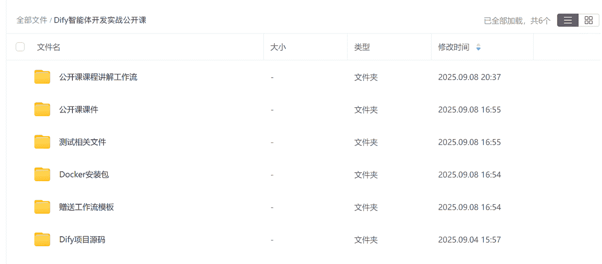


## 一、Dify高阶应用：工作流与ChatFlow

本节开始，我们将开始讲解Dify中的最高阶应用：工作流与ChatFlow开发方法。

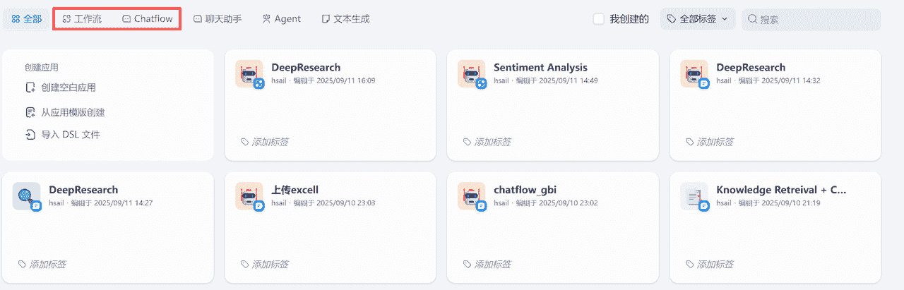

**工作流（Workflow）是 D**ify 当前最核心、最重点维护的功能模块，它提供了高度可视化的流程编排界面，允许开发者以节点（Node）为基本单元，通过拖拽和连线的方式构建出复杂的多步骤处理链路。工作流支持集成大语言模型调用、外部工具调用、数据处理、结构化输出等能力，可用于实现从简单文本生成到复杂企业级智能业务流程的全自动执行。

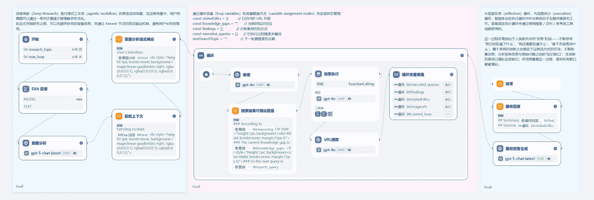

在Dify中，**工作流（Workflow）** 与 **ChatFlow** 是两类面向不同场景的应用构建方式。二者在运行机制、适用场景与开发思路上存在显著差异，理解它们的本质区别，有助于根据实际业务需求选择合适的开发模式。

+   **工作流（Workflow）**
工作流强调任务**的确定性与流程**化执行。其运行过程通常**为单轮推**理，即在收到输入后依照预定义的节点顺序执行各类处理逻辑（如数据处理、调用工具、模型推理等），最终生成结构化结果。工作流在执行时不保留上下文状态，每次运行均为独立实例，便于实现可重复的自动化处理流程。

+   **ChatFlow**
ChatFlow 面**向多轮对话与上下文管**理场景，其核心在于维持会话状态（conversation state）。在 ChatFlow 中，用户的每次输入会被作为对话轮次追加到上下文中，模型推理会结合历史消息进行响应。ChatFlow 更适合构建具备对话记忆能力的聊天型应用（如客服、问答助手等），强调动态交互与持续推理。

其中：

+   工作流更适用于：

+   数据处理与信息抽取类任务

+   报表生成、内容审核等确定性流程

+   需要结构化输出和稳定执行的后端任务

+   ChatFlow更适用于：

+   客服机器人、智能问答等对话型应用

+   需要记忆上下文并持续交流的场景

+   以用户体验与自然交互为核心的前端应用

此外，无论是工作流还是ChatFlow，都包含了Dify完整的各项功能，包括插件调用、Agent集成、发布部署与前端测试等等，外加工作流与ChatFlow本身的灵活特性，使得工作流和ChatFlow是目前Dify最核心的功能了。

## 二、Dify ChatFlow搭建与应用实战

### 1. 从零到一搭建Dify ChatFlow

首先我们尝试从零到一搭建Dify ChatFlow。在最简单的情况下，只包含大模型一个节点的应用，也是一个ChatFlow，其功能和聊天机器人一样，只不过不已聊天机器人形式呈现。其基本创建过程如下：


然后即可进行简单的对话测试：


在工作流画布的预览页面中，用户可以直接与流程进行对话调试。对话采用流式响应方式，回答内容会实时逐字呈现，同时界面会高亮显示当前正在执行的节点，方便开发者清晰地追踪对话进度与执行路径。

+   发布与对话

+           创建完成后，即可发布ChatFlow，发布、运维、后端接口等各项功能和其他各项应用并美誉本质区别。


同时还可以在追踪页面查看对话记录和各环节输出结果。


同样也可以调用后端API来进行对话和响应。


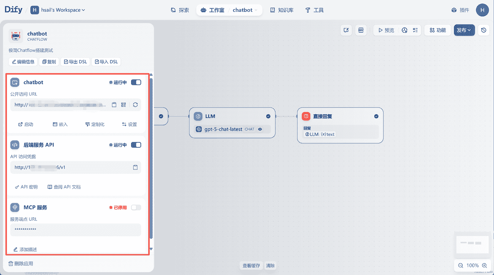

在任意主机上使用cURL进行后端服务测试：

```
    curl -X POST &#x27;http://&lt;服务器地址&gt;/v1/chat-messages&#x27; \
--header &#x27;Authorization: Bearer &lt;API-KEY&gt;&#x27; \
--header &#x27;Content-Type: application/json&#x27; \
--data-raw &#x27;{
    &quot;inputs&quot;: {&quot;course_name&quot;: &quot;DB-GPT课程&quot;},
    &quot;query&quot;: &quot;请帮我解释一下DB-GPT的安装步骤&quot;,
    &quot;response_mode&quot;: &quot;streaming&quot;,
    &quot;conversation_id&quot;: &quot;&quot;,
    &quot;user&quot;: &quot;abc-123&quot;
}&#x27;
```

能看到响应结果如下：

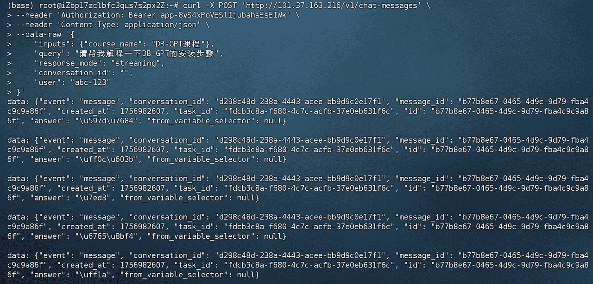

### 2. Dify工作流&ChatFlow中关键节点功能解读

** **       而在Dify的整体架构中，ChatFlow 与工作流（Workflow）不仅仅是应用构建方式，更可以视作 Dify 提供的一套底层开发接口（底层 API）。这意味着，开发者在使用 Dify Flow 时，实际上是在以图形化的方式直接调用并编排 Dify 的内部能力模块，从而构建出复杂的智能应用逻辑。

这种“底层化”的特征主要体现在以下三个方面：

1.  **功能节点数量丰富**
Dify Flow 提供了数量众多且类型多元的功能节点，涵盖模型推理、知识检索、Agent 调度、逻辑控制、数据转换、变量处理、外部请求等各类能力。这些节点的存在，使得开发者能够像调用底层 API 一样，将不同功能模块自由组合，构建出灵活的业务流程。


1.  **节点内部功能高度嵌套**
每个节点并非单一功能单元，而是内含多层可配置子功能。例如 LLM 节点可配置模型参数、提示词模板、推理策略等，条件分支节点可配置复杂的表达式逻辑，HTTP 请求节点可进行完整的 REST 接口调用。这种“节点即模块”的设计理念，使得每个节点都像一个封装良好的底层 API 端点，支持高度可定制的调用方式。

1.  **提供可视化画布式开发环境**
Dify Flow 通过画布式的可视化界面呈现整个工作流，使开发者能够以拖拽连线的方式完成底层 API 的编排。这不仅降低了调用底层能力的门槛，也使得流程逻辑一目了然，便于调试、扩展与协作开发。

正因如此，ChatFlow 与工作流可以被理解为 Dify 在平台层面对底层能力的一次抽象封装：它们既保留了底层 API 的灵活性与可组合性，又通过可视化的方式极大降低了使用复杂度，为构建企业级 AI 应用提供了高效且可维护的开发模式。

#### 2.1 开始节点（Start Node）


在 的 ChatFlow 中，开始节点（Start Node）是整个对话流程的入口，也是所有后续节点执行的起点。每当用户向该 ChatFlow 发送一条消息时，系统会自动创建一个新的流程运行实例（Workflow Run），并从开始节点启动执行逻辑。可以将其理解为流程的初始化模块，它负责接收用户输入并将上下文信息注入到工作流的变量空间中，供后续节点调用。

##### 节点功能

+   接收用户的对话输入（文本、文件等），并初始化系统变量。

+   创建唯一的会话上下文标识，用于追踪本次对话的执行链路。

+   为整个流程提供可复用的全局变量，使后续节点能够读取用户标识、会话信息等元数据。

##### 参数字段说明

在开始节点的右侧配置栏中，可以看到多个自动注入的系统参数（以 sys. 为前缀）。这些参数无需手动传入，而是由 Dify 平台在流程启动时自动生成，用于描述本次流程的运行环境。主要字段说明如下：

| 字段名 | 类型 | 说明 |
| --- | --- | --- |
| sys.query | String | 当前用户输入的文本内容，是最主要的对话输入字段。 |
| sys.files | Array[File] | 用户上传的文件列表，可用于多模态处理流程。 |
| sys.dialogue_count | Number | 当前会话的轮次计数，用于统计该会话中已进行的消息数量。 |
| sys.conversation_id | String | 当前会话的唯一标识，用于区分不同用户会话。 |
| sys.user_id | String | 当前用户的唯一标识，可用于用户画像或权限控制。 |
| sys.app_id | String | 当前应用（ChatFlow）实例的唯一标识。 |
| sys.workflow_id | String | 当前工作流定义的唯一标识，用于追踪流程版本。 |
| sys.workflow_run_id | String | 当前流程运行实例的唯一标识，用于区分每次执行。 |

这些系统参数在 ChatFlow 中具有全局可见性，可以被任意后续节点引用。例如，在 LLM 节点中可以直接引用 {{sys.query}} 来获取用户输入，也可以在 HTTP 请求节点中使用 {{sys.user_id}} 进行个性化请求。

#### 2.2 LLM 节点（大语言模型节点）


在 的 ChatFlow 中，**L**LM 节点（Large Language Model Node）是负责调用大语言模型进行推理生成的核心节点，通常用于对用户输入进行理解、加工与生成自然语言回答。它是整个流程的“推理中心”，决定了系统对输入的语义处理能力与输出质量。

##### 节点功能

+   调用指定的大语言模型（如 gpt-5-chat-latest）执行推理任务。

+   接收来自上游节点（通常是开始节点）的输入内容，将其注入到提示词中进行模型生成。

+   可输出多种结构化内容（如文本、JSON 等），供下游节点继续处理。

##### 配置区域说明

LLM 节点的右侧配置栏包含以下几个关键部分：

| 区域 | 说明 |
| --- | --- |
| **模型（Model）** | 用于选择当前节点调用的模型类型，如 gpt-5-chat-latest。选择不同模型会直接影响推理能力、风格和成本。 |
| **上下文（Context）** | 支持设置变量，用于为模型提供额外上下文信息或长程记忆数据。 |
| **SYSTEM 区块** | 系统提示词（System Prompt）编写区域，用于定义模型的行为指令、角色设定等，是模型生成内容的核心控制逻辑。可以在其中插入变量（如 {{sys.query}}）以动态填充用户输入。 |
| **USER 区块** | 用户提示词（User Prompt）编写区域，用于指定本轮对话中用户的具体输入内容。通常会绑定来自开始节点的 sys.query（文本）或 sys.files（文件）等变量。 |
| **记忆（Memory）** | 可选项，用于配置节点是否调用内置对话记忆模块，使模型能够基于历史消息进行上下文推理。 |

##### 变量引用示例

+   {{开始.sys.query}}：引用开始节点中用户输入的文本。

+   {{开始.sys.files}}：引用开始节点中用户上传的文件。

通过合理编写 SYSTEM 和 USER 区块提示词，并灵活注入变量，LLM 节点可以承担包括问答、总结、改写、分类、信息抽取等各类自然语言处理任务，是 ChatFlow 中最核心的智能化组件。

#### 2.3 直接回复节点（Respond Node）

**在Dify的 ChatFlow 中**，直接回复节点（Respond Node）用于将流程的执行结果返回给最终用户，是整个对话流程的终点节点之一。通常情况下，它会直接接在 LLM 节点或其他生成节点之后，将模型生成的内容发送回聊天界面，作为用户本轮问题的回答。


##### 节点功能

+   接收来自上游节点的输出内容，并将其作为最终回复返回给用户。

+   支持灵活引用上游节点的任意输出变量，如文本、JSON、文件链接等。

+   是 ChatFlow 中实现“对话闭环”的关键节点，没有它流程将不会在界面上呈现可见回复。

##### 配置区域说明

在右侧的配置栏中，主要包含以下部分：

| 区域 | 说明 |
| --- | --- |
| **回复（Response）** | 用于指定要输出给用户的内容。可以直接输入固定文本，也可以引用上游节点的变量。常见做法是引用 LLM 节点的 {{LLM.text}} 变量，将模型生成的文本作为回复内容。 |
| **变量插入** | 可在编辑框中点击变量图标，快速插入来自上游节点的输出变量，实现动态回复。 |
| **下一步（Next）** | 可选配置，用于在本节点输出后继续执行后续节点，支持在发送回复的同时继续触发其他操作逻辑。 |

##### 使用示例

+   {{LLM.text}}：将 LLM 节点的文本输出内容作为最终回答。

+   {{变量名}}：可以引用其他节点输出的任意结构化结果，实现组合式输出。

通过「直接回复」节点，ChatFlow 能够将复杂推理流程的结果传递回用户，实现自然的对话闭环，是所有对话型应用必不可少的输出终端。

### 3. Dify工作流和ChatFlow单节点测试

在 Dify 工作流中，支持对单个节点进行功能测试。开发者可以在节点设置面板中点击「测试」按钮，为该节点单独输入测试数据并查看输出结果，而无需运行整个流程。通过单节点测试，可以快速验证节点配置是否正确、参数传递是否符合预期，从而大幅提升调试效率并降低整体工作流的出错率。


### 4.【实战一】多知识库切换的智能课程助教

+   Part 1.课程助教功能复现


```
你叫小智，你是一名严谨耐心的“智能助教”。你的任务是基于课程《{{#1757580925407.course_name#}}》的课件知识库，用中文为学生解答问题。

规则要求：
1）在回答学生问题之前，请下查阅检索到的关联上下文：{{#context#}}
2）在检索到的知识库文档中，**必须优先使用与课程《{{#1757580925407.course_name#}}》最相关的文档片段**来回答。如果检索结果包含多个课程内容，只能引用与《{{#1757580925407.course_name#}}》相关的部分。
3）如果没有检索到与《{{#1757580925407.course_name#}}》相关的文档片段，请明确说明“资料未覆盖”，并避免编造内容。在这种情况下，你可以基于模型自身知识补充回答，但需提示“以下内容来自模型知识，而非课件资料”。
4）回答必须在末尾附加【引用】列表（包括文档名和页码/段落标识），仅当回答使用了课件资料时才需要输出【引用】列表。
5）如问题表达含糊，请先列出 2-3 个澄清要点，并提示学生选择或补充说明，然后再给出可能的方向与对应课件位置。
6）回答时，必须先用一句话概括结论，再以分点形式给出推理、定义或解释。
7）面向初学者，术语首次出现时需要给出简明解释。

变量：
- 课程名：{{#1757580925407.course_name#}}
```

+   发布与测试流程


+   优化一：不同课程采用不同知识库进行检索


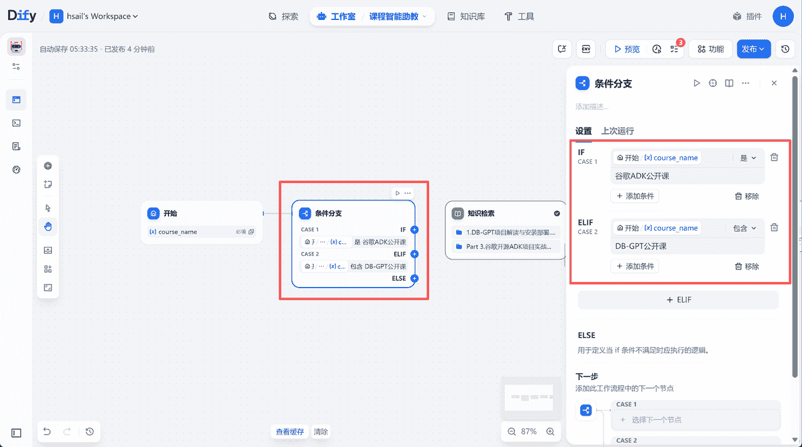

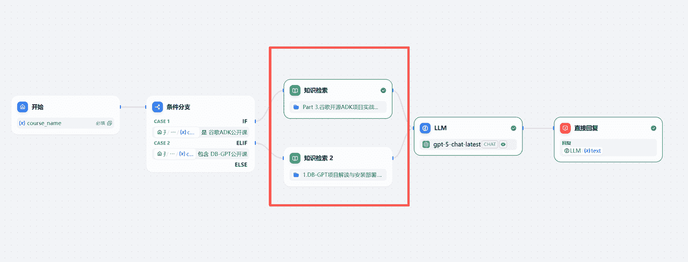


+   搭建Agentic RAG系统


```
你是一名分类助手，请根据用户的提问内容{{#sys.query#}}，判断其属于以下三类之一：

1. 如果问题与谷歌ADK或Agent开发相关，请输出字符串：ADK
2. 如果问题与AI数据分析或DB-GPT项目相关，请输出字符串：DB-GPT
3. 如果问题不属于以上两类，请输出字符串：chat

务必只输出上述三种类别中的一个，不要输出任何解释、标点或附加内容。
```


```
{
  &quot;type&quot;: &quot;object&quot;,
  &quot;properties&quot;: {
    &quot;category&quot;: {
      &quot;type&quot;: &quot;string&quot;,
      &quot;enum&quot;: [
        &quot;ADK&quot;,
        &quot;DB-GPT&quot;,
        &quot;chat&quot;
      ],
      &quot;description&quot;: &quot;根据用户提问内容判断出的分类&quot;
    }
  },
  &quot;required&quot;: [
    &quot;category&quot;
  ],
  &quot;additionalProperties&quot;: false
}
```


```
你叫小智，你是《{{#1757580925407.course_name#}}》课程的“智能助教”。现在你的学生提出了一个和课程无关的问题{{#sys.query#}}，请用你自己的原始知识进行回答，要求如下：
1）如问题表达含糊，请先列出 2-3 个澄清要点，并提示学生选择或补充说明，然后再给出可能的方向与对应课件位置。
2）回答时，必须先用一句话概括结论，再以分点形式给出推理、定义或解释。
3）面向初学者，术语首次出现时需要给出简明解释。
```


问答效果测试：


+   工作流成品展示

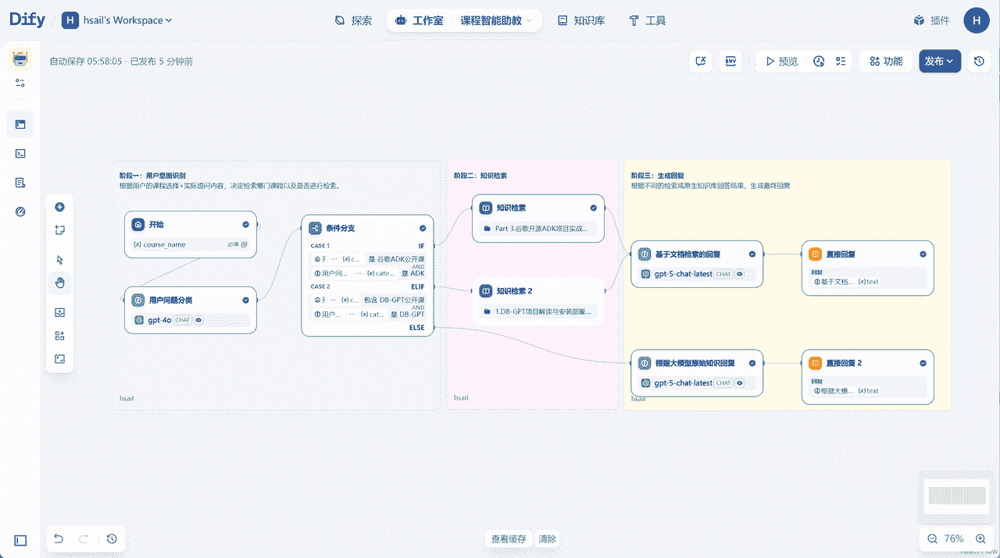

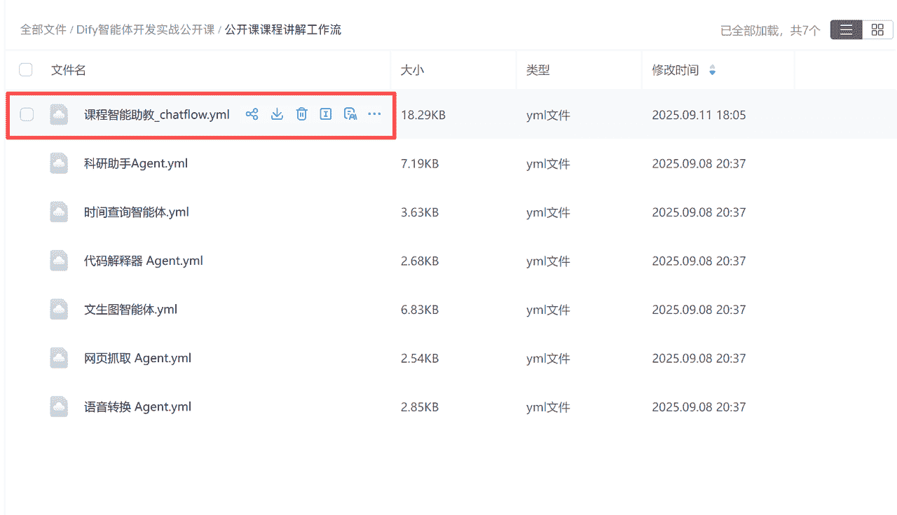


## 三、Dify ChatFlow实战案例

在掌握了Dify工作流的基本原理与节点使用方式后，本篇章将通过两个具有代表性的实战案例，带领读者系统体验工作流在真实业务场景中的落地过程与价值体现。

第一个案例是**从零到一搭建多模态问答机器人**。该案例**围绕“文档上传—内容解析**—知识入库—知识检索—大模型问答”的完整链路展开，结合MinerU+Knowledge插件实现对复杂文档（PDF、Word、PPT 等）的结构化解析，并自动将解析后的内容存入知识库。在此基础上，机器人能够根据用户的提问动态选择是否调用知识库进行检索，或直接调用大模型进行原生回答，并支持图文混合输出。该案例帮助读者掌握构建企业级知识型问答助手的核心流程，重点体现 Dify 在多模态数据处理、知识管理、推理问答融合等方面的能力。


第二个案例是构建 DeepResearch 应用。该应用以“研究任务”为核心，基于循环变量（Loop Variables）与动态变量赋值节点（Variable Assignment）设计了一套完整的 Agentic Workflow。它能够根据用户设定的研究主题，自动生成检索查询词，通过 工具进行外部信息抓取，再由大模型进行阅读、提炼与反思，不断发现知识空白并生成下一轮检索策略，最终输出系统化的研究报告。这一案例展示了 Dify 在构建多轮推理、工具调用与动态控制逻辑结合的复杂智能体工作流方面的强大能力，是高阶开发者进阶 Agent 架构设计的绝佳范例。

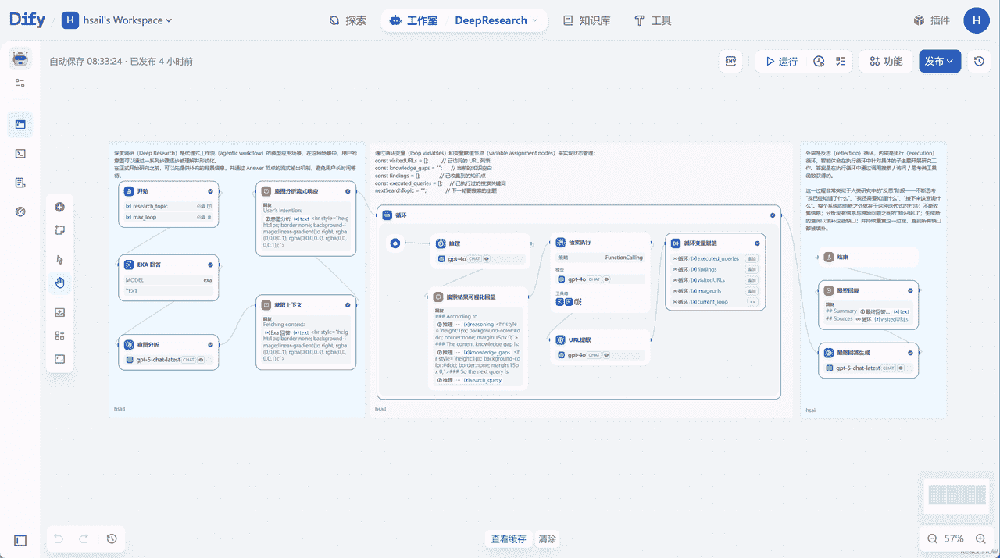

通过这两个案例的学习，读者不仅可以掌握从零开始搭建多模态 RAG 系统的完整技能链条，还能理解如何在 Dify 中实现循环推理、工具协作与多阶段决策，真正发挥工作流的可视化编排优势，打造具备企业级实用价值的智能应用。

+   工作流文件领取：

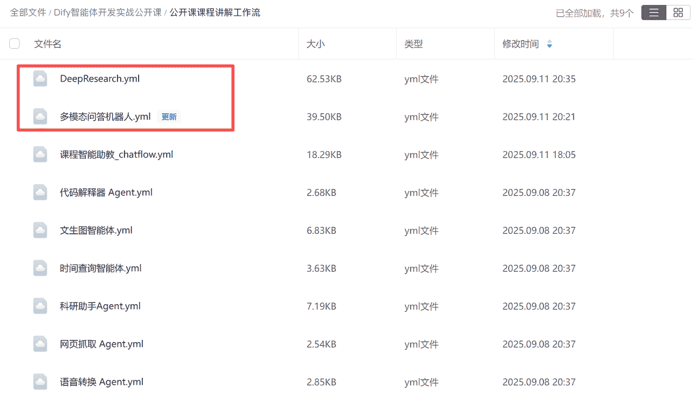


### 1. 多模态PDF文档检索工作流

#### 1.1 案例介绍

本案例的目标是搭建一个能够对多模态 PDF 文档进行内容解析、知识入库并支持检索问答的智能工作流。在这个流程中，我们重点使用了两个插件：MinerU 和 knowledge，它们共同构成了整个系统的数据底座。

其中，**MinerU 插件**负责对用户上传的 PDF、Word、PPT 等复杂文档进行精准解析，它能够自动去除页眉页脚、页码等噪声信息，提取文档中的段落结构、标题层级、图片、表格、公式等多模态内容，并将结果统一输出为 Markdown、JSON 等结构化格式。这使得原本难以处理的非结构化文档得以被大模型理解和利用，为后续知识库的构建打下坚实基础。

而**Knowledge 插件**则承担了将 MinerU 解析结果导入知识库的任务。它支持将文本内容自动切分为合适的语义块，并建立高质量索引，形成可供大模型调用的向量化知识库。在配置中，我们可以通过设置数据集 ID 指定知识库位置，并灵活调整分段策略、语言类型等参数，从而确保知识入库的精度与检索效果。

通过 MinerU 和 Knowledge 的组合，我们构建的工作流能够让上传文档即时转化为可检索的知识，并在后续用户提问时实现基于知识库的高质量回答，为大模型提供了可靠的外部知识增强能力。

> 多模态RAG检索系统开发实战：

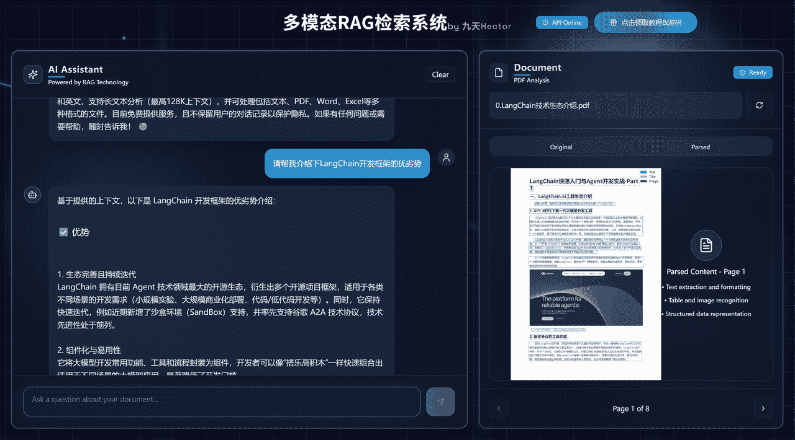

>

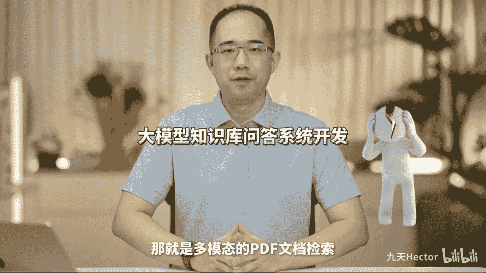

> 教程地址：https://www.bilibili.com/video/BV1CDHQzdEfg/

>

#### 1.2 MinerU项目介绍与插件安装

MinerU 是由 OpenDataLab 团队开源的一款高质量文档解析工具，专为将 PDF 等非结构化文档转化为大模型可理解的结构化数据而设计。它能够精准处理包含多列排版、复杂图文混排、扫描图像等多种类型的文档内容，输出结果涵盖文本、标题、段落、列表、表格、图片、公式等丰富要素。MinerU 具备以下显著优势：

+   **高精度语义解析**：自动去除页眉页脚、页码等干扰信息，保证内容的语义连贯性。

+   **多模态内容抽取**：除纯文本外，还能提取图片、图表、表格、公式等内容并进行结构化标注。

+   **多格式输出**：支持输出 Markdown、JSON、HTML、LaTeX 等多种格式，适用于后续多样化的下游任务。

+   **自动 OCR 支持**：可识别扫描类文档或乱码 PDF，内置 OCR 模块支持 80+ 种语言文字识别。

+   **跨平台部署**：兼容 Windows、Linux、macOS 等主流平台，既可使用官方云端 API，也可进行本地化部署。

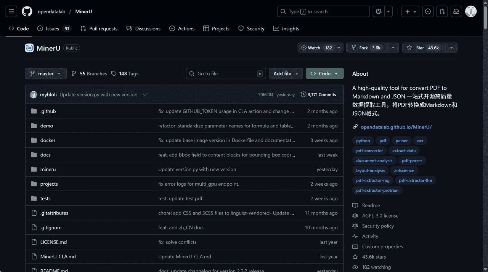

+   GitHub项目主页：https://github.com/opendatalab/MinerU

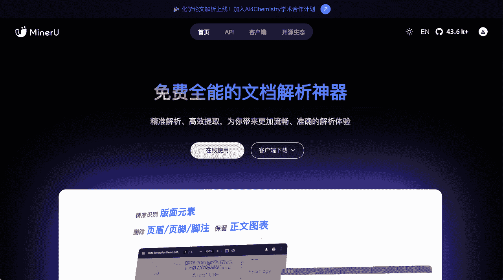

+   MinerU官网：https://mineru.net/

+   创建MinerU API-KEY：

+    要使用官方云端 API 方式调用 MinerU，需要先获取个人的 API-KEY，具体流程如下：

1.  打开 MinerU 官网（https://mineru.net），点击「API」。

1.  点击 **「API Token」** 按钮生成一条新的 API-KEY，并复制保存好该密钥。

+   获取到的 API-KEY 即可在 Dify 插件配置页面中填写，用于验证和调用 MinerU 的官方服务接口。

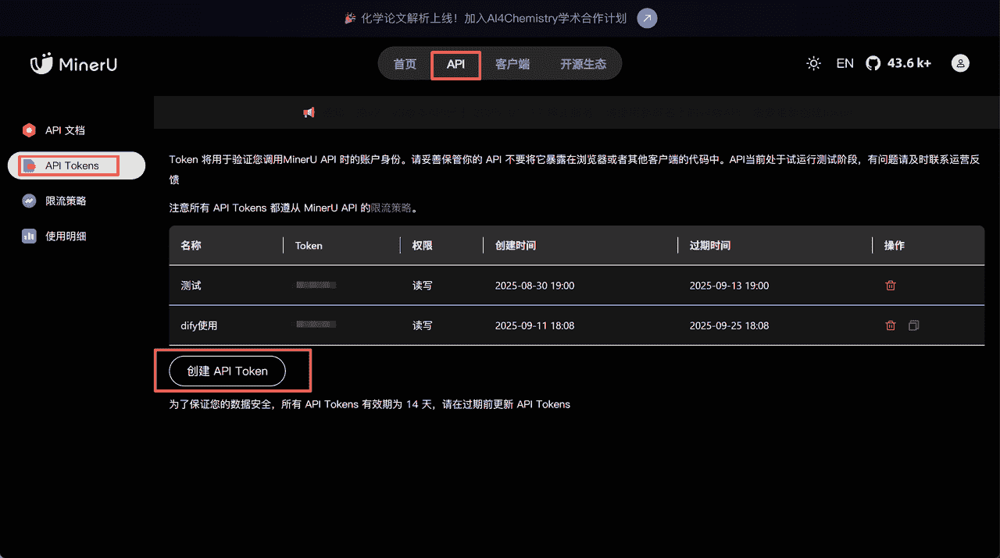

然后即可在Dify应用市场中找到MinerU并进行安装，注意需要同时安装knowledge插件，方便后续把MinerU解析的文档直接导入成Dify的知识库。

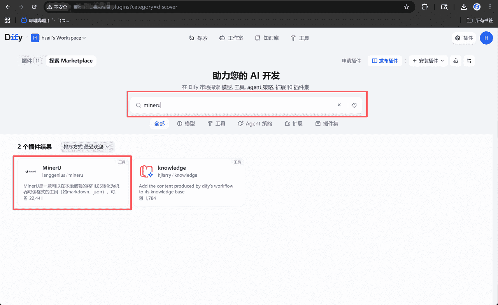

#### 1.3 MinerU插件功能介绍与配置方法

MinerU是一款高质量的文档解析工具，能够将 PDF、DOCX、PPT 等复杂排版文档解析为结构化的 Markdown 或 JSON 数据，为下游的大模型应用（如 RAG 检索、Agent 工具调用、知识问答等）提供高质量的输入内容。

通过在 中使用 MinerU 插件，我们可以在工作流中一键完成「上传文档 → 自动解析 → 获取结构化内容」的流程，极大提升知识库构建与文档问答系统的开发效率。

MinerU 插件支持以下关键能力：

+   📝 清**理文档杂项：**自动去除页眉、页脚、页码、脚注等冗余信息，保证语义连贯。

+   📐 结**构化输出：**保留文档标题、段落、列表等结构信息，输出可读性强的 Markdown。

+   📊 表**格与公式解析：**

+   表格自动转为 HTML 格式

+   公式自动转为 LaTeX 格式

+   🖼️ 多**模态元素抽取：**可抽取文档内的图片、图片描述、表格、表格标题、脚注等。

+   🌐 多**语言 OCR 支持：**可识别 84 种语言，对扫描件或乱码 PDF 自动启用 OCR。

+   💻 多**格式输出：**支持 Markdown、JSON、以及可选的 DOCX / HTML / LaTeX 等多种格式。

+   ⚡ **多平台部署**：支持 Windows / Linux / macOS，可纯 CPU 运行，也支持 GPU/NPU/MPS 加速。

无论使用哪种方式使用MinerU（在线调用API或者本地部署），安装完插件后都必须正确配置 Dify 的 FILES_URL，否则会出现**“Request URL is missing an 'http://' or 'https://' protocol”**等上传失败报错。具体配置如下：

1.  打开 Dify 部署目录中的 .env 文件

1.  找到 FILES_URL，根据部署方式设置为：

+   Docker Compose 部署：

```
FILES_URL=http://api:5001
```

+   **其它部署方式**：

```

FILES_URL=http://你的Dify服务器IP:5001
```

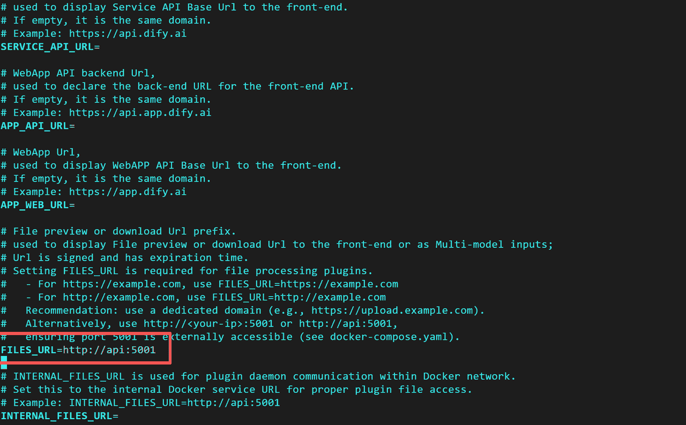

1.  重启 Dify 服务使配置生效：

```
docker compose down
docker compose up -d
```

> 💡 提示：如果你使用的是局域网 IP，当网络环境改变（例如更换 WiFi）后 IP 会改变，需要同时更新 MinerU 插件的 Base URL 和 .env 里的 FILES_URL。

修改完后回到Dify的MinerU插件授权页面，输入API-KEY（令牌）和Base URL:https://mineru.net


#### 1.4 基于MinerU的简易多模态PDF问答机器人

在掌了解 MinerU 的基本使用方法后，我们可以快速搭建一个简易的 PDF 多模态聊天机器人，实现从上传 PDF 文档到智能问答的基本流程。其核心思路是：利用 MinerU 插件对上传的 PDF 进行结构化解析，将文档内容抽取为可读的 Markdown 或纯文本格式（text），然后将解析结果作为上下文输入传递给 工作流中的大模型节点，让模型基于文档内容回答用户问题。

在工作流中，可以按以下方式进行节点设计：

1.  **开始节点**：接收用户上传的 PDF 文件。

1.  **MinerU 解析节点**：调用 MinerU 插件，将 PDF 文档解析为文本内容。

1.  **LLM 节点**：将 MinerU 输出的文本内容作为上下文，结合用户的提问传入大模型，让其生成回答。

1.  **直接回复节点**：将大模型的回答结果返回给用户，实现即时对话。

这种实现方式虽为简易版本，但已能够完成多模态内容（图文混排 PDF）→ 文本 → 知识问答的基础闭环流程，为后续构建更完整的知识库型问答系统奠定了良好基础。


接下来即可进行问答测试：


同时也可以查看MinerU实际解析的内容：

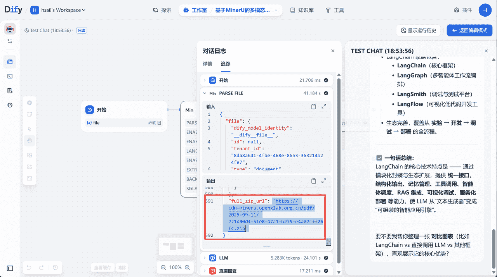

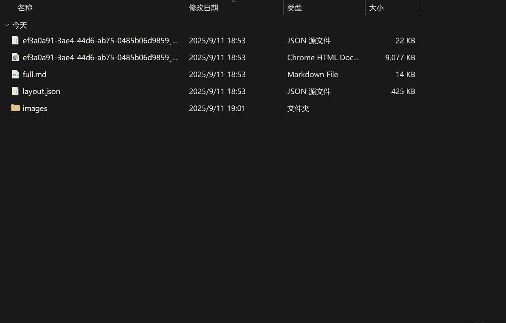

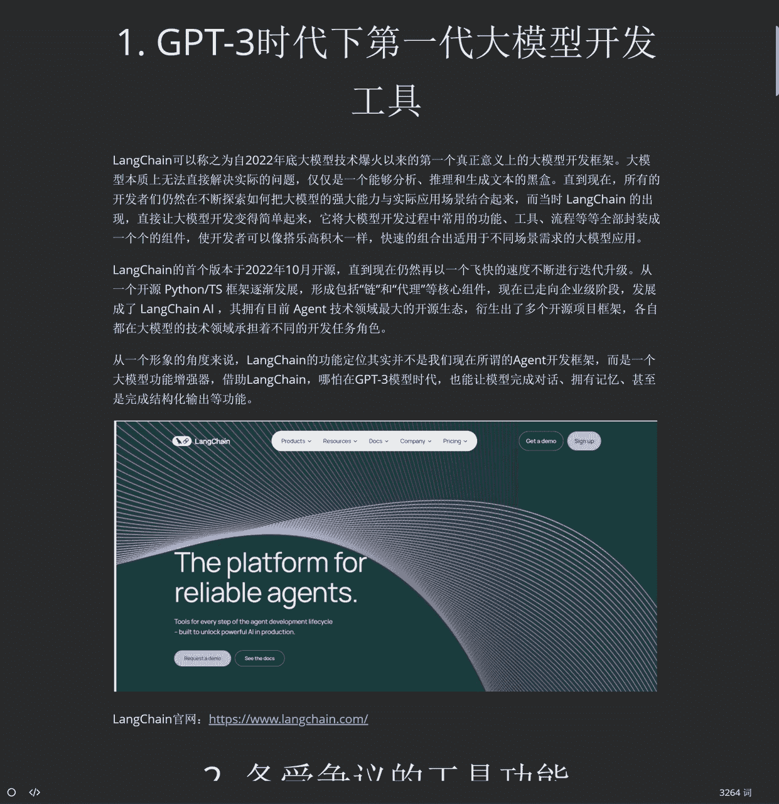

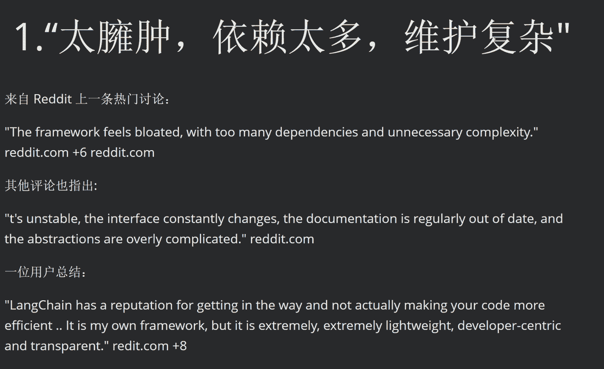

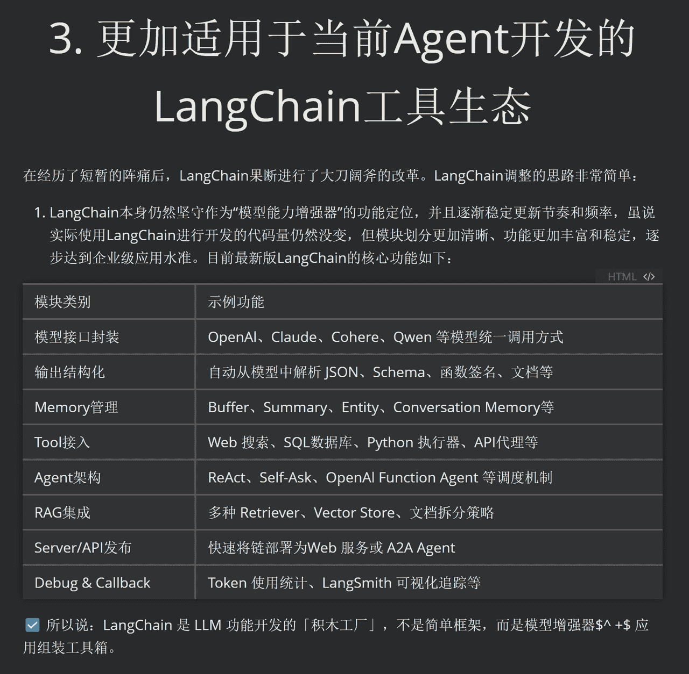

#### 1.5 【实战1】：多模态问答机器人搭建流程


实际测试效果：


#### 1.6 【实战2】：DeepResearch应用开发流程


实际使用效果：

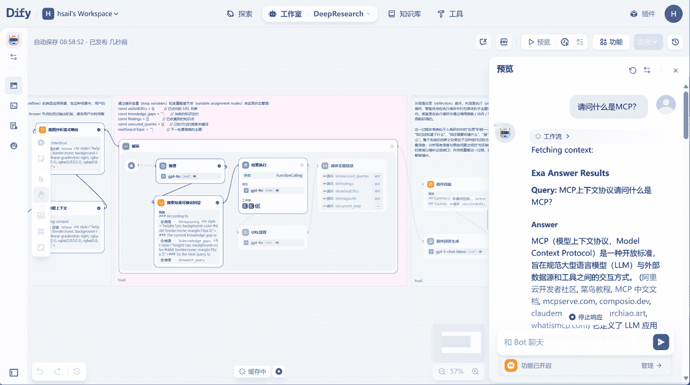

---

+   体验课内容节选自《2025大模型Agent智能体开发实战》(秋招冲刺班)完整版付费课程

体验课时间有限，若想深度学习大模型技术，欢迎大家报名由我主讲的《2025大模型Agent智能体开发实战》(秋招冲刺班)

