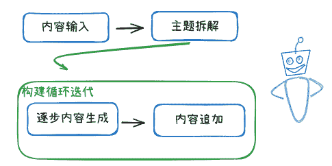
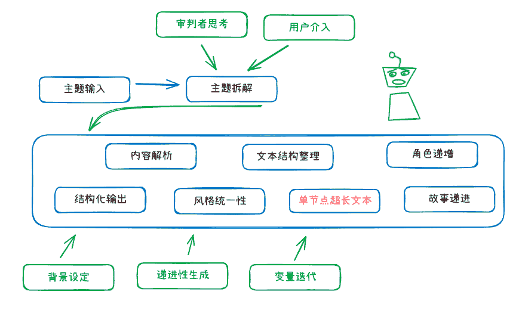
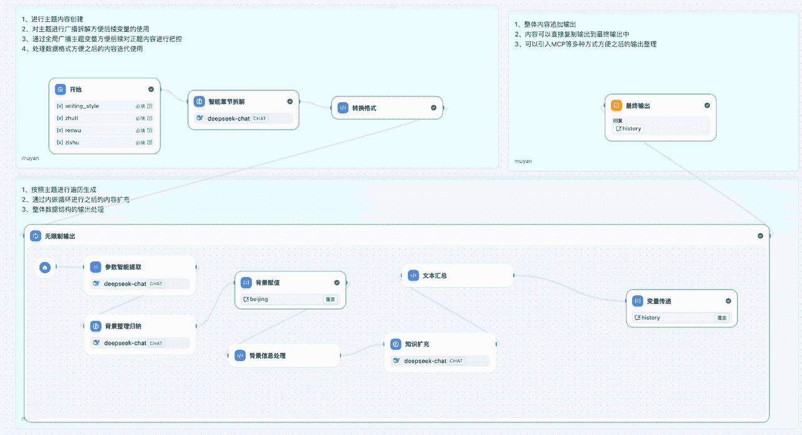
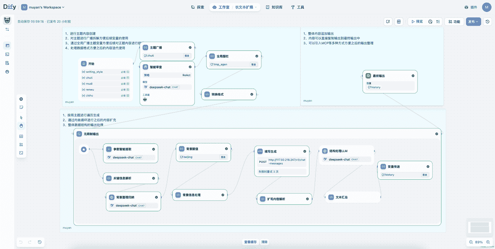
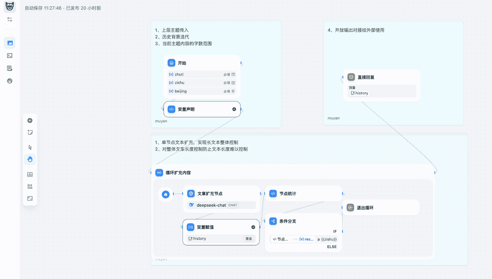

# Dify 2.0 智能 Agent 长文本生成实践

> 来源：[https://kq4b3vgg5b.feishu.cn/docx/Z0xhd68Tlo6zdwxXXMLc7esFnxd](https://kq4b3vgg5b.feishu.cn/docx/Z0xhd68Tlo6zdwxXXMLc7esFnxd)

# 1. 什么是 Dify

**一句话**：Dify 是一个面向大语言模型（LLM）应用的低代码开发与运行平台。

它把「`Prompt` 编排、流程控制、工具调用、记忆管理、知识检索、监控与发布」集成在一个可视化界面里，让你像搭乐高一样把“会聊天的模型”拼装成“能完成任务的应用”。

**把它放进技术栈**里看，Dify 相当于 LLM 应用的“中间层/操作台”：

+ **上游**：各种模型（DeepSeek、Qwen、ChatGLM、OpenAI…）

+ **中间**（Dify）：流程编排（`Workflow` / `Chatflow`）、Agent 工具调用、会话变量/记忆、RAG 检索、代码与 `HTTP` 节点、日志监控/调试、发布为 API 或网页

+ **下游**：你的业务系统、数据库、文档/知识库、第三方 API、企业内部工具

> **不是**“一个模型”，而是“一个把模型用起来的平台”。

# 2. Dify 能做什么

## 1. 流程编排（`Workflow` / `Chatflow`）

+ **`Workflow`**：面向“流水线式任务”（多步生成、分支判断、循环、工具调用、代码后处理）。

+ **`Chatflow`**：面向“多轮对话任务”，内置对话历史、会话变量、消息路由，更适合“持续交互、随时调用子流程”的场景。

## 2. 模型编排与 Prompt 管理

+ 在**模型节点**里配置系统提示/用户提示、占位变量、温度/长度等推理参数；

+ 支持**多模型混用**（比如 DeepSeek 负责规划/Qwen负责润色），同一流程里灵活切换；

+ **Prompt 作为资产**，可调试、复用、版本化，避免“散落在代码里难维护”。

## 3. 记忆与状态管理

+ **会话变量**（Session Variables）：在一次对话/流程中读写结构化数据（字符串/对象/数组），可当“短期/中期记忆”；

+ **变量赋值/聚合节点**：把中间结果写入变量，或汇总多个分支的结果；

+ **迭代节点**：对数组逐项执行子流程，实现章节级生成、批处理。

> **这解决了“模型健忘”的普遍问题**：你决定什么要被记住、记在哪儿、何时以什么形式给回模型。

## 4. 工具调用与扩展（Agent 能力）

+ **`HTTP` 节点**：拉取/推送外部数据（检索接口、公司内部 API、Webhook…）

+ **代码节点**：嵌入 Python 做解析/校验/规整/打分/过滤/持久化等

+ **Agent 节点**：让模型在子流程里**自主选择**调用哪些工具、如何规划步骤（对“开放问题”“多步子任务”有用）

## 5. 知识增强（RAG）

+ 将文档/知识库向量化，按需检索片段注入提示词，从而让模型基于事实作答（减少瞎编）；

+ 可用于企业 FAQ、产品手册、内部规章的问答/总结/对比。

## 6. 运行监控与发布

+ **调用日志**、每个节点的**输入输出**、**耗时**、**错误信息**，一览无余（便于调试与复盘）；

+ 一键**发布为 API** 或网页应用；

+ 支持**自托管**与云端，易于纳入现有系统。


# 3. 我们为什么需要 Dify

> “有模型 ≠ 有应用”。把“能写字的模型”变成“能办事的系统”，中间隔着一整层工程问题。

**痛点 A：`Prompt` 不可复用、流程不可控**

光靠 `prompt` 做复杂任务会越来越“乱”：谁负责规划？谁负责校对？怎么循环？如何在出错时降级重试？Dify 把这些变成明牌的节点与连线，流程可见、可控、可复现、可维护。

**痛点 B：模型健忘、上下文超长**

长流程/长文本生成时，一次性塞满上下文既昂贵也不稳。Dify 用**会话变量** + 概要/关键信息的方式“挑着记”，配合迭代与检索，做到稳态连贯而非“爆记忆”。

**痛点 C：工具/数据接入碎片**

直接在代码里缝 `HTTP`、数据库、第三方服务，会越写越胶水。Dify 用 `HTTP`/代码/Agent 节点统一承载“行动力”，在流程层面组织工具调用，读写世界。

**痛点 D：从原型到生产的鸿沟**

本地试验时看不见“模型中间想了什么、出过啥差错”。Dify 的流程/日志/参数让你可观测、可定位、可迭代，也易于发布给其他系统调用。

**结论**：Dify 解决的是**工程化落地**问题——让 LLM 真正成为业务系统的一部分，而不是一个“对话黑箱”。

# 4. 谁需要 Dify

+ **程序员/转 AI 的开发者**

  + 目标：快速把 LLM 融入业务、可维护、能上线

  + 价值：少写胶水，多做结构；可视化排错；易 A/B 与版本化

+ **产品经理/创业者**

  + 目标：用最短时间做出“真的能跑”的原型

  + 价值：拖拽梳理业务逻辑、参数化试验、快速迭代拿反馈

+ **内容/运营/教育从业者**

  + 目标：长文本、标准稿、流水线式创作与审核

  + 价值：大纲—章节—校对—统一风格—发布，全流程可控

+ **企业内部团队**（客服、知识管理、流程自动化）

  + 目标：内网知识问答、报表自动化、流程机器人

  + 价值：可私有化、可接内网 API、可策略可审计

# 5. 除了 Dify，还有哪些低/无代码平台？差异到底在哪

> 按“**能力重心**”来分类，更不容易混淆。

## 1. “AI 应用中台型”

+ **Dify**：

+ **重心**：LLM 应用编排（流程/变量/Agent/RAG/监控/发布）

+ **强项**：流程可视、可调、可复用；多模型切换；记忆与检索并用；易上线

+ **短板**：特别复杂的业务规则/高并发，仍需外部系统配合

+ **Flowise**：

+ **强项**：组件多，灵活；适合“想玩 LangChain 但要图形化”的开发者

+ **差异**：更偏“可视化 SDK”，工程与发布侧不如 Dify 一体化；调试与运维成本略高

+ **`LangGraph**（编程式 Agent 框架，不是低代码）**

+ **强项**：**状态机级**控制、复杂 Agent 规划、自定义深；适合资深工程

+ **差异**：需要写代码；上手门槛高；不是“拖拽平台”

## 2. “自动化工作流/集成型”（不是 AI 原生，但常被拿来比较）

+ **n8n / Zapier**：

+ **强项**：系统集成、触发器、任务编排、第三方服务生态

+ **差异**：AI 相关的“Prompt/记忆/RAG/Agent”不原生；常作为 Dify 的外围胶水层

+ **典型协作**：事件 → n8n 触发 → 调 Dify 的 AI 流程 → n8n 后续分发

## 3. “Bot/聊天类创作平台”（偏前台交互）

+ **Coze** 等：

+ **强项**：做聊天机器人快、界面上手简单、社区活跃

+ **差异**：更偏消费级、轻量化；流程/记忆/工程能力相对薄；复杂逻辑、私有对接需额外开发

**关系图（简化）**

+ 做“AI 应用编排与上线”：**Dify / Flowise**

+ **做“Agent 深控与研发型工程”**：`LangGraph`

+ 做“业务自动化对接生态”：n8n / Make / Zapier（常外接 Dify）

+ 做“前台 Bot 与轻创作”：**Coze**（轻交互，流程较浅）

+ 做“评测/观测”：评测工具（与 Dify 互补）

> **简明选择建议**：

+ 需要“**从想法到可上线应用**”——优先 Dify。

+ 需要“**深度自定义 Agent 逻辑**、写复杂状态机”——上 `LangGraph`。

+ 已有大量**系统集成/触发器**，只是偶尔需要 AI ——用 n8n 做胶水，外呼 Dify。

+ 只想做一个“**能聊的 Bot**”、快速做活动互动 ——可先选 Coze。

+ 你是“`LangChain` 重度用户”，但团队喜欢看图 ——Flowise。

# 6. Dify 的优势、边界与常见误区

## 1. 优势（工程视角）

+ **流程显式化**：生成—校验—修正—发布全链路可视、可控；

+ **多模型编排**：谁规划、谁润色、谁检索，各司其职；

+ **记忆/变量**：对“要记住什么”有**设计权**，不是“全历史硬塞”；

+ **能“动手”**：`HTTP`/代码/Agent 让模型能真正“去做事”；

+ **可运维**：日志、报错、时间线、参数，便于定位问题与 A/B 迭代；

+ **可发布**：抽象成 API 或网页，接进业务。

## 2. 边界（知道何时不该用/怎么搭配）

+ **极复杂的业务规则/占大量计算**：需要外部后端服务或数据管道配合，Dify 负责协调而非替代；

+ **海量长期记忆**：会话变量适合“关键摘要+短中期”，若要“全量长期”，需外部数据库/向量库+检索策略；

+ **超高并发/低延迟**：要评估模型吞吐、缓存策略、异步队列，Dify 侧重编排，性能瓶颈在模型与后端。

## 3. 常见误区

+ **误区 1**：“开个大模型就够了”

现实：流程/变量/工具/检索/监控缺一不可，否则可复用与可维护性很差。

+ **误区 2**：“Dify = 无代码”

现实：**Dify 是“低代码”**。复杂分支、数据规整、持久化，往往需要代码节点或外部服务。

+ **误区 3**：“把所有历史都塞给模型 = 有记忆”

现实：应当结构化记忆（摘要/Key Facts/角色表），加“相关性检索”，才稳且省钱。

# 7. 典型落地用法

长文创作 Agent（小说/报告）

+ 节点链路：主题输入 → 大纲生成 → 用户确认 → 迭代章节生成（每章：参考“全局设定+前章摘要+风格卡”）→ 逻辑校验节点 → 风格统一节点 → 汇总输出/发布

+ 关键点：

  + “会话变量”里存**全局设定/角色表/术语表**；

  + 每章写完立刻**摘要**，后续只给摘要而非整章；

  + 逻辑校验与风格统一可用 LLM 做“自评+修改”。

**企业知识问答**

+ 文档入库→向量化→检索节点→模型引用片段回答→置信度/来源标注→管理员复核

+ 关键点：

  + “检索粒度”与“引用阈值”要调；

  + 回答格式规范（含来源链接/编号），利于内控。

**自动化助手**

+ 触发器（入站消息/表单）→ 分类路由→ 不同处理子流程（查数据库、补充信息、生成结果）→ 回写系统或发消息

+ 关键点：

  + 纯自动 vs 人在回路（异常/置信度低时转人工）。

## 你该不该选 Dify

+ 要“把 LLM 用在业务里”，还要可维护、能调试、能上线 → 选

+ 只是做一个简易聊天机器人 Demo → 可先用更轻的 Bot 平台

+ 你是重度工程团队，要写自定义 Agent 状态机 → Dify + 代码/或直接 `LangGraph`

+ **系统集成需求远大于 AI** → 主用 n8n/Make，外呼 Dify 即可

### 总结

**Dify 的意义不是“让模型更聪明”**，而是让你更会用模型。

你不再把希望押在一次 Prompt 上，而是把任务拆成能控的步骤：

收集需求、规划结构、逐段生成、校验修正、统一风格、再发布。

中间怎么玩工具、怎么记忆、出了错如何回滚，都在流程里写清楚。

这才是“能上线、能复用、能协作”的 AI 应用形态。

# 8. 长文本生成注意事项

## 1. 到底什么时候需要长文本？

长文本不是“字数越多越好”，而是当结构复杂、语义跨段、需要持续一致性时才有价值。典型需求：

+ 叙事类创作

  + 长篇小说、剧本、漫画设定书、游戏世界观文档。

  + 关键难点：人物弧线、伏笔回收、时间线一致、世界观规则不自相矛盾。

+ 商业与研究写作

  + 行业研究报告、白皮书、竞品分析、市场洞察。

  + 难点：章节逻辑递进、跨图表引用、结论与数据相互校验、参考文献管理。

+ 企业知识与规范化输出

  + 产品手册、实施方案、SOP、合规文档、FAQ 大库。

  + 难点：术语统一、版本管理、政策/条款引用准确、跨章节一致性。

+ 教学与培训内容

  + 课程讲义、分级教案、试题解析、案例库。

  + 难点：同一知识体系多层展开（入门→进阶→实战），跨章节衔接。

+ 多轮交互驱动的生成

  + “先确定大纲→部分试写→风格/受众确认→逐章产出→回收反馈修订”。

  + 难点：每一次确认都要影响后续内容，必须“记住且贯彻”。

+ 汇编/整合类输出

  + 会议周报/月报、客户调研洞见、CS 工单沉淀、研发里程碑总结等。

  + 难点：多来源信息合并、冲突消解、命名与口径统一。

结论：当你需要跨段逻辑、跨章一致性、跨轮决策传导时，就是“真正需要长文本”的时刻。


## 2. 为什么有“大上下文（几十 K、甚至上百 K tokens）”不够？

**上下文窗口 ≠ 可靠记忆 ≠ 可控流程。**实际落地会遇到这些硬问题：

+ 注意力稀释与“中段遗忘”

  + 窗口再大，注意力也会分散；越长越容易“前后用不上”，模型对关键约束“记不牢”。

  + 结果：风格漂移、设定遗失、出现矛盾。

+ 错误累积不可逆

  + 一次性生成长文，**中途出错难以回滚**；后面再改会牵一发动全身。

  + 工作流的“逐章-校验-修订”能把风险局部化。

+ 成本与延迟不可控

  + 超长提示一次塞入，**费用与时延成倍上升**；还难以复用中间结果。

  + 分块生成+滚动摘要，能把成本按“章节/阶段”控制。

+ 工具与事实约束无法插入

  + 长文常需要查数据、调 API、检索材料、风格校准；

  + 纯上下文里塞不进这些“行动”，需要流程级的工具调用与决策节点。

+ 可观测性与可维护性差

  + 一次吐出两万字，你很难知道“它为什么这么写”“哪段逻辑有问题”。

  + 流程把“思考路径”拆成节点，**可审计、可复现、可 A/B**。

+ 团队协作与版本控制

  + 长文往往多人配合；整块生成难以在章节或任务层面协作。

  + 流程化能按章节/子任务划分责任与验收标准。

因此，**大上下文适合“参考更多材料”**，但**不解决“过程控制与长期一致性”**。这正是工作流存在的意义。

## 3. 哪些具体场景“最好用工作流”来做长文本？

### 场景 A：长篇小说 / 剧本

+ 目标：多卷本叙事、人物成长线、伏笔呼应。

+ 痛点：设定丢失、人物性格跑偏、时间线错位、反复重写成本高。

+ **为什么工作流**：可把“世界观卡”“角色卡”“时间线卡”作为会话变量；逐章生成→每章摘要→用摘要喂下一章；每章出厂前经过“逻辑校验/风格统一”子流程。

+ 流程骨架：主题与世界观 → 角色卡生成 → 大纲与章设 → 逐章循环：写作→一致性校验→风格校对→摘要固化 → 全书汇编 → 目录/引文/彩蛋。

### 场景 B：行业研究报告 / 白皮书

+ 目标：结构化论证、数据支撑、统一术语、可追溯引用。

+ 痛点：数据口径不一致、图表与文字不匹配、结论与证据脱节。

+ **为什么工作流**：RAG 检索事实、`HTTP` 调数据、代码节点做单位/口径标准化；章节级校验“论据-论点一致性”，统一术语表。

+ 流程骨架：提纲与指标定义 → 数据抓取/清洗（代码/`HTTP`）→ 逐章生成（引用片段+表格校对）→ 术语与风格统一 → 附录与参考文献自动汇编。

### 场景 C：产品手册 / SOP / 合规文档

+ 目标：可执行、可审计、版本化维护。

+ 痛点：不同作者口径不一致、改动处难以追踪、法条引用易出错。

+ **为什么工作流**：条款/步骤作为结构化变量；校验节点检查“禁止词”“高风险语句”；对版本差异做自动比对与变更日志。

+ 流程骨架：模板规范加载 → 逐章节填充 → 合规用语校验（代码/LLM）→ 交叉引用检查 → 版本打包发布。

### 场景 D：课程讲义 / 训练营讲义

+ 目标：分层进阶、案例驱动、作业/答疑联动。

+ 痛点：章节跨度大、同一案例在不同难度层面复用、风格易飘。

+ **为什么工作流**：先固化教学目标与难度分层卡；每章产出后摘要关键知识点，再统一风格卡；可插“问答生成”子流程形成练习题。

+ 流程骨架：教学目标卡 → 大纲与层级 → 逐章生成（案例+练习）→ 关键点摘要 → 风格统一/排版 → QA 题库生成。

### 场景 E：多源信息汇编（周报/月报/竞品）

+ 目标：从多渠道抓信息，统一口径形成长文。

+ 痛点：来源不一致、重复/冲突信息多、人工筛选成本高。

+ **为什么工作流**：`HTTP` 拉取多源 → 代码去重与冲突合并 → 模型聚合抽象 → 统一风格输出；错误点能回到对应节点修正。

+ 流程骨架：数据拉取 → 预清洗（代码）→ 聚合摘要 → 章节编排 → 风格与口径统一 → 导出/推送。

## 4. 工作流做长文本的“关键设计要点”

1. **分层结构化记忆**

   + 全局卡：世界观/术语表/角色表/受众画像。

   + 局部记忆：每章“摘要+关键事实+未决问题”。

   + 使用策略：**后续只喂摘要与关键点**，避免整章回灌导致稀释与昂贵。

1. **迭代与校验闭环**


# 工作流设计原则与适用性

+ 每章节：内容生成 → 逻辑校验（人物设定、时间线、因果）→ 风格统一（语体、节奏、禁用词）。

+ 校验可用 LLM 自评+代码检测双通道，必要时回滚修订。

## 1. 工具与数据接入

+ RAG：事实引用；

+ HTTP：拉实时指标/价格/政策；

+ 代码：数据清洗、度量统计、术语规范检查。

+ 通过节点把“事实/规则”嵌进写作过程，而非事后修补。

## 2. 成本与时延管理

+ 章节化生成、滚动摘要、只携带必要上下文；

+ 关键节点设定“短模板+刚性约束”，减少来回重写。

## 3. 可观测与可回放

+ 每个节点保留输入/输出与参数，定位“哪一步引入矛盾”；

+ 重要节点打“版本号”，便于回滚与对比。

## 4. 协作与验收

+ 把“审稿标准/打分 Rubric”写成提示词或代码校验，机器先过一遍；

+ 人只看“有风险/低分项”，把人工时间投入到关键处。

## 5. 什么时候“可以不必用工作流”？

+ 只要一页文案、一个段落、没有前后一致性要求；

+ 一次性写作，人工稍微润色即可；

+ 对事实准确性、流程可复现性要求不高。

此时直接一个 LLM 节点（或 Chatflow 单轮）够用。

凡是跨段一致、跨轮传导、可审计与可维护的需求，就该上工作流。

## 结论

+ 长文本的“必要性”来自结构复杂性、跨段一致性与可审计性，而不是单纯的“篇幅”。

+ 大上下文解决“看更多材料”，工作流解决“如何稳、如何控、如何复用”。

+ 用 Dify 把长文本写作拆成“可控的节点链”，把记忆、检索、工具调用、校验与回滚嵌进路径里，才能做出可维护、可升级、可交付的内容生产线。


# 9. 长文本工作流实战

## Dify 里，长文本工作流的最小可行

### 1. 开始节点（输入）

+ 主题、目标受众、风格卡、约束项（禁用词/引用要求）、目标字数或篇幅。

+ 初始化会话变量：`global_style`, `world_rules`, `character_bible`, `glossary`, `acc_outline`, `acc_chapters`.

### 2. 大纲节点（LLM）

+ 产出章节列表（含每章摘要/关键点/依赖）。

+ 写入：`acc_outline`；生成术语初稿写入 `glossary`.

### 3. 迭代节点（按章节列表）

+ 子流程：

a) 取“全局卡 + 该章摘要 + 之前章的滚动摘要” → 生成正文草稿；

b) 逻辑校验（LLM 或 代码）：人物/设定/数据/引用；

c) 产出“本章摘要+关键事实”写入滚动记忆；

d) 将合格章节追加到 `acc_chapters`。

### 4. 整书汇编节点（代码/LLM）

+ 合并章节、生成目录、交叉引用检查、图表占位；

+ 统一风格再走一遍；导出 Markdown/Docx/HTML。

### 5. 发布/回写（HTTP）

+ 推送到文档库/知识库；版本号/变更摘要记录。



## 1. 先选入口：用 `Workflow` 还是 `Chatflow`？

### 什么时候从 `Workflow` 开始（流程型、一次跑通）

适合“批量生成 / 结构稳定 / 人机交互很少”的长文本任务：

+ 已有明确的大纲模板、章节结构和产出格式（小说流水线、标准报告、SOP）。

+ 强依赖工具/校验/数据对齐（HTTP 抓数、代码清洗、风格统一、逻辑校验）。

+ 要可复现、可回放、可观测（日志对齐、成本控制、A/B 对比）。

+ 希望一键跑完全链路，然后人工只做抽查与修订。

**理由**：`Workflow` 的优势是“显式步骤 + 变量控制 + 工具化 + 迭代节点”。长文本最怕失控，流程化可以把“写—验—修—汇”拆开，各自优化。

### 什么时候从 `Chatflow` 开始（对话型、交互驱动）

适合“先共创、再生产”的场景：

+ 需要多轮确认：受众画像、基调、风格卡、角色表、世界观设定。

+ 需要人类即时选择/否决/改写（比如大纲几版投票、章节优先级调整）。

+ 用“会话变量”滚动沉淀设定，然后把“定稿设定”交给 `Workflow` 批量产出。

**推荐做法（常用混合模式）**：

1. `Chatflow` 做规划与确认（沉淀到会话变量：`global_style` / `glossary` / `character_bible` / `outline`）。

1. `Chatflow` 最后一步用 `HTTP` 节点调用你的 `Workflow` API，把已确认的设定一次性传过去，进入“生产线”。

**理由**：`Chatflow` 擅长“人机共创”，`Workflow` 擅长“稳定生产”。先共创、后流水线，是长文本最稳的模式。

## 2. 怎么筛选与规划：三步判断 + 三层记忆

### A. 三步判断（立项前先问清）

1. 结构是否稳定

1. 事实约束多不多

1. 是否需要批量/复用

### B. 三层记忆（长文本必备的“记忆设计”）

#### 1. 全局卡（一次生成，多次复用）：

`global_style`（语体/禁忌词/受众）、`world_rules`（世界观/逻辑）、`glossary`（术语表）、`character_bible`（角色卡）。

#### 2. 章节级记忆（滚动摘要 + 关键事实）：

每章产出后生成 `chapter_summary[n]` + `key_facts[n]`，下章只喂“摘要与关键事实”，避免把整章回灌导致稀释与昂贵。

#### 3. 未决项与冲突清单：

`open_questions`（未解问题）、`inconsistencies`（潜在矛盾），在下一章或总校对时优先处理。

## 3. 必须熟悉的节点与“工程化套路”

### 1) `LLM` 节点（核心产出）

+ 拆三段提示：系统指令（角色与边界） / 任务指令（本章目标） / 结构约束（JSON Schema/Markdown 格式）。

+ 控制“只返回 `JSON`”或“只返回 `Markdown` 结构”，结合代码节点做严格校验（`json.loads()`，格式不符就重试/降级）。

### 2) 变量赋值 / 变量聚合

+ 用来初始化全局卡与累积章节输出（例如 `acc_chapters` / `acc_summaries`）。

+ 提醒：很多人只在 `LLM` 节点里拼 `Prompt`，忘了把关键状态“落在变量里”，这会导致后续节点拿不到稳定上下文。

### 3) 迭代（`Array`）节点

+ 喂入 `outline.subtopics` 或 `chapters[]`，子流程里使用当前 `item`。

+ 字段访问建议两种方式：

+ 支持模板访问时：`{{item.title}}` / `{{item.estimated_length}}`；

+ 若 UI 不支持深层读写，在迭代首个代码节点里把 `item` 解构成平铺变量（`title`/`summary`/`len`/`style`），再供后续节点用。

+ 不能嵌套迭代时的替代：把多层列表提前拍平（代码节点），或“外层迭代 + 子流程通过 `HTTP` 调另一个 `Workflow`”。

### 4) 条件分支（`Branch`/`If`）

+ 典型用法：长度超限重写、置信度不足触发检索、风格偏离触发纠偏、预算守门（比如 `tokens` 超限则降级模板）。

### 5) 代码节点（`Python`）

+ 作用：解析/校验/规整/打分/聚合。

+ 常见片段：

+ `JSON` 解码 + 容错（`\uXXXX` 反转义）；

+ 计数器与累加器（`acc_text`、`acc_len`、`acc_refs`）；

+ 章节摘要器（抽取关键事实 5 条），统一语义口径；

+ 风格/术语检查（禁用词、敏感词、词表替换）。

### 6) `HTTP` 节点

+ 用于 `RAG` 检索、抓取实时数据、落库/发布、或调用“子工作流/子 `Chatflow`”。

+ 常见错误与对策：

+ `400` 参数不匹配 → 确认服务端 `schema`（不多传字段；`Content-Type application/json`）。

+ 中文被转义 → 返回是 `JSON` 字符串，需要代码节点里二次 `json.loads()` 或 `unicode_escape` 解码。

+ 阻塞超时 → 流式拉取（`streaming`）更稳；或者 `Workflow` 端切块处理再合并。

### 7) `Agent` 节点（可选）

+ 当“工具调用路径不确定”/“步骤需模型自行规划”时再用（如“先检索还是先写？”）。

+ 若流程已固化，普通 `LLM` + `HTTP`/代码往往更可控、更可测。



# 10. 长文本工作流实操



# 11. 额外注意事项与扩展方向





## 1. 为什么在长文本工作流里引入“监管者”

长文本的难点不只是“写够字”，而是稳定、可控、可回溯：人物与术语一致、事实不胡编、风格统一、法律/品牌/禁用词符合规范、能解释“为什么这么写”。

“监管者”（`Regulator` / `Critic` / 审稿官）本质上是可编排的策略层：它把“隐性标准”显性化，变成可执行规则与分数门槛，并能驱动“回滚/修订/降级”。

## 2. 当前即可落地：在 Dify 内实现“监管者”的四种角色

可以把审稿拆成四个可插拔的监管子角色，放到章节迭代回路中（写完一章→依次过审→不合格则修订）。

### 1）逻辑一致性审稿官（`LLM` 评审 + 代码硬检）

位点：章节生成节点之后、风格统一之前。

做法：

+ `LLM` 节点按 `Rubric` 打分（0–5）：人物设定一致、因果合理、时间线无冲突、结论与证据匹配（报告类）、引用编号闭合（`[1]`、`[2]`…）。

+ 代码节点做“硬规则检查”：`JSON` 合规、字数范围、禁用词、引用占位完整、数字口径（`%` vs `‰`）等。

+ 若任一不达标 → 回到“修订节点”（给出具体条目式修改要求）。

`Rubric` 提示词骨架（节选）：

```
你是逻辑一致性审稿官。请对【本章草稿】按照以下维度打分并指出问题：
1. 设定一致性（0-5）：与“世界观/角色卡/术语表/上一章摘要”一致性
2. 因果合理性（0-5）：关键转折是否有因有果
3. 时间线/数据一致性（0-5）：事件/数值是否前后矛盾
4. 结论-证据一致（0-5，报告类必填）
输出JSON：
{
  "scores": {"consistency": x, "causality": y, "timeline": z, "evidence": w},
  "issues": ["问题1", "问题2", ...],
  "must_fix": ["必须修改A", ...],
  "suggested_patch": "建议修改思路（不超过200字）"
}
仅输出JSON。
```

评审结果 `Schema`：

```
{
  "scores": {
    "consistency": 0,
    "causality": 0,
    "timeline": 0,
    "evidence": 0
  },
  "issues": [],
  "must_fix": [],
  "suggested_patch": ""
}
```

代码硬检示例（要点）：

+ 正则检查引用编号闭合：`\[\d+\]` 计数与“参考文献”对应

+ 禁用词扫描与替换表

+ 字数在 `min_words` ~ `max_words`

+ `JSON`/`Markdown` 结构校验

### 2）风格与术语监管者（`Style` & `Glossary` Guard）

位点：逻辑通过后、汇编前。

做法：

+ 维护一份风格卡/术语表（会话变量 `global_style`/`glossary`），风格卡定义“语体/口吻/句长/标点习惯/禁用表达”，术语表定义“统一译名/术语首选词”。

+ `LLM` 做风格对齐（以风格卡为准）；代码节点做术语替换/拼写统一。

风格统一提示词骨架（节选）：

```
你是风格审核与统一器。依据【风格卡】和【术语表】，对【章节草稿】做不改变事实的最小幅度重写：
- 保持信息量与结构不变
- 统一口吻、句长范围、标点风格
- 严格使用术语表中的首选词
输出仅为 `Markdown` 正文。
```

### 3）事实与合规监管者（`RAG` + 规则库）

位点：报告/白皮书/`SOP`/合规类，先于风格统一。

做法：

+ `HTTP` 节点/`RAG` 节点检索“法规/政策/官方口径”；

+ `LLM` 比对正文声明与检索证据，生成“事实对齐报告”；

+ 代码节点设定“引用阈值/可靠性门槛”，不达标则回修订。

事实对齐输出 `Schema`：

```
{
  "coverage": {"claimed_facts": 12, "supported": 10, "unsupported": 2},
  "unsupported_items": ["第3段结论缺少出处", "..."],
  "citations": [{"span": "...", "ref_id": "DOC123#P4", "confidence": 0.86}],
  "verdict": "pass | revise"
}
```

### 4）品牌与风险监管者（`Guardrails`）

位点：最终汇编前的“闸门”。

做法：

+ 维护禁用清单：政治敏感、歧视性、虚假承诺、夸张化语义等；

+ 代码节点“硬挡”，`LLM` 节点“软性改写”；仍不合规则阻断并报警。

## 3. Dify 中的监管结构化落点

推荐主循环（章节级）

```
[章节生成 LLM]
  → [逻辑一致性评审 LLM] → [代码硬检]
  → IF(评分>=阈值 && 硬检通过)
       THEN [风格统一 LLM + 术语对齐 代码]
       ELSE [修订 LLM → 回到“逻辑一致性评审”]
  → [生成本章摘要/关键事实（LLM或代码）写入滚动记忆]
```

关键变量

+ `global_style`：语体、句长、标点、禁用表达

+ `glossary`：术语与首选词表

+ `world_rules`/`character_bible`：世界观、人物卡

+ `acc_summaries[]`：每章摘要（仅150–300字，避免上下文爆炸）

失败回退策略

+ 连续 `N` 次未达标 → 降级模板（加刚性结构与例子）或切换到更稳的模型/更低温度

+ 触发“人工在回路”分支：把 `regulation_report` 推给人工审批

## 4. 把监管“服务化”

把监管角色拆为独立的 `HTTP` 服务或子工作流，形成“评审微服务”。

做法：

+ 设计一个通用评审 `API`：输入正文 + 上下文（风格卡/术语表/上一章摘要），输出固定 `JSON`（分数、问题清单、修订建议、裁定）。

+ 在 `Dify` 主流程里：

+ 章节生成 → 调用 `/review/logic`、`/review/style`、`/review/fact`

+ 统一把结果存入 `regulation_report[]`

+ 未达标 → 修订节点 → 再次调用评审 `API`

好处：

+ 评审逻辑可复用；

+ 任何语言实现都行（`Python`/`FastAPI`、`Node` 等），`Dify` 用 `HTTP` 即可接入；

+ 后续更换模型或增加规则，无需改主工作流。

## 5. 面向 `MCP` 的中长期规划

`MCP` 的核心思想是：把工具/记忆/知识/策略变成协议化的“服务端”，让“客户端模型/代理”在严格的权限与上下文治理下进行调用。

在不改变你现有 `Dify` 架构的前提下，可以先按“`MCP` 化的边界”去设计：

### 1）把“监管者”抽象为一组 `MCP` 服务器

+ 风格卡、禁用词、术语表、`Rubric` 模板、阈值（版本化、可审计）。

+ 逻辑一致性评分与修订建议。

+ 风格/术语统一评分与改写建议。

+ `RAG` 检索与事实对齐。

+ 把每次评审的输入/输出/裁定存档，可追溯。

+ 章节摘要、关键事实的“长期记忆”读取与更新。

过渡期集成：

+ `Dify` 通过 `HTTP` 节点当“轻量 `MCP` 客户端”，只要你确保这些服务的 `API` 契约稳定。


+   等 Dify 或你所在环境对 MCP 客户端支持更完善，再换成正式的 MCP 通道，主流程不需要大改。

## 2. 上下文与权限治理

+   每次调用审稿服务，只传最小必要上下文（风格卡的散列/版本号 + 当前章摘要 + 近两章摘要 + 关键事实），不要把全书内容反复暴露；

+   为评审服务加签名/追踪 ID，在 `audit-log` 里串起完整链路（谁改过什么、为什么）；

## 3. 协议化收益

+   监管逻辑可被多个应用共享；

+   策略升级不影响业务流程；

+   审计与合规层可以独立演进，便于企业落地。

## 6. 度量与监控

为监管者建立可度量指标，把“玄学调 Prompt”变成“工程调系统”。

### 核心指标

+   章节平均重写次数、平均审核时间；

+   每类评审（逻辑/风格/事实）的平均分与通过率；

+   触发“人工在回路”的比率；

+   成本：tokens/章节、评审 tokens/章节、整体生成时长；

+   缺陷返工来源占比（逻辑/事实/风格/结构）。

### 目标

+   把“每章平均重写次数”降到 ≤1.5；

+   把“事实不一致导致的回滚”压低到 <5%；

+   把“人工在回路”聚焦在最高风险 10–20% 的样本。

## 七、失败模式与稳态策略

+   模型越写越飘：缩短上下文，强制只喂“摘要+关键事实”，加“负例对比”提示。

+   评审易放水：Rubric 细化到“可操作的细则”，并引入对比采样（self-consistency：同一段评两次取最严判定）。

+   事实对齐慢：预先对关键语料做向量化，先 Top-k 再精检，避免全库遍历。

+   成本失控：章节切小、评审文本只传关键段落；对通过率高的章节减少评审频次（抽检）。

+   “看不见问题在哪”：每个评审服务“只输出 JSON”，并把“问题定位为段落/行号/句子索引”，便于代码节点精准替换。
