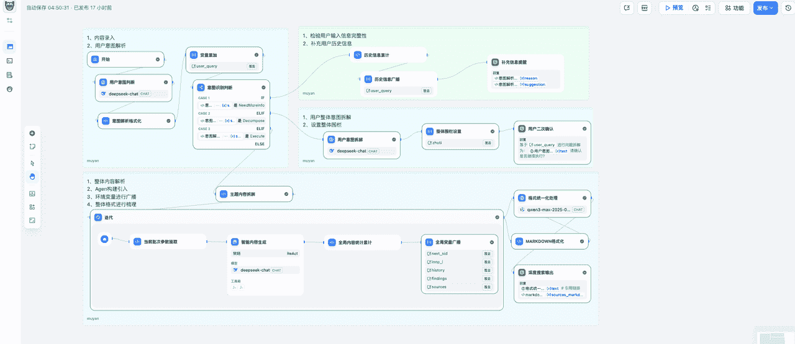
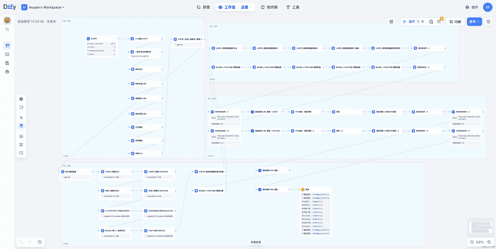

# （Dify + Tavily）基于 DeepResearch Agent 构建企业级自动化调研系统

> 来源：[https://kq4b3vgg5b.feishu.cn/docx/WWMKdUCkHoO13JxCQzXcUz3qnXf](https://kq4b3vgg5b.feishu.cn/docx/WWMKdUCkHoO13JxCQzXcUz3qnXf)

## 课程说明：

+ 体验课内容节选自《2025大模型Agent智能体开发实战》(秋季班)完整版付费课程

体验课时间有限，若想深度学习大模型技术，欢迎大家报名由我主讲的《2025大模型Agent智能体开发实战》(秋季班)


[深度搜索yml文件.zip](https://internal-api-drive-stream.feishu.cn/space/api/box/stream/download/all/G44zbbVkjoN9OhxWy7mcxNTwnff)

**此外，更多企业级大模型技术学习内容，联系⬆️助教回复“Llm”，即可进行咨询（目前咨询人数较多，助教老师在加急一一回复啦，小伙伴们发送后耐心等待一下哦🌹～）。**

## 1. 基础概念讲解

### 什么是 DeepResearch？

#### 1. 这到底是什么？

**Deep Research（深度研究）**是给 AI 加上“认真做功课”的能力：

它不是随口**回答**的一句话搜索结果，而是花一段时间在全网找资料、对照多个来源、再写出带脚注的结论。可以把它理解成“会自己找资料的研究助理”。目前三家都在做：OpenAI（ChatGPT 里的 Deep Research）、Google（Gemini Deep Research）、Perplexity（Deep Research 模式）。

#### 2. 为什么会出现这个概念？

+ **原来的 AI 更像“快问快答”**：适合查事实，不擅长**跨很多网页/文档**、要**相互印证**、还得**留出证据**的任务。

+ **真实工作里需要“研究级”产出**：投研尽调、政策扫描、竞品情报、选型评审，都强调多源信息+可核验。

+ 大厂同步产品化：Google 在 2024 年底把 Deep Research 放进 Gemini；OpenAI 在 2025 年把“Deep Research”做成 ChatGPT 的一个能力；Perplexity 在 2025 年也上线同名功能。多家同时推进，说明它不是一家公司自造的噱头，而是行业共识。

#### 3. 它“解决的痛点”到底是什么？

把“需要认真查证的复杂问题”，从“快答”升级为“有根据的研究结论”。

具体体感是三点：

1. **把分散的信息找全**：自动做多次搜索、读很多来源（新闻、报告、PDF 等），不是只看一两篇。

1. **把彼此矛盾的说法理清**：会对比、会指出争议点与不确定处。

1. **把证据带回来**：输出**可核验的引用/脚注**，方便复查与给老板/法务看。

#### 4. 它“怎么做”的

**把 Deep Research 想成一个耐心的“长流程”**：

1. **先把题目拆清楚**（要回答哪些小问题？）

1. **去找足够多的资料**（一次不够就多次搜索/多站点浏览）

1. **做对照与筛选**（哪些更权威？哪些互相矛盾？）

1. **写出可复查的结论**（分点表达+脚注/来源列表）

1. **说明边界**（哪里还不确定、还需要人来判断）

— 这也是 OpenAI、Google、Perplexity 官方对“Deep Research”的共同描述：多步检索→综合→带引用。

#### 5. 它和“普通联网回答/搜索”有何本质差异？

+ **目标不同**：普通联网回答追求“**快**”；**Deep Research** 追求“可信且完整”。

+ **过程不同**：普通**回答**像“一次抓取”；Deep Research 是“反复查证”。

+ **结果不同**：普通回答常只有**结论**；Deep Research 会有结构化报告+脚注。

#### 6. 适配哪些场景？

+ **投研/尽调/咨询**：行业扫描、竞品与监管比对、风险清单。

+ **市场与传播**：议题研究、辟谣与溯源、媒体背景包。

+ **科研/政策**：综述、争议点收敛、法规时间线与条款对照。

+ **技术/采购选型**：参数、口碑、TCO、SLA、社区活跃度对照表。

这些都需要多来源+可核验，**Deep Research** 正对口。Google 与 OpenAI 的官方介绍也把它定位为处理“复杂研究任务”的助手。

#### 7. 它“不是可有可无的小功能”

+ **多家落地→行业共识**：**Google**（Gemini）、**OpenAI**（ChatGPT）、Perplexity 同期推出“Deep Research”，共同强调“花时间在检索和综合上，交付带引用的综合报告”。这说明它是 AI 从“聊天”走向“能完成真正研究工作”的一步。

+ **媒体评价点**：**例如，《卫报》报道提到 OpenAI 的 Deep Research 目标是达到研究分析师级别的报告，强调时间节省与质量，同时提醒输出仍需人类核验——这是“专业工具”的定位而非玩具。**

+ **产品延展**：Google 甚至把 Deep Research 的报告做成音频播客（Audio Overviews）等衍生形态，进一步说明它承载“系统性内容”。

#### 8. 能力边界与使用提醒

+ **不是所有题**都要用 Deep Research：简单事实题用普通回答更高效；Deep Research 适合“需要证据链”的问题。

+ **不是“绝对正确”**：它仍可能误判来源或忽略少数重要证据，**要看脚注**、要抽查。官方与媒体都建议保留人类复核环节。

+ **时间换质量**：Deep Research 通常比普通回答更慢，因为确实在“做功课”。

#### 9. 总结

**Deep Research = AI** 从“会回答”升级为“会查证后再回答”。

### 什么是“大模型 Agent”？

+ “大模型”指 LLM（Large Language Model），它能理解人类语言、推理、写作。

+ “Agent”直译是“智能体、代理”，意思是能自己感知环境、做出决策、并采取行动的系统。

把两者合在一起，**大模型 Agent** 就是一种：

> 基于大语言模型驱动、能理解目标、会自己思考、会规划步骤、并能自主行动完成任务的 AI 个体。

它的核心变化是：

> 让 AI 从“被问就答” 升级成“理解意图→主动完成任务→反馈结果”。

#### 为什么会出现 Agent 这个概念？

ChatGPT 早期：

提问，它回答——但不会记住、不会行动、也不会自己去查。

现实世界的任务却往往是：

> 先找资料 → 整理数据 → 调用接口 → 汇总成报告 → 发到邮箱。

这是一条**链式动作**，不是一句话。

于是研究者发现：

> **单靠 LLM 的“文本生成”**不够，需要让模型具备“执行意识”和“连续行为能力”。

这正是 Agent 诞生的动因：

解决 LLM 只能说不能做的问题。

#### Agent 和普通 LLM 的区别是什么？

| 对比维度 | 普通 LLM | 大模型 Agent |
| --- | --- | --- |
| 思考方式 | 被动回答 | 主动规划与反思 |
| 任务形式 | 一次性问答 | 多步连贯任务 |
| 工具使用 | 不能调用外部工具 | 能调用搜索、数据库、API |
| 状态记忆 | 对话结束即忘 | 记得上下文，能连续行动 |
| 输出目标 | 生成文字 | 完成目标任务（报告、数据、执行动作） |

一句话概括：

> 普通 LLM 是“语言专家”，Agent 是“任务执行者”。

#### Agent 是怎么“思考”的（概念层）

**Agent** 的思考过程通常分四个阶段——可以用“AI 行动链”来理解：

1. **感知（Perceive）**

读懂人类输入或外部环境，比如指令、网页信息、数据库内容。

1. **思考（Think）**

拆解任务，计划执行步骤，选择可能路径。

1. **行动（Act）**

调用合适工具或外部系统执行，比如搜索、运行代码、发请求。

1. **反思（Reflect）**

检查结果是否正确，不对就重试或换方法。

这让 Agent 看起来像一个“拥有目标感的 AI 员工”，

能“先想后做、再自查”，而不是“听话就写”。

#### 它解决了哪些实际问题？

1. **连续任务问题**

让 AI 可以自动完成由多步组成的工作流程。

1. **信息更新问题**

普通 LLM 只知道训练数据； Agent 能主动联网、搜索实时信息。

1. **工具协同问题**

过去 AI 无法直接用数据库或 API； Agent 可以自己调用工具。

1. **决策透明问题**

Agent 通常记录自己的推理步骤与行动日志，方便复查。

#### 它为什么重要？

1. **智能进化方向**

语言模型只是“大脑”；Agent 是让“大脑”长出“手脚”。

—— 这是 AI 从“会说”到“会做”的必经阶段。

1. **产业转型驱动力**

有了 Agent，企业可以让 AI 完成以前要人工执行的流程：

+ 自动报告生成

+ 市场调研

+ 招聘筛选

+ 售后响应

+ 代码分析

1. **生态基础**

Deep Research、AutoGPT、LangGraph、OpenAI Agent、Dify Workflow……

这些都是 Agent 思维在不同场景的体现。

#### 类比理解

可以把 Agent 想成一位**懂事的助手**：

> 对普通 LLM 说：“帮查一下 2024 年中国 AI 投融资情况。”

> 它只会生成一段看似合理的文字。

> 但对 Agent 说同样的话，它会：

1. 规划：要查哪些网站？要统计哪些指标？

1. 行动：自己打开搜索、爬取信息、整理数据。

1. 汇报：输出一份带数据表和来源脚注的报告。

**它真的做完了一件事。**

#### Agent 的价值可以从三个维度体现：

1. **效率**——让 AI 帮人跑流程，节省时间与人力。

1. **准确**——能反复验证、对照、引用来源。

1. **拓展性**——能自动调用工具，连接任意业务系统。

所以 Agent 不是“概念新”，而是“方向正确”：

> 所有 AI 最终都要变成 Agent，

> 因为人类需要的不是“对话”，而是“行动”。

#### 总结

+ Agent = 会思考、会行动、会反思的 AI 个体。

+ 它让 AI 从被动聊天 → 主动执行。

+ 它的使命：让大模型真正变成“能干活”的智能员工。

## 2. 为什么要使用 Deep Research + Agent

> “Deep Research 本身是不是已经是一种『大模型 + 搜索』的形态？那如果是这样，为什么还要再和 Agent 结合？两者不就重复了吗？”

### 区别

#### Deep Research 的“底层定义”

**Deep Research 不是一种独立模型**，而是一种大模型的使用模式或系统形态。

换句话说，它是“大模型 + 搜索 + 推理策略 + 溯源机制”的组合。

具体包含：

1. **底座：LLM（大语言模型）**

+ 负责理解问题、规划检索策略、整合结果、撰写总结。

1. 外部感知：搜索/浏览/文件读取等工具

+ 让模型能实时访问信息，而不局限于训练语料。

1. 推理逻辑：多步思考（ReAct、ToT 等）

+ 让模型不只“一次问一次答”，而是持续查证、迭代推理。

1. **结果约束：溯源、脚注、引用**

+ 确保输出内容可验证、可追溯。

所以可以理解成：

> **Deep Research = LLM × 搜索/工具 × 多步推理 × 溯源机制**

它解决的是**“内容正确性与可信度”**的问题，

也就是让“模型回答”变成“有证据支撑的研究结论”。

#### 那既然这样，它已经是“大模型 + 搜索”了，为何还要 Agent？

关键点在于：Deep Research 解决“查得准”，但不解决“做得完”。

想象一下：

> 让 Deep Research 去研究 “欧洲 AI 合规政策”。

> 它能查一堆网页、整合出一份带脚注的分析报告。

但研究完之后呢？

+ 它不会把结论更新到企业知识库；

+ 不会生成合规清单；

+ 不会通知法务团队；

+ 更不会每周自动复查。

这些**“研究之后要落地执行的动作”**，正是 Agent 擅长的。

所以：

> **Deep Research = 帮 AI “想清楚”；Agent = 帮 AI “做下去”。**

换句话说，**结合**不是出于安全/合规动机，而是出于功能完整性：

Deep Research 让 AI 知道“什么是对的”，

Agent 让 AI 把“对的事”真正做完。

#### 从技术边界看两者不重叠

| 能力维度 | Deep Research | Agent |
| --- | --- | --- |
| 信息获取 | ✅ 主动搜索、阅读、比对 | 🔸 可调用外部工具但重点不在查 |
| 推理方式 | ✅ 多步思考、溯源验证 | ✅ 任务规划、动态决策 |
| 行动执行 | ❌ 研究后停在输出报告 | ✅ 自动执行任务（发邮件、建表、调用接口） |
| 状态记忆 | 🟡 局部上下文 | ✅ 可长期状态管理 |
| 目标导向 | ❌ 偏被动（回答或研究） | ✅ 主动（围绕目标完成任务） |
| 监督合规 | ✅ 信息层合规（引用、来源） | ⚠️ 需要额外治理（行为边界） |

> **从合规意义上讲，“Agent + Deep Research” 并不是为了“让 Deep Research 更合规”，**

> **而是为了“让研究结果能够自动进入业务闭环”。**

Deep Research 让 AI 知道“什么是对的”，

Agent 让 AI 把“对的事”真正做完。

### 结合

#### 为什么行业要结合

1. **业务层面需要结果，而不是报告**

企业真正想要的不是“研究报告”，而是“研究结论 + 对应动作”：

+ 投研 → 自动更新数据库

+ 法务 → 生成合规检查单

+ 市场 → 自动生成竞品对照表并推送 Slack

1. AI 的学习闭环需要“行动反馈”

只研究不行动，模型拿不到结果反馈；

有了行动，它能在下一次研究中调整策略。

1. **工程角度**：Agent 是“调度系统”，DR 是“子能力”

Agent 负责 orchestrate（编排）；

Deep Research 是其中一个 Tool / Sub-Agent。

这是一种系统工程的层次结构，而非功能重复。

#### 结合是让 AI 完成“从认知到行动”的闭环

这部分是核心。

AI 的演化可以用一句话概括：

> 从会说话 → 会思考 → 会查证 → 会做事。

拆开看：

| 阶段 | 技术代表 | 能力上限 | 核心问题 |
| --- | --- | --- | --- |
| 早期 LLM | ChatGPT、Gemini 基础模型 | 会聊天，会写，但容易编 | “说得好听但不一定对” |
| Deep Research | ChatGPT Deep Research 模式、Gemini Research | 查得准、讲得对、有引用 | “知道真相但不会行动” |
| Agent | AutoGPT、LangGraph、OpenAI Agent | 会执行、能自动化 | “行动快但可能方向错” |

**👉 Deep Research** 解决了“**认知准确性**”的问题，

👉 Agent 解决了“行动执行力”的问题。

但单独存在，都停在“半条命”状态：

+ 只有 Deep Research → 会查不会干；

+ **只有 Agent** → 会干但容易干错。

> 结合之后，AI 第一次能像一个人那样：

> “先查清楚，再自己去做。”

这就是人工智能**跨越“智能 → 智慧”**的一步。

#### 结合是“智能体时代”的必然结果

现在所有公司都在**做一件事**：

让 AI 能够 **“独立完成真实世界的任务”**。

任务有三个核心阶段：

1. **理解世界（理解目标）**

1. **获取知识（检索与验证）**

1. **采取行动（执行与反馈）**

对应过去的三种技术形态：

| 环节 | 技术代表 | 角色 |
| --- | --- | --- |
| 理解 | LLM | 大脑 |
| 获取知识 | Deep Research | 眼睛和记忆 |
| 行动 | Agent | 手和脚 |

这三者必须串起来，AI 才能“真正工作”。

如果只有大脑（LLM），没有眼睛（Research）和手（Agent），它永远只是个“会说话的机器”。

而一旦 Deep Research + Agent 结合，得到的是一个：

> 能自己看世界 → 思考 → 查证 → 行动 → 反思的系统。

这就是“智能体（Agentic System）”的核心定义。

因此，结合不是巧合，而是智能体演化的必经阶段。

#### 结合后的价值跃迁

| 维度 | Deep Research 单独做 | Deep Research + Agent 结合后 |
| --- | --- | --- |
| 信息质量 | 内容更可靠、有溯源 | 同样可靠，但能自动流入后续流程（决策/执行） |
| 效率 | 产出报告快，但还要人工处理结果 | 自动完成研究→汇报→落地的一体化流程 |
| 成本 | 省一半人力但仍需中层人工 | 直接变成“AI 团队成员”，成本再降 |
| 可复用性 | 研究报告静态存在 | Agent 能动态更新、周期复查、持续优化 |

一个最典型的企业应用例子：

> **在投研/咨询/市场分析中**：
> Deep Research 负责查清楚竞品和政策；
> Agent 负责根据报告内容生成汇报邮件、填 CRM、发 Slack 通知、创建任务。


> 整个过程从“半天”缩短到“十几分钟”，且全程留痕、可追溯。

# 结合的必要原因

## 需求驱动的必然性

企业不需要“能聊天的 AI”，而是“能交付结果的 AI”。

只有 Deep Research + Agent，才能提供“有根据的成果”。

## 技术演进的必然性

LLM 的上下文理解力增强（`o1/o3` 系列）→ 足以支撑长流程计划。

工具调用、内存、RAG、检索等基础组件成熟 → 可以安全组合。

所以两者结合，是整个技术栈水到渠成的结果。

## 生态竞争的必然性

OpenAI、Google、Anthropic、Perplexity 都在同时推出类似路线：

Deep Research → Agent → Agentic Workspace

说明整个行业都意识到：

“让 AI 真正能工作”才是下一阶段的门槛。

> **Deep Research 让 AI 知道该**怎么做；Agent 让 AI 真正去做。

> 两者结合，让 AI 从“聪明的回答者”变成“可信的行动者”，

> 这不是一条可选路线，而是智能体时代的必然方向。

# 技术上应该怎么选

+   一种是 👉 LLM + Deep Research：

“手动控制步骤，让模型带着检索能力帮查、帮写。”

+   另一种是 👉 Agent + Deep Research：

“模型自己规划、自己查、自己决定下一步，还能自动执行。”

## 结构本质的区别

| 对比项 | LLM + Deep Research | Agent + Deep Research |

| --- | --- | --- |

| 核心定位 | “人工驱动的研究助手” | “自主执行的研究型智能体” |

| 控制逻辑 | 人或工作流控制每一步 | 模型自己规划、决策与反思 |

| 工具使用方式 | 被动调用：按指令触发搜索 | 主动调用：按目标自发检索/试探 |

| 执行范围 | 通常停留在研究层面 | 可继续执行研究后的任务（分析→汇报→行动） |

| 状态管理 | 一次性任务 | 长生命周期，可记忆与更新状态 |

> **LLM + DR = “被动查证”； Agent + DR = “主动研究+执行”。**

## 能力差异

| 能力维度 | LLM + DR | Agent + DR |

| --- | --- | --- |

| 信息正确性 | ✅ 一样依赖 Deep Research 的查证机制 | ✅ 同样正确，但可多轮验证冲突信息 |

| 自主性 | ❌ 无（完全靠人控制） | ✅ 有（可自规划、调整策略） |

| 任务类型 | 单次问答/固定流程 | 多轮推理/复杂项目 |

| 工具编排 | 固定顺序（如搜索→整合→输出） | 动态组合（按情境多次搜索、调用不同工具） |

| 行为透明 | ✅ 高：人看得见每一步 | ⚠️ 低：需要日志与约束治理 |

| 出错风险 | 低（人把关） | 高（需防止跑偏），但可自修正 |

| 上手门槛 | 低（Prompt 即可） | 高（需设计 Agent 逻辑或框架） |

核心思想：

+   **LLM + DR** 更像“人指挥 AI”；

+   **Agent + DR** 更像“AI 自己想明白再去干活”。

## 使用体验上的区别

| 体验点 | LLM + DR | Agent + DR |

| --- | --- | --- |

| 操作方式 | 问 → 它查 → 它答 | 定目标 → 它计划 → 它多轮执行 → 它汇报 |

| 人机关系 | 是“研究主管”，AI 是助理 | 是“业务负责人”，AI 是执行团队 |

| 输出形式 | 报告/摘要/引用 | 报告 + 行动（如自动更新表格/发邮件） |

| 控制感 | 高（每步确认） | 较低（更自动） |

| 适合谁用 | 研究员、分析师、合规岗 | 自动化工程、策略岗、运营或数据团队 |

> **LLM+DR 是“开车”**，AI 给导航、报路；

> Agent+DR 是“上车”，AI 自动驾驶并自己查路况。

## 场景匹配度对比

| 场景类型 | 更适合 LLM + DR | 更适合 Agent + DR |

| --- | --- | --- |

| 📘 一次性研究报告 | ✅（用户控制节奏） | ❌（用不到自主规划） |

| ⚖️ 合规/政策汇编 | ✅（标准化强、易审计） | ❌（自动化价值不高） |

| 📊 技术选型/竞品研究 | ⚖️ 都可用 | ✅ 若要自动生成对照表与后续测试计划 |

| 🕵️♀️ 投研尽调 | ⚖️ 都可用 | ✅ 自动生成备忘录/任务/通知 |

| 🔄 周期性信息追踪 | ❌（手动重复） | ✅ 可自动监测并推送报告 |

| ⚙️ 运营/数据自动化 | ❌（输出静态） | ✅ 可调用系统、执行动作 |

**总结判断逻辑：**

+   任务标准化、高合规、结果需人工签发 → LLM + DR。

+   任务复杂、动态变化、后续要执行落地 → Agent + DR。

## 企业价值层面的区别

| 维度 | LLM + DR | Agent + DR |

| --- | --- | --- |

| 价值定位 | 提升“研究效率与准确度” | 提升“决策到执行的整体效率” |

| ROI 周期 | 快速见效，短期 ROI 高 | 成长期投入大，长期 ROI 更高 |

| 对人角色影响 | 辅助型：让分析师更快 | 替代型：让系统自动跑任务 |

| 治理与风险 | 容易管控、低风险 | 需治理（行为边界、审计日志） |

| 战略意义 | 局部提效 | 架构性变革：从信息工具 → 智能执行体 |

重点差异：

> LLM+DR 解决“知道得更准”，

> Agent+DR 解决“知道后能自动去做”。

## 选型建议

| 决策问题 | 优先选谁 |

| --- | --- |

| 任务清晰、可标准化 | LLM + DR |

| 任务模糊、需探索 | Agent + DR |

| 合规要求高 | LLM + DR |

| 自动化收益大 | Agent + DR |

| 团队以分析师为主 | LLM + DR |

| 团队有工程能力 | Agent + DR |

| 目标：信息更可靠 | LLM + DR |

| 目标：流程更智能 | Agent + DR |

**最优实践**：

多数成熟企业最终会采用“混合策略”：

+   顶层用 LLM + DR 工作流 做标准化研究与审批；

+   局部高价值节点用 Agent + DR 做智能探索与执行闭环。

> LLM + Deep Research = 让 AI 成为“可信的信息助手”；

> Agent + Deep Research = 让 AI 成为“能独立完成研究与行动的员工”。

前者稳、可控，适合“研究驱动的决策”；

后者灵、闭环，适合“行动驱动的智能化”。

# 3. 企业级自动化调研系统落地难点剖析

## 难点一：信息复杂、问题模糊 —— 系统无法自主“理解调研目标”

### 为什么难

企业调研不是固定问答，比如：

> “评估中国新能源行业的竞争格局”

> 这个问题其实包含了几十个子问题：

+   谁是主要企业？

+   市场规模多大？

+   政策趋势如何？

+   投融资活跃度怎样？

**传统系统或普通大模型**只能“按关键词搜索”，不知道该拆成哪几个维度。

结果不是信息缺失，就是方向跑偏。

### 举例

> 让模型调研“AI 医疗监管政策”，它可能：

+   找到几篇新闻稿；

+   摘**抄出几条**法规；

但不会区分“药监局文件”和“二手评论”，也不会知道“哪些条文有实际约束力”。

### Agent + Deep Research 的解决方式

+   **Agent 负责“任务规划”**：能先理解主题，自动分解为若干研究子任务（市场 / 法规 / 技术 / 投资）。

+   Deep Research 负责“查证与脚注”：每个子任务再用多源检索和溯源机制查清楚。

+   结合后：系统就能像一个研究员一样“先想清楚要查什么，再去查”，而不是盲搜。

## 难点二：信息真伪混杂、数据冲突 —— 系统无法判断“哪个可信”

### 为什么难

在真实世界里，信息常常相互矛盾。

例如：

+   不同报告给出的“中国 AI 行业市场规模”差 3 倍；

+   不同分析师对政策走向完全相反。

传统搜索或普通 LLM：

+   只会“平均化”结果；

+   不会说明冲突来源；

+   也不标明引用。

结果企业领导看完报告：“这数据哪来的？信得过吗？”

### 举例

报告写着“中国 AI 投融资规模 3000 亿”，但没脚注。

一查才发现是 2019 年旧数据，且来自自媒体。

### Agent + Deep Research 的解决方式

+   Deep Research 部分会：

+   自动比对多方来源；

+   给每个结论加脚注、快照；

+   标出“冲突信息”和“不确定区”。

+   **Agent 部分**会：

+   在出现冲突时主动“扩展检索范围”；

+   或启动“再验证任务”（比如访问官方数据）。

→ 让系统不仅给答案，还解释为什么这个答案可信、哪里有疑点。

## 难点三：研究过程难复盘、无法审计 —— 结果“黑箱化”

### 为什么难

企业级系统最怕的不是“答错”，而是答对也解释不清楚怎么来的。

传统做法要么：

+   让人复制网页截图，效率极低；

+   要么模型直接输出摘要，**过程全丢失**。

审计、复查、复用都没法做。

### 举例

合规部门问：“这份报告的第三条政策结论从哪来的？”

工程师答：“是模型总结的，也不清楚。”

—— 这就叫不可复现风险。

### Agent + Deep Research 的解决方式

+   Deep Research 提供可追溯的引用链：每条信息都绑定来源 URL、时间戳、快照。

+   **Agent 负责记录全过程日志**：检索、筛选、整合、判断的每一步都留痕。

+   最终形成“研究轨迹 + 证据包”，既能自动生成报告，也能被法务/合规追溯。

## 难点四：研究停在报告层面，无法自动进入业务闭环

### 为什么难

即使系统能生成好报告，企业还需要：

+   把结论推到看板；

+   更新数据库；

+   生成任务单；

+   发给相关负责人。

传统方案**要人手动**搬运结果，断层严重。

### 举例

> 市场调研系统生成一份竞品分析报告，但没人接手执行；

> 一周后市场团队又手动做了一份，重复劳动。

### Agent + Deep Research 的解决方式

+   **Agent** 可以直接调用工具/API，把研究结果“自动化落地”：

+   生成对照表 → 写入数据库；

+   发现风险 → 自动发警报；

+   新政策更新 → 触发任务。

+   **Deep Research** 保证结论可信。

→ 两者结合后，AI 不只是“写报告”，而是真正“推动企业行动”。

> 企业调研难，不在“AI 不会写”，而在“它不会查、不会证、不会留痕、不会落地”。

> Agent + Deep Research 把这四件事补齐：

+   Agent 让系统能 **规划与执行**；

+   **Deep Research** 让系统能 查清楚并留证据。

二者结合，才真正让“AI 从能说话 → 能做研究 → 能推动行动”。

# 4. DeepResearch Agent 核心原理与系统架构概览

## DeepResearch Agent 的核心原理

DeepResearch Agent = Agent（会行动） + DeepResearch（会查证）

它是一个“自动研究员”系统，能根据目标去规划、执行、查证、整合并得出可信结论。

### Agent 的三层结构

| 层级 | 功能 | 说明 |

| --- | --- | --- |

| 指令层（Decision Layer） | 决策与规划 | 负责理解任务目标、拆分子任务、生成查询问题，并判断何时继续或停止。相当于“大脑”，决定研究方向与节奏。 |

| 工具层（Action Layer） | 行动执行 | 调用各类工具实现目标，如搜索引擎、网页阅读、PDF 解析、知识库检索、数据总结等。相当于“手脚”，完成实际动作。 |

| 记忆层（Memory Layer） | 信息整合与反思 | 保存历史搜索结果、证据链、上下文与结论，让系统能从历史中学习和避免重复。相当于“记忆与经验”。 |

**工作方式**

> 任务输入 → 指令层拆解问题 → 工具层执行查找 → 记忆层保存并总结 → 指令层反思与决策下一步。

## DeepResearch 的执行链路（研究型流程）

DeepResearch 本身是一条“可信研究链路”，用来确保每个结论都有证据、有溯源、有可复查性。

可以把它理解为 Agent 的“大脑研究思路”。

### DeepResearch 执行链路（共 6 步）

| 阶段 | 技术逻辑 | 作用说明 |

| --- | --- | --- |

| 1. 任务理解（Task Understanding） | 分析用户问题 → 拆分研究维度（政策、市场、技术、竞争、风险等） | 让系统清楚“要查什么”，确定研究边界。 |

| 2. 查询规划（Query Planning） | 生成多维查询（关键词扩展、时间窗、语言、站点过滤） | 确保搜索覆盖全面，不遗漏重要来源。 |

| 3. 信息获取（Information Retrieval） | 调用搜索/浏览工具 → 打开网页/PDF → 读取正文 | 把原始数据抓取回来，为后续阅读和分析准备。 |

| 4. 内容抽取与理解（Extraction & Reading） | 对文本结构化解析 → 提取关键事实、表格、时间、数据点 | 从杂乱内容中抽出“可比对的信息单元”。 |

| 5. 证据验证与整合（Evidence Validation） | 多来源比对 → 检测冲突 → 添加脚注与时间线 | 确保结论有出处、可溯源、可审计。 |

| 6. 结论生成（Synthesis & Reporting） | 生成结构化研究报告（含脚注、快照、分歧点、局限） | 产出最终“可信结论”，可直接用于企业决策或触发后续动作。 |

#### 链路逻辑图

```
任务目标
   ↓
任务理解 → 查询规划
   ↓
信息获取（搜索/抓取）
   ↓
内容抽取（阅读/整理）
   ↓
证据验证（多源对比 + 溯源）
   ↓
结论生成（带脚注的报告）
```

## 两者结合的工作机制

| 模块 | DeepResearch 负责 | Agent 负责 | 结合后结果 |

| --- | --- | --- | --- |

| **目标理解** | 拆研究维度 | 制定任务计划与执行顺序 | 自动形成研究路线图 |

| **搜索与阅读** | 确保来源可信、信息完整 | 调用工具完成执行 | 自动化调研执行 |

| **验证与总结** | 生成脚注、快照、冲突报告 | 判断是否继续或终止 | 保证可信度与效率 |

| **结果输出** | 结构化报告 | 可触发下游任务（发报告/写数据库） | 实现从“查到”到“用上”的闭环 |

# 5. Tavily 实时搜索引擎详解

## Tavily 是什么？

Tavily 是一个专门为大模型（LLM）和 AI Agent 设计的实时搜索引擎。

可以把它理解成：

> 🔍 「让 AI 真正能上网、查得到、读得懂、引用得出的搜索系统」。

### 普通搜索引擎 vs Tavily 的区别

| 项目 | 普通搜索（Google/Bing） | Tavily |

| --- | --- | --- |

| 面向人类 | 展示网页、靠人点击阅读 | ✅ 面向 AI，直接返回干净内容 |

| 返回内容 | 只给标题+链接 | ✅ 给摘要、正文、时间、脚注 |

| 是否理解问题 | ❌ 不理解问题背景 | ✅ 理解自然语言查询 |

| 是否能多轮交互 | ❌ 不行 | ✅ 可被 Agent 调用，多轮查证 |

| 是否支持网页提取 | ❌ 需要自己爬取 | ✅ 内置内容提取与清洗 |

| 是否可控 | ❌ 结果随机 | ✅ 可设白名单、时间范围、域名限制 |

总结：

> Tavily 是“AI 搜索 + 网页阅读 + 内容提炼 + 引用脚注”的一体化服务。

> 它让大模型不再“瞎编”，能“查清楚、讲明白”。

## 为什么会出现 Tavily？

### 1️背景问题：大模型“不知道现在的世界”

+   ChatGPT、Claude、Qwen 等模型，知识止步于训练时间。

→ 例如：问“2025 年中国新能源政策”，它可能回答 2023 年的旧内容。

+   模型没法实时上网查新数据，只能“预测文本”——这就是“幻觉”。

### 企业痛点

在实际应用里：

+   投研要最新新闻；

+   咨询要最新政策；

+   品牌要监测舆情；

+   产品团队要分析竞品文档。

但普通大模型的“知识库”老旧、内容不可信，**无法满足“实时 + 可验证”**的需求。

### 于是 Tavily 出现了：

> 它让 AI 拥有“眼睛”和“手”：

> +   能实时上网看到最新的网页；

> +   能自己去读、去提取、去判断真假；

> +   能把证据、脚注和摘要整理好交给模型。

这就是 Tavily 诞生的意义。

它解决了 AI 知识老化 和 幻觉不可验证 的根本问题。

## 三、Tavily 能做什么？

### Tavily 的四大能力

| 能力模块 | 说明 | 举例 |

| --- | --- | --- |

| 🧭 实时搜索 | 输入自然语言问题，Tavily 自动上网搜索、筛选、整合最新内容。 | “2025 年 10 月特斯拉新电池技术有哪些进展？” |

| 🧩 网页内容提取 | 给出网页链接，提取干净正文（去广告、保留表格、留脚注）。 | “提取《AI 安全标准白皮书》正文内容” |


# Tavily 功能与应用

## 核心功能

| 🕸️ 站点爬取 | 批量抓取整个网站内容（带层级限制、正则过滤）。 | “抓取并分析中国证监会公告网站最近政策” |

| 🗺️ 站点结构探索 | 帮快速获取网站地图和目录层次。 | “这个文档网站有哪些分类、多少页？” |

### 四种典型应用场景

企业研究部门（投研/咨询/战略）

> 用 Tavily 实时收集行业政策、公司动态、新闻舆情，自动生成带脚注的调研报告。

AI 助手 / Agent 应用

> 让的 AI 可以“实时查资料”，不是只靠旧知识回答。

> 例如一个“新闻分析 Agent”，每天调用 Tavily 自动抓新闻并分析趋势。

知识库构建 / RAG 更新

> 把 Tavily 提取到的网页正文，直接导入到企业内部的向量数据库（如 Qdrant、Pinecone），让知识库保持新鲜。

监控与自动化分析系统

> 定期触发 Tavily 搜索，监测品牌、产品、法律变更或技术论文更新。


## Tavily 怎么用？

`https://www.tavily.com/`

### 第一步：注册账号，获取 API Key

+   官网 `tavily.com` 注册；

+   免费账户有一定额度（约 1000 次/月）；

+   拿到的 `API Key`。

### 第二步：选择调用方式

Tavily 支持：

+   直接调用网页界面（适合非程序员）；

+   通过 `API` / `Python SDK`（适合开发者）；

+   在各类框架中一键集成：

+   `LangChain`（工具模块已内置）；

+   `Dify`（官方插件）；

+   `n8n`（可用现成节点）。

### 第三步：调用逻辑（非代码版思路）

> 举例：想知道「2025 年 Qwen 开源模型的最新版本」。

Step 1：AI（或）调用 Tavily 搜索接口

+   关键词：“Qwen3 模型 最新 发布 2025”

+   过滤条件：时间=近一个月、语言=中文。

Step 2：Tavily 自动抓取前几条网页，提取正文。

+   去掉广告、模板、重复内容。

Step 3：返回结果（AI 可直接使用）

+   文章摘要、引用来源、`URL`、发布时间。

+   有些结果附带“模型生成的综合答案”。

最终模型看到的就是一份「干净、可引用」的材料包。

→ 可以让它用来生成报告、总结趋势、甚至自动发日报。

## Tavily 的优势总结

| 优势 | 意义 |

| --- | --- |

| ✅ 实时性 | 拿到最新网页内容，避免模型“知识过期” |

| ✅ 可信度 | 自动生成脚注与来源，结果可验证 |

| ✅ 一体化 | 搜索 + 提取 + 清洗 一步到位 |

| ✅ 易集成 | 直接支持 `LangChain`、`Dify`、`n8n`、`Flowise` |

| ✅ 成本低 | 访问量计费，免费额度友好 |

| ✅ 可控性 | 可设置白名单、过滤低质量站点 |

## 补充与普通搜索引擎的区别

### 核心区别

> ✅ 普通搜索接口是“给人看的搜索结果”。

> ✅ Tavily 是“给 AI 模型用的结构化知识输入”。

也就是说——

+   `Google`、`Bing` 搜出来的是网页链接 + 简介，需要人点开、自己读。

+   Tavily 搜出来的是 AI 可直接理解、带正文、摘要、脚注的内容包，机器能立即用。

## 从功能结构上看区别

| 对比项 | 普通搜索 `API`（`Google` / `Bing` / `SerpAPI`） | Tavily（AI 搜索引擎） |

| --- | --- | --- |

| 设计目标 | 让人“看到链接，点击阅读” | 让 AI “拿到干净内容，直接理解” |

| 返回结果 | 只给出标题、`URL`、描述摘要（`snippet`） | 给出标题、`URL`、正文片段、清洗文本、时间、脚注引用 |

| 后续步骤 | 需要自己再写爬虫抓内容 | Tavily 自动完成抓取、提取、去广告、清洗 |

| 输出形式 | 非结构化（文本+链接） | 结构化（`JSON` 含文本、图片、来源、时间、可靠度） |

| 可控性 | 只能靠关键词调整搜索结果 | 可设置时间、国家、语言、域名白/黑名单、搜索深度 |

| AI 友好度 | `AI` 拿到后仍要解析网页 | Tavily 的结果可以直接送进 `LLM`、`RAG` 或 `Agent` |

| 引用机制 | 无脚注 | 每个段落自带来源 `URL`，可自动生成引用 |

| 内容新鲜度 | 实时（但仅到搜索层） | 实时 + 内容抽取层（完整网页内容） |

## 例子

场景：

要让 AI 研究 “2025 年中国新能源汽车市场最新政策”。

### 用普通搜索 API：

调用 `Bing` `API`，会得到类似这样的结果：

```
{
  &quot;title&quot;: &quot;2025年新能源政策调整 - 搜狐新闻&quot;,
  &quot;url&quot;: &quot;https://www.sohu.com/a/789458787_121118&quot;,
  &quot;snippet&quot;: &quot;中国工信部发布新的新能源汽车支持计划...&quot;
}
```

接下来还得：

1.  写爬虫去访问链接；

1.  提取正文；

1.  去掉广告；

1.  控长度；

1.  才能把文本交给模型分析。

——这就是传统“搜索接口”的现状。

### 用 Tavily：

Tavily 直接返回结构化结果：

```
{
  &quot;title&quot;: &quot;工信部发布2025年新能源汽车政策&quot;,
  &quot;url&quot;: &quot;https://www.sohu.com/a/789458787_121118&quot;,
  &quot;content&quot;: &quot;根据工信部最新公告，2025年起新能源汽车购置补贴...&quot;,
  &quot;published_date&quot;: &quot;2025-10-22&quot;,
  &quot;raw_content&quot;: &quot;（清洗后的网页全文）&quot;,
  &quot;chunk_id&quot;: &quot;1&quot;,
  &quot;citations&quot;: [&quot;https://www.sohu.com/...&quot;],
  &quot;answer&quot;: &quot;2025年起中国将对新能源汽车税收政策进行分级调整...&quot;
}
```

换句话说：

> Tavily 已经帮完成了“搜索 + 抓取 + 提取 + 清洗 + 摘要 + 脚注”一整套流程。

> AI 模型拿到这个结果，就能直接分析、对比、引用，不需要额外的工程。

## 从系统结构上看

### 普通搜索接口（人类搜索链路）

```
用户输入关键词
   ↓
搜索引擎返回链接（Link + Snippet）
   ↓
用户点击并阅读网页
   ↓
人工筛选 + 整理信息
```

### Tavily（AI 搜索链路）

```
AI 输入自然语言问题
   ↓
Tavily 理解问题 → 多维检索
   ↓
自动抓取网页内容
   ↓
清洗、抽取正文、生成摘要
   ↓
返回结构化 JSON + 来源脚注
   ↓
AI 模型直接读取并生成答案
```

这就是 “以人为中心的搜索” → “以 AI 为中心的搜索” 的根本差别。

## 实际应用的差异

| 场景 | 普通搜索接口的局限 | Tavily 的优势 |

| --- | --- | --- |

| 💡 `AI` 问答 / `Agent` | 模型拿到的只是 `URL`，没法直接回答 | Tavily 提供文本片段，模型直接引用生成答案 |

| 📚 知识库构建 / `RAG` | 要自己爬网页和清洗内容 | Tavily 一次就能返回干净文本，直接入库 |

| 🕵️ 调研与报告生成 | 搜索 + 手动整理 | Tavily 自动生成带脚注的结构化结果 |

| ⏰ 时效信息监控 | 只能拿搜索页快照 | Tavily 返回最新正文，适合日报/周报系统 |

| ⚖️ 合规与可信引用 | 来源链丢失，难复核 | Tavily 自动生成引用脚注、时间、来源等级 |

> 💡 普通搜索接口 = “告诉去哪里看”；

> 💡 Tavily = “帮看完、总结好、带上来源交给”。

这就是 Tavily 的核心竞争力。

它让大模型、`Agent`、企业系统都能拥有“真正可验证的实时知识输入”。

> Tavily 不是取代搜索引擎，而是把“搜索结果”变成可直接供 AI 使用的知识素材。

> 它让“搜索”从一个“链接层工具”，变成一个“面向智能体的知识采集层”。

# 6. Agent 智能流程编排

## 先理解 Dify 是怎么“思考”的

Dify 的工作流其实是一种「事件驱动的可视化函数编排」。

要想把 DeepResearch + `Agent` 落地，它的工作逻辑是：

> 触发（`Trigger`） → 控制（`Logic`） → 执行（`Action`） → 记忆（`Storage`） → 反馈（`Loop`）

也就是说，Dify 不是单纯的问答工具，而是一个具备执行力的 `Agent Flow Engine`（智能体流引擎）。

所以要想让它像 `DeepResearch Agent` 一样运行，需要学会：

+   哪些节点负责“想”；

+   哪些节点负责“查”；

+   哪些节点负责“做”；

+   哪些节点负责“记”和“反馈”。

## 核心节点体系

| 节点类型 | Dify 节点名称 | 技术作用 | 在 `DeepResearch` + `Agent` 中的意义 |

| --- | --- | --- | --- |

| 🟢 触发节点 | `Trigger` / `Workflow Trigger` | 启动整个工作流 | 比如：用户输入一个问题“分析2025新能源政策” |

| 🔵 模型节点 | `LLM Node` / `Text Generation Node` | 调用大模型生成文本 | 用于“问题理解”、“任务拆解”、“生成查询关键词” |

| 🟣 工具节点 | `Web Search` / `Tavily Search` / `HTTP Request` | 访问外部世界 | DeepResearch 的灵魂：上网搜索、抓取网页、提取正文 |

| 🟤 条件判断节点 | `If` / `Switch` / `Branch` | 控制逻辑分支 | 比如：如果搜索不到结果 → 再次扩展关键词；若找到多个结果 → 进入比对流程 |

| 🟡 循环节点 | `Loop` / `For Each` | 遍历数据集或任务 | 比如：对多个网页逐一提取摘要、对比差异 |

| 🧩 记忆与存储节点 | `Variable` / `Data Storage` / `Knowledge Base` | 保存中间结果或历史上下文 | 保存搜索结果、脚注、提取内容、最终结论 |

| 🟠 输出节点 | `Response` / `Text Output` | 返回最终输出结果 | 输出带引用的报告、总结或表格 |

## `DeepResearch` + `Agent` 的逻辑核心：流程控制思想

让 Dify 真正像“研究员”一样工作，需要掌握 3 套核心逻辑机制👇

### ① 问题拆解逻辑（Decomposition）

> 把复杂的研究问题拆成子问题。

实现方法：

+   用 `LLM` 节点 生成子问题列表（比如政策 / 市场 / 技术 / 风险）。

+   用 `Loop` 节点 遍历这些子问题。

+   每轮子问题进入 Tavily 搜索并收集结果。

举例：

```
主问题: 评估2025中国新能源政策影响
↓
子问题: 
1. 政策主要方向
2. 财税支持条款
3. 产业链影响
4. 外资企业受限政策
```

### ② 查证逻辑（Verification）

> 对不同来源内容进行比对、提取和可信判断。

实现方法：

+   Tavily 节点搜索多源；

+   `LLM` 节点整合结果；

+   `If` 节点判断“是否冲突”；

+   若冲突 → `Loop` 回到再检索；

+   否则 → 存入可信来源。

举例：

> 若两篇报道的数据不一致，`LLM` 节点调用提示词：「比较来源差异，解释可能原因并标注可信度」。

### ③ 溯源逻辑（Citation）

> 每个结论必须能回溯到原始网页、来源或快照。

实现方法：

+   Tavily 返回 `JSON` 中自带 `URL`；

+   用 `Variable` 节点保存所有 `URL`；

+   `LLM` 节点在生成报告时调用这些变量；

+   自动生成「脚注区」。

举例：

> “根据工信部政策公告（来源：`tavily_url_1`），2025年补贴将调整为按碳排系数计算。”

## 要理解的 Dify 技术机制

| 技术能力 | 说明 | 对 `DeepResearch` + `Agent` 的意义 |

| --- | --- | --- |

| 🧠 上下文变量传递机制 | 节点之间的数据通过 `$json.xxx` 或 `$memory.xxx` 传递 | 控制搜索结果、脚注、标题动态传入模型 |

| 🔄 `Prompt` 模板化 | 支持用模板语句动态生成提示词 | 可在不同环节使用不同提示语风格（拆解、总结、比对） |

| 💾 `Memory` / 知识记忆模块 | 在多轮工作流中保持上下文 | 支持多步查证、反思、再查的逻辑 |

| ⚖️ `Flow` 控制与条件分支 | 用 `If` + `Loop` 控制复杂路径 | 避免死循环或重复搜索 |

| 🔌 工具集成（Tools Hub） | `Tavily`、`Serper`、`Arxiv`、`WebPilot`、`Scraper` 等 | 增强 DeepResearch 的“外部感知能力” |

| 📊 数据类型系统 | 支持文本、数组、`JSON`、数字等 | 便于结构化存储搜索结果 |

## 知识铺垫建议

1️⃣ 掌握 `Prompt` 思维

> 会写“系统提示 + 任务指令 + 输出格式”，尤其是分阶段指令。

> （比如“只输出子任务列表”，“只输出表格对照格式”。）

2️⃣ 理解数据流

> Dify 的每一个节点都像“一个函数”，输入是什么、输出是什么，一定要清楚。

3️⃣ 熟悉条件控制

> DeepResearch 往往需要“查不到 → 再查”，要能设计 `if` / `loop` 流程，不死循环。

4️⃣ 会用 `Variable` / `Memory`

> 保存中间信息，如 Tavily 的 `URL`、脚注数组、已总结内容。

5️⃣ 熟悉工具调用逻辑

> Tavily 用于实时搜索；

> `HTTP Request` / `Scraper` 用于内容抓取；

> `Knowledge` 用于存结果；

> `LLM` 节点用于“分析与综合”。

## 其他实现框架

### 先对齐概念

“`Agent` + `DeepResearch`” 本质上包含两层能力：

| 能力层 | 定义 | 关键作用 |

| --- | --- | --- |

| `Agent` 层（行动智能） | 会拆任务、调用工具、执行循环、判断是否继续 | 决策 + 流程调度 |

| `DeepResearch` 层（查证智能） | 会实时搜索、提取、比对、整合、有脚注 | 查找 + 可信结果输出 |

所以要落地一个完整系统，无论用什么框架，都得具备这两层：

“`Agent` 框架” + “具备搜索与查证插件（如 `Tavily`、`Serper`、`WebPilot`）”。

### 当前能实现 `Agent` + `DeepResearch` 的主流框架

| 框架名称 | 核心定位 | 技术成熟度 | 是否可可视化 | 适合对象 |

| --- | --- | --- | --- | --- |

| `Dify` | 可视化智能体编排平台 | ⭐⭐⭐⭐ | ✅ 全图形化 | 非程序员 / 快速原型 |

| `LangChain` + `LangGraph` | `Python` `Agent` 框架（标准逻辑管线） | ⭐⭐⭐⭐⭐ | ❌ 代码驱动 | 技术开发者 |

| `AgentScope`（通义） | 企业级多智能体框架 | ⭐⭐⭐⭐ | 半可视化（`DSL`） | 想构建复杂 `Agent` 协同系统 |

| `CrewAI` | 多 `Agent` 协作框架（基于角色+任务） | ⭐⭐⭐⭐ | ❌ 纯代码 | 团队型 `Agent` 场景 |

| `Flowise` | 类 `Dify` 的开源可视化编排器 | ⭐⭐⭐ | ✅ 可视化 | 技术中级用户 |

| `AutoGen` (微软) | 多 `Agent` 对话式协作 | ⭐⭐⭐ | ❌ | 对话型研究项目 |

| `LlamaIndex` | 信息抽取 / 索引导向的 `Agent` 执行 | ⭐⭐⭐⭐ | ❌ | `RAG` + 调研任务型项目 |

### 他们在 `DeepResearch` 模式中的分工对比

| 框架 | “`Agent`” 角色 | “`DeepResearch`” 实现方式 | 可扩展性 | 典型使用场景 |

| --- | --- | --- | --- | --- |

| `Dify` | 可视化节点逻辑，内置 `LLM` `Agent` | `Tavily` / `WebPilot` 节点调用，自动整合内容 | 中等（通过 `HTTP` / `API` 扩展） | 快速构建企业调研工作流 |

| `LangChain` + `LangGraph` | `Chain` + `Tool` + `Memory` 模型 | `Tavily` / `Serper` / `Firecrawl` 等自定义 `Tool` | 极强（自定义 `Class`） | 构建底层“`DeepResearch Agent SDK`” |

| `AgentScope` | `LLM` + 多 `Agent` 协作编排 | 插入搜索、数据库 `Agent` 子模块 | 强 | 多部门协作型 AI 系统 |


| **CrewAI** | 多角色 Agent（Leader + Researcher + Writer） | 调用外部检索插件，角色间分工查证 | 强 | 像真实团队一样分角色研究 |
| --- | --- | --- | --- | --- |
| **Flowise** | 可视化节点流 | LangChain Node + Tavily Tool | 中 | 想用可视化但比 Dify 灵活的用户 |
| **AutoGen** | 多Agent对话反思机制 | 通过 `ToolAgent` 调 Tavily 或浏览器 | 一般 | 学术研究、实验验证 |
| **LlamaIndex** | `QueryEngine` / `Retriever` | 通过 Tavily + 文档索引结合 | 强 | 构建长期可复查的研究数据库 |

### Dify 与其他框架的“深度对比表”

| 对比维度 | **Dify** | LangChain / LangGraph | **AgentScope** | **CrewAI** | **Flowise** |
| --- | --- | --- | --- | --- | --- |
| **上手门槛** | ⭐⭐（低） | ⭐⭐⭐⭐（需要编程） | ⭐⭐⭐⭐ | ⭐⭐⭐ | ⭐⭐ |
| **可视化操作** | ✅ 完整可视化 | ❌（纯代码） | ⚙️ 半可视化 DSL | ❌ | ✅ |
| **逻辑编排能力** | 强（节点+变量+循环） | 极强（完全自定义） | 强（多Agent协作） | 中 | 强 |
| **插件生态** | Tavily、Serper、Arxiv、HTTP、WebPilot | 🔥 超丰富（几乎所有开源API都能接） | 以通义为主 | 社区扩展 | 与 LangChain 共享 |
| **典型优势** | 无需写代码即可做复杂流程；可快速部署 | 自由度最高、代码可控 | 企业级协作多Agent系统 | 角色扮演型研究流 | 开源低门槛 |
| **适合人群** | 教育、企业落地、低代码开发 | 技术开发者、研究型团队 | 企业AI部门 | 内容生成团队 | 半开发者 |
| **缺点** | 自定义逻辑深度有限 | 需要代码实现，复杂度高 | 依赖多Agent框架生态 | 无图形化可视 | 可视化但生态小 |
| **理想使用场景** | 搭建企业调研系统 / 教学演示 / 原型开发 | 自研 AI Agent 平台 / 深度研究 | 多部门自动化协作 | 写作 / 团队调研 | 教学与实验室研究 |

# 7. 全链路实战操作以及常见问题



## 超多工作流免费领取使用




# 8. 后续技术发展方向

## DeepResearch 的核心发展方向：

**从“检索+总结”工具 → 演化为“自主研究体（Autonomous Research System）”**

换句话说，DeepResearch 的发展不再停留在：

> “帮你上网查一查，然后输出一个总结”。

而是朝着一种新的技术形态前进：

> 它能自己规划研究问题、主动收集数据、验证信息、更新知识、持续学习。

这个方向一般被称为：

> **Self-Learning Research Agent（自学习研究智能体）**

或者企业场景下叫：

> **Autonomous Research Pipeline（自主化研究流水线）**

## 二、技术演进的核心特征

1. 具备持续感知能力（Continuous Awareness）

DeepResearch 不再等人来提问，而是能自己检测“研究主题的新变化”。

例如：政策变动、市场数据更新、竞争对手发布新闻，它能主动触发研究任务。

→ 这意味着 DeepResearch 将逐步具备“主动信息捕获”功能。

1. 具备知识积累与演化机制（Knowledge Evolution）

它会保存每次研究结果，持续更新一个“研究记忆库”，

让下一次调研能引用旧结论、对比变化。

→ 这意味着系统开始具备“自成长”特征。

1. 具备自动验证能力（Self-Verification）

不再单纯输出答案，而是自己去核实信息的真实性，

比如跨来源比对、时间线验证、内容冲突检测。

→ 这意味着研究结果更可靠、可复查。

1. **多Agent 协同与分工机制（Collaborative Reasoning）**

未来的 DeepResearch 不会是一个 Agent，而是一组：

+   一个负责检索、

+   一个负责验证、

+   一个负责整合、

+   一个负责报告。

→ 形成自动化的“研究团队”。

## 技术与伦理问题

### 1. 结果信任与可追溯性问题（Trust & Traceability）

当 DeepResearch 系统具备自主学习能力时：

+   它的研究路径不再由人直接控制；

+   结论来源可能经历多轮推理、再加工；

+   用户难以清晰判断“这结论从何而来”。

这将带来：

+   监管和审计难度显著上升；

+   企业或机构难以证明其研究报告的合规性；

+   若出现错误结论，责任边界难以界定。

### 2. 信息污染与模型偏置问题（Bias & Contamination）

随着 DeepResearch 持续自动抓取外部数据：

+   网络信息质量参差不齐；

+   模型会不知不觉吸收带偏见或错误的信息；

+   若没有清洗机制，错误知识会被循环强化。

最终会出现一种“研究自污染”：

系统的知识库越来越庞大，但准确率在下降。

### 3. 算力与成本问题（Cost & Scalability）

一个持续运行的自主研究体意味着：

+   持续占用 API 调用、搜索接口、存储空间；

+   如果多Agent 并行运行，算力和成本会快速飙升；

+   对普通企业或教育项目而言将难以长期维护。

这会催生新的需求：

→ “轻量化 DeepResearch 引擎”，

→ “低成本长期调研缓存机制”。

### 4. 知识产权与内容边界问题（Legal & Ownership）

DeepResearch 会自动提取网页正文、报告片段、政策文件等内容。

但如果没有合规过滤机制：

+   抓取的内容可能涉及版权；

+   若再被生成报告输出，就触及“二次传播”法律风险。

未来系统必须具备：

+   内容来源分类（公开/授权/敏感）；

+   自动版权标记与过滤机制。

### 5. 认知过度依赖问题（Human Oversight）

当 DeepResearch 变得越来越“智能”，

人类可能逐渐失去对研究过程的介入和判断能力。

风险在于：

+   系统的推理错误会在无人监督下被信任；

+   人类的“研究直觉”被替代；

+   企业决策完全依赖算法判断。

解决之道：

+   强化“人机共研”机制；

+   保留人工审核与反思环节；

+   用解释性模型记录每一步的推理依据。

## 总结

| 维度 | 未来趋势 | 潜在问题 |
| --- | --- | --- |
| **能力演化** | 从“被动搜索” → “主动研究” | 推理路径不透明，信任成本高 |
| **数据机制** | 从“一次检索” → “持续学习” | 信息污染、知识老化 |
| **智能结构** | 从“单Agent” → “多Agent 协作” | 协同复杂、状态同步困难 |
| **运维模式** | 从“人工触发” → “自动运行” | 成本与能耗显著增加 |
| **伦理合规** | 从“引用内容” → “重组内容” | 版权与审计问题加剧 |


**我们下期公开课，再见！** 👋
