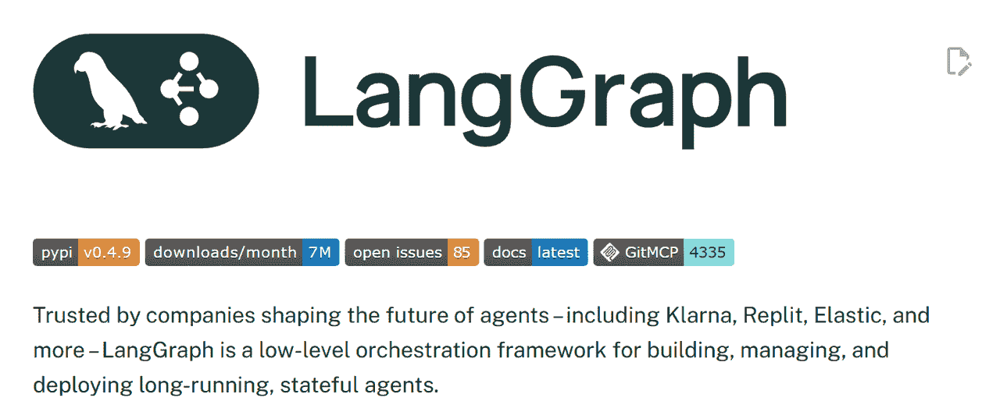
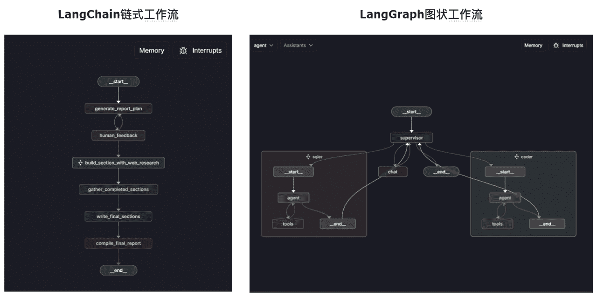

# LangGraph（README）

> 来源：[https://kq4b3vgg5b.feishu.cn/docx/UH7AdLrmLoqxwix4RwEcQhj7nWg](https://kq4b3vgg5b.feishu.cn/docx/UH7AdLrmLoqxwix4RwEcQhj7nWg)

# 框架介绍

LangGraph 是一个开源框架，专为开发状态化、多代理的大型语言模型（LLM）应用程序而设计，该框架由 LangChain 生态系统支持，旨在帮助开发者构建状态化（stateful）、多代理（multi-agent）的大型语言模型（LLM）应用程序。

该框架于 2022 年 10 月由 Harrison Chase 发起，适用于构建各种需要长期记忆和交互的 LLM 驱动应用程序，如聊天机器人、智能搜索、问答工具和执行机器人流程自动化的 AI 代理。

LangGraph和LangChain同宗同源，底层架构完全相同、接口完全相通。从开发者角度来说，LangGraph也是使用LangChain底层API来接入各类大模型、LangGraph也完全兼容LangChain内置的一系列工具。换而言之，LangGraph的核心功能都是依托LangChain来完成。但是和LangChain的链式工作流哲学完全不同的是，LangGraph的基础哲学是构建图结构的工作流，并引入“状态”这一核心概念来描绘任务执行情况，从而拓展了LangChain LCEL链式语法的功能灵活程度。

很明显，图状工作流肯定比链式工作流功能要更加灵活，功能可拓展性也更强。

> 用于创建图结构的工作流，这也是LangGraph中Graph一词的由来。

对于 LLM 开发者，LangGraph 是一个变革性的框架。它消除了为每个数据源或工具进行定制集成的需要，减少了开发时间和维护成本。

研究显示，LangGraph 支持高级用例，如构建 AI 驱动的 IDE（如 Cursor、Sourcegraph Cody）、个人助手与本地数据深度集成，以及跨不同系统的复杂工作流编排。它还减少了 LLM 的幻觉（hallucinations），通过实时数据访问提高上下文感知能力，并支持更自主的 AI 代理。

LangGraph 的多代理编排能力特别重要，支持由 LinkedIn、Uber、Klarna、GitLab 等主要公司信任的生产级代理，这验证了其可靠性和可扩展性。

> **关键引用：**

+   LangGraph 官方网站介绍

+   LangGraph GitHub 仓库

+   [LangGraph 文档概述](https://langchain-ai.github.io/langgraph/)

+   [LangGraph 记忆管理](https://langchain-ai.github.io/langgraph/concepts/memory/)

+   LangGraph 流式处理指南

+   LangGraph token-by-token 流式

+   [LangGraph 概念指南](https://langchain-ai.github.io/langgraph/concepts/agentic_concepts/)

# 快速阅览

我们团队在文档不同的位置进行了详细的介绍，您可以点击进入并查看具体的技术文档。

### ☑️ LangGraph快速入门+智能体开发实战

⭐️ LangGraph入门介绍+从零构建LangGraph智能体（课件）

⭐️ LangGraph智能体开发与部署上线流程（课件）

+   [LangGraph快速入门与智能体开发实战！工业级智能体开发、部](https://www.bilibili.com/video/BV1Kx3CzyE6Q/?share_source=copy_web&vd_source=48c040395bfe575e55afe8f0b67a097f)署、运维、前端对话全流程实践，NL2SQL、Python代码解释器开发！（视频）

### ☑️ LangGraph+MCP开发智能体

⭐️ LangGraph MCP智能体开发实战（课件）

+   [LangChain&LangGraph+MCP技术实战，双](https://www.bilibili.com/video/BV1bzMdzkERM/?share_source=copy_web&vd_source=48c040395bfe575e55afe8f0b67a097f)向MCP接入与封装双向开发实践！（视频）

### ☑️ LangGraph DeepResearch企业级开发实战

⭐️ DeepResearch应用开发实战（课件）

+   [大模型幻觉克星，DeepResearch开发实战！从零手搓DeepResearch，实操三](https://www.bilibili.com/video/BV1SZubzBEVt)类主流开发范式，谷歌开源DeepResearch国内适配开发与本地部署（视频）

---

# ❤️ 赋范社区交流群

海量硬核独家技术**干货内容**+无门槛**技术交流**~

上图**扫码**👆即刻入群！

📍 社群技术交**流氛围浓厚，**不定期开设硬**核干货&前沿技术公开课噢**~

---