# 1.LangGraph快速入门

> 来源：[https://kq4b3vgg5b.feishu.cn/docx/NP4HdwG9pomCTcxE6HKcuPuUnth](https://kq4b3vgg5b.feishu.cn/docx/NP4HdwG9pomCTcxE6HKcuPuUnth)

## 课程说明

体验课内容节选自《2025大模型Agent智能体开发实战》(夏季班)完整版付费课程

体验课时间有限，若想深度学习大模型技术，欢迎大家报名由我主讲的《2025大模型Agent智能体开发实战》(夏季班)！

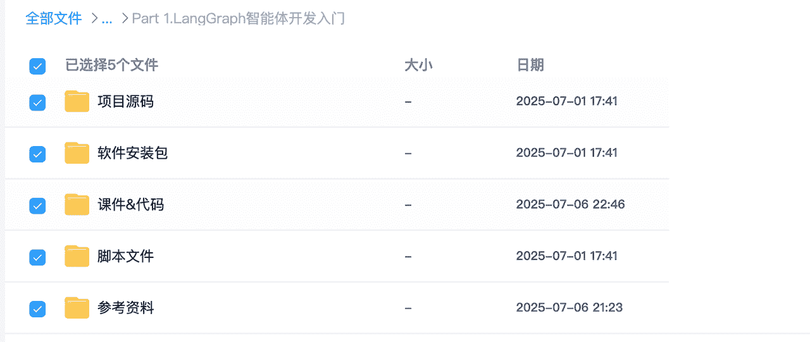


公开课全套学习资料，已上传至网盘（链接:https://pan.baidu.com/s/1Grrp1Mjc-99s_PKMbNlcYg?pwd=je4y  ）

需要更系统深入学习大模型可扫码⬆️添加助教咨询喔～

---

## LangGraph快速入门与Agent开发实战

# Part 1.LangGraph智能体开发快速入门

本期公开课，我们来深入系统讲解目前最通用、同时也是最实用的Agent开发框架：LangGraph。

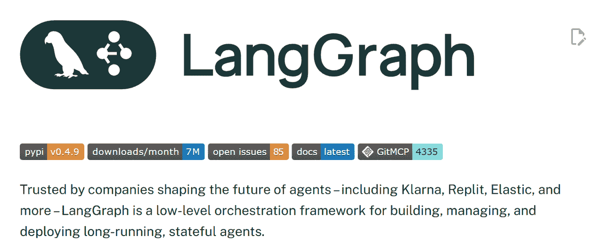

> LangGraph官网：https://langchain-ai.github.io/langgraph/

## 一、LangGraph入门介绍

### 1. LangGraph：超越LangChain的全新一代Agent开发框架

+   Agent开发首选框架：LangChain

说到现阶段目前最流行、最通用的Agent开发框架，毫无疑问，肯定是LangChain。LangChain作为2022年就已经开源的元老级开发框架，历经数年的发展，其功能和生态都已非常完善，并且拥有数量众多的开发者。在我们团队统计的今年第一季度大模型岗位JD中，有90%以上的Agent开发岗位要求掌握LangChain，可以说LangChain就是目前最通用、最流行的Agent开发框架没有之一。

+   LangChain的技术架构思路

不过，由于LangChain诞生时间较早，在2022年末，GPT-3.5刚诞生之时，开发者对大模型的想象主要是希望用其搭建一个又一个工作流，而这也成为LangChain的核心技术目标，LangChain中“Chain”就是指链、也就是搭建工作流的意思。

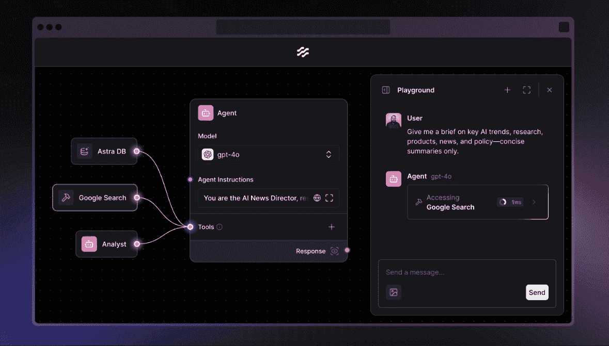

而且当时Function calling功能尚未诞生、大模型普遍性能较弱，并且2023年各类大模型百花齐放，但接口混乱、且上下文很短，开发者调用和开发都非常麻烦。因此，LangChain初始的核心架构有两层，第一层是围绕各类模型接入设置统一的接口，而为了让各类模型接入更加统一和稳定，LangChain不惜为不同的模型单独开发一个库，例如要接入Claude模型，我们就需要提前安装`langchain-anthropic`，而如果要接入DeepSeek模型，则需要安装`langchain-deepseek`。这么做虽然过程麻烦，但却能很好的保障开发过程的稳定性。

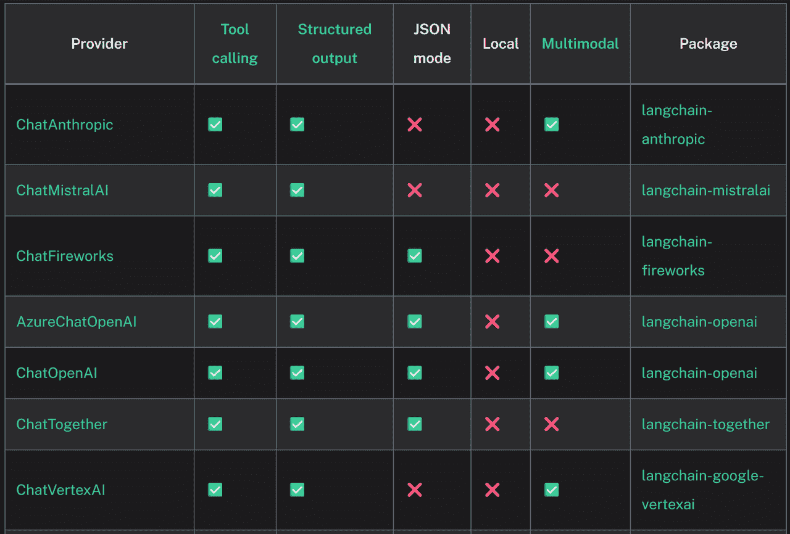

> 各类模型接入列表：https://python.langchain.com/docs/integrations/chat/

> 此外需要注意的是，LangGraph也需要使用和LangChain一样的模型接入流程。

而相比之下，OpenAI的Agents SDK则统一要求基座模型以OpenAI风格API进行接入，这必然会导致一些兼容性问题，而谷歌ADK则借助第三方库`LiteLlm`来调用基座模型，而这就会导致两个库功能不匹配的问题。因此从底层模型接入角度来看，LangChain也是最完善和最稳定的。

而在确保模型能够稳定接入后，LangChain紧接着定义了一整套LCEL（LangChain Expression Language）的语法规则，基于这个语法，开发者能够非常便捷的将提示词模板、大模型以及一些外部工具进行组合拼装，搭建一些大模型工作流，其功能定位和现在的`n8n`非常类似。

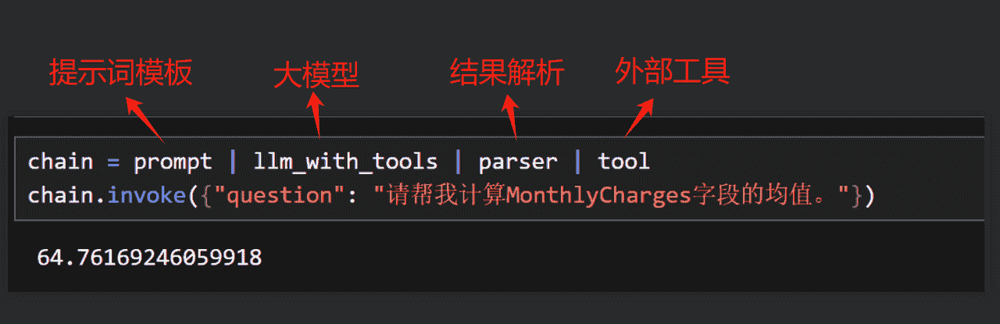

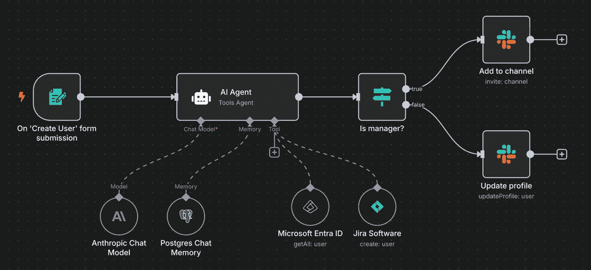

但是，大模型基座模型能力在飞速进化，例如目前最新一代的大模型，不仅拥有非常强悍的外部工具识别和调用能力，还原生就支持多工具并联和串联调用，而开发者对于大模型应用开发的需求也在快速变化，单纯的构建这种线性的工作流，可拓展性并不强。当前开发者更偏好的是“用AI开发AI”的思路，也就是我们不用定死工作流，而可以让大模型自主判断每一步该怎么做，然后实时创建一些链路，并根据运行情况随时调整。这也就是目前Agent智能体开发的核心思路。

为此，LangChain又进行了第三层封装，在Chain基础上，LangChain设置了一整套能够实时根据用户需求灵活创建Chain来完成工作的API——Agent API。借助这些API，开发者仅需将模型、提示词模板和外部工具“放一起”创建Agent，该Agent就能自动根据用户需求创建一些链来完成工作。从而避免开发者反复编写各种链的复杂工作，大幅加快的了开发效率。

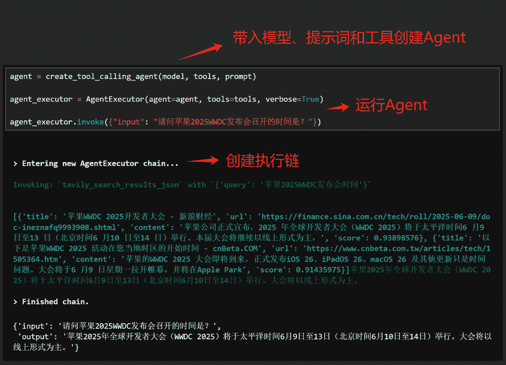

> 这种开发模式也就是目前OpenAI Agents SDK和谷歌ADK遵循的开发模式。

因此，LangChain整体架构如下：

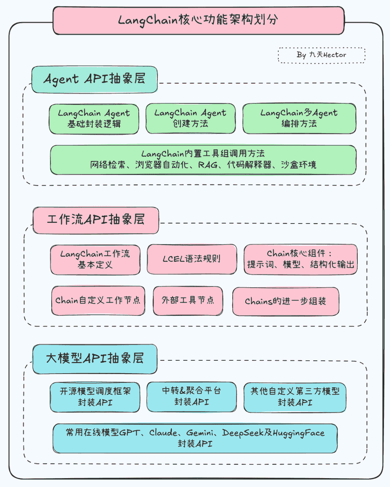

不过，伴随着Agent开发飞速发展，很快LangChain就意识到，要真正满足新一代Agent开发需求，仅靠Agent API是完全不够的，因此在23年下半年，LangChain开源了一个实验性质项目——LangGraph。

+   LangGraph核心技术概念

LangGraph和LangChain同宗同源，底层架构完全相同、接口完全相通。从开发者角度来说，LangGraph也是使用LangChain底层API来接入各类大模型、LangGraph也完全兼容LangChain内置的一系列工具。换而言之，LangGraph的核心功能都是依托LangChain来完成。但是和LangChain的链式工作流哲学完全不同的是，LangGraph的基础哲学是构建图结构的工作流，并引入“状态”这一核心概念来描绘任务执行情况，从而拓展了LangChain LCEL链式语法的功能灵活程度。

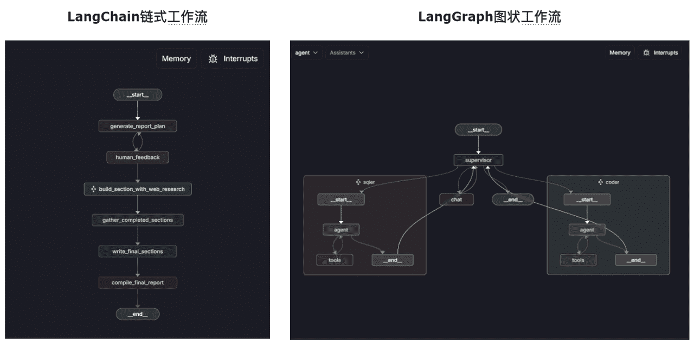

很明显，图状工作流肯定比链式工作流功能要更加灵活，功能可拓展性也更强。

> 用于创建图结构的工作流，这也是LangGraph中Graph一词的由来。

+   LangGraph的本质：LangChain的高级编排工具

不过需要注意的是，`LangGraph`是基于LangChain进行的构建，无论图结构多复杂，单独每个任务执行链路仍然是线性的，其背后仍然是靠着LangChain的Chain来实现的。因此我们可以这么来描述LangChain和LangGraph之间的关系，LangGraph是LangChain工作流的高级编排工具，其中“高级”之处就是LangGraph能按照图结构来编排工作流。

+   LangGraph的技术架构

尽管图结构看起来比链式结构灵活很多，但在实际开发过程中，要创建一个图结构却绝非易事。大家可以试想一下，要在代码环境中描述清楚一个图，至少需要清晰的说明图中有哪些节点，不同节点之间是什么关系（边如何连接），同时还需要设置各节点功能，然后才能测试上线，这个流程其实是非常复杂的，哪怕是简单的一个图也需要用很多代码才能描述清楚：

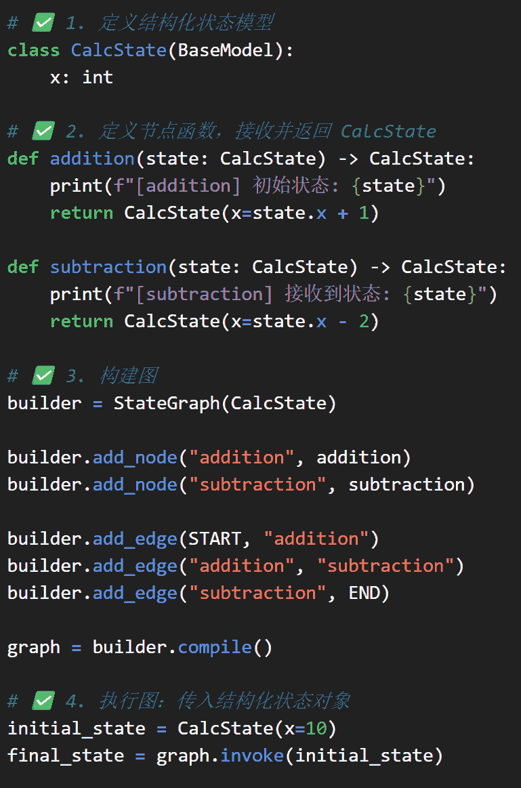

这就会导致开发效率受到影响。

> LangGraph的本质是DAG（有向无环图），但它扩展支持了“有状态循环图”，本质上是一种 可控状态机（State Machine）。

+   LangGraph的高层封装API

不过这对于LangChain来说并不难解决。LangChain生态各框架的核心思路都是“既要有底层API来定义基础功能，同时也要有高层API来加快开发效率”，就好比LangChain中既有LCEL语法、同时也有Agent API一样，LangGraph也提供了基于图结构基础语法的高层API。

LangGraph的高层API主要分为两层，其一是Agent API，用于将大模型、提示词模板、外部工具等关键元素快速封装为图中的一些节点，而更高一层的封装，则是进一步创建一些预构建的Agent、也就是预构建好的图，开发者只需要带入设置好要带入的工具和模型，三行代码就能借助这些预构建好的图，创建一个完整的Agent：

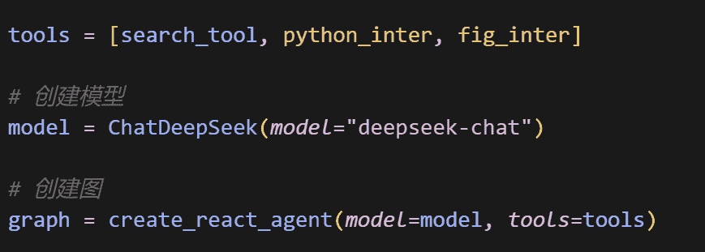

开发效率得到极大提升。

完整的LangGraph三层API架构图如下所示：

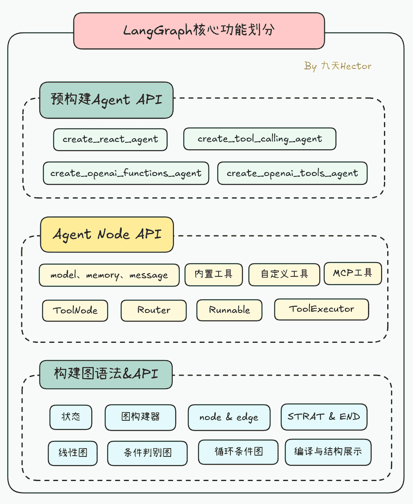

依托LangChain完善的生态、拥有丰富稳定的API架构、以及便捷上手等特性，使得LangGraph成为目前超越LangChain的新一代Agent开发框架。

### 2. LangGraph开发必备工具套件

在对LangGraph有了一定的基础了解之后，对于开发者来说，还需要进一步了解和掌握LangGraph必备的开发者套件。分别是LangGraph运行监控框架LangSmith、LangGraph图结构可视化与调试框架LangGraph Studio和LangGraph服务部署工具LangGraph Cli。可以说这些开发工具套件，是真正推动LangGraph的企业级应用开发效率大幅提升的关键。同时监控、调试和部署工具，也是全新一代企业级Agent开发框架的必备工具，也是开发者必须要掌握的基础工具。

+   LangGraph运行监控框架：LangSmith

> LangSmith官网地址：https://docs.smith.langchain.com/

LangSmith 是一款用于构建、调试、可视化和评估 LLM 工作流的全生命周期开发平台。它聚焦的不是模型训练，而是我们在构建 AI 应用（尤其是多工具 Agent、LangChain/Graph）时的「可视化调试」、「性能评估」与「运维监控」。

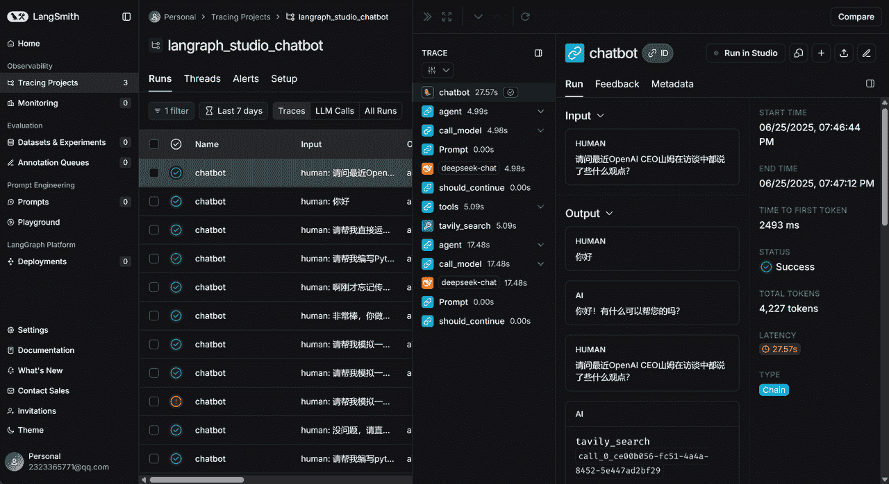

| 功能类别 | 描述 | 场景 |

| --- | --- | --- |

| 🧪 调试追踪（Trace Debugging） | 可视化展示每个 LLM 调用、工具调用、Prompt、输入输出 | Agent 调试、Graph 调用链分析 |

| 📊 评估（Evaluation） | 支持自动评估多个输入样本的回答质量，可自定义评分维度 | 批量测试 LLM 表现、A/B 对比 |

| 🧵 会话记录（Sessions / Runs） | 每次 chain 或 agent 的运行都会被记录为一个 Run，可溯源 | Agent 问题诊断、用户问题分析 |

| 🔧 Prompt 管理器（Prompt Registry） | 保存、版本控制、调用历史 prompt | 多版本 prompt 迭代测试 |

| 📈 流量监控（Telemetry） | 实时查看运行次数、错误率、响应时间等 | 在生产环境中监控 Agent 质量 |

| 📁 Dataset 管理 | 管理自定义测试集样本，支持自动化评估 | 微调前评估、数据对比实验 |

| 📜 LangGraph 可视化 | 对 LangGraph 中每个节点运行情况进行实时可视化展示 | Graph 执行追踪 |

+   LangGraph图结构可视化与调试框架：LangGraph Studio

> LangGraph Studio官网地址：https://www.langgraph.dev/studio

LangGraph Studio 是一个用于可视化构建、测试、分享和部署智能体流程图的图形化 IDE + 运行平台。

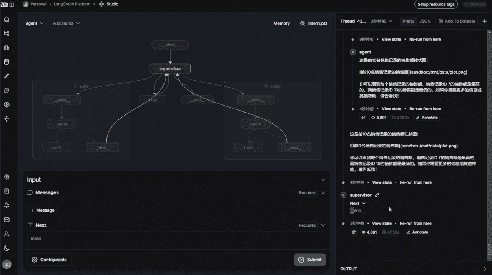

| 功能模块 | 说明 | 应用场景 |

| --- | --- | --- |

| 🧩 Graph 编辑器 | 以拖拽方式创建节点（工具、模型、Router）并连接 | 零代码构建 LangGraph |

| 🔍 节点配置器 | 每个节点可配置 LLM、工具、Router 逻辑、Memory | 灵活定制 Agent 控制流 |

| ▶️ 即时测试 | 输入 prompt 可在浏览器中运行整个图 | 实时测试执行结果 |

| 💾 云端保存 / 分享 | 将构建的 Graph 保存为公共 URL / 私人项目 | 团队协作，Demo 分享 |

| 📎 Tool 插件管理 | 可连接自定义工具（MCP）、HTTP API、Python 工具 | 插件式扩展 Agent 功能 |

| 🔁 Router 分支节点 | 创建条件分支，支持 if/else 路由 | 决策型智能体 |

| 📦 上传文档 / 多模态 | 可以上传文件（如 PDF）并嵌入进图中处理流程 | RAG 结构、OCR、图文问答等 |

| 🧠 Prompt 输入/预览 | 编辑 prompt 并观察其运行效果 | Prompt 工程调试 |

| 📤 一键部署 | 将 Graph 部署为可被 Agent Chat UI 使用的 Assistant | 快速集成到前端 |

+   LangGraph服务部署工具：LangGraph Cli

> LangGraph Cli官网地址：https://www.langgraph.dev/ （需要代理环境）

LangGraph CLI 是用于本地启动、调试、测试和托管 LangGraph 智能体图的开发者命令行工具。

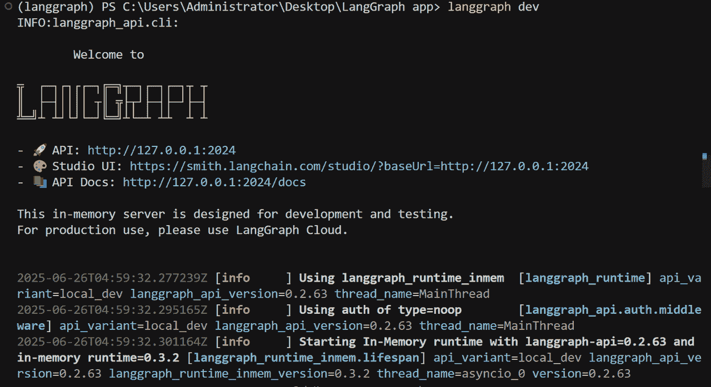

| 功能类别 | 命令示例 | 说明 |

| --- | --- | --- |

| ✅ 启动 Graph 服务 | `langgraph dev` | 启动 Graph 的开发服务器，供前端（如 Agent Chat UI）调用 |

| 🧪 测试 Graph 输入 | `langgraph run graph:graph --input &#x27;{&quot;input&quot;: &quot;你好&quot;}&#x27;` | 本地 CLI 输入测试，输出结果 |

| 🧭 管理项目结构 | `langgraph init` | 初始化一个标准 Graph 项目目录结构 |

| 📦 部署 Graph（未来） | `langgraph deploy`（预留） | 发布 graph 至 LangGraph 云端（已对接 Studio） |

| 🧱 显示 Assistant 列表 | `langgraph list` | 显示当前 graph 中有哪些 assistant（即 entrypoint） |

| 🔄 重载运行时 | 自动热重载 | 修改 `graph.py` 时，dev 模式自动重启生效 |

而一旦应用成功部署上线，LangGraph Cli还会非常贴心的提供后端接口说明文档：

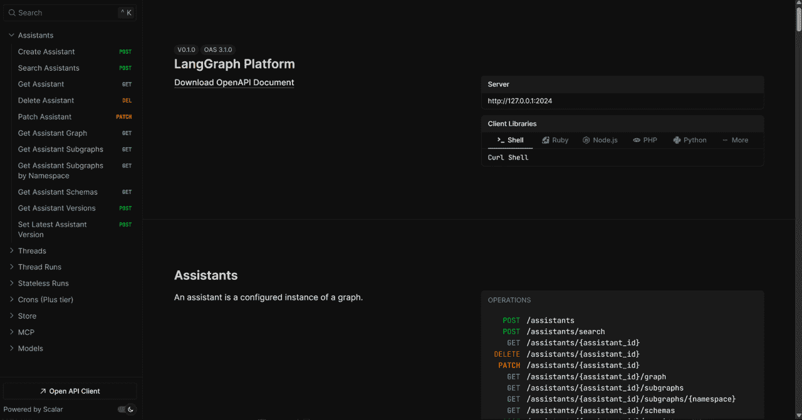

而对于LangGraph构建的智能体，除了能够本地部署外，官方也提供了云托管服务，借助LangGraph Platform，开发者可以将构建的智能体 Graph部署到云端，并允许公开访问，同时支持支持长时间运行、文件上传、外部 API 调用、Studio 集成等功能。

+   LangGraph Agent前端可视化工具：Agent Chat UI

Agent Chat UI 是 LangGraph/LangChain 官方提供的多智能体前端对话面板，用于与后端 Agent（Graph 或 Chain）进行实时互动，支持上传文件、多工具协同、结构化输出、多轮对话、调试标注等功能。

> Agent Chat UI官网地址：https://langchain-ai.github.io/langgraph/agents/ui/


| 功能模块 | 描述 | 应用场景 |

| --- | --- | --- |

| 💬 多轮对话框 | 类似 ChatGPT 的输入区域，支持多轮上下文 | 用户提问，Agent 回复 |

| 🛠 工具调用轨迹显示 | 显示每个调用的工具、参数、结果（结构化） | Agent 推理透明化 |

| 📄 上传 PDF / 图片 | 支持上传文档、图片、嵌入多模态输入 | RAG、OCR、图像问答 |

| 📁 文件面板 | 可查看上传历史文件、删除、重新引用 | 管理文档输入 |

| 🧭 Assistant 切换 | 支持切换不同 Assistant（Graph entry） | 一键切换模型能力（如 math / weather） |

| 🧩 插件支持 | 与 MCP 工具、LangGraph 图打通 | 工具式 Agent 调用 |

| 🔍 调试视图 | 显示每轮 Agent 的思维过程和中间状态 | Prompt 调试、模型行为分析 |

| 🌐 云部署支持 | 支持接入远端 Graph API（如 dev 服务器） | 前后端分离部署 |

| 🧪 与 LangSmith 对接（可选） | 若后端启用 tracing，可同步显示运行 trace | 调试闭环 |

+   LangGraph内置工具库与MCP调用组件


## 一、LangGraph 与 LangChain 工具生态

除了有上述非常多实用的开发工具外，LangGraph还全面兼容LangChain的内置工具集。LangChain自诞生之初就为开发者提供了非常多种类各异的、封装好的实用工具，历经几年发展时间，目前LangChain已经拥有了数以百计的内置实用工具，包括网络搜索工具、浏览器自动化工具、Python代码解释器、SQL代码解释器等。而作为LangChain同系框架，LangGraph也可以无缝调用LangChain各项开发工具，从而大幅提高开发效率。

> LangChain工具集：https://python.langchain.com/docs/integrations/tools/


此外，LangChain是最早支持MCP的开发框架之一，借助`langchain-mcp-adapters`，LangChain和LangGraph便可快速接入各类MCP工具。

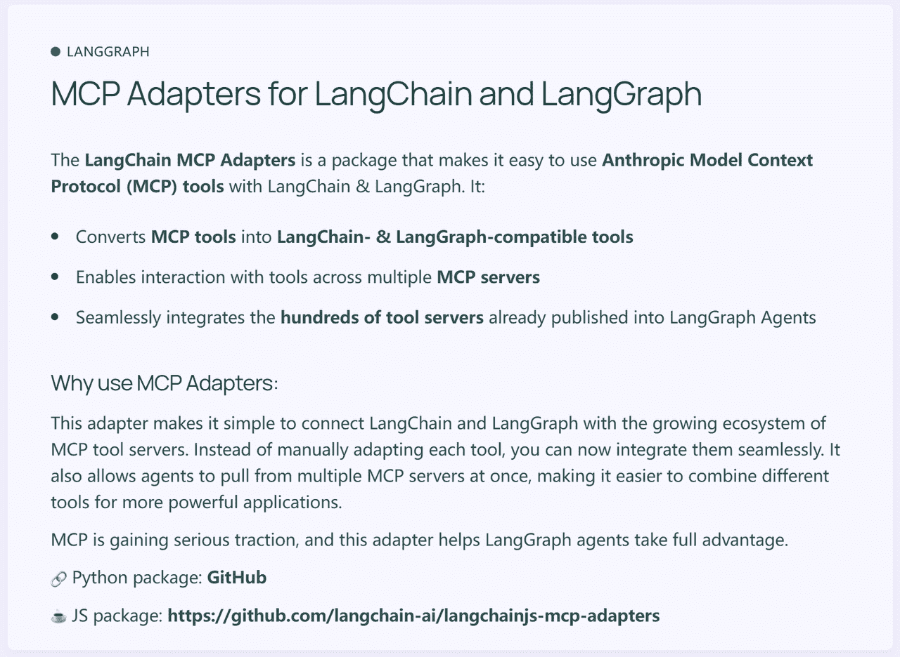

并且LangGraph也同样支持谷歌的A2A（跨Agents通信协议）。

### 3. LangGraph VS 其他开发框架

而关于LangGraph框架与其他开发框架的对比，其实从上面对于LangGrpah的技术介绍不难看出，依托LangChain的强大生态，LangGraph可以说是目前功能最完善、性能最强的开发框架没有之一。

+ LangGraph VS LangChain

首先，如果要对比LangGraph和LangChain，其实二者定位有本质的区别。从目前LangChain工具功能划分来看，LangChain未来将继续专注于更加底层的API开发与维护，以及链式基础功能的维护，而作为LangChain链式功能更高级编排工具，LangGraph未来将承担更多Agent开发的重任。

因此如果要从LangChain和LangGraph中挑选一项进行学习的话，推荐优先学习更高层的LangGraph API，而在实际使用LangGraph的过程中，将会用到非常多的LangChain基础功能，届时再补充LangChain基础知识即可。另外，如果希望一站式深入学习LangChain&LangGraph技术体系，也可以先从底层API开始学习，先学习LangChain打好基础，然后再学习LangGraph，这样的学习路径将有助于搭建更加扎实的技术和技能体系。

> LangChain公开课参考：https://www.bilibili.com/video/BV1pYKgzAE5C/


+ LangGraph VS OpenAI Agents SDK

目前来看，OpenAI的Agents SDK最核心的优势还是在于和OpenAI的GPT系列模型深度集成，能够非常便捷的调用GPT模型的很多内置工具（如网络搜索、RAG、Computer use等），并且上手难度非常低，能够非常简单的完成Agent创建。因此如果是GPT模型开发者，Agents SDK还是非常合适的。

但Agents SDK本身并不能算是企业级的Agent开发框架，其很多功能设计较为简单，且稳定性不足，因此Agents SDK更加适用于小规模智能体功能探索或前期demo开发或者用于科研性质的智能体开发。

+ LangGraph VS 谷歌ADK

相比OpenAI的Agents SDK，谷歌的ADK功能更加丰富、运行更加稳定，并且谷歌ADK也提供了调试前端UI页面以及智能体运行追踪等功能，同时支持一键部署上线，因此尽管ADK上手难度更高，但确实是目前能够用于企业级Agent开发的框架。

但相比LangGraph，谷歌ADK起步时间较晚，很多功能细节丰富程度不如LangGraph，并且内置工具也远不如LangChain更加丰富。但ADK的优势在于和Gemini多模态功能深度适配，可以说是原生的多模态Agent开发框架，原生就支持图像、文本、音频等多模态交互功能，并且和谷歌云在线API深度集成，可以直接调用谷歌云API（例如谷歌云盘、谷歌邮箱API、谷歌搜索等）来完成智能体开发。并且由于ADK采用了和LangGraph完全不同的设计思路，具体何种思路会在未来的竞争中胜出犹未可知。

因此，就目前来看，我们推荐的适用于企业级应用的Agent框架学习路线是LangChain&LangGraph>ADK>Agents SDK。而如果是出于科研目的，或者前期希望进行一些尽量快速的尝试和探索，并不考虑工业环境部署上线，则优先推荐Agents SDK。

### 4. LangGraph最佳学习路线与本期公开课大纲

虽然从技术架构的角度来说，是`LangGraph图结构语法`—>`Agent Node API`—>预构建的`Agent API`，但对于学习者来说，更推荐反过来的学习顺序，也就是预构建的`Agent API`—>`Agent Node API`—>`LangGraph图结构语法`，这也是本期公开课的内容顺序。

## 二、从零构建LangGraph智能体

### 1. LangGraph接入大模型流程

+ LangGraph安装

本次公开课使用的版本是：`langgraph==0.4.8`

```
! pip install langgraph -i https://pypi.tuna.tsinghua.edu.cn/simple
```


# `LangGraph`接入DeepSeek模型流程

```
Collecting langgraph
  Downloading langgraph-0.4.8-py3-none-any.whl.metadata (6.8 kB)
Requirement already satisfied: langchain-core>=0.1 in /root/anaconda3/lib/python3.12/site-packages (from langgraph) (0.3.65)
Collecting langgraph-checkpoint>=2.0.26 (from langgraph)
  Downloading langgraph_checkpoint-2.1.0-py3-none-any.whl.metadata (4.2 kB)
Collecting langgraph-prebuilt>=0.2.0 (from langgraph)
  Downloading langgraph_prebuilt-0.2.2-py3-none-any.whl.metadata (4.5 kB)
Collecting langgraph-sdk>=0.1.42 (from langgraph)
  Downloading langgraph_sdk-0.1.70-py3-none-any.whl.metadata (1.5 kB)
Requirement already satisfied: pydantic>=2.7.4 in /root/anaconda3/lib/python3.12/site-packages (from langgraph) (2.11.4)
Requirement already satisfied: xxhash>=3.5.0 in /root/anaconda3/lib/python3.12/site-packages (from langgraph) (3.5.0)
Requirement already satisfied: langsmith<0.4,>=0.3.45 in /root/anaconda3/lib/python3.12/site-packages (from langchain-core>=0.1->langgraph) (0.3.45)
Requirement already satisfied: tenacity!=8.4.0,<10.0.0,>=8.1.0 in /root/anaconda3/lib/python3.12/site-packages (from langchain-core>=0.1->langgraph) (8.5.0)
Requirement already satisfied: jsonpatch<2.0,>=1.33 in /root/anaconda3/lib/python3.12/site-packages (from langchain-core>=0.1->langgraph) (1.33)
Requirement already satisfied: PyYAML>=5.3 in /root/anaconda3/lib/python3.12/site-packages (from langchain-core>=0.1->langgraph) (6.0.1)
Requirement already satisfied: packaging<25,>=23.2 in /root/anaconda3/lib/python3.12/site-packages (from langchain-core>=0.1->langgraph) (24.1)
Requirement already satisfied: typing-extensions>=4.7 in /root/anaconda3/lib/python3.12/site-packages (from langchain-core>=0.1->langgraph) (4.13.2)
Collecting ormsgpack>=1.10.0 (from langgraph-checkpoint>=2.0.26->langgraph)
  Downloading ormsgpack-1.10.0-cp312-cp312-manylinux_2_17_x86_64.manylinux2014_x86_64.whl.metadata (43 kB)
     ━━━━━━━━━━━━━━━━━━━━━━━━━━━━━━━━━━━━━ 43.7/43.7 kB 14.2 kB/s eta 0:00:00 0:00:01
Requirement already satisfied: httpx>=0.25.2 in /root/anaconda3/lib/python3.12/site-packages (from langgraph-sdk>=0.1.42->langgraph) (0.28.1)
Requirement already satisfied: orjson>=3.10.13 in /root/anaconda3/lib/python3.12/site-packages (from langgraph-sdk>=0.1.42->langgraph) (3.10.13)
Requirement already satisfied: annotated-types>=0.6.0 in /root/anaconda3/lib/python3.12/site-packages (from pydantic>=2.7.4->langgraph) (0.6.0)
Requirement already satisfied: pydantic-core==2.33.2 in /root/anaconda3/lib/python3.12/site-packages (from pydantic>=2.7.4->langgraph) (2.33.2)
Requirement already satisfied: typing-inspection>=0.4.0 in /root/anaconda3/lib/python3.12/site-packages (from pydantic>=2.7.4->langgraph) (0.4.0)
Requirement already satisfied: anyio in /root/anaconda3/lib/python3.12/site-packages (from httpx>=0.25.2->langgraph-sdk>=0.1.42->langgraph) (4.8.0)
Requirement already satisfied: certifi in /root/anaconda3/lib/python3.12/site-packages (from httpx>=0.25.2->langgraph-sdk>=0.1.42->langgraph) (2024.2.2)
Requirement already satisfied: httpcore==1.* in /root/anaconda3/lib/python3.12/site-packages (from httpx>=0.25.2->langgraph-sdk>=0.1.42->langgraph) (1.0.7)
Requirement already satisfied: idna in /root/anaconda3/lib/python3.12/site-packages (from httpx>=0.25.2->langgraph-sdk>=0.1.42->langgraph) (3.7)
Requirement already satisfied: h11<0.15,>=0.13 in /root/anaconda3/lib/python3.12/site-packages (from httpcore==1.*->httpx>=0.25.2->langgraph-sdk>=0.1.42->langgraph) (0.14.0)
Requirement already satisfied: jsonpointer>=1.9 in /root/anaconda3/lib/python3.12/site-packages (from jsonpatch<2.0,>=1.33->langchain-core>=0.1->langgraph) (2.1)
Requirement already satisfied: requests<3,>=2 in /root/anaconda3/lib/python3.12/site-packages (from langsmith<0.4,>=0.3.45->langchain-core>=0.1->langgraph) (2.32.3)
Requirement already satisfied: requests-toolbelt<2.0.0,>=1.0.0 in /root/anaconda3/lib/python3.12/site-packages (from langsmith<0.4,>=0.3.45->langchain-core>=0.1->langgraph) (1.0.0)
Requirement already satisfied: zstandard<0.24.0,>=0.23.0 in /root/anaconda3/lib/python3.12/site-packages (from langsmith<0.4,>=0.3.45->langchain-core>=0.1->langgraph) (0.23.0)
Requirement already satisfied: charset-normalizer<4,>=2 in /root/anaconda3/lib/python3.12/site-packages (from requests<3,>=2->langsmith<0.4,>=0.3.45->langchain-core>=0.1->langgraph) (2.0.4)
Requirement already satisfied: urllib3<3,>=1.21.1 in /root/anaconda3/lib/python3.12/site-packages (from requests<3,>=2->langsmith<0.4,>=0.3.45->langchain-core>=0.1->langgraph) (2.2.2)
Requirement already satisfied: sniffio>=1.1 in /root/anaconda3/lib/python3.12/site-packages (from anyio->httpx>=0.25.2->langgraph-sdk>=0.1.42->langgraph) (1.3.0)
Downloading langgraph-0.4.8-py3-none-any.whl (152 kB)
   ━━━━━━━━━━━━━━━━━━━━━━━━━━━━━━━━━━━━━ 152.4/152.4 kB 6.7 kB/s eta 0:00:00 0:00:02
Downloading langgraph_checkpoint-2.1.0-py3-none-any.whl (43 kB)
   ━━━━━━━━━━━━━━━━━━━━━━━━━━━━━━━━━━━━━ 43.8/43.8 kB 26.7 kB/s eta 0:00:00 0:00:01
Downloading langgraph_prebuilt-0.2.2-py3-none-any.whl (23 kB)
Downloading langgraph_sdk-0.1.70-py3-none-any.whl (49 kB)
   ━━━━━━━━━━━━━━━━━━━━━━━━━━━━━━━━━━━━━ 50.0/50.0 kB 27.4 kB/s eta 0:00:00 0:00:01
Downloading ormsgpack-1.10.0-cp312-cp312-manylinux_2_17_x86_64.manylinux2014_x86_64.whl (216 kB)
   ━━━━━━━━━━━━━━━━━━━━━━━━━━━━━━━━━━━━━ 216.7/216.7 kB 10.7 kB/s eta 0:00:00 00:01 00:02
Installing collected packages: ormsgpack, langgraph-sdk, langgraph-checkpoint, langgraph-prebuilt, langgraph
Successfully installed langgraph-0.4.8 langgraph-checkpoint-2.1.0 langgraph-prebuilt-0.2.2 langgraph-sdk-0.1.70 ormsgpack-1.10.0
WARNING: Running pip as the 'root' user can result in broken permissions and conflicting behaviour with the system package manager. It is recommended to use a virtual environment instead: https://pip.pypa.io/warnings/venv
```

```
! pip show langgraph
```

```
Name: langgraph
Version: 0.4.8
Summary: Building stateful, multi-actor applications with LLMs
Home-page: 
Author: 
Author-email: 
License: 
Location: /root/anaconda3/lib/python3.12/site-packages
Requires: langchain-core, langgraph-checkpoint, langgraph-prebuilt, langgraph-sdk, pydantic, xxhash
Required-by: 
```

接下来以DeepSeek为例，介绍`LangGraph`接入大模型流程。

```
! pip install python-dotenv openai
```


# DeepSeek API 调用与 LangGraph 接入

## 环境依赖

```text
Requirement already satisfied: python-dotenv in /root/anaconda3/lib/python3.12/site-packages (1.0.1)
Requirement already satisfied: openai in /root/anaconda3/lib/python3.12/site-packages (1.78.1)
Requirement already satisfied: anyio<5,>=3.5.0 in /root/anaconda3/lib/python3.12/site-packages (from openai) (4.8.0)
Requirement already satisfied: distro<2,>=1.7.0 in /root/anaconda3/lib/python3.12/site-packages (from openai) (1.9.0)
Requirement already satisfied: httpx<1,>=0.23.0 in /root/anaconda3/lib/python3.12/site-packages (from openai) (0.28.1)
Requirement already satisfied: jiter<1,>=0.4.0 in /root/anaconda3/lib/python3.12/site-packages (from openai) (0.8.2)
Requirement already satisfied: pydantic<3,>=1.9.0 in /root/anaconda3/lib/python3.12/site-packages (from openai) (2.11.4)
Requirement already satisfied: sniffio in /root/anaconda3/lib/python3.12/site-packages (from openai) (1.3.0)
Requirement already satisfied: tqdm>4 in /root/anaconda3/lib/python3.12/site-packages (from openai) (4.66.4)
Requirement already satisfied: typing-extensions<5,>=4.11 in /root/anaconda3/lib/python3.12/site-packages (from openai) (4.13.2)
Requirement already satisfied: idna>=2.8 in /root/anaconda3/lib/python3.12/site-packages (from anyio<5,>=3.5.0->openai) (3.7)
Requirement already satisfied: certifi in /root/anaconda3/lib/python3.12/site-packages (from httpx<1,>=0.23.0->openai) (2024.2.2)
Requirement already satisfied: httpcore==1.* in /root/anaconda3/lib/python3.12/site-packages (from httpx<1,>=0.23.0->openai) (1.0.7)
Requirement already satisfied: h11<0.15,>=0.13 in /root/anaconda3/lib/python3.12/site-packages (from httpcore==1.*->httpx<1,>=0.23.0->openai) (0.14.0)
Requirement already satisfied: annotated-types>=0.6.0 in /root/anaconda3/lib/python3.12/site-packages (from pydantic<3,>=1.9.0->openai) (0.6.0)
Requirement already satisfied: pydantic-core==2.33.2 in /root/anaconda3/lib/python3.12/site-packages (from pydantic<3,>=1.9.0->openai) (2.33.2)
Requirement already satisfied: typing-inspection>=0.4.0 in /root/anaconda3/lib/python3.12/site-packages (from pydantic<3,>=1.9.0->openai) (0.4.0)
WARNING: Running pip as the 'root' user can result in broken permissions and conflicting behaviour with the system package manager. It is recommended to use a virtual environment instead: https://pip.pypa.io/warnings/venv
```

## 配置 DeepSeek API 密钥

这里我们使用`DeepSeek`官方的`API_KEK`进行调用。如果初次使用，需要在`DeepSeek`官网上进行注册并创建一个新的`API_Key`，其官方地址为：https://platform.deepseek.com/usage


注册好`DeepSeek`的`API_KEY`后，首先在项目同级目录下创建一个`env`文件，用于存储`DeepSeek`的`API_KEY`，如下所示：

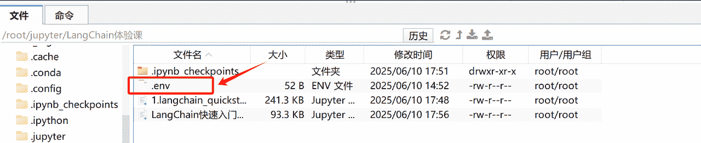

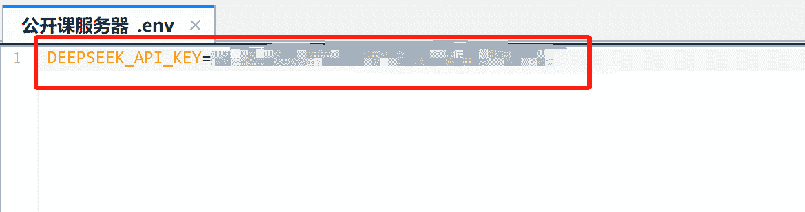

接下来通过`python-dotenv`库读取`env`文件中的`API_KEY`，使其加载到当前的运行环境中，代码如下：

```python
import os
from dotenv import load_dotenv 
load_dotenv(override=True)

DeepSeek_API_KEY = os.getenv("DEEPSEEK_API_KEY")
# print(DeepSeek_API_KEY)  # 可以通过打印查看
```

```python
from openai import OpenAI

# 初始化DeepSeek的API客户端
client = OpenAI(api_key=DeepSeek_API_KEY, base_url="https://api.deepseek.com")

# 调用DeepSeek的API，生成回答
response = client.chat.completions.create(
    model="deepseek-chat",
    messages=[
        {"role": "system", "content": "你是乐于助人的助手，请根据用户的问题给出回答"},
        {"role": "user", "content": "你好，请你介绍一下你自己。"},
    ],
)

# 打印模型最终的响应结果
print(response.choices[0].message.content)
```

```text
你好！我是一个乐于助人的AI助手，随时准备为你提供帮助。我可以回答各种问题、提供建议、协助解决问题，或者陪你聊天。无论是学习、工作还是日常生活，我都会尽力为你提供有用的信息和支持。 

我的知识涵盖了多个领域，包括但不限于科技、历史、文化、健康、编程等。如果你有任何疑问或需要帮助，随时告诉我！ 😊 

你想了解关于我的具体方面，还是需要其他帮助呢？
```

## 接入 LangGraph

接下来我们要考虑的是，对于这样一个`DeepSeek`官方的`API`，如何接入到`LangGraph`中呢？其实非常简单，我们只需要使用`LangChain`中的一个`DeepSeek`组件即可向像述代码一样，直接使用相同的`DeepSeek API KEY`与大模型进行交互。因此，我们首先需要安装`LangChain`的`DeepSeek`组件，安装命令如下：

```bash
! pip install langchain-deepseek
```


# 依赖包安装

```
Collecting langchain-deepseek
  Downloading langchain_deepseek-0.1.3-py3-none-any.whl.metadata (1.1 kB)
Requirement already satisfied: langchain-core<1.0.0,>=0.3.47 in /root/anaconda3/lib/python3.12/site-packages (from langchain-deepseek) (0.3.64)
Collecting langchain-openai<1.0.0,>=0.3.9 (from langchain-deepseek)
  Downloading langchain_openai-0.3.21-py3-none-any.whl.metadata (2.3 kB)
Requirement already satisfied: langsmith<0.4,>=0.3.45 in /root/anaconda3/lib/python3.12/site-packages (from langchain-core<1.0.0,>=0.3.47->langchain-deepseek) (0.3.45)
Requirement already satisfied: tenacity!=8.4.0,<10.0.0,>=8.1.0 in /root/anaconda3/lib/python3.12/site-packages (from langchain-core<1.0.0,>=0.3.47->langchain-deepseek) (8.5.0)
Requirement already satisfied: jsonpatch<2.0,>=1.33 in /root/anaconda3/lib/python3.12/site-packages (from langchain-core<1.0.0,>=0.3.47->langchain-deepseek) (1.33)
Requirement already satisfied: PyYAML>=5.3 in /root/anaconda3/lib/python3.12/site-packages (from langchain-core<1.0.0,>=0.3.47->langchain-deepseek) (6.0.1)
Requirement already satisfied: packaging<25,>=23.2 in /root/anaconda3/lib/python3.12/site-packages (from langchain-core<1.0.0,>=0.3.47->langchain-deepseek) (24.1)
Requirement already satisfied: typing-extensions>=4.7 in /root/anaconda3/lib/python3.12/site-packages (from langchain-core<1.0.0,>=0.3.47->langchain-deepseek) (4.13.2)
Requirement already satisfied: pydantic>=2.7.4 in /root/anaconda3/lib/python3.12/site-packages (from langchain-core<1.0.0,>=0.3.47->langchain-deepseek) (2.11.4)
Requirement already satisfied: openai<2.0.0,>=1.68.2 in /root/anaconda3/lib/python3.12/site-packages (from langchain-openai<1.0.0,>=0.3.9->langchain-deepseek) (1.78.1)
Requirement already satisfied: tiktoken<1,>=0.7 in /root/anaconda3/lib/python3.12/site-packages (from langchain-openai<1.0.0,>=0.3.9->langchain-deepseek) (0.8.0)
Requirement already satisfied: jsonpointer>=1.9 in /root/anaconda3/lib/python3.12/site-packages (from jsonpatch<2.0,>=1.33->langchain-core<1.0.0,>=0.3.47->langchain-deepseek) (2.1)
Requirement already satisfied: httpx<1,>=0.23.0 in /root/anaconda3/lib/python3.12/site-packages (from langsmith<0.4,>=0.3.45->langchain-core<1.0.0,>=0.3.47->langchain-deepseek) (0.28.1)
Requirement already satisfied: orjson<4.0.0,>=3.9.14 in /root/anaconda3/lib/python3.12/site-packages (from langsmith<0.4,>=0.3.45->langchain-core<1.0.0,>=0.3.47->langchain-deepseek) (3.10.13)
Requirement already satisfied: requests<3,>=2 in /root/anaconda3/lib/python3.12/site-packages (from langsmith<0.4,>=0.3.45->langchain-core<1.0.0,>=0.3.47->langchain-deepseek) (2.32.3)
Requirement already satisfied: requests-toolbelt<2.0.0,>=1.0.0 in /root/anaconda3/lib/python3.12/site-packages (from langsmith<0.4,>=0.3.45->langchain-core<1.0.0,>=0.3.47->langchain-deepseek) (1.0.0)
Requirement already satisfied: zstandard<0.24.0,>=0.23.0 in /root/anaconda3/lib/python3.12/site-packages (from langsmith<0.4,>=0.3.45->langchain-core<1.0.0,>=0.3.47->langchain-deepseek) (0.23.0)
Requirement already satisfied: anyio<5,>=3.5.0 in /root/anaconda3/lib/python3.12/site-packages (from openai<2.0.0,>=1.68.2->langchain-openai<1.0.0,>=0.3.9->langchain-deepseek) (4.8.0)
Requirement already satisfied: distro<2,>=1.7.0 in /root/anaconda3/lib/python3.12/site-packages (from openai<2.0.0,>=1.68.2->langchain-openai<1.0.0,>=0.3.9->langchain-deepseek) (1.9.0)
Requirement already satisfied: jiter<1,>=0.4.0 in /root/anaconda3/lib/python3.12/site-packages (from openai<2.0.0,>=1.68.2->langchain-openai<1.0.0,>=0.3.9->langchain-deepseek) (0.8.2)
Requirement already satisfied: sniffio in /root/anaconda3/lib/python3.12/site-packages (from openai<2.0.0,>=1.68.2->langchain-openai<1.0.0,>=0.3.9->langchain-deepseek) (1.3.0)
Requirement already satisfied: tqdm>4 in /root/anaconda3/lib/python3.12/site-packages (from openai<2.0.0,>=1.68.2->langchain-openai<1.0.0,>=0.3.9->langchain-deepseek) (4.66.4)
Requirement already satisfied: annotated-types>=0.6.0 in /root/anaconda3/lib/python3.12/site-packages (from pydantic>=2.7.4->langchain-core<1.0.0,>=0.3.47->langchain-deepseek) (0.6.0)
Requirement already satisfied: pydantic-core==2.33.2 in /root/anaconda3/lib/python3.12/site-packages (from pydantic>=2.7.4->langchain-core<1.0.0,>=0.3.47->langchain-deepseek) (2.33.2)
Requirement already satisfied: typing-inspection>=0.4.0 in /root/anaconda3/lib/python3.12/site-packages (from pydantic>=2.7.4->langchain-core<1.0.0,>=0.3.47->langchain-deepseek) (0.4.0)
Requirement already satisfied: regex>=2022.1.18 in /root/anaconda3/lib/python3.12/site-packages (from tiktoken<1,>=0.7->langchain-openai<1.0.0,>=0.3.9->langchain-deepseek) (2023.10.3)
Requirement already satisfied: idna>=2.8 in /root/anaconda3/lib/python3.12/site-packages (from anyio<5,>=3.5.0->openai<2.0.0,>=1.68.2->langchain-openai<1.0.0,>=0.3.9->langchain-deepseek) (3.7)
Requirement already satisfied: certifi in /root/anaconda3/lib/python3.12/site-packages (from httpx<1,>=0.23.0->langsmith<0.4,>=0.3.45->langchain-core<1.0.0,>=0.3.47->langchain-deepseek) (2024.2.2)
Requirement already satisfied: httpcore==1.* in /root/anaconda3/lib/python3.12/site-packages (from httpx<1,>=0.23.0->langsmith<0.4,>=0.3.45->langchain-core<1.0.0,>=0.3.47->langchain-deepseek) (1.0.7)
Requirement already satisfied: h11<0.15,>=0.13 in /root/anaconda3/lib/python3.12/site-packages (from httpcore==1.*->httpx<1,>=0.23.0->langsmith<0.4,>=0.3.45->langchain-core<1.0.0,>=0.3.47->langchain-deepseek) (0.14.0)
Requirement already satisfied: charset-normalizer<4,>=2 in /root/anaconda3/lib/python3.12/site-packages (from requests<3,>=2->langsmith<0.4,>=0.3.45->langchain-core<1.0.0,>=0.3.47->langchain-deepseek) (2.0.4)
Requirement already satisfied: urllib3<3,>=1.21.1 in /root/anaconda3/lib/python3.12/site-packages (from requests<3,>=2->langsmith<0.4,>=0.3.45->langchain-core<1.0.0,>=0.3.47->langchain-deepseek) (2.2.2)
Downloading langchain_deepseek-0.1.3-py3-none-any.whl (7.1 kB)
Downloading langchain_openai-0.3.21-py3-none-any.whl (65 kB)
[2K   [90m━━━━━━━━━━━━━━━━━━━━━━━━━━━━━━━━━━━━━━[0m [32m65.2/65.2 kB[0m [31m4.9 kB/s[0m eta [36m0:00:00[0ma [36m0:00:09[0m
[?25hInstalling collected packages: langchain-openai, langchain-deepseek
Successfully installed langchain-deepseek-0.1.3 langchain-openai-0.3.21
[33mWARNING: Running pip as the 'root' user can result in broken permissions and conflicting behaviour with the system package manager. It is recommended to use a virtual environment instead: https://pip.pypa.io/warnings/venv[0m[33m
[0m
```

# 模型初始化

安装好`LangChain`集成`DeepSeek`模型的依赖包后，需要通过一个`init_chat_model`函数来初始化大模型，代码如下：

```
from langchain.chat_models import init_chat_model

model = init_chat_model(model="deepseek-chat", model_provider="deepseek")  
```

其中`model`用来指定要使用的模型名称，而`model_provider`用来指定模型提供者，当写入`deepseek`时，会自动加载`langchain-deepseek`的依赖包，并使用在`model`中指定的模型名称用来进行交互。

# 调用示例

```
question = "你好，请你介绍一下你自己。"

result = model.invoke(question)
print(result.content)
```


# 使用 LangChain 集成 DeepSeek 模型

## DeepSeek 模型能力介绍

你好！我是 `DeepSeek Chat`，由深度求索公司（`DeepSeek`）研发的一款智能 AI 助手。我可以帮助你解答各种问题，包括学习、工作、编程、写作、生活百科等多个领域。

### 我的特点

- ✅ `免费使用`：目前无需付费，你可以随时向我提问！
- ✅ `知识丰富`：我的知识截止到 `2024 年 7 月`，可以为你提供较新的信息。
- ✅ `超长上下文支持`：可以处理 `128K` 长度的文本，适合分析长文档或复杂问题。
- ✅ `文件阅读`：支持上传 `PDF`、`Word`、`Excel`、`PPT`、`TXT` 等文件，并从中提取信息进行分析。
- ✅ `多语言能力`：可以用中文、英文等多种语言交流，帮助你翻译或学习外语。
- ✅ `编程助手`：能写代码、调试、优化算法，支持 `Python`、`C++`、`Java` 等多种编程语言。

### 我能帮你做什么

- 📖 `学习辅导`：解题思路、论文写作、知识点讲解
- 💼 `工作效率`：写邮件、做 `PPT`、总结报告
- 💡 `创意灵感`：写故事、起名字、头脑风暴
- 📊 `数据分析`：处理表格、绘制图表、解读数据
- 🔧 `技术支持`：代码调试、算法优化、技术咨询

你可以随时向我提问，我会尽力提供最准确、有用的回答！😊 有什么我可以帮你的吗？

你好呀！👋 我是 `DeepSeek-R1`，由中国的人工智能公司「深度求索」研发。你可以把我当作一个聪明、热心、24 小时在线的文字助手～✨

### 🌟 我的特点

- `知识丰富`：截至 2024 年 7 月前的各种知识我都有所了解，无论是学习、工作、生活，还是科技、历史、娱乐，我都能帮上忙。
- `超长记忆力`：可以处理长达 `128K` 上下文的内容，也就是说，你发给我超长的文件或对话，我也能理解清楚！
- `文件助手`：支持你上传 `PDF`、`Word`、`PPT`、`Excel`、`图片` 等文件，我能帮你阅读、总结、提取重点。
- `免费使用`（目前是哦！🎉）而且 `无需登录` 也能畅快聊天（不过登录后能保存历史记录更方便～）

### 🛠 我能做什么

- ✅ 解答问题（学习、考试、百科）
- ✅ 写作助手（作文、小说、文案、邮件）
- ✅ 编程帮手（写代码、查 `bug`、讲算法）
- ✅ 文件处理（读论文、总结报告、提取数据）
- ✅ 生活助手（旅游攻略、美食推荐、情感建议）

### 🧠 我的“小限制”

- 目前是 `纯文字模型`，不支持语音或识图（但你可以上传图片文件，我能读取里面的文字）。
- 我的知识截止在 `2024 年 7 月`，之后的新事件就不太清楚啦。
- 我不是真人，但我会尽力用温暖、贴心的方式和你交流 ❤️

不管你是学生、上班族、创作者，还是只是好奇想聊聊天——我都在这儿等你！😊 现在，有什么我可以帮你的吗？比如学习上的难题、工作中的任务，或者生活里的小烦恼？

## 通过 LangChain 调用 DeepSeek 模型

这里可以看到，仅通过两行代码，我们便可以在 `LangChain` 中顺利调用 `DeepSeek` 模型，并得到模型的响应结果。相较于使用 `DeepSeek` 的 API，使用 `LangChain` 调用模型无疑是更加简单的。同时，不仅仅是 `DeepSeek` 模型，`LangChain` 还支持其他很多大模型，如 `OpenAI`、`Qwen`、`Gemini` 等，我们只需要在 `init_chat_model` 函数中指定不同的模型名称，就可以调用不同的模型。其工作的原理是这样的：

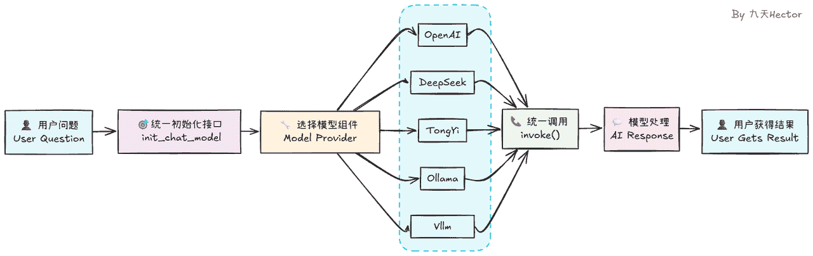

理解了这个基本原理，如果大家想在用 `LangGraph` 进行开发时使用其他大模型如 `Qwen3` 系列，则只需要先获取到 `Qwen3` 模型的 `API_KEY`，然后安装 `Tongyi Qwen` 的第三方依赖包，即可同样通过 `init_chat_model` 函数来初始化模型，并调用 `invoke` 方法来得到模型的响应结果。关于 `LangChain` 都支持哪些大模型以及每个模型对应的是哪个第三方依赖包，大家可以在 `LangChain` 的官方文档中找到，访问链接为：https://python.langchain.com/docs/integrations/chat/

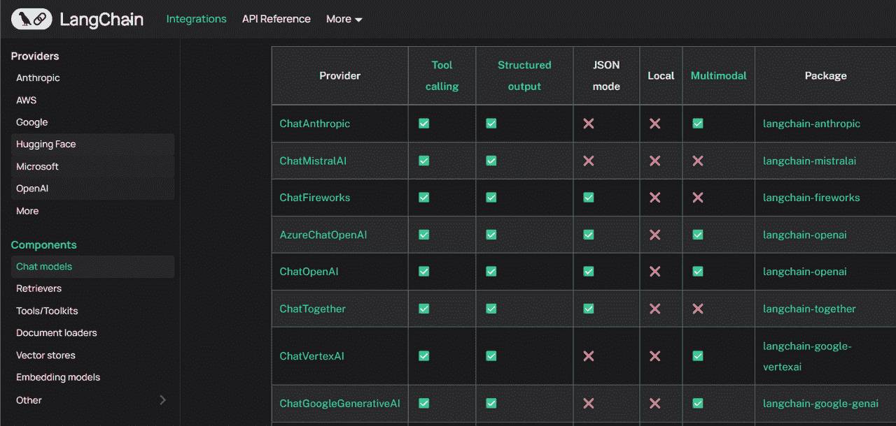

更多关于 `LangChain` & `LangGraph` 接入各类大模型的基本流程，可以参考 `LangChain` 公开课相关资料，本节公开课不再赘述。

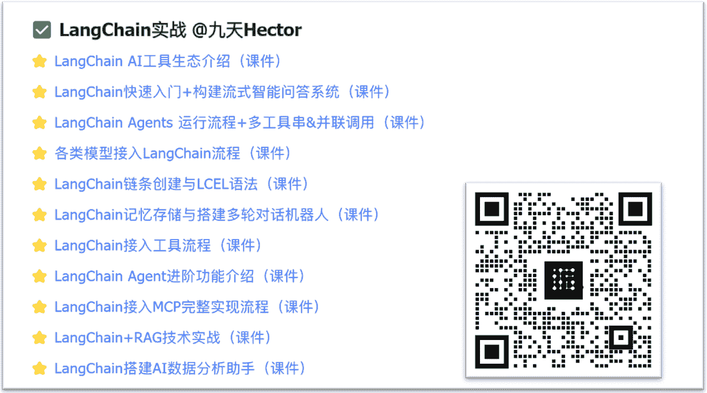

### 1. 基础模型调用

```python
model = init_chat_model(model="deepseek-reasoner", model_provider="deepseek")

result = model.invoke(question)
print(result.content)
```

`result`

```text
AIMessage(content='你好！我是 DeepSeek Chat，由深度求索公司（DeepSeek）研发的一款智能AI助手。我可以帮助你解答各种问题，包括学习、工作、编程、写作、生活百科等多个领域。  \n\n### 我的特点：  \n✅ 免费使用：目前无需付费，你可以随时向我提问！  \n✅ 知识丰富：我的知识截止到 2024年7月，可以为你提供较新的信息。  \n✅ 超长上下文支持：可以处理 128K 长度的文本，适合分析长文档或复杂问题。  \n✅ 文件阅读：支持上传 PDF、Word、Excel、PPT、TXT 等文件，并从中提取信息进行分析。  \n✅ 多语言能力：可以用中文、英文等多种语言交流，帮助你翻译或学习外语。  \n✅ 编程助手：能写代码、调试、优化算法，支持Python、C++、Java等多种编程语言。  \n\n### 我能帮你做什么？  \n📖 学习辅导：解题思路、论文写作、知识点讲解  \n💼 工作效率：写邮件、做PPT、总结报告  \n💡 创意灵感：写故事、起名字、头脑风暴  \n📊 数据分析：处理表格、绘制图表、解读数据  \n🔧 技术支持：代码调试、算法优化、技术咨询  \n\n你可以随时向我提问，我会尽力提供最准确、有用的回答！😊 有什么我可以帮你的吗？', additional_kwargs={'refusal': None}, response_metadata={'token_usage': {'completion_tokens': 311, 'prompt_tokens': 9, 'total_tokens': 320, 'completion_tokens_details': None, 'prompt_tokens_details': {'audio_tokens': None, 'cached_tokens': 0}, 'prompt_cache_hit_tokens': 0, 'prompt_cache_miss_tokens': 9}, 'model_name': 'deepseek-chat', 'system_fingerprint': 'fp_8802369eaa_prod0425fp8', 'id': 'e3323dc0-46fa-497b-aaf5-83596184f8b2', 'service_tier': None, 'finish_reason': 'stop', 'logprobs': None}, id='run--9f652093-6feb-484f-99f7-0c30e33290ab-0', usage_metadata={'input_tokens': 9, 'output_tokens': 311, 'total_tokens': 320, 'input_token_details': {'cache_read': 0}, 'output_token_details': {}})
```

`result.additional_kwargs`

```text
{'refusal': None,
 'reasoning_content': '嗯，用户发来一句简单的问候和自我介绍请求。看起来像是初次接触的破冰场景，可能刚打开聊天界面或者第一次使用这类AI助手。\n\n用户语气礼貌但比较笼统，没有具体需求指向。这种开放式问题通常有两种可能：一是真的想了解AI的功能边界，二是测试性提问看AI如何反应。考虑到中文互联网环境里常有用户用“介绍自己”测试机器人，需要同时做好信息传递和破冰互动。\n\n回复策略上应该突出三点：明确身份属性（非人类但能做什么）、消除陌生感（用表情符号和分段提升可读性）、引导后续对话（结尾提问）。要避免机械的术语堆砌，比如不说“基于Transformer架构”而说“能帮你查资料”。\n\n用户没透露任何个人信息，就用中性称呼。最后那个🎉表情可能有点过，不过新用户首次互动需要点活泼感——要是商务场景用户应该会直接问专业问题吧。结尾提问选“学习/工作/生活”三个维度覆盖常见场景，比单问“有什么可以帮你”更易触发具体需求。'}
```

`result.additional_kwargs['reasoning_content']`

```text
'嗯，用户发来一句简单的问候和自我介绍请求。看起来像是初次接触的破冰场景，可能刚打开聊天界面或者第一次使用这类AI助手。\n\n用户语气礼貌但比较笼统，没有具体需求指向。这种开放式问题通常有两种可能：一是真的想了解AI的功能边界，二是测试性提问看AI如何反应。考虑到中文互联网环境里常有用户用“介绍自己”测试机器人，需要同时做好信息传递和破冰互动。\n\n回复策略上应该突出三点：明确身份属性（非人类但能做什么）、消除陌生感（用表情符号和分段提升可读性）、引导后续对话（结尾提问）。要避免机械的术语堆砌，比如不说“基于Transformer架构”而说“能帮你查资料”。\n\n用户没透露任何个人信息，就用中性称呼。最后那个🎉表情可能有点过，不过新用户首次互动需要点活泼感——要是商务场景用户应该会直接问专业问题吧。结尾提问选“学习/工作/生活”三个维度覆盖常见场景，比单问“有什么可以帮你”更易触发具体需求。'
```

### 2. 借助预构建的智能体 API 快速创建 LangGraph 智能体

正如开篇所说，我们先尝试用最高层的 API 快速构建智能体，然后在后续的课程讲解中，将逐渐深入到其背后的底层原理及更底层的 API 进行讲解。


在 `LangGraph` 所有的顶层 API 中，最常见的预构建智能体 API 就是 `create_react_agent`，借助该 API，开发者仅需将大模型、工具和提示词模板（可选）以参数形式带入，即可快速创建一个拥有完整功能、并且能够串联并联调用多个外部工具的智能体。

#### 创建自定义工具

```python
import requests, json
import os
from dotenv import load_dotenv
load_dotenv(override=True)
```

`True`

```python
def get_weather(loc):
    """
    查询即时天气函数
    :param loc: 必要参数，字符串类型，用于表示查询天气的具体城市名称，\
    注意，中国的城市需要用对应城市的英文名称代替，例如如果需要查询北京市天气，则 loc 参数需要输入 'Beijing'；
    :return：OpenWeather API 查询即时天气的结果，具体 URL 请求地址为：https://api.openweathermap.org/data/2.5/weather\
    返回结果对象类型为解析之后的 JSON 格式对象，并用字符串形式进行表示，其中包含了全部重要的天气信息
    """
    # Step 1. 构建请求
    url = "https://api.openweathermap.org/data/2.5/weather"

    # Step 2. 设置查询参数
    params = {
        "q": loc,
        "appid": os.getenv("OPENWEATHER_API_KEY"),    # 输入 API key
        "units": "metric",            # 使用摄氏度而不是华氏度
        "lang": "zh_cn"                # 输出语言为简体中文
    }

    # Step 3. 发送 GET 请求
    response = requests.get(url, params=params)
    
    # Step 4. 解析响应
    data = response.json()
    return json.dumps(data)
```

`get_weather("Beijing")`

```text
'{ "coord": { "lon": 116.3972, "lat": 39.9075 }, "weather": [ { "id": 804, "main": "Clouds", "description": "\u9634\uff0c\u591a\u4e91", "icon": "04d" } ], "base": "stations", "main": { "temp": 30.2, "feels_like": 29.8, "temp_min": 30.2, "temp_max": 30.2, "pressure": 1004, "humidity": 39, "sea_level": 1004, "grnd_level": 999 }, "visibility": 10000, "wind": { "speed": 6.78, "deg": 213, "gust": 9.75 }, "clouds": { "all": 100 }, "dt": 1750927053, "sys": { "country": "CN", "sunrise": 1750884439, "sunset": 1750938415 }, "timezone": 28800, "id": 1816670, "name": "Beijing", "cod": 200 }'
```

在 `LangGraph` 中，我们可以直接使用上述外部工具带入到 `LangGraph` 中创建智能体，不过更为稳妥的形式，是通过一个结构化工具函数来说明外部函数的参数输入（包括参数类型），以确保在实际调用过程中大模型能够准确识别外部函数的参数类型及其实际含义：


# 使用 LangChain 构建天气查询智能体

## 定义天气查询工具

```
from langchain_core.tools import tool
from pydantic import BaseModel, Field

class WeatherQuery(BaseModel):
    loc: str = Field(description="The location name of the city")

@tool(args_schema = WeatherQuery)
def get_weather(loc):
    """
    查询即时天气函数
    :param loc: 必要参数，字符串类型，用于表示查询天气的具体城市名称，\
    注意，中国的城市需要用对应城市的英文名称代替，例如如果需要查询北京市天气，则loc参数需要输入'Beijing'；
    :return：OpenWeather API查询即时天气的结果，具体URL请求地址为：https://api.openweathermap.org/data/2.5/weather\
    返回结果对象类型为解析之后的JSON格式对象，并用字符串形式进行表示，其中包含了全部重要的天气信息
    """
    # Step 1.构建请求
    url = "https://api.openweathermap.org/data/2.5/weather"

    # Step 2.设置查询参数
    params = {
        "q": loc,               
        "appid": os.getenv("OPENWEATHER_API_KEY"),    # 输入API key
        "units": "metric",            # 使用摄氏度而不是华氏度
        "lang":"zh_cn"                # 输出语言为简体中文
    }

    # Step 3.发送GET请求
    response = requests.get(url, params=params)
    
    # Step 4.解析响应
    data = response.json()
    return json.dumps(data)
```

```
print(f'''
name: {get_weather.name}
description: {get_weather.description}
arguments: {get_weather.args}
''')
```

```
name: get_weather
description: 查询即时天气函数
:param loc: 必要参数，字符串类型，用于表示查询天气的具体城市名称，    注意，中国的城市需要用对应城市的英文名称代替，例如如果需要查询北京市天气，则loc参数需要输入'Beijing'；
:return：OpenWeather API查询即时天气的结果，具体URL请求地址为：https://api.openweathermap.org/data/2.5/weather    返回结果对象类型为解析之后的JSON格式对象，并用字符串形式进行表示，其中包含了全部重要的天气信息
arguments: {'loc': {'description': 'The location name of the city', 'title': 'Loc', 'type': 'string'}}
```

其中`Pydantic` 提供的 `BaseModel` 负责定义外部函数的参数结构，相当于是告诉模型外部函数参数名是 `loc`、类型是字符串（`str`）、描述为“城市名称”，有了这个结构，模型能更好地理解如何调用该函数。

## 创建 LangGraph 智能体

+   创建`LangGraph`智能体

```
tools = [get_weather]
```

```
from langchain.chat_models import init_chat_model

model = init_chat_model(model="deepseek-chat", model_provider="deepseek")  
```

```
from langgraph.prebuilt import create_react_agent
```

```
agent = create_react_agent(model=model, tools=tools)
```

```
response = agent.invoke({"messages": [{"role": "user", "content": "你好，请介绍下你自己。"}]})
```

```
response
```

```
{'messages': [HumanMessage(content='你好，请介绍下你自己。', additional_kwargs={}, response_metadata={}, id='2eec6ae4-28f9-4ddf-bf25-e205567edf7e'),
  AIMessage(content='你好！我是一个智能助手，可以帮助你解答问题、提供信息、完成任务，或者陪你聊天。无论是学习、工作还是生活中的问题，我都可以尽力协助你。例如：\n\n- **信息查询**：天气、新闻、百科知识等。\n- **任务协助**：日程安排、提醒、计算、翻译等。\n- **创意支持**：写作灵感、代码编写、设计建议等。\n- **娱乐互动**：讲笑话、推荐电影、音乐等。\n\n如果你有任何需求或问题，随时告诉我！ 😊', additional_kwargs={'refusal': None}, response_metadata={'token_usage': {'completion_tokens': 108, 'prompt_tokens': 223, 'total_tokens': 331, 'completion_tokens_details': None, 'prompt_tokens_details': {'audio_tokens': None, 'cached_tokens': 192}, 'prompt_cache_hit_tokens': 192, 'prompt_cache_miss_tokens': 31}, 'model_name': 'deepseek-chat', 'system_fingerprint': 'fp_8802369eaa_prod0623_fp8_kvcache', 'id': 'b3506888-3a23-4202-8eec-12a416642a6e', 'service_tier': None, 'finish_reason': 'stop', 'logprobs': None}, id='run--1c0a066d-1145-4aa5-ab00-041cfb9ee438-0', usage_metadata={'input_tokens': 223, 'output_tokens': 108, 'total_tokens': 331, 'input_token_details': {'cache_read': 192}, 'output_token_details': {}})]}
```

```
response["messages"]
```

```
[HumanMessage(content='你好，请介绍下你自己。', additional_kwargs={}, response_metadata={}, id='2eec6ae4-28f9-4ddf-bf25-e205567edf7e'),
 AIMessage(content='你好！我是一个智能助手，可以帮助你解答问题、提供信息、完成任务，或者陪你聊天。无论是学习、工作还是生活中的问题，我都可以尽力协助你。例如：\n\n- **信息查询**：天气、新闻、百科知识等。\n- **任务协助**：日程安排、提醒、计算、翻译等。\n- **创意支持**：写作灵感、代码编写、设计建议等。\n- **娱乐互动**：讲笑话、推荐电影、音乐等。\n\n如果你有任何需求或问题，随时告诉我！ 😊', additional_kwargs={'refusal': None}, response_metadata={'token_usage': {'completion_tokens': 108, 'prompt_tokens': 223, 'total_tokens': 331, 'completion_tokens_details': None, 'prompt_tokens_details': {'audio_tokens': None, 'cached_tokens': 192}, 'prompt_cache_hit_tokens': 192, 'prompt_cache_miss_tokens': 31}, 'model_name': 'deepseek-chat', 'system_fingerprint': 'fp_8802369eaa_prod0623_fp8_kvcache', 'id': 'b3506888-3a23-4202-8eec-12a416642a6e', 'service_tier': None, 'finish_reason': 'stop', 'logprobs': None}, id='run--1c0a066d-1145-4aa5-ab00-041cfb9ee438-0', usage_metadata={'input_tokens': 223, 'output_tokens': 108, 'total_tokens': 331, 'input_token_details': {'cache_read': 192}, 'output_token_details': {}})]
```

```
response["messages"][-1].content
```

```
'你好！我是一个智能助手，可以帮助你解答问题、提供信息、完成任务，或者陪你聊天。无论是学习、工作还是生活中的问题，我都可以尽力协助你。例如：\n\n- **信息查询**：天气、新闻、百科知识等。\n- **任务协助**：日程安排、提醒、计算、翻译等。\n- **创意支持**：写作灵感、代码编写、设计建议等。\n- **娱乐互动**：讲笑话、推荐电影、音乐等。\n\n如果你有任何需求或问题，随时告诉我！ 😊'
```

## 测试外部工具调用

```
response = agent.invoke({"messages": [{"role": "user", "content": "请问北京今天天气如何？"}]})
print(response["messages"][-1].content)
```

```
北京今天的天气情况如下：

- **天气状况**：阴，多云
- **当前温度**：30.22°C
- **体感温度**：30.33°C
- **湿度**：43%
- **气压**：1004 hPa
- **风速**：6.78 m/s，风向为西南方向（213°）
- **能见度**：10公里

请注意防晒和补水，尤其是多云天气下紫外线依然较强。
```

```
response['messages']
```


# Function calling 调用流程示例

## 初始消息列表

```python
[
    HumanMessage(content='请问北京今天天气如何？', additional_kwargs={}, response_metadata={}, id='437024fa-2082-4194-9b58-8a8affb6b9c6'),
    AIMessage(content='', additional_kwargs={'tool_calls': [{'id': 'call_0_be105d52-221c-4eb2-bfe1-7e21279fa53f', 'function': {'arguments': '{"loc":"Beijing"}', 'name': 'get_weather'}, 'type': 'function', 'index': 0}], 'refusal': None}, response_metadata={'token_usage': {'completion_tokens': 19, 'prompt_tokens': 222, 'total_tokens': 241, 'completion_tokens_details': None, 'prompt_tokens_details': {'audio_tokens': None, 'cached_tokens': 192}, 'prompt_cache_hit_tokens': 192, 'prompt_cache_miss_tokens': 30}, 'model_name': 'deepseek-chat', 'system_fingerprint': 'fp_8802369eaa_prod0623_fp8_kvcache', 'id': 'e94184ce-4b25-4b5d-9c45-b8cc483ff539', 'service_tier': None, 'finish_reason': 'tool_calls', 'logprobs': None}, id='run--638f21a3-91dc-4619-8bdd-66ac48d7e611-0', tool_calls=[{'name': 'get_weather', 'args': {'loc': 'Beijing'}, 'id': 'call_0_be105d52-221c-4eb2-bfe1-7e21279fa53f', 'type': 'tool_call'}], usage_metadata={'input_tokens': 222, 'output_tokens': 19, 'total_tokens': 241, 'input_token_details': {'cache_read': 192}, 'output_token_details': {}}),
    ToolMessage(content='{"coord": {"lon": 116.3972, "lat": 39.9075}, "weather": [{"id": 804, "main": "Clouds", "description": "\\u9634\\uff0c\\u591a\\u4e91", "icon": "04d"}], "base": "stations", "main": {"temp": 30.22, "feels_like": 30.33, "temp_min": 30.22, "temp_max": 30.22, "pressure": 1004, "humidity": 43, "sea_level": 1004, "grnd_level": 999}, "visibility": 10000, "wind": {"speed": 6.78, "deg": 213, "gust": 9.75}, "clouds": {"all": 100}, "dt": 1750930167, "sys": {"country": "CN", "sunrise": 1750884439, "sunset": 1750938415}, "timezone": 28800, "id": 1816670, "name": "Beijing", "cod": 200}', name='get_weather', id='f9b7d2d6-05da-496f-b075-22cbd8f9ee19', tool_call_id='call_0_be105d52-221c-4eb2-bfe1-7e21279fa53f'),
    AIMessage(content='北京今天的天气情况如下：\n\n- **天气状况**：阴，多云\n- **当前温度**：30.22°C\n- **体感温度**：30.33°C\n- **湿度**：43%\n- **气压**：1004 hPa\n- **风速**：6.78 m/s，风向为西南方向（213°）\n- **能见度**：10公里\n\n请注意防晒和补水，尤其是多云天气下紫外线依然较强。', additional_kwargs={'refusal': None}, response_metadata={'token_usage': {'completion_tokens': 99, 'prompt_tokens': 496, 'total_tokens': 595, 'completion_tokens_details': None, 'prompt_tokens_details': {'audio_tokens': None, 'cached_tokens': 192}, 'prompt_cache_hit_tokens': 192, 'prompt_cache_miss_tokens': 304}, 'model_name': 'deepseek-chat', 'system_fingerprint': 'fp_8802369eaa_prod0623_fp8_kvcache', 'id': '00c08d2e-f7aa-4980-b669-cef67c497dca', 'service_tier': None, 'finish_reason': 'stop', 'logprobs': None}, id='run--fd106677-6489-4a64-8935-210072b57014-0', usage_metadata={'input_tokens': 496, 'output_tokens': 99, 'total_tokens': 595, 'input_token_details': {'cache_read': 192}, 'output_token_details': {}})
]
```

而这背后其实就是一次完整的 Function calling 调用流程：

## 消息访问示例

获取消息总数：

```python
len(response['messages'])
```

返回结果为：

```python
4
```

访问第一条消息 `response['messages'][0]`：

```python
response['messages'][0]
```

```python
HumanMessage(content='请问北京今天天气如何？', additional_kwargs={}, response_metadata={}, id='437024fa-2082-4194-9b58-8a8affb6b9c6')
```

访问第二条消息 `response['messages'][1]`，其类型为 `AIMessage`：

```python
response['messages'][1]
```

```python
AIMessage(content='', additional_kwargs={'tool_calls': [{'id': 'call_0_be105d52-221c-4eb2-bfe1-7e21279fa53f', 'function': {'arguments': '{"loc":"Beijing"}', 'name': 'get_weather'}, 'type': 'function', 'index': 0}], 'refusal': None}, response_metadata={'token_usage': {'completion_tokens': 19, 'prompt_tokens': 222, 'total_tokens': 241, 'completion_tokens_details': None, 'prompt_tokens_details': {'audio_tokens': None, 'cached_tokens': 192}, 'prompt_cache_hit_tokens': 192, 'prompt_cache_miss_tokens': 30}, 'model_name': 'deepseek-chat', 'system_fingerprint': 'fp_8802369eaa_prod0623_fp8_kvcache', 'id': 'e94184ce-4b25-4b5d-9c45-b8cc483ff539', 'service_tier': None, 'finish_reason': 'tool_calls', 'logprobs': None}, id='run--638f21a3-91dc-4619-8bdd-66ac48d7e611-0', tool_calls=[{'name': 'get_weather', 'args': {'loc': 'Beijing'}, 'id': 'call_0_be105d52-221c-4eb2-bfe1-7e21279fa53f', 'type': 'tool_call'}], usage_metadata={'input_tokens': 222, 'output_tokens': 19, 'total_tokens': 241, 'input_token_details': {'cache_read': 192}, 'output_token_details': {}})
```

访问第三条消息 `response['messages'][2]`，其类型为 `ToolMessage`：

```python
response['messages'][2]
```

```python
ToolMessage(content='{"coord": {"lon": 116.3972, "lat": 39.9075}, "weather": [{"id": 804, "main": "Clouds", "description": "\\u9634\\uff0c\\u591a\\u4e91", "icon": "04d"}], "base": "stations", "main": {"temp": 30.22, "feels_like": 30.33, "temp_min": 30.22, "temp_max": 30.22, "pressure": 1004, "humidity": 43, "sea_level": 1004, "grnd_level": 999}, "visibility": 10000, "wind": {"speed": 6.78, "deg": 213, "gust": 9.75}, "clouds": {"all": 100}, "dt": 1750930167, "sys": {"country": "CN", "sunrise": 1750884439, "sunset": 1750938415}, "timezone": 28800, "id": 1816670, "name": "Beijing", "cod": 200}', name='get_weather', id='f9b7d2d6-05da-496f-b075-22cbd8f9ee19', tool_call_id='call_0_be105d52-221c-4eb2-bfe1-7e21279fa53f')
```

访问第四条消息 `response['messages'][3]`：

```python
response['messages'][3]
```


# AI 消息输出与 LangGraph React Agent 工具调用示例

```
AIMessage(content='北京今天的天气情况如下：\n\n- **天气状况**：阴，多云\n- **当前温度**：30.22°C\n- **体感温度**：30.33°C\n- **湿度**：43%\n- **气压**：1004 hPa\n- **风速**：6.78 m/s，风向为西南方向（213°）\n- **能见度**：10公里\n\n请注意防晒和补水，尤其是多云天气下紫外线依然较强。', additional_kwargs={'refusal': None}, response_metadata={'token_usage': {'completion_tokens': 99, 'prompt_tokens': 496, 'total_tokens': 595, 'completion_tokens_details': None, 'prompt_tokens_details': {'audio_tokens': None, 'cached_tokens': 192}, 'prompt_cache_hit_tokens': 192, 'prompt_cache_miss_tokens': 304}, 'model_name': 'deepseek-chat', 'system_fingerprint': 'fp_8802369eaa_prod0623_fp8_kvcache', 'id': '00c08d2e-f7aa-4980-b669-cef67c497dca', 'service_tier': None, 'finish_reason': 'stop', 'logprobs': None}, id='run--fd106677-6489-4a64-8935-210072b57014-0', usage_metadata={'input_tokens': 496, 'output_tokens': 99, 'total_tokens': 595, 'input_token_details': {'cache_read': 192}, 'output_token_details': {}})
```


> 更加完整的`Function calling`执行链路


## 3. LangGraph React Agent外部工具响应形式

借助`LangGraph React Agent`，无需任何额外设置，即可完成多工具串联和并联调用。

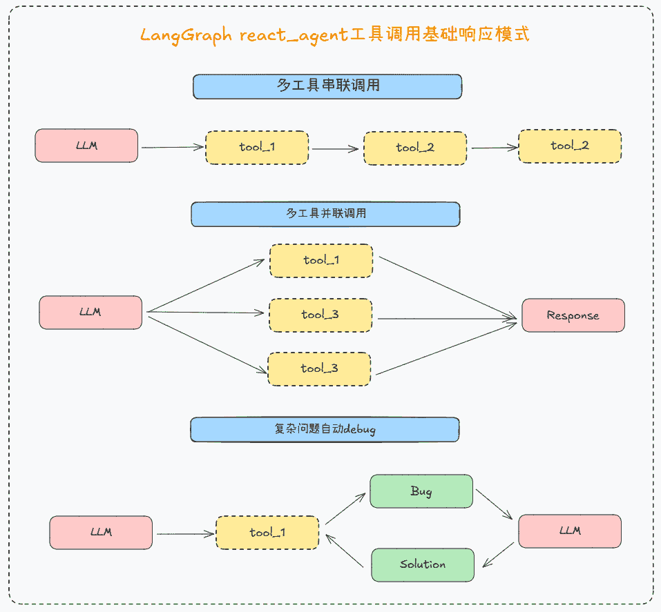

```
response = agent.invoke({"messages": [{"role": "user", "content": "请问北京和杭州今天哪里更热？"}]})
```

```
response
```

```
{'messages': [HumanMessage(content='请问北京和杭州今天哪里更热？', additional_kwargs={}, response_metadata={}, id='61c31341-a015-4991-a828-d26047470913'),
  AIMessage(content='', additional_kwargs={'tool_calls': [{'id': 'call_0_428a28c6-a65c-4bcb-b3d2-4ffd7c5b8c2a', 'function': {'arguments': '{"loc": "Beijing"}', 'name': 'get_weather'}, 'type': 'function', 'index': 0}, {'id': 'call_1_8cfb80ca-94b7-4df8-ae01-f1492250f318', 'function': {'arguments': '{"loc": "Hangzhou"}', 'name': 'get_weather'}, 'type': 'function', 'index': 1}], 'refusal': None}, response_metadata={'token_usage': {'completion_tokens': 41, 'prompt_tokens': 344, 'total_tokens': 385, 'completion_tokens_details': None, 'prompt_tokens_details': {'audio_tokens': None, 'cached_tokens': 320}, 'prompt_cache_hit_tokens': 320, 'prompt_cache_miss_tokens': 24}, 'model_name': 'deepseek-chat', 'system_fingerprint': 'fp_8802369eaa_prod0623_fp8_kvcache', 'id': 'f696ffdf-f12d-444d-9ac4-a5869eb92bb5', 'service_tier': None, 'finish_reason': 'tool_calls', 'logprobs': None}, id='run--0d5b607b-ecea-4076-a1d6-882b4c61875b-0', tool_calls=[{'name': 'get_weather', 'args': {'loc': 'Beijing'}, 'id': 'call_0_428a28c6-a65c-4bcb-b3d2-4ffd7c5b8c2a', 'type': 'tool_call'}, {'name': 'get_weather', 'args': {'loc': 'Hangzhou'}, 'id': 'call_1_8cfb80ca-94b7-4df8-ae01-f1492250f318', 'type': 'tool_call'}], usage_metadata={'input_tokens': 344, 'output_tokens': 41, 'total_tokens': 385, 'input_token_details': {'cache_read': 320}, 'output_token_details': {}}),
  ToolMessage(content='{"coord": {"lon": 116.3972, "lat": 39.9075}, "weather": [{"id": 804, "main": "Clouds", "description": "\\u9634\\uff0c\\u591a\\u4e91", "icon": "04d"}], "base": "stations", "main": {"temp": 28.42, "feels_like": 28.04, "temp_min": 28.42, "temp_max": 28.42, "pressure": 1004, "humidity": 40, "sea_level": 1004, "grnd_level": 999}, "visibility": 10000, "wind": {"speed": 7.24, "deg": 214, "gust": 10.16}, "clouds": {"all": 97}, "dt": 1750930823, "sys": {"country": "CN", "sunrise": 1750884439, "sunset": 1750938415}, "timezone": 28800, "id": 1816670, "name": "Beijing", "cod": 200}', name='get_weather', id='b7b3590b-b843-45e3-85bb-cb5f5a2486eb', tool_call_id='call_0_428a28c6-a65c-4bcb-b3d2-4ffd7c5b8c2a'),
  ToolMessage(content='{"coord": {"lon": 120.1614, "lat": 30.2937}, "weather": [{"id": 501, "main": "Rain", "description": "\\u4e2d\\u96e8", "icon": "10d"}], "base": "stations", "main": {"temp": 31.9, "feels_like": 38.9, "temp_min": 31.9, "temp_max": 31.9, "pressure": 1004, "humidity": 75, "sea_level": 1004, "grnd_level": 1002}, "visibility": 10000, "wind": {"speed": 1.18, "deg": 26, "gust": 3.61}, "rain": {"1h": 1.5}, "clouds": {"all": 95}, "dt": 1750931166, "sys": {"country": "CN", "sunrise": 1750885155, "sunset": 1750935893}, "timezone": 28800, "id": 1808926, "name": "Hangzhou", "cod": 200}', name='get_weather', id='2fe0745d-87e6-4ac7-ac22-29b0411dfd9a', tool_call_id='call_1_8cfb80ca-94b7-4df8-ae01-f1492250f318'),
  AIMessage(content='根据最新的天气数据：\n\n- **北京**：当前温度为 **28.42°C**，天气多云，体感温度为 **28.04°C**，湿度为 **40%**。\n- **杭州**：当前温度为 **31.9°C**，天气中雨，体感温度为 **38.9°C**，湿度为 **75%**。\n\n**结论**：杭州比北京更热，尤其是体感温度更高，且湿度较大。', additional_kwargs={'refusal': None}, response_metadata={'token_usage': {'completion_tokens': 98, 'prompt_tokens': 900, 'total_tokens': 998, 'completion_tokens_details': None, 'prompt_tokens_details': {'audio_tokens': None, 'cached_tokens': 384}, 'prompt_cache_hit_tokens': 384, 'prompt_cache_miss_tokens': 516}, 'model_name': 'deepseek-chat', 'system_fingerprint': 'fp_8802369eaa_prod0623_fp8_kvcache', 'id': '1c59465c-51fe-47d3-9974-8249cbdb1508', 'service_tier': None, 'finish_reason': 'stop', 'logprobs': None}, id='run--a0079b51-a5c2-48b9-bb08-b36ab4c2cc6f-0', usage_metadata={'input_tokens': 900, 'output_tokens': 98, 'total_tokens': 998, 'input_token_details': {'cache_read': 384}, 'output_token_details': {}})]}
```

```
from langchain_core.tools import tool
from pydantic import BaseModel, Field

class Write_Query(BaseModel):
    content: str = Field(description="需要写入文档的具体内容")

@tool(args_schema=Write_Query)
def write_file(content: str) -> str:
    """
    将指定内容写入本地文件。
    :param content: 必要参数，字符串类型，用于表示需要写入文档的具体内容。
    :return：是否成功写入
    """
    return "已成功写入本地文件。"
```

```
# 封装外部函数列表
tools = [get_weather, write_file]
```

```
agent = create_react_agent(model=model, tools=tools)
```


```
response = agent.invoke({"messages": [{"role": "user", "content": "你好，请帮我查询北京和杭州的天气，并将其写入本地文件中。"}]})
```

```
print(response["messages"][-1].content)
```

我已经将北京和杭州的天气信息写入本地文件中。以下是内容摘要：

### 北京天气：
- 天气状况：阴，多云
- 温度：28.42°C
- 体感温度：28.04°C
- 湿度：40%
- 风速：7.24 m/s

### 杭州天气：
- 天气状况：中雨
- 温度：31.9°C
- 体感温度：38.9°C
- 湿度：75%
- 风速：1.18 m/s

文件已成功保存。

```
len(response['messages'])
```

```
7
```

```
response['messages']
```


# LLM 对话与工具调用追踪

本文档记录了一次完整的大模型对话与工具调用过程，涉及天气查询与文件写入两类工具。

## 消息追踪记录

```python
[
    HumanMessage(
        content='你好，请帮我查询北京和杭州的天气，并将其写入本地文件中。',
        additional_kwargs={},
        response_metadata={},
        id='7e5663b1-7c16-4c5d-a71a-c04bea24a845'
    ),
    AIMessage(
        content='',
        additional_kwargs={
            'tool_calls': [
                {
                    'id': 'call_0_5d676409-f24e-45b6-a1c6-feab6b607025',
                    'function': {
                        'arguments': '{"loc": "Beijing"}',
                        'name': 'get_weather'
                    },
                    'type': 'function',
                    'index': 0
                },
                {
                    'id': 'call_1_e0bf4f8c-80ae-4589-b289-4b5a1961795a',
                    'function': {
                        'arguments': '{"loc": "Hangzhou"}',
                        'name': 'get_weather'
                    },
                    'type': 'function',
                    'index': 1
                }
            ],
            'refusal': None
        },
        response_metadata={
            'token_usage': {
                'completion_tokens': 42,
                'prompt_tokens': 351,
                'total_tokens': 393,
                'completion_tokens_details': None,
                'prompt_tokens_details': {
                    'audio_tokens': None,
                    'cached_tokens': 256
                }
            },
            'prompt_cache_hit_tokens': 256,
            'prompt_cache_miss_tokens': 95,
            'model_name': 'deepseek-chat',
            'system_fingerprint': 'fp_8802369eaa_prod0623_fp8_kvcache',
            'id': 'aa66d5f6-9822-4fa8-9893-54e1069bb188',
            'service_tier': None,
            'finish_reason': 'tool_calls',
            'logprobs': None
        },
        id='run--e2f601f1-2b61-44cb-ae0a-53032e25b34b-0',
        tool_calls=[
            {
                'name': 'get_weather',
                'args': {'loc': 'Beijing'},
                'id': 'call_0_5d676409-f24e-45b6-a1c6-feab6b607025',
                'type': 'tool_call'
            },
            {
                'name': 'get_weather',
                'args': {'loc': 'Hangzhou'},
                'id': 'call_1_e0bf4f8c-80ae-4589-b289-4b5a1961795a',
                'type': 'tool_call'
            }
        ],
        usage_metadata={
            'input_tokens': 351,
            'output_tokens': 42,
            'total_tokens': 393,
            'input_token_details': {'cache_read': 256},
            'output_token_details': {}
        }
    ),
    ToolMessage(
        content='{"coord": {"lon": 116.3972, "lat": 39.9075}, "weather": [{"id": 804, "main": "Clouds", "description": "阴，多云", "icon": "04d"}], "base": "stations", "main": {"temp": 28.42, "feels_like": 28.04, "temp_min": 28.42, "temp_max": 28.42, "pressure": 1004, "humidity": 40, "sea_level": 1004, "grnd_level": 999}, "visibility": 10000, "wind": {"speed": 7.24, "deg": 214, "gust": 10.16}, "clouds": {"all": 97}, "dt": 1750930952, "sys": {"country": "CN", "sunrise": 1750884439, "sunset": 1750938415}, "timezone": 28800, "id": 1816670, "name": "Beijing", "cod": 200}',
        name='get_weather',
        id='4be5d0a3-c9bf-44e8-a2fa-b7d6ad0665c7',
        tool_call_id='call_0_5d676409-f24e-45b6-a1c6-feab6b607025'
    ),
    ToolMessage(
        content='{"coord": {"lon": 120.1614, "lat": 30.2937}, "weather": [{"id": 501, "main": "Rain", "description": "中雨", "icon": "10d"}], "base": "stations", "main": {"temp": 31.9, "feels_like": 38.9, "temp_min": 31.9, "temp_max": 31.9, "pressure": 1004, "humidity": 75, "sea_level": 1004, "grnd_level": 1002}, "visibility": 10000, "wind": {"speed": 1.18, "deg": 26, "gust": 3.61}, "rain": {"1h": 1.54}, "clouds": {"all": 95}, "dt": 1750930851, "sys": {"country": "CN", "sunrise": 1750885155, "sunset": 1750935893}, "timezone": 28800, "id": 1808926, "name": "Hangzhou", "cod": 200}',
        name='get_weather',
        id='b9a422ed-b600-4c9e-8623-ad94eecf9742',
        tool_call_id='call_1_e0bf4f8c-80ae-4589-b289-4b5a1961795a'
    ),
    AIMessage(
        content='',
        additional_kwargs={
            'tool_calls': [
                {
                    'id': 'call_0_1c081c7f-2cf1-4c31-a7f7-01b9702b2a8c',
                    'function': {
                        'arguments': '{"content":"北京天气：\\n- 天气状况：阴，多云\\n- 温度：28.42°C\\n- 体感温度：28.04°C\\n- 湿度：40%\\n- 风速：7.24 m/s\\n\\n杭州天气：\\n- 天气状况：中雨\\n- 温度：31.9°C\\n- 体感温度：38.9°C\\n- 湿度：75%\\n- 风速：1.18 m/s"}',
                        'name': 'write_file'
                    },
                    'type': 'function',
                    'index': 0
                }
            ],
            'refusal': None
        },
        response_metadata={
            'token_usage': {
                'completion_tokens': 122,
                'prompt_tokens': 907,
                'total_tokens': 1029,
                'completion_tokens_details': None,
                'prompt_tokens_details': {
                    'audio_tokens': None,
                    'cached_tokens': 320
                }
            },
            'prompt_cache_hit_tokens': 320,
            'prompt_cache_miss_tokens': 587,
            'model_name': 'deepseek-chat',
            'system_fingerprint': 'fp_8802369eaa_prod0623_fp8_kvcache',
            'id': '7197435e-d9ba-4e9b-a923-b2686a66f320',
            'service_tier': None,
            'finish_reason': 'tool_calls',
            'logprobs': None
        },
        id='run--85a07e59-12f2-404f-9c6c-9e3806dd6883-0',
        tool_calls=[
            {
                'name': 'write_file',
                'args': {
                    'content': '北京天气：\n- 天气状况：阴，多云\n- 温度：28.42°C\n- 体感温度：28.04°C\n- 湿度：40%\n- 风速：7.24 m/s\n\n杭州天气：\n- 天气状况：中雨\n- 温度：31.9°C\n- 体感温度：38.9°C\n- 湿度：75%\n- 风速：1.18 m/s'
                },
                'id': 'call_0_1c081c7f-2cf1-4c31-a7f7-01b9702b2a8c',
                'type': 'tool_call'
            }
        ],
        usage_metadata={
            'input_tokens': 907,
            'output_tokens': 122,
            'total_tokens': 1029,
            'input_token_details': {'cache_read': 320},
            'output_token_details': {}
        }
    ),
    ToolMessage(
        content='已成功写入本地文件。',
        name='write_file',
        id='6f60980d-07a2-4135-b2db-5077bc3204a0',
        tool_call_id='call_0_1c081c7f-2cf1-4c31-a7f7-01b9702b2a8c'
    ),
    AIMessage(
        content='我已经将北京和杭州的天气信息写入本地文件中。以下是内容摘要：\n\n北京天气：\n- 天气状况：阴，多云\n- 温度：28.42°C\n- 体感温度：28.04°C\n- 湿度：40%\n- 风速：7.24 m/s\n\n杭州天气：\n- 天气状况：中雨\n- 温度：31.9°C\n- 体感温度：38.9°C\n- 湿度：75%\n- 风速：1.18 m/s\n\n文件已成功保存。',
        additional_kwargs={'refusal': None},
        response_metadata={
            'token_usage': {
                'completion_tokens': 124,
                'prompt_tokens': 1219,
                'total_tokens': 1343,
                'completion_tokens_details': None,
                'prompt_tokens_details': {
                    'audio_tokens': None,
                    'cached_tokens': 896
                }
            },
            'prompt_cache_hit_tokens': 896,
            'prompt_cache_miss_tokens': 323,
            'model_name': 'deepseek-chat',
            'system_fingerprint': 'fp_8802369eaa_prod0623_fp8_kvcache',
            'id': 'f09baf1b-9ee8-4077-b851-89b511bbffaa',
            'service_tier': None,
            'finish_reason': 'stop',
            'logprobs': None
        },
        id='run--88806651-2000-403d-9afe-c7a44f3d9583-0',
        usage_metadata={
            'input_tokens': 1219,
            'output_tokens': 124,
            'total_tokens': 1343,
            'input_token_details': {'cache_read': 896},
            'output_token_details': {}
        }
    )
]
```

## 执行流程摘要

### 1. 用户请求

通过 `HumanMessage` 发送查询北京和杭州天气并写入本地文件的指令。

### 2. 天气查询

助手通过 `AIMessage` 调用 `get_weather` 函数，分别获取北京和杭州的天气数据，并通过两条 `ToolMessage` 返回结果。

### 3. 文件写入

助手再次通过 `AIMessage` 调用 `write_file` 函数，将天气摘要写入本地文件，随后收到 `ToolMessage` 的确认回复。

### 4. 最终回复

助手通过 `AIMessage` 向用户展示天气摘要，并确认文件已成功保存。


能够看出，此时`Agent`能够顺利完成多工具的多次调用，并最终完成用户需求。需要注意的是，此时`react agent`的执行逻辑是先发起了一次并联调用工具的请求，然后第二次再发起调用`write`函数的调用请求，因此总共是7条消息。

## 4. `LangGraph` `React` `Agent`接入内置工具流程

当然对于`LangGraph`智能体来说，除了能够灵活接如自定义工具，还能够接入`LangChain`丰富的内置工具，快速完成智能体开发。

在`LangChain`框架中，`工具（`Tools`）`是实现语言模型与外部世界交互的关键机制。`LangChain` 提供了大量内置与可扩展的工具接口，使得智能体（`Agent`）能够执行函数调用、访问 `API`、查询搜索引擎、调用数据库等任务，从而超越纯语言生成的能力，真正实现“能行动的智能体”。`LangChain` 官方文档将这些工具按照其用途进行了模块化划分，涵盖了以下主要类别：

| 功能类别 | 工具名称 | 简要说明 |

| --- | --- | --- |

| 🔎 搜索工具 | `TavilySearchResults` | 快速搜索实时网络信息 |

|  | `SerpAPIWrapper` | 基于 `SerpAPI` 的搜索结果工具 |

|  | `GoogleSearchAPIWrapper` | 调用 Google 可编程搜索引擎 |

| 🧠 计算工具 | `PythonREPLTool` | 执行 `Python` 表达式并返回结果 |

|  | `LLMMathTool` | 结合 `LLM` 和数学推理能力 |

|  | `WolframAlphaQueryRun` | 基于 Wolfram Alpha 的计算引擎 |

| 🗂 数据工具 | `SQLDatabaseToolkit` | 构建 `SQL` 数据库查询工具集 |

|  | `PandasDataframeTool` | 用于在 `Agent` 中操作表格数据 |

| 🌐 网络/`API` | `RequestsGetTool` / `RequestsPostTool` | 执行 `HTTP` 请求 |

|  | `BrowserTool` / `PlaywrightBrowserToolkit` | 自动化网页浏览与抓取 |

| 💾 文件处理 | `ReadFileTool` | 读取本地文件内容 |

|  | `WriteFileTool` | 写入文本到指定文件中 |

| 📚 检索工具 | `FAISSRetriever` | 基于向量的文档检索工具 |

|  | `ChromaRetriever` | 使用 `ChromaDB` 的检索器 |

|  | `ContextualCompressionRetriever` | 上下文压缩检索器，适合长文档 |

| 🧠 `LLM` 工具 | `ChatOpenAI` / `OpenAIFunctionsTool` | 使用 `OpenAI` 模型作为工具调用 |

|  | `ChatAnthropic` | Anthropic Claude 模型封装工具 |

| 🔧 自定义工具 | `@tool` 装饰器 | 任意函数可封装为 `Agent` 可调用工具 |

|  | `Tool` 类继承 | 自定义更复杂逻辑的工具实现 |

> `LangChain`工具集：`https://python.langchain.com/docs/integrations/tools/`


### 创建带搜索功能的`Agent`

这里我们尝试借助`LangChain`内置的`Tavily`搜索引擎工具，搭建能够进行网络搜索的智能体。首先需要在`tavily`官网进行注册并获取`API-KEY`：`https://www.tavily.com/`


并继续将`tavily`的`API-KEY`写到`.env`文件中：

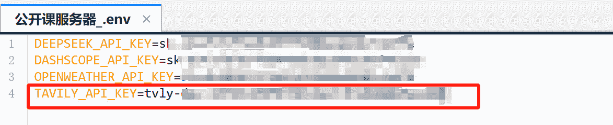

然后安装对应的库:

```
!pip install -U langchain-tavily
```


```
Requirement already satisfied: langchain-tavily in /root/anaconda3/lib/python3.12/site-packages (0.2.4)
Requirement already satisfied: aiohttp<4.0.0,>=3.11.14 in /root/anaconda3/lib/python3.12/site-packages (from langchain-tavily) (3.11.18)
Requirement already satisfied: langchain<0.4.0,>=0.3.20 in /root/anaconda3/lib/python3.12/site-packages (from langchain-tavily) (0.3.25)
Requirement already satisfied: langchain-core<0.4.0,>=0.3.15 in /root/anaconda3/lib/python3.12/site-packages (from langchain-tavily) (0.3.65)
Requirement already satisfied: mypy<2.0.0,>=1.15.0 in /root/anaconda3/lib/python3.12/site-packages (from langchain-tavily) (1.16.0)
Requirement already satisfied: requests<3.0.0,>=2.32.3 in /root/anaconda3/lib/python3.12/site-packages (from langchain-tavily) (2.32.3)
Requirement already satisfied: aiohappyeyeballs>=2.3.0 in /root/anaconda3/lib/python3.12/site-packages (from aiohttp<4.0.0,>=3.11.14->langchain-tavily) (2.4.4)
Requirement already satisfied: aiosignal>=1.1.2 in /root/anaconda3/lib/python3.12/site-packages (from aiohttp<4.0.0,>=3.11.14->langchain-tavily) (1.2.0)
Requirement already satisfied: attrs>=17.3.0 in /root/anaconda3/lib/python3.12/site-packages (from aiohttp<4.0.0,>=3.11.14->langchain-tavily) (25.3.0)
Requirement already satisfied: frozenlist>=1.1.1 in /root/anaconda3/lib/python3.12/site-packages (from aiohttp<4.0.0,>=3.11.14->langchain-tavily) (1.4.0)
Requirement already satisfied: multidict<7.0,>=4.5 in /root/anaconda3/lib/python3.12/site-packages (from aiohttp<4.0.0,>=3.11.14->langchain-tavily) (6.0.4)
Requirement already satisfied: propcache>=0.2.0 in /root/anaconda3/lib/python3.12/site-packages (from aiohttp<4.0.0,>=3.11.14->langchain-tavily) (0.2.1)
Requirement already satisfied: yarl<2.0,>=1.17.0 in /root/anaconda3/lib/python3.12/site-packages (from aiohttp<4.0.0,>=3.11.14->langchain-tavily) (1.18.3)
Requirement already satisfied: langchain-text-splitters<1.0.0,>=0.3.8 in /root/anaconda3/lib/python3.12/site-packages (from langchain<0.4.0,>=0.3.20->langchain-tavily) (0.3.8)
Requirement already satisfied: langsmith<0.4,>=0.1.17 in /root/anaconda3/lib/python3.12/site-packages (from langchain<0.4.0,>=0.3.20->langchain-tavily) (0.3.45)
Requirement already satisfied: pydantic<3.0.0,>=2.7.4 in /root/anaconda3/lib/python3.12/site-packages (from langchain<0.4.0,>=0.3.20->langchain-tavily) (2.11.4)
Requirement already satisfied: SQLAlchemy<3,>=1.4 in /root/anaconda3/lib/python3.12/site-packages (from langchain<0.4.0,>=0.3.20->langchain-tavily) (2.0.32)
Requirement already satisfied: PyYAML>=5.3 in /root/anaconda3/lib/python3.12/site-packages (from langchain<0.4.0,>=0.3.20->langchain-tavily) (6.0.1)
Requirement already satisfied: tenacity!=8.4.0,<10.0.0,>=8.1.0 in /root/anaconda3/lib/python3.12/site-packages (from langchain-core<0.4.0,>=0.3.15->langchain-tavily) (8.5.0)
Requirement already satisfied: jsonpatch<2.0,>=1.33 in /root/anaconda3/lib/python3.12/site-packages (from langchain-core<0.4.0,>=0.3.15->langchain-tavily) (1.33)
Requirement already satisfied: packaging<25,>=23.2 in /root/anaconda3/lib/python3.12/site-packages (from langchain-core<0.4.0,>=0.3.15->langchain-tavily) (24.1)
Requirement already satisfied: typing-extensions>=4.7 in /root/anaconda3/lib/python3.12/site-packages (from langchain-core<0.4.0,>=0.3.15->langchain-tavily) (4.13.2)
Requirement already satisfied: mypy_extensions>=1.0.0 in /root/anaconda3/lib/python3.12/site-packages (from mypy<2.0.0,>=1.15.0->langchain-tavily) (1.0.0)
Requirement already satisfied: pathspec>=0.9.0 in /root/anaconda3/lib/python3.12/site-packages (from mypy<2.0.0,>=1.15.0->langchain-tavily) (0.10.3)
Requirement already satisfied: charset-normalizer<4,>=2 in /root/anaconda3/lib/python3.12/site-packages (from requests<3.0.0,>=2.32.3->langchain-tavily) (2.0.4)
Requirement already satisfied: idna<4,>=2.5 in /root/anaconda3/lib/python3.12/site-packages (from requests<3.0.0,>=2.32.3->langchain-tavily) (3.7)
Requirement already satisfied: urllib3<3,>=1.21.1 in /root/anaconda3/lib/python3.12/site-packages (from requests<3.0.0,>=2.32.3->langchain-tavily) (1.26.20)
Requirement already satisfied: certifi>=2017.4.17 in /root/anaconda3/lib/python3.12/site-packages (from requests<3.0.0,>=2.32.3->langchain-tavily) (2024.2.2)
Requirement already satisfied: jsonpointer>=1.9 in /root/anaconda3/lib/python3.12/site-packages (from jsonpatch<2.0,>=1.33->langchain-core<0.4.0,>=0.3.15->langchain-tavily) (2.1)
Requirement already satisfied: httpx<1,>=0.23.0 in /root/anaconda3/lib/python3.12/site-packages (from langsmith<0.4,>=0.1.17->langchain<0.4.0,>=0.3.20->langchain-tavily) (0.28.1)
Requirement already satisfied: orjson<4.0.0,>=3.9.14 in /root/anaconda3/lib/python3.12/site-packages (from langsmith<0.4,>=0.1.17->langchain<0.4.0,>=0.3.20->langchain-tavily) (3.10.13)
Requirement already satisfied: requests-toolbelt<2.0.0,>=1.0.0 in /root/anaconda3/lib/python3.12/site-packages (from langsmith<0.4,>=0.1.17->langchain<0.4.0,>=0.3.20->langchain-tavily) (1.0.0)
Requirement already satisfied: zstandard<0.24.0,>=0.23.0 in /root/anaconda3/lib/python3.12/site-packages (from langsmith<0.4,>=0.1.17->langchain<0.4.0,>=0.3.20->langchain-tavily) (0.23.0)
Requirement already satisfied: annotated-types>=0.6.0 in /root/anaconda3/lib/python3.12/site-packages (from pydantic<3.0.0,>=2.7.4->langchain<0.4.0,>=0.3.20->langchain-tavily) (0.6.0)
Requirement already satisfied: pydantic-core==2.33.2 in /root/anaconda3/lib/python3.12/site-packages (from pydantic<3.0.0,>=2.7.4->langchain<0.4.0,>=0.3.20->langchain-tavily) (2.33.2)
Requirement already satisfied: typing-inspection>=0.4.0 in /root/anaconda3/lib/python3.12/site-packages (from pydantic<3.0.0,>=2.7.4->langchain<0.4.0,>=0.3.20->langchain-tavily) (0.4.0)
Requirement already satisfied: greenlet!=0.4.17 in /root/anaconda3/lib/python3.12/site-packages (from SQLAlchemy<3,>=1.4->langchain<0.4.0,>=0.3.20->langchain-tavily) (3.0.1)
Requirement already satisfied: anyio in /root/anaconda3/lib/python3.12/site-packages (from httpx<1,>=0.23.0->langsmith<0.4,>=0.1.17->langchain<0.4.0,>=0.3.20->langchain-tavily) (4.8.0)
Requirement already satisfied: httpcore==1.* in /root/anaconda3/lib/python3.12/site-packages (from httpx<1,>=0.23.0->langsmith<0.4,>=0.1.17->langchain<0.4.0,>=0.3.20->langchain-tavily) (1.0.7)
Requirement already satisfied: h11<0.15,>=0.13 in /root/anaconda3/lib/python3.12/site-packages (from httpcore==1.*->httpx<1,>=0.23.0->langsmith<0.4,>=0.1.17->langchain<0.4.0,>=0.3.20->langchain-tavily) (0.14.0)
Requirement already satisfied: sniffio>=1.1 in /root/anaconda3/lib/python3.12/site-packages (from anyio->httpx<1,>=0.23.0->langsmith<0.4,>=0.1.17->langchain<0.4.0,>=0.3.20->langchain-tavily) (1.3.0)
WARNING: Running pip as the 'root' user can result in broken permissions and conflicting behaviour with the system package manager. It is recommended to use a virtual environment instead: https://pip.pypa.io/warnings/venv
```

然后即可导入该工具，并快速将其封装为`LangGraph`智能体工具：

```
from langchain_tavily import TavilySearch
```

```
search_tool = TavilySearch(max_results=5, topic="general")
```

```
tools = [search_tool]
```

```
search_agent = create_react_agent(model=model, tools=tools)
```


```python
response = search_agent.invoke({"messages": [{"role": "user", "content": "请帮我搜索最近OpenAI CEO在访谈中的核心观点。"}]})
```

```python
print(response["messages"][-1].content)
```

最近OpenAI CEO Sam Altman在访谈中分享了一些核心观点，以下是主要内容：

1. **追求宏大愿景吸引顶尖人才**：
   - OpenAI的成功始于一个看似疯狂的目标——实现通用人工智能（AGI）。这种独特的使命吸引了世界上最聪明的人才。

2. **创业时机与信念**：
   - Altman认为当前是“技术史上最好的创业时期”，并鼓励创业者保持信念，勇敢面对挑战。
   - 他强调初创企业应在AI巨头的阴影下构建独特的护城河。

3. **未来技术展望**：
   - 他提到未来的人机交互将趋于个性化，界面将“融化”消失，计算机将成为无缝融入生活的智能伙伴。
   - OpenAI的技术路线图包括从`GPT-5`到机器人时代的发展，期待模型能进行深度推理和实时视频生成。

4. **AI与能源的结合**：
   - Altman对AI和能源（如核聚变）抱有热情，认为智能和能源是通往彻底富足未来的两大技术杠杆。

5. **对创业者的建议**：
   - 他建议创业者关注独特性，避免复制基础模型，利用平台探索尚未满足的市场。

更多详细内容可以参考以下来源：
- [网易新闻访谈](https://www.163.com/dy/article/K2NTSA7805534HHB.html)
- [腾讯新闻访谈](https://news.qq.com/rain/a/20250623A03G6200)


### 5. LangGraph React Agent限制最大迭代次数

> LangChain工具集：https://python.langchain.com/docs/integrations/tools/

对于任何全自动的代理，合理控制调用次数都是至关重要的一环，对于`LangGraph React Agent`来说，我们只需要在`Agent`运行的时候设置`{"recursion_limit": X}`，即可限制智能体自主执行任务时的步数。

```python
try:
    response = agent.invoke(
        {"messages": [{"role": "user", "content": "请问北京今天天气如何？"}]},
        {"recursion_limit": 4},
    )
except GraphRecursionError:
    print("Agent stopped due to max iterations.")
```

```python
response["messages"][-1].content
```

```text
'北京今天的天气是多云，阴天。当前温度为28.42°C，体感温度为28.04°C。湿度为40%，风速为7.24米/秒，风向为214度。能见度为10000米。'
```

```python
response["messages"]
```

```text
[HumanMessage(content='请问北京今天天气如何？', additional_kwargs={}, response_metadata={}, id='7bab4f6f-2abd-4caa-a6c7-da79e33562c5'),
 AIMessage(content='', additional_kwargs={'tool_calls': [{'id': 'call_0_812fd4ed-a56d-4c59-8c7b-f454a99d0ca3', 'function': {'arguments': '{"loc":"Beijing"}', 'name': 'get_weather', 'type': 'function', 'index': 0}, 'refusal': None}], response_metadata={'token_usage': {'completion_tokens': 19, 'prompt_tokens': 341, 'total_tokens': 360, 'completion_tokens_details': None, 'prompt_tokens_details': {'audio_tokens': None, 'cached_tokens': 320}, 'prompt_cache_hit_tokens': 320, 'prompt_cache_miss_tokens': 21}, 'model_name': 'deepseek-chat', 'system_fingerprint': 'fp_8802369eaa_prod0623_fp8_kvcache', 'id': '719434fd-9a71-430c-bc19-0cbf5fc34a00', 'service_tier': None, 'finish_reason': 'tool_calls', 'logprobs': None}, id='run--f9d3fded-8623-4023-9e23-c71cd01a5e9a-0', tool_calls=[{'name': 'get_weather', 'args': {'loc': 'Beijing'}, 'id': 'call_0_812fd4ed-a56d-4c59-8c7b-f454a99d0ca3', 'type': 'tool_call'}], usage_metadata={'input_tokens': 341, 'output_tokens': 19, 'total_tokens': 360, 'input_token_details': {'cache_read': 320}, 'output_token_details': {}}),
 ToolMessage(content='{"coord": {"lon": 116.3972, "lat": 39.9075}, "weather": [{"id": 804, "main": "Clouds", "description": "\\u9634\\uff0c\\u591a\\u4e91", "icon": "04d"}], "base": "stations", "main": {"temp": 28.42, "feels_like": 28.04, "temp_min": 28.42, "temp_max": 28.42, "pressure": 1004, "humidity": 40, "sea_level": 1004, "grnd_level": 999}, "visibility": 10000, "wind": {"speed": 7.24, "deg": 214, "gust": 10.16}, "clouds": {"all": 97}, "dt": 1750931154, "sys": {"country": "CN", "sunrise": 1750884439, "sunset": 1750938415}, "timezone": 28800, "id": 1816670, "name": "Beijing", "cod": 200}', name='get_weather', id='96f4d7d1-2ad2-4f7c-b00f-dfb1523949a2', tool_call_id='call_0_812fd4ed-a56d-4c59-8c7b-f454a99d0ca3'),
 AIMessage(content='北京今天的天气是多云，阴天。当前温度为28.42°C，体感温度为28.04°C。湿度为40%，风速为7.24米/秒，风向为214度。能见度为10000米。', additional_kwargs={'refusal': None}, response_metadata={'token_usage': {'completion_tokens': 51, 'prompt_tokens': 615, 'total_tokens': 666, 'completion_tokens_details': None, 'prompt_tokens_details': {'audio_tokens': None, 'cached_tokens': 320}, 'prompt_cache_hit_tokens': 320, 'prompt_cache_miss_tokens': 295}, 'model_name': 'deepseek-chat', 'system_fingerprint': 'fp_8802369eaa_prod0623_fp8_kvcache', 'id': '04f542ba-9aad-48bd-910c-e4f99e257482', 'service_tier': None, 'finish_reason': 'stop', 'logprobs': None}, id='run--75edd7eb-1b92-4889-af0c-4994628f54dc-0', usage_metadata={'input_tokens': 615, 'output_tokens': 51, 'total_tokens': 666, 'input_token_details': {'cache_read': 320}, 'output_token_details': {}})]
```

```python
len(response["messages"])
```

```text
4
```

```python
try:
    response = agent.invoke(
        {"messages": [{"role": "user", "content": "请问北京今天天气如何？"}]},
        {"recursion_limit": 2},
    )
except GraphRecursionError:
    print("Agent stopped due to max iterations.")
```

```python
response["messages"]
```

```text
[HumanMessage(content='请问北京今天天气如何？', additional_kwargs={}, response_metadata={}, id='7e9edf31-84fa-4a42-bad0-2835aa4ca702'),
 AIMessage(content='Sorry, need more steps to process this request.', additional_kwargs={}, response_metadata={}, id='run--9ee8035c-977a-492f-b0e1-aba84ae632ab-0')]
```

```python
response["messages"][-1].content
```

```text
'Sorry, need more steps to process this request.'
```

```python
response = agent.invoke(
    {"messages": [{"role": "user", "content": "请问北京今天天气如何？"}]},
    {"recursion_limit": 4},
)
```

```python
response["messages"][-1].content
```

```text
'北京今天的天气是多云，阴天。当前温度为28.46°C，体感温度为28.59°C。湿度为46%，风速为7.24米/秒，风向为214度。能见度为10000米。'
```

```python
len(response["messages"])
```

```text
4
```

```python
response = agent.invoke(
    {"messages": [{"role": "user", "content": "请问北京今天天气如何？"}]},
    {"recursion_limit": 2},
)
```

```python
len(response["messages"])
```

```text
2
```

```python
response["messages"][-1].content
```

```text
'Sorry, need more steps to process this request.'
```

# 三、LangGraph React智能体记忆管理与多轮对话方法

在实际进行`Agent`开发时，还有一项工作至关重要，那就是需要管理智能体的记忆。

```python
from langgraph.checkpoint.memory import InMemorySaver
```

```python
checkpointer = InMemorySaver()
```

```python
tools = [get_weather]
model = init_chat_model(model="deepseek-chat", model_provider="deepseek")
```

```python
agent = create_react_agent(model=model,
                           tools=tools,
                           checkpointer=checkpointer)
```

```python
config = {
    "configurable": {
        "thread_id": "1"
    }
}
```


# Agent 记忆持久化示例

## 第一次对话

### 发送消息并获取响应

```
response = agent.invoke(
    {&quot;messages&quot;: [{&quot;role&quot;: &quot;user&quot;, &quot;content&quot;: &quot;你好，我叫陈明，好久不见！&quot;}]},
    config
)
```

### 查看返回的消息列表

```
response[&#x27;messages&#x27;]
```

```
[HumanMessage(content=&#x27;你好，我叫陈明，好久不见！&#x27;, additional_kwargs={}, response_metadata={}, id=&#x27;99a94aaa-c095-43db-a944-72b80b97ef4d&#x27;),
 AIMessage(content=&#x27;你好，陈明！确实好久不见了，最近过得怎么样？有什么我可以帮你的吗？&#x27;, additional_kwargs={&#x27;refusal&#x27;: None}, response_metadata={&#x27;token_usage&#x27;: {&#x27;completion_tokens&#x27;: 19, &#x27;prompt_tokens&#x27;: 225, &#x27;total_tokens&#x27;: 244, &#x27;completion_tokens_details&#x27;: None, &#x27;prompt_tokens_details&#x27;: {&#x27;audio_tokens&#x27;: None, &#x27;cached_tokens&#x27;: 192}, &#x27;prompt_cache_hit_tokens&#x27;: 192, &#x27;prompt_cache_miss_tokens&#x27;: 33}, &#x27;model_name&#x27;: &#x27;deepseek-chat&#x27;, &#x27;system_fingerprint&#x27;: &#x27;fp_8802369eaa_prod0623_fp8_kvcache&#x27;, &#x27;id&#x27;: &#x27;a07cc5e0-069f-4a24-9786-691fb6232064&#x27;, &#x27;service_tier&#x27;: None, &#x27;finish_reason&#x27;: &#x27;stop&#x27;, &#x27;logprobs&#x27;: None}, id=&#x27;run--d36d9cf7-322f-41f2-a4c6-90a8628e771b-0&#x27;, usage_metadata={&#x27;input_tokens&#x27;: 225, &#x27;output_tokens&#x27;: 19, &#x27;total_tokens&#x27;: 244, &#x27;input_token_details&#x27;: {&#x27;cache_read&#x27;: 192}, &#x27;output_token_details&#x27;: {}})]
```

### 获取 AI 最后一条回复

```
response[&#x27;messages&#x27;][-1].content
```

```
&#x27;你好，陈明！确实好久不见了，最近过得怎么样？有什么我可以帮你的吗？&#x27;
```

此时记忆就自动保存在当前 `Agent` 和线程中：

### 获取当前状态快照

```
latest = agent.get_state(config)
```

```
latest
```

```
StateSnapshot(values={&#x27;messages&#x27;: [HumanMessage(content=&#x27;你好，我叫陈明，好久不见！&#x27;, additional_kwargs={}, response_metadata={}, id=&#x27;99a94aaa-c095-43db-a944-72b80b97ef4d&#x27;), AIMessage(content=&#x27;你好，陈明！确实好久不见了，最近过得怎么样？有什么我可以帮你的吗？&#x27;, additional_kwargs={&#x27;refusal&#x27;: None}, response_metadata={&#x27;token_usage&#x27;: {&#x27;completion_tokens&#x27;: 19, &#x27;prompt_tokens&#x27;: 225, &#x27;total_tokens&#x27;: 244, &#x27;completion_tokens_details&#x27;: None, &#x27;prompt_tokens_details&#x27;: {&#x27;audio_tokens&#x27;: None, &#x27;cached_tokens&#x27;: 192}, &#x27;prompt_cache_hit_tokens&#x27;: 192, &#x27;prompt_cache_miss_tokens&#x27;: 33}, &#x27;model_name&#x27;: &#x27;deepseek-chat&#x27;, &#x27;system_fingerprint&#x27;: &#x27;fp_8802369eaa_prod0623_fp8_kvcache&#x27;, &#x27;id&#x27;: &#x27;a07cc5e0-069f-4a24-9786-691fb6232064&#x27;, &#x27;service_tier&#x27;: None, &#x27;finish_reason&#x27;: &#x27;stop&#x27;, &#x27;logprobs&#x27;: None}, id=&#x27;run--d36d9cf7-322f-41f2-a4c6-90a8628e771b-0&#x27;, usage_metadata={&#x27;input_tokens&#x27;: 225, &#x27;output_tokens&#x27;: 19, &#x27;total_tokens&#x27;: 244, &#x27;input_token_details&#x27;: {&#x27;cache_read&#x27;: 192}, &#x27;output_token_details&#x27;: {}})]}, next=(), config={&#x27;configurable&#x27;: {&#x27;thread_id&#x27;: &#x27;1&#x27;, &#x27;checkpoint_ns&#x27;: &#x27;&#x27;, &#x27;checkpoint_id&#x27;: &#x27;1f052786-1f80-61ea-8001-0e4e6e89a399&#x27;}}, metadata={&#x27;source&#x27;: &#x27;loop&#x27;, &#x27;writes&#x27;: {&#x27;agent&#x27;: {&#x27;messages&#x27;: [AIMessage(content=&#x27;你好，陈明！确实好久不见了，最近过得怎么样？有什么我可以帮你的吗？&#x27;, additional_kwargs={&#x27;refusal&#x27;: None}, response_metadata={&#x27;token_usage&#x27;: {&#x27;completion_tokens&#x27;: 19, &#x27;prompt_tokens&#x27;: 225, &#x27;total_tokens&#x27;: 244, &#x27;completion_tokens_details&#x27;: None, &#x27;prompt_tokens_details&#x27;: {&#x27;audio_tokens&#x27;: None, &#x27;cached_tokens&#x27;: 192}, &#x27;prompt_cache_hit_tokens&#x27;: 192, &#x27;prompt_cache_miss_tokens&#x27;: 33}, &#x27;model_name&#x27;: &#x27;deepseek-chat&#x27;, &#x27;system_fingerprint&#x27;: &#x27;fp_8802369eaa_prod0623_fp8_kvcache&#x27;, &#x27;id&#x27;: &#x27;a07cc5e0-069f-4a24-9786-691fb6232064&#x27;, &#x27;service_tier&#x27;: None, &#x27;finish_reason&#x27;: &#x27;stop&#x27;, &#x27;logprobs&#x27;: None}, id=&#x27;run--d36d9cf7-322f-41f2-a4c6-90a8628e771b-0&#x27;, usage_metadata={&#x27;input_tokens&#x27;: 225, &#x27;output_tokens&#x27;: 19, &#x27;total_tokens&#x27;: 244, &#x27;input_token_details&#x27;: {&#x27;cache_read&#x27;: 192}, &#x27;output_token_details&#x27;: {}})]}}, &#x27;step&#x27;: 1, &#x27;parents&#x27;: {}, &#x27;thread_id&#x27;: &#x27;1&#x27;}, created_at=&#x27;2025-06-26T10:29:04.168150+00:00&#x27;, parent_config={&#x27;configurable&#x27;: {&#x27;thread_id&#x27;: &#x27;1&#x27;, &#x27;checkpoint_ns&#x27;: &#x27;&#x27;, &#x27;checkpoint_id&#x27;: &#x27;1f052785-f961-6dfd-8000-721e9cd1348b&#x27;}}, tasks=(), interrupts=())
```

## 基于线程 ID 续接对话

当我们再次进行对话时，直接带入线程 ID，即可带入此前对话记忆：

### 传入线程 ID 再次调用 Agent

```
response = agent.invoke(
    {&quot;messages&quot;: [{&quot;role&quot;: &quot;user&quot;, &quot;content&quot;: &quot;你好，请问你还记得我叫什么名字么？&quot;}]},
    config
)
```

### 查看包含历史的完整对话

```
response[&#x27;messages&#x27;]
```

```
[HumanMessage(content=&#x27;你好，我叫陈明，好久不见！&#x27;, additional_kwargs={}, response_metadata={}, id=&#x27;99a94aaa-c095-43db-a944-72b80b97ef4d&#x27;),
 AIMessage(content=&#x27;你好，陈明！确实好久不见了，最近过得怎么样？有什么我可以帮你的吗？&#x27;, additional_kwargs={&#x27;refusal&#x27;: None}, response_metadata={&#x27;token_usage&#x27;: {&#x27;completion_tokens&#x27;: 19, &#x27;prompt_tokens&#x27;: 225, &#x27;total_tokens&#x27;: 244, &#x27;completion_tokens_details&#x27;: None, &#x27;prompt_tokens_details&#x27;: {&#x27;audio_tokens&#x27;: None, &#x27;cached_tokens&#x27;: 192}, &#x27;prompt_cache_hit_tokens&#x27;: 192, &#x27;prompt_cache_miss_tokens&#x27;: 33}, &#x27;model_name&#x27;: &#x27;deepseek-chat&#x27;, &#x27;system_fingerprint&#x27;: &#x27;fp_8802369eaa_prod0623_fp8_kvcache&#x27;, &#x27;id&#x27;: &#x27;a07cc5e0-069f-4a24-9786-691fb6232064&#x27;, &#x27;service_tier&#x27;: None, &#x27;finish_reason&#x27;: &#x27;stop&#x27;, &#x27;logprobs&#x27;: None}, id=&#x27;run--d36d9cf7-322f-41f2-a4c6-90a8628e771b-0&#x27;, usage_metadata={&#x27;input_tokens&#x27;: 225, &#x27;output_tokens&#x27;: 19, &#x27;total_tokens&#x27;: 244, &#x27;input_token_details&#x27;: {&#x27;cache_read&#x27;: 192}, &#x27;output_token_details&#x27;: {}}),
 HumanMessage(content=&#x27;你好，请问你还记得我叫什么名字么？&#x27;, additional_kwargs={}, response_metadata={}, id=&#x27;678a6591-6cbb-4e80-8da1-57be94976a52&#x27;),
 AIMessage(content=&#x27;当然记得！你刚刚告诉我你叫陈明。有什么需要帮忙的吗？&#x27;, additional_kwargs={&#x27;refusal&#x27;: None}, response_metadata={&#x27;token_usage&#x27;: {&#x27;completion_tokens&#x27;: 16, &#x27;prompt_tokens&#x27;: 257, &#x27;total_tokens&#x27;: 273, &#x27;completion_tokens_details&#x27;: None, &#x27;prompt_tokens_details&#x27;: {&#x27;audio_tokens&#x27;: None, &#x27;cached_tokens&#x27;: 192}, &#x27;prompt_cache_hit_tokens&#x27;: 192, &#x27;prompt_cache_miss_tokens&#x27;: 65}, &#x27;model_name&#x27;: &#x27;deepseek-chat&#x27;, &#x27;system_fingerprint&#x27;: &#x27;fp_8802369eaa_prod0623_fp8_kvcache&#x27;, &#x27;id&#x27;: &#x27;f92c722c-bbe4-4d10-bd09-10838ea68d35&#x27;, &#x27;service_tier&#x27;: None, &#x27;finish_reason&#x27;: &#x27;stop&#x27;, &#x27;logprobs&#x27;: None}, id=&#x27;run--3fbece08-4322-40dd-9b5e-24f2b85cbd06-0&#x27;, usage_metadata={&#x27;input_tokens&#x27;: 257, &#x27;output_tokens&#x27;: 16, &#x27;total_tokens&#x27;: 273, &#x27;input_token_details&#x27;: {&#x27;cache_read&#x27;: 192}, &#x27;output_token_details&#x27;: {}})]
```

### 获取最新回复

```
response[&#x27;messages&#x27;][-1].content
```

```
&#x27;当然记得！你刚刚告诉我你叫陈明。有什么需要帮忙的吗？&#x27;
```

### 获取更新后的状态

```
latest = agent.get_state(config)
latest
```


# 状态快照与线程记忆示例

## 查看状态快照

```
StateSnapshot(values={'messages': [HumanMessage(content='你好，我叫陈明，好久不见！', additional_kwargs={}, response_metadata={}, id='99a94aaa-c095-43db-a944-72b80b97ef4d'), AIMessage(content='你好，陈明！确实好久不见了，最近过得怎么样？有什么我可以帮你的吗？', additional_kwargs={'refusal': None}, response_metadata={'token_usage': {'completion_tokens': 19, 'prompt_tokens': 225, 'total_tokens': 244, 'completion_tokens_details': None, 'prompt_tokens_details': {'audio_tokens': None, 'cached_tokens': 192}, 'prompt_cache_hit_tokens': 192, 'prompt_cache_miss_tokens': 33}, 'model_name': 'deepseek-chat', 'system_fingerprint': 'fp_8802369eaa_prod0623_fp8_kvcache', 'id': 'a07cc5e0-069f-4a24-9786-691fb6232064', 'service_tier': None, 'finish_reason': 'stop', 'logprobs': None}, id='run--d36d9cf7-322f-41f2-a4c6-90a8628e771b-0', usage_metadata={'input_tokens': 225, 'output_tokens': 19, 'total_tokens': 244, 'input_token_details': {'cache_read': 192}, 'output_token_details': {}}), HumanMessage(content='你好，请问你还记得我叫什么名字么？', additional_kwargs={}, response_metadata={}, id='678a6591-6cbb-4e80-8da1-57be94976a52'), AIMessage(content='当然记得！你刚刚告诉我你叫陈明。有什么需要帮忙的吗？', additional_kwargs={'refusal': None}, response_metadata={'token_usage': {'completion_tokens': 16, 'prompt_tokens': 257, 'total_tokens': 273, 'completion_tokens_details': None, 'prompt_tokens_details': {'audio_tokens': None, 'cached_tokens': 192}, 'prompt_cache_hit_tokens': 192, 'prompt_cache_miss_tokens': 65}, 'model_name': 'deepseek-chat', 'system_fingerprint': 'fp_8802369eaa_prod0623_fp8_kvcache', 'id': 'f92c722c-bbe4-4d10-bd09-10838ea68d35', 'service_tier': None, 'finish_reason': 'stop', 'logprobs': None}, id='run--3fbece08-4322-40dd-9b5e-24f2b85cbd06-0', usage_metadata={'input_tokens': 257, 'output_tokens': 16, 'total_tokens': 273, 'input_token_details': {'cache_read': 192}, 'output_token_details': {}})]}, next=(), config={'configurable': {'thread_id': '1', 'checkpoint_ns': '', 'checkpoint_id': '1f05278b-1b95-6ec5-8004-51137ac9cb01'}}, metadata={'source': 'loop', 'writes': {'agent': {'messages': [AIMessage(content='当然记得！你刚刚告诉我你叫陈明。有什么需要帮忙的吗？', additional_kwargs={'refusal': None}, response_metadata={'token_usage': {'completion_tokens': 16, 'prompt_tokens': 257, 'total_tokens': 273, 'completion_tokens_details': None, 'prompt_tokens_details': {'audio_tokens': None, 'cached_tokens': 192}, 'prompt_cache_hit_tokens': 192, 'prompt_cache_miss_tokens': 65}, 'model_name': 'deepseek-chat', 'system_fingerprint': 'fp_8802369eaa_prod0623_fp8_kvcache', 'id': 'f92c722c-bbe4-4d10-bd09-10838ea68d35', 'service_tier': None, 'finish_reason': 'stop', 'logprobs': None}, id='run--3fbece08-4322-40dd-9b5e-24f2b85cbd06-0', usage_metadata={'input_tokens': 257, 'output_tokens': 16, 'total_tokens': 273, 'input_token_details': {'cache_read': 192}, 'output_token_details': {}})]}}, 'step': 4, 'parents': {}, 'thread_id': '1'}, created_at='2025-06-26T10:31:17.975371+00:00', parent_config={'configurable': {'thread_id': '1', 'checkpoint_ns': '', 'checkpoint_id': '1f05278a-f895-6132-8003-d65e4c9f2550'}}, tasks=(), interrupts=())
```

## 更新线程ID重新开启对话

而如果更新线程ID，则会重新开启对话：

```
config2 = {
    "configurable": {
        "thread_id": "2"
    }
}
```

```
response2 = agent.invoke(
    {"messages": [{"role": "user", "content": "你好，你还记得我叫什么名字么？"}]},
    config2
)
```

```
response2['messages']
```

```
[HumanMessage(content='你好，你还记得我叫什么名字么？', additional_kwargs={}, response_metadata={}, id='cc08c35d-21d8-4439-a343-f64e94cc6b4a'),
 AIMessage(content='目前我还不知道你的名字，但如果你愿意告诉我，我会记住的！你可以告诉我你的名字吗？', additional_kwargs={'refusal': None}, response_metadata={'token_usage': {'completion_tokens': 21, 'prompt_tokens': 225, 'total_tokens': 246, 'completion_tokens_details': None, 'prompt_tokens_details': {'audio_tokens': None, 'cached_tokens': 192}, 'prompt_cache_hit_tokens': 192, 'prompt_cache_miss_tokens': 33}, 'model_name': 'deepseek-chat', 'system_fingerprint': 'fp_8802369eaa_prod0623_fp8_kvcache', 'id': '829a29c3-8dad-42e9-85c1-5434d4b42fcd', 'service_tier': None, 'finish_reason': 'stop', 'logprobs': None}, id='run--d9d1addd-68e4-4506-9c59-943ca59836b2-0', usage_metadata={'input_tokens': 225, 'output_tokens': 21, 'total_tokens': 246, 'input_token_details': {'cache_read': 192}, 'output_token_details': {}})]
```

## 记忆管理功能概览

此外，关于记忆的管理，往往还涉及记忆持久化存储、跨线程记忆管理、修建&总结历史记录、设置用户偏好记忆、记忆修改、语义搜索、数据加密、快照回复、人机交互（Human in loop）等功能，受限于公开课时间，无法具体展开介绍，感兴趣的同学可以参与付费课程进行更深入的学习，欢迎大家报名由我主讲的《2025大模型Agent智能体开发实战》(夏季班)，下图扫码即可咨询。


