# 2.LangGraph智能体开发与部署上线流程

> 来源：[https://kq4b3vgg5b.feishu.cn/docx/Ngy0dLpz9ow4CUx4GdVcj9BUn6D](https://kq4b3vgg5b.feishu.cn/docx/Ngy0dLpz9ow4CUx4GdVcj9BUn6D)

## 课程说明：

+   体验课内容节选自《2025大模型Agent智能体开发实战》(夏季班)完整版付费课程

**体**验课时间有限，若想深度学习大模型技术，欢迎大家报名由我主讲的《2025大模型Agent智能体开发实战》(夏季班)！

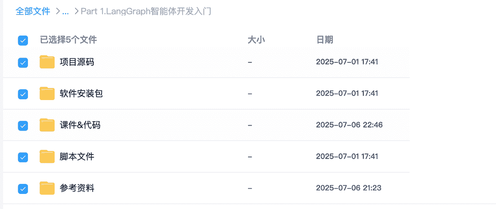


公开课全套学习资料，已上传至网盘（链接:https://pan.baidu.com/s/1Grrp1Mjc-99s_PKMbNlcYg?pwd=je4y  ）

需要更系统深入学习大模型可扫码⬆️添加助教咨询喔～

---

# LangGraph快速入门与Agent开发实战

# Part 2.LangGraph智能体开发与部署上线流程

## 一、LangGraph开发必备工具套件回顾

在对LangGraph有了一定的基础了解之后，对于开发者来说，还需要进一步了解和掌握LangGraph必备的开发者套件。分别是LangGraph运行监控框架LangSmith、LangGraph图结构可视化与调试框架LangGraph Studio和LangGraph服务部署工具LangGraph Cli。可以说这些开发工具套件，是真正推动LangGraph的企业级应用开发效率大幅提升的关键。同时监控、调试和部署工具，也是全新一代企业级Agent开发框架的必备工具，也是开发者必须要掌握的基础工具。

### 1. LangGraph运行监控框架：LangSmith

> LangSmith官网地址：https://docs.smith.langchain.com/

LangSmith 是一款用于构建、调试、可视化和评估 LLM 工作流的全生命周期开发平台。它聚焦的不是模型训练，而是我们在构建 AI 应用（尤其是多工具 Agent、LangChain/Graph）时的「可视化调试」、「性能评估」与「运维监控」。

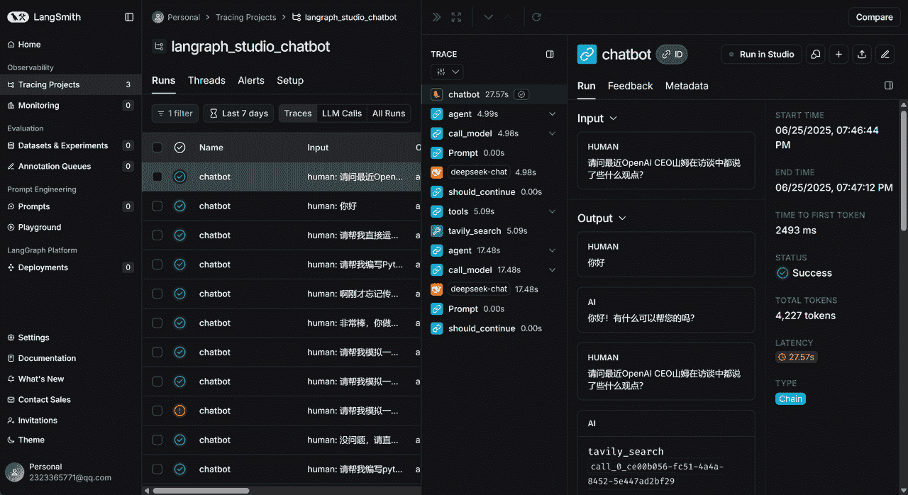

| 功能类别 | 描述 | 场景 |
| --- | --- | --- |
| 🧪 调试追踪（Trace Debugging） | 可视化展示每个 LLM 调用、工具调用、Prompt、输入输出 | Agent 调试、Graph 调用链分析 |
| 📊 评估（Evaluation） | 支持自动评估多个输入样本的回答质量，可自定义评分维度 | 批量测试 LLM 表现、A/B 对比 |
| 🧵 会话记录（Sessions / Runs） | 每次 chain 或 agent 的运行都会被记录为一个 Run，可溯源 | Agent 问题诊断、用户问题分析 |
| 🔧 Prompt 管理器（Prompt Registry） | 保存、版本控制、调用历史 prompt | 多版本 prompt 迭代测试 |
| 📈 流量监控（Telemetry） | 实时查看运行次数、错误率、响应时间等 | 在生产环境中监控 Agent 质量 |
| 📁 Dataset 管理 | 管理自定义测试集样本，支持自动化评估 | 微调前评估、数据对比实验 |
| 📜 LangGraph 可视化 | 对 LangGraph 中每个节点运行情况进行实时可视化展示 | Graph 执行追踪 |

### 2. LangGraph图结构可视化与调试框架：LangGraph Studio

> LangGraph Studio官网地址：https://www.langgraph.dev/studio

LangGraph Studio 是一个用于可视化构建、测试、分享和部署智能体流程图的图形化 IDE + 运行平台。

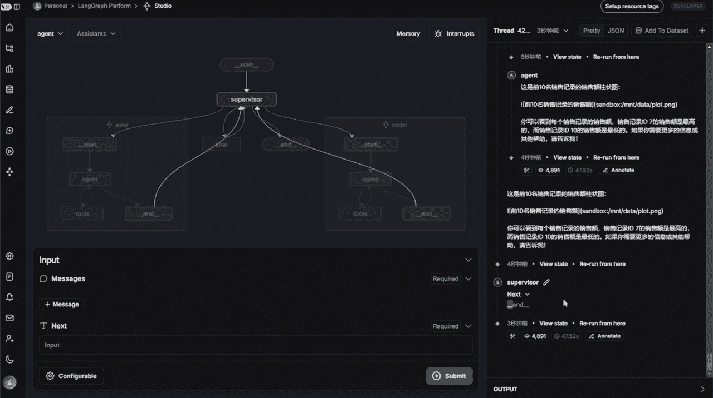

| 功能模块 | 说明 | 应用场景 |
| --- | --- | --- |
| 🧩 Graph 编辑器 | 以拖拽方式创建节点（工具、模型、Router）并连接 | 零代码构建 LangGraph |
| 🔍 节点配置器 | 每个节点可配置 LLM、工具、Router 逻辑、Memory | 灵活定制 Agent 控制流 |
| ▶️ 即时测试 | 输入 prompt 可在浏览器中运行整个图 | 实时测试执行结果 |
| 💾 云端保存 / 分享 | 将构建的 Graph 保存为公共 URL / 私人项目 | 团队协作，Demo 分享 |
| 📎 Tool 插件管理 | 可连接自定义工具（MCP）、HTTP API、Python 工具 | 插件式扩展 Agent 功能 |
| 🔁 Router 分支节点 | 创建条件分支，支持 if/else 路由 | 决策型智能体 |
| 📦 上传文档 / 多模态 | 可以上传文件（如 PDF）并嵌入进图中处理流程 | RAG 结构、OCR、图文问答等 |
| 🧠 Prompt 输入/预览 | 编辑 prompt 并观察其运行效果 | Prompt 工程调试 |
| 📤 一键部署 | 将 Graph 部署为可被 Agent Chat UI 使用的 Assistant | 快速集成到前端 |

### 3. LangGraph服务部署工具：LangGraph Cli

> LangGraph Cli官网地址：https://www.langgraph.dev/ （需要代理环境）

LangGraph CLI 是用于本地启动、调试、测试和托管 LangGraph 智能体图的开发者命令行工具。

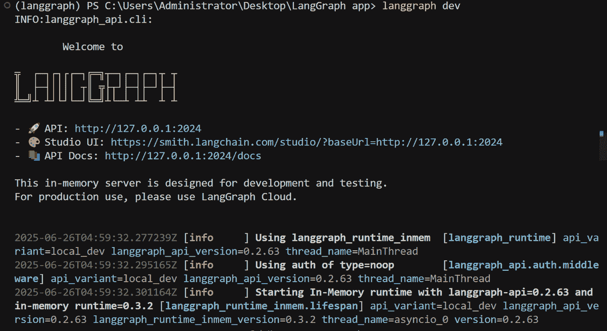

| 功能类别 | 命令示例 | 说明 |
| --- | --- | --- |
| ✅ 启动 Graph 服务 | langgraph dev | 启动 Graph 的开发服务器，供前端（如 Agent Chat UI）调用 |
| 🧪 测试 Graph 输入 | langgraph run graph:graph --input &#x27;{&quot;input&quot;: &quot;你好&quot;}&#x27; | 本地 CLI 输入测试，输出结果 |
| 🧭 管理项目结构 | langgraph init | 初始化一个标准 Graph 项目目录结构 |
| 📦 部署 Graph（未来） | langgraph deploy（预留） | 发布 graph 至 LangGraph 云端（已对接 Studio） |
| 🧱 显示 Assistant 列表 | langgraph list | 显示当前 graph 中有哪些 assistant（即 entrypoint） |
| 🔄 重载运行时 | 自动热重载 | 修改 graph.py 时，dev 模式自动重启生效 |

而一旦应用成功部署上线，LangGraph Cli还会非常贴心的提供后端接口说明文档：

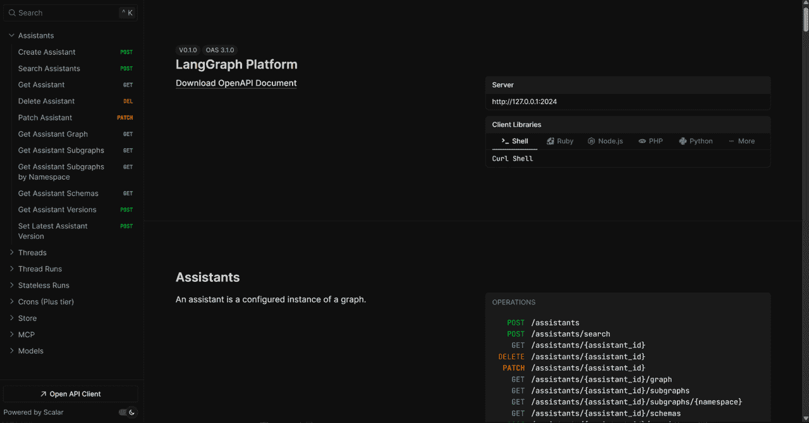

而对于LangGraph构建的智能体，除了能够本地部署外，官方也提供了云托管服务，借助LangGraph Platform，开发者可以将构建的智能体 Graph部署到云端，并允许公开访问，同时支持支持长时间运行、文件上传、外部 API 调用、Studio 集成等功能。

### 4. LangGraph Agent前端可视化工具：Agent Chat UI

Agent Chat UI 是 LangGraph/LangChain 官方提供的多智能体前端对话面板，用于与后端 Agent（Graph 或 Chain）进行实时互动，支持上传文件、多工具协同、结构化输出、多轮对话、调试标注等功能。

> Agent Chat UI官网地址：https://langchain-ai.github.io/langgraph/agents/ui/

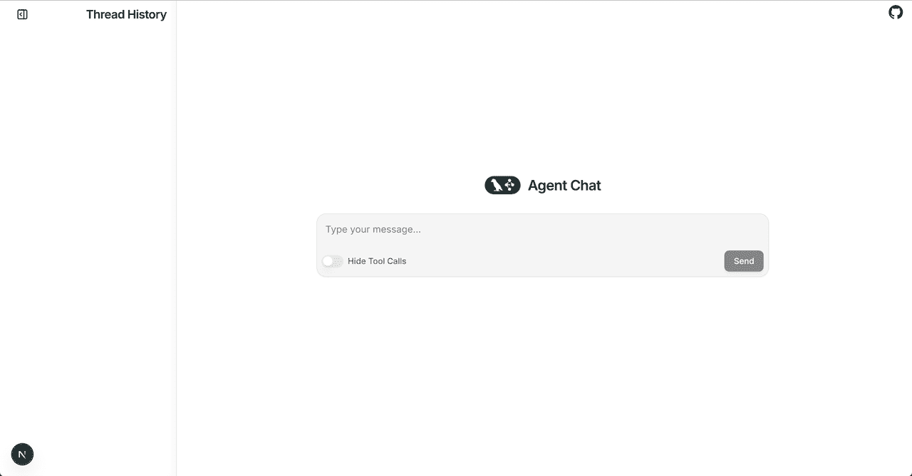

| 功能模块 | 描述 | 应用场景 |
| --- | --- | --- |
| 💬 多轮对话框 | 类似 ChatGPT 的输入区域，支持多轮上下文 | 用户提问，Agent 回复 |
| 🛠 工具调用轨迹显示 | 显示每个调用的工具、参数、结果（结构化） | Agent 推理透明化 |
| 📄 上传 PDF / 图片 | 支持上传文档、图片、嵌入多模态输入 | RAG、OCR、图像问答 |
| 📁 文件面板 | 可查看上传历史文件、删除、重新引用 | 管理文档输入 |
| 🧭 Assistant 切换 | 支持切换不同 Assistant（Graph entry） | 一键切换模型能力（如 math / weather） |
| 🧩 插件支持 | 与 MCP 工具、LangGraph 图打通 | 工具式 Agent 调用 |
| 🔍 调试视图 | 显示每轮 Agent 的思维过程和中间状态 | Prompt 调试、模型行为分析 |
| 🌐 云部署支持 | 支持接入远端 Graph API（如 dev 服务器） | 前后端分离部署 |
| 🧪 与 LangSmith 对接（可选） | 若后端启用 tracing，可同步显示运行 trace | 调试闭环 |

### 5. LangGraph内置工具库与MCP调用组件

除了有上述非常多实用的开发工具外，LangGraph还全面兼容LangChain的内置工具集。LangChain自诞生之初就为开发者提供了非常多种类各异的、封装好的实用工具，历经几年发展时间，目前LangChain已经拥有了数以百计的内置实用工具，包括网络搜索工具、浏览器自动化工具、Python代码解释器、SQL代码解释器等。而作为LangChain同系框架，LangGraph也可以无缝调用LangChain各项开发工具，从而大幅提高开发效率。

> LangChain工具集：https://python.langchain.com/docs/integrations/tools/

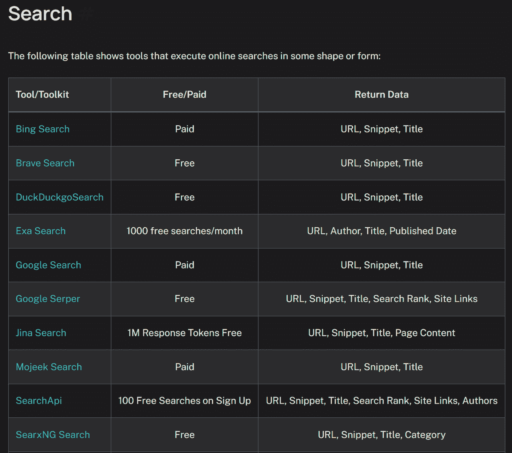

此外，LangChain是最早支持MCP的开发框架之一，借助langchain-mcp-adapters，LangChain和LangGraph便可快速接入各类MCP工具。

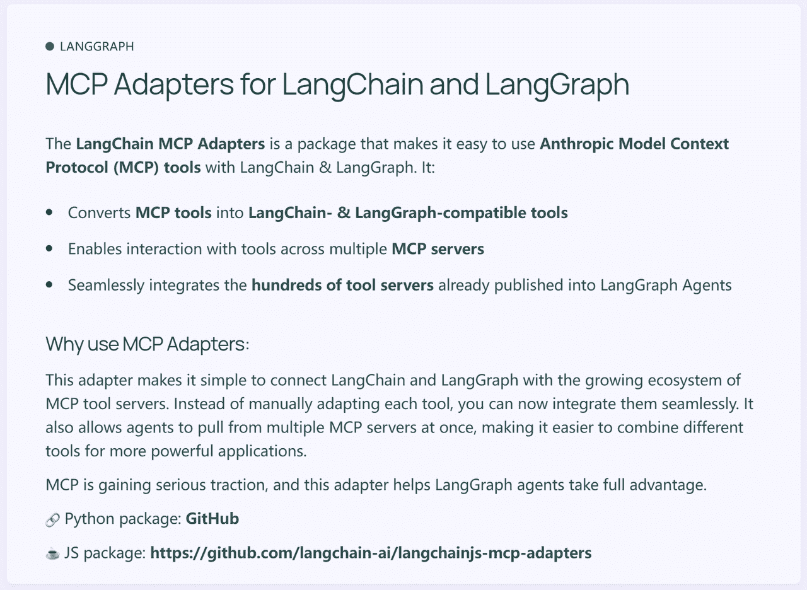

并且LangGraph也同样支持谷歌的A2A（跨Agents通信协议）。

## 二、借助LangGraph Cli创建完整智能体项目

### 1. LangGraph智能体项目说明

LangSmith 与 LangGraph Studio 都是 LangChain AI 生态中非常核心的工具，前者是用于跟踪和分析大模型的使用情况，而langGraph Studio则是对于LangGraph来说，则是比LangSmith更加方便和高效的可视化调试工具平台。

大家可以思考一个问题：基于LangGraph框架可以开发出各种复杂的应用、Agent、Workflow等，那么这些应用、Agent、Workflow等在生产中如何部署和运行呢？ 解决方案就是把它们部署成一个Server。 而对如何方便高效的把LangGraph的Graph部署成一个Server，LangGraph官方提供了LangGraph Platform，其完整架构如下所示：

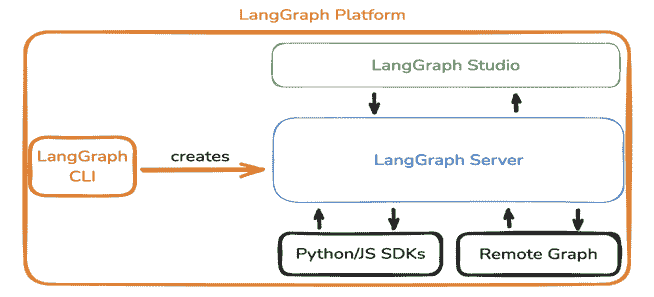

+   LangGraph Studio：桌面版应用（目前仅支持Mac）和本地运行（适用于所有操作系统）；

+   **LangServer**：最终构建出来的服务，提供Assistant API接口；

+   **Python/JS SDK**：通过接口可以直接和 LangServer 提供的各个API接口连接；

+   **Remote Graph**：类似于之前LangServe的用法，可以直接用 Graph 的接口去调用，这样拿到的Graph就是一个 Runable对象，就可以去调用它的invoke，batch 等。

LangGraph Studio 是专为 LangGraph 图式代理打造的本地/云端 IDE，具备可视化节点和状态及实时调试功能。LangGraph Studio 在本地可视化运行时会自动把调用过程上传到 LangSmith；而在 LangSmith 网页端查看任何 Trace 时，又能一键Run in Studio回放整条执行链，所以它是通过统一 Trace SDK 与 LangSmith 紧密集成。而LangGraph CLI则是构建这个项目的关键

接下来我们就来详细的讲解下如何使用LangGraph CLI来创建一个完整的LangGraph Agent项目，并在此过程中使用LangGraph Chat Agent UI进行前端对话，以及使用LangGraph Studio进行架构实时演示，并使用LangSmith进行运行效果监督。

首先需要说明的是，如果想要把一个定义的Graph添加到LangGraph Studio中，需要严格按照官方要求的项目结构进行构建，需要执行的步骤依次是：

### 2. 创建完整LangGraph智能体项目流程

+   **Step 1. 创建一个****LangGraph****项目文件夹**

我们这里创建一个langraph_chatbot文件夹，如下图所示：

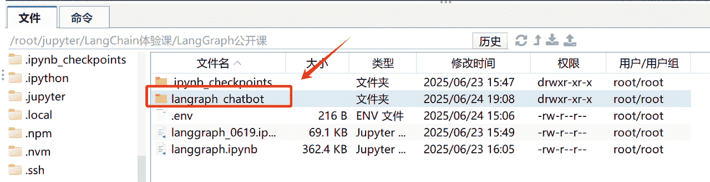

+   **Step 2. 创建****re**quirements.txt文件

在langgraph_chatbot文件夹中，新建一个requirements.txt文件，里面需要填写在运行该项目时需要安装的依赖项，如下所示：

```
langgraph
langchain-core
langchain-deepseek
python-dotenv
langsmith
pydantic
matplotlib
seaborn
pandas
IPython
langchain_mcp_adapters
uv
```

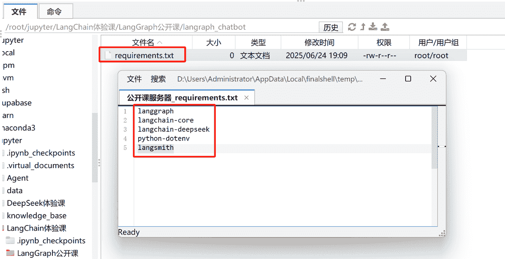

+   Step 3. 注册LangSmith（可选）

对于企业级的Agent项目，为了更好的监控智能体实时运行情况，我们可以考虑借助LangSmith进行追踪（会将智能体运行情况实时上传到LangGraph官网并进行展示）。

要开始使用 LangSmith，我们需要创建一个帐户。可以在这里注册一个免费帐户进入LangSmith登录页面： https://smith.langchain.com/ ， 支持使用 Google、GitHub、Discord 和电子邮件登录。

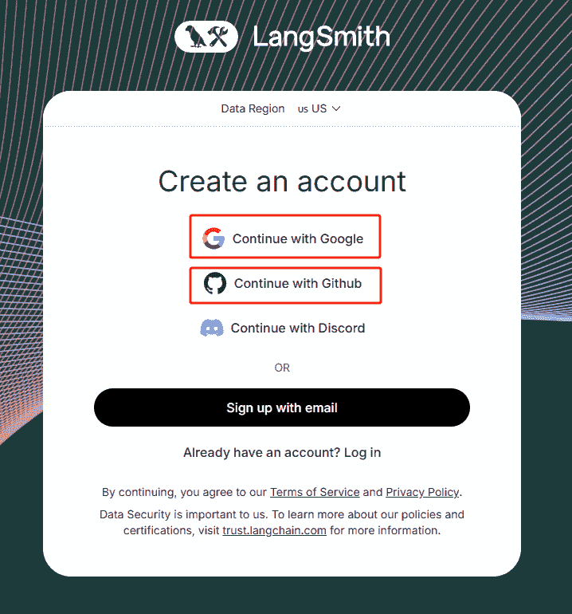

注册并等登录后，可以直接查看到仪表板：


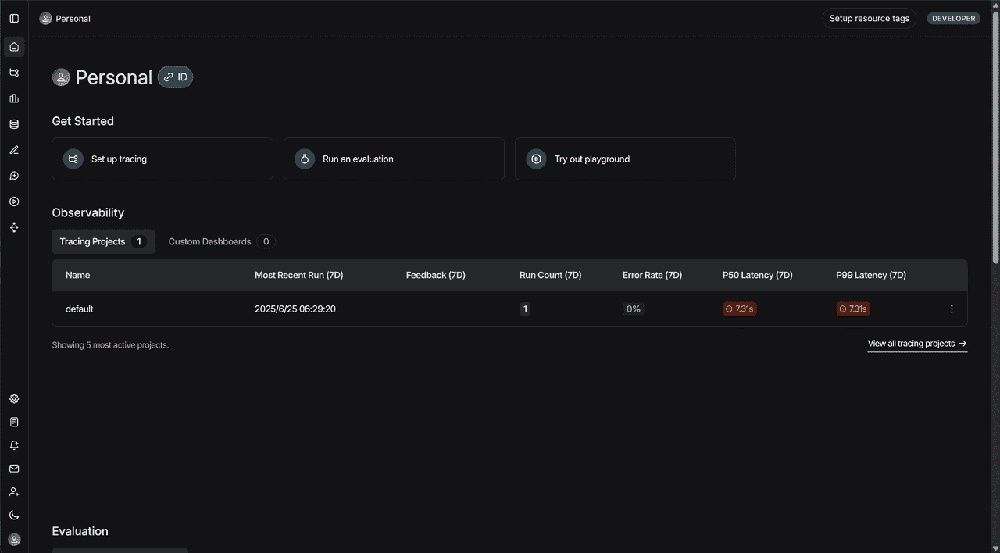

在构建程序跟踪前，首先需要创建一个 API 密钥，该密钥将允许我们的项目开始向 Langsmith 发送跟踪数据。创建完密钥后，在后续配置环境变量环节设置开启追踪、并输入密钥即可接入LangSmith。

+   **Step 4. 创建****.env****配置文件**

在langgraph_chatbot文件夹中，新建一个.env文件，将敏感信息（如API密钥）放在环境变量中而不是硬编码。如下所示：

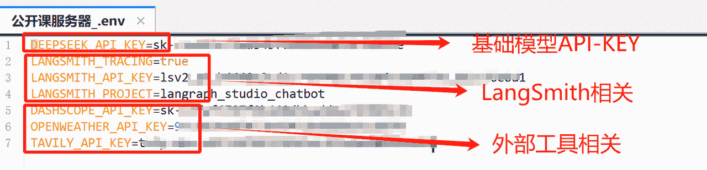

这里需要注意的是，如果不设置LangSmith，则无需设置中间三个环境变量，而具体工具也可以根据实际需求进行设置。

+   **Step 5. 创建****graph.py****核心文件**

在langgraph_chatbot文件夹中，新建一个graph.py文件，在该文件中编写构建图的具体运行逻辑，如状态、节点、变、图的编译等。注意：这里不要使用init_chat_model方法，而是使用ChatDeepSeek方法，因为会存在异步阻塞问题。此外，在使用LangGraph CLI创建智能体项目时，会自动设置记忆相关内容，并进行持久化记忆存储，无需手动设置。因此此时智能体代码如下所示：

```
import os
from dotenv import load_dotenv 
from langchain_deepseek import ChatDeepSeek
from typing import Annotated
from typing_extensions import TypedDict
from langgraph.graph import StateGraph, START, END
from langgraph.graph.message import add_messages
from langchain.chat_models import init_chat_model
from langgraph.prebuilt import create_react_agent
from langchain_mcp_adapters.client import MultiServerMCPClient
from langchain_core.tools import tool
from pydantic import BaseModel, Field
import requests,json

# 加载环境变量
load_dotenv(override=True)

# 内置搜索工具
search_tool = TavilySearch(max_results=5, topic=&quot;general&quot;)

class WeatherQuery(BaseModel):
    loc: str = Field(description=&quot;The location name of the city&quot;)

@tool(args_schema = WeatherQuery)
def get_weather(loc):
    &quot;&quot;&quot;
    查询即时天气函数
    :param loc: 必要参数，字符串类型，用于表示查询天气的具体城市名称，\
    注意，中国的城市需要用对应城市的英文名称代替，例如如果需要查询北京市天气，则loc参数需要输入&#x27;Beijing&#x27;；
    :return：OpenWeather API查询即时天气的结果，具体URL请求地址为：https://api.openweathermap.org/data/2.5/weather\
    返回结果对象类型为解析之后的JSON格式对象，并用字符串形式进行表示，其中包含了全部重要的天气信息
    &quot;&quot;&quot;
    # Step 1.构建请求
    url = &quot;https://api.openweathermap.org/data/2.5/weather&quot;

    # Step 2.设置查询参数
    params = {
        &quot;q&quot;: loc,               
        &quot;appid&quot;: os.getenv(&quot;OPENWEATHER_API_KEY&quot;),    # 输入API key
        &quot;units&quot;: &quot;metric&quot;,            # 使用摄氏度而不是华氏度
        &quot;lang&quot;:&quot;zh_cn&quot;                # 输出语言为简体中文
    }

    # Step 3.发送GET请求
    response = requests.get(url, params=params)
    
    # Step 4.解析响应
    data = response.json()
    return json.dumps(data)

tools = [search_tool, get_weather]

# 创建模型
model = ChatDeepSeek(model=&quot;deepseek-chat&quot;)

# 创建图
graph = create_react_agent(model=model, tools=tools)
```

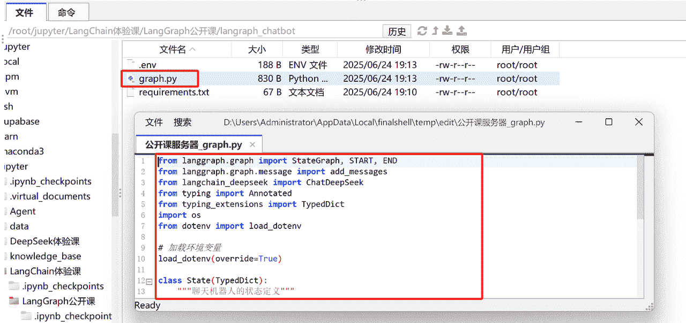

+   **Step 6. 创建****langgraph.json****文件**

在langgraph_chatbot文件夹中，新建一个langgraph.json文件，在该json文件中配置项目信息，遵循规范如下所示：

+   必须包含 dependencies 和 graphs 字段

+   graphs 字段格式："图名": "文件路径:变量名"

+   配置文件必须放在与Python文件同级或更高级的目录

注意: 项目文件的名称必须为langgraph.json。如下所示：

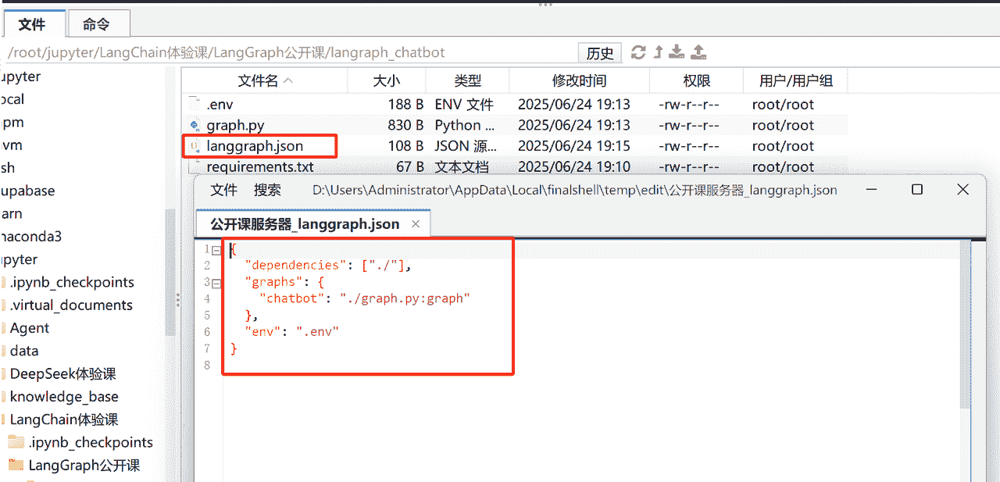

其中：

+   dependencies: ["./"] - 告诉LangGraph在当前目录查找依赖项（会自动读取requirements.txt）

+   chatbot: "./graph.py:graph" - 定义图名为chatbot，来自graph.py文件中的graph变量

+   env: ".env" - 指定环境变量文件位置

最终完整项目结构如下所示：

```
    ./langraph_chatbot/
    ├── graph.py              # 对应官方的 agent.py
    ├── requirements.txt      # ✅ 依赖管理
    ├── langgraph.json       # ✅ 配置文件
    └── .env                 # ✅ 环境变量
```

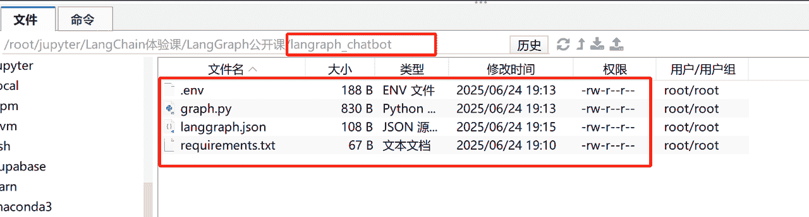

完整的代码已经上传至百度网盘中的langgraph_chatbot文件夹中，大家可以扫描下方二维码免费领取

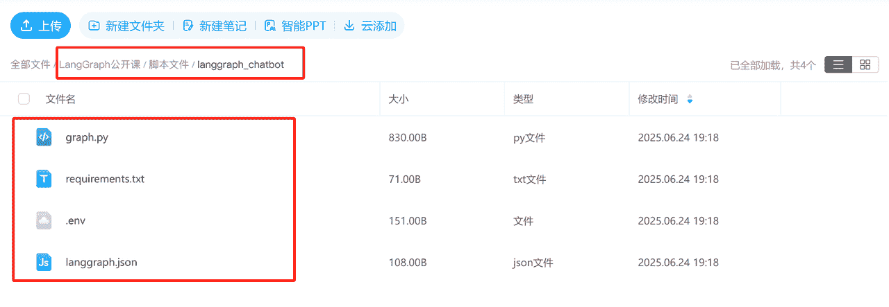


+   **Step 7. 安装****langgraph-cli****以及其他依赖**

然后，安装langgraph-cli依赖，执行如下代码：

```
    pip install -U &quot;langgraph-cli[inmem]&quot; -i https://pypi.tuna.tsinghua.edu.cn/simple
```

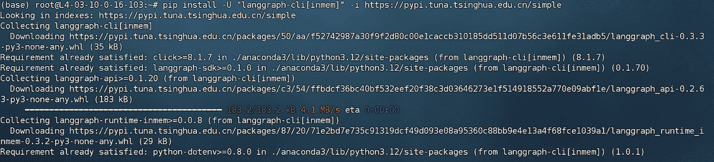

然后进入到langgraph_chatbot文件夹，安装相关基础依赖：

```
pip isntall -r requirements.txt
```

最后，进入到langgraph_chatbot文件夹，执行LangGraph dev即可启动项目

```
   langgraph dev
```

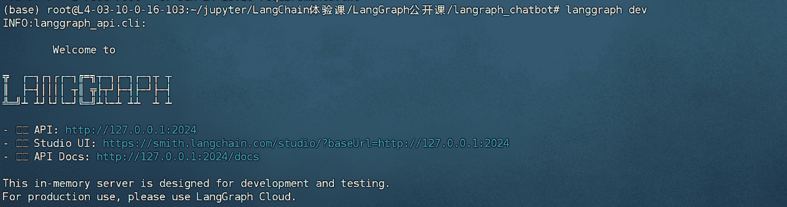

启动成功后能看到三个连接，其中第一个连接是当前部署完成后的服务端口，第二个是LangGraph Studio的可视化页面，第三个端口是端口说明。

### 3. LangGraph Agent部署后调用流程

+   后端服务接口

这里我们首先可以看下第三个连接，其中包含了详细的接口调用方法：

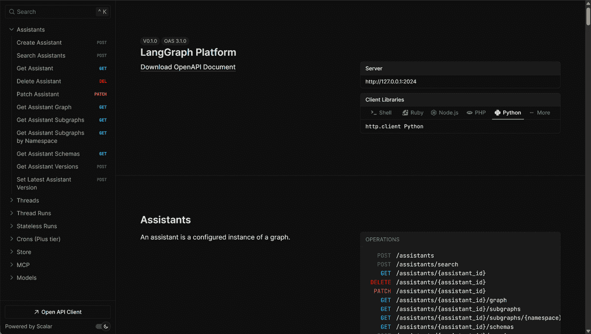

这些暴露的接口和调用方法，接下来就可以用于进行进一步开发和测试。

+   LangGraph Studio

然后我们可点击Studio UI中显示的链接，在浏览器中打开并访问Studio，如下所示：

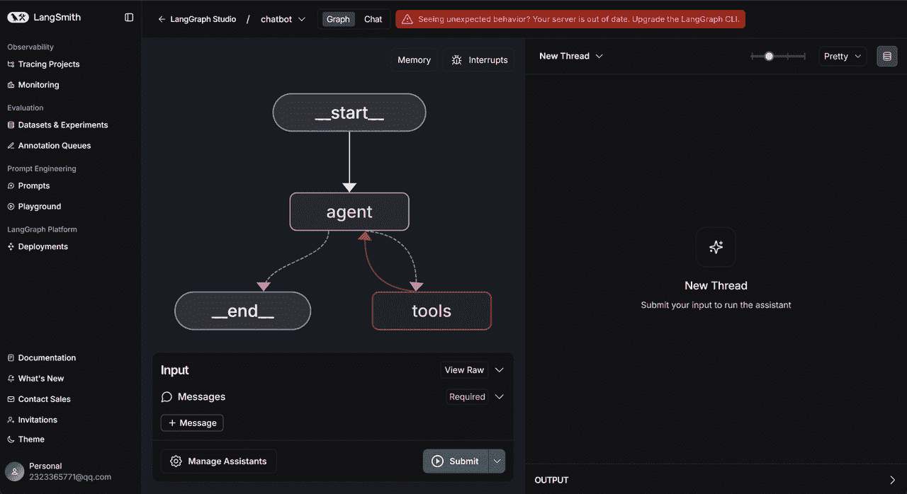

完整演示流程如下所示：

```
Video(&quot;https://ml2022.oss-cn-hangzhou.aliyuncs.com/2025-06-26%2019-29-04.mp4&quot;, width=800, height=400)
```

Your browser does not support the video element.

+   LangSmith

而如果此前设置了追踪，此时就能在LangSmith中看到当前项目运行情况：


```
Video(&quot;https://ml2022.oss-cn-hangzhou.aliyuncs.com/2025-06-26%2019-52-57.mp4&quot;, width=800, height=400)
```

Your browser does not support the video element.

### 4. LangGraph Agent后端接入Agent Chat UI完整流程

+   项目主页：https://github.com/langchain-ai/agent-chat-ui

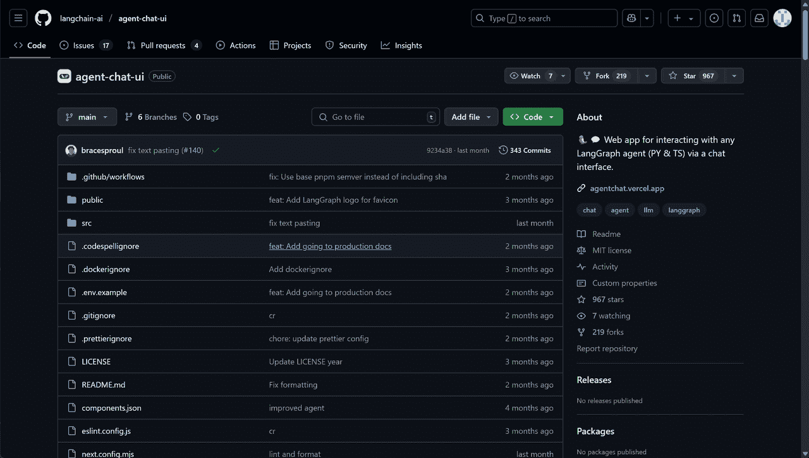

+   Step 1.克隆项目：

```
git clone https://github.com/langchain-ai/agent-chat-ui.git

cd agent-chat-ui
```

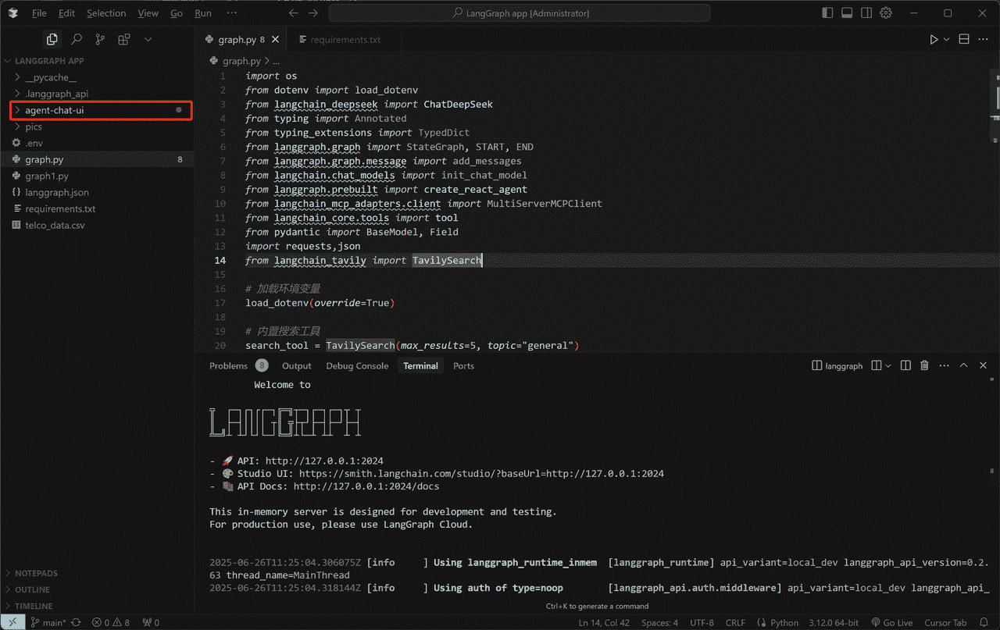

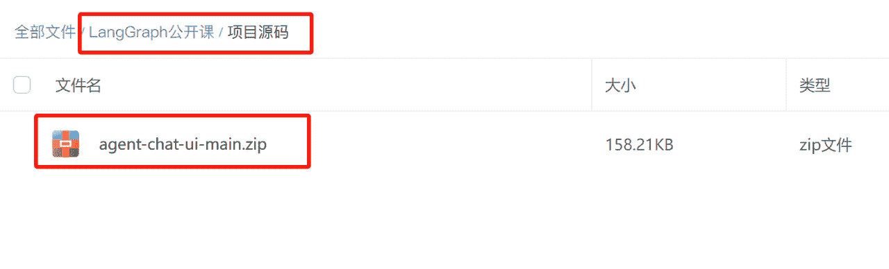


+   Step 2. 安装npm

node.js官网：https://nodejs.org

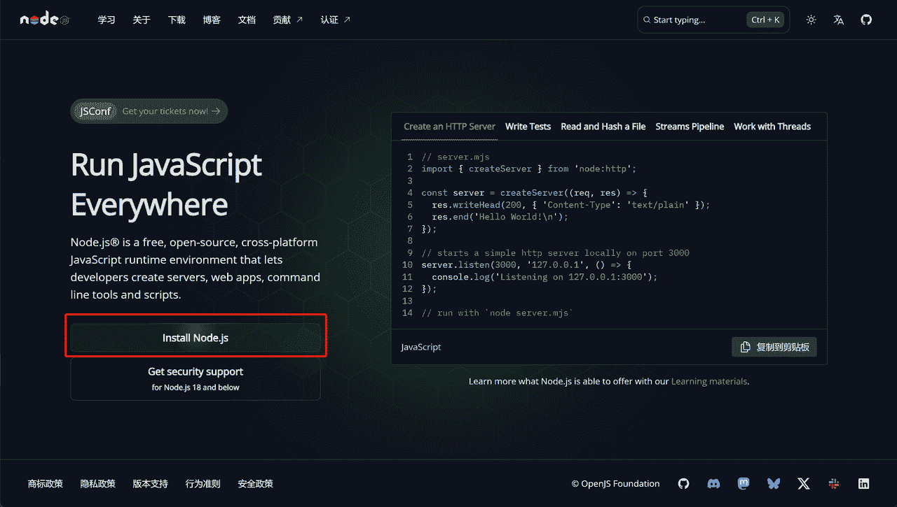

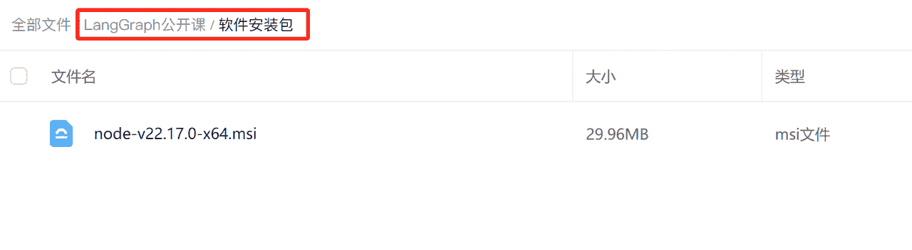

```
npm install -g pnpm
pnpm -v
```


+   Step 3. 安装前端项目依赖

```
pnpm install
```

+   Step 4. 开启Chat Agent UI

```
pnpm dev
```

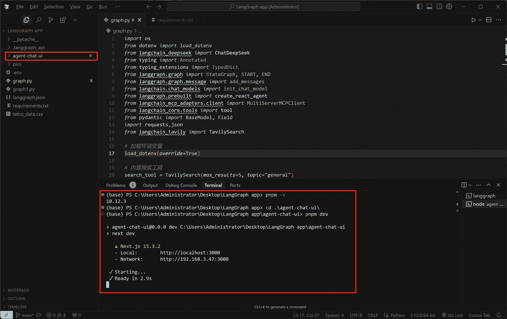


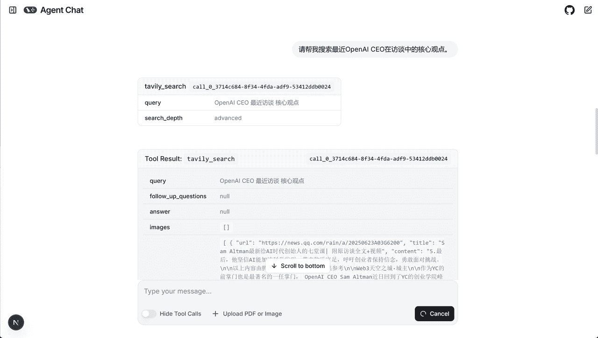

```
Video(&quot;https://ml2022.oss-cn-hangzhou.aliyuncs.com/2025-06-26%2020-03-25.mp4&quot;, width=800, height=400)
```

Your browser does not support the video element.

## 三、借助LangGraph Cli打造智能数据分析助手

+   修改graph.py

```
import os
from dotenv import load_dotenv 
from langchain_deepseek import ChatDeepSeek
from typing import Annotated
from typing_extensions import TypedDict
from langgraph.graph import StateGraph, START, END
from langgraph.graph.message import add_messages
from langchain.chat_models import init_chat_model
from langgraph.prebuilt import create_react_agent
from langchain_mcp_adapters.client import MultiServerMCPClient
from langchain_core.tools import tool
from pydantic import BaseModel, Field
import matplotlib
import json
import matplotlib.pyplot as plt
import seaborn as sns
import pandas as pd
import pymysql
from langchain_tavily import TavilySearch

# 加载环境变量
load_dotenv(override=True)

# 内置搜索工具
search_tool = TavilySearch(max_results=5, topic=&quot;general&quot;)


# ✅ 定义结构化参数模型
class SQLQuerySchema(BaseModel):
    sql_query: str = Field(description=&quot;用于执行查询的 SQL 语句字符串，目标数据库是 MySQL 中的 telco_db。&quot;)

# ✅ 封装为 LangGraph 工具
@tool(args_schema=SQLQuerySchema)
def sql_inter(sql_query: str) -&gt; str:
    &quot;&quot;&quot;
    当用户需要进行数据库查询工作时，请调用该函数。
    该函数用于在指定MySQL服务器上运行一段SQL代码，完成数据查询相关工作，
    并且当前函数是使用pymsql连接MySQL数据库。
    本函数只负责运行SQL代码并进行数据查询，若要进行数据提取，则使用另一个extract_data函数。
    :param sql_query: 字符串形式的SQL查询语句，用于执行对MySQL中telco_db数据库中各张表进行查询，并获得各表中的各类相关信息
    :return：sql_query在MySQL中的运行结果。   
    &quot;&quot;&quot;
    # print(&quot;正在调用 sql_inter 工具运行 SQL 查询...&quot;)
    
    # 加载环境变量
    load_dotenv(override=True)
    host = os.getenv(&#x27;HOST&#x27;)
    user = os.getenv(&#x27;USER&#x27;)
    mysql_pw = os.getenv(&#x27;MYSQL_PW&#x27;)
    db = os.getenv(&#x27;DB_NAME&#x27;)
    port = os.getenv(&#x27;PORT&#x27;)
    
    # 创建连接
    connection = pymysql.connect(
        host=host,
        user=user,
        passwd=mysql_pw,
        db=db,
        port=int(port),
        charset=&#x27;utf8&#x27;
    )
    
    try:
        with connection.cursor() as cursor:
            cursor.execute(sql_query)
            results = cursor.fetchall()
            # print(&quot;SQL 查询已成功执行，正在整理结果...&quot;)
    finally:
        connection.close()

    # 将结果以 JSON 字符串形式返回
    return json.dumps(results, ensure_ascii=False)

# ✅ 定义结构化参数
class ExtractQuerySchema(BaseModel):
    sql_query: str = Field(description=&quot;用于从 MySQL 提取数据的 SQL 查询语句。&quot;)
    df_name: str = Field(description=&quot;指定用于保存结果的 pandas 变量名称（字符串形式）。&quot;)

# ✅ 注册为 Agent 工具
@tool(args_schema=ExtractQuerySchema)
def extract_data(sql_query: str, df_name: str) -&gt; str:
    &quot;&quot;&quot;
    用于在MySQL数据库中提取一张表到当前Python环境中，注意，本函数只负责数据表的提取，
    并不负责数据查询，若需要在MySQL中进行数据查询，请使用sql_inter函数。
    同时需要注意，编写外部函数的参数消息时，必须是满足json格式的字符串，
    :param sql_query: 字符串形式的SQL查询语句，用于提取MySQL中的某张表。
    :param df_name: 将MySQL数据库中提取的表格进行本地保存时的变量名，以字符串形式表示。
    :return：表格读取和保存结果
    &quot;&quot;&quot;
    print(&quot;正在调用 extract_data 工具运行 SQL 查询...&quot;)
    
    load_dotenv(override=True)
    host = os.getenv(&#x27;HOST&#x27;)
    user = os.getenv(&#x27;USER&#x27;)
    mysql_pw = os.getenv(&#x27;MYSQL_PW&#x27;)
    db = os.getenv(&#x27;DB_NAME&#x27;)
    port = os.getenv(&#x27;PORT&#x27;)

    # 创建数据库连接
    connection = pymysql.connect(
        host=host,
        user=user,
        passwd=mysql_pw,
        db=db,
        port=int(port),
        charset=&#x27;utf8&#x27;
    )

    try:
        # 执行 SQL 并保存为全局变量
        df = pd.read_sql(sql_query, connection)
        globals()[df_name] = df
        # print(&quot;数据成功提取并保存为全局变量：&quot;, df_name)
        return f&quot;✅ 成功创建 pandas 对象 `{df_name}`，包含从 MySQL 提取的数据。&quot;
    except Exception as e:
        return f&quot;❌ 执行失败：{e}&quot;
    finally:
        connection.close()

# Python代码执行工具
class PythonCodeInput(BaseModel):
    py_code: str = Field(description=&quot;一段合法的 Python 代码字符串，例如 &#x27;2 + 2&#x27; 或 &#x27;x = 3\\ny = x * 2&#x27;&quot;)


@tool(args_schema=PythonCodeInput)
def python_inter(py_code):
    &quot;&quot;&quot;
    当用户需要编写Python程序并执行时，请调用该函数。
    该函数可以执行一段Python代码并返回最终结果，需要注意，本函数只能执行非绘图类的代码，若是绘图相关代码，则需要调用fig_inter函数运行。
    &quot;&quot;&quot;    
    g = globals()
    try:
        # 尝试如果是表达式，则返回表达式运行结果
        return str(eval(py_code, g))
    # 若报错，则先测试是否是对相同变量重复赋值
    except Exception as e:
        global_vars_before = set(g.keys())
        try:            
            exec(py_code, g)
        except Exception as e:
            return f&quot;代码执行时报错{e}&quot;
        global_vars_after = set(g.keys())
        new_vars = global_vars_after - global_vars_before
        # 若存在新变量
        if new_vars:
            result = {var: g[var] for var in new_vars}
            # print(&quot;代码已顺利执行，正在进行结果梳理...&quot;)
            return str(result)
        else:
            # print(&quot;代码已顺利执行，正在进行结果梳理...&quot;)
            return &quot;已经顺利执行代码&quot;

class FigCodeInput(BaseModel):
    py_code: str = Field(description=&quot;要执行的 Python 绘图代码，必须使用 matplotlib/seaborn 创建图像并赋值给变量&quot;)
    fname: str = Field(description=&quot;图像对象的变量名，例如 &#x27;fig&#x27;，用于从代码中提取并保存为图片&quot;)

@tool(args_schema=FigCodeInput)
def fig_inter(py_code: str, fname: str) -&gt; str:
    &quot;&quot;&quot;
    当用户需要使用 Python 进行可视化绘图任务时，请调用该函数。
    该函数会执行用户提供的 Python 绘图代码，并自动将生成的图像对象保存为图片文件并展示。
    &quot;&quot;&quot;
    print(&quot;正在调用fig_inter工具运行Python代码...&quot;)

    current_backend = matplotlib.get_backend()
    matplotlib.use(&#x27;Agg&#x27;)

    local_vars = {&quot;plt&quot;: plt, &quot;pd&quot;: pd, &quot;sns&quot;: sns}
    
    # ✅ 设置图像保存路径（你自己的绝对路径）
    base_dir = r&quot;C:\Users\Administrator\Desktop\LangGraph app\agent-chat-ui\public&quot;
    images_dir = os.path.join(base_dir, &quot;images&quot;)
    os.makedirs(images_dir, exist_ok=True)  # ✅ 自动创建 images 文件夹（如不存在）

    try:
        g = globals()
        exec(py_code, g, local_vars)
        g.update(local_vars)

        fig = local_vars.get(fname, None)
        if fig:
            image_filename = f&quot;{fname}.png&quot;
            abs_path = os.path.join(images_dir, image_filename)  # ✅ 绝对路径
            rel_path = os.path.join(&quot;images&quot;, image_filename)    # ✅ 返回相对路径（给前端用）

            fig.savefig(abs_path, bbox_inches=&#x27;tight&#x27;)
            return f&quot;✅ 图片已保存，路径为: {rel_path}&quot;
        else:
            return &quot;⚠️ 图像对象未找到，请确认变量名正确并为 matplotlib 图对象。&quot;
    except Exception as e:
        return f&quot;❌ 执行失败：{e}&quot;
    finally:
        plt.close(&#x27;all&#x27;)
        matplotlib.use(current_backend)

tools = [search_tool, python_inter, fig_inter, sql_inter, extract_data]

# 创建模型
model = ChatDeepSeek(model=&quot;deepseek-chat&quot;)

# 创建图
graph = create_react_agent(model=model, tools=tools)
```

```

```

+   修改requirements.txt

```
langgraph
langchain-core
langchain-deepseek
langchain-tavily
python-dotenv
langsmith
pydantic
matplotlib
seaborn
pandas
IPython
langchain_mcp_adapters
uv
pymysql
```

+   修改.env

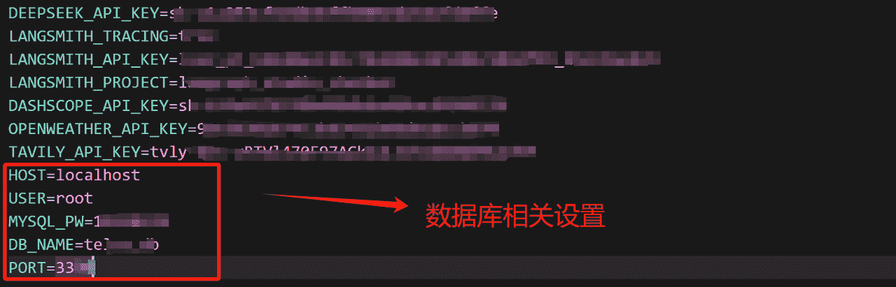

新增以下字段：

HOST=localhost

USER=root

MYSQL_PW=**

DB_NAME=**

PORT=3306

然后安装后端依赖：

```
pip isntall -r requirements.txt
```

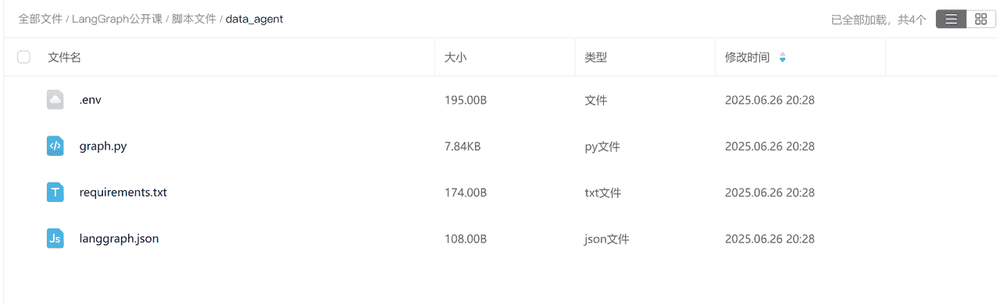


即可尝试进行运行

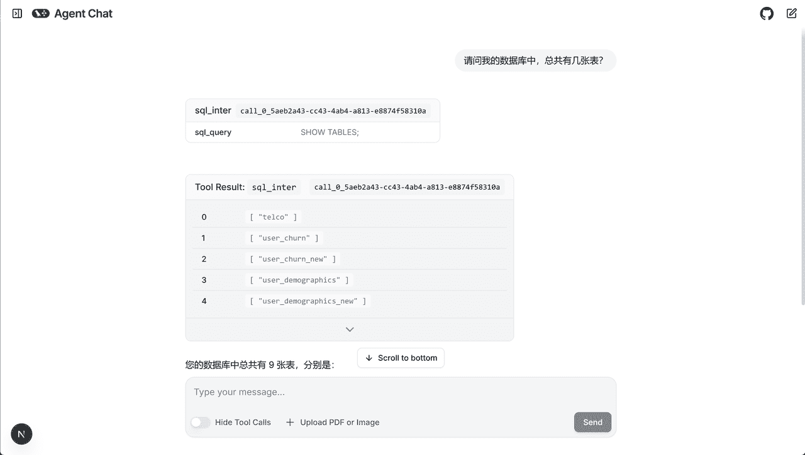

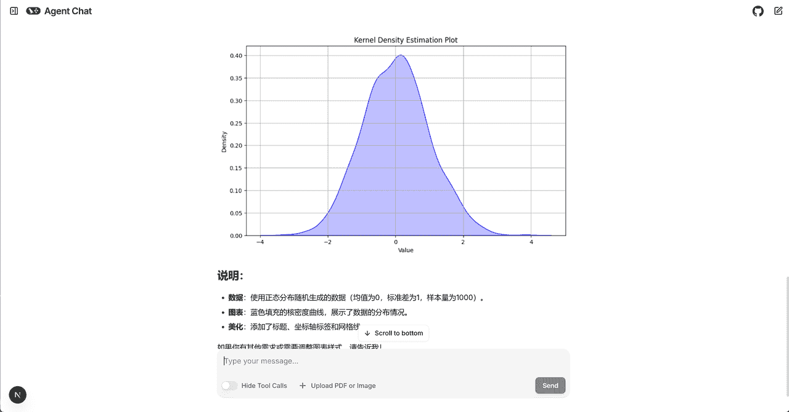