# LangGraph MCP智能体开发实战

> 来源：[https://kq4b3vgg5b.feishu.cn/docx/PTIRd1S9DoAP4fxQa96cnJtQnwg](https://kq4b3vgg5b.feishu.cn/docx/PTIRd1S9DoAP4fxQa96cnJtQnwg)

## 课程说明：

+   体验课内容节选自《2025大模型Agent智能体开发实战》(夏季班)完整版付费课程

**体**验课时间有限，若想深度学习大模型技术，欢迎大家报名由我主讲的《2025大模型Agent智能体开发实战》(夏季班)！


公开课全套学习资料，已上传至网盘（链接:https://pan.baidu.com/s/1Grrp1Mjc-99s_PKMbNlcYg?pwd=je4y  ）

需要更系统深入学习大模型可扫码⬆️添加助教咨询喔～

---

## 一、LangGraph与MCP技术概述

### 1. LangGraph接入外部工具技术实现方法

说到智能体开发，无论使用何种框架，有一项绕不开的核心技术，那就是MCP（Model Context Protocol）技术。

在智能体开发过程中，接入外部函数工具是至关重要的一环，而在LangChain&LangGraph技术生态中，我们可以非常便捷的通过@tool装饰符来自定义一个外部函数：

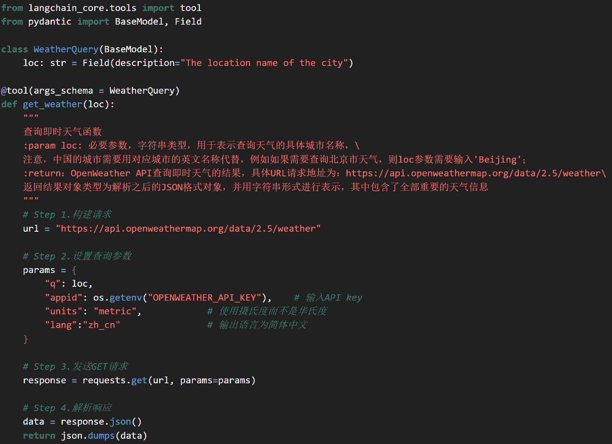

或者也可以借助LangChain丰富的、数以百计的内置工具，三行代码即可在智能体中进行工具调用。

| 功能类别 | 工具名称 | 简要说明 |
| --- | --- | --- |
| 🔎 搜索工具 | TavilySearchResults | 快速搜索实时网络信息 |
|  | SerpAPIWrapper | 基于 SerpAPI 的搜索结果工具 |
|  | GoogleSearchAPIWrapper | 调用 Google 可编程搜索引擎 |
| 🧠 计算工具 | PythonREPLTool | 执行 Python 表达式并返回结果 |
|  | LLMMathTool | 结合 LLM 和数学推理能力 |
|  | WolframAlphaQueryRun | 基于 Wolfram Alpha 的计算引擎 |
| 🗂 数据工具 | SQLDatabaseToolkit | 构建 SQL 数据库查询工具集 |
|  | PandasDataframeTool | 用于在 Agent 中操作表格数据 |
| 🌐 网络/API | RequestsGetTool / RequestsPostTool | 执行 HTTP 请求 |
|  | BrowserTool / PlaywrightBrowserToolkit | 自动化网页浏览与抓取 |
| 💾 文件处理 | ReadFileTool | 读取本地文件内容 |
|  | WriteFileTool | 写入文本到指定文件中 |
| 📚 检索工具 | FAISSRetriever | 基于向量的文档检索工具 |
|  | ChromaRetriever | 使用 ChromaDB 的检索器 |
|  | ContextualCompressionRetriever | 上下文压缩检索器，适合长文档 |
| 🧠 LLM 工具 | ChatOpenAI / OpenAIFunctionsTool | 使用 OpenAI 模型作为工具调用 |
|  | ChatAnthropic | Anthropic Claude 模型封装工具 |
| 🔧 自定义工具 | @tool 装饰器 | 任意函数可封装为 Agent 可调用工具 |
|  | Tool 类继承 | 自定义更复杂逻辑的工具实现 |

> LangChain工具集：https://python.langchain.com/docs/integrations/tools/

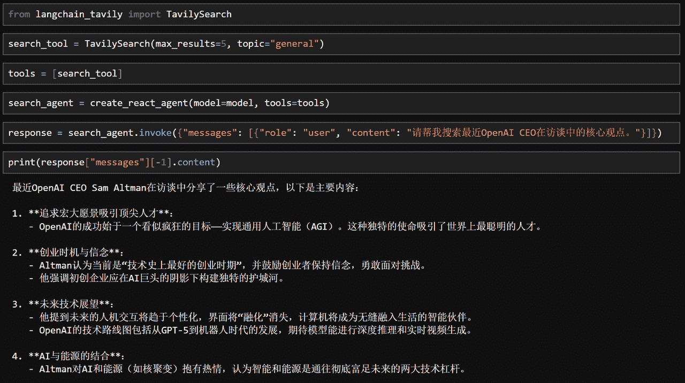

而除此之外，伴随着MCP技术爆火，给了开发者第三种选项，那就是借助MCP技术、遵照MCP协议，来调用其他开发者已经开发好的MCP工具，来快速搭建智能体应用。

### 2. MCP技术概述

#### 2.1 MCP技术定位与技术价值介绍

我们可以将MCP技术简单理解为智能体外部工具开发的一种通用规范（范式）。举个例子，以天气查询工具为例，在MCP技术诞生之前，要给大模型添加查询天气的功能，至少需要经历这么两个开发阶段：

+   阶段一：编写查询天气的外部函数，例如：

```
def get_weather(loc):
    &quot;&quot;&quot;
    查询即时天气函数
    :param loc: 必要参数，字符串类型，用于表示查询天气的具体城市名称，\
    注意，中国的城市需要用对应城市的英文名称代替，例如如果需要查询北京市天气，则loc参数需要输入&#x27;Beijing&#x27;；
    :return：OpenWeather API查询即时天气的结果，具体URL请求地址为：https://api.openweathermap.org/data/2.5/weather\
    返回结果对象类型为解析之后的JSON格式对象，并用字符串形式进行表示，其中包含了全部重要的天气信息
    &quot;&quot;&quot;
    # Step 1.构建请求
    url = &quot;https://api.openweathermap.org/data/2.5/weather&quot;

    # Step 2.设置查询参数
    params = {
        &quot;q&quot;: loc,               
        &quot;appid&quot;: os.getenv(&quot;OPENWEATHER_API_KEY&quot;),    # 输入API key
        &quot;units&quot;: &quot;metric&quot;,            # 使用摄氏度而不是华氏度
        &quot;lang&quot;:&quot;zh_cn&quot;                # 输出语言为简体中文
    }

    # Step 3.发送GET请求
    response = requests.get(url, params=params)
    
    # Step 4.解析响应
    data = response.json()
    return json.dumps(data)
```

+   阶段二：将外部工具进行进一步封装，以适配不同的开发框架。例如

+   接入OpenAI Agents SDK时：

```
from agents import function_tool
@function_tool
def get_weather(loc):
    &quot;&quot;&quot;
    查询即时天气函数......
    &quot;&quot;&quot;
    # Step 1.构建请求
    url = &quot;https://api.openweathermap.org/data/2.5/weather&quot;

    # Step 2.设置查询参数
    params = {......
    return ......
```

+   接入LangGraph时：

```
from langchain_core.tools import tool
from pydantic import BaseModel, Field

class WeatherQuery(BaseModel):
    loc: str = Field(description=&quot;The location name of the city&quot;)

@tool(args_schema = WeatherQuery)
def get_weather(loc):
    &quot;&quot;&quot;
    查询即时天气函数......
    &quot;&quot;&quot;
    # Step 1.构建请求
    url = &quot;https://api.openweathermap.org/data/2.5/weather&quot;

    # Step 2.设置查询参数
    params = {......
    return ......
```

+   接入谷歌ADK时

```
def get_weather(city: str) -&gt; str:
    &quot;&quot;&quot;
    Retrieves the current weather report for a specified city.

    Args:
        city (str): The name of the city (e.g., &quot;Beijing&quot;, &quot;Shanghai&quot;).
                   Note: For cities in China, use the city&#x27;s English name (e.g., &quot;Beijing&quot;).

    Returns:
        dict: A dictionary containing the weather information.
              Includes a &#x27;status&#x27; key (&#x27;success&#x27; or &#x27;error&#x27;).
              If &#x27;success&#x27;, includes a &#x27;report&#x27; key with weather details.
              If &#x27;error&#x27;, includes an &#x27;error_message&#x27; key.
    &quot;&quot;&quot;
    # Step 1.构建请求
    url = &quot;https://api.openweathermap.org/data/2.5/weather&quot;

    # Step 2.设置查询参数
    params = {......
    return ......
```

这就使得实际开发Agent的过程中，外部函数工具的开发会占用大量的开发者的时间精力。

而与此同时，人们发现，很多外部工具的功能其实是通用的，例如查询时间、查询天气、网络搜索、操作本地文件夹等等等等，如果有一种规范，能够减少重复造轮子的时间，一个人开发完成后全体开发者都能共享，那么整体的研发效率都将得到大幅提高。

在这一设想下，MCP技术诞生了。MCP的全称是Model Context Protocol，模型上下文协议，由Claude母公司Anthropic于去年11月正式提出。


该技术核心目标，就是创建一种统一的大模型调用外部工具的通信规范，相当于这种标准的通信规范，一项特定功能的外部函数，只需要开发一次，就能被各种不同类型的Agent开发框架所识别。例如同样是查询天气，如果我们遵循MCP技术协议开发一个查询天气的外部函数，那么接下来全体开发者就都能直接用我开发好的这个天气查询工具，带入任何智能体开发框架，快速搭建智能体应用了。

通过下面这组图能够非常清楚的解释MCP工具在智能体开发过程中实际带来的提效的作用。


#### 2.2 MCP技术架构

不过呢，要做到这种“车同轨、书同文”的标准化工作，不仅需要制定一套让所有人都信服的标准，而且还需要经过时间的检验，同时还需要有足够多的用户，这个标准才能真正被市场所认同。因此MCP技术也历经了一段时间的沉淀和打磨，自去年11月发布开始，到今年3月技术大爆发，再到第二季度开始越来越多的Agent框架和热门应用宣布支持MCP技术，MCP才算是逐渐成为一项智能体开发的通用协议。

截止目前，MCP的技术生态可以划分为三层，最底层是协议层，也就是“文字版”的规定、或者说规范，而为了普及这一规范，让更多的人更加快速的完成自己的MCP工具开发，Anthropic进一步的提供了MCP开发工具，借助这些SDK，我们能够非常快速完成MCP工具开发。而既然是一种标准化的协议，其核心价值就在于用的人足够多、同时分享的人也足够多，才能真正减少“重复造轮子”的时间，因此Anthropic官方和很多第三方平台，也在积极的推进MCP技术生态的构建，尤其是MCP工具平台的建设，通过鼓励开发者更多的分享自己开发的MCP工具，只有形成了更大的（分享和引用的）协作规模，MCP的技术才能更有价值。


#### 2.3 MCP SDK与MCP技术生态

而在这些MCP完整的技术架构中，开发者尤其需要关注MCP的SDK（开发工具）和MCP技术生态。所谓MCP的SDK，指的是官方提供的用于开发MCP工具的第三方库，截至目前，MCP SDK已支持Python、TypeScript、Java、Kotlin和C#等编程语言进行客户端和服务器创建。

> MCP项目官网：https://github.com/modelcontextprotocol


而借助这些库，仅需几行代码，即可快速构建一个MCP工具。

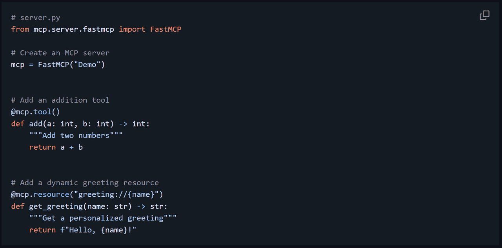

反之，如果没有这些MCP开发工具，想要开发MCP工具，就必须从MCP技术协议出发，借助其他库来完成开发，其实现难度非常大。

而如果我们并不需要开发MCP工具，而只想要借助现成的MCP工具快速完成智能体开发，那么就需要重点关注现在的MCP集成平台，也就是集成了各类目前非常流行的MCP工具的平台，借助这些平台，我们能够快速找到想要的MCP服务，然后根据指示说明快速进行接入，甚至伴随着MCP流式HTTP功能的上线，很多平台还提供了这些MCP工具后端运行服务，我们只需要输入指定的后端地址，就能调用运行在云端的MCP工具。

主流的MCP集成平台如下：

+   MCP官方服务器合集：https://github.com/modelcontextprotocol/servers

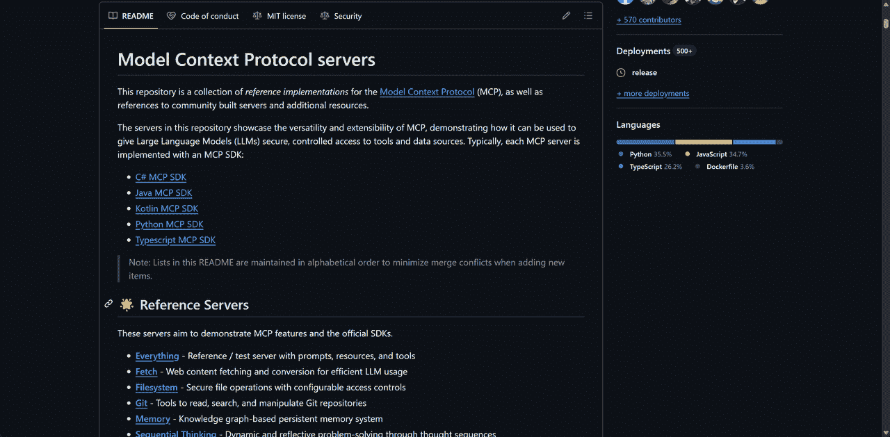

+   MCP Github热门导航：https://github.com/punkpeye/awesome-mcp-servers

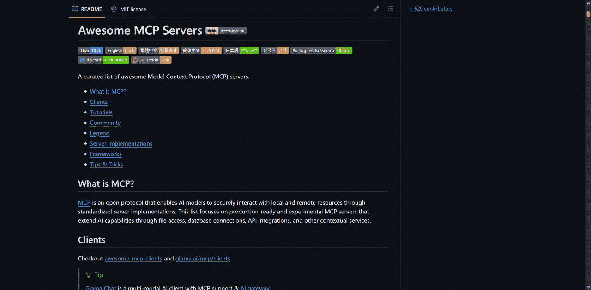

+   Smithery：https://smithery.ai/


+   MCP导航：https://mcp.so/

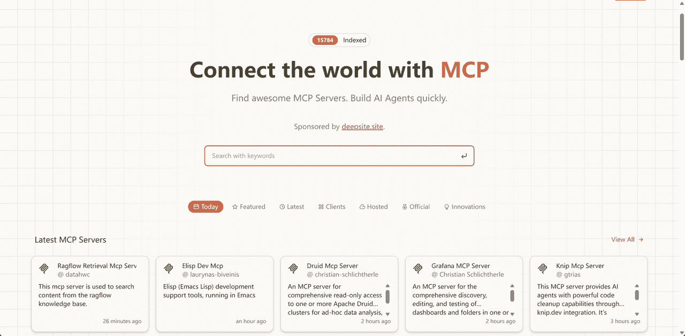

+   阿里云百炼：https://bailian.console.aliyun.com/?tab=mcp


+   魔搭社区MCP广场：https://www.modelscope.cn/mcp


+   mcp.run：https://www.mcp.run/


### 3.MCP核心技术概念

而在正式开始MCP智能体开发之前，我们还需要补充两个MCP技术体系中至关重要的技术概念，分别是MCP客户端与服务器、以及两大类MCP工具运行模式。

#### 3.1 MCP客户端与服务器

由于MCP是一种围绕大模型外部函数工具创建的统一范式，因此MCP工具从诞生之初就是客户端（client）与服务器（server）分离的架构。服务器与客户端的技术概念可以借助MySQL这个通用的数据库软件进行理解，在MySQL中，服务器指的是数据库实际运行环境，例如公司内部的某个统一用于数据存储的物理机，而客户端，则指的是SQL编写和运行的环境，可以是比如数据分析师用的笔记本。每次要进行查数时，数据分析师就可以在自己的笔记本上运行MySQL WorkBench（一个SQL编程的IDE），然后借助MySQL客户端，给公司的MySQL服务器发送查数的请求。

类似的，所谓MCP Server（服务器），指的是MCP工具运行的环境，而MCP Client（客户端），则指的是能够调用MCP工具、或者说给MCP工具发送请求并接受结果的环境。二者关系如图所示：


这种服务器和客户端分离的架构的好处，就在于可以更加便捷的进行模块化开发和维护，而此前我们所说的MCP工具，其实就指的是MCP服务器，而那些MCP工具集合，其实就是MCP服务器集合网站。

同时，基于这种技术划分，当我们在开发一个智能体，并希望这个智能体能够接入MCP工具时，其实从MCP技术角度来说，我们本质上是开发一个MCP的客户端（Client）。例如当我们基于LangGrpah开发一个接入MCP工具的智能体，其实我们就开发了一个基于LangGraph的MCP客户端。而现在也有很多大模型聊天工具允许接入MCP工具，例如Claude Desktop、Cherry Studio等，这些也都是MCP客户端。

#### 3.2 标准MCP工具接入客户端流程

这里以Cherry Studio为例，为大家展示一个标准的MCP客户端接入MCP服务器的基本流程，从中我们能够看出，填写对应的配置文件，是运行MCP工具的关键。

#### 3.3 MCP离线运行与在线运行模式

既然是服务器和客户端分离的架构，那么MCP肯定支持两种调用方法，其一是本地运行，也被成为离线运行，指的是MCP服务器和MCP客户端在同一台电脑上进行运行，其二则是在线运行，或者异地部署运行，指的是MCP服务器在远程服务器或者云端运行，然后借助HTTP网络通信来进行响应。

而这也就对应着MCP工具调用的两种核心模式，分别是stdio（本地）模式调用和SSE&streamable HTTP（在线）模式调用，各调用方法效果对比如下所示：

| 特性 | **Stdio** | **SSE** | **Streamable HTTP** |
| --- | --- | --- | --- |
| **通信方向** | 双向（但仅限本地） | 单向（服务器到客户端） | 双向（适用于复杂交互） |
| **使用场景** | 本地进程间通信 | 实时数据推送，浏览器支持 | 跨服务、分布式系统、大规模并发支持 |
| **支持并发连接数** | 低 | 中等 | 高（适合大规模并发） |
| **适应性** | 局限于本地环境 | 支持浏览器，但单向通信 | 高灵活性，支持流式数据与请求批处理 |
| **实现难度** | 简单，适合本地调试 | 简单，但浏览器兼容性和长连接限制 | 复杂，需处理长连接和流管理 |
| **适合的业务类型** | 本地命令行工具，调试环境 | 实时推送，新闻、股票等实时更新 | 高并发、分布式系统，实时交互系统 |

三种传输方式总结如下：

+   **Stdio**** 传输**：适合本地进程之间的简单通信，适合命令行工具或调试阶段，但不支持分布式。

+   **SSE**** 传输**：适合实时推送和客户端/浏览器的单向通知，但无法满足双向复杂交互需求。

+   **Streamable HTTP**** 传输**：最灵活、最强大的选项，适用于大规模并发、高度交互的分布式应用系统，虽然实现较复杂，但能够处理更复杂的场景。

而伴随着5月MCP更新了Streamable HTTP的SDK，目前越来越多的MCP工具都选择采用Streamable HTTP形式进行部署和运行。

#### 3.4 离线MCP工具托管平台

当然，如果是调用在线MCP服务，开发者只能了解其功能，而如果是离线的MCP服务，则对应的MCP工具是完全开源的，在每次调用之前，开发者都需要将其源码先下载到本地，然后再运行。例如上述演示视频中，我们使用npx命令，其本质就是先将指定的MCP工具下载到本地，然后在有需要的时候对其进行调用。例如高德MCP配置文件如下：

```
    &quot;amap-maps&quot;: {
      &quot;isActive&quot;: true,
      &quot;command&quot;: &quot;npx&quot;,
      &quot;args&quot;: [
        &quot;-y&quot;,
        &quot;@amap/amap-maps-mcp-server&quot;
      ],
      &quot;env&quot;: {
        &quot;AMAP_MAPS_API_KEY&quot;: &quot;YOUR_API_KRY&quot;
      },
      &quot;name&quot;: &quot;amap-maps&quot;
    }
```

代表的含义就是我们需要先使用如下命令：

```
npx -y @amap/amap-maps-mcp-server
```

对这个库@amap/amap-maps-mcp-server进行下载，然后在本地运行，当有必要的时候调用这个库里面的函数执行相关功能。

而这个@amap/amap-maps-mcp-server库是一个托管在https://www.npmjs.com/上的库，


可以使用npx命令进行下载。搜索库名即可看到这个库的完整代码，https://www.npmjs.com/package/@amap/amap-maps-mcp-server：


除此此外，一些由Python编写的MCP开源工具，则托管在pypi平台上，https://pypi.org/ ，每次运行的时候我们需要填写uvx命令，其本质就是将工具源码从pypi平台上下载到本地再来进行运行。


#### 3.5 MCP在线托管服务

伴随着MCP快速调用的请求不断增加，也有很多平台提供了在线托管服务模式，例如魔搭社区的MCP广场中，就有很多是运行在魔搭社区服务器上的MCP工具，开发者可以直接使用SSE或者流式HTTP方式请求调用在线的MCP工具，从而快速完成开发工作。


### 4. 更多MCP技术教程


✔《7分钟讲清楚MCP是什么？》：https://www.bilibili.com/video/BV1uXQzYaEpJ/?

✔《MCP技术开发入门实战！》：https://www.bilibili.com/video/BV1NLXCYTEbj/

✔《MCP企业级智能体开发实战！》：https://www.bilibili.com/video/BV1n1ZuYjEzf/

✔《主流客户端接入MCP实战》：https://www.bilibili.com/video/BV1dCo7YdEgK/

✔《从零到一开发&部署专属MCP工具》：https://www.bilibili.com/video/BV1VHL6zsE5F/

✔《流式HTTP MCP服务器开发流程》：https://www.bilibili.com/video/BV1P7VSzwEXL/

相关课程资料，下图扫码即可获取


### 5. LangGraph技术概述

#### 5.1 从LangChain到LangGraph

说到现阶段目前最流行、最通用的Agent开发框架，毫无疑问，肯定是LangChain。LangChain作为2022年就已经开源的元老级开发框架，历经数年的发展，其功能和生态都已非常完善，并且拥有数量众多的开发者。在我们团队统计的今年第一季度大模型岗位JD中，有90%以上的Agent开发岗位要求掌握LangChain，可以说LangChain就是目前最通用、最流行的Agent开发框架没有之一。不过，由于LangChain诞生时间较早，在2022年末，GPT-3.5刚诞生之时，开发者对大模型的想象主要是希望用其搭建一个又一个工作流，而这也成为LangChain的核心技术目标，LangChain中“Chain”就是指链、也就是搭建工作流的意思。


但是，大模型基座模型能力在飞速进化，例如目前最新一代的大模型，不仅拥有非常强悍的外部工具识别和调用能力，还原生就支持多工具并联和串联调用，而开发者对于大模型应用开发的需求也在快速变化，单纯的构建这种线性的工作流，可拓展性并不强。当前开发者更偏好的是“用AI开发AI”的思路，也就是我们不用定死工作流，而可以让大模型自主判断每一步该怎么做，然后实时创建一些链路，并根据运行情况随时调整。这也就是目前Agent智能体开发的核心思路。

LangGraph和LangChain同宗同源，底层架构完全相同、接口完全相通。从开发者角度来说，LangGraph也是使用LangChain底层API来接入各类大模型、LangGraph也完全兼容LangChain内置的一系列工具。换而言之，LangGraph的核心功能都是依托LangChain来完成。但是和LangChain的链式工作流哲学完全不同的是，LangGraph的基础哲学是构建图结构的工作流，并引入“状态”这一核心概念来描绘任务执行情况，从而拓展了LangChain LCEL链式语法的功能灵活程度。


不过需要注意的是，LangGra**p**h是基于LangChain进行的构建，无论图结构多复杂，单独每个任务执行链路仍然是现行的，其背后仍然是靠着LangChain的Chain来实现的。因此我们可以这么来描述LangChain和LangGraph之间的关系，LangGraph是LangChain工作流的高级编排工具，其中“高级”之处就是LangGraph能按照图结构来编排工作流。

#### 5.2 LangGraph三层API架构

尽管图结构看起来比链式结构灵活很多，但在实际开发过程中，要创建一个图结构却绝非易事。大家可以试想一下，要在代码环境中描述清楚一个图，至少需要清晰的说明图中有哪些节点，不同节点之间是什么关系（边如何连接），同时还需要设置各节点功能，然后才能测试上线，这个流程其实是非常复杂的，哪怕是简单的一个图也需要用很多代码才能描述清楚：


不过这对于LangChain来说并不难解决。LangChain生态各框架的核心思路都是“既要有底层API来定义基础功能，同时也要有高层API来加快开发效率”，就好比LangChain中既有LCEL语法、同时也有Agent API一样，LangGraph也提供了基于图结构基础语法的高层API。LangGraph的高层API主要分为两层，其一是Agent API，用于将大模型、提示词模板、外部工具等关键元素快速封装为图中的一些节点，而更高一层的封装，则是进一步创建一些预构建的Agent、也就是预构建好的图，开发者只需要带入设置好要带入的工具和模型，三行代码就能借助这些预构建好的图，创建一个完整的Agent：


依托LangChain完善的生态、拥有丰富稳定的API架构、以及便捷上手等特性，使得LangGraph成为目前超越LangChain的新一代Agent开发框架。

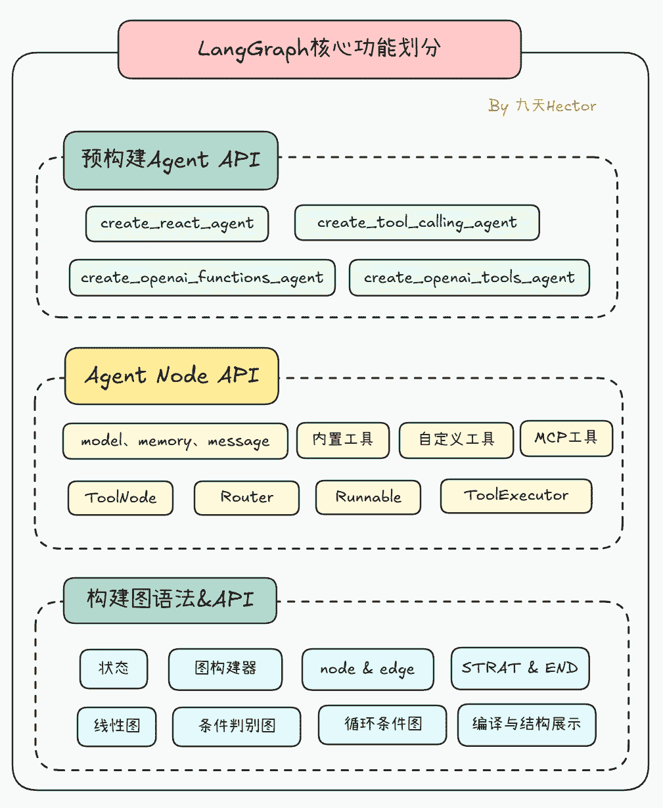

#### 5.3 LangGraph开发生态

+   丰富的模型接口

+           为了让各类模型接入更加统一和稳定，LangChain不惜为不同的模型单独开发一个库，例如要接入Claude模型，我们就需要提前安装langchain-anthropic，而如果要接入DeepSeek模型，则需要安装langchain-deepseek。这么做虽然过程麻烦，但却能很好的保障开发过程的稳定性。


+   各类模型接入列表：https://python.langchain.com/docs/integrations/chat/
此外需要注意的是，LangGraph也需要使用和LangChain一样的模型接入流程。

+   LangGraph运行监控框架：LangSmith

+           LangSmith 是一款用于构建、调试、可视化和评估 LLM 工作流的全生命周期开发平台。它聚焦的不是模型训练，而是我们在构建 AI 应用（尤其是多工具 Agent、LangChain/Graph）时的「可视化调试」、「性能评估」与「运维监控」。核心功能如下：

| 功能类别 | 描述 | 场景 |
| --- | --- | --- |
| 🧪 调试追踪（Trace Debugging） | 可视化展示每个 LLM 调用、工具调用、Prompt、输入输出 | Agent 调试、Graph 调用链分析 |
| 📊 评估（Evaluation） | 支持自动评估多个输入样本的回答质量，可自定义评分维度 | 批量测试 LLM 表现、A/B 对比 |
| 🧵 会话记录（Sessions / Runs） | 每次 chain 或 agent 的运行都会被记录为一个 Run，可溯源 | Agent 问题诊断、用户问题分析 |
| 🔧 Prompt 管理器（Prompt Registry） | 保存、版本控制、调用历史 prompt | 多版本 prompt 迭代测试 |
| 📈 流量监控（Telemetry） | 实时查看运行次数、错误率、响应时间等 | 在生产环境中监控 Agent 质量 |
| 📁 Dataset 管理 | 管理自定义测试集样本，支持自动化评估 | 微调前评估、数据对比实验 |
| 📜 LangGraph 可视化 | 对 LangGraph 中每个节点运行情况进行实时可视化展示 | Graph 执行追踪 |

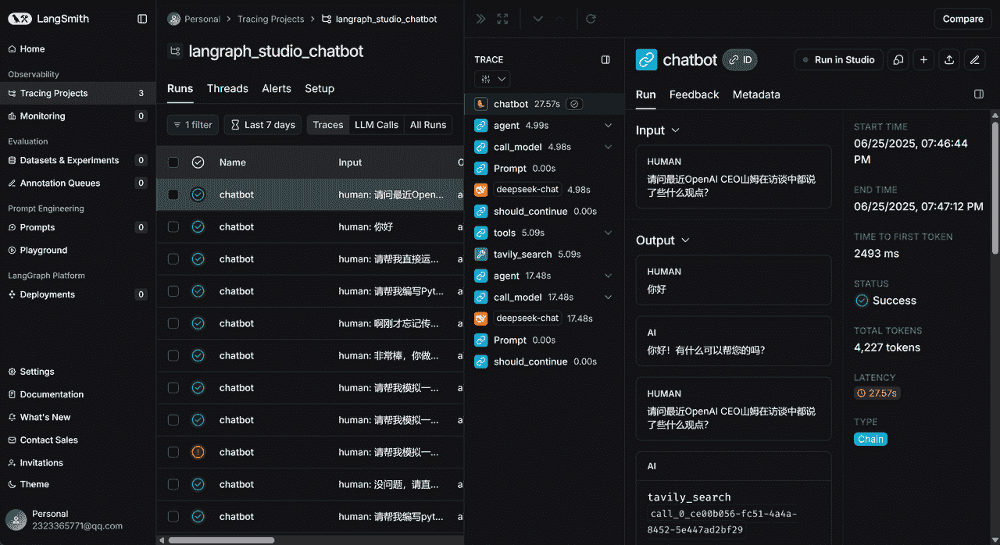

+   LangSmith官网地址：https://docs.smith.langchain.com/

+   LangGraph图结构可视化与调试框架：LangGraph Studio

+           LangGraph Studio 是一个用于可视化构建、测试、分享和部署智能体流程图的图形化 IDE + 运行平台。核心功能如下：

| 功能模块 | 说明 | 应用场景 |
| --- | --- | --- |
| 🧩 Graph 编辑器 | 以拖拽方式创建节点（工具、模型、Router）并连接 | 零代码构建 LangGraph |
| 🔍 节点配置器 | 每个节点可配置 LLM、工具、Router 逻辑、Memory | 灵活定制 Agent 控制流 |
| ▶️ 即时测试 | 输入 prompt 可在浏览器中运行整个图 | 实时测试执行结果 |
| 💾 云端保存 / 分享 | 将构建的 Graph 保存为公共 URL / 私人项目 | 团队协作，Demo 分享 |
| 📎 Tool 插件管理 | 可连接自定义工具（MCP）、HTTP API、Python 工具 | 插件式扩展 Agent 功能 |
| 🔁 Router 分支节点 | 创建条件分支，支持 if/else 路由 | 决策型智能体 |
| 📦 上传文档 / 多模态 | 可以上传文件（如 PDF）并嵌入进图中处理流程 | RAG 结构、OCR、图文问答等 |
| 🧠 Prompt 输入/预览 | 编辑 prompt 并观察其运行效果 | Prompt 工程调试 |
| 📤 一键部署 | 将 Graph 部署为可被 Agent Chat UI 使用的 Assistant | 快速集成到前端 |


+   LangGraph服务部署工具：LangGraph Cli

+           LangGraph CLI 是用于本地启动、调试、测试和托管 LangGraph 智能体图的开发者命令行工具。核心功能如下：

| 功能类别 | 命令示例 | 说明 |
| --- | --- | --- |
| ✅ 启动 Graph 服务 | langgraph dev | 启动 Graph 的开发服务器，供前端（如 Agent Chat UI）调用 |
| 🧪 测试 Graph 输入 | langgraph run graph:graph --input &#x27;{&quot;input&quot;: &quot;你好&quot;}&#x27; | 本地 CLI 输入测试，输出结果 |
| 🧭 管理项目结构 | langgraph init | 初始化一个标准 Graph 项目目录结构 |
| 📦 部署 Graph（未来） | langgraph deploy（预留） | 发布 graph 至 LangGraph 云端（已对接 Studio） |
| 🧱 显示 Assistant 列表 | langgraph list | 显示当前 graph 中有哪些 assistant（即 entrypoint） |
| 🔄 重载运行时 | 自动热重载 | 修改 graph.py 时，dev 模式自动重启生效 |


+   LangGraph Cli官网地址：https://www.langgraph.dev/ （需要代理环境）

+   LangGraph内置工具库与MCP调用组件

+           除了有上述非常多实用的开发工具外，LangGraph还全面兼容LangChain的内置工具集。LangChain自诞生之初就为开发者提供了非常多种类各异的、封装好的实用工具，历经几年发展时间，目前LangChain已经拥有了数以百计的内置实用工具，包括网络搜索工具、浏览器自动化工具、Python代码解释器、SQL代码解释器等。而作为LangChain同系框架，LangGraph也可以无缝调用LangChain各项开发工具，从而大幅提高开发效率。


+   此外，LangChain是最早支持MCP的开发框架之一，借助langchain-mcp-adapters，LangChain和LangGraph便可快速接入各类MCP工具。

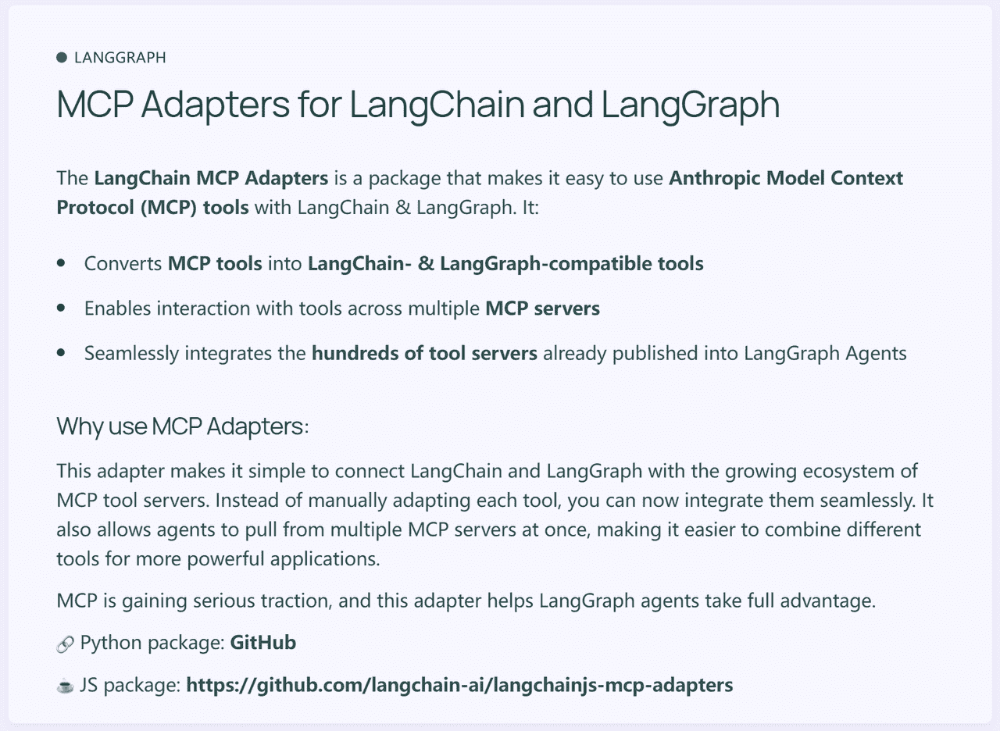

+   并且LangGraph也同样支持谷歌的A2A（跨Agents通信协议）。

+   LangChain工具集：https://python.langchain.com/docs/integrations/tools/

#### 5.4 LangChain&LangGraph更多入门基础教程

下图扫码免费获取完整课程资料


## 二、LangGraph搭建MCP客户端流程

接下来进入到实操环节，正式为大家介绍如何将MCP工具接入LangGraph中并创建智能体。

### 1. 创建自定义MCP工具

作为大模型开发者，掌握MCP工具开发流程是基本功，这里我们先尝试自定义MCP工具，并将其接入LangGraph。对于一个完整的MCP项目来说，要有完整的项目代码结构、以及符合MCP服务器基本调用规范。具体项目创建流程如下：

#### Step 1. 借助uv创建Python项目

**  MCP开发要求借助uv**进行虚拟环境创建和依赖管理。uv 是一个Python 依赖管理工具，类似于 p**ip ****和 c****o****nda，****但它更****快、更高效，并且可**以更好地管理 Python 虚拟环境和依赖项。它的核心目标是替代 pip、venv 和 pip-tools，提供更好的性能和更低的管理开销。

**uv**** 的特点**：

1.  **速度更快**：相比 pip，uv 采用 Rust 编写，性能更优。

1.  **支持 PEP 582**：无需 virtualenv，可以直接使用 __pypackages__ 进行管理。

1.  **兼容 ****pip**：支持 requirements.txt 和 pyproject.toml 依赖管理。

1.  **替代 ****venv**：提供 uv venv 进行虚拟环境管理，比 venv 更轻量。

1.  **跨平台**：支持 Windows、macOS 和 Linux。

以Ubuntu系统为例，首先使用pip安装uv：

```
pip install uv
```

> 此外，也可以直接使用curl安装uv

```
curl -LsSf https://astral.sh/uv/install.sh | sh
```

然后按照如下流程创建项目主目录：

```
# 创建项目目录
uv init mcp-get-weather
cd mcp-get-weather
```


然后输入如下命令创建虚拟环境：

```
# 创建虚拟环境
uv venv

# 激活虚拟环境
source .venv/bin/activate
```

此时这个.venv文件就负责保存当前虚拟环境的各项依赖。

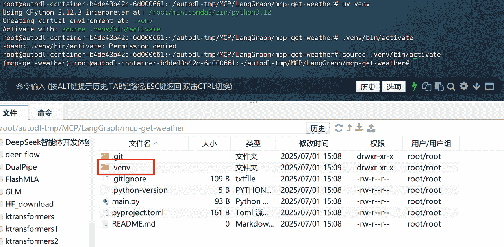

各文件解释如下：

| 文件/文件夹 | 作用 |
| --- | --- |
| .git/ | Git 版本控制目录 |
| .venv/ | 虚拟环境 |
| .gitignore | Git 忽略规则 |
| .python-version | Python版本声明 |
| main.py | 主程序入口 |
| pyproject.toml | 项目配置文件 |
| README.md | 项目说明文档 |

#### Step 2. 添加项目依赖

接下来继续使用uv工具，为我们的项目添加基础依赖。根据此前的代码解释不难看出，当前项目主要需要用到httpx、dotenv、langgraph、langchain_deepseek和langchain_mcp_adapters等核心库，我们可以使用如下命令安装相关依赖，并同时安装mcp sdk：

```
# 安装 MCP SDK
uv add mcp httpx dotenv langgraph langchain-deepseek langchain-mcp-adapters
```

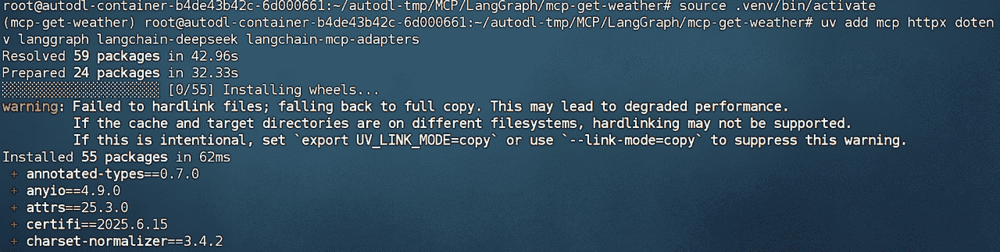

注意，对于uv管理库来说，相关依赖会安装到.venv文件中，并不会和系统库产生冲突。

#### Step 3.编写MCP服务器

接下来继续创建MCP服务器，为了更好的模拟真实场景，这里我们创建多个MCP服务器。

+   查询天气服务器weather_server.py

+   用于进行天气信息查询的服务器，完整代码如下：

```
import os
import json
import httpx
from typing import Any
from dotenv import load_dotenv
from mcp.server.fastmcp import FastMCP

# 初始化 MCP 服务器
mcp = FastMCP(&quot;WeatherServer&quot;)

# OpenWeather API 配置
OPENWEATHER_API_BASE = &quot;https://api.openweathermap.org/data/2.5/weather&quot;
API_KEY = &quot;98cdb20187473b93432b86d8181cb070&quot;
USER_AGENT = &quot;weather-app/1.0&quot;

async def fetch_weather(city: str) -&gt; dict[str, Any] | None:
    &quot;&quot;&quot;
    从 OpenWeather API 获取天气信息。
    :param city: 城市名称（需使用英文，如 Beijing）
    :return: 天气数据字典；若出错返回包含 error 信息的字典
    &quot;&quot;&quot;
    params = {
        &quot;q&quot;: city,
        &quot;appid&quot;: API_KEY,
        &quot;units&quot;: &quot;metric&quot;,
        &quot;lang&quot;: &quot;zh_cn&quot;
    }
    headers = {&quot;User-Agent&quot;: USER_AGENT}

    async with httpx.AsyncClient() as client:
        try:
            response = await client.get(OPENWEATHER_API_BASE, params=params, headers=headers, timeout=30.0)
            response.raise_for_status()
            return response.json()  # 返回字典类型
        except httpx.HTTPStatusError as e:
            return {&quot;error&quot;: f&quot;HTTP 错误: {e.response.status_code}&quot;}
        except Exception as e:
            return {&quot;error&quot;: f&quot;请求失败: {str(e)}&quot;}

def format_weather(data: dict[str, Any] | str) -&gt; str:
    &quot;&quot;&quot;
    将天气数据格式化为易读文本。
    :param data: 天气数据（可以是字典或 JSON 字符串）
    :return: 格式化后的天气信息字符串
    &quot;&quot;&quot;
    # 如果传入的是字符串，则先转换为字典
    if isinstance(data, str):
        try:
            data = json.loads(data)
        except Exception as e:
            return f&quot;无法解析天气数据: {e}&quot;

    # 如果数据中包含错误信息，直接返回错误提示
    if &quot;error&quot; in data:
        return f&quot;⚠️ {data[&#x27;error&#x27;]}&quot;

    # 提取数据时做容错处理
    city = data.get(&quot;name&quot;, &quot;未知&quot;)
    country = data.get(&quot;sys&quot;, {}).get(&quot;country&quot;, &quot;未知&quot;)
    temp = data.get(&quot;main&quot;, {}).get(&quot;temp&quot;, &quot;N/A&quot;)
    humidity = data.get(&quot;main&quot;, {}).get(&quot;humidity&quot;, &quot;N/A&quot;)
    wind_speed = data.get(&quot;wind&quot;, {}).get(&quot;speed&quot;, &quot;N/A&quot;)
    # weather 可能为空列表，因此用 [0] 前先提供默认字典
    weather_list = data.get(&quot;weather&quot;, [{}])
    description = weather_list[0].get(&quot;description&quot;, &quot;未知&quot;)

    return (
        f&quot;🌍 {city}, {country}\n&quot;
        f&quot;🌡 温度: {temp}°C\n&quot;
        f&quot;💧 湿度: {humidity}%\n&quot;
        f&quot;🌬 风速: {wind_speed} m/s\n&quot;
        f&quot;🌤 天气: {description}\n&quot;
    )

@mcp.tool()
async def query_weather(city: str) -&gt; str:
    &quot;&quot;&quot;
    输入指定城市的英文名称，返回今日天气查询结果。
    :param city: 城市名称（需使用英文）
    :return: 格式化后的天气信息
    &quot;&quot;&quot;
    data = await fetch_weather(city)
    return format_weather(data)

if __name__ == &quot;__main__&quot;:
    # 以标准 I/O 方式运行 MCP 服务器
    mcp.run(transport=&#x27;stdio&#x27;)
```

+   写入本地文档服务器write_server.py

+   用于将指定文本信息写入本地文档的外部函数，完整代码如下：

```
import os
from datetime import datetime
from mcp.server.fastmcp import FastMCP

# 初始化 MCP 服务器
mcp = FastMCP(&quot;WriteServer&quot;)
USER_AGENT = &quot;write-app/1.0&quot;

# 文件保存目录
OUTPUT_DIR = &quot;./output&quot;

# 确保目录存在
os.makedirs(OUTPUT_DIR, exist_ok=True)

@mcp.tool()
async def write_file(content: str) -&gt; str:
    &quot;&quot;&quot;
    将指定内容写入本地文件，并返回生成的文件名。
    :param content: 必要参数，字符串类型，用于表示需要写入文档的具体内容。
    :return: 写入结果与文件路径
    &quot;&quot;&quot;
    # 创建带时间戳的文件名
    timestamp = datetime.now().strftime(&quot;%Y%m%d_%H%M%S&quot;)
    filename = f&quot;note_{timestamp}.txt&quot;
    filepath = os.path.join(OUTPUT_DIR, filename)

    try:
        # 写入文件
        with open(filepath, &quot;w&quot;, encoding=&quot;utf-8&quot;) as f:
            f.write(content)

        return f&quot;✅ 已成功写入文件: {filepath}&quot;
    except Exception as e:
        return f&quot;⚠️ 写入失败: {e}&quot;

if __name__ == &quot;__main__&quot;:
    # 以标准 I/O 方式运行 MCP 服务器
    mcp.run(transport=&#x27;stdio&#x27;)
```

+   创建.env文件

+    为了更好的保管敏感API-KEY信息，我们还需要创建一个.env文件，并写入OpenWeather的API-KEY，用于进行天气查询。


+


创建完成后可以在本地文件夹中看到这两个python文件。

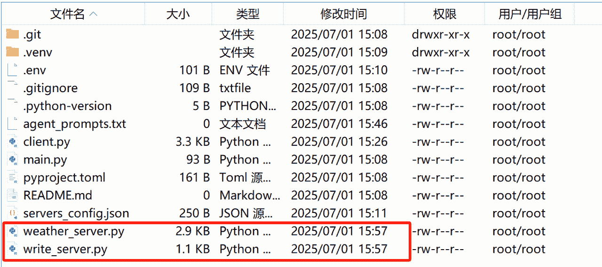

#### Step 4.测试MCP服务器功能

当我们完成MCP服务器开发后，即可使用MCP-Inspector进行MCP工具功能测试。回到项目主目录下，然后输入如下命令：

```
# 回到项目主目录
# cd /root/autodl-tmp/MCP/LangGraph/mcp-get-weather

# 安装Node.js
# curl -fsSL https://deb.nodesource.com/setup_20.x | sudo bash -
# sudo apt install -y nodejs

npx -y @modelcontextprotocol/inspector
```


接下来，如果是使用AutoDL，则先需要使用隧道工具将端口映射到本地进行运行：


然后打开Inspector：http://127.0.0.1:6274/ ，并在页面中进行如下设置：

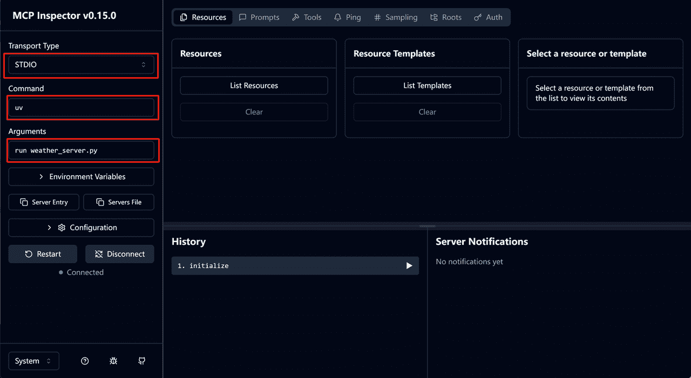

同时，需要输入Proxy Token，可以在启动环境中查看：

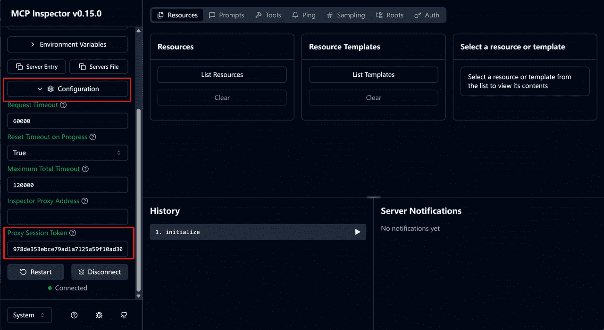


然后即可点击连接，显示Connected后则代表MCP工具服务已顺利启动。接下来即可进行功能测试了：

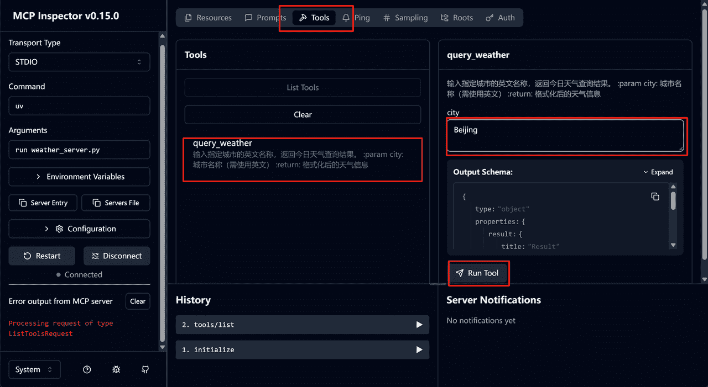

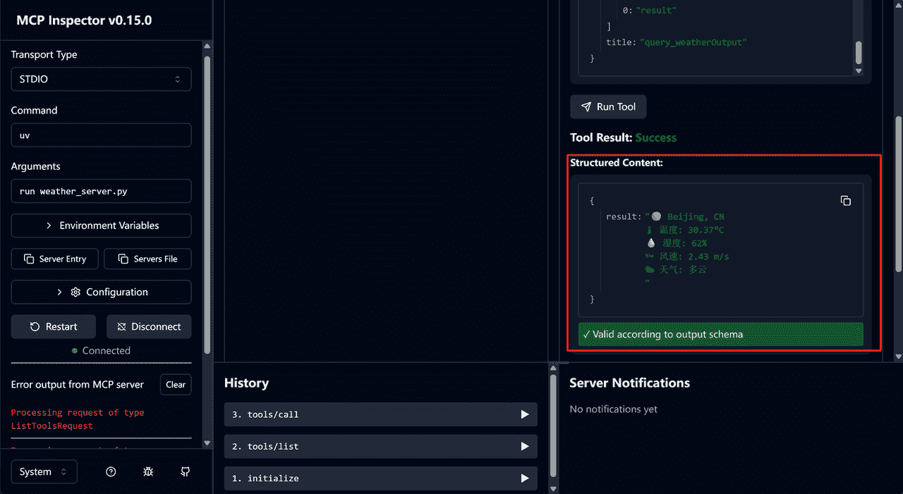

然后即可测试下一项工具write_server.py：

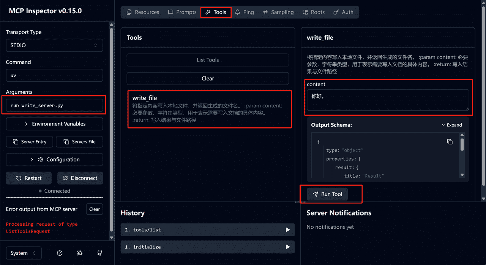

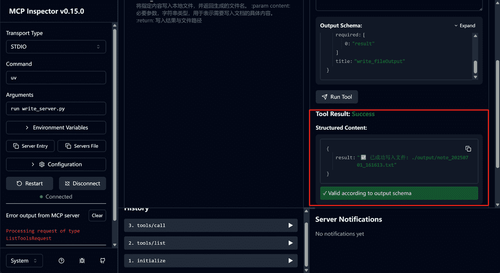

两项工具都通过了测试，

选择SSE模式，选择默认运行地址：http://localhost:8000/sse，然后点击connect：


然后输入地名进行测试：


完整测试流程如下：

同时我们也在本地文件夹中看到了output中新增的内容，表明第二个函数已经顺利将文本内容写入到了本地：

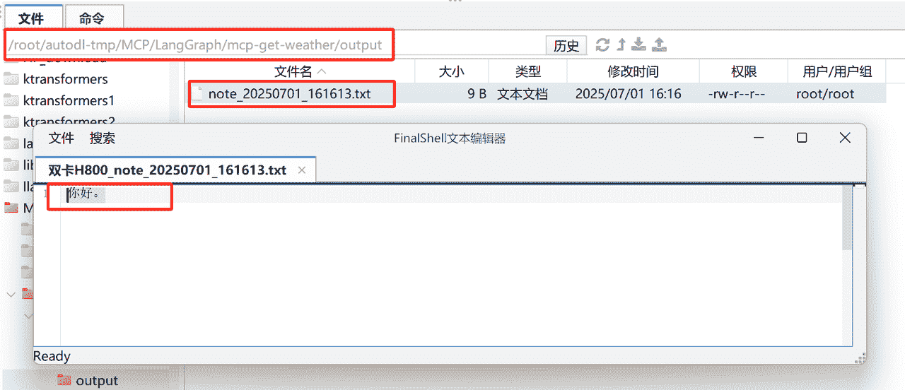

至此，两项MCP工具均测试完毕，接下来即可构建LangGraph MCP客户端，来接入这些工具搭建智能体了。

### 2. 创建LangGraph MCP客户端

使用LangGraph接入MCP工具，核心需要使用langchain_mcp_adapters库，该库可以将MCP工具信息进行解析，并让LangGraph顺利识别。识别后即可像任意其他工具一样接入LangGraph中并搭建智能体。


LangGraph接入MCP的核心原理为： weather_server.py → 启动为子进程 → stdio 通信 → MCP 协议 → 转换为 LangChain 工具 → LangGraph Agent 执行读写，核心转换过程为：：

1.  @mcp.tool() → 标准 LangChain Tool

1.  stdio_client() → 自动处理 read/write 流，其中read 表示从 MCP 服务器读取响应的流，write 表示向 MCP 服务器发送请求的流，对于 stdio weather_server.py，它们就是子进程的 stdout 和 stdin

1.  MultiServerMCPClient → 一键转换所有工具

#### Step 1. 创建MCP配置文件

而为了完整实现一个标准的MCP调用流程、即通过配置文件灵活说明MCP工具信息然后再进行调用，这里我们同样先创建一个servers_config.json文件，用于记录MCP工具信息：

```
{
  &quot;mcpServers&quot;: {
    &quot;weather&quot;: {
      &quot;command&quot;: &quot;python&quot;,
      &quot;args&quot;: [&quot;weather_server.py&quot;],
      &quot;transport&quot;: &quot;stdio&quot;
    },
    &quot;write&quot;: {
      &quot;command&quot;: &quot;python&quot;,
      &quot;args&quot;: [&quot;write_server.py&quot;],
      &quot;transport&quot;: &quot;stdio&quot;
    }
  }
}
```


#### Step 2. 修改.env配置文件和提示词模板

同样的，我们需要创建一个.env文件来写入敏感信息：


```
BASE_URL=https://api.deepseek.com
MODEL=deepseek-chat
LLM_API_KEY=DeepSeek API KEY
OPENWEATHER_API_KEY=OpenWeather API KEY
```

然后为当前Agent创建一个提示词模板agent_prompts.txt：


然后写入如下内容：

```
你是一个智能体，具备以下两种能力：

1.查询天气：调用query_weather(city: str)，返回指定城市的实时天气。

2.写入文件：调用write_file(content: str)，将文本内容写入本地文件并返回路径。

当用户提出请求时，你需要理解意图并选择相应的工具。如果请求缺少必要信息，先与用户确认后再调用工具。返回结果时以简洁、友好的方式回复。

如果用户提出的问题与你的功能无关，请礼貌告知无法处理。
```

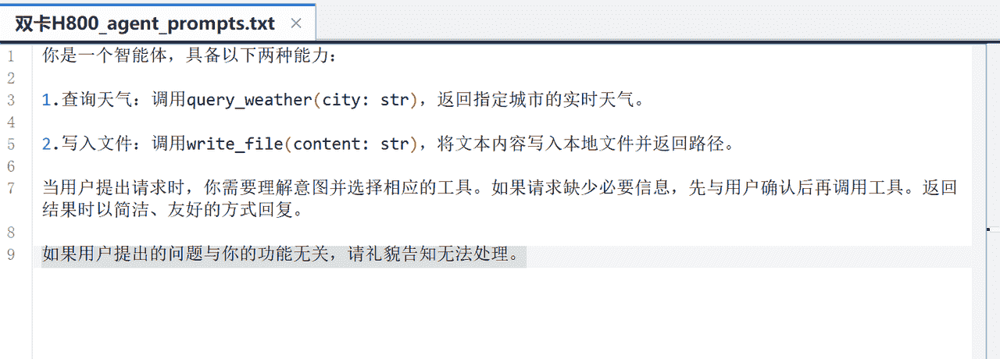

#### Step 3. 创建client.py主函数文件

然后再创建client主函数文件

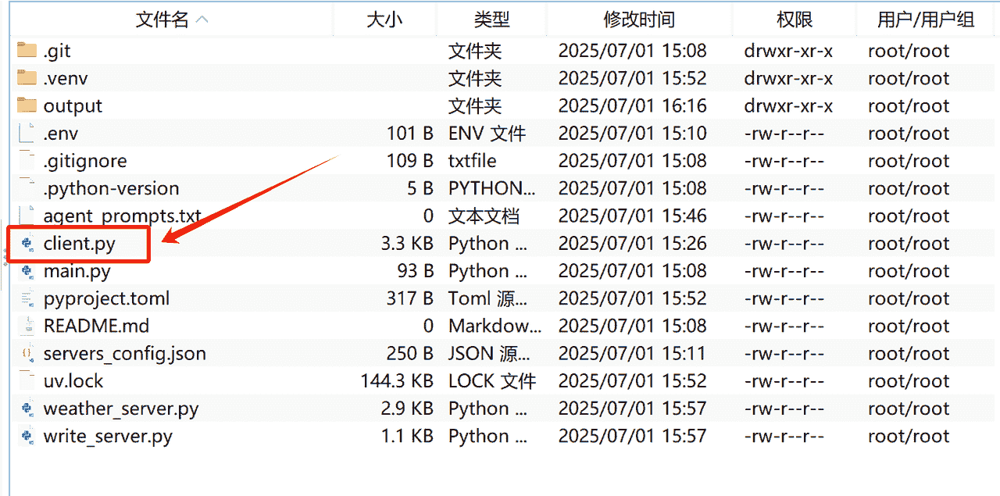

并在其中写入如下代码：

```
&quot;&quot;&quot;
多服务器 MCP + LangChain Agent 示例
---------------------------------
1. 读取 .env 中的 LLM_API_KEY / BASE_URL / MODEL
2. 读取 servers_config.json 中的 MCP 服务器信息
3. 启动 MCP 服务器（支持多个）
4. 将所有工具注入 LangGraph Agent，由大模型自动选择并调用
&quot;&quot;&quot;

import asyncio
import json
import logging
import os
from typing import Any, Dict, List

from dotenv import load_dotenv
from langgraph.prebuilt import create_react_agent
from langchain_deepseek import ChatDeepSeek
from langchain_mcp_adapters.client import MultiServerMCPClient
from langgraph.checkpoint.memory import InMemorySaver

# 设置记忆存储
checkpointer = InMemorySaver()

# 读取提示词
with open(&quot;agent_prompts.txt&quot;, &quot;r&quot;, encoding=&quot;utf-8&quot;) as f:
    prompt = f.read()

# 设置对话配置
config = {
    &quot;configurable&quot;: {
        &quot;thread_id&quot;: &quot;1&quot;  
    }
}

# ────────────────────────────
# 环境配置
# ────────────────────────────

class Configuration:
    &quot;&quot;&quot;读取 .env 与 servers_config.json&quot;&quot;&quot;

    def __init__(self) -&gt; None:
        load_dotenv()
        self.api_key: str = os.getenv(&quot;LLM_API_KEY&quot;) or &quot;&quot;
        self.base_url: str | None = os.getenv(&quot;BASE_URL&quot;)  # DeepSeek 用 https://api.deepseek.com
        self.model: str = os.getenv(&quot;MODEL&quot;) or &quot;deepseek-chat&quot;
        if not self.api_key:
            raise ValueError(&quot;❌ 未找到 LLM_API_KEY，请在 .env 中配置&quot;)

    @staticmethod
    def load_servers(file_path: str = &quot;servers_config.json&quot;) -&gt; Dict[str, Any]:
        with open(file_path, &quot;r&quot;, encoding=&quot;utf-8&quot;) as f:
            return json.load(f).get(&quot;mcpServers&quot;, {})

# ────────────────────────────
# 主逻辑
# ────────────────────────────
async def run_chat_loop() -&gt; None:
    &quot;&quot;&quot;启动 MCP-Agent 聊天循环&quot;&quot;&quot;
    cfg = Configuration()
    os.environ[&quot;DEEPSEEK_API_KEY&quot;] = os.getenv(&quot;LLM_API_KEY&quot;, &quot;&quot;)
    if cfg.base_url:
        os.environ[&quot;DEEPSEEK_API_BASE&quot;] = cfg.base_url
    servers_cfg = Configuration.load_servers()

    # 1️ 连接多台 MCP 服务器
    mcp_client = MultiServerMCPClient(servers_cfg)

    tools = await mcp_client.get_tools()         # LangChain Tool 对象列表

    logging.info(f&quot;✅ 已加载 {len(tools)} 个 MCP 工具： {[t.name for t in tools]}&quot;)

    # 2️ 初始化大模型（DeepSeek / OpenAI / 任意兼容 OpenAI 协议的模型）
    DeepSeek_API_KEY = os.getenv(&quot;DEEPSEEK_API_KEY&quot;)
    model = ChatDeepSeek(model=&quot;deepseek-chat&quot;)

    # 3 构造 LangGraph Agent
    
    agent = create_react_agent(model=model, 
                               tools=tools,
                               prompt=prompt,
                               checkpointer=checkpointer)

    # 4 CLI 聊天
    print(&quot;\n🤖 MCP Agent 已启动，输入 &#x27;quit&#x27; 退出&quot;)
    while True:
        user_input = input(&quot;\n你: &quot;).strip()
        if user_input.lower() == &quot;quit&quot;:
            break
        try:
            result = await agent.ainvoke(
            {&quot;messages&quot;: [{&quot;role&quot;: &quot;user&quot;, &quot;content&quot;: user_input}]},
            config
        )
            print(f&quot;\nAI: {result[&#x27;messages&#x27;][-1].content}&quot;)
        except Exception as exc:
            print(f&quot;\n⚠️  出错: {exc}&quot;)

    # 5️ 清理
    await mcp_client.cleanup()
    print(&quot;🧹 资源已清理，Bye!&quot;)

# ────────────────────────────
# 入口
# ────────────────────────────
if __name__ == &quot;__main__&quot;:
    logging.basicConfig(level=logging.INFO, format=&quot;%(asctime)s - %(levelname)s - %(message)s&quot;)
    asyncio.run(run_chat_loop())
```

代码解释如下：

✅ 从 .env 文件读取模型配置

✅ 从 servers_config.json 读取 MCP 服务器配置（支持多个服务器）

✅ 启动 MCP 客户端加载所有工具

✅ 用 LangGraph 创建 Agent，把所有工具挂载

✅ 在命令行与用户进行对话，模型自动选择工具

✅ 清理资源

##### 1️⃣ 顶部模块导入

```
import asyncio
import json
import logging
import os
from typing import Any, Dict, List

from dotenv import load_dotenv
from langgraph.prebuilt import create_react_agent
from langchain_deepseek import ChatDeepSeek
from langchain_mcp_adapters.client import MultiServerMCPClient
from langgraph.checkpoint.memory import InMemorySaver
```

🔹 解**释**

+   asyncio：异步执行工具

+   json：读取JSON配置

+   logging：日志输出

+   os：读取环境变量

+   load_dotenv：加载.env文件

+   create_react_agent：LangGraph的预置函数，创建ReAct式Agent

+   ChatDeepSeek：DeepSeek官方模型封装

+   MultiServerMCPClient：用于一次连接多个MCP服务器

+   InMemorySaver：LangGraph的内存记忆存储（会话状态保存）

##### 2️⃣ 记忆存储和提示词加载

```
checkpointer = InMemorySaver()

with open(&quot;agent_prompts.txt&quot;, &quot;r&quot;, encoding=&quot;utf-8&quot;) as f:
    prompt = f.read()
```

🔹 解**释**

+   checkpointer: 用于保存在对话中的上下文记忆（例如工具调用历史）

+   prompt: 从 agent_prompts.txt 读取智能体提示词（系统角色）

##### 3️⃣ 对话配置

```
config = {
    &quot;configurable&quot;: {
        &quot;thread_id&quot;: &quot;1&quot;  
    }
}
```

🔹 解**释**

+   thread_id: 会话编号，如果要做多会话隔离时用

+   这里硬编码为1，所以这个会话上下文ID固定

##### 4️⃣ Configuration类 - 环境配置

```
class Configuration:
    &quot;&quot;&quot;读取 .env 与 servers_config.json&quot;&quot;&quot;

    def __init__(self) -&gt; None:
        load_dotenv()
        self.api_key: str = os.getenv(&quot;LLM_API_KEY&quot;) or &quot;&quot;
        self.base_url: str | None = os.getenv(&quot;BASE_URL&quot;)
        self.model: str = os.getenv(&quot;MODEL&quot;) or &quot;deepseek-chat&quot;
        if not self.api_key:
            raise ValueError(&quot;❌ 未找到 LLM_API_KEY，请在 .env 中配置&quot;)

    @staticmethod
    def load_servers(file_path: str = &quot;servers_config.json&quot;) -&gt; Dict[str, Any]:
        with open(file_path, &quot;r&quot;, encoding=&quot;utf-8&quot;) as f:
            return json.load(f).get(&quot;mcpServers&quot;, {})
```

🔹 解**释

**这个类分两部分：

1.  **初始化方法**

+   load_dotenv() 加载 .env 中的配置

+   LLM_API_KEY: 大模型的密钥

+   BASE_URL: API Base URL

+   MODEL: 模型名称

+   没有密钥会直接报错

1.  **静态方法**

+   load_servers()：加载 servers_config.json 文件，返回 mcpServers 字典

+   这个字典包含所有 MCP 服务器连接信息

✅ 这样就可以把配置集中管理

##### 5️⃣ run_chat_loop() 主逻辑

这是整个程序的核心。

```
async def run_chat_loop() -&gt; None:
```

一个异步函数，用于：

+   启动MCP客户端

+   创建LangGraph Agent

+   循环读取用户输入

+   调用Agent

+   返回结果

我们分步骤看。

###### 5.1 配置读取与环境变量设置

```
cfg = Configuration()
os.environ[&quot;DEEPSEEK_API_KEY&quot;] = os.getenv(&quot;LLM_API_KEY&quot;, &quot;&quot;)
if cfg.base_url:
    os.environ[&quot;DEEPSEEK_API_BASE&quot;] = cfg.base_url
servers_cfg = Configuration.load_servers()
```

🔹 解**释**

+   cfg = Configuration(): 实例化配置

+   把 LLM_API_KEY 注入环境变量 DEEPSEEK_API_KEY（DeepSeek SDK会用）

+   如果设置了 BASE_URL，也注入 DEEPSEEK_API_BASE

+   加载所有MCP服务器配置

###### 5.2 连接多台MCP服务器

```
mcp_client = MultiServerMCPClient(servers_cfg)
tools = await mcp_client.get_tools()
```

🔹 解**释**

+   MultiServerMCPClient：自动连接多台MCP服务器

+   get_tools()：从所有服务器加载工具（LangChain Tool对象）

+   例如你的query_weather和write_file

+   可以跨服务器统一管理

###### 5.3 日志打印

```
logging.info(f&quot;✅ 已加载 {len(tools)} 个 MCP 工具： {[t.name for t in tools]}&quot;)
```

🔹 解**释

**显示一行日志，告诉你加载了多少工具以及它们的名字。

###### 5.4 初始化大模型

```
DeepSeek_API_KEY = os.getenv(&quot;DEEPSEEK_API_KEY&quot;)
model = ChatDeepSeek(model=&quot;deepseek-chat&quot;)
```

🔹 解**释**

+   ChatDeepSeek: 封装DeepSeek的聊天模型

+   model: 用于 LangGraph Agent 的核心 LLM

###### 5.5 创建LangGraph Agent

```
agent = create_react_agent(model=model, 
                           tools=tools,
                           prompt=prompt,
                           checkpointer=checkpointer)
```

🔹 解**释**

+   create_react_agent: 快捷方法，创建ReAct推理式智能体

+   参数：

+   model: 大模型

+   tools: 所有MCP工具

+   prompt: 系统提示词

+   checkpointer: 记忆存储器（保存上下文）

###### 5.6 CLI 聊天循环

```
print(&quot;\n🤖 MCP Agent 已启动，输入 &#x27;quit&#x27; 退出&quot;)
while True:
    user_input = input(&quot;\n你: &quot;).strip()
    if user_input.lower() == &quot;quit&quot;:
        break
    try:
        result = await agent.ainvoke(
            {&quot;messages&quot;: [{&quot;role&quot;: &quot;user&quot;, &quot;content&quot;: user_input}]},
            config
        )
        print(f&quot;\nAI: {result[&#x27;messages&#x27;][-1].content}&quot;)
    except Exception as exc:
        print(f&quot;\n⚠️  出错: {exc}&quot;)
```

🔹 解**释**

+   input(): 读取用户输入

+   如果输入quit就退出

+   调用 agent.ainvoke()：

+   异步执行模型推理

+   自动决定要不要调用工具

+   打印最后一条模型回复

+   出错时打印异常

###### 5.7 清理资源

```
await mcp_client.cleanup()
print(&quot;🧹 资源已清理，Bye!&quot;)
```

🔹 解**释

**关闭所有MCP连接，释放资源。

6️⃣ 入口逻辑

```
if __name__ == &quot;__main__&quot;:
    logging.basicConfig(level=logging.INFO, format=&quot;%(asctime)s - %(levelname)s - %(message)s&quot;)
    asyncio.run(run_chat_loop())
```

🔹 解**释**

+   配置日志格式

+   启动事件循环执行 run_chat_loop()

##### 🟢 功能总结：

✅ **多服务器支持**：同**时连接多台M**CP**服务器

✅ 动态工具加载**：不**需硬编码**工具**

✅ DeepSe**ek模型支持：直接用LangChain的DeepSeek封装

✅ 记忆管理：用InMemorySaver保存对话状态

✅ 标准ReAct推理：大模型自主判断何时调用工具

#### Step 4. 运行测试

最后，输入如下命令启动对话：

```
uv run client.py
```

实际运行效果如下，能够发现，无论是多工具调用还是持久化记忆，都能顺利运行。


至此，我们就完整完成了完整的MCP工具接入LangGraph搭建智能体的完整流程。

### 3. 接入更多MCP工具

#### 3.1 Filesystem MCP工具接入

接下来借助我们创建好的MCP客户端，仅需填写MCP配置，即可非常便捷的接入更多MCP工具。这里以GitHub上的Filesystem MCP工具为例进行演示。Filesystem服务器是一个最基础同时也是最常用的MCP服务器，同时也是官方推荐的服务器，服务器项目地址：https://github.com/modelcontextprotocol/servers/tree/main/src/filesystem


借助Filesystem，我们可以高效便捷操作本地文件夹。同时Filesystem也是一个js项目，源码托管在npm平台上：（https://www.npmjs.com/package/@modelcontextprotocol/server-filesystem）


而我们仅需填写如下配置，即可使用Filesystem MCP：

```
{
  &quot;mcpServers&quot;: {
    &quot;filesystem&quot;: {
      &quot;command&quot;: &quot;npx&quot;,
      &quot;args&quot;: [
        &quot;-y&quot;,
        &quot;@modelcontextprotocol/server-filesystem&quot;,
        &quot;/path/to/other/allowed/dir&quot;
      ]
    }
  }
}
```

例如我们在servers_config.json中写入MCP工具配置：

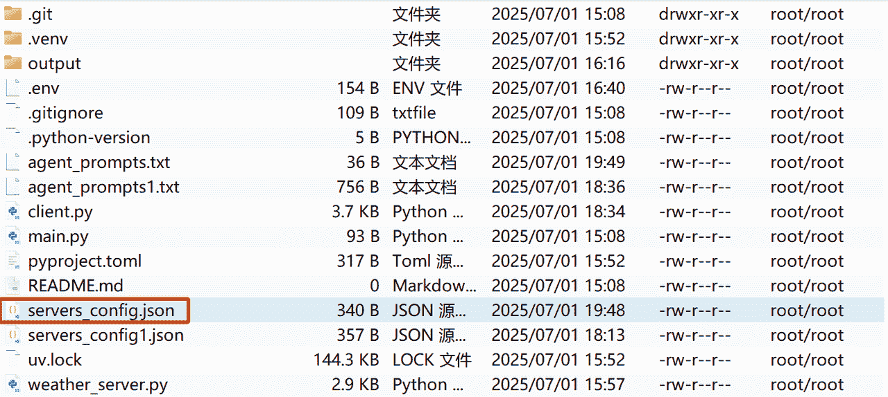


```
{
  &quot;mcpServers&quot;: {
    &quot;weather&quot;: {
      &quot;command&quot;: &quot;python&quot;,
      &quot;args&quot;: [&quot;weather_server.py&quot;],
      &quot;transport&quot;: &quot;stdio&quot;
    },
    &quot;filesystem&quot;: {
      &quot;command&quot;: &quot;npx&quot;,
      &quot;args&quot;: [
        &quot;-y&quot;,
        &quot;@modelcontextprotocol/server-filesystem&quot;,
        &quot;/root/autodl-tmp/MCP/LangGraph/mcp-get-weather&quot;
      ],
      &quot;transport&quot;: &quot;stdio&quot;
    }
  }  
}
```

实际运行效果如下所示：

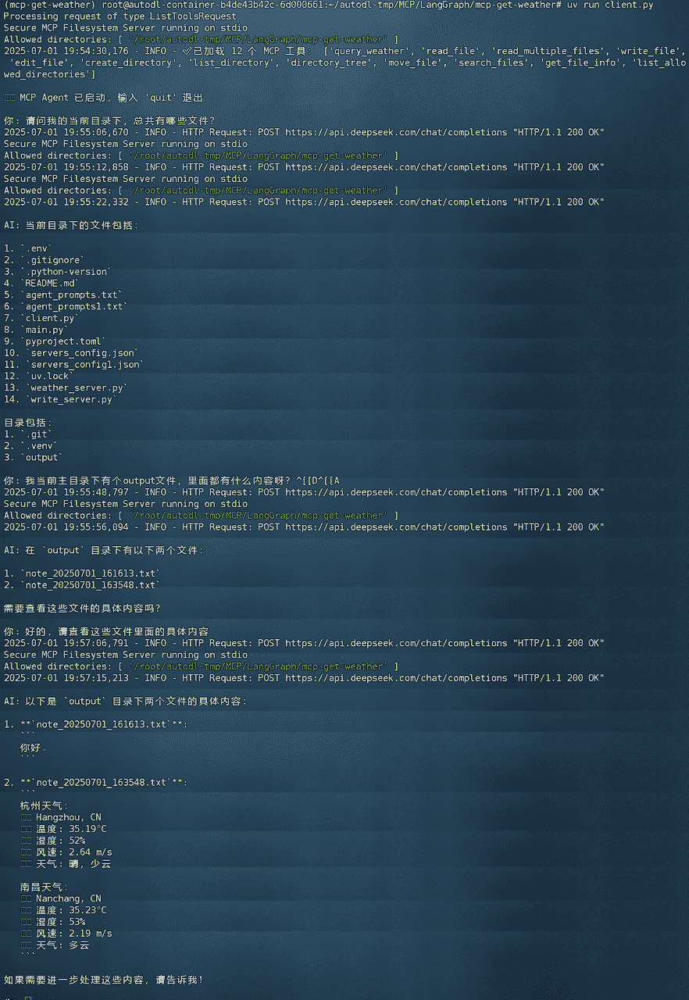

#### 3.2 FireCrawl MCP工具接入

**FireCrawl**是一款专为现代人工智能应用而设计的高性能网页抓取与结构化内容提取框架。它致力于通过自动化的方式，将互联网海量的非结构化网页数据转化为可被大模型理解、检索和推理的标准化知识。FireCrawl不仅支持对静态和动态网页进行深度爬取，还能够自动识别并提取页面中的正文、元数据、表格、代码片段以及多媒体内容，形成丰富的上下文语料。该工具在多语言环境下同样表现出色，可在全球范围内快速搭建定制化的知识抓取流程。通过与矢量数据库、检索增强生成（RAG）系统和MCP协议的无缝集成，FireCrawl为企业和研究机构提供了一种高效、可扩展的解决方案，使大型语言模型具备最新的实时知识获取与更新能力，显著提升其在问答、分析与内容生成等场景中的智能化水平。

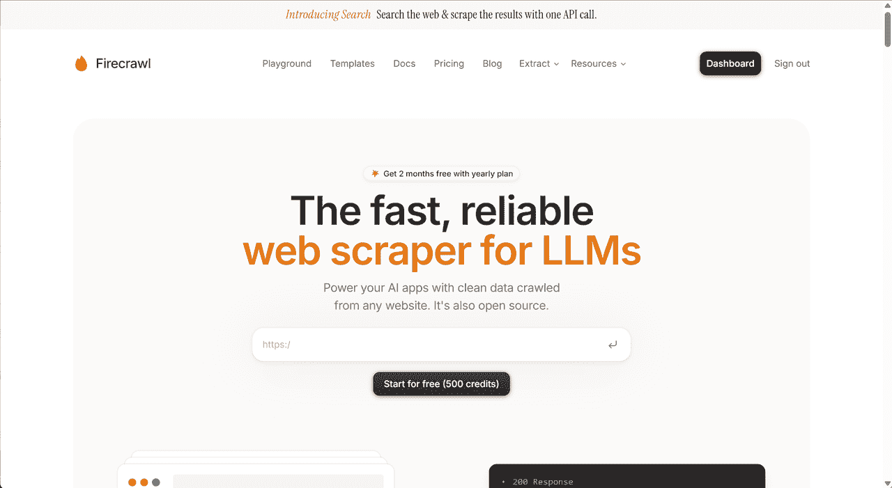

+   FireCrawl官网地址：https://www.firecrawl.dev/

+   FireCrawl MCP官网地址 https://github.com/mendableai/firecrawl-mcp-server

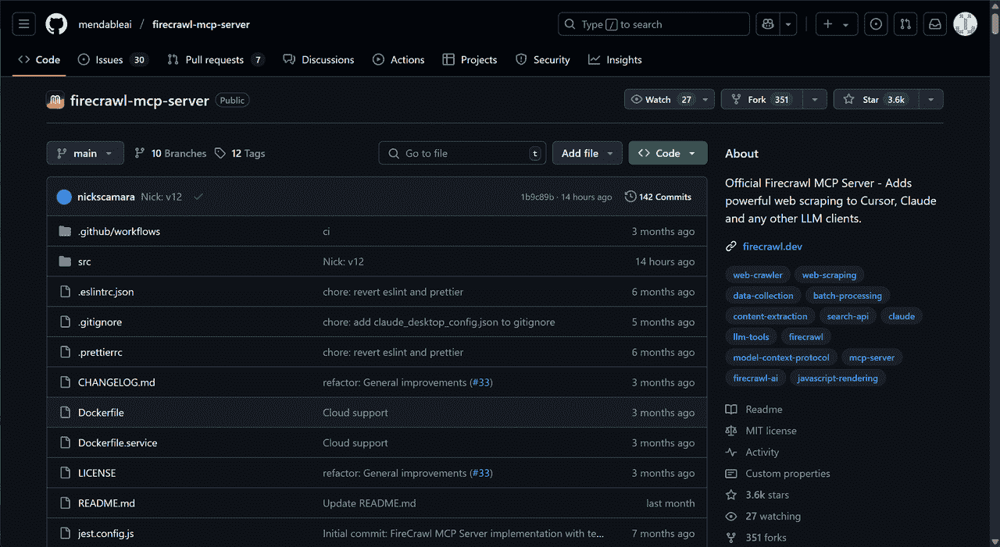

紧接着改写配置文件内容如下：

```
{
  &quot;mcpServers&quot;: {
    &quot;weather&quot;: {
      &quot;command&quot;: &quot;python&quot;,
      &quot;args&quot;: [&quot;weather_server.py&quot;],
      &quot;transport&quot;: &quot;stdio&quot;
    },
    &quot;filesystem&quot;: {
      &quot;command&quot;: &quot;npx&quot;,
      &quot;args&quot;: [
        &quot;-y&quot;,
        &quot;@modelcontextprotocol/server-filesystem&quot;,
        &quot;/root/autodl-tmp/MCP/LangGraph/mcp-get-weather&quot;
      ],
        &quot;transport&quot;: &quot;stdio&quot;
    },
    &quot;mcp-server-firecrawl&quot;: {
      &quot;command&quot;: &quot;npx&quot;,
      &quot;args&quot;: [&quot;-y&quot;, &quot;firecrawl-mcp&quot;],
      &quot;env&quot;: {
        &quot;FIRECRAWL_API_KEY&quot;: &quot;YOUR_API_KEY&quot;
      },
        &quot;transport&quot;: &quot;stdio&quot;
    }      
  }  
}
```


实际运行效果如下:

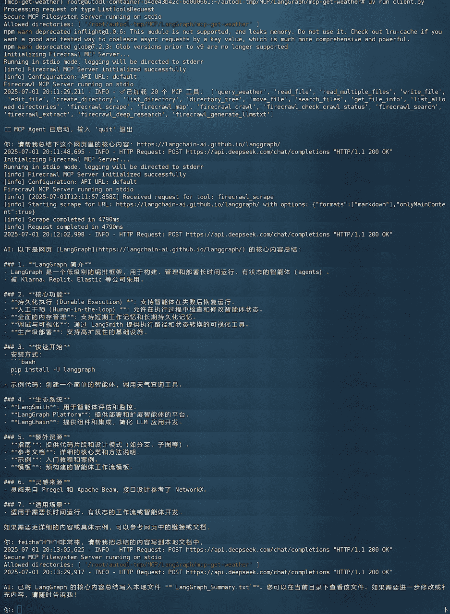


## 三、将LangGraph封装为MCP工具

作为双向MCP工具，我们不仅能借助LangGraph来创建MCP客户端并搭建智能体，我们还能将已经开发好的LangGraph项目便捷的封装为MCP工具。我们这里将此前公开课介绍的数据分析Agent封装为一个MCP工具。

项目完整教程已上线至赋范大模型技术社区，大家扫码即可领取：

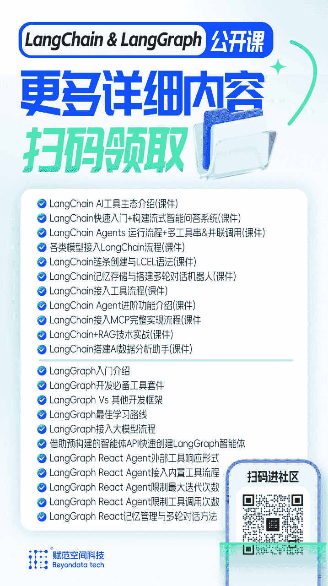

### 1. LangGraph项目一般结构与开发工具回顾

+   LangGraph项目结构与开发流程


+   LangGraph服务部署工具：LangGraph Cli


+   LangGraph运行监控框架：LangSmith


+   LangGraph图结构可视化与调试框架：LangGraph Studio


### 2. Data Agent服务启动流程

LangGraph智能体后端服务对MCP功能是完全兼容的，一旦我们顺利开启LangGraph后端服务，即可在/mcp路由端口以流式HTTP模式调用LangGraph的智能体各项功能。这也是最便捷的将LangGraph智能体封装为MCP工具的方法。

为此，我们需要先启动此前公开课创建的Data Agent服务。

#### Step 1.下载项目完整源码

扫码添加助教老师领取课件网盘，下载Data Agent完整项目源码：


#### Step 2. 配置环境

紧接着需要修改.env配置文件，需要填写的内容如下，需要注意的是，如果不需要连接本地MySQL数据库，相关配置空着即可。


+   LangSmith API Key获取

+           LangSmith需要先登录LangSmith官网进行注册，https://www.langchain.com/langsmith，


+   然后选择开启项目追踪功能，


+   然后点击创建API-KEY即可。


+   Tavily搜索引擎API KEY获取

+   获取用于进行网络搜索的Tavily API Key，https://www.tavily.com/，同样需要在Tavily官网注册账号，


+   然后在个人主页即可获取API-KEY，


然后输入如下命令，安装项目依赖：

```
pip install -r requirements.txt
```

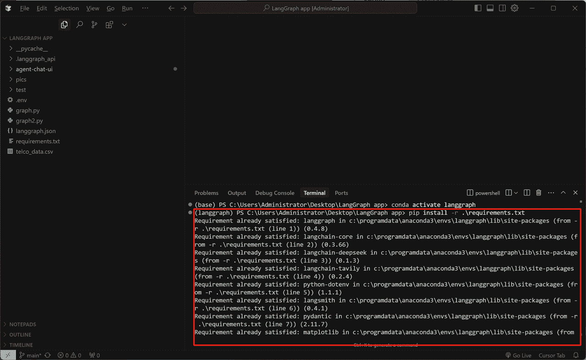

#### Step 3. 开启Data Agent项目后端服务

紧接着即可启动后端服务了：

```
pip install -U &quot;langgraph-cli[inmem]&quot;
langgraph dev
```


其中2024是当前智能体后端服务端口，而2024/docs则是后端接口功能说明


而在LangSmith官网主页https://www.langchain.com/langsmith，就能看到每次对话追踪的效果，


而第二个链接则是用于可视化展示项目结构和在线功能测试的功能组件：LangGraph Studio


#### 【可选】Step 4. 开启前端对话

此外，我们还可以将其接入前端。而最适配的前端，当然是LangChain自带的Agent Chat UI，这个前端不仅页面美观，而且支持定制化二次开发。我们可以在Agent Chat UI的GitHub主页上下载源码并进行部署，


也可以直接在课件网盘中下载源码压缩包，


然后在当前项目主目录内进行解压缩，然后输入如下命令安装依赖和开启前端：

```
pnpm install
pnpm dev
```

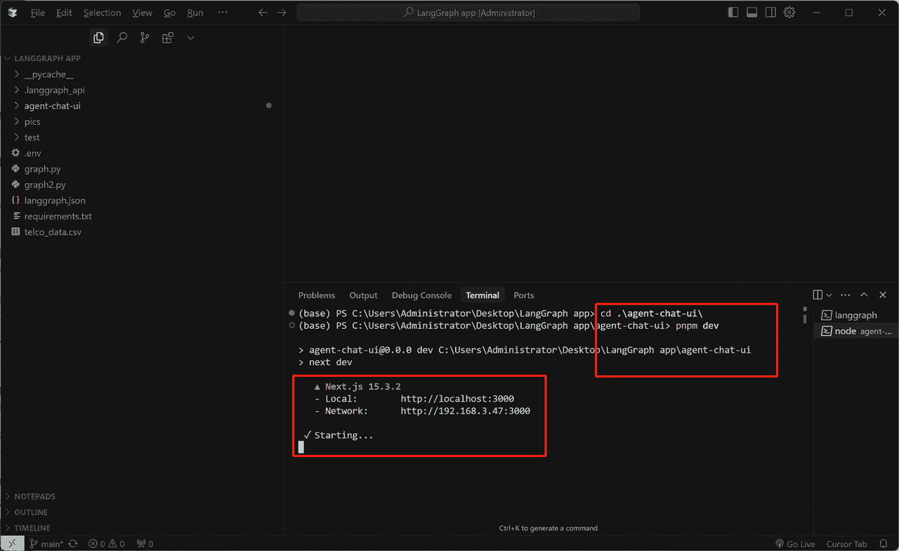

然后即可在http://localhost:3000 通过前端页面访问Data Agent服务了。


### 3. 将Data Agent封装为MCP工具

顺利开启后端服务后，我们就能在http://127.0.0.1:2024/mcp 处，以流式传输的MCP工具形式对其进行调用。例如现在保持Data Agent后端服务开启状态，然后回到我们的LangGraph MCP项目中，在MCP工具配置文件中，加上Data Agent服务端口：


```
{
  &quot;mcpServers&quot;: {
    &quot;weather&quot;: {
      &quot;command&quot;: &quot;python&quot;,
      &quot;args&quot;: [&quot;weather_server.py&quot;],
      &quot;transport&quot;: &quot;stdio&quot;
    },
    &quot;write&quot;: {
      &quot;command&quot;: &quot;python&quot;,
      &quot;args&quot;: [&quot;write_server.py&quot;],
      &quot;transport&quot;: &quot;stdio&quot;
    },
    &quot;data_analysis&quot;: {
      &quot;url&quot;: &quot;http://localhost:2024/mcp&quot;,
      &quot;transport&quot;: &quot;streamable_http&quot;
    },    
  }
}
```

并修改提示词模板：


```
你是一个智能体，具备以下三种能力：

1.查询天气：调用query_weather(city: str)，返回指定城市的实时天气。

2.写入文件：调用write_file(content: str)，将文本内容写入本地文件并返回路径。

3.数据查询与分析，当用户的问题需要上网搜索、查询数据库或者需要进行数据分析时，请调用chatbot工具。此时请创建如下格式消息进行调用：{&quot;type&quot;: &quot;human&quot;, &quot;content&quot;: user_input}

当用户提出请求时，你需要理解意图并选择相应的工具。如果请求缺少必要信息，先与用户确认后再调用工具。返回结果时以简洁、友好的方式回复。

如果用户提出的问题与你的功能无关，请礼貌告知无法处理。
```

然后开启LangGraph MCP Agent：

```
uv run client.py
```

实际演示效果如下：


此时在LangSmith中就能实时查看当前对话情况：

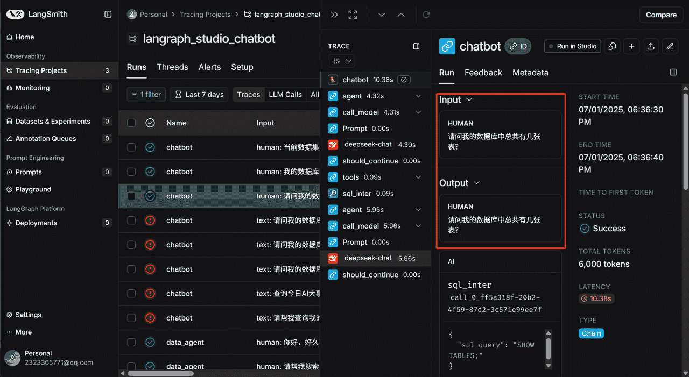

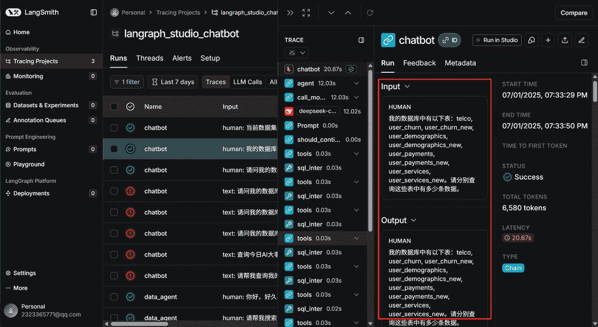

## 四、LangGraph接入HTTP MCP智能体

### 1. 接入在线MCP服务流程

在 SSE (Server-Sent Events) 模式 下，我们可以把 MCP 服务**器当成一个已经在网络上跑着**的「工具 API」，用 URL 建立事件流、再用 POST /messages 发指令。当前主流的使用形式可以归纳为两大类：自托管启动与平台托管直连。

+   自托管启动（Self-hosted）

这种方式主要是应用[MCP](https://github.com/modelcontextprotocol)官方的Python / TypeScript MCP SDK 把 Server 代码跑起来（FastAPI / Express 集成）, 程序启动后会打印或返回一个本地或内网 SSE URL，然后便可以用这个 URL 建立事件流接入到OpenAI Agents SDK 框架中。如果需要使用MCP 官方的Python SDK构建SSE 模式的MCP 服务器，可以学习《【加餐】MCP SSE与流式HTTP开发实战】》课程模块，我们这里不再重复讲解。

+   平台托管直连（Platform-hosted）

诸如 [ModelScope](https://www.modelscope.cn/mcp)[的 ](https://www.modelscope.cn/mcp)[MCP](https://www.modelscope.cn/mcp)[ 广场](https://www.modelscope.cn/mcp)、[mcp.run](https://docs.mcp.run/integrating/tutorials/mcp-run-sse-openai-agents)等社区维护大量 MPC 服务并支持一键启动MCP的SSE 模式。使用的方法非常简单，只需要在平台首页选好MCP Server → 生成一个API-Key，一键生成 SSE URL ，即可直接接入使用。

对于国内开发者，通过“一键复制 URL + API-Key”就能拿到 SSE 端点的热门网站大致可以分为四类：

1.  专门的 MCP 服务市场/目录（如 MCP Market、AIbase、MCP Server Hub）；

1.  云厂商推出的 官方托管平台（阿里云 “百炼” 与 Higress Marketplace）；

1.  行业 API 已内置 MCP & SSE（百度地图、腾讯位置服务等）；

1.  IDE / 客户端集市 把第三方 SSE URL 聚合到本地（Cherry Studio、Cursor）。

MCP 热门导航网站

| 平台 | 规模与特点 | 访问链接 |
| --- | --- | --- |
| ModelScope MCP 广场 | 超过 3000+ 个中文托管 MCP；详情页右侧直接复制 SSE URL，部分服务需在“API Key”栏目填 Token | [点击进入](https://www.modelscope.cn/mcp/) |
| **MCP Market** | **标榜“**国内首个 MCP 服务市场”，已收录 1W+ SSE Server，并提供云托管与 Playground，一键生成专属 URL | [点击进入](https://mcpmarket.cn/) |
| **AIbase MCP 资源站** | 整理 GitHub 上的热门 MCP Server 并直接给出 SSE 地址与使用教程 | [点击进入](https://mcp.aibase.cn/) |
| **MCP Server Hub** | 国际化，标签筛选 + “Copy URL” 操作流畅，站内统计数千条 SSE Server | [点击进入](https://mcpserverhub.com/) |
| **阿里云 百炼** | 官方托管“全周期 MCP 服务”，控制台能生成已鉴权的 SSE URL | [点击进入](https://bailian.console.aliyun.com/?spm=5176.29619931.0.0.1369521cW5hVGj&amp;tab=mcp#/mcp-market) |

平台托管直连不需要开发者关心进程与依赖等问题，直接在网页一键生成URL即可接入。下面我们以ModelScope的MCP 广场为例，演示如何在OpenAI Agents SDK框架中通过SSE 模式接入MCP 服务器。

+   **Step 1. 进入****ModelScope****的****MCP**** 广场，访问地址：https://w**ww.modelscope.cn/mcp

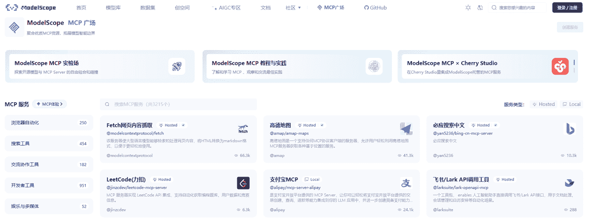

+   **Step 2. 点击右上角****登录****按钮，登录****ModelScope****账号**

+     可以通过手机号注册并登录，注意：国内用户记得选择中国大陆 +86 的手机号注册，否则会提示手机号格式错误。

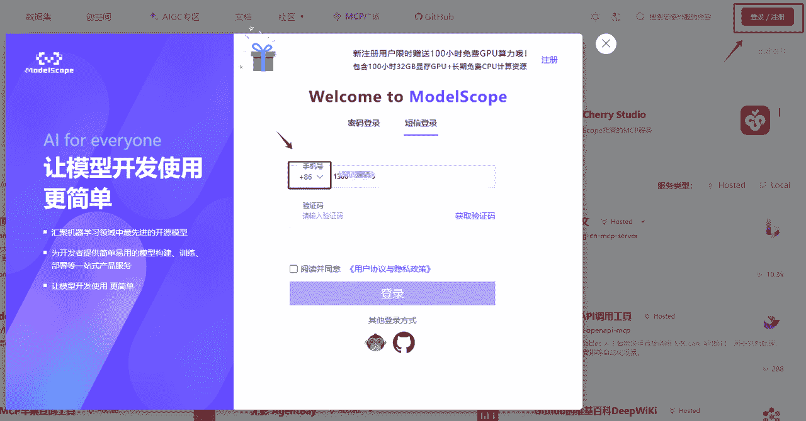

+   **Step 3. 挑选****MCP**** 服务，并进入详情页**

+     这里我们选择的是12306-MCP车票查询工具，该MCP 服务提供了搜索12306购票信息的功能。

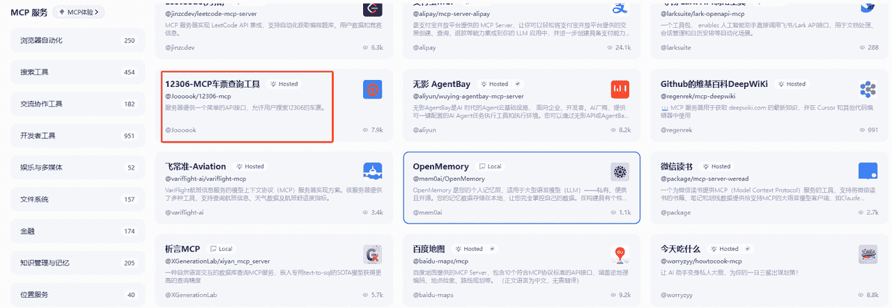

+   **Step 4. 点击****立即使用****按钮，进入****MCP**** 服务详情页**

+     如果是首次使用，在详情页的最右侧会有一个通过SSE URL连接服务的说明

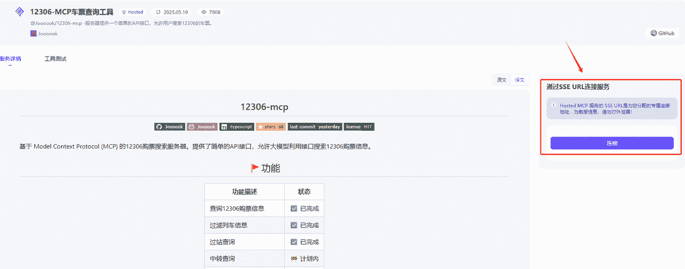

+     点击连接按钮，即可生成一个SSE URL，如下图所示：


+   **Step 5. 修改配置文件**


```
{
  &quot;mcpServers&quot;: {
    &quot;12306-mcp&quot;: {
      &quot;url&quot;: &quot;https://mcp.api-inference.modelscope.net/f38521aeede344/sse&quot;,
      &quot;transport&quot;: &quot;sse&quot;
    }      
  }  
}
```

+   实际运行效果

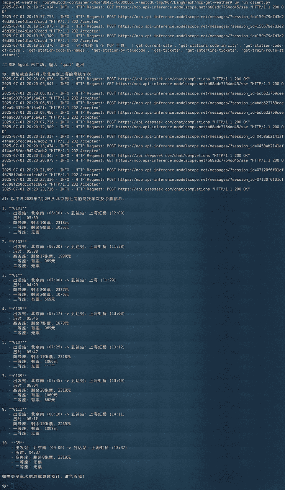

上述过程中，MCP适配器承担了接口映射的工作——它将 MCP Server 提供的工具描述转化为 LangGraph 的工具对象，包括工具名称、功能说明、输入输出参数类型等。大模型在推理中根据工具描述和对话上下文决定何时调用哪个工具，LangGraph负责将调用意图映射为实际的函数调用。调用时，MCP客户端会将函数参数通过既定格式发送给服务器执行，并将结果以标准化的JSON格式返回给LangGraph代理。这一标准通信过程无需开发者处理底层序列化和协议细节，实现了上下文和数据在 LangGraph 与 MCP 之间的透明传递。模型每次调用工具时，当前对话信息会作为提示的一部分（通常由LangGraph agent在内部prompt中包含工具使用说明），因此模型“知道”何时以及如何使用这些工具来获取所需信息。

### 2. 搭建可视化MCP智能体开发平台

掌握了LangGraph 接入 MCP Server 的原理，接下来我们通过一个实际的案例来进一步加深大家对LangGraph + MCP Server的应用。我们实现了一个基于Streamlit的智能AI代理平台，其包含的主要功能是：

+   多MCP工具集成平台：支持动态添加和管理多个MCP（Model Context Protocol）工具

+   智能对话代理：基于LangGraph创建的ReAct（推理-行动）代理，能够智能选择和使用工具

+   可视化Web界面：提供友好的用户界面进行对话和工具管理

+   多模型支持：目前主要支持DeepSeek模型，架构可扩展支持其他LLM

如下是该系统的运行效果演示：

完整项目代码已上传至课件网盘，大家扫码即可领取：

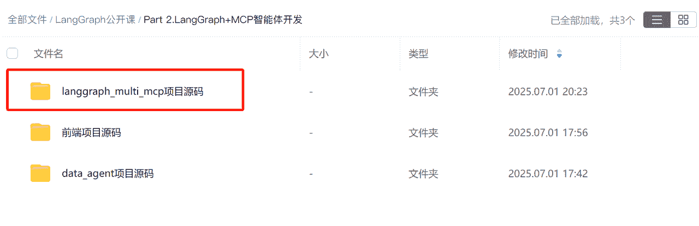


接下来我们逐步讲解如何在本地部署并启动LangGraph_Multi_MCP应用。

下载源码文件后，首先需要新建一个venv环境：


进入该虚拟环境后，进行依赖项的安装：

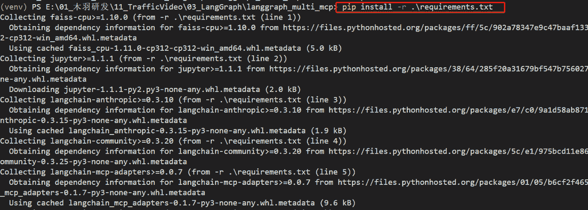

接下来，在启动前需要配置.env文件，包含以下配置:

```
    # === 必需配置 ===
    # DeepSeek API密钥（必须）
    DEEPSEEK_API_KEY=your_deepseek_api_key_here

    # === 可选配置 ===
    # 登录功能开关
    USE_LOGIN=true                    # true启用登录，false禁用

    # 用户认证信息（仅在USE_LOGIN=true时需要）
    USER_ID=your_username            # 登录用户名
    USER_PASSWORD=your_password      # 登录密码


    # LangSmith追踪（可选）
    LANGSMITH_TRACING=true
    LANGSMITH_API_KEY=your_langsmith_key
    LANGSMITH_PROJECT=langgraph_mcp_project
```

其次，大家可以参考mcp_server_time.py文件，来实现内置的MCP Server，然后将其写入config.json文件中。

```
    {
    &quot;get_current_time&quot;: {
        &quot;command&quot;: &quot;python&quot;,
        &quot;args&quot;: [
        &quot;./mcp_server_time.py&quot;
        ],
        &quot;transport&quot;: &quot;stdio&quot;
    }
    }
```

注意：这里可以写多个MCP Server的配置，大家可以根据自己的需求进行开发和应用。注意：前端界面中的添加和删除MCP Server的功能，其实就是对config.json文件的修改。

修改完以上配置后，便可以在控制台运行项目了。执行如下命令：

```
    streamlit run app.py
```

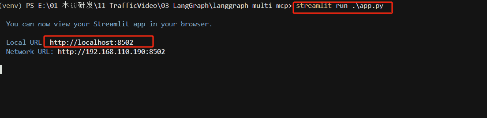

首次登录时，需要输入用户名和密码，这里的用户名和密码是在.env文件中配置的，按照自己的设置进行登录校验即可。登录成功后，便可以进入系统的主界面进行交互了。

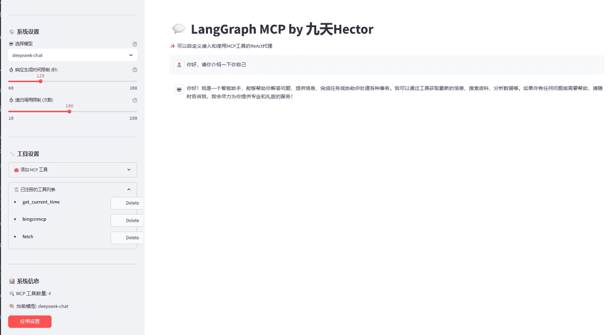

---

+   体验课内容节选自《2025大模型Agent智能体开发实战》(夏季班)完整版付费课程

体验课时间有限，若想深度学习大模型技术，欢迎大家报名由我主讲的《2025大模型Agent智能体开发实战》(夏季班)https://ix9mq.xetslk.com/s/3u765N)


**《2025大模型Agent智能体开发实战**》(夏季班)为【100+小时】体系大课，总共20大模块精讲精析，零基础直达大模型企业级应用！


同时，5月班重磅新增DeepSeek+Agents SDK+谷歌ADK+MCP技术应用与智能体开发相关实战内容，并计划新增Qwen-3模型实战教学：


### 部分课程成果演示

+   Dify+DeepSeek搭建智能客服

+   可视化数据分析Multi-Agent

+   Ollama 自动化并发请求测试与动态资源监控

+   Neo4j并行多线程导入百万级文本方法与实践

+   MateGen Pro 项目功能演示

+   智能客服项目展示

此外，若是对大模型底层原理感兴趣，也欢迎报名由我和菜菜老师共同主讲的《2025大模型原理与实战课程》(夏季班)


**两门大模型课程夏季班目前上新特惠，直播间下单可享618平价钜惠，合购还有更多**优惠哦~详细信息扫码添加助教，回复“大模型”，即可领取课程大纲&查看课程详情👇


