# DeepResearch应用开发实战

> 来源：[https://kq4b3vgg5b.feishu.cn/docx/PDVrdepsKolx4fxJsE1cSo1mnfc](https://kq4b3vgg5b.feishu.cn/docx/PDVrdepsKolx4fxJsE1cSo1mnfc)

## 课程说明：

+   体验课内容节选自《2025大模型Agent智能体开发实战》(夏季班)完整版付费课程

**体**验课时间有限，若想深度学习大模型技术，欢迎大家报名由我主讲的《2025大模型Agent智能体开发实战》(夏季班)！

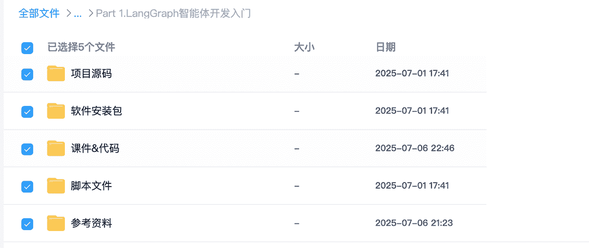


公开课全套学习资料，已上传至网盘（链接:https://pan.baidu.com/s/1Grrp1Mjc-99s_PKMbNlcYg?pwd=je4y  ）

需要更系统深入学习大模型可扫码⬆️添加助教咨询喔～

---

## 一、新一代信息检索增强工具DeepResearch

Deep Research（深度研究）是一种新兴的大模型驱动多步信息检索与报告生成技术。与传统搜索引擎只返回相关链接不同，Deep Research 会像研究员一样自主检索和阅读网页内容，提取关键信息，并多轮推理整理成全面的研究报告。它能够自动将复杂问题分解为子问题、反复搜索权威资料、交叉分析多源信息，最终生成带有引用来源的结构化报告。这种能力旨在解决传统搜索和一般问答中的信息碎片化和AI幻觉问题。相比用户手动点击众多链接筛选信息（耗时低效），Deep Research 通过多次自动检索和跨来源验证，大幅提升信息准确性和研究深度。简而言之，Deep Research 是一种让大型语言模型作为代理人迭代检索和分析信息，并输出详尽报告的技术。

Deep Research 的概念在 2024 年底至 2025 年初迅速走红，OpenAI、Google、Perplexity 等公司相继推出各自的深度研究代理功能。OpenAI 的 Deep Research 作为 ChatGPT 的新代理功能，宣称可自主搜索、分析并综合上百份在线资料，生成接近研究分析师水准的报告。Google 的 Gemini 模型也强调了探索复杂主题并输出易读报告的能力。这些产品体现出深度研究在降低信息误差和提升决策效率上的巨大潜力：通过自动化检索和智能分析，减少错误信息与幻觉，让企业和专业人士获得更可靠的研究结果，从而更高效地做出决策。

Deep Research 的实现过程可以分为以下几个步骤：

1.  问题分解：将复杂问题分解为多个子问题，每个子问题都对应一个信息检索任务。

1.  信息检索：使用搜索引擎或API检索相关信息。

1.  信息整合：将检索到的信息进行整合，形成一个全面的研究报告。

1.  报告生成：将整合后的信息生成一个全面的研究报告。

而根据 **ar**X**iv 2506.12594** 《A Comprehensive Survey of Deep Research: Systems, Methodologies, and Applications》 的梳理，目前全球主流科技公司（OpenAI、Google、Microsoft、Meta、Anthropic 等）对 Deep Research 系统的技术设想与落地路径。

### 1. Deep Research 的三个核心维度

| 维度 | 含义 | 论文要点 |
| --- | --- | --- |
| 认知-推理 (Cognitive Reasoning) | 以 LLM 作为思考引擎，具备自主规划、链式推理与反思。 | [系统需能把复杂研究](https://arxiv.org/pdf/2506.12594?utm_source=chatgpt.com)任务拆分为子目标，自主调用工具再综合结论。 (arxiv.org) |
| 工具集成 (Tool Integration) | 无缝调用搜索 / 数据库 / 代码执行等外部工具。 | [强调“可插拔工具层](https://arxiv.org/abs/2506.12594?utm_source=chatgpt.com)”，[并提出超过 80 个](https://github.com/scienceaix/deepresearch?utm_source=chatgpt.com)商用 / 开源实现对比。 (arxiv.org, github.com) |
| 流程自动化 (Workflow Automation) | 端到端覆盖检索、阅读、实验、写作、迭代。 | [区分于只包一层 p](https://arxiv.org/pdf/2506.12594?utm_source=chatgpt.com)rompt 的“单点 LLM 应用”。 (arxiv.org) |

> 只有同时具备 **≥2 个维度** 且以 LLM 为核心推理单元的系统，论文才认定为真正的 “Deep Research” 系统。

### 2. 巨头方案速览

| 公司 | 对应产品 / 原型 | 技术要点 | Deep Research 侧重点 |
| --- | --- | --- | --- |
| **OpenAI** | GPT-4o + “DeepResearch” 功能位（文中列为商业样例） | 128 k 上下文 + Retrieval-Augmented Generation；函数调用触发链式工具。 | **认知-推理 + 工具集成**：[LLM 作为“研究](https://arxiv.org/pdf/2506.12594?utm_source=chatgpt.com)总管”，外呼 Papers with Code、ArXiv API、代码解释器。 (arxiv.org) |
| **Google** | **Gemini 1.5 Pro /** Gemini DeepResearch | 1 M token 长上下文、循环检索-写作；Notebook-Agent 协同。 | 极长上[下文 + 自动摘要](https://arxiv.org/html/2506.12594?utm_source=chatgpt.com)/对[比实验。 (arxiv](https://twitter.com/rohanpaul_ai/status/1936822784685957155?utm_source=chatgpt.com).org, twitter.com) |
| **Microsoft** | Copilot + AutoGen Stack | Planner-Executor 多 Agent；Neo4j Graph-RAG；Office 文档写作链。 | **流程自动化**：把文献检索→Excel 统计→Word 报告串成 Workflow。 |
| **Meta (FAIR)** | LlamaCode Research Companion | Llama-3-70B + Code Interpreter + PaperQA。 | **开源路线**：私有知识库 + 本地 RAG。 |
| **Anthropic** | **Claude-3 Sonnet “Re**search Assistant” 模式 | 200 k context；Constitutional self-critique；搜索-批注-写长文。 | **安全对齐 + 长文写作**。 |

### 3.架构模式

**论文与后续**解读将 Deep Research 系统抽象为 4 类架构：

**Pipeline-Agent**（顺序管线）

+   LLM 负责分段调用 Search → Read → Synthesis。

+   代表：Perplexity、PubMed GPT。

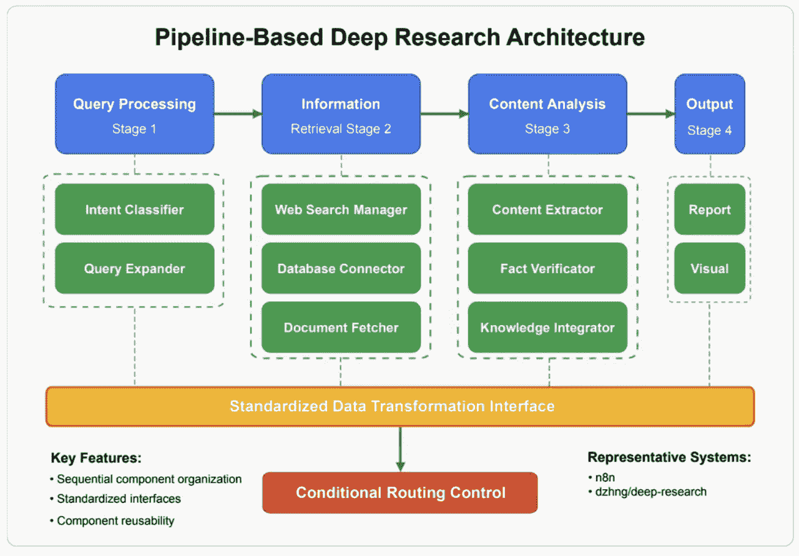

**Planner/Executor-**Agent (Hierarchical)

+   顶层 Planner 生成任务树，下层 Executor 并行执行子节点。

+   代表：OpenAI DeepResearch、Microsoft AutoGen。

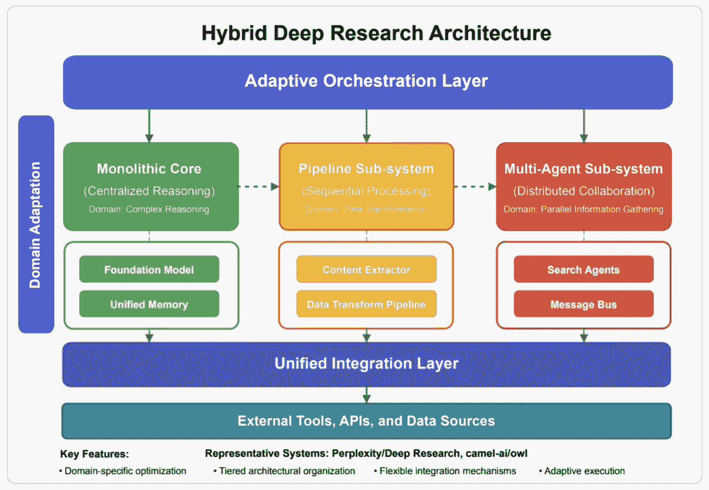

Cooperative Multi-Agent

+   多 Agent 互评互改，降低 hallucination，提升深度。

+   代表：Anthropic Team-Agent 原型、Google Gemini “Science Agents” 实验。

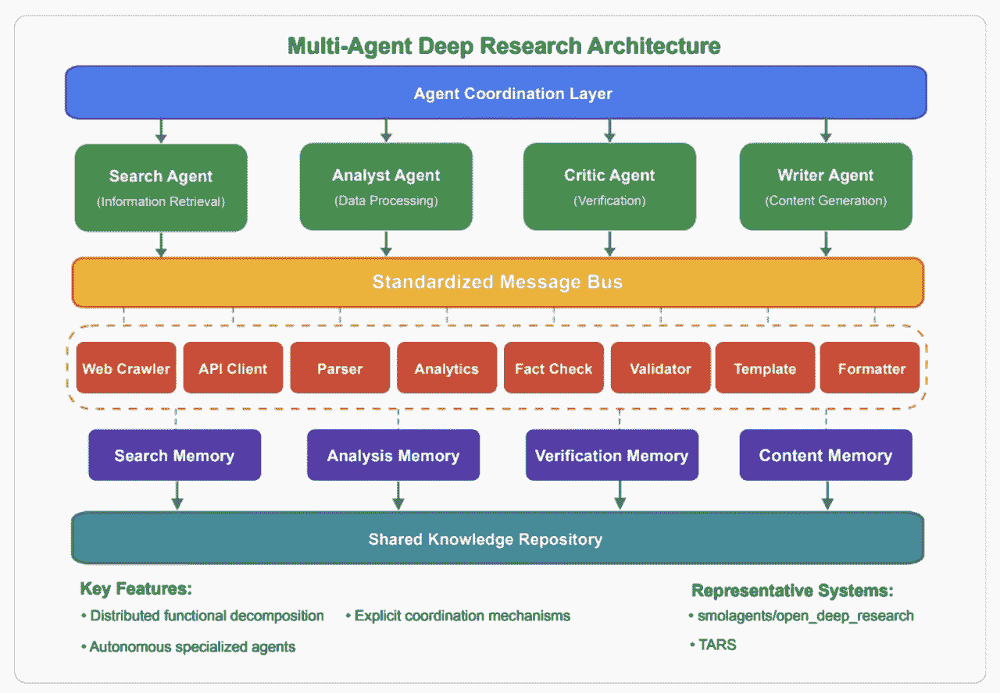

Memory-Centric (Graph-RAG)

+   将外部检索结果与过程记忆统一写入向量＋图存储，支持“持续研究”。

+   代表：OpenAI Knowledge Graph、Meta ResearchGraph。 (shchegrikovich.substack.com)

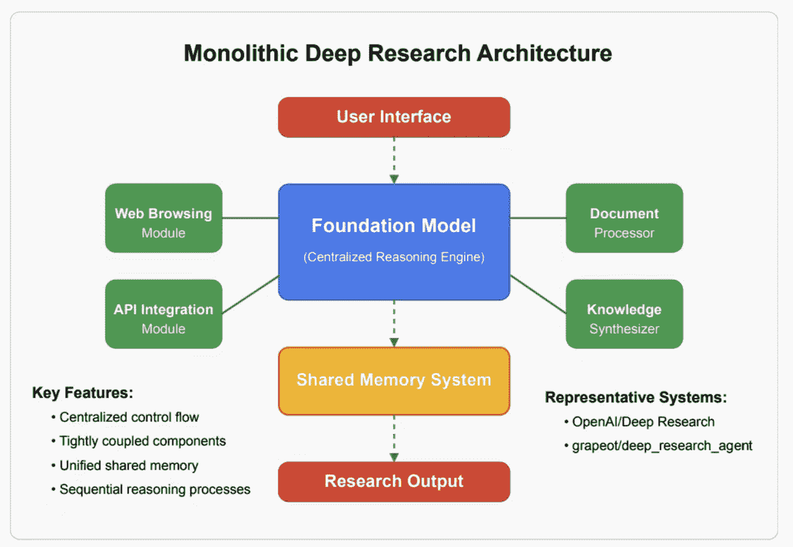

### 4. 技术设想与落地挑战

| 方向 | 巨头共识 | 挑战 |
| --- | --- | --- |
| **超长上下文 + 批判性检索** | 利用 128 k–1 M 窗口直接“整卷”阅读论文集；多轮自提问、自验证。 | 成本 &amp; 速度；Token-泄漏风险；引用准确率。 |
| **Hybrid-RAG-2.0** | Web + 私库 + 结构化数据库多通路检索，向量 + 关键字 + 图融合。 | 检索质量评估标准；新旧版本冲突；跨语种融合。 |
| **自反馈-自改进 (RLAIF)** | 让 Agent 生成多版推理链，自动打分择优。 | 反馈信号设计；防止模式坍缩。 |
| **安全对齐 &amp; 审计** | 引入责任链日志（Tool 调用、引用来源、判例比对）。 | 大规模日志存储成本；隐私合规；解释性欠缺。 |
| 多模态科研 (代码、图表、实验仪数据) | Gemini、GPT-4o 开始支持数学推导、图片解析、代码执行。 | 上下文融合策略；推理稳定性。 |

## 二、Agent常用搜索引擎介绍

### 1. Tavily通用搜索引擎介绍

在当前以智能体（Agent）为核心的应用开发浪潮中，Tavily正迅速崛起为备受瞩目的搜索引擎解决方案。作为一款专为智能体检索与推理需求量身打造的工具，Tavily不仅提供了高度可编程的API接口，还具备显著优于传统搜索引擎的上下文相关性理解能力。其核心优势在于能够以结构化、可解析的形式返回搜索结果，便于Agent将检索到的信息直接用于后续的推理、生成或任务执行流程。

此外，Tavily在响应速度和结果多样性方面表现尤为突出。开发者可以通过配置查询参数，自定义结果数量、语言偏好以及检索深度，从而精确地控制搜索行为。得益于其对自然语言查询的深度优化，Tavily在处理复杂、开放式问题时，能够提供比通用搜索引擎更高质量的答案。近年来，Tavily已被广泛集成到LangChain、CrewAI等智能体开发框架中，成为构建检索增强生成（RAG）和自动化工作流的重要组成部分。

总体而言，Tavily不仅是一款通用的Web搜索工具，更是新一代AI Agent应用实现智能信息检索的关键基础设施，为开发者在复杂任务自动化和知识获取领域提供了强有力的支持。在目前Agent开发过程中，Tavily具备如下优势：

1. 针对智能体检索场景深度优化

与传统面向人类终端用户的搜索引擎不同，Tavily从一开始就以AI Agent为核心服务对象，支持结构化JSON格式的响应，并对结果进行高置信度排序，极大简化了智能体的后续解析和利用流程。

2. 出色的上下文理解与语义匹配

Tavily在自然语言查询理解和语义相关性匹配方面进行了深度训练，能够更精准地提取用户意图和问题背景，从而返回比通用搜索更贴近需求的答案。

**3. 高度可编程性与灵活性**

Tavily API支持灵活配置检索参数（如结果数量、语言、检索范围），并允许开发者将其无缝嵌入到对话式智能体、工作流自动化或RAG（检索增强生成）链路中，具备极高的集成适配性。

**4. 响应速度与可用性**

相比部分依赖通用搜索API或爬虫方案的替代产品，Tavily在响应速度、稳定性和可用性方面表现优异，能为对话或推理提供近乎实时的检索支持。

**5. 生态集成能力**

目前，Tavily已被LangChain、CrewAI、Autogen等主流Agent开发框架官方支持，成为检索增强智能体的默认首选搜索后端，这使其在开发者生态中拥有更高的便利性和成熟度。

6. 更优质的内容过滤与结果可控性

Tavily提供了更细粒度的内容过滤机制，支持对结果来源、领域或置信度进行约束，使开发者在敏感或高可靠性场景下更易掌控输出。

### 2. Tavily搜索引擎API-KEY获取核心功能介绍

+   Tavily官网：https://www.tavily.com/

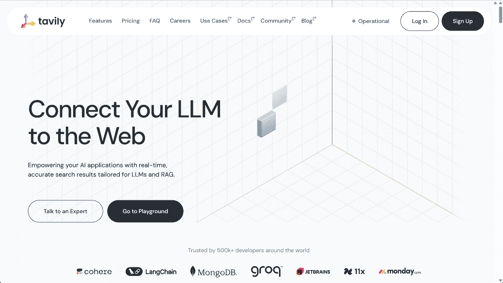

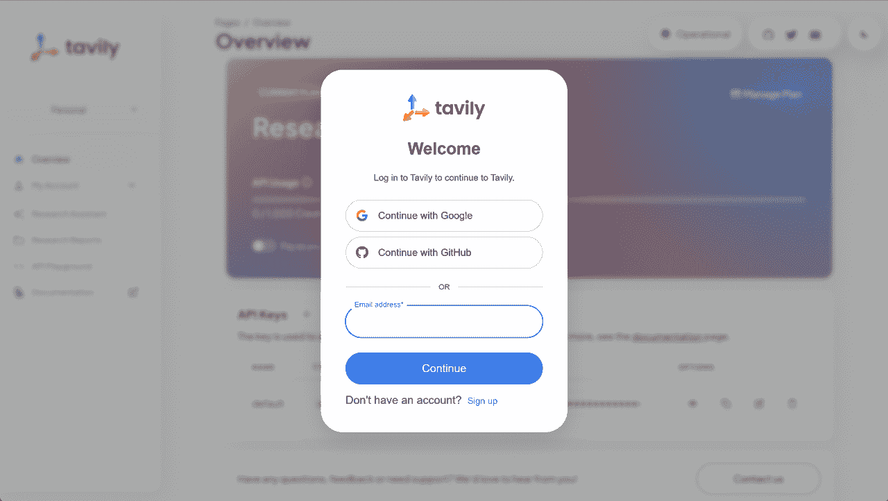

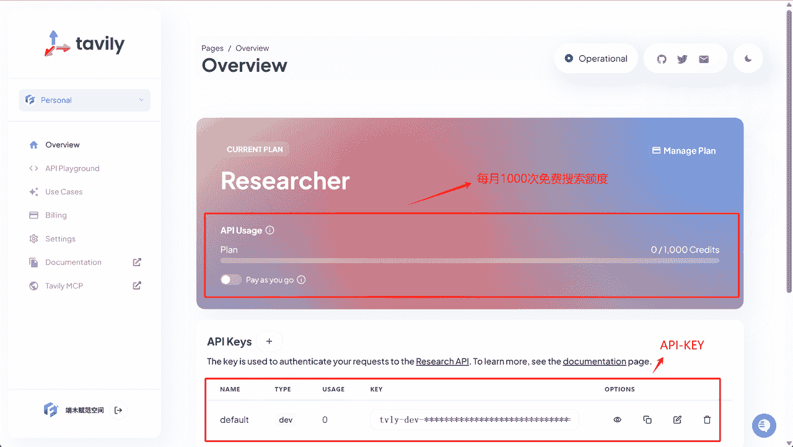

更多付费选项

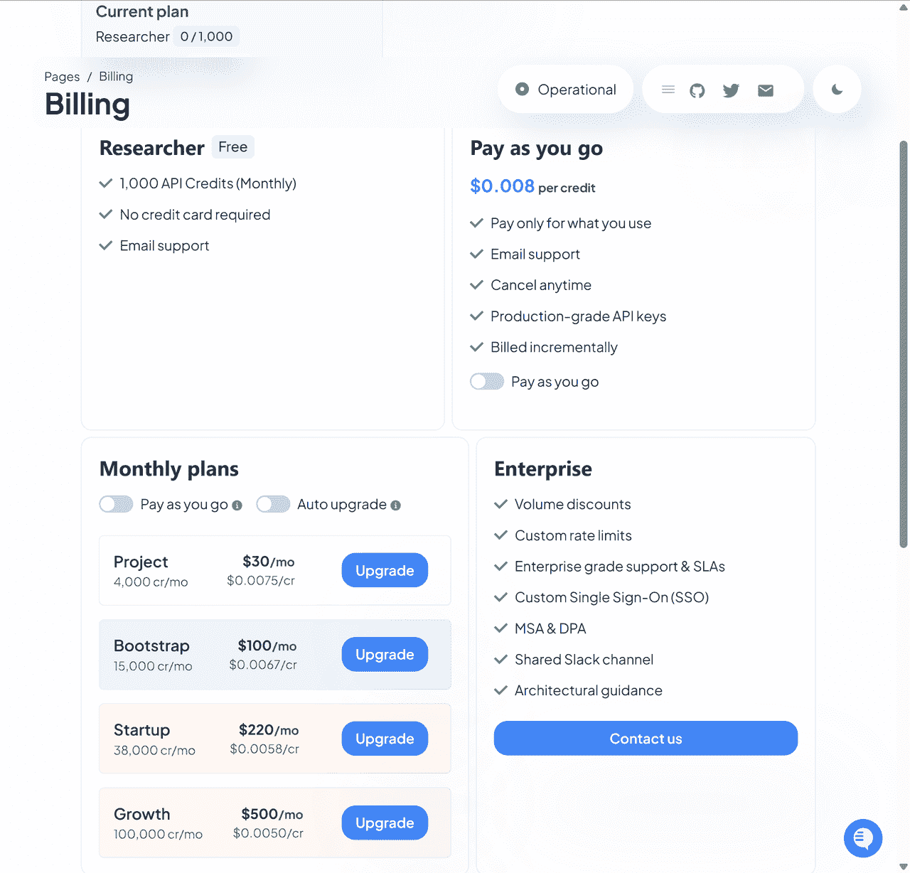

+   官方说明文档：https://docs.tavily.com/welcome

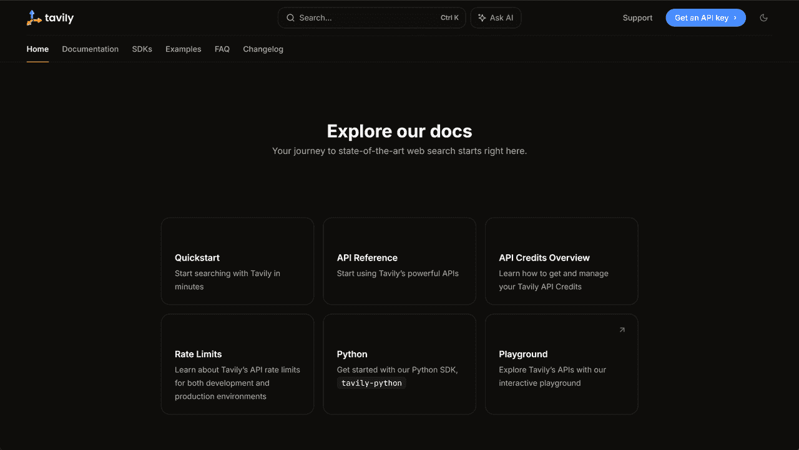

+   Tavily Expert：https://tavily.tadata.com/docs

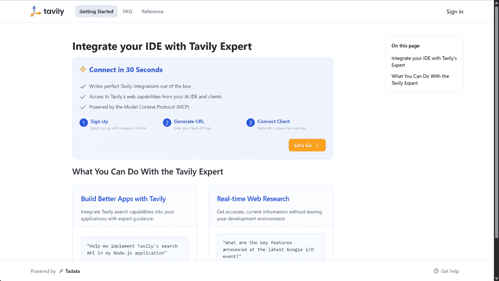

**Tavily Expert**是Tavily团队在智能检索领域推出的增强型专业知识提取服务，旨在为开发者和企业提供一种更精准、更高价值的信息获取方式。相较于基础的Web搜索功能，Tavily Expert在检索策略、知识库整合和结果可信度方面进行了全方位的优化，尤其适用于需要深度事实核查和权威来源支持的场景。

从功能定位来看，Tavily Expert并非仅仅对互联网上的通用内容进行抓取，而是通过与精选的专业数据库、优质出版物和可靠文献资源对接，构建出一套具备更高可信度和领域针对性的检索体系。开发者可以通过API接口，向Tavily Expert提交自然语言查询，随后得到经过多层次筛选和关联的答案集，其中包含详细的来源引用和内容摘要，便于在智能体工作流中进行验证或引用。

在实际应用中，Tavily Expert尤其适合于以下几类场景：

+   法律、医疗、科研等对信息准确性要求极高的领域，智能体需要对答案来源进行严格溯源和核实；

+   **企业内部知识管理与客户支持系统**，需快速获取权威解答与高置信度材料；

+   **复杂推理或写作任务**，要求检索到的内容既有覆盖面，也有深度和结构化呈现。

此外，Tavily Expert继承了Tavily引擎的高可编程性和低延迟特性，开发者可灵活指定查询参数，如期望返回的文档数量、领域偏好和内容过滤选项。这种高度定制化的能力，使其成为当下AI Agent开发生态中不可多得的专业信息检索工具。

+   tavily Python SDK：https://docs.tavily.com/sdk/python/quick-start

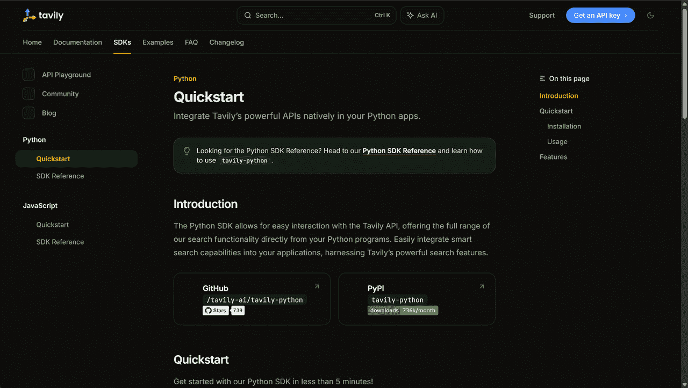

### 3. Tavily SDK 使用指南

#### 3.1 Tavily基础功能介绍

在Python应用中集成Tavily的强大API非常简单，官方SDK既支持同步调用，也提供了现代异步编程接口，满足不同开发需求。以下内容将逐步介绍如何在项目中初始化客户端并进行配置。

✅ 1. 安装与初始化

```
! pip install tavily-python

from tavily import TavilyClient

client = TavilyClient(&quot;tvly-YOUR_API_KEY&quot;)
```

只需传入API密钥，即可完成初始化。

✅ 2. 代理配置

Tavily SDK支持通过**代理服务器**转发请求，便于在受限网络环境下使用。您可以在客户端实例化时直接指定proxies参数：

```
from tavily import TavilyClient

proxies = {
  &quot;http&quot;: &quot;&lt;your HTTP proxy&gt;&quot;,
  &quot;https&quot;: &quot;&lt;your HTTPS proxy&gt;&quot;,
}

client = TavilyClient(&quot;tvly-YOUR_API_KEY&quot;, proxies=proxies)
```

✅ 3. 执行搜索

```
# 执行搜索
response = tavily_client.search(
    &quot;Who is Leo Messi?&quot;,
    include_images=True,
    include_image_descriptions=True
)

# 输出结果
print(response)
```

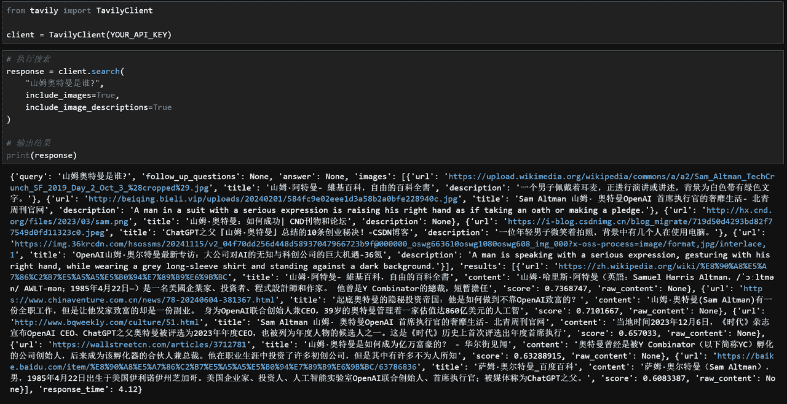

+   相关参数说明

以下为 search() 方法支持的所有参数及含义，便于根据需要灵活配置：

| 参数 | 类型 | 说明 | 默认值 |
| --- | --- | --- | --- |
| query (必填) | str | 待搜索的查询内容 | — |
| auto_parameters | bool | 自动根据查询内容智能配置搜索参数（可手动覆盖部分参数）。需注意：include_answer, include_raw_content, max_results 始终需手动设置；如自动设置 search_depth 为 advanced，会产生额外消耗（2 API credits）。 | False |
| search_depth | str | 搜索深度，可选 &quot;basic&quot; 或 &quot;advanced&quot;；高级模式会返回更相关的内容片段和来源 | &quot;basic&quot; |
| topic | str | 搜索主题（分类），支持 &quot;general&quot; 和 &quot;news&quot; | &quot;general&quot; |
| days | int | 针对 news 主题，查询结果包含从当前日期往前推几天内的内容 | 7 |
| time_range | str | 时间范围，支持 &quot;day&quot;, &quot;week&quot;, &quot;month&quot;, &quot;year&quot; 或简写 &quot;d&quot;, &quot;w&quot;, &quot;m&quot;, &quot;y&quot; | — |
| max_results | int | 返回结果最大数量（0~20） | 5 |
| chunks_per_source | int | 每个来源返回多少内容片段（仅 advanced 有效） | 3 |
| include_images | bool | 是否返回与查询相关的图片列表 | False |
| include_image_descriptions | bool | 是否返回图片及其自动生成的描述 | False |
| include_answer | bool或str | 返回基于搜索结果生成的答案，&quot;basic&quot;/True为简要答案，&quot;advanced&quot;为详细答案 | False |
| include_raw_content | bool或str | 返回解析的原始HTML内容，&quot;markdown&quot;或True为Markdown格式，&quot;text&quot;为纯文本 | False |
| include_domains | list[str] | 指定要包含的域名 | [] |
| exclude_domains | list[str] | 指定要排除的域名 | [] |
| country | str | 优先返回来自指定国家的内容（仅 general 主题可用） | — |
| timeout | int | API请求超时时间（秒） | 60 |
| include_favicon | bool | 返回每个结果对应的 favicon URL | False |

+   返回格式

一次搜索请求将返回一个字典对象，包含以下字段：

| 字段 | 类型 | 说明 |
| --- | --- | --- |
| query | str | 您的原始查询内容 |
| results | list[Result] | 排序后的搜索结果列表 |
| response_time | float | 搜索用时（秒） |
| answer (可选) | str | 基于搜索结果生成的答案（需开启 include_answer） |
| images (可选) | list[str]或list[ImageResult] | 图片URL或包含描述的对象列表（需开启图片参数） |

**Result对象字段：**

| 字段 | 类型 | 说明 |
| --- | --- | --- |
| title | str | 搜索结果标题 |
| url | str | 搜索结果URL |
| content | str | 最相关的内容摘要 |
| score | float | 相关性得分 |
| raw_content (可选) | str | 原始HTML内容（需开启 include_raw_content） |
| published_date (可选) | str | 来源发布时间（news 主题下可用） |
| favicon (可选) | str | favicon URL |

ImageResult对象字段：

当启用 include_image_descriptions 时，每个图片将包含以下信息：

| 字段 | 类型 | 说明 |
| --- | --- | --- |
| url | str | 图片URL |
| description | str | 自动生成的图片描述 |

#### 3.2 Tavily Extract 功能详解

除了搜索功能，Tavily SDK 还提供了网页内容提取（Extract）接口，支持从指定 URL 抓取清洗后的正文、图片和元数据，特别适用于批量获取网页内容、构建知识库或进行后续分析。

可以通过 extract() 方法向 Tavily 提交单个或批量 URL，自动提取结构化内容。

```
from tavily import TavilyClient

# 初始化客户端
tavily_client = TavilyClient(api_key=&quot;tvly-YOUR_API_KEY&quot;)

# 定义需要提取内容的URL列表
urls = [
    &quot;https://en.wikipedia.org/wiki/Artificial_intelligence&quot;,
    &quot;https://en.wikipedia.org/wiki/Machine_learning&quot;,
    &quot;https://en.wikipedia.org/wiki/Data_science&quot;,
]

# 执行提取请求
response = tavily_client.extract(
    urls=urls,
    include_images=True
)

# 输出提取结果
print(response)
```

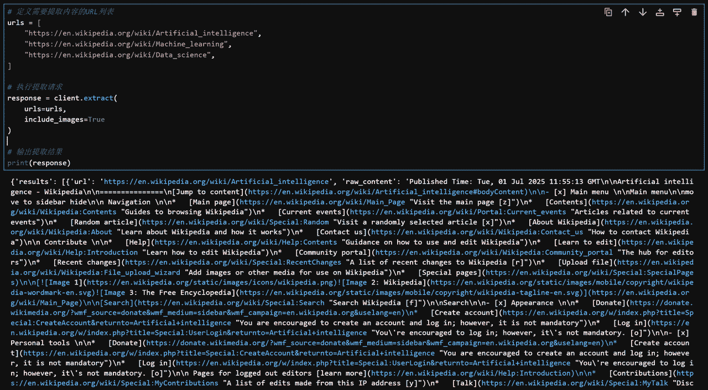

#### 3.3 Tavily Crawl 功能介绍

Tavily Crawl 是专为智能体开发设计的网页爬取功能，支持从一个基础 URL 自动递归抓取网页内容，构建丰富的上下文数据。该功能目前处于**公开测试（Open Beta）**阶段。

通过 crawl() 方法即可启动一个爬取任务，并自动获取抓取结果。

```
from tavily import TavilyClient

# 初始化客户端
tavily_client = TavilyClient(api_key=&quot;tvly-YOUR_API_KEY&quot;)

# 定义起始URL
url = &quot;https://docs.tavily.com&quot;

# 执行爬取
response = tavily_client.crawl(
    url,
    instructions=&quot;请帮我整理Python SDK相关信息&quot;
)

# 输出结果
print(response)
```

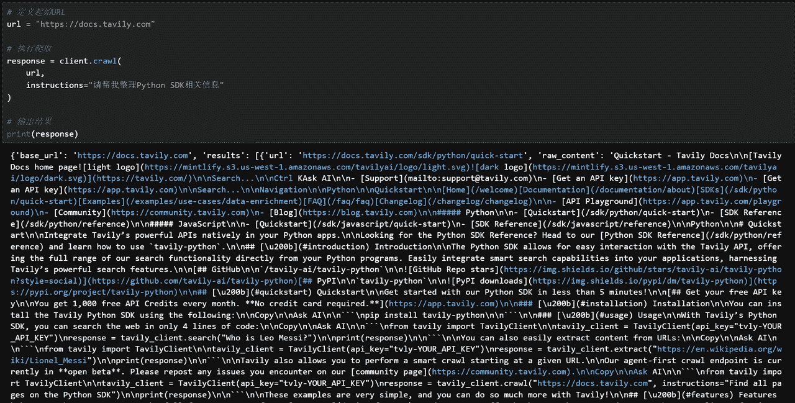

### 4. 谷歌可编程搜索引擎调用方法

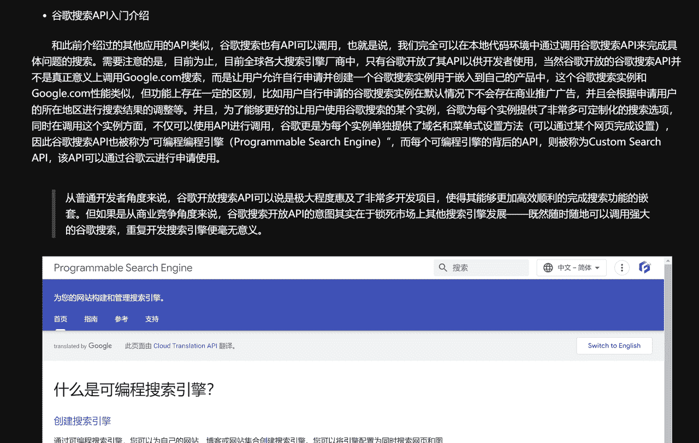

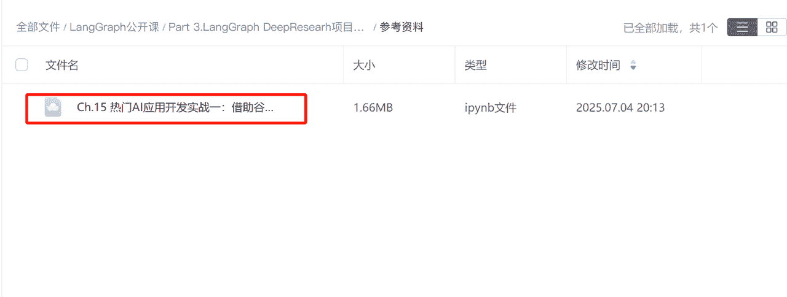


## 三、从零到一构建DeepResearch应用

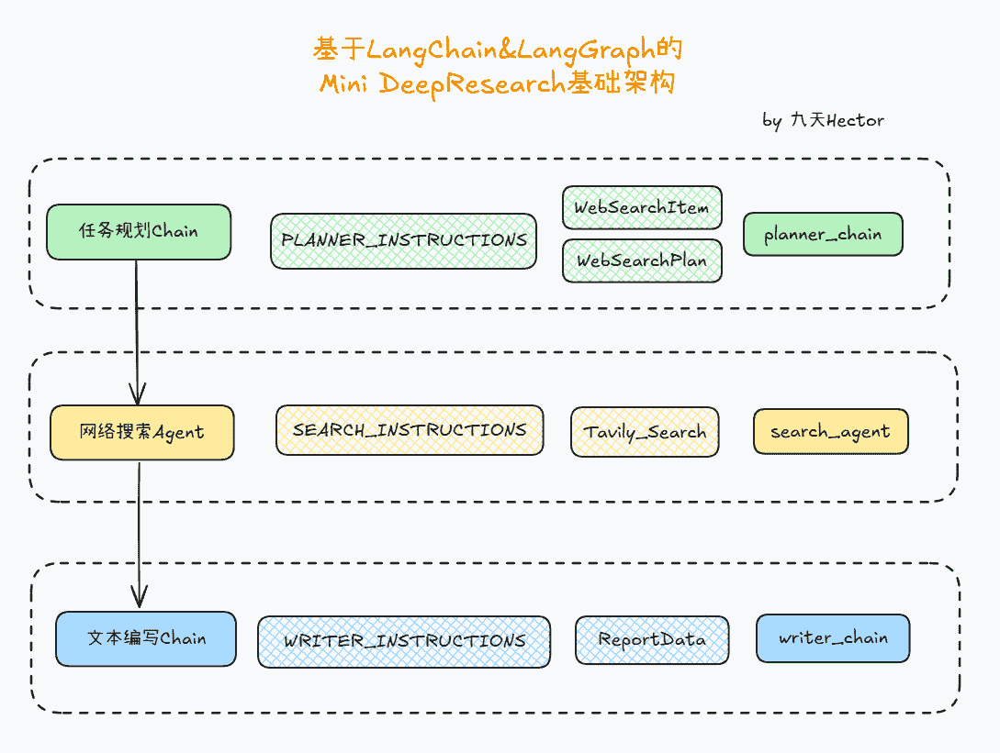

> 详见Jupyter文件

## 四、open_deep_research项目部署与调用

open_deep_researcher 是 LangChain AI 团队开源的一个深度研究代理项目，其功能和目标是复现并拓展上述 Deep Research 能力，让开发者无需付费即可使用AI自动化完成深入的信息调研和报告撰写。用户只需提供一个研究主题或问题，代理就会自动生成搜索查询，抓取和总结网页内容，反思是否有知识缺口并继续检索，最终整理输出一份结构清晰的 Markdown 报告。

其开源地址如下所示：https://github.com/langchain-ai/open_deep_research

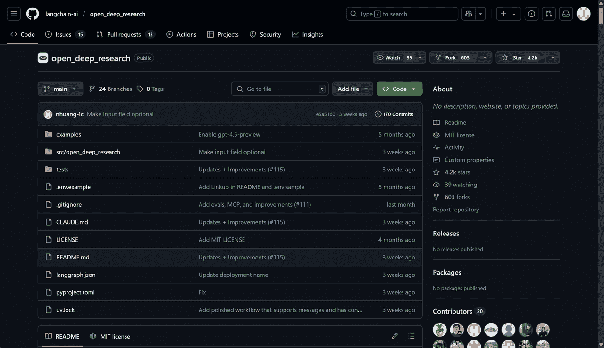

与传统搜索/检索相比，深度研究的核心区别在于：它不仅返回信息，还会自主完成信息筛选和整合。传统搜索需要用户自己点开筛选内容，普通的AI问答则容易产生未经验证的答案；而深度研究代理能够多轮迭代，在发现知识空白时自动调整方向，持续检索直到形成全面理解。最终输出的报告通常包含分层次结构的内容、事实支撑的分析以及明确引用来源，可视作一个专业研究员整理的成果而非简单搜索结果。

这个项目提供了两种不同的实现架构：基于工作流的有向图（Graph）实现和多智能体（Multi-agent）实现。这两种实现各有侧重，分别对应不同的应用场景和需求。

Graph 工作流模式采用规划—执行的顺序流程，将深度研究任务划分为固定阶段依次完成：首先使用“规划”大模型分析主题，生成报告的大纲和计划；然后经过人工反馈确认计划；接下来对每个章节依次进行检索和写作，每一章节都包含搜索—总结—反思的循环，确保信息充分；最后整合各章节内容并生成完整报告

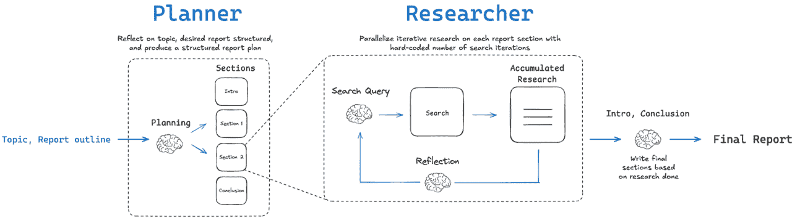

Mulit-Agent 架构下，open_deep_researcher 采用监督者-研究员的多智能体协作机制，以提高调研效率。上图展示了该模式的流程：由一个监督Agent（Supervisor）负责总体规划和协调，多个研究Agent（Researcher）并行执行各章节的搜索与写作。具体而言，监督Agent首先根据用户主题拟定报告的大致章节计划，分配若干研究Agent分别处理不同的章节任务。各研究Agent接收到自己负责的章节后，并行地生成该章节的搜索查询，利用搜索工具检索资料，整理后撰写章节内容。所有章节同时开展研究，大大减少了总的报告生成时间。监督Agent在此过程中还可以提问澄清用户需求（如果启用的话），确保理解准确，然后在研究Agent完成各自章节后，监督Agent负责最后汇总各章节并撰写引言结论，组成完整报告

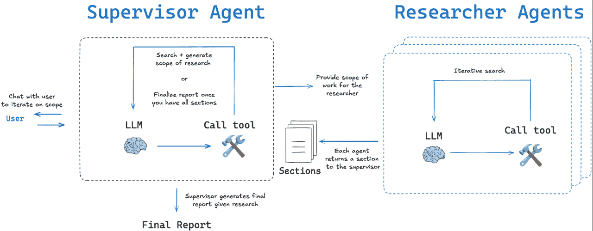

LangGraph 的引入让 open_deep_researcher 易于部署和集成。例如项目的 .env 配置会被 LangGraph 自动加载，使模型API Key、搜索API Key 等环境参数统一管理。LangGraph 平台也支持将开发好的 Deep Research agent 一键部署到云端运行（如果需要对外提供服务）。总之，open_deep_researcher 借助 LangGraph 实现了复杂代理流程的标准化和模块化，开发者在此之上可以更高效地定制和扩展深度研究Agent的能力。

部署 open_deep_researcher 十分简便，可以通过源码或 PyPI 包两种方式安装。 我们这里要使用源码安装。大家可以扫描下方二维码进入百度网盘领取源码。

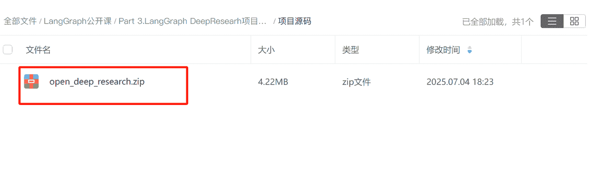


下载到项目源码后，进入项目目录，编辑 .env 文件，这里需要准备 API 密钥，核心是两个配置：LLM 模型接口 和 搜索工具接口。这里我们使用的大模型是DeepSeek，搜索工具是Tavily。其中Tavily 的 Web 搜索 API 会作为信息检索工具。注册地址： https://www.tavily.com/ 。

同时，需要在.env文件中配置LangSmith的配置信息，用于追踪和分析代理的执行过程。完整的配置参数如下：

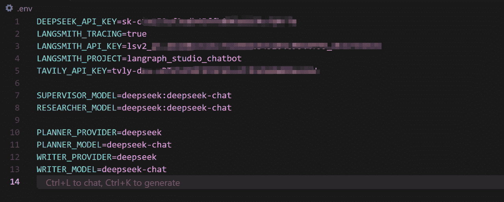

在Windows/Linux系统中，安装open_deep_researcher项目依赖，可以使用常规的pip 命令进行安装。首先创建一个虚拟环境，并激活。然后安装 open_deep_researcher 项目依赖：

```
pip install -e .
```

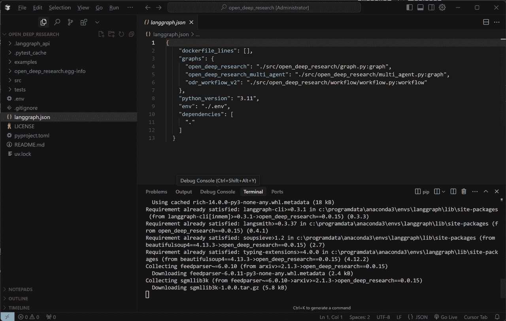

接下来需要安装 LangGraph 的命令行工具 langgraph-cli，用于管理 LangGraph 的运行和部署。

```
pip install -U &quot;langgraph-cli[inmem]&quot;
```

然后，在项目源码中需要修改一个日期文件，否则在Windows系统中会报错。(我们提供的代码已经修改好了，大家可以直接使用)

```
    def get_today_str() -&gt; str:
    &quot;&quot;&quot;Get current date in a human-readable format.&quot;&quot;&quot;
    return datetime.datetime.now().strftime(&quot;%a %b %-d, %Y&quot;)

    -&gt;

    def get_today_str() -&gt; str:
        &quot;&quot;&quot;Get current date in a human-readable format.&quot;&quot;&quot;
        # Use %d instead of %-d for Windows compatibility
        date_str = datetime.datetime.now().strftime(&quot;%a %b %d, %Y&quot;)
        # Remove leading zero from day if present (manual formatting for cross-platform compatibility)
        import re
        return re.sub(r&#x27;\b0(\d)&#x27;, r&#x27;\1&#x27;, date_str)
```

接下来，便可以启动 LangGraph 开发服务器，执行如下命令：

```
langgraph dev
```

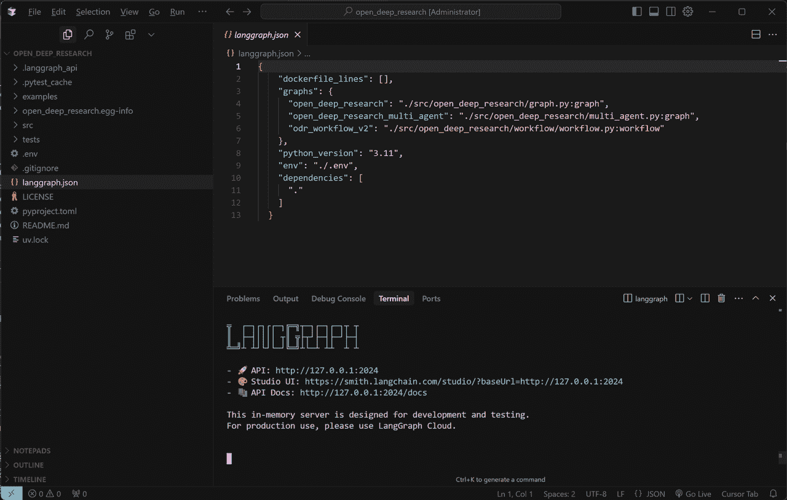

当执行langgraph dev 后，会在本地开启一个 LangGraph Server（默认监听端口 2024）。命令行中会显示 API 接口地址和 Studio 界面URL，例如：

```
API: http://127.0.0.1:2024
Studio UI: https://smith.langchain.com/studio/?baseUrl=http://127.0.0.1:2024
```

用浏览器打开上述 Studio UI 链接，即可进入 LangGraph 提供的深度研究助手界面。在该界面上，你可以像使用 ChatGPT 一样与 deep researcher 交互：输入研究主题或问题，然后提交，观察代理自动检索和生成报告的全过程。界面还提供配置面板，可实时查看和调整部分参数（对应 .env 配置），以及一个 JSON 输入框用于反馈或控制流程（例如输入 true 确认计划，或输入字符串对提纲提供修改意见)

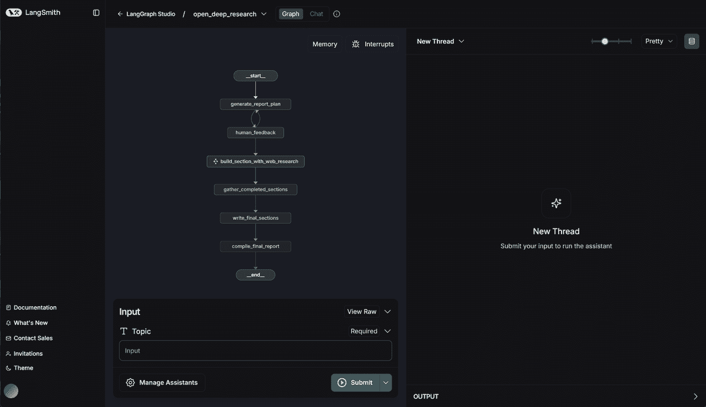

这里需要关注的是langgraph.json 配置文件。当我们执行 langgraph dev 时，会启动所有三个图：


1.  open_deep_research - 基于 ./src/open_deep_research/graph.py:graph

1.  open_deep_research_multi_agent - 基于 ./src/open_deep_research/multi_agent.py:graph

1.  odr_workflow_v2 - 基于 ./src/open_deep_research/workflow/workflow.py:workflow

+   **graph图**

这个图是父-子图结构，父图（外层）控制整体报告生成流程，子图（内层）负责具体的任务，即处理单个章节的深度研究。具体如下：

| 层次 | 主要节点 | 说明 |
| --- | --- | --- |
| 外层 | generate_report_plan | 生成初始大纲（Sections） |
|  | human_feedback | 人类审核或提出修改 |
|  | build_section_with_web_research | 子图：对需要检索的 section 逐一并行写作 |
|  | gather_completed_sections | 汇总已完成的研究类 section 作为上下文 |
|  | write_final_sections | 写结论、摘要等无需检索的 section |
|  | compile_final_report | 按最初规划顺序拼接全部 section |
| 子图 | generate_queries | 为单个 section 产出检索词 |
|  | search_web | 调用外部搜索 API 抓取资料 |
|  | write_section | 结合资料撰写并自评，失败则循环检索 |

主要适用的场景是自动化生成一份结构化、可信且可控的深度调研／分析报告。将“规划—检索—写作—自评—循环—总结”拆成原子节点，显式控制顺序与分支。非常适合一些需要深度调研的场景。比如市场、技术、政策的分析，需要多轮网络检索的报告等。

+   **multi_agent 图**

这个架构的特点是一个双层智能体系统: 督导者（supervisor） + 多个研究者 。角色明确分工非常明确，由督导负责规划统筹，研究者负责具体执行。其中：

+   Supervisor Workflow 控制全局：

+   supervisor - 由 LLM 判断是否调用工具。

+   supervisor_tools - 真正执行工具调用并根据结果：

+   分发 Section 给 research_team 并行研究；

+   或撰写 Introduction／Conclusion；

+   或汇总 Final Report 并结束。

+   Conditional Edge supervisor_should_continue 决定退出或继续循环。

+   research_team 子图负责单个章节：

+   research_agent 决定下一步是检索还是写作。

+   research_agent_tools 执行搜索或写入章节。

+   Conditional Edge research_agent_should_continue 决定重复检索-写作还是返回 Supervisor。

它解决的核心问题就是多章节、多人并行的调研工作，比如“围绕xx在xx领域的可行性，输出章节：技术现状、经济性分析、政策激励、案例研究、未来展望”等问题。

+   **odr_workflow_v2**

这是一个带交互式澄清的工作流研究系统。根据配置决定是否先澄清需求,其关键的控制点如下所示：

| 结点 / 条件 | 功能 |
| --- | --- |
| **initial_router** | 判断是否先 clarify_with_user 以向用户提问澄清主题 |
| clarify_with_user | 通过 structured output 返回 AIMessage(question)——对话式确认需求 |
| generate_report_plan | ① 生成检索关键词→搜索  ② 得到章节草案（Sections） |
| **human_feedback** (可选) | interrupt() 采集用户对章节草案的审核或修改 |
| build_section_with_web_research | 对每个需检索章节并行执行「检索→写作→自评→循环」 |
| gather_completed_sections | 收敛所有已完成章节，为后续写 Introduction / Conclusion 提供上下文 |
| write_final_sections | 写无需检索的章节（引言、总结） |
| compile_final_report | 按原始顺序拼接 Introduction → Body → Conclusion，返回最终报告 |

该工作流解决的核心痛点是因需求不清导致反复返工、章节结构需人工把关、多章节检索写作效率低等情况，整体来看是一个 「澄清 → 规划 → 并行研究 → 自评迭代 → 汇编」 的自动化报告生成器，特别适合需要 前期澄清、用户审核、外部检索 的深度文档写作任务。

实际运行演示效果如下：

其他三种图，当 LangGraph Studio 启动后，大家可以在界面中选择要使用的图进行尝试。

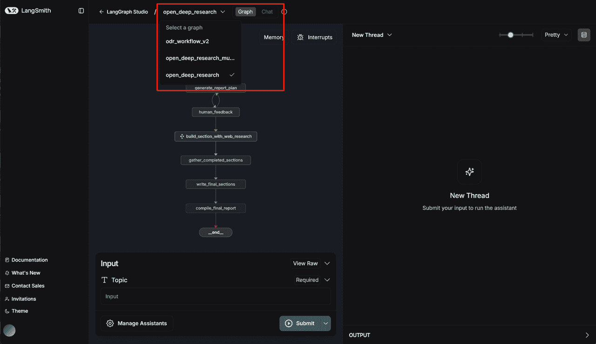

## 五、谷歌Gemini Fullstack LangGraph Quickstart

Gemini Fullstack LangGraph Quickstart（也被称作深度研究增强型对话式 AI 系统）是 Google 在 2025 年6月开源的一个全栈 AI Agent 模板项目。该项目结合了 Google 的大语言模型 Gemini 2.5 系列和开源的 LangGraph 框架，提供了一个端到端的示例应用，展示如何构建一个研究增强型的对话式 AI 系统。简单来说，这个项目的后端借助 LangGraph 编排的智能 Agent，能够对用户查询执行深度资料检索：自动生成搜索关键词、使用 Google 搜索获取资料、分析结果找出知识空白，并不断迭代检索，直到形成有依据的答案并给出引用来源。前端则提供了一个 React 网页界面，允许用户方便地与 Agent 进行对话交互。该项目作为 Google 官方模板，定位于帮助开发者快速入门全栈 AI 助理的构建，在开源社区引起了极大关注，现在已经有了15K的Star。

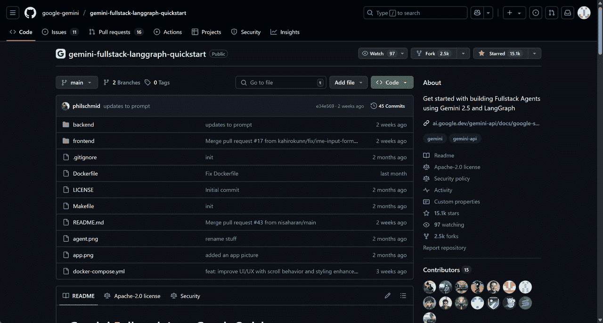

Gemini Fullstack LangGraph Quickstart的核心是一套自动化深度搜索与问答功能，旨在解决“如何让对话式AI给出有依据的深入回答”这一问题。它主要体现为一个多步骤的“研究型 Agent”，可以将用户的提问转化为搜索行动，并经过一系列推理最终返回答案。项目的主要功能和特点包括：

+   动态查询生成：Agent基于用户的问题，利用 Gemini LLM 理解意图并生成初步的搜索关键词或查询语句。这种动态查询能够针对输入问题的细微差异调整搜索方向，而非固定模板查询。

+   网络资料检索：Agent 与网络搜索服务集成，通过 Google Search API 获取相关网页内容。每个由 LLM 提出的查询都会触发一次网络检索，汇集潜在有用的网页及摘要信息，确保 Agent 拥有新鲜的外部知识。

+   反思与知识空白分析：Agent 并非简单汇总搜索结果，而是会调用 LLM 对获取的信息进行反思性分析。具体来说，它检查当前资料是否足以完整回答问题，是否存在尚未覆盖的知识点或疑问（即“知识空白”）。这一步骤相当关键，提升了 Agent 从“信息罗列”到主动发现不足的能力。

+   迭代搜索完善：如果通过反思发现信息不充分，Agent 将针对缺口迭代改进搜索。它会让 LLM 生成新的、更有针对性的搜索查询，然后再次检索网络并分析结果。这样的循环可持续进行多轮（项目中有配置最大循环次数），直到 Agent 认为信息足够支撑答案为止。这种循环机制赋予了 Agent **深入研究（Deep Research）**的能力，类似人类研究者不断追问、查证直至弄清问题。

+   基于证据的回答生成：在收集到充分资料后，Agent 使用 Gemini 模型对所有信息进行整合，生成完整回答。生成时特别注重引用来源：答案中会标注引用的文献或网页出处。最终给出的答复不仅有内容，而且附带来源引用，以确保答案的可追溯性和可信度。

在具体的架构上，采用了前后端解耦的全栈架构：前端是基于 React+Vite 构建的单页应用，提供用户友好的聊天界面，配以 Tailwind CSS 和 Shadcn UI 组件库美化界面。后端是基于 FastAPI 的服务，承载 LangGraph 智能体逻辑和 API 接口。这种架构清晰划分了界面展示和AI推理两个层面，便于分别开发和调试。

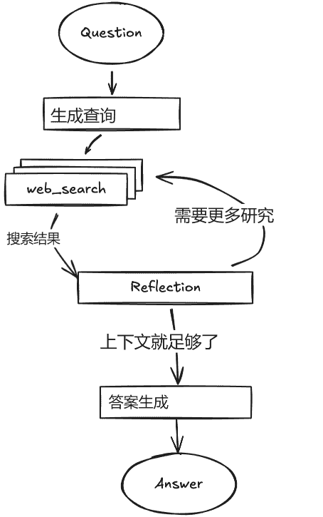

Gemini Fullstack LangGraph Quickstart 可以看作是 LangGraph 框架的一个示范性应用（template 项目）。LangGraph 是 LangChain 团队推出的一个开源库，专门用于构建可控的多步骤 LLM 工作流。与传统顺序链式调用相比，LangGraph 引入“有状态图（stateful graph）”的概念，将复杂任务拆解为节点、并用图结构管理执行流程。开发者可以在 LangGraph 中定义节点（例如一次 LLM 推理或一个工具操作），以及状态在节点之间的传递方式，从而打造出具有决策分支和循环能力的智能体。 在本项目中，后端 Agent 就是基于 LangGraph 实现的。项目的 backend/ 目录下包含了 LangGraph Agent 的定义（主要逻辑在 backend/src/agent/graph.py）。可以说，LangGraph 提供了整个多步骤推理过程的“骨架”和运行时支持，而 Gemini 等 LLM 则是完成每个节点任务的“大脑”。 具体而言，LangGraph 在该项目中扮演了以下角色：

+   流程编排：利用 LangGraph，开发者以声明式方式定义了 Agent 的流程图（如上一节的5步）。LangGraph 负责按照定义的图依次或迭代地调用各节点函数，确保流程正确执行和循环控制。这解决了手写复杂异步逻辑的困难，使多轮推理变得直观可维护

+   状态管理：LangGraph 允许在节点之间传递状态数据。在本项目中，状态包括当前的搜索查询、累计的搜索结果列表、已发现的来源列表、迭代次数计数等。LangGraph 负责将这些数据在节点间合并和更新（例如把新搜索结果附加到总列表）。这保证了 Agent 每次迭代都能记忆之前步骤的信息，而不是无状态地重复工作。

+   异步与执行控制：LangGraph 框架底层支持异步执行，可将一些节点任务放在后台执行并通过消息队列通信。在生产部署时，本项目利用 LangGraph 要求配置的 Redis 来实现 Agent 后台运行的实时输出流（使得前端可以流式显示AI思考过程），用 PostgreSQL 数据库持久化 Agent 的会话和任务队列状态，以保证“一次只处理一次”的可靠性。这些基础设施集成点都是 LangGraph 的设计所需，使 Agent 在实际应用中更健壮可监控。

但是需要说明的：当前这个项目是基于Gemini 2.5系列的模型，因此需要大家拥有Gemini的API Key, 同时其网络检索功能也是 Gemini 原生 SDK 的 Google Search 工具功能，它本质上是 Google 自家的模型调用自家的搜索能力。所以，对国内的用户来说并不是很友好。

因此，我们也是特意对这个项目做了二次开发，将底层的基座模型替换成了DeepSeek模型，并且将联网检索功能替换为LangGraph可以支持的Tavily联网检索。同时，也修改了提示词为中文，使得在执行任务时能够以中文的形式进行输出和总结。

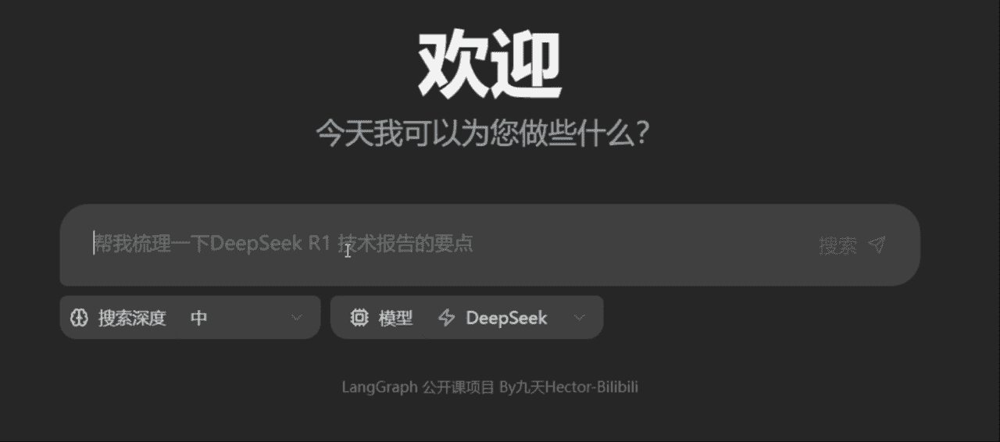

完整项目代码网盘如下：

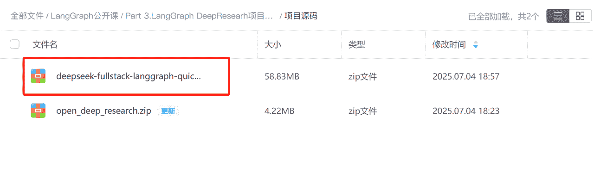


接下来我们就详细介绍如何在本地启动DeepSeek-fullstack-LangGraph项目。

下载项目至本地后，首先需要通过一个Python IDE打开项目，比如VSCode、PyCharm、Cursor等，大家根据自己的实际情况选择即可。我们这里以Cursor为例，打开项目后，可以看到项目结构如下：

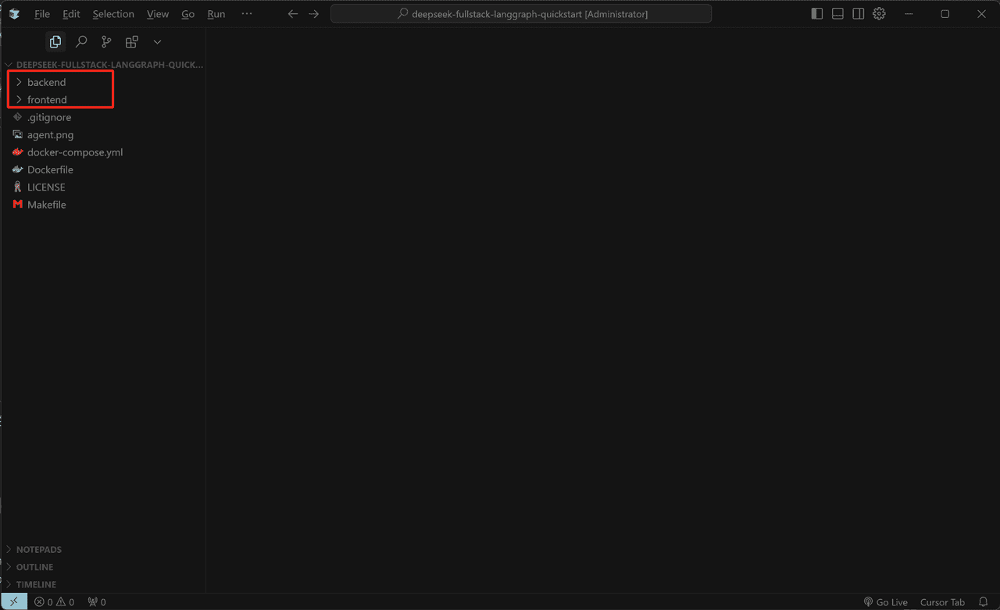

这是一个前后端分离的架构，其中backend是后端，frontend是前端。我们需要依次启动前后端的服务。

+   **启动后端服务**

DeepSeek-fullstack-LangGraph的后端是使用LangGraph搭建的多智能体架构。因此依赖的是Python的环境。大家需要依次执行如下操作：

```
cd backend
# 可选安装虚拟环境
python -m venv venv      
source venv/bin/activate
# Windows 内输入.\venv\Scripts\activate
```

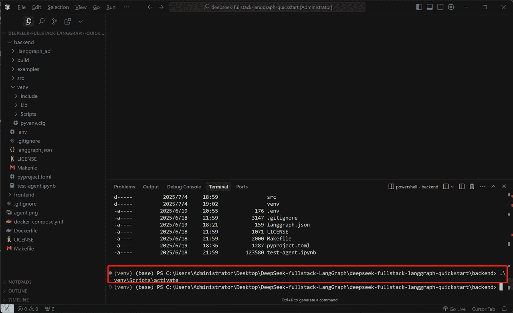

然后安装所有的第三方依赖，执行如下代码：

```
pip install .
```

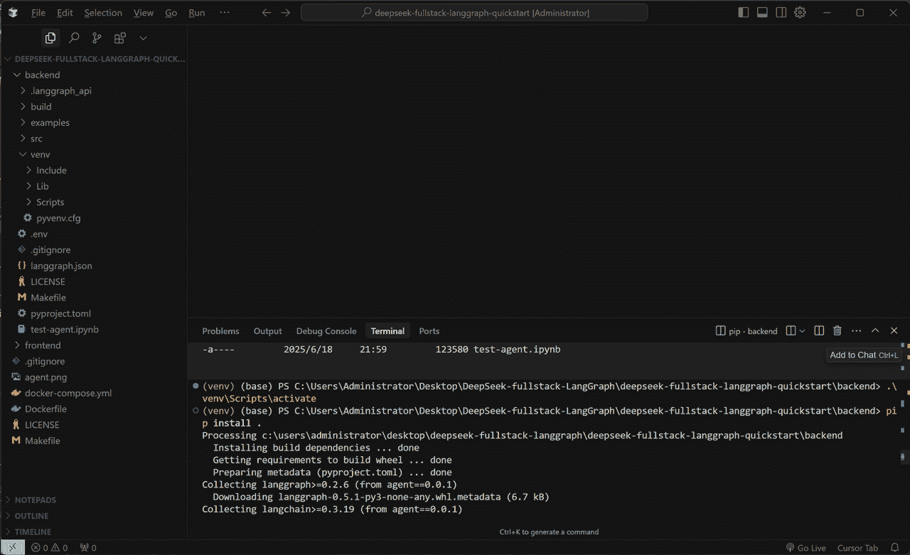

接下来修改.env文件，分别配置DEEPSEEK_API_KEY、TAVILY_API_KEY 以及 LangSmith的配置。

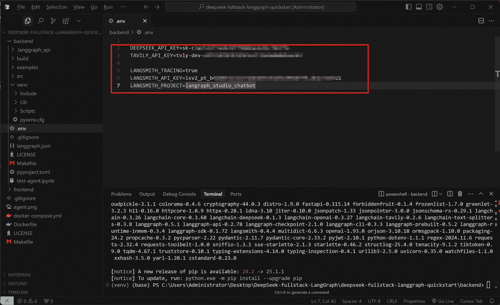

以上配置结束后，便可以开启后端服务了。执行如下代码：

```
pip install -U &quot;langgraph-cli[inmem]&quot;
langraph dev
# 找不到路径时使用.\venv\Scripts\langgraph.exe dev
```

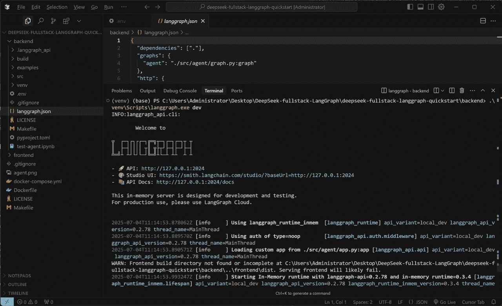

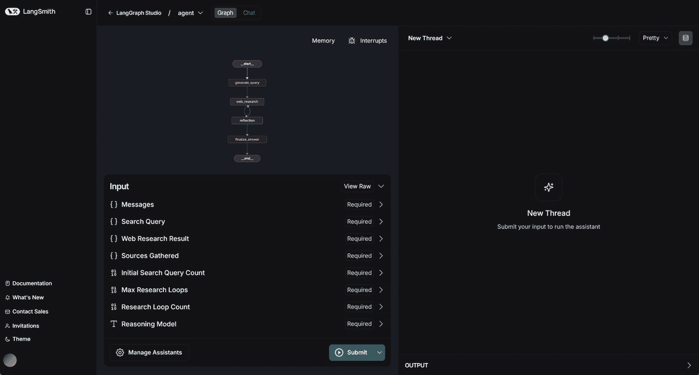

+   **开启前端服务**

启动了后端服务后，我们需要打开一个新的终端，并执行如下代码：

```
cd frontend
npm install
```

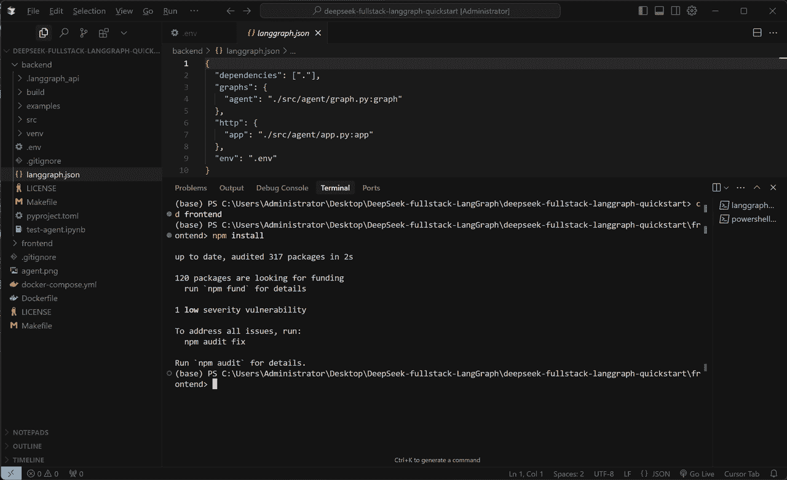

如果操作系统中之前没有安装Node.js，则需要先安装Node.js。地址：https://nodejs.org/zh-cn

然后，直接通过npm run dev即可启动前端服务。

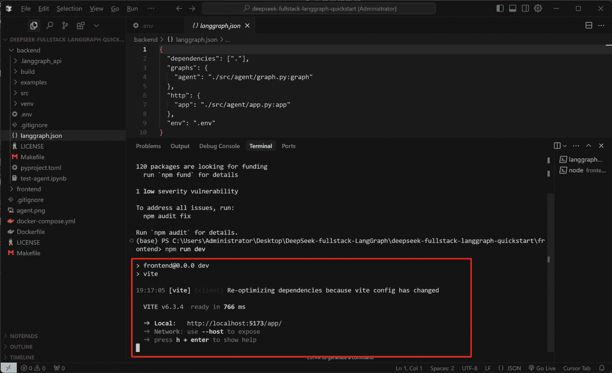

如果一切正常，那么我们能够看到如上图所示一样的界面，通过显示的http://localhost:5173/app，便可以在浏览器中访问我们的应用了。


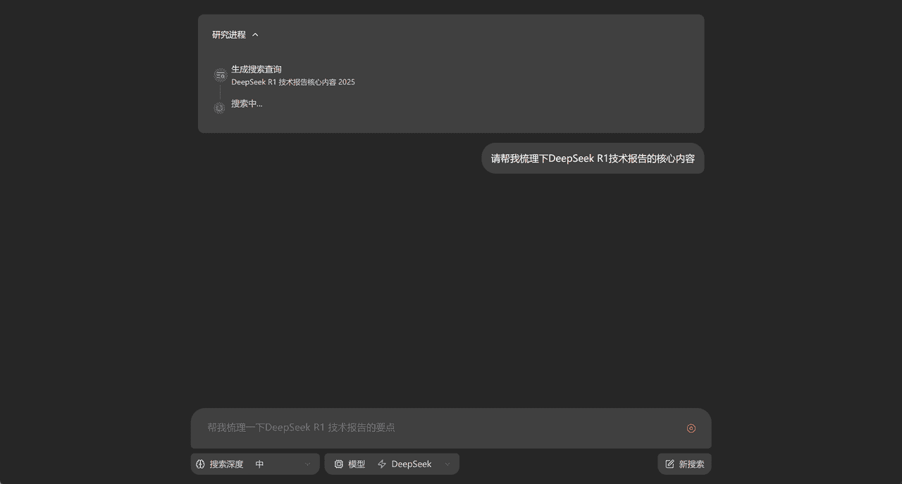

实际运行效果如下：

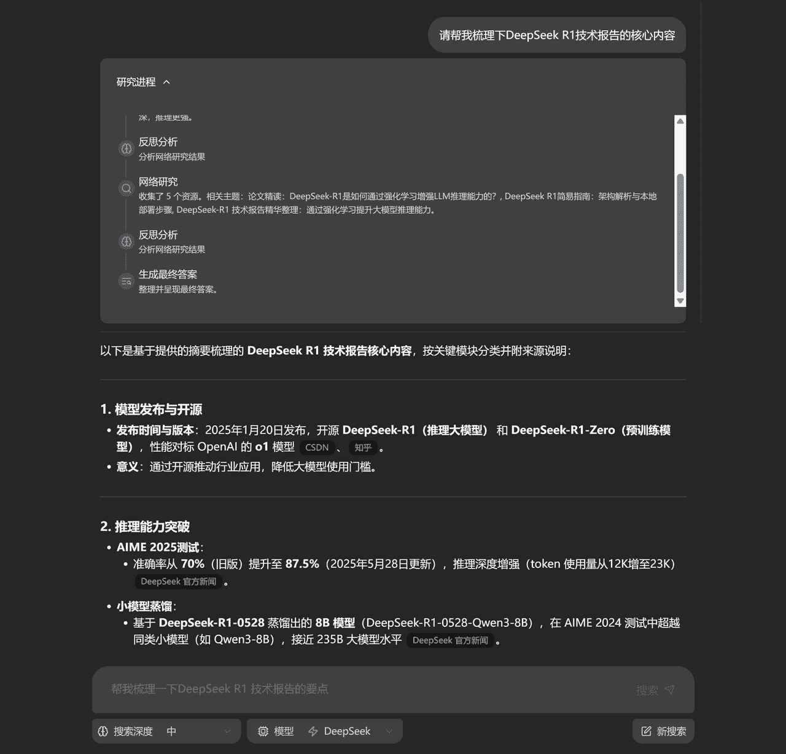

---

+   体验课内容节选自《2025大模型Agent智能体开发实战》(夏季班)完整版付费课程

体验课时间有限，若想深度学习大模型技术，欢迎大家报名由我主讲的《2025大模型Agent智能体开发实战》(夏季班)https://ix9mq.xetslk.com/s/3u765N)


**《2025大模型Agent智能体开发实战**》(夏季班)为【100+小时】体系大课，总共20大模块精讲精析，零基础直达大模型企业级应用！


### 部分课程成果演示

+   Dify+DeepSeek搭建智能客服

+   可视化数据分析Multi-Agent

+   Ollama 自动化并发请求测试与动态资源监控

+   Neo4j并行多线程导入百万级文本方法与实践

+   MateGen Pro 项目功能演示

+   智能客服项目展示

此外，若是对大模型底层原理感兴趣，也欢迎报名由我和菜菜老师共同主讲的《2025大模型原理与实战课程》(夏季班)


**两门大模型课程夏季班目前上新特惠，直播间下单可享618平价钜惠，合购还有更多**优惠哦~详细信息扫码添加助教，回复“大模型”，即可领取课程大纲&查看课程详情👇


