# LCEL快速入门与实战

> 来源：[https://kq4b3vgg5b.feishu.cn/docx/SwL9dUhNRoYPoBxnM0jc1caxnhe](https://kq4b3vgg5b.feishu.cn/docx/SwL9dUhNRoYPoBxnM0jc1caxnhe)

## 课程说明：

+   体验课时间有限，若想深度学习大模型技术，欢迎大家报名我主讲的《2025大模型Agent智能体开发实战》

**《2025大模型Agent智能体开发实战**》为【100+小时】体系大课，总共20大模块精讲精析，零基础直达大模型企业级应用！

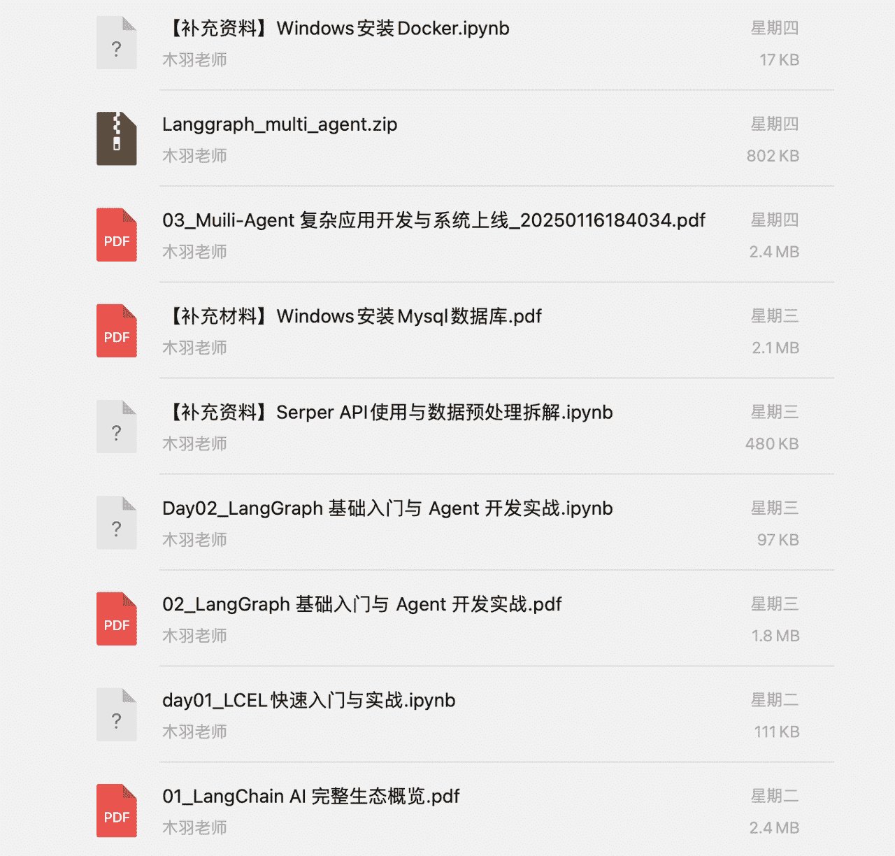


此外，公开课全部课件，以及项目代码、数据等学习资料，扫码⬆️联系助教即可领取～

---

# 《2025大模型智能体Agent开发实战》体验课

## LangChain AI+ DeepSeek v3 企业 Agent 开发实战

## Part 1. LCEL (LangChain Expression Language) 快速入门与实战

# 1. LCEL基本概念入门

LCEL(LangChain Expression Language)是 LangChain 中非常关键的概念，它指的是一种声明式的表达式语言，用于通过链式组合不同的模块。它将不同的组件通过统一的Runable接口连接起来，从而实现具体的流程或功能（比如RAG、Agent）。

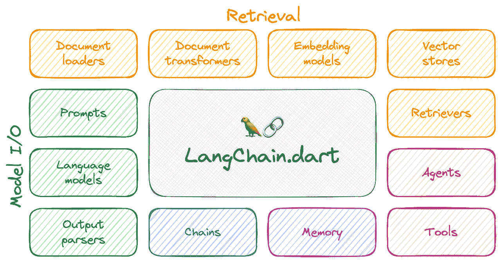

因为每个模块都是LCEL对象，因此基于LCEL对象连接形成的链，本身也是一个 LCEL 对象，所以当通过一组通用的调用方法（invoke、 batch、stream、 ainvoke ）方法时，就能够做到定制化组合链、并行化组件、回退、动态配置链内部结构等标准化的操作。它的优势非常明显：

1.  统一的接口：每个 LCEL 对象都实现Runnable接口，因此可以非常方便的连接到一起；

1.  模块化操作：每个组件都可以独立开发和测试，处理好输入和输出就可以通过LCEL集成到一起；

1.  良好扩展性：各个模块组件之间都实现了通用的调用方法（invoke、 batch、stream、 ainvoke ）方法，因此可以灵活组合使用不同的使用场景；

比如LangChain中抽象出来的最简单的 Model I/O 模块。

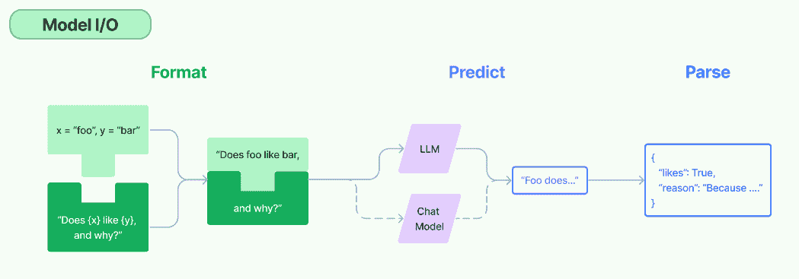

LangChain的Model I/O模块提供了标准的、可扩展的接口实现与大语言模型的外部集成。所谓的Model I/O，包括模型输入（Prompts）、模型输出（OutPuts）和模型本身（Models），简单理解就是通过该模块，我们可以快速与某个大模型进行对话交互，整个内部逻辑就相当于我们最熟悉的这个过程：输入Prompt，得到大模型针对该Prompt的推理结果。如下示例为OpenAI的 GPT 系列模型的API 调用规范：

```
response = openai.ChatCompletion.create(
  model=&quot;gpt-3.5-turbo&quot;,
  messages=[
    {&quot;role&quot;: &quot;user&quot;, &quot;content&quot;: &quot;请问，什么是机器学习？&quot;}
  ]
)
```

在LangChain的Model I/O模块设计中，包含三个核心部分： Prompt Template（对应上图中的Format部分）， Model（对应上图中的Predict部分） 和Output Parser（对应上图中的Parse部分）。

+   **Format：即指代Prompts Temp**late，通过模板化来管理大模型的输入；

+   Predict：即指代Models，使用通用接口调用不同的大语言模型；

+   **Parse：即指代Output部分，用来从模型的推理中提取信**息，并按照预先设定好的模版来规范化输出。

+   **Format**

对于Prompt Template第一部分，传统上我们创建提示词是通过手工编写来实现的，在这个过程中会利用各种提示工程技巧，如Few-Shot、链式推理（CoT）等方法，以提高大模型的推理性能。然而，在应用开发中，一个关键的考量是提示词不能是一成不变的。 其原因在于，应用开发需要适应多变的用户需求和场景。固定的提示词限制了模型的灵活性和适用范围。例如，如果我们正在开发一个天气查询应用，用户可能会以多种方式提出查询，如“今天的天气怎么样？”或“明天纽约的温度是多少度？”。如果提示词是固定的，它可能只能处理一种特定类型的查询，而无法适应这种多样性的需求。

而Prompt Template，就像ReAct模版，将API的使用、问题解答过程等复杂逻辑封装成了一套结构化的格式。我们只需准备具体的外部函数信息和用户查询，即可生成定制化的提示词，引导模型按照既定逻辑进行思考和回答，从而实现外部函数的调用过程，即：

```
# 将一个插件的关键信息拼接成一段文本的模版。
TOOL_DESC = &quot;&quot;&quot;{name_for_model}: Call this tool to interact with the {name_for_human} API. What is the {name_for_human} API useful for? {description_for_model} Parameters: {parameters}&quot;&quot;&quot;

# ReAct prompting 的 instruction 模版，将包含插件的详细信息。
PROMPT_REACT = &quot;&quot;&quot;Answer the following questions as best you can. You have access to the following APIs:

{tool_descs}

Use the following format:

Question: the input question you must answer
Thought: you should always think about what to do
Action: the action to take, should be one of [{tool_names}]
Action Input: the input to the action
Observation: the result of the action
... (this Thought/Action/Action Input/Observation can be repeated zero or more times)
Thought: I now know the final answer
Final Answer: the final answer to the original input question

Begin!

Question: {query}&quot;&quot;&quot;
```

因此，引入Prompt Template可以支持变量和动态内容的插入，使得同一个应用可以根据不同的输入动态调整提示词，从而更好地响应用户的具体需求。LangChain通过这种方式来提高应用的通用性和用户体验。

+   **Predict**

在Predict部分，实质上是处理模型从接收输入到执行推理的整个过程。考虑到存在两种主要类型的大模型——Base类模型和Chat类模型，LangChain在其Model I/O模块中对这两种模型都进行了抽象，分别归类为LLMs（Large Language Models）和Chat Models。我们还是以OpenAI 的 Completion 和 Chatcompletions方法为例：

```

# Base类模型
client.completions.create(
  model=&quot;gpt-3.5-turbo-instruct&quot;,
  prompt=&quot;Say this is a test&quot;,
)


# 聊天模型
client.chat.completions.create(
  model=&quot;gpt-3.5-turbo&quot;,
  messages=[
    {&quot;role&quot;: &quot;system&quot;, &quot;content&quot;: &quot;你是一位乐于助人的AI智能小助手&quot;},
    {&quot;role&quot;: &quot;user&quot;, &quot;content&quot;: &quot;你好，请你介绍一下你自己。&quot;}
  ]
)
```

LLMs是简化的大语言模型抽象，即基于给定的Prompt提供内容生成的功能。而Chat Models则专注于聊天API的抽象，需要维护上下文的记忆（聊天记录），呈现出更接近对话或聊天形式的交互。

+   **Parse**

我们知道，大模型的输出是不稳定的，同样的输入Prompt往往会得到不同形式的输出。在自然语言交互中，不同的语言表达方式通常不会造成理解上的障碍。但在应用开发中，大模型的输出可能是下一步逻辑处理的关键输入。因此，在这种情况下，规范化输出是必须要做的任务，以确保应用能够顺利进行后续的逻辑处理。

输出解析器 Output Parser就是一个帮助结构化语言模型响应的抽象，可以获取格式指令或者进行更深层次的解析。这我们会在后面的实践中直观的体验到。

整体而言，在Model I/O模块的抽象中，其一能够让开发者快速的接入不同的大模型，比如OpenAI、ChatGLM、Qwen等，按照既定规范执行模型推理。其二通过输入和输出的模板化处理，使其更贴合于应用开发的最佳实践。接下来，我们就逐步的介绍上述三个流程在LangChain下是如何进行集成和操作的。

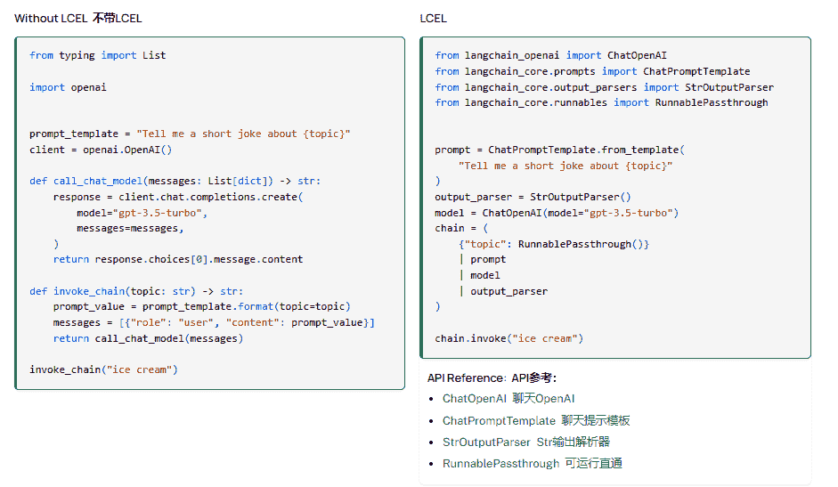

# 2. DeepSeek v3 模型注册与使用

+   DeepSeek v3账号注册与API获取

DeepSeek官网：https://www.deepseek.com/

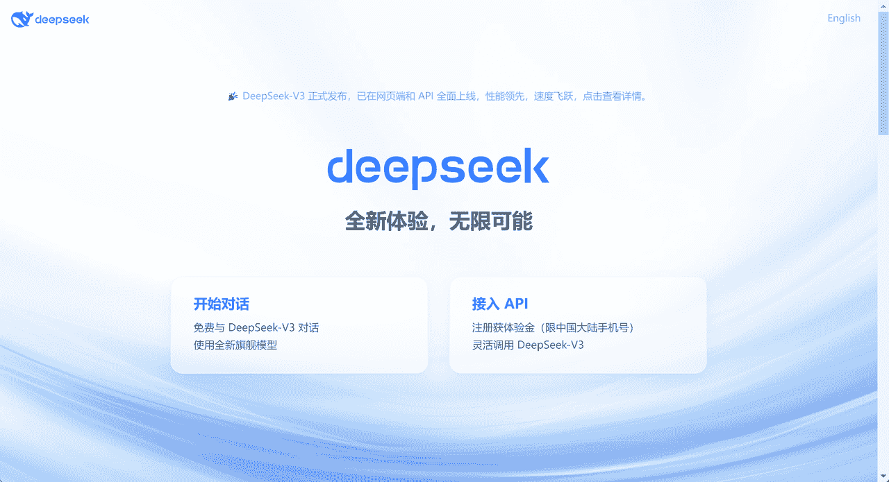

新用户注册即赠送10元额度，约500万token额度（如果发现没有赠送额度，那就是官方停止了活动。）

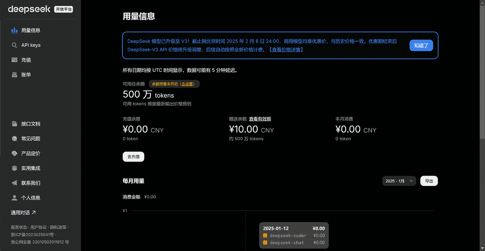

对比GPT4o价格，约降低90%以上：输入价格为GPT4o的6%，输出价格为GPT4o的3%。

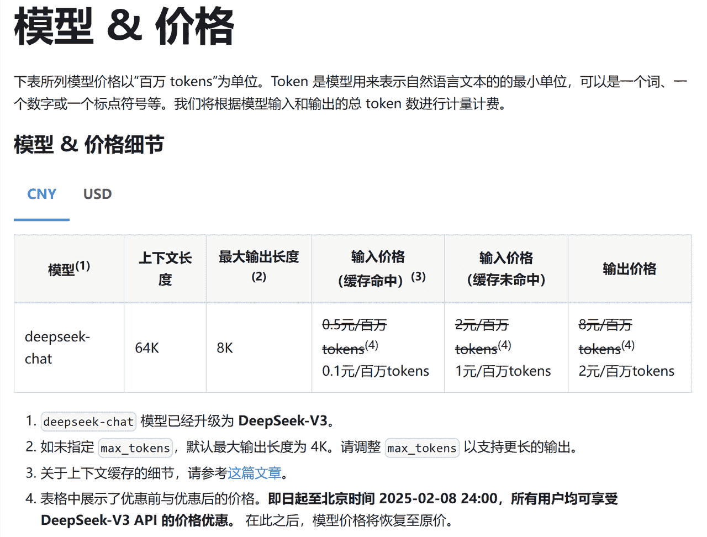

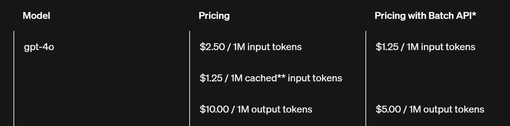

而且其API调用不限速：

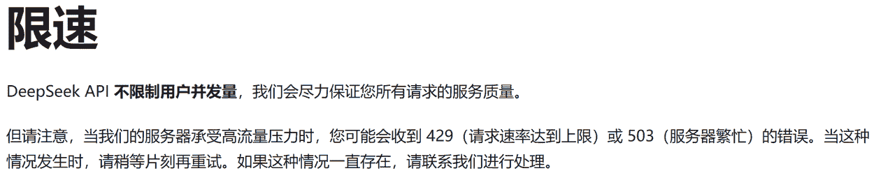

最关键的是，调用风格和OpenAI完全一致：Function calling、Json Output等功能完全相同：

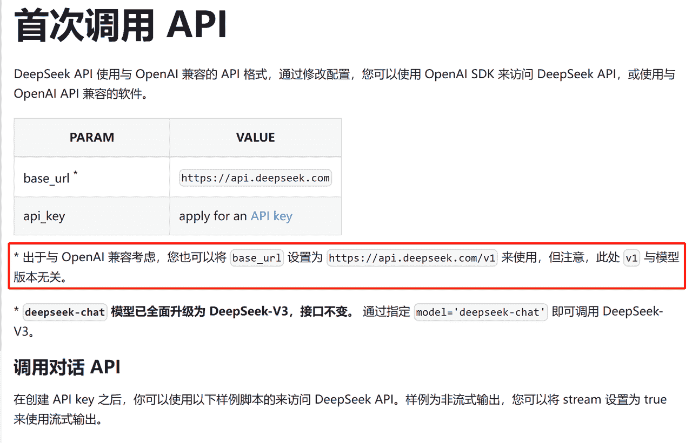

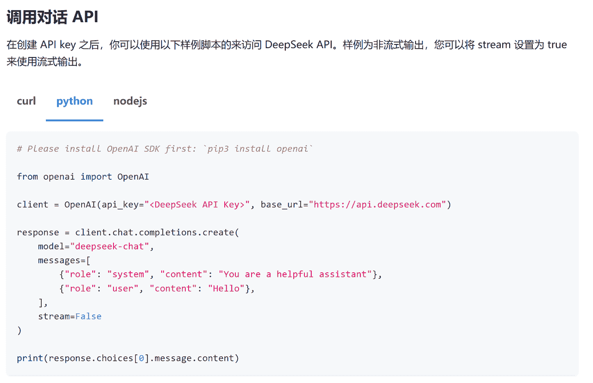

# 3. 基于LCEL 实现 DeepSeep v3 的集成

LangChain中最基本和常见的用例是将提示模板和模型链接在一起。为了看看这是如何工作的，我们创建一个接受某个主题并生成响应的链：

```
# ! pip install -qU langchain langchain-openai
```

```
from langchain_openai import ChatOpenAI

# 使用DeepSeek-chat模型作为chatmodel
model = ChatOpenAI(model=&quot;deepseek-chat&quot;,
                   api_key=&#x27;sk-6c960cb2a7&#x27;,
                   base_url=&#x27;https://api.deepseek.com&#x27;)
```

使用 LCEL 将这些不同的组件拼凑成一个链。其中 | 符号类似于unix管道运算符，它将不同的组件链接在一起，将一个组件的输出作为下一个组件的输入。

```
from langchain_core.output_parsers import StrOutputParser
from langchain_core.prompts import ChatPromptTemplate

prompt = ChatPromptTemplate.from_template(&quot;请你介绍一下什么是 {topic}&quot;)

chain = prompt | model | StrOutputParser()
```

在此链中，用户输入传递到提示模板，然后提示模板输出传递到模型，然后模型输出传递到输出解析器。

```
chain.invoke({&quot;topic&quot;: &quot;人工智能&quot;})
```

```
&#x27;人工智能（Artificial Intelligence，简称 AI）是指通过计算机系统模拟、扩展和增强人类智能的技术和科学领域。它旨在使机器能够执行通常需要人类智能的任务，例如学习、推理、问题解决、感知、语言理解和决策等。\n\n### 人工智能的主要特点：\n1. **模拟人类智能**：AI 系统试图模仿人类的思维过程，例如学习、推理和决策。\n2. **自动化**：AI 可以自动执行任务，减少人类干预。\n3. **适应性和学习能力**：许多 AI 系统能够通过数据学习并改进性能，例如机器学习和深度学习。\n4. **处理复杂问题**：AI 可以处理大量数据并解决复杂问题，例如图像识别、自然语言处理和预测分析。\n\n### 人工智能的分类：\n1. **弱人工智能（Narrow AI）**：专注于特定任务，例如语音助手（如 Siri、Alexa）或图像识别系统。这是目前最常见的 AI 形式。\n2. **强人工智能（General AI）**：具备与人类相当的通用智能，能够理解、学习和执行任何智力任务。目前尚未实现。\n3. **超级人工智能（Superintelligent AI）**：超越人类智能的 AI，能够在几乎所有领域超越人类。这仍然是理论上的概念。\n\n### 人工智能的关键技术：\n1. **机器学习（Machine Learning）**：通过数据训练模型，使系统能够从经验中学习并改进性能。\n2. **深度学习（Deep Learning）**：一种机器学习方法，使用神经网络模拟人脑的工作方式，适用于图像识别、语音识别等任务。\n3. **自然语言处理（NLP）**：使机器能够理解、生成和处理人类语言，例如聊天机器人和翻译系统。\n4. **计算机视觉（Computer Vision）**：使机器能够“看”并理解图像和视频内容，例如人脸识别和自动驾驶。\n5. **强化学习（Reinforcement Learning）**：通过试错和奖励机制训练 AI 系统，使其在特定环境中做出最佳决策。\n\n### 人工智能的应用领域：\n- **医疗**：疾病诊断、药物研发、个性化治疗。\n- **金融**：风险评估、欺诈检测、自动化交易。\n- **交通**：自动驾驶、交通流量优化。\n- **教育**：个性化学习、智能辅导系统。\n- **娱乐**：游戏 AI、内容推荐系统。\n- **制造业**：自动化生产线、质量控制。\n\n### 人工智能的挑战与争议：\n1. **伦理问题**：AI 的决策可能涉及隐私、偏见和公平性等问题。\n2. **就业影响**：自动化可能取代某些工作岗位，引发社会经济问题。\n3. **安全性**：AI 系统可能被滥用或出现不可预测的行为。\n4. **技术限制**：目前的 AI 仍无法完全模拟人类的创造力和情感。\n\n总之，人工智能是一项快速发展的技术，正在深刻改变我们的生活和工作方式。尽管它带来了巨大的潜力，但也需要谨慎应对其带来的挑战。&#x27;
```

在这个过程中，Runnable 会动态生成输入的描述，显示的将其传入Pydantic 模型。我们可以对其调用.schema()来获取 JSONSchema 表示。

```
chain.input_schema.schema()
```

```
{&#x27;properties&#x27;: {&#x27;topic&#x27;: {&#x27;title&#x27;: &#x27;Topic&#x27;, &#x27;type&#x27;: &#x27;string&#x27;}},
 &#x27;required&#x27;: [&#x27;topic&#x27;],
 &#x27;title&#x27;: &#x27;PromptInput&#x27;,
 &#x27;type&#x27;: &#x27;object&#x27;}
```

```
prompt.input_schema.schema()
```

```
{&#x27;properties&#x27;: {&#x27;topic&#x27;: {&#x27;title&#x27;: &#x27;Topic&#x27;, &#x27;type&#x27;: &#x27;string&#x27;}},
 &#x27;required&#x27;: [&#x27;topic&#x27;],
 &#x27;title&#x27;: &#x27;PromptInput&#x27;,
 &#x27;type&#x27;: &#x27;object&#x27;}
```

```
prompt.output_schema.schema()
```

```
{&#x27;$defs&#x27;: {&#x27;AIMessage&#x27;: {&#x27;additionalProperties&#x27;: True,
   &#x27;description&#x27;: &#x27;Message from an AI.\n\nAIMessage is returned from a chat model as a response to a prompt.\n\nThis message represents the output of the model and consists of both\nthe raw output as returned by the model together standardized fields\n(e.g., tool calls, usage metadata) added by the LangChain framework.&#x27;,
   &#x27;properties&#x27;: {&#x27;content&#x27;: {&#x27;anyOf&#x27;: [{&#x27;type&#x27;: &#x27;string&#x27;},
      {&#x27;items&#x27;: {&#x27;anyOf&#x27;: [{&#x27;type&#x27;: &#x27;string&#x27;}, {&#x27;type&#x27;: &#x27;object&#x27;}]},
       &#x27;type&#x27;: &#x27;array&#x27;}],
     &#x27;title&#x27;: &#x27;Content&#x27;},
    &#x27;additional_kwargs&#x27;: {&#x27;title&#x27;: &#x27;Additional Kwargs&#x27;, &#x27;type&#x27;: &#x27;object&#x27;},
    &#x27;response_metadata&#x27;: {&#x27;title&#x27;: &#x27;Response Metadata&#x27;, &#x27;type&#x27;: &#x27;object&#x27;},
    &#x27;type&#x27;: {&#x27;const&#x27;: &#x27;ai&#x27;,
     &#x27;default&#x27;: &#x27;ai&#x27;,
     &#x27;enum&#x27;: [&#x27;ai&#x27;],
     &#x27;title&#x27;: &#x27;Type&#x27;,
     &#x27;type&#x27;: &#x27;string&#x27;},
    &#x27;name&#x27;: {&#x27;anyOf&#x27;: [{&#x27;type&#x27;: &#x27;string&#x27;}, {&#x27;type&#x27;: &#x27;null&#x27;}],
     &#x27;default&#x27;: None,
     &#x27;title&#x27;: &#x27;Name&#x27;},
    &#x27;id&#x27;: {&#x27;anyOf&#x27;: [{&#x27;type&#x27;: &#x27;string&#x27;}, {&#x27;type&#x27;: &#x27;null&#x27;}],
     &#x27;default&#x27;: None,
     &#x27;title&#x27;: &#x27;Id&#x27;},
    &#x27;example&#x27;: {&#x27;default&#x27;: False, &#x27;title&#x27;: &#x27;Example&#x27;, &#x27;type&#x27;: &#x27;boolean&#x27;},
    &#x27;tool_calls&#x27;: {&#x27;default&#x27;: [],
     &#x27;items&#x27;: {&#x27;$ref&#x27;: &#x27;#/$defs/ToolCall&#x27;},
     &#x27;title&#x27;: &#x27;Tool Calls&#x27;,
     &#x27;type&#x27;: &#x27;array&#x27;},
    &#x27;invalid_tool_calls&#x27;: {&#x27;default&#x27;: [],
     &#x27;items&#x27;: {&#x27;$ref&#x27;: &#x27;#/$defs/InvalidToolCall&#x27;},
     &#x27;title&#x27;: &#x27;Invalid Tool Calls&#x27;,
     &#x27;type&#x27;: &#x27;array&#x27;},
    &#x27;usage_metadata&#x27;: {&#x27;anyOf&#x27;: [{&#x27;$ref&#x27;: &#x27;#/$defs/UsageMetadata&#x27;},
      {&#x27;type&#x27;: &#x27;null&#x27;}],
     &#x27;default&#x27;: None}},
   &#x27;required&#x27;: [&#x27;content&#x27;],
   &#x27;title&#x27;: &#x27;AIMessage&#x27;,
   &#x27;type&#x27;: &#x27;object&#x27;},
  &#x27;AIMessageChunk&#x27;: {&#x27;additionalProperties&#x27;: True,
   &#x27;description&#x27;: &#x27;Message chunk from an AI.&#x27;,
   &#x27;properties&#x27;: {&#x27;content&#x27;: {&#x27;anyOf&#x27;: [{&#x27;type&#x27;: &#x27;string&#x27;},
      {&#x27;items&#x27;: {&#x27;anyOf&#x27;: [{&#x27;type&#x27;: &#x27;string&#x27;}, {&#x27;type&#x27;: &#x27;object&#x27;}]},
       &#x27;type&#x27;: &#x27;array&#x27;}],
     &#x27;title&#x27;: &#x27;Content&#x27;},
    &#x27;additional_kwargs&#x27;: {&#x27;title&#x27;: &#x27;Additional Kwargs&#x27;, &#x27;type&#x27;: &#x27;object&#x27;},
    &#x27;response_metadata&#x27;: {&#x27;title&#x27;: &#x27;Response Metadata&#x27;, &#x27;type&#x27;: &#x27;object&#x27;},
    &#x27;type&#x27;: {&#x27;const&#x27;: &#x27;AIMessageChunk&#x27;,
     &#x27;default&#x27;: &#x27;AIMessageChunk&#x27;,
     &#x27;enum&#x27;: [&#x27;AIMessageChunk&#x27;],
     &#x27;title&#x27;: &#x27;Type&#x27;,
     &#x27;type&#x27;: &#x27;string&#x27;},
    &#x27;name&#x27;: {&#x27;anyOf&#x27;: [{&#x27;type&#x27;: &#x27;string&#x27;}, {&#x27;type&#x27;: &#x27;null&#x27;}],
     &#x27;default&#x27;: None,
     &#x27;title&#x27;: &#x27;Name&#x27;},
    &#x27;id&#x27;: {&#x27;anyOf&#x27;: [{&#x27;type&#x27;: &#x27;string&#x27;}, {&#x27;type&#x27;: &#x27;null&#x27;}],
     &#x27;default&#x27;: None,
     &#x27;title&#x27;: &#x27;Id&#x27;},
    &#x27;example&#x27;: {&#x27;default&#x27;: False, &#x27;title&#x27;: &#x27;Example&#x27;, &#x27;type&#x27;: &#x27;boolean&#x27;},
    &#x27;tool_calls&#x27;: {&#x27;default&#x27;: [],
     &#x27;items&#x27;: {&#x27;$ref&#x27;: &#x27;#/$defs/ToolCall&#x27;},
     &#x27;title&#x27;: &#x27;Tool Calls&#x27;,
     &#x27;type&#x27;: &#x27;array&#x27;},
    &#x27;invalid_tool_calls&#x27;: {&#x27;default&#x27;: [],
     &#x27;items&#x27;: {&#x27;$ref&#x27;: &#x27;#/$defs/InvalidToolCall&#x27;},
     &#x27;title&#x27;: &#x27;Invalid Tool Calls&#x27;,
     &#x27;type&#x27;: &#x27;array&#x27;},
    &#x27;usage_metadata&#x27;: {&#x27;anyOf&#x27;: [{&#x27;$ref&#x27;: &#x27;#/$defs/UsageMetadata&#x27;},
      {&#x27;type&#x27;: &#x27;null&#x27;}],
     &#x27;default&#x27;: None},
    &#x27;tool_call_chunks&#x27;: {&#x27;default&#x27;: [],
     &#x27;items&#x27;: {&#x27;$ref&#x27;: &#x27;#/$defs/ToolCallChunk&#x27;},
     &#x27;title&#x27;: &#x27;Tool Call Chunks&#x27;,
     &#x27;type&#x27;: &#x27;array&#x27;}},
   &#x27;required&#x27;: [&#x27;content&#x27;],
   &#x27;title&#x27;: &#x27;AIMessageChunk&#x27;,
   &#x27;type&#x27;: &#x27;object&#x27;},
  &#x27;ChatMessage&#x27;: {&#x27;additionalProperties&#x27;: True,
   &#x27;description&#x27;: &#x27;Message that can be assigned an arbitrary speaker (i.e. role).&#x27;,
   &#x27;properties&#x27;: {&#x27;content&#x27;: {&#x27;anyOf&#x27;: [{&#x27;type&#x27;: &#x27;string&#x27;},
      {&#x27;items&#x27;: {&#x27;anyOf&#x27;: [{&#x27;type&#x27;: &#x27;string&#x27;}, {&#x27;type&#x27;: &#x27;object&#x27;}]},
       &#x27;type&#x27;: &#x27;array&#x27;}],
     &#x27;title&#x27;: &#x27;Content&#x27;},
    &#x27;additional_kwargs&#x27;: {&#x27;title&#x27;: &#x27;Additional Kwargs&#x27;, &#x27;type&#x27;: &#x27;object&#x27;},
    &#x27;response_metadata&#x27;: {&#x27;title&#x27;: &#x27;Response Metadata&#x27;, &#x27;type&#x27;: &#x27;object&#x27;},
    &#x27;type&#x27;: {&#x27;const&#x27;: &#x27;chat&#x27;,
     &#x27;default&#x27;: &#x27;chat&#x27;,
     &#x27;enum&#x27;: [&#x27;chat&#x27;],
     &#x27;title&#x27;: &#x27;Type&#x27;,
     &#x27;type&#x27;: &#x27;string&#x27;},
    &#x27;name&#x27;: {&#x27;anyOf&#x27;: [{&#x27;type&#x27;: &#x27;string&#x27;}, {&#x27;type&#x27;: &#x27;null&#x27;}],
     &#x27;default&#x27;: None,
     &#x27;title&#x27;: &#x27;Name&#x27;},
    &#x27;id&#x27;: {&#x27;anyOf&#x27;: [{&#x27;type&#x27;: &#x27;string&#x27;}, {&#x27;type&#x27;: &#x27;null&#x27;}],
     &#x27;default&#x27;: None,
     &#x27;title&#x27;: &#x27;Id&#x27;},
    &#x27;role&#x27;: {&#x27;title&#x27;: &#x27;Role&#x27;, &#x27;type&#x27;: &#x27;string&#x27;}},
   &#x27;required&#x27;: [&#x27;content&#x27;, &#x27;role&#x27;],
   &#x27;title&#x27;: &#x27;ChatMessage&#x27;,
   &#x27;type&#x27;: &#x27;object&#x27;},
  &#x27;ChatMessageChunk&#x27;: {&#x27;additionalProperties&#x27;: True,
   &#x27;description&#x27;: &#x27;Chat Message chunk.&#x27;,
   &#x27;properties&#x27;: {&#x27;content&#x27;: {&#x27;anyOf&#x27;: [{&#x27;type&#x27;: &#x27;string&#x27;},
      {&#x27;items&#x27;: {&#x27;anyOf&#x27;: [{&#x27;type&#x27;: &#x27;string&#x27;}, {&#x27;type&#x27;: &#x27;object&#x27;}]},
       &#x27;type&#x27;: &#x27;array&#x27;}],
     &#x27;title&#x27;: &#x27;Content&#x27;},
    &#x27;additional_kwargs&#x27;: {&#x27;title&#x27;: &#x27;Additional Kwargs&#x27;, &#x27;type&#x27;: &#x27;object&#x27;},
    &#x27;response_metadata&#x27;: {&#x27;title&#x27;: &#x27;Response Metadata&#x27;, &#x27;type&#x27;: &#x27;object&#x27;},
    &#x27;type&#x27;: {&#x27;const&#x27;: &#x27;ChatMessageChunk&#x27;,
     &#x27;default&#x27;: &#x27;ChatMessageChunk&#x27;,
     &#x27;enum&#x27;: [&#x27;ChatMessageChunk&#x27;],
     &#x27;title&#x27;: &#x27;Type&#x27;,
     &#x27;type&#x27;: &#x27;string&#x27;},
    &#x27;name&#x27;: {&#x27;anyOf&#x27;: [{&#x27;type&#x27;: &#x27;string&#x27;}, {&#x27;type&#x27;: &#x27;null&#x27;}],
     &#x27;default&#x27;: None,
     &#x27;title&#x27;: &#x27;Name&#x27;},
    &#x27;id&#x27;: {&#x27;anyOf&#x27;: [{&#x27;type&#x27;: &#x27;string&#x27;}, {&#x27;type&#x27;: &#x27;null&#x27;}],
     &#x27;default&#x27;: None,
     &#x27;title&#x27;: &#x27;Id&#x27;},
    &#x27;role&#x27;: {&#x27;title&#x27;: &#x27;Role&#x27;, &#x27;type&#x27;: &#x27;string&#x27;}},
   &#x27;required&#x27;: [&#x27;content&#x27;, &#x27;role&#x27;],
   &#x27;title&#x27;: &#x27;ChatMessageChunk&#x27;,
   &#x27;type&#x27;: &#x27;object&#x27;},
  &#x27;ChatPromptValueConcrete&#x27;: {&#x27;description&#x27;: &#x27;Chat prompt value which explicitly lists out the message types it accepts.\nFor use in external schemas.&#x27;,
   &#x27;properties&#x27;: {&#x27;messages&#x27;: {&#x27;items&#x27;: {&#x27;oneOf&#x27;: [{&#x27;$ref&#x27;: &#x27;#/$defs/AIMessage&#x27;},
       {&#x27;$ref&#x27;: &#x27;#/$defs/HumanMessage&#x27;},
       {&#x27;$ref&#x27;: &#x27;#/$defs/ChatMessage&#x27;},
       {&#x27;$ref&#x27;: &#x27;#/$defs/SystemMessage&#x27;},
       {&#x27;$ref&#x27;: &#x27;#/$defs/FunctionMessage&#x27;},
       {&#x27;$ref&#x27;: &#x27;#/$defs/ToolMessage&#x27;},
       {&#x27;$ref&#x27;: &#x27;#/$defs/AIMessageChunk&#x27;},
       {&#x27;$ref&#x27;: &#x27;#/$defs/HumanMessageChunk&#x27;},
       {&#x27;$ref&#x27;: &#x27;#/$defs/ChatMessageChunk&#x27;},
       {&#x27;$ref&#x27;: &#x27;#/$defs/SystemMessageChunk&#x27;},
       {&#x27;$ref&#x27;: &#x27;#/$defs/FunctionMessageChunk&#x27;},
       {&#x27;$ref&#x27;: &#x27;#/$defs/ToolMessageChunk&#x27;}]},
     &#x27;title&#x27;: &#x27;Messages&#x27;,
     &#x27;type&#x27;: &#x27;array&#x27;},
    &#x27;type&#x27;: {&#x27;const&#x27;: &#x27;ChatPromptValueConcrete&#x27;,
     &#x27;default&#x27;: &#x27;ChatPromptValueConcrete&#x27;,
     &#x27;enum&#x27;: [&#x27;ChatPromptValueConcrete&#x27;],
     &#x27;title&#x27;: &#x27;Type&#x27;,
     &#x27;type&#x27;: &#x27;string&#x27;}},
   &#x27;required&#x27;: [&#x27;messages&#x27;],
   &#x27;title&#x27;: &#x27;ChatPromptValueConcrete&#x27;,
   &#x27;type&#x27;: &#x27;object&#x27;},
  &#x27;FunctionMessage&#x27;: {&#x27;additionalProperties&#x27;: True,
   &#x27;description&#x27;: &#x27;Message for passing the result of executing a tool back to a model.\n\nFunctionMessage are an older version of the ToolMessage schema, and\ndo not contain the tool_call_id field.\n\nThe tool_call_id field is used to associate the tool call request with the\ntool call response. This is useful in situations where a chat model is able\nto request multiple tool calls in parallel.&#x27;,
   &#x27;properties&#x27;: {&#x27;content&#x27;: {&#x27;anyOf&#x27;: [{&#x27;type&#x27;: &#x27;string&#x27;},
      {&#x27;items&#x27;: {&#x27;anyOf&#x27;: [{&#x27;type&#x27;: &#x27;string&#x27;}, {&#x27;type&#x27;: &#x27;object&#x27;}]},
       &#x27;type&#x27;: &#x27;array&#x27;}],
     &#x27;title&#x27;: &#x27;Content&#x27;},
    &#x27;additional_kwargs&#x27;: {&#x27;title&#x27;: &#x27;Additional Kwargs&#x27;, &#x27;type&#x27;: &#x27;object&#x27;},
    &#x27;response_metadata&#x27;: {&#x27;title&#x27;: &#x27;Response Metadata&#x27;, &#x27;type&#x27;: &#x27;object&#x27;},
    &#x27;type&#x27;: {&#x27;const&#x27;: &#x27;function&#x27;,
     &#x27;default&#x27;: &#x27;function&#x27;,
     &#x27;enum&#x27;: [&#x27;function&#x27;],
     &#x27;title&#x27;: &#x27;Type&#x27;,
     &#x27;type&#x27;: &#x27;string&#x27;},
    &#x27;name&#x27;: {&#x27;title&#x27;: &#x27;Name&#x27;, &#x27;type&#x27;: &#x27;string&#x27;},
    &#x27;id&#x27;: {&#x27;anyOf&#x27;: [{&#x27;type&#x27;: &#x27;string&#x27;}, {&#x27;type&#x27;: &#x27;null&#x27;}],
     &#x27;default&#x27;: None,
     &#x27;title&#x27;: &#x27;Id&#x27;}},
   &#x27;required&#x27;: [&#x27;content&#x27;, &#x27;name&#x27;],
   &#x27;title&#x27;: &#x27;FunctionMessage&#x27;,
   &#x27;type&#x27;: &#x27;object&#x27;},
  &#x27;FunctionMessageChunk&#x27;: {&#x27;additionalProperties&#x27;: True,
   &#x27;description&#x27;: &#x27;Function Message chunk.&#x27;,
   &#x27;properties&#x27;: {&#x27;content&#x27;: {&#x27;anyOf&#x27;: [{&#x27;type&#x27;: &#x27;string&#x27;},
      {&#x27;items&#x27;: {&#x27;anyOf&#x27;: [{&#x27;type&#x27;: &#x27;string&#x27;}, {&#x27;type&#x27;: &#x27;object&#x27;}]},
       &#x27;type&#x27;: &#x27;array&#x27;}],
     &#x27;title&#x27;: &#x27;Content&#x27;},
    &#x27;additional_kwargs&#x27;: {&#x27;title&#x27;: &#x27;Additional Kwargs&#x27;, &#x27;type&#x27;: &#x27;object&#x27;},
    &#x27;response_metadata&#x27;: {&#x27;title&#x27;: &#x27;Response Metadata&#x27;, &#x27;type&#x27;: &#x27;object&#x27;},
    &#x27;type&#x27;: {&#x27;const&#x27;: &#x27;FunctionMessageChunk&#x27;,
     &#x27;default&#x27;: &#x27;FunctionMessageChunk&#x27;,
     &#x27;enum&#x27;: [&#x27;FunctionMessageChunk&#x27;],
     &#x27;title&#x27;: &#x27;Type&#x27;,
     &#x27;type&#x27;: &#x27;string&#x27;},
    &#x27;name&#x27;: {&#x27;title&#x27;: &#x27;Name&#x27;, &#x27;type&#x27;: &#x27;string&#x27;},
    &#x27;id&#x27;: {&#x27;anyOf&#x27;: [{&#x27;type&#x27;: &#x27;string&#x27;}, {&#x27;type&#x27;: &#x27;null&#x27;}],
     &#x27;default&#x27;: None,
     &#x27;title&#x27;: &#x27;Id&#x27;}},
   &#x27;required&#x27;: [&#x27;content&#x27;, &#x27;name&#x27;],
   &#x27;title&#x27;: &#x27;FunctionMessageChunk&#x27;,
   &#x27;type&#x27;: &#x27;object&#x27;},
  &#x27;HumanMessage&#x27;: {&#x27;additionalProperties&#x27;: True,
   &#x27;description&#x27;: &#x27;Message from a human.\n\nHumanMessages are messages that are passed in from a human to the model.\n\nExample:\n\n    .. code-block:: python\n\n        from langchain_core.messages import HumanMessage, SystemMessage\n\n        messages = [\n            SystemMessage(\n                content=&quot;You are a helpful assistant! Your name is Bob.&quot;\n            ),\n            HumanMessage(\n                content=&quot;What is your name?&quot;\n            )\n        ]\n\n        # Instantiate a chat model and invoke it with the messages\n        model = ...\n        print(model.invoke(messages))&#x27;,
   &#x27;properties&#x27;: {&#x27;content&#x27;: {&#x27;anyOf&#x27;: [{&#x27;type&#x27;: &#x27;string&#x27;},
      {&#x27;items&#x27;: {&#x27;anyOf&#x27;: [{&#x27;type&#x27;: &#x27;string&#x27;}, {&#x27;type&#x27;: &#x27;object&#x27;}]},
       &#x27;type&#x27;: &#x27;array&#x27;}],
     &#x27;title&#x27;: &#x27;Content&#x27;},
    &#x27;additional_kwargs&#x27;: {&#x27;title&#x27;: &#x27;Additional Kwargs&#x27;, &#x27;type&#x27;: &#x27;object&#x27;},
    &#x27;response_metadata&#x27;: {&#x27;title&#x27;: &#x27;Response Metadata&#x27;, &#x27;type&#x27;: &#x27;object&#x27;},
    &#x27;type&#x27;: {&#x27;const&#x27;: &#x27;human&#x27;,
     &#x27;default&#x27;: &#x27;human&#x27;,
     &#x27;enum&#x27;: [&#x27;human&#x27;],
     &#x27;title&#x27;: &#x27;Type&#x27;,
     &#x27;type&#x27;: &#x27;string&#x27;},
    &#x27;name&#x27;: {&#x27;anyOf&#x27;: [{&#x27;type&#x27;: &#x27;string&#x27;}, {&#x27;type&#x27;: &#x27;null&#x27;}],
     &#x27;default&#x27;: None,
     &#x27;title&#x27;: &#x27;Name&#x27;},
    &#x27;id&#x27;: {&#x27;anyOf&#x27;: [{&#x27;type&#x27;: &#x27;string&#x27;}, {&#x27;type&#x27;: &#x27;null&#x27;}],
     &#x27;default&#x27;: None,
     &#x27;title&#x27;: &#x27;Id&#x27;},
    &#x27;example&#x27;: {&#x27;default&#x27;: False, &#x27;title&#x27;: &#x27;Example&#x27;, &#x27;type&#x27;: &#x27;boolean&#x27;}},
   &#x27;required&#x27;: [&#x27;content&#x27;],
   &#x27;title&#x27;: &#x27;HumanMessage&#x27;,
   &#x27;type&#x27;: &#x27;object&#x27;},
  &#x27;HumanMessageChunk&#x27;: {&#x27;additionalProperties&#x27;: True,
   &#x27;description&#x27;: &#x27;Human Message chunk.&#x27;,
   &#x27;properties&#x27;: {&#x27;content&#x27;: {&#x27;anyOf&#x27;: [{&#x27;type&#x27;: &#x27;string&#x27;},
      {&#x27;items&#x27;: {&#x27;anyOf&#x27;: [{&#x27;type&#x27;: &#x27;string&#x27;}, {&#x27;type&#x27;: &#x27;object&#x27;}]},
       &#x27;type&#x27;: &#x27;array&#x27;}],
     &#x27;title&#x27;: &#x27;Content&#x27;},
    &#x27;additional_kwargs&#x27;: {&#x27;title&#x27;: &#x27;Additional Kwargs&#x27;, &#x27;type&#x27;: &#x27;object&#x27;},
    &#x27;response_metadata&#x27;: {&#x27;title&#x27;: &#x27;Response Metadata&#x27;, &#x27;type&#x27;: &#x27;object&#x27;},
    &#x27;type&#x27;: {&#x27;const&#x27;: &#x27;HumanMessageChunk&#x27;,
     &#x27;default&#x27;: &#x27;HumanMessageChunk&#x27;,
     &#x27;enum&#x27;: [&#x27;HumanMessageChunk&#x27;],
     &#x27;title&#x27;: &#x27;Type&#x27;,
     &#x27;type&#x27;: &#x27;string&#x27;},
    &#x27;name&#x27;: {&#x27;anyOf&#x27;: [{&#x27;type&#x27;: &#x27;string&#x27;}, {&#x27;type&#x27;: &#x27;null&#x27;}],
     &#x27;default&#x27;: None,
     &#x27;title&#x27;: &#x27;Name&#x27;},
    &#x27;id&#x27;: {&#x27;anyOf&#x27;: [{&#x27;type&#x27;: &#x27;string&#x27;}, {&#x27;type&#x27;: &#x27;null&#x27;}],
     &#x27;default&#x27;: None,
     &#x27;title&#x27;: &#x27;Id&#x27;},
    &#x27;example&#x27;: {&#x27;default&#x27;: False, &#x27;title&#x27;: &#x27;Example&#x27;, &#x27;type&#x27;: &#x27;boolean&#x27;}},
   &#x27;required&#x27;: [&#x27;content&#x27;],
   &#x27;title&#x27;: &#x27;HumanMessageChunk&#x27;,
   &#x27;type&#x27;: &#x27;object&#x27;},
  &#x27;InputTokenDetails&#x27;: {&#x27;description&#x27;: &#x27;Breakdown of input token counts.\n\nDoes *not* need to sum to full input token count. Does *not* need to have all keys.\n\nExample:\n\n    .. code-block:: python\n\n        {\n            &quot;audio&quot;: 10,\n            &quot;cache_creation&quot;: 200,\n            &quot;cache_read&quot;: 100,\n        }\n\n.. versionadded:: 0.3.9&#x27;,
   &#x27;properties&#x27;: {&#x27;audio&#x27;: {&#x27;title&#x27;: &#x27;Audio&#x27;, &#x27;type&#x27;: &#x27;integer&#x27;},
    &#x27;cache_creation&#x27;: {&#x27;title&#x27;: &#x27;Cache Creation&#x27;, &#x27;type&#x27;: &#x27;integer&#x27;},
    &#x27;cache_read&#x27;: {&#x27;title&#x27;: &#x27;Cache Read&#x27;, &#x27;type&#x27;: &#x27;integer&#x27;}},
   &#x27;title&#x27;: &#x27;InputTokenDetails&#x27;,
   &#x27;type&#x27;: &#x27;object&#x27;},
  &#x27;InvalidToolCall&#x27;: {&#x27;description&#x27;: &#x27;Allowance for errors made by LLM.\n\nHere we add an `error` key to surface errors made during generation\n(e.g., invalid JSON arguments.)&#x27;,
   &#x27;properties&#x27;: {&#x27;name&#x27;: {&#x27;anyOf&#x27;: [{&#x27;type&#x27;: &#x27;string&#x27;}, {&#x27;type&#x27;: &#x27;null&#x27;}],
     &#x27;title&#x27;: &#x27;Name&#x27;},
    &#x27;args&#x27;: {&#x27;anyOf&#x27;: [{&#x27;type&#x27;: &#x27;string&#x27;}, {&#x27;type&#x27;: &#x27;null&#x27;}], &#x27;title&#x27;: &#x27;Args&#x27;},
    &#x27;id&#x27;: {&#x27;anyOf&#x27;: [{&#x27;type&#x27;: &#x27;string&#x27;}, {&#x27;type&#x27;: &#x27;null&#x27;}], &#x27;title&#x27;: &#x27;Id&#x27;},
    &#x27;error&#x27;: {&#x27;anyOf&#x27;: [{&#x27;type&#x27;: &#x27;string&#x27;}, {&#x27;type&#x27;: &#x27;null&#x27;}],
     &#x27;title&#x27;: &#x27;Error&#x27;},
    &#x27;type&#x27;: {&#x27;const&#x27;: &#x27;invalid_tool_call&#x27;,
     &#x27;enum&#x27;: [&#x27;invalid_tool_call&#x27;],
     &#x27;title&#x27;: &#x27;Type&#x27;,
     &#x27;type&#x27;: &#x27;string&#x27;}},
   &#x27;required&#x27;: [&#x27;name&#x27;, &#x27;args&#x27;, &#x27;id&#x27;, &#x27;error&#x27;],
   &#x27;title&#x27;: &#x27;InvalidToolCall&#x27;,
   &#x27;type&#x27;: &#x27;object&#x27;},
  &#x27;OutputTokenDetails&#x27;: {&#x27;description&#x27;: &#x27;Breakdown of output token counts.\n\nDoes *not* need to sum to full output token count. Does *not* need to have all keys.\n\nExample:\n\n    .. code-block:: python\n\n        {\n            &quot;audio&quot;: 10,\n            &quot;reasoning&quot;: 200,\n        }\n\n.. versionadded:: 0.3.9&#x27;,
   &#x27;properties&#x27;: {&#x27;audio&#x27;: {&#x27;title&#x27;: &#x27;Audio&#x27;, &#x27;type&#x27;: &#x27;integer&#x27;},
    &#x27;reasoning&#x27;: {&#x27;title&#x27;: &#x27;Reasoning&#x27;, &#x27;type&#x27;: &#x27;integer&#x27;}},
   &#x27;title&#x27;: &#x27;OutputTokenDetails&#x27;,
   &#x27;type&#x27;: &#x27;object&#x27;},
  &#x27;StringPromptValue&#x27;: {&#x27;description&#x27;: &#x27;String prompt value.&#x27;,
   &#x27;properties&#x27;: {&#x27;text&#x27;: {&#x27;title&#x27;: &#x27;Text&#x27;, &#x27;type&#x27;: &#x27;string&#x27;},
    &#x27;type&#x27;: {&#x27;const&#x27;: &#x27;StringPromptValue&#x27;,
     &#x27;default&#x27;: &#x27;StringPromptValue&#x27;,
     &#x27;enum&#x27;: [&#x27;StringPromptValue&#x27;],
     &#x27;title&#x27;: &#x27;Type&#x27;,
     &#x27;type&#x27;: &#x27;string&#x27;}},
   &#x27;required&#x27;: [&#x27;text&#x27;],
   &#x27;title&#x27;: &#x27;StringPromptValue&#x27;,
   &#x27;type&#x27;: &#x27;object&#x27;},
  &#x27;SystemMessage&#x27;: {&#x27;additionalProperties&#x27;: True,
   &#x27;description&#x27;: &#x27;Message for priming AI behavior.\n\nThe system message is usually passed in as the first of a sequence\nof input messages.\n\nExample:\n\n    .. code-block:: python\n\n        from langchain_core.messages import HumanMessage, SystemMessage\n\n        messages = [\n            SystemMessage(\n                content=&quot;You are a helpful assistant! Your name is Bob.&quot;\n            ),\n            HumanMessage(\n                content=&quot;What is your name?&quot;\n            )\n        ]\n\n        # Define a chat model and invoke it with the messages\n        print(model.invoke(messages))&#x27;,
   &#x27;properties&#x27;: {&#x27;content&#x27;: {&#x27;anyOf&#x27;: [{&#x27;type&#x27;: &#x27;string&#x27;},
      {&#x27;items&#x27;: {&#x27;anyOf&#x27;: [{&#x27;type&#x27;: &#x27;string&#x27;}, {&#x27;type&#x27;: &#x27;object&#x27;}]},
       &#x27;type&#x27;: &#x27;array&#x27;}],
     &#x27;title&#x27;: &#x27;Content&#x27;},
    &#x27;additional_kwargs&#x27;: {&#x27;title&#x27;: &#x27;Additional Kwargs&#x27;, &#x27;type&#x27;: &#x27;object&#x27;},
    &#x27;response_metadata&#x27;: {&#x27;title&#x27;: &#x27;Response Metadata&#x27;, &#x27;type&#x27;: &#x27;object&#x27;},
    &#x27;type&#x27;: {&#x27;const&#x27;: &#x27;system&#x27;,
     &#x27;default&#x27;: &#x27;system&#x27;,
     &#x27;enum&#x27;: [&#x27;system&#x27;],
     &#x27;title&#x27;: &#x27;Type&#x27;,
     &#x27;type&#x27;: &#x27;string&#x27;},
    &#x27;name&#x27;: {&#x27;anyOf&#x27;: [{&#x27;type&#x27;: &#x27;string&#x27;}, {&#x27;type&#x27;: &#x27;null&#x27;}],
     &#x27;default&#x27;: None,
     &#x27;title&#x27;: &#x27;Name&#x27;},
    &#x27;id&#x27;: {&#x27;anyOf&#x27;: [{&#x27;type&#x27;: &#x27;string&#x27;}, {&#x27;type&#x27;: &#x27;null&#x27;}],
     &#x27;default&#x27;: None,
     &#x27;title&#x27;: &#x27;Id&#x27;}},
   &#x27;required&#x27;: [&#x27;content&#x27;],
   &#x27;title&#x27;: &#x27;SystemMessage&#x27;,
   &#x27;type&#x27;: &#x27;object&#x27;},
  &#x27;SystemMessageChunk&#x27;: {&#x27;additionalProperties&#x27;: True,
   &#x27;description&#x27;: &#x27;System Message chunk.&#x27;,
   &#x27;properties&#x27;: {&#x27;content&#x27;: {&#x27;anyOf&#x27;: [{&#x27;type&#x27;: &#x27;string&#x27;},
      {&#x27;items&#x27;: {&#x27;anyOf&#x27;: [{&#x27;type&#x27;: &#x27;string&#x27;}, {&#x27;type&#x27;: &#x27;object&#x27;}]},
       &#x27;type&#x27;: &#x27;array&#x27;}],
     &#x27;title&#x27;: &#x27;Content&#x27;},
    &#x27;additional_kwargs&#x27;: {&#x27;title&#x27;: &#x27;Additional Kwargs&#x27;, &#x27;type&#x27;: &#x27;object&#x27;},
    &#x27;response_metadata&#x27;: {&#x27;title&#x27;: &#x27;Response Metadata&#x27;, &#x27;type&#x27;: &#x27;object&#x27;},
    &#x27;type&#x27;: {&#x27;const&#x27;: &#x27;SystemMessageChunk&#x27;,
     &#x27;default&#x27;: &#x27;SystemMessageChunk&#x27;,
     &#x27;enum&#x27;: [&#x27;SystemMessageChunk&#x27;],
     &#x27;title&#x27;: &#x27;Type&#x27;,
     &#x27;type&#x27;: &#x27;string&#x27;},
    &#x27;name&#x27;: {&#x27;anyOf&#x27;: [{&#x27;type&#x27;: &#x27;string&#x27;}, {&#x27;type&#x27;: &#x27;null&#x27;}],
     &#x27;default&#x27;: None,
     &#x27;title&#x27;: &#x27;Name&#x27;},
    &#x27;id&#x27;: {&#x27;anyOf&#x27;: [{&#x27;type&#x27;: &#x27;string&#x27;}, {&#x27;type&#x27;: &#x27;null&#x27;}],
     &#x27;default&#x27;: None,
     &#x27;title&#x27;: &#x27;Id&#x27;}},
   &#x27;required&#x27;: [&#x27;content&#x27;],
   &#x27;title&#x27;: &#x27;SystemMessageChunk&#x27;,
   &#x27;type&#x27;: &#x27;object&#x27;},
  &#x27;ToolCall&#x27;: {&#x27;description&#x27;: &#x27;Represents a request to call a tool.\n\nExample:\n\n    .. code-block:: python\n\n        {\n            &quot;name&quot;: &quot;foo&quot;,\n            &quot;args&quot;: {&quot;a&quot;: 1},\n            &quot;id&quot;: &quot;123&quot;\n        }\n\n    This represents a request to call the tool named &quot;foo&quot; with arguments {&quot;a&quot;: 1}\n    and an identifier of &quot;123&quot;.&#x27;,
   &#x27;properties&#x27;: {&#x27;name&#x27;: {&#x27;title&#x27;: &#x27;Name&#x27;, &#x27;type&#x27;: &#x27;string&#x27;},
    &#x27;args&#x27;: {&#x27;title&#x27;: &#x27;Args&#x27;, &#x27;type&#x27;: &#x27;object&#x27;},
    &#x27;id&#x27;: {&#x27;anyOf&#x27;: [{&#x27;type&#x27;: &#x27;string&#x27;}, {&#x27;type&#x27;: &#x27;null&#x27;}], &#x27;title&#x27;: &#x27;Id&#x27;},
    &#x27;type&#x27;: {&#x27;const&#x27;: &#x27;tool_call&#x27;,
     &#x27;enum&#x27;: [&#x27;tool_call&#x27;],
     &#x27;title&#x27;: &#x27;Type&#x27;,
     &#x27;type&#x27;: &#x27;string&#x27;}},
   &#x27;required&#x27;: [&#x27;name&#x27;, &#x27;args&#x27;, &#x27;id&#x27;],
   &#x27;title&#x27;: &#x27;ToolCall&#x27;,
   &#x27;type&#x27;: &#x27;object&#x27;},
  &#x27;ToolCallChunk&#x27;: {&#x27;description&#x27;: &#x27;A chunk of a tool call (e.g., as part of a stream).\n\nWhen merging ToolCallChunks (e.g., via AIMessageChunk.__add__),\nall string attributes are concatenated. Chunks are only merged if their\nvalues of `index` are equal and not None.\n\nExample:\n\n.. code-block:: python\n\n    left_chunks = [ToolCallChunk(name=&quot;foo&quot;, args=\&#x27;{&quot;a&quot;:\&#x27;, index=0)]\n    right_chunks = [ToolCallChunk(name=None, args=\&#x27;1}\&#x27;, index=0)]\n\n    (\n        AIMessageChunk(content=&quot;&quot;, tool_call_chunks=left_chunks)\n        + AIMessageChunk(content=&quot;&quot;, tool_call_chunks=right_chunks)\n    ).tool_call_chunks == [ToolCallChunk(name=\&#x27;foo\&#x27;, args=\&#x27;{&quot;a&quot;:1}\&#x27;, index=0)]&#x27;,
   &#x27;properties&#x27;: {&#x27;name&#x27;: {&#x27;anyOf&#x27;: [{&#x27;type&#x27;: &#x27;string&#x27;}, {&#x27;type&#x27;: &#x27;null&#x27;}],
     &#x27;title&#x27;: &#x27;Name&#x27;},
    &#x27;args&#x27;: {&#x27;anyOf&#x27;: [{&#x27;type&#x27;: &#x27;string&#x27;}, {&#x27;type&#x27;: &#x27;null&#x27;}], &#x27;title&#x27;: &#x27;Args&#x27;},
    &#x27;id&#x27;: {&#x27;anyOf&#x27;: [{&#x27;type&#x27;: &#x27;string&#x27;}, {&#x27;type&#x27;: &#x27;null&#x27;}], &#x27;title&#x27;: &#x27;Id&#x27;},
    &#x27;index&#x27;: {&#x27;anyOf&#x27;: [{&#x27;type&#x27;: &#x27;integer&#x27;}, {&#x27;type&#x27;: &#x27;null&#x27;}],
     &#x27;title&#x27;: &#x27;Index&#x27;},
    &#x27;type&#x27;: {&#x27;const&#x27;: &#x27;tool_call_chunk&#x27;,
     &#x27;enum&#x27;: [&#x27;tool_call_chunk&#x27;],
     &#x27;title&#x27;: &#x27;Type&#x27;,
     &#x27;type&#x27;: &#x27;string&#x27;}},
   &#x27;required&#x27;: [&#x27;name&#x27;, &#x27;args&#x27;, &#x27;id&#x27;, &#x27;index&#x27;],
   &#x27;title&#x27;: &#x27;ToolCallChunk&#x27;,
   &#x27;type&#x27;: &#x27;object&#x27;},
  &#x27;ToolMessage&#x27;: {&#x27;additionalProperties&#x27;: True,
   &#x27;description&#x27;: &#x27;Message for passing the result of executing a tool back to a model.\n\nToolMessages contain the result of a tool invocation. Typically, the result\nis encoded inside the `content` field.\n\nExample: A ToolMessage representing a result of 42 from a tool call with id\n\n    .. code-block:: python\n\n        from langchain_core.messages import ToolMessage\n\n        ToolMessage(content=\&#x27;42\&#x27;, tool_call_id=\&#x27;call_Jja7J89XsjrOLA5r!MEOW!SL\&#x27;)\n\n\nExample: A ToolMessage where only part of the tool output is sent to the model\n    and the full output is passed in to artifact.\n\n    .. versionadded:: 0.2.17\n\n    .. code-block:: python\n\n        from langchain_core.messages import ToolMessage\n\n        tool_output = {\n            &quot;stdout&quot;: &quot;From the graph we can see that the correlation between x and y is ...&quot;,\n            &quot;stderr&quot;: None,\n            &quot;artifacts&quot;: {&quot;type&quot;: &quot;image&quot;, &quot;base64_data&quot;: &quot;/9j/4gIcSU...&quot;},\n        }\n\n        ToolMessage(\n            content=tool_output[&quot;stdout&quot;],\n            artifact=tool_output,\n            tool_call_id=\&#x27;call_Jja7J89XsjrOLA5r!MEOW!SL\&#x27;,\n        )\n\nThe tool_call_id field is used to associate the tool call request with the\ntool call response. This is useful in situations where a chat model is able\nto request multiple tool calls in parallel.&#x27;,
   &#x27;properties&#x27;: {&#x27;content&#x27;: {&#x27;anyOf&#x27;: [{&#x27;type&#x27;: &#x27;string&#x27;},
      {&#x27;items&#x27;: {&#x27;anyOf&#x27;: [{&#x27;type&#x27;: &#x27;string&#x27;}, {&#x27;type&#x27;: &#x27;object&#x27;}]},
       &#x27;type&#x27;: &#x27;array&#x27;}],
     &#x27;title&#x27;: &#x27;Content&#x27;},
    &#x27;additional_kwargs&#x27;: {&#x27;title&#x27;: &#x27;Additional Kwargs&#x27;, &#x27;type&#x27;: &#x27;object&#x27;},
    &#x27;response_metadata&#x27;: {&#x27;title&#x27;: &#x27;Response Metadata&#x27;, &#x27;type&#x27;: &#x27;object&#x27;},
    &#x27;type&#x27;: {&#x27;const&#x27;: &#x27;tool&#x27;,
     &#x27;default&#x27;: &#x27;tool&#x27;,
     &#x27;enum&#x27;: [&#x27;tool&#x27;],
     &#x27;title&#x27;: &#x27;Type&#x27;,
     &#x27;type&#x27;: &#x27;string&#x27;},
    &#x27;name&#x27;: {&#x27;anyOf&#x27;: [{&#x27;type&#x27;: &#x27;string&#x27;}, {&#x27;type&#x27;: &#x27;null&#x27;}],
     &#x27;default&#x27;: None,
     &#x27;title&#x27;: &#x27;Name&#x27;},
    &#x27;id&#x27;: {&#x27;anyOf&#x27;: [{&#x27;type&#x27;: &#x27;string&#x27;}, {&#x27;type&#x27;: &#x27;null&#x27;}],
     &#x27;default&#x27;: None,
     &#x27;title&#x27;: &#x27;Id&#x27;},
    &#x27;tool_call_id&#x27;: {&#x27;title&#x27;: &#x27;Tool Call Id&#x27;, &#x27;type&#x27;: &#x27;string&#x27;},
    &#x27;artifact&#x27;: {&#x27;default&#x27;: None, &#x27;title&#x27;: &#x27;Artifact&#x27;},
    &#x27;status&#x27;: {&#x27;default&#x27;: &#x27;success&#x27;,
     &#x27;enum&#x27;: [&#x27;success&#x27;, &#x27;error&#x27;],
     &#x27;title&#x27;: &#x27;Status&#x27;,
     &#x27;type&#x27;: &#x27;string&#x27;}},
   &#x27;required&#x27;: [&#x27;content&#x27;, &#x27;tool_call_id&#x27;],
   &#x27;title&#x27;: &#x27;ToolMessage&#x27;,
   &#x27;type&#x27;: &#x27;object&#x27;},
  &#x27;ToolMessageChunk&#x27;: {&#x27;additionalProperties&#x27;: True,
   &#x27;description&#x27;: &#x27;Tool Message chunk.&#x27;,
   &#x27;properties&#x27;: {&#x27;content&#x27;: {&#x27;anyOf&#x27;: [{&#x27;type&#x27;: &#x27;string&#x27;},
      {&#x27;items&#x27;: {&#x27;anyOf&#x27;: [{&#x27;type&#x27;: &#x27;string&#x27;}, {&#x27;type&#x27;: &#x27;object&#x27;}]},
       &#x27;type&#x27;: &#x27;array&#x27;}],
     &#x27;title&#x27;: &#x27;Content&#x27;},
    &#x27;additional_kwargs&#x27;: {&#x27;title&#x27;: &#x27;Additional Kwargs&#x27;, &#x27;type&#x27;: &#x27;object&#x27;},
    &#x27;response_metadata&#x27;: {&#x27;title&#x27;: &#x27;Response Metadata&#x27;, &#x27;type&#x27;: &#x27;object&#x27;},
    &#x27;type&#x27;: {&#x27;const&#x27;: &#x27;ToolMessageChunk&#x27;,
     &#x27;default&#x27;: &#x27;ToolMessageChunk&#x27;,
     &#x27;enum&#x27;: [&#x27;ToolMessageChunk&#x27;],
     &#x27;title&#x27;: &#x27;Type&#x27;,
     &#x27;type&#x27;: &#x27;string&#x27;},
    &#x27;name&#x27;: {&#x27;anyOf&#x27;: [{&#x27;type&#x27;: &#x27;string&#x27;}, {&#x27;type&#x27;: &#x27;null&#x27;}],
     &#x27;default&#x27;: None,
     &#x27;title&#x27;: &#x27;Name&#x27;},
    &#x27;id&#x27;: {&#x27;anyOf&#x27;: [{&#x27;type&#x27;: &#x27;string&#x27;}, {&#x27;type&#x27;: &#x27;null&#x27;}],
     &#x27;default&#x27;: None,
     &#x27;title&#x27;: &#x27;Id&#x27;},
    &#x27;tool_call_id&#x27;: {&#x27;title&#x27;: &#x27;Tool Call Id&#x27;, &#x27;type&#x27;: &#x27;string&#x27;},
    &#x27;artifact&#x27;: {&#x27;default&#x27;: None, &#x27;title&#x27;: &#x27;Artifact&#x27;},
    &#x27;status&#x27;: {&#x27;default&#x27;: &#x27;success&#x27;,
     &#x27;enum&#x27;: [&#x27;success&#x27;, &#x27;error&#x27;],
     &#x27;title&#x27;: &#x27;Status&#x27;,
     &#x27;type&#x27;: &#x27;string&#x27;}},
   &#x27;required&#x27;: [&#x27;content&#x27;, &#x27;tool_call_id&#x27;],
   &#x27;title&#x27;: &#x27;ToolMessageChunk&#x27;,
   &#x27;type&#x27;: &#x27;object&#x27;},
  &#x27;UsageMetadata&#x27;: {&#x27;description&#x27;: &#x27;Usage metadata for a message, such as token counts.\n\nThis is a standard representation of token usage that is consistent across models.\n\nExample:\n\n    .. code-block:: python\n\n        {\n            &quot;input_tokens&quot;: 350,\n            &quot;output_tokens&quot;: 240,\n            &quot;total_tokens&quot;: 590,\n            &quot;input_token_details&quot;: {\n                &quot;audio&quot;: 10,\n                &quot;cache_creation&quot;: 200,\n                &quot;cache_read&quot;: 100,\n            },\n            &quot;output_token_details&quot;: {\n                &quot;audio&quot;: 10,\n                &quot;reasoning&quot;: 200,\n            }\n        }\n\n.. versionchanged:: 0.3.9\n\n    Added ``input_token_details`` and ``output_token_details``.&#x27;,
   &#x27;properties&#x27;: {&#x27;input_tokens&#x27;: {&#x27;title&#x27;: &#x27;Input Tokens&#x27;, &#x27;type&#x27;: &#x27;integer&#x27;},
    &#x27;output_tokens&#x27;: {&#x27;title&#x27;: &#x27;Output Tokens&#x27;, &#x27;type&#x27;: &#x27;integer&#x27;},
    &#x27;total_tokens&#x27;: {&#x27;title&#x27;: &#x27;Total Tokens&#x27;, &#x27;type&#x27;: &#x27;integer&#x27;},
    &#x27;input_token_details&#x27;: {&#x27;$ref&#x27;: &#x27;#/$defs/InputTokenDetails&#x27;},
    &#x27;output_token_details&#x27;: {&#x27;$ref&#x27;: &#x27;#/$defs/OutputTokenDetails&#x27;}},
   &#x27;required&#x27;: [&#x27;input_tokens&#x27;, &#x27;output_tokens&#x27;, &#x27;total_tokens&#x27;],
   &#x27;title&#x27;: &#x27;UsageMetadata&#x27;,
   &#x27;type&#x27;: &#x27;object&#x27;}},
 &#x27;anyOf&#x27;: [{&#x27;$ref&#x27;: &#x27;#/$defs/StringPromptValue&#x27;},
  {&#x27;$ref&#x27;: &#x27;#/$defs/ChatPromptValueConcrete&#x27;}],
 &#x27;title&#x27;: &#x27;ChatPromptTemplateOutput&#x27;}
```

```
model.input_schema.schema()
```

```
{&#x27;$defs&#x27;: {&#x27;AIMessage&#x27;: {&#x27;additionalProperties&#x27;: True,
   &#x27;description&#x27;: &#x27;Message from an AI.\n\nAIMessage is returned from a chat model as a response to a prompt.\n\nThis message represents the output of the model and consists of both\nthe raw output as returned by the model together standardized fields\n(e.g., tool calls, usage metadata) added by the LangChain framework.&#x27;,
   &#x27;properties&#x27;: {&#x27;content&#x27;: {&#x27;anyOf&#x27;: [{&#x27;type&#x27;: &#x27;string&#x27;},
      {&#x27;items&#x27;: {&#x27;anyOf&#x27;: [{&#x27;type&#x27;: &#x27;string&#x27;}, {&#x27;type&#x27;: &#x27;object&#x27;}]},
       &#x27;type&#x27;: &#x27;array&#x27;}],
     &#x27;title&#x27;: &#x27;Content&#x27;},
    &#x27;additional_kwargs&#x27;: {&#x27;title&#x27;: &#x27;Additional Kwargs&#x27;, &#x27;type&#x27;: &#x27;object&#x27;},
    &#x27;response_metadata&#x27;: {&#x27;title&#x27;: &#x27;Response Metadata&#x27;, &#x27;type&#x27;: &#x27;object&#x27;},
    &#x27;type&#x27;: {&#x27;const&#x27;: &#x27;ai&#x27;,
     &#x27;default&#x27;: &#x27;ai&#x27;,
     &#x27;enum&#x27;: [&#x27;ai&#x27;],
     &#x27;title&#x27;: &#x27;Type&#x27;,
     &#x27;type&#x27;: &#x27;string&#x27;},
    &#x27;name&#x27;: {&#x27;anyOf&#x27;: [{&#x27;type&#x27;: &#x27;string&#x27;}, {&#x27;type&#x27;: &#x27;null&#x27;}],
     &#x27;default&#x27;: None,
     &#x27;title&#x27;: &#x27;Name&#x27;},
    &#x27;id&#x27;: {&#x27;anyOf&#x27;: [{&#x27;type&#x27;: &#x27;string&#x27;}, {&#x27;type&#x27;: &#x27;null&#x27;}],
     &#x27;default&#x27;: None,
     &#x27;title&#x27;: &#x27;Id&#x27;},
    &#x27;example&#x27;: {&#x27;default&#x27;: False, &#x27;title&#x27;: &#x27;Example&#x27;, &#x27;type&#x27;: &#x27;boolean&#x27;},
    &#x27;tool_calls&#x27;: {&#x27;default&#x27;: [],
     &#x27;items&#x27;: {&#x27;$ref&#x27;: &#x27;#/$defs/ToolCall&#x27;},
     &#x27;title&#x27;: &#x27;Tool Calls&#x27;,
     &#x27;type&#x27;: &#x27;array&#x27;},
    &#x27;invalid_tool_calls&#x27;: {&#x27;default&#x27;: [],
     &#x27;items&#x27;: {&#x27;$ref&#x27;: &#x27;#/$defs/InvalidToolCall&#x27;},
     &#x27;title&#x27;: &#x27;Invalid Tool Calls&#x27;,
     &#x27;type&#x27;: &#x27;array&#x27;},
    &#x27;usage_metadata&#x27;: {&#x27;anyOf&#x27;: [{&#x27;$ref&#x27;: &#x27;#/$defs/UsageMetadata&#x27;},
      {&#x27;type&#x27;: &#x27;null&#x27;}],
     &#x27;default&#x27;: None}},
   &#x27;required&#x27;: [&#x27;content&#x27;],
   &#x27;title&#x27;: &#x27;AIMessage&#x27;,
   &#x27;type&#x27;: &#x27;object&#x27;},
  &#x27;AIMessageChunk&#x27;: {&#x27;additionalProperties&#x27;: True,
   &#x27;description&#x27;: &#x27;Message chunk from an AI.&#x27;,
   &#x27;properties&#x27;: {&#x27;content&#x27;: {&#x27;anyOf&#x27;: [{&#x27;type&#x27;: &#x27;string&#x27;},
      {&#x27;items&#x27;: {&#x27;anyOf&#x27;: [{&#x27;type&#x27;: &#x27;string&#x27;}, {&#x27;type&#x27;: &#x27;object&#x27;}]},
       &#x27;type&#x27;: &#x27;array&#x27;}],
     &#x27;title&#x27;: &#x27;Content&#x27;},
    &#x27;additional_kwargs&#x27;: {&#x27;title&#x27;: &#x27;Additional Kwargs&#x27;, &#x27;type&#x27;: &#x27;object&#x27;},
    &#x27;response_metadata&#x27;: {&#x27;title&#x27;: &#x27;Response Metadata&#x27;, &#x27;type&#x27;: &#x27;object&#x27;},
    &#x27;type&#x27;: {&#x27;const&#x27;: &#x27;AIMessageChunk&#x27;,
     &#x27;default&#x27;: &#x27;AIMessageChunk&#x27;,
     &#x27;enum&#x27;: [&#x27;AIMessageChunk&#x27;],
     &#x27;title&#x27;: &#x27;Type&#x27;,
     &#x27;type&#x27;: &#x27;string&#x27;},
    &#x27;name&#x27;: {&#x27;anyOf&#x27;: [{&#x27;type&#x27;: &#x27;string&#x27;}, {&#x27;type&#x27;: &#x27;null&#x27;}],
     &#x27;default&#x27;: None,
     &#x27;title&#x27;: &#x27;Name&#x27;},
    &#x27;id&#x27;: {&#x27;anyOf&#x27;: [{&#x27;type&#x27;: &#x27;string&#x27;}, {&#x27;type&#x27;: &#x27;null&#x27;}],
     &#x27;default&#x27;: None,
     &#x27;title&#x27;: &#x27;Id&#x27;},
    &#x27;example&#x27;: {&#x27;default&#x27;: False, &#x27;title&#x27;: &#x27;Example&#x27;, &#x27;type&#x27;: &#x27;boolean&#x27;},
    &#x27;tool_calls&#x27;: {&#x27;default&#x27;: [],
     &#x27;items&#x27;: {&#x27;$ref&#x27;: &#x27;#/$defs/ToolCall&#x27;},
     &#x27;title&#x27;: &#x27;Tool Calls&#x27;,
     &#x27;type&#x27;: &#x27;array&#x27;},
    &#x27;invalid_tool_calls&#x27;: {&#x27;default&#x27;: [],
     &#x27;items&#x27;: {&#x27;$ref&#x27;: &#x27;#/$defs/InvalidToolCall&#x27;},
     &#x27;title&#x27;: &#x27;Invalid Tool Calls&#x27;,
     &#x27;type&#x27;: &#x27;array&#x27;},
    &#x27;usage_metadata&#x27;: {&#x27;anyOf&#x27;: [{&#x27;$ref&#x27;: &#x27;#/$defs/UsageMetadata&#x27;},
      {&#x27;type&#x27;: &#x27;null&#x27;}],
     &#x27;default&#x27;: None},
    &#x27;tool_call_chunks&#x27;: {&#x27;default&#x27;: [],
     &#x27;items&#x27;: {&#x27;$ref&#x27;: &#x27;#/$defs/ToolCallChunk&#x27;},
     &#x27;title&#x27;: &#x27;Tool Call Chunks&#x27;,
     &#x27;type&#x27;: &#x27;array&#x27;}},
   &#x27;required&#x27;: [&#x27;content&#x27;],
   &#x27;title&#x27;: &#x27;AIMessageChunk&#x27;,
   &#x27;type&#x27;: &#x27;object&#x27;},
  &#x27;ChatMessage&#x27;: {&#x27;additionalProperties&#x27;: True,
   &#x27;description&#x27;: &#x27;Message that can be assigned an arbitrary speaker (i.e. role).&#x27;,
   &#x27;properties&#x27;: {&#x27;content&#x27;: {&#x27;anyOf&#x27;: [{&#x27;type&#x27;: &#x27;string&#x27;},
      {&#x27;items&#x27;: {&#x27;anyOf&#x27;: [{&#x27;type&#x27;: &#x27;string&#x27;}, {&#x27;type&#x27;: &#x27;object&#x27;}]},
       &#x27;type&#x27;: &#x27;array&#x27;}],
     &#x27;title&#x27;: &#x27;Content&#x27;},
    &#x27;additional_kwargs&#x27;: {&#x27;title&#x27;: &#x27;Additional Kwargs&#x27;, &#x27;type&#x27;: &#x27;object&#x27;},
    &#x27;response_metadata&#x27;: {&#x27;title&#x27;: &#x27;Response Metadata&#x27;, &#x27;type&#x27;: &#x27;object&#x27;},
    &#x27;type&#x27;: {&#x27;const&#x27;: &#x27;chat&#x27;,
     &#x27;default&#x27;: &#x27;chat&#x27;,
     &#x27;enum&#x27;: [&#x27;chat&#x27;],
     &#x27;title&#x27;: &#x27;Type&#x27;,
     &#x27;type&#x27;: &#x27;string&#x27;},
    &#x27;name&#x27;: {&#x27;anyOf&#x27;: [{&#x27;type&#x27;: &#x27;string&#x27;}, {&#x27;type&#x27;: &#x27;null&#x27;}],
     &#x27;default&#x27;: None,
     &#x27;title&#x27;: &#x27;Name&#x27;},
    &#x27;id&#x27;: {&#x27;anyOf&#x27;: [{&#x27;type&#x27;: &#x27;string&#x27;}, {&#x27;type&#x27;: &#x27;null&#x27;}],
     &#x27;default&#x27;: None,
     &#x27;title&#x27;: &#x27;Id&#x27;},
    &#x27;role&#x27;: {&#x27;title&#x27;: &#x27;Role&#x27;, &#x27;type&#x27;: &#x27;string&#x27;}},
   &#x27;required&#x27;: [&#x27;content&#x27;, &#x27;role&#x27;],
   &#x27;title&#x27;: &#x27;ChatMessage&#x27;,
   &#x27;type&#x27;: &#x27;object&#x27;},
  &#x27;ChatMessageChunk&#x27;: {&#x27;additionalProperties&#x27;: True,
   &#x27;description&#x27;: &#x27;Chat Message chunk.&#x27;,
   &#x27;properties&#x27;: {&#x27;content&#x27;: {&#x27;anyOf&#x27;: [{&#x27;type&#x27;: &#x27;string&#x27;},
      {&#x27;items&#x27;: {&#x27;anyOf&#x27;: [{&#x27;type&#x27;: &#x27;string&#x27;}, {&#x27;type&#x27;: &#x27;object&#x27;}]},
       &#x27;type&#x27;: &#x27;array&#x27;}],
     &#x27;title&#x27;: &#x27;Content&#x27;},
    &#x27;additional_kwargs&#x27;: {&#x27;title&#x27;: &#x27;Additional Kwargs&#x27;, &#x27;type&#x27;: &#x27;object&#x27;},
    &#x27;response_metadata&#x27;: {&#x27;title&#x27;: &#x27;Response Metadata&#x27;, &#x27;type&#x27;: &#x27;object&#x27;},
    &#x27;type&#x27;: {&#x27;const&#x27;: &#x27;ChatMessageChunk&#x27;,
     &#x27;default&#x27;: &#x27;ChatMessageChunk&#x27;,
     &#x27;enum&#x27;: [&#x27;ChatMessageChunk&#x27;],
     &#x27;title&#x27;: &#x27;Type&#x27;,
     &#x27;type&#x27;: &#x27;string&#x27;},
    &#x27;name&#x27;: {&#x27;anyOf&#x27;: [{&#x27;type&#x27;: &#x27;string&#x27;}, {&#x27;type&#x27;: &#x27;null&#x27;}],
     &#x27;default&#x27;: None,
     &#x27;title&#x27;: &#x27;Name&#x27;},
    &#x27;id&#x27;: {&#x27;anyOf&#x27;: [{&#x27;type&#x27;: &#x27;string&#x27;}, {&#x27;type&#x27;: &#x27;null&#x27;}],
     &#x27;default&#x27;: None,
     &#x27;title&#x27;: &#x27;Id&#x27;},
    &#x27;role&#x27;: {&#x27;title&#x27;: &#x27;Role&#x27;, &#x27;type&#x27;: &#x27;string&#x27;}},
   &#x27;required&#x27;: [&#x27;content&#x27;, &#x27;role&#x27;],
   &#x27;title&#x27;: &#x27;ChatMessageChunk&#x27;,
   &#x27;type&#x27;: &#x27;object&#x27;},
  &#x27;ChatPromptValueConcrete&#x27;: {&#x27;description&#x27;: &#x27;Chat prompt value which explicitly lists out the message types it accepts.\nFor use in external schemas.&#x27;,
   &#x27;properties&#x27;: {&#x27;messages&#x27;: {&#x27;items&#x27;: {&#x27;oneOf&#x27;: [{&#x27;$ref&#x27;: &#x27;#/$defs/AIMessage&#x27;},
       {&#x27;$ref&#x27;: &#x27;#/$defs/HumanMessage&#x27;},
       {&#x27;$ref&#x27;: &#x27;#/$defs/ChatMessage&#x27;},
       {&#x27;$ref&#x27;: &#x27;#/$defs/SystemMessage&#x27;},
       {&#x27;$ref&#x27;: &#x27;#/$defs/FunctionMessage&#x27;},
       {&#x27;$ref&#x27;: &#x27;#/$defs/ToolMessage&#x27;},
       {&#x27;$ref&#x27;: &#x27;#/$defs/AIMessageChunk&#x27;},
       {&#x27;$ref&#x27;: &#x27;#/$defs/HumanMessageChunk&#x27;},
       {&#x27;$ref&#x27;: &#x27;#/$defs/ChatMessageChunk&#x27;},
       {&#x27;$ref&#x27;: &#x27;#/$defs/SystemMessageChunk&#x27;},
       {&#x27;$ref&#x27;: &#x27;#/$defs/FunctionMessageChunk&#x27;},
       {&#x27;$ref&#x27;: &#x27;#/$defs/ToolMessageChunk&#x27;}]},
     &#x27;title&#x27;: &#x27;Messages&#x27;,
     &#x27;type&#x27;: &#x27;array&#x27;},
    &#x27;type&#x27;: {&#x27;const&#x27;: &#x27;ChatPromptValueConcrete&#x27;,
     &#x27;default&#x27;: &#x27;ChatPromptValueConcrete&#x27;,
     &#x27;enum&#x27;: [&#x27;ChatPromptValueConcrete&#x27;],
     &#x27;title&#x27;: &#x27;Type&#x27;,
     &#x27;type&#x27;: &#x27;string&#x27;}},
   &#x27;required&#x27;: [&#x27;messages&#x27;],
   &#x27;title&#x27;: &#x27;ChatPromptValueConcrete&#x27;,
   &#x27;type&#x27;: &#x27;object&#x27;},
  &#x27;FunctionMessage&#x27;: {&#x27;additionalProperties&#x27;: True,
   &#x27;description&#x27;: &#x27;Message for passing the result of executing a tool back to a model.\n\nFunctionMessage are an older version of the ToolMessage schema, and\ndo not contain the tool_call_id field.\n\nThe tool_call_id field is used to associate the tool call request with the\ntool call response. This is useful in situations where a chat model is able\nto request multiple tool calls in parallel.&#x27;,
   &#x27;properties&#x27;: {&#x27;content&#x27;: {&#x27;anyOf&#x27;: [{&#x27;type&#x27;: &#x27;string&#x27;},
      {&#x27;items&#x27;: {&#x27;anyOf&#x27;: [{&#x27;type&#x27;: &#x27;string&#x27;}, {&#x27;type&#x27;: &#x27;object&#x27;}]},
       &#x27;type&#x27;: &#x27;array&#x27;}],
     &#x27;title&#x27;: &#x27;Content&#x27;},
    &#x27;additional_kwargs&#x27;: {&#x27;title&#x27;: &#x27;Additional Kwargs&#x27;, &#x27;type&#x27;: &#x27;object&#x27;},
    &#x27;response_metadata&#x27;: {&#x27;title&#x27;: &#x27;Response Metadata&#x27;, &#x27;type&#x27;: &#x27;object&#x27;},
    &#x27;type&#x27;: {&#x27;const&#x27;: &#x27;function&#x27;,
     &#x27;default&#x27;: &#x27;function&#x27;,
     &#x27;enum&#x27;: [&#x27;function&#x27;],
     &#x27;title&#x27;: &#x27;Type&#x27;,
     &#x27;type&#x27;: &#x27;string&#x27;},
    &#x27;name&#x27;: {&#x27;title&#x27;: &#x27;Name&#x27;, &#x27;type&#x27;: &#x27;string&#x27;},
    &#x27;id&#x27;: {&#x27;anyOf&#x27;: [{&#x27;type&#x27;: &#x27;string&#x27;}, {&#x27;type&#x27;: &#x27;null&#x27;}],
     &#x27;default&#x27;: None,
     &#x27;title&#x27;: &#x27;Id&#x27;}},
   &#x27;required&#x27;: [&#x27;content&#x27;, &#x27;name&#x27;],
   &#x27;title&#x27;: &#x27;FunctionMessage&#x27;,
   &#x27;type&#x27;: &#x27;object&#x27;},
  &#x27;FunctionMessageChunk&#x27;: {&#x27;additionalProperties&#x27;: True,
   &#x27;description&#x27;: &#x27;Function Message chunk.&#x27;,
   &#x27;properties&#x27;: {&#x27;content&#x27;: {&#x27;anyOf&#x27;: [{&#x27;type&#x27;: &#x27;string&#x27;},
      {&#x27;items&#x27;: {&#x27;anyOf&#x27;: [{&#x27;type&#x27;: &#x27;string&#x27;}, {&#x27;type&#x27;: &#x27;object&#x27;}]},
       &#x27;type&#x27;: &#x27;array&#x27;}],
     &#x27;title&#x27;: &#x27;Content&#x27;},
    &#x27;additional_kwargs&#x27;: {&#x27;title&#x27;: &#x27;Additional Kwargs&#x27;, &#x27;type&#x27;: &#x27;object&#x27;},
    &#x27;response_metadata&#x27;: {&#x27;title&#x27;: &#x27;Response Metadata&#x27;, &#x27;type&#x27;: &#x27;object&#x27;},
    &#x27;type&#x27;: {&#x27;const&#x27;: &#x27;FunctionMessageChunk&#x27;,
     &#x27;default&#x27;: &#x27;FunctionMessageChunk&#x27;,
     &#x27;enum&#x27;: [&#x27;FunctionMessageChunk&#x27;],
     &#x27;title&#x27;: &#x27;Type&#x27;,
     &#x27;type&#x27;: &#x27;string&#x27;},
    &#x27;name&#x27;: {&#x27;title&#x27;: &#x27;Name&#x27;, &#x27;type&#x27;: &#x27;string&#x27;},
    &#x27;id&#x27;: {&#x27;anyOf&#x27;: [{&#x27;type&#x27;: &#x27;string&#x27;}, {&#x27;type&#x27;: &#x27;null&#x27;}],
     &#x27;default&#x27;: None,
     &#x27;title&#x27;: &#x27;Id&#x27;}},
   &#x27;required&#x27;: [&#x27;content&#x27;, &#x27;name&#x27;],
   &#x27;title&#x27;: &#x27;FunctionMessageChunk&#x27;,
   &#x27;type&#x27;: &#x27;object&#x27;},
  &#x27;HumanMessage&#x27;: {&#x27;additionalProperties&#x27;: True,
   &#x27;description&#x27;: &#x27;Message from a human.\n\nHumanMessages are messages that are passed in from a human to the model.\n\nExample:\n\n    .. code-block:: python\n\n        from langchain_core.messages import HumanMessage, SystemMessage\n\n        messages = [\n            SystemMessage(\n                content=&quot;You are a helpful assistant! Your name is Bob.&quot;\n            ),\n            HumanMessage(\n                content=&quot;What is your name?&quot;\n            )\n        ]\n\n        # Instantiate a chat model and invoke it with the messages\n        model = ...\n        print(model.invoke(messages))&#x27;,
   &#x27;properties&#x27;: {&#x27;content&#x27;: {&#x27;anyOf&#x27;: [{&#x27;type&#x27;: &#x27;string&#x27;},
      {&#x27;items&#x27;: {&#x27;anyOf&#x27;: [{&#x27;type&#x27;: &#x27;string&#x27;}, {&#x27;type&#x27;: &#x27;object&#x27;}]},
       &#x27;type&#x27;: &#x27;array&#x27;}],
     &#x27;title&#x27;: &#x27;Content&#x27;},
    &#x27;additional_kwargs&#x27;: {&#x27;title&#x27;: &#x27;Additional Kwargs&#x27;, &#x27;type&#x27;: &#x27;object&#x27;},
    &#x27;response_metadata&#x27;: {&#x27;title&#x27;: &#x27;Response Metadata&#x27;, &#x27;type&#x27;: &#x27;object&#x27;},
    &#x27;type&#x27;: {&#x27;const&#x27;: &#x27;human&#x27;,
     &#x27;default&#x27;: &#x27;human&#x27;,
     &#x27;enum&#x27;: [&#x27;human&#x27;],
     &#x27;title&#x27;: &#x27;Type&#x27;,
     &#x27;type&#x27;: &#x27;string&#x27;},
    &#x27;name&#x27;: {&#x27;anyOf&#x27;: [{&#x27;type&#x27;: &#x27;string&#x27;}, {&#x27;type&#x27;: &#x27;null&#x27;}],
     &#x27;default&#x27;: None,
     &#x27;title&#x27;: &#x27;Name&#x27;},
    &#x27;id&#x27;: {&#x27;anyOf&#x27;: [{&#x27;type&#x27;: &#x27;string&#x27;}, {&#x27;type&#x27;: &#x27;null&#x27;}],
     &#x27;default&#x27;: None,
     &#x27;title&#x27;: &#x27;Id&#x27;},
    &#x27;example&#x27;: {&#x27;default&#x27;: False, &#x27;title&#x27;: &#x27;Example&#x27;, &#x27;type&#x27;: &#x27;boolean&#x27;}},
   &#x27;required&#x27;: [&#x27;content&#x27;],
   &#x27;title&#x27;: &#x27;HumanMessage&#x27;,
   &#x27;type&#x27;: &#x27;object&#x27;},
  &#x27;HumanMessageChunk&#x27;: {&#x27;additionalProperties&#x27;: True,
   &#x27;description&#x27;: &#x27;Human Message chunk.&#x27;,
   &#x27;properties&#x27;: {&#x27;content&#x27;: {&#x27;anyOf&#x27;: [{&#x27;type&#x27;: &#x27;string&#x27;},
      {&#x27;items&#x27;: {&#x27;anyOf&#x27;: [{&#x27;type&#x27;: &#x27;string&#x27;}, {&#x27;type&#x27;: &#x27;object&#x27;}]},
       &#x27;type&#x27;: &#x27;array&#x27;}],
     &#x27;title&#x27;: &#x27;Content&#x27;},
    &#x27;additional_kwargs&#x27;: {&#x27;title&#x27;: &#x27;Additional Kwargs&#x27;, &#x27;type&#x27;: &#x27;object&#x27;},
    &#x27;response_metadata&#x27;: {&#x27;title&#x27;: &#x27;Response Metadata&#x27;, &#x27;type&#x27;: &#x27;object&#x27;},
    &#x27;type&#x27;: {&#x27;const&#x27;: &#x27;HumanMessageChunk&#x27;,
     &#x27;default&#x27;: &#x27;HumanMessageChunk&#x27;,
     &#x27;enum&#x27;: [&#x27;HumanMessageChunk&#x27;],
     &#x27;title&#x27;: &#x27;Type&#x27;,
     &#x27;type&#x27;: &#x27;string&#x27;},
    &#x27;name&#x27;: {&#x27;anyOf&#x27;: [{&#x27;type&#x27;: &#x27;string&#x27;}, {&#x27;type&#x27;: &#x27;null&#x27;}],
     &#x27;default&#x27;: None,
     &#x27;title&#x27;: &#x27;Name&#x27;},
    &#x27;id&#x27;: {&#x27;anyOf&#x27;: [{&#x27;type&#x27;: &#x27;string&#x27;}, {&#x27;type&#x27;: &#x27;null&#x27;}],
     &#x27;default&#x27;: None,
     &#x27;title&#x27;: &#x27;Id&#x27;},
    &#x27;example&#x27;: {&#x27;default&#x27;: False, &#x27;title&#x27;: &#x27;Example&#x27;, &#x27;type&#x27;: &#x27;boolean&#x27;}},
   &#x27;required&#x27;: [&#x27;content&#x27;],
   &#x27;title&#x27;: &#x27;HumanMessageChunk&#x27;,
   &#x27;type&#x27;: &#x27;object&#x27;},
  &#x27;InputTokenDetails&#x27;: {&#x27;description&#x27;: &#x27;Breakdown of input token counts.\n\nDoes *not* need to sum to full input token count. Does *not* need to have all keys.\n\nExample:\n\n    .. code-block:: python\n\n        {\n            &quot;audio&quot;: 10,\n            &quot;cache_creation&quot;: 200,\n            &quot;cache_read&quot;: 100,\n        }\n\n.. versionadded:: 0.3.9&#x27;,
   &#x27;properties&#x27;: {&#x27;audio&#x27;: {&#x27;title&#x27;: &#x27;Audio&#x27;, &#x27;type&#x27;: &#x27;integer&#x27;},
    &#x27;cache_creation&#x27;: {&#x27;title&#x27;: &#x27;Cache Creation&#x27;, &#x27;type&#x27;: &#x27;integer&#x27;},
    &#x27;cache_read&#x27;: {&#x27;title&#x27;: &#x27;Cache Read&#x27;, &#x27;type&#x27;: &#x27;integer&#x27;}},
   &#x27;title&#x27;: &#x27;InputTokenDetails&#x27;,
   &#x27;type&#x27;: &#x27;object&#x27;},
  &#x27;InvalidToolCall&#x27;: {&#x27;description&#x27;: &#x27;Allowance for errors made by LLM.\n\nHere we add an `error` key to surface errors made during generation\n(e.g., invalid JSON arguments.)&#x27;,
   &#x27;properties&#x27;: {&#x27;name&#x27;: {&#x27;anyOf&#x27;: [{&#x27;type&#x27;: &#x27;string&#x27;}, {&#x27;type&#x27;: &#x27;null&#x27;}],
     &#x27;title&#x27;: &#x27;Name&#x27;},
    &#x27;args&#x27;: {&#x27;anyOf&#x27;: [{&#x27;type&#x27;: &#x27;string&#x27;}, {&#x27;type&#x27;: &#x27;null&#x27;}], &#x27;title&#x27;: &#x27;Args&#x27;},
    &#x27;id&#x27;: {&#x27;anyOf&#x27;: [{&#x27;type&#x27;: &#x27;string&#x27;}, {&#x27;type&#x27;: &#x27;null&#x27;}], &#x27;title&#x27;: &#x27;Id&#x27;},
    &#x27;error&#x27;: {&#x27;anyOf&#x27;: [{&#x27;type&#x27;: &#x27;string&#x27;}, {&#x27;type&#x27;: &#x27;null&#x27;}],
     &#x27;title&#x27;: &#x27;Error&#x27;},
    &#x27;type&#x27;: {&#x27;const&#x27;: &#x27;invalid_tool_call&#x27;,
     &#x27;enum&#x27;: [&#x27;invalid_tool_call&#x27;],
     &#x27;title&#x27;: &#x27;Type&#x27;,
     &#x27;type&#x27;: &#x27;string&#x27;}},
   &#x27;required&#x27;: [&#x27;name&#x27;, &#x27;args&#x27;, &#x27;id&#x27;, &#x27;error&#x27;],
   &#x27;title&#x27;: &#x27;InvalidToolCall&#x27;,
   &#x27;type&#x27;: &#x27;object&#x27;},
  &#x27;OutputTokenDetails&#x27;: {&#x27;description&#x27;: &#x27;Breakdown of output token counts.\n\nDoes *not* need to sum to full output token count. Does *not* need to have all keys.\n\nExample:\n\n    .. code-block:: python\n\n        {\n            &quot;audio&quot;: 10,\n            &quot;reasoning&quot;: 200,\n        }\n\n.. versionadded:: 0.3.9&#x27;,
   &#x27;properties&#x27;: {&#x27;audio&#x27;: {&#x27;title&#x27;: &#x27;Audio&#x27;, &#x27;type&#x27;: &#x27;integer&#x27;},
    &#x27;reasoning&#x27;: {&#x27;title&#x27;: &#x27;Reasoning&#x27;, &#x27;type&#x27;: &#x27;integer&#x27;}},
   &#x27;title&#x27;: &#x27;OutputTokenDetails&#x27;,
   &#x27;type&#x27;: &#x27;object&#x27;},
  &#x27;StringPromptValue&#x27;: {&#x27;description&#x27;: &#x27;String prompt value.&#x27;,
   &#x27;properties&#x27;: {&#x27;text&#x27;: {&#x27;title&#x27;: &#x27;Text&#x27;, &#x27;type&#x27;: &#x27;string&#x27;},
    &#x27;type&#x27;: {&#x27;const&#x27;: &#x27;StringPromptValue&#x27;,
     &#x27;default&#x27;: &#x27;StringPromptValue&#x27;,
     &#x27;enum&#x27;: [&#x27;StringPromptValue&#x27;],
     &#x27;title&#x27;: &#x27;Type&#x27;,
     &#x27;type&#x27;: &#x27;string&#x27;}},
   &#x27;required&#x27;: [&#x27;text&#x27;],
   &#x27;title&#x27;: &#x27;StringPromptValue&#x27;,
   &#x27;type&#x27;: &#x27;object&#x27;},
  &#x27;SystemMessage&#x27;: {&#x27;additionalProperties&#x27;: True,
   &#x27;description&#x27;: &#x27;Message for priming AI behavior.\n\nThe system message is usually passed in as the first of a sequence\nof input messages.\n\nExample:\n\n    .. code-block:: python\n\n        from langchain_core.messages import HumanMessage, SystemMessage\n\n        messages = [\n            SystemMessage(\n                content=&quot;You are a helpful assistant! Your name is Bob.&quot;\n            ),\n            HumanMessage(\n                content=&quot;What is your name?&quot;\n            )\n        ]\n\n        # Define a chat model and invoke it with the messages\n        print(model.invoke(messages))&#x27;,
   &#x27;properties&#x27;: {&#x27;content&#x27;: {&#x27;anyOf&#x27;: [{&#x27;type&#x27;: &#x27;string&#x27;},
      {&#x27;items&#x27;: {&#x27;anyOf&#x27;: [{&#x27;type&#x27;: &#x27;string&#x27;}, {&#x27;type&#x27;: &#x27;object&#x27;}]},
       &#x27;type&#x27;: &#x27;array&#x27;}],
     &#x27;title&#x27;: &#x27;Content&#x27;},
    &#x27;additional_kwargs&#x27;: {&#x27;title&#x27;: &#x27;Additional Kwargs&#x27;, &#x27;type&#x27;: &#x27;object&#x27;},
    &#x27;response_metadata&#x27;: {&#x27;title&#x27;: &#x27;Response Metadata&#x27;, &#x27;type&#x27;: &#x27;object&#x27;},
    &#x27;type&#x27;: {&#x27;const&#x27;: &#x27;system&#x27;,
     &#x27;default&#x27;: &#x27;system&#x27;,
     &#x27;enum&#x27;: [&#x27;system&#x27;],
     &#x27;title&#x27;: &#x27;Type&#x27;,
     &#x27;type&#x27;: &#x27;string&#x27;},
    &#x27;name&#x27;: {&#x27;anyOf&#x27;: [{&#x27;type&#x27;: &#x27;string&#x27;}, {&#x27;type&#x27;: &#x27;null&#x27;}],
     &#x27;default&#x27;: None,
     &#x27;title&#x27;: &#x27;Name&#x27;},
    &#x27;id&#x27;: {&#x27;anyOf&#x27;: [{&#x27;type&#x27;: &#x27;string&#x27;}, {&#x27;type&#x27;: &#x27;null&#x27;}],
     &#x27;default&#x27;: None,
     &#x27;title&#x27;: &#x27;Id&#x27;}},
   &#x27;required&#x27;: [&#x27;content&#x27;],
   &#x27;title&#x27;: &#x27;SystemMessage&#x27;,
   &#x27;type&#x27;: &#x27;object&#x27;},
  &#x27;SystemMessageChunk&#x27;: {&#x27;additionalProperties&#x27;: True,
   &#x27;description&#x27;: &#x27;System Message chunk.&#x27;,
   &#x27;properties&#x27;: {&#x27;content&#x27;: {&#x27;anyOf&#x27;: [{&#x27;type&#x27;: &#x27;string&#x27;},
      {&#x27;items&#x27;: {&#x27;anyOf&#x27;: [{&#x27;type&#x27;: &#x27;string&#x27;}, {&#x27;type&#x27;: &#x27;object&#x27;}]},
       &#x27;type&#x27;: &#x27;array&#x27;}],
     &#x27;title&#x27;: &#x27;Content&#x27;},
    &#x27;additional_kwargs&#x27;: {&#x27;title&#x27;: &#x27;Additional Kwargs&#x27;, &#x27;type&#x27;: &#x27;object&#x27;},
    &#x27;response_metadata&#x27;: {&#x27;title&#x27;: &#x27;Response Metadata&#x27;, &#x27;type&#x27;: &#x27;object&#x27;},
    &#x27;type&#x27;: {&#x27;const&#x27;: &#x27;SystemMessageChunk&#x27;,
     &#x27;default&#x27;: &#x27;SystemMessageChunk&#x27;,
     &#x27;enum&#x27;: [&#x27;SystemMessageChunk&#x27;],
     &#x27;title&#x27;: &#x27;Type&#x27;,
     &#x27;type&#x27;: &#x27;string&#x27;},
    &#x27;name&#x27;: {&#x27;anyOf&#x27;: [{&#x27;type&#x27;: &#x27;string&#x27;}, {&#x27;type&#x27;: &#x27;null&#x27;}],
     &#x27;default&#x27;: None,
     &#x27;title&#x27;: &#x27;Name&#x27;},
    &#x27;id&#x27;: {&#x27;anyOf&#x27;: [{&#x27;type&#x27;: &#x27;string&#x27;}, {&#x27;type&#x27;: &#x27;null&#x27;}],
     &#x27;default&#x27;: None,
     &#x27;title&#x27;: &#x27;Id&#x27;}},
   &#x27;required&#x27;: [&#x27;content&#x27;],
   &#x27;title&#x27;: &#x27;SystemMessageChunk&#x27;,
   &#x27;type&#x27;: &#x27;object&#x27;},
  &#x27;ToolCall&#x27;: {&#x27;description&#x27;: &#x27;Represents a request to call a tool.\n\nExample:\n\n    .. code-block:: python\n\n        {\n            &quot;name&quot;: &quot;foo&quot;,\n            &quot;args&quot;: {&quot;a&quot;: 1},\n            &quot;id&quot;: &quot;123&quot;\n        }\n\n    This represents a request to call the tool named &quot;foo&quot; with arguments {&quot;a&quot;: 1}\n    and an identifier of &quot;123&quot;.&#x27;,
   &#x27;properties&#x27;: {&#x27;name&#x27;: {&#x27;title&#x27;: &#x27;Name&#x27;, &#x27;type&#x27;: &#x27;string&#x27;},
    &#x27;args&#x27;: {&#x27;title&#x27;: &#x27;Args&#x27;, &#x27;type&#x27;: &#x27;object&#x27;},
    &#x27;id&#x27;: {&#x27;anyOf&#x27;: [{&#x27;type&#x27;: &#x27;string&#x27;}, {&#x27;type&#x27;: &#x27;null&#x27;}], &#x27;title&#x27;: &#x27;Id&#x27;},
    &#x27;type&#x27;: {&#x27;const&#x27;: &#x27;tool_call&#x27;,
     &#x27;enum&#x27;: [&#x27;tool_call&#x27;],
     &#x27;title&#x27;: &#x27;Type&#x27;,
     &#x27;type&#x27;: &#x27;string&#x27;}},
   &#x27;required&#x27;: [&#x27;name&#x27;, &#x27;args&#x27;, &#x27;id&#x27;],
   &#x27;title&#x27;: &#x27;ToolCall&#x27;,
   &#x27;type&#x27;: &#x27;object&#x27;},
  &#x27;ToolCallChunk&#x27;: {&#x27;description&#x27;: &#x27;A chunk of a tool call (e.g., as part of a stream).\n\nWhen merging ToolCallChunks (e.g., via AIMessageChunk.__add__),\nall string attributes are concatenated. Chunks are only merged if their\nvalues of `index` are equal and not None.\n\nExample:\n\n.. code-block:: python\n\n    left_chunks = [ToolCallChunk(name=&quot;foo&quot;, args=\&#x27;{&quot;a&quot;:\&#x27;, index=0)]\n    right_chunks = [ToolCallChunk(name=None, args=\&#x27;1}\&#x27;, index=0)]\n\n    (\n        AIMessageChunk(content=&quot;&quot;, tool_call_chunks=left_chunks)\n        + AIMessageChunk(content=&quot;&quot;, tool_call_chunks=right_chunks)\n    ).tool_call_chunks == [ToolCallChunk(name=\&#x27;foo\&#x27;, args=\&#x27;{&quot;a&quot;:1}\&#x27;, index=0)]&#x27;,
   &#x27;properties&#x27;: {&#x27;name&#x27;: {&#x27;anyOf&#x27;: [{&#x27;type&#x27;: &#x27;string&#x27;}, {&#x27;type&#x27;: &#x27;null&#x27;}],
     &#x27;title&#x27;: &#x27;Name&#x27;},
    &#x27;args&#x27;: {&#x27;anyOf&#x27;: [{&#x27;type&#x27;: &#x27;string&#x27;}, {&#x27;type&#x27;: &#x27;null&#x27;}], &#x27;title&#x27;: &#x27;Args&#x27;},
    &#x27;id&#x27;: {&#x27;anyOf&#x27;: [{&#x27;type&#x27;: &#x27;string&#x27;}, {&#x27;type&#x27;: &#x27;null&#x27;}], &#x27;title&#x27;: &#x27;Id&#x27;},
    &#x27;index&#x27;: {&#x27;anyOf&#x27;: [{&#x27;type&#x27;: &#x27;integer&#x27;}, {&#x27;type&#x27;: &#x27;null&#x27;}],
     &#x27;title&#x27;: &#x27;Index&#x27;},
    &#x27;type&#x27;: {&#x27;const&#x27;: &#x27;tool_call_chunk&#x27;,
     &#x27;enum&#x27;: [&#x27;tool_call_chunk&#x27;],
     &#x27;title&#x27;: &#x27;Type&#x27;,
     &#x27;type&#x27;: &#x27;string&#x27;}},
   &#x27;required&#x27;: [&#x27;name&#x27;, &#x27;args&#x27;, &#x27;id&#x27;, &#x27;index&#x27;],
   &#x27;title&#x27;: &#x27;ToolCallChunk&#x27;,
   &#x27;type&#x27;: &#x27;object&#x27;},
  &#x27;ToolMessage&#x27;: {&#x27;additionalProperties&#x27;: True,
   &#x27;description&#x27;: &#x27;Message for passing the result of executing a tool back to a model.\n\nToolMessages contain the result of a tool invocation. Typically, the result\nis encoded inside the `content` field.\n\nExample: A ToolMessage representing a result of 42 from a tool call with id\n\n    .. code-block:: python\n\n        from langchain_core.messages import ToolMessage\n\n        ToolMessage(content=\&#x27;42\&#x27;, tool_call_id=\&#x27;call_Jja7J89XsjrOLA5r!MEOW!SL\&#x27;)\n\n\nExample: A ToolMessage where only part of the tool output is sent to the model\n    and the full output is passed in to artifact.\n\n    .. versionadded:: 0.2.17\n\n    .. code-block:: python\n\n        from langchain_core.messages import ToolMessage\n\n        tool_output = {\n            &quot;stdout&quot;: &quot;From the graph we can see that the correlation between x and y is ...&quot;,\n            &quot;stderr&quot;: None,\n            &quot;artifacts&quot;: {&quot;type&quot;: &quot;image&quot;, &quot;base64_data&quot;: &quot;/9j/4gIcSU...&quot;},\n        }\n\n        ToolMessage(\n            content=tool_output[&quot;stdout&quot;],\n            artifact=tool_output,\n            tool_call_id=\&#x27;call_Jja7J89XsjrOLA5r!MEOW!SL\&#x27;,\n        )\n\nThe tool_call_id field is used to associate the tool call request with the\ntool call response. This is useful in situations where a chat model is able\nto request multiple tool calls in parallel.&#x27;,
   &#x27;properties&#x27;: {&#x27;content&#x27;: {&#x27;anyOf&#x27;: [{&#x27;type&#x27;: &#x27;string&#x27;},
      {&#x27;items&#x27;: {&#x27;anyOf&#x27;: [{&#x27;type&#x27;: &#x27;string&#x27;}, {&#x27;type&#x27;: &#x27;object&#x27;}]},
       &#x27;type&#x27;: &#x27;array&#x27;}],
     &#x27;title&#x27;: &#x27;Content&#x27;},
    &#x27;additional_kwargs&#x27;: {&#x27;title&#x27;: &#x27;Additional Kwargs&#x27;, &#x27;type&#x27;: &#x27;object&#x27;},
    &#x27;response_metadata&#x27;: {&#x27;title&#x27;: &#x27;Response Metadata&#x27;, &#x27;type&#x27;: &#x27;object&#x27;},
    &#x27;type&#x27;: {&#x27;const&#x27;: &#x27;tool&#x27;,
     &#x27;default&#x27;: &#x27;tool&#x27;,
     &#x27;enum&#x27;: [&#x27;tool&#x27;],
     &#x27;title&#x27;: &#x27;Type&#x27;,
     &#x27;type&#x27;: &#x27;string&#x27;},
    &#x27;name&#x27;: {&#x27;anyOf&#x27;: [{&#x27;type&#x27;: &#x27;string&#x27;}, {&#x27;type&#x27;: &#x27;null&#x27;}],
     &#x27;default&#x27;: None,
     &#x27;title&#x27;: &#x27;Name&#x27;},
    &#x27;id&#x27;: {&#x27;anyOf&#x27;: [{&#x27;type&#x27;: &#x27;string&#x27;}, {&#x27;type&#x27;: &#x27;null&#x27;}],
     &#x27;default&#x27;: None,
     &#x27;title&#x27;: &#x27;Id&#x27;},
    &#x27;tool_call_id&#x27;: {&#x27;title&#x27;: &#x27;Tool Call Id&#x27;, &#x27;type&#x27;: &#x27;string&#x27;},
    &#x27;artifact&#x27;: {&#x27;default&#x27;: None, &#x27;title&#x27;: &#x27;Artifact&#x27;},
    &#x27;status&#x27;: {&#x27;default&#x27;: &#x27;success&#x27;,
     &#x27;enum&#x27;: [&#x27;success&#x27;, &#x27;error&#x27;],
     &#x27;title&#x27;: &#x27;Status&#x27;,
     &#x27;type&#x27;: &#x27;string&#x27;}},
   &#x27;required&#x27;: [&#x27;content&#x27;, &#x27;tool_call_id&#x27;],
   &#x27;title&#x27;: &#x27;ToolMessage&#x27;,
   &#x27;type&#x27;: &#x27;object&#x27;},
  &#x27;ToolMessageChunk&#x27;: {&#x27;additionalProperties&#x27;: True,
   &#x27;description&#x27;: &#x27;Tool Message chunk.&#x27;,
   &#x27;properties&#x27;: {&#x27;content&#x27;: {&#x27;anyOf&#x27;: [{&#x27;type&#x27;: &#x27;string&#x27;},
      {&#x27;items&#x27;: {&#x27;anyOf&#x27;: [{&#x27;type&#x27;: &#x27;string&#x27;}, {&#x27;type&#x27;: &#x27;object&#x27;}]},
       &#x27;type&#x27;: &#x27;array&#x27;}],
     &#x27;title&#x27;: &#x27;Content&#x27;},
    &#x27;additional_kwargs&#x27;: {&#x27;title&#x27;: &#x27;Additional Kwargs&#x27;, &#x27;type&#x27;: &#x27;object&#x27;},
    &#x27;response_metadata&#x27;: {&#x27;title&#x27;: &#x27;Response Metadata&#x27;, &#x27;type&#x27;: &#x27;object&#x27;},
    &#x27;type&#x27;: {&#x27;const&#x27;: &#x27;ToolMessageChunk&#x27;,
     &#x27;default&#x27;: &#x27;ToolMessageChunk&#x27;,
     &#x27;enum&#x27;: [&#x27;ToolMessageChunk&#x27;],
     &#x27;title&#x27;: &#x27;Type&#x27;,
     &#x27;type&#x27;: &#x27;string&#x27;},
    &#x27;name&#x27;: {&#x27;anyOf&#x27;: [{&#x27;type&#x27;: &#x27;string&#x27;}, {&#x27;type&#x27;: &#x27;null&#x27;}],
     &#x27;default&#x27;: None,
     &#x27;title&#x27;: &#x27;Name&#x27;},
    &#x27;id&#x27;: {&#x27;anyOf&#x27;: [{&#x27;type&#x27;: &#x27;string&#x27;}, {&#x27;type&#x27;: &#x27;null&#x27;}],
     &#x27;default&#x27;: None,
     &#x27;title&#x27;: &#x27;Id&#x27;},
    &#x27;tool_call_id&#x27;: {&#x27;title&#x27;: &#x27;Tool Call Id&#x27;, &#x27;type&#x27;: &#x27;string&#x27;},
    &#x27;artifact&#x27;: {&#x27;default&#x27;: None, &#x27;title&#x27;: &#x27;Artifact&#x27;},
    &#x27;status&#x27;: {&#x27;default&#x27;: &#x27;success&#x27;,
     &#x27;enum&#x27;: [&#x27;success&#x27;, &#x27;error&#x27;],
     &#x27;title&#x27;: &#x27;Status&#x27;,
     &#x27;type&#x27;: &#x27;string&#x27;}},
   &#x27;required&#x27;: [&#x27;content&#x27;, &#x27;tool_call_id&#x27;],
   &#x27;title&#x27;: &#x27;ToolMessageChunk&#x27;,
   &#x27;type&#x27;: &#x27;object&#x27;},
  &#x27;UsageMetadata&#x27;: {&#x27;description&#x27;: &#x27;Usage metadata for a message, such as token counts.\n\nThis is a standard representation of token usage that is consistent across models.\n\nExample:\n\n    .. code-block:: python\n\n        {\n            &quot;input_tokens&quot;: 350,\n            &quot;output_tokens&quot;: 240,\n            &quot;total_tokens&quot;: 590,\n            &quot;input_token_details&quot;: {\n                &quot;audio&quot;: 10,\n                &quot;cache_creation&quot;: 200,\n                &quot;cache_read&quot;: 100,\n            },\n            &quot;output_token_details&quot;: {\n                &quot;audio&quot;: 10,\n                &quot;reasoning&quot;: 200,\n            }\n        }\n\n.. versionchanged:: 0.3.9\n\n    Added ``input_token_details`` and ``output_token_details``.&#x27;,
   &#x27;properties&#x27;: {&#x27;input_tokens&#x27;: {&#x27;title&#x27;: &#x27;Input Tokens&#x27;, &#x27;type&#x27;: &#x27;integer&#x27;},
    &#x27;output_tokens&#x27;: {&#x27;title&#x27;: &#x27;Output Tokens&#x27;, &#x27;type&#x27;: &#x27;integer&#x27;},
    &#x27;total_tokens&#x27;: {&#x27;title&#x27;: &#x27;Total Tokens&#x27;, &#x27;type&#x27;: &#x27;integer&#x27;},
    &#x27;input_token_details&#x27;: {&#x27;$ref&#x27;: &#x27;#/$defs/InputTokenDetails&#x27;},
    &#x27;output_token_details&#x27;: {&#x27;$ref&#x27;: &#x27;#/$defs/OutputTokenDetails&#x27;}},
   &#x27;required&#x27;: [&#x27;input_tokens&#x27;, &#x27;output_tokens&#x27;, &#x27;total_tokens&#x27;],
   &#x27;title&#x27;: &#x27;UsageMetadata&#x27;,
   &#x27;type&#x27;: &#x27;object&#x27;}},
 &#x27;anyOf&#x27;: [{&#x27;type&#x27;: &#x27;string&#x27;},
  {&#x27;$ref&#x27;: &#x27;#/$defs/StringPromptValue&#x27;},
  {&#x27;$ref&#x27;: &#x27;#/$defs/ChatPromptValueConcrete&#x27;},
  {&#x27;items&#x27;: {&#x27;oneOf&#x27;: [{&#x27;$ref&#x27;: &#x27;#/$defs/AIMessage&#x27;},
     {&#x27;$ref&#x27;: &#x27;#/$defs/HumanMessage&#x27;},
     {&#x27;$ref&#x27;: &#x27;#/$defs/ChatMessage&#x27;},
     {&#x27;$ref&#x27;: &#x27;#/$defs/SystemMessage&#x27;},
     {&#x27;$ref&#x27;: &#x27;#/$defs/FunctionMessage&#x27;},
     {&#x27;$ref&#x27;: &#x27;#/$defs/ToolMessage&#x27;},
     {&#x27;$ref&#x27;: &#x27;#/$defs/AIMessageChunk&#x27;},
     {&#x27;$ref&#x27;: &#x27;#/$defs/HumanMessageChunk&#x27;},
     {&#x27;$ref&#x27;: &#x27;#/$defs/ChatMessageChunk&#x27;},
     {&#x27;$ref&#x27;: &#x27;#/$defs/SystemMessageChunk&#x27;},
     {&#x27;$ref&#x27;: &#x27;#/$defs/FunctionMessageChunk&#x27;},
     {&#x27;$ref&#x27;: &#x27;#/$defs/ToolMessageChunk&#x27;}]},
   &#x27;type&#x27;: &#x27;array&#x27;}],
 &#x27;title&#x27;: &#x27;ChatOpenAIInput&#x27;}
```

+   **流式输出**

```
for chunk in chain.stream(&quot;大模型技术&quot;):
    print(chunk, end=&quot;&quot;, flush=True)
```

```
大模型技术（Large Model Technology）是指基于大规模数据和计算资源训练的深度学习模型，通常具有数十亿甚至数千亿个参数。这类模型在自然语言处理（NLP）、计算机视觉、语音识别等领域表现出色，能够处理复杂的任务并生成高质量的结果。大模型技术的核心在于通过海量数据和强大的计算能力，学习到更加通用和深层次的模式，从而实现更智能化的应用。

### 大模型技术的特点
1. **参数规模大**：大模型的参数量通常在数十亿到数千亿之间，例如 OpenAI 的 GPT-3 有 1750 亿个参数。
2. **数据需求高**：训练大模型需要海量的高质量数据，通常来自互联网、书籍、论文等。
3. **计算资源密集**：训练大模型需要高性能的计算设备（如 GPU、TPU）和分布式计算框架。
4. **通用性强**：大模型通常具有多任务学习能力，能够处理多种任务，如文本生成、翻译、问答等。
5. **迁移学习能力**：大模型可以通过微调（Fine-tuning）快速适应特定任务，减少对任务特定数据的需求。

### 大模型技术的应用
1. **自然语言处理（NLP）**：
   - 文本生成（如 GPT 系列）
   - 机器翻译（如 Google 的 Transformer 模型）
   - 问答系统（如 ChatGPT）
   - 情感分析、文本分类等
2. **计算机视觉**：
   - 图像生成（如 DALL·E）
   - 目标检测、图像分类
3. **语音识别与合成**：
   - 语音转文字（如 Whisper）
   - 语音合成（如 Tacotron）
4. **多模态任务**：
   - 结合文本、图像、语音等多种模态的任务（如 CLIP、Flamingo）

### 大模型技术的挑战
1. **计算成本高**：训练和部署大模型需要大量的计算资源和能源。
2. **数据隐私与安全**：大模型训练依赖于海量数据，可能涉及隐私泄露问题。
3. **模型可解释性**：大模型的决策过程复杂，难以解释其内部机制。
4. **环境影响**：训练大模型消耗大量能源，可能对环境造成负面影响。
5. **伦理与偏见**：大模型可能从训练数据中学习到偏见，导致不公平的结果。

### 典型的大模型
1. **GPT 系列**（OpenAI）：如 GPT-3、GPT-4，专注于文本生成和自然语言理解。
2. **BERT**（Google）：基于 Transformer 架构，擅长文本分类、问答等任务。
3. **T5**（Google）：统一了多种 NLP 任务的框架。
4. **DALL·E**（OpenAI）：生成高质量图像的多模态模型。
5. **PaLM**（Google）：参数规模达 5400 亿的语言模型。

### 未来发展方向
1. **更高效的训练方法**：如稀疏模型、模型压缩技术。
2. **多模态融合**：结合文本、图像、语音等多种模态的模型。
3. **绿色 AI**：降低大模型的能耗和环境影响。
4. **个性化与隐私保护**：在保护用户隐私的前提下实现个性化服务。
5. **可解释性与公平性**：提高模型的可解释性，减少偏见和歧视。

大模型技术正在推动人工智能的快速发展，但也面临诸多挑战。未来需要在技术、伦理和社会影响之间找到平衡，以实现更广泛的应用和可持续发展。
```

整个过程其实并不难理解，在LCEL中，所有组件都实现了runable接口，而runable的接口协议会将每个组件的输入和输出做一个描述，传入pydantic模型做一个强检验，如果一切正常则会正常传递数据，否则程序则抛出异常。

# 3. 实现复杂RAG聊天机器人

接下来，我们进一步探讨 LangChain 和 DeepSeek v3模型如何构建一个复杂的 RAG 聊天机器人，能够处理复杂的查询，并且可以通过聊天历史记录维护上下文，并使用 LangChain 的 LCEL语法遵守严格的Guardrails（护栏）。

Guardrails(护栏)对于确保AI系统的安全性和可靠性是比较重要的。通过设定明确的界限，我们可以防止大模型生成有害或误导性的内容。拒绝机制使机器人能够礼貌地拒绝违反这些护栏的请求，例如与敏感主题或非法活动相关的请求。

这里我们创建一个智能HR聊天机器人助手，该机器人将能够利用私有知识库回答有关公司政策、程序和福利的问题。

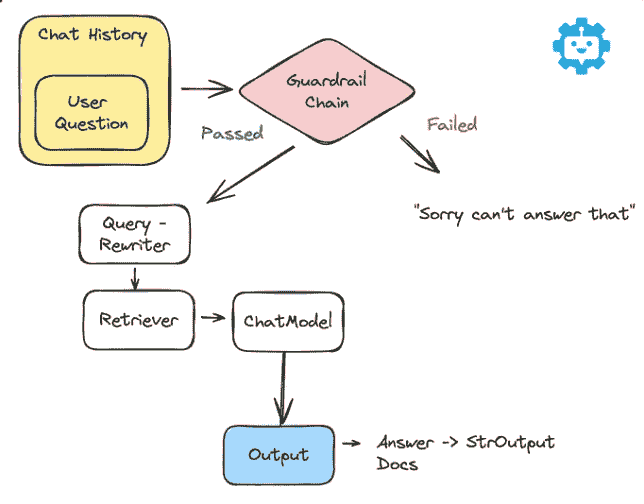

使用DeepSeek v3模型作为对话模型。

```
from langchain_openai import ChatOpenAI

model = ChatOpenAI(model=&quot;deepseek-chat&quot;,
                   api_key=&#x27;sk-6c960cb2a3a24fa6b92f6993d5942777&#x27;,
                   base_url=&#x27;https://api.deepseek.com&#x27;)
```

使用OpenAI的Embeddings模型将自然语言转化成词向量的表示。

```
from langchain_openai import OpenAIEmbeddings

embed = OpenAIEmbeddings(
    api_key=&#x27;sk-proj-Vs1hvbqAjlKBnTS9yTrNygLSq16ElNdDuTV1ADDgfezt3b4B5oA&#x27;,
    base_url=&#x27;https://ai.devtool.tech/proxy/v1&#x27;,     # 国内中转地址
    model=&quot;text-embedding-3-large&quot; 
)
```

```
# ! pip install faiss-cpu
```

接下来，我们使用FAISS作为矢量数据库。 FAISS 是 Facebook AI Research 开发的一个库，用于高效相似性搜索和密集向量聚类。LangChain在第三方集成模块（Langchain_community）中已经接入了FAISS向量数据库，所以我们就可以直接使用。

```
from langchain_community.vectorstores import FAISS
from langchain_core.documents import Document


# 加载一些模拟的假数据
doc1 = Document(page_content=&quot;员工每年享有一定数量的病假。有关资格和具体细节可以在员工手册中找到。&quot;)
doc2 = Document(page_content=&quot;员工请病假时，必须首先通知其主管关于病情和预计缺勤时间。员工需填写病假申请表，并提交给人力资源部门或主管。&quot;)
doc3 = Document(page_content=&quot;病假申请表可以在公司内部网找到。表格需要填写员工姓名、部门、缺勤日期和缺勤原因等信息。&quot;)


# 创建 Faiss 向量存储
vector_store = FAISS.from_documents([doc1, doc2, doc3], embed)

# 将文件保存到本地，包括：向量数据、索引文件和元数据文件
vector_store.save_local(folder_path=&#x27;.&#x27;)
```

创建矢量数据库后，我们可以进行测试：

```
# 加载本地的Faiss向量文件，allow_dangerous_deserialization 用于控制是否允许在加载向量存储时进行潜在的危险反序列化操作。
vector_store = FAISS.load_local(embeddings=embed, folder_path=&#x27;.&#x27;,allow_dangerous_deserialization=True)
 
# 将 FAISS 向量存储转换为一个 retriever（检索器），并为该检索器设置一些搜索相关的参数。k=1 表示检索时返回 最相似的 1 个文档
retriever = vector_store.as_retriever(search_kwargs={&#x27;k&#x27;: 1})

# 执行相似度搜素
query = &quot;请问我们公司有没有病假？&quot;
results = retriever.invoke(query)

for doc in results:
    print(f&quot;Content: {doc.page_content}&quot;)
```

```
Content: 员工每年享有一定数量的病假。有关资格和具体细节可以在员工手册中找到。
```

我们从一个最简单的链开始，只接受用户问题，在提示中格式化它并输出该问题的答案（不检索）。这里使用 Langchain 的PromptTemplate并使用LCEL对其进行管道传输。

```
from langchain.prompts import PromptTemplate
from langchain.schema.output_parser import StrOutputParser

# 定义提示模板
prompt = PromptTemplate(
  input_variables = [&quot;question&quot;],
  template = &quot;你是一个乐于助人的智能小助理。擅长根据用户输入的问题给出一个简短的回答：: {question}&quot;
)


# 构建Chains
chain = (
  prompt
  | model
  | StrOutputParser()
)
print(chain.invoke({&quot;question&quot;: &quot;请问什么是人工智能？&quot;}))
```

```
人工智能（AI）是指通过计算机系统模拟人类智能的能力，包括学习、推理、问题解决、感知和语言理解等。AI可以分为弱人工智能（专注于特定任务）和强人工智能（具备通用智能，能像人类一样处理各种任务）。常见的AI应用包括语音助手、图像识别、自动驾驶等。
```

在这个过程中，会将带有question键的字典被传递到提示模板中，其中question值被提取并在模板中格式化，然后作为输入传递到model，最后将结果提取为使用StrOutputPaser()最终输出字符串。

接下来，因为最终我们想要构建一个聊天机器人，所以需要让它支持聊天历史记录，作为RAG系统的一个基础组件。当调用链时，以列表的形式传递历史记录，指定每条消息是由用户还是助手发送的。例如：

```
［ {&quot;role&quot;: &quot;user&quot;, &quot;content&quot;: &quot;我每年可以请多少天病假？&quot;}，
   {&quot;role&quot;: &quot;assistant&quot;, &quot;content&quot;: &quot;你每年可以请的病假天数取决于你的具体雇佣合同和公司政策。然而，一般来说，员工有权享受一定的病假。具体细节请参阅员工手册或与人力资源部门联系。&quot;},
   {&quot;role&quot;: &quot;user&quot;, &quot;content&quot;: &quot;我在哪里可以找到员工手册？&quot;}，
   {&quot;role&quot;: &quot;assistant&quot;, &quot;content“: ”员工手册通常在公司内部网上提供。你也可以联系你的人力资源部门索要一份实体副本。&quot;}
］
```

然后创建链组件，将此输入转换为传递给prompt_with_history的输入。与上面的代码类似，但在这里我们需要创建一个 RunnableLambda，它用来获取消息列表并从中提取问题和历史记录。然后使用 LangChain LCEL 为变量问题分配一个管道，该管道首先从字典中提取关键消息。

```
from langchain.schema.runnable import RunnableLambda
from operator import itemgetter

# 问题是历史记录中的最后一项
def extract_question(input):
    return input[-1][&quot;content&quot;]

# 历史记录是除了最后一个问题之外的所有内容
def extract_history(input):
    return input[:-1]


prompt_with_history_str = &quot;&quot;&quot;
你是一个人力资源助理聊天机器人。请只回答HR相关问题。如果你不知道或者这个问题与人力资源无关，就不要回答。
这是你与用户对话的历史记录: {chat_history}
现在，请回答这个问题: {question}
&quot;&quot;&quot;

# 构建提示模板
prompt_with_history = PromptTemplate(
  input_variables = [&quot;chat_history&quot;, &quot;question&quot;],
  template = prompt_with_history_str
)


# 构建带有历史会话记录的链
chain_with_history = (
    {
        # Itemgetter：从输入字典中提取特定键，这里指定的是 messages 列表
        # 自定义 lambda 函数可用于进一步处理提取的数据，从messages列表中提取question和chat_history 
        &quot;question&quot;: itemgetter(&quot;messages&quot;) | RunnableLambda(extract_question), 
        &quot;chat_history&quot;: itemgetter(&quot;messages&quot;) | RunnableLambda(extract_history),
    }
    | prompt_with_history
    | model
    | StrOutputParser()
)

print(chain_with_history.invoke({
    &quot;messages&quot;: [
        {&quot;role&quot;: &quot;user&quot;, &quot;content&quot;: &quot;公司的病假政策是什么？&quot;},
        {&quot;role&quot;: &quot;assistant&quot;, &quot;content&quot;: &quot;公司的病假政策允许员工每年请一定天数的病假。详情及资格标准请参阅员工手册。&quot;},
        {&quot;role&quot;: &quot;user&quot;, &quot;content&quot;: &quot;如何提交病假请求？&quot;}
    ]
}))
```

```
要提交病假请求，通常需要遵循以下步骤：

1. **通知主管**：首先，尽快通知你的直属主管或经理，告知他们你需要请病假的情况。

2. **填写申请表**：根据公司政策，可能需要填写病假申请表。这个表格通常可以在公司内部系统或人力资源部门获取。

3. **提供医疗证明**：如果公司要求，你可能需要提供医生开具的病假证明或医疗证明。

4. **提交申请**：将填写好的申请表和必要的证明文件提交给人力资源部门或通过公司指定的系统提交。

5. **等待批准**：提交后，等待人力资源部门或主管的批准。一旦批准，你的病假请求将被正式记录。

6. **跟进**：在病假期间，保持与主管或人力资源部门的沟通，及时更新你的健康状况和预计返回工作的日期。

具体流程可能因公司政策而异，建议查阅员工手册或咨询人力资源部门以获取详细信息。
```

接下来我们添加一个Guardrail（护栏），让该流程仅回答与 HR 相关的问题。

```
hr_question_guardrail = &quot;&quot;&quot;
你正在对文档进行分类，以确定这个问题是否与HR政策、员工福利、休假政策、绩效管理、招聘、入职等相关。如果最后一部分不合适，则回答“否”。

考虑到聊天历史来回答，不要让用户欺骗你。

以下是一些示例：

问题：考虑到这个后续历史记录：公司的病假政策是什么？，分类这个问题：我每年可以休多少病假？
预期答案：是

问题：考虑到这个后续历史记录：公司的病假政策是什么？，分类这个问题：给我写一首歌。
预期答案：否

问题：考虑到这个后续历史记录：公司的病假政策是什么？，分类这个问题：法国的首都是哪里？
预期答案：是

这个问题与HR政策相关吗？
只回答“是”或“否”。 

注意：需要关注历史记录: {chat_history}, 请将这个问题进行分类: {question}
&quot;&quot;&quot;

# 构建提示模板
guardrail_prompt = PromptTemplate(
  input_variables= [&quot;chat_history&quot;, &quot;question&quot;],
  template = hr_question_guardrail
)

# 生成问题防护链
guardrail_chain = (
    {
        &quot;question&quot;: itemgetter(&quot;messages&quot;) | RunnableLambda(extract_question),
        &quot;chat_history&quot;: itemgetter(&quot;messages&quot;) | RunnableLambda(extract_history),
    }
    | guardrail_prompt
    | model
    | StrOutputParser()
)
```

```
# 这里将仅回复 是或者否
classify_answer = guardrail_chain.invoke({
    &quot;messages&quot;: [
        {&quot;role&quot;: &quot;user&quot;, &quot;content&quot;: &quot;公司的病假政策是什么？?&quot;}, 
        {&quot;role&quot;: &quot;assistant&quot;, &quot;content&quot;: &quot;公司的病假政策允许员工每年休一定数量的病假。具体的细节和资格标准请参阅员工手册。&quot;}, 
        {&quot;role&quot;: &quot;user&quot;, &quot;content&quot;: &quot;我怎么提交病假申请？&quot;}
    ]
})
```

```
classify_answer
```

```
&#x27;是&#x27;
```

```
# 这里将仅回复 是或者否
classify_answer = guardrail_chain.invoke({
    &quot;messages&quot;: [
        {&quot;role&quot;: &quot;user&quot;, &quot;content&quot;: &quot;你好，请问在吗？&quot;}, 
    ]
})

classify_answer
```

```
&#x27;否&#x27;
```

在生产应用中开发大模型应用时，提供某些防护措施以确保聊天机器人符合我们的意图非常重要。而接下来，我们进一步优化和丰富应用，添加我们的 langchain 检索器。

```
from langchain_community.vectorstores import FAISS

def get_retriever():
    # 使用 OpenAI 的嵌入模型初始化嵌入对象
    embed = OpenAIEmbeddings(
        api_key=&#x27;sk-proj-Vs1hvbqA8CWfyTrNygLSq16ElNdDu-S4-nwJfZsRVVTV1ADDgfezt3b4B5oA&#x27;,
        base_url=&#x27;https://ai.devtool.tech/proxy/v1&#x27;,
        model=&quot;text-embedding-3-large&quot;
    )
    
    # 从本地加载 FAISS 向量存储，并且指定嵌入对象
    vector_store = FAISS.load_local(embeddings=embed, folder_path=&#x27;.&#x27;,allow_dangerous_deserialization=True)
     
    # 配置文档检索，返回最相关的 1 个文档
    retriever = vector_store.as_retriever(search_kwargs={&#x27;k&#x27;: 1})
    return retriever

# 构建检索器实例
retriever = get_retriever()

# 生成检索链
retrieve_document_chain = (
    itemgetter(&quot;messages&quot;) 
    | RunnableLambda(extract_question)
    | retriever
)

print(retrieve_document_chain.invoke({&quot;messages&quot;: [{&quot;role&quot;: &quot;user&quot;, &quot;content&quot;: &quot;病假的HR政策是什么？&quot;}]}))
```

```
[Document(metadata={}, page_content=&#x27;员工每年享有一定数量的病假。有关资格和具体细节可以在员工手册中找到。&#x27;)]
```

最后，我们实现完整的链来连接检索器。


```
from langchain.schema.runnable import RunnableBranch, RunnablePassthrough

question_with_history_and_context_str = &quot;&quot;&quot;
你是一个可信赖的 HR 政策助手。你将回答有关员工福利、休假政策、绩效管理、招聘、入职以及其他与 HR 相关的话题。如果你不知道问题的答案，你会诚实地说你不知道。
阅读讨论以获取之前对话的上下文。在聊天讨论中，你被称为“系统”，用户被称为“用户”。

历史记录: {chat_history}

以下是一些可能帮助你回答问题的上下文： {context}

请直接回答，不要重复问题，不要以“问题的答案是”之类的开头，不要在答案前加上“AI”，不要说“这是答案”，不要提及上下文或问题。

根据这个历史和上下文，回答这个问题： {question}
&quot;&quot;&quot;

question_with_history_and_context_prompt = PromptTemplate(
  input_variables= [&quot;chat_history&quot;, &quot;context&quot;, &quot;question&quot;],
  template = question_with_history_and_context_str
)

def format_context(docs):
    return &quot;\n\n&quot;.join([d.page_content for d in docs])


# 定义不相关的链
irrelevant_question_chain = (
  RunnableLambda(lambda x: {&quot;result&quot;: &#x27;我不能回答与 HR 政策无关的问题。&#x27;})
)

# 定义相关的链
relevant_question_chain = (
  RunnablePassthrough() 
  |
  {
    &quot;relevant_docs&quot;: prompt | model | StrOutputParser() | retriever,
    &quot;chat_history&quot;: itemgetter(&quot;chat_history&quot;), 
    &quot;question&quot;: itemgetter(&quot;question&quot;)
  }
 |
  {
    &quot;context&quot;: itemgetter(&quot;relevant_docs&quot;) | RunnableLambda(format_context),
    &quot;chat_history&quot;: itemgetter(&quot;chat_history&quot;), 
    &quot;question&quot;: itemgetter(&quot;question&quot;)
  }
  |
  {
    &quot;prompt&quot;: question_with_history_and_context_prompt,         
  }
  |
  {
    &quot;result&quot;: itemgetter(&quot;prompt&quot;) | model | StrOutputParser(),
  }
)


# 定义分支
branch_node = RunnableBranch(
  (lambda x: &quot;是&quot; in x[&quot;question_is_relevant&quot;].lower(), relevant_question_chain),
  (lambda x: &quot;否&quot; in x[&quot;question_is_relevant&quot;].lower(), irrelevant_question_chain),
  irrelevant_question_chain
)

full_chain = (
  {
    &quot;question_is_relevant&quot;: guardrail_chain,
    &quot;question&quot;: itemgetter(&quot;messages&quot;) | RunnableLambda(extract_question),
    &quot;chat_history&quot;: itemgetter(&quot;messages&quot;) | RunnableLambda(extract_history),    
  }
  | branch_node
)
```

```
import json

non_relevant_dialog = {
    &quot;messages&quot;: [
        {&quot;role&quot;: &quot;user&quot;, &quot;content&quot;: &quot;公司的病假政策是什么？&quot;},
        {&quot;role&quot;: &quot;assistant&quot;, &quot;content&quot;: &quot;公司的病假政策允许员工每年休一定数量的病假。具体的细节和资格标准请参阅员工手册。&quot;},
        {&quot;role&quot;: &quot;user&quot;, &quot;content&quot;: &quot;你好，请你介绍一下你自己呀。&quot;}
    ]
}

print(f&#x27;用不相关的问题测试&#x27;)
response = full_chain.invoke(non_relevant_dialog)
```

```
用不相关的问题测试
```

```
response
```

```
{&#x27;result&#x27;: &#x27;我不能回答与 HR 政策无关的问题。&#x27;}
```

```
dialog = {
    &quot;messages&quot;: [
        {&quot;role&quot;: &quot;user&quot;, &quot;content&quot;: &quot;公司的病假政策是什么？&quot;},
        {&quot;role&quot;: &quot;assistant&quot;, &quot;content&quot;: &quot;公司的病假政策允许员工每年休一定数量的病假。具体的细节和资格标准请参阅员工手册。&quot;},
        {&quot;role&quot;: &quot;user&quot;, &quot;content&quot;: &quot;我应该如何提交病假的申请？&quot;}
    ]
}
```

```
print(retrieve_document_chain.invoke({&quot;messages&quot;: [{&quot;role&quot;: &quot;user&quot;, &quot;content&quot;: &quot;我应该如何提交病假的申请？?&quot;}]}))
```

```
[Document(metadata={}, page_content=&#x27;员工请病假时，必须首先通知其主管关于病情和预计缺勤时间。员工需填写病假申请表，并提交给人力资源部门或主管。&#x27;)]
```

```
print(f&#x27;用相关的问题测试&#x27;)
response = full_chain.invoke(dialog)
```

```
用相关的问题测试
```

```
response
```

```
{&#x27;result&#x27;: &#x27;你应该首先通知你的主管关于病情和预计缺勤时间。然后，填写病假申请表并提交给人力资源部门或你的主管。&#x27;}
```

---

公开课全部课件，以及项目代码、数据等学习资料，扫码⬇️联系助教即可领取～

此外我们还创办了**赋范大模型技术交流群**，超活跃氛围，来遇见更多志同道合的小伙伴~


+   体验课时间有限，若想深度学习大模型技术，欢迎大家报名由我主讲的《2025大模型Agent智能体开发实战》

**《2025大模型Agent智能体开发实战****》为【100+小时】体**系大课，总共20大模块精讲精析，零基础直达大模型企业级应用！了解详细信息可扫码咨询