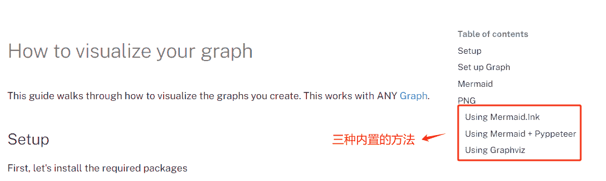
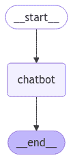
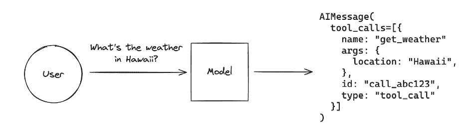
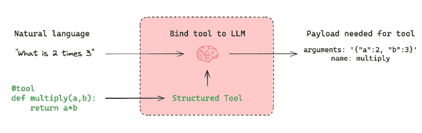
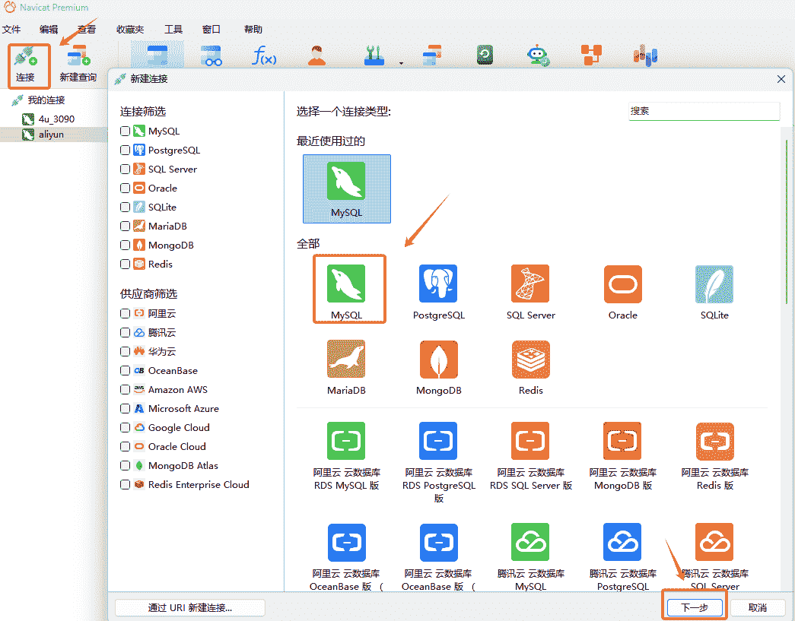
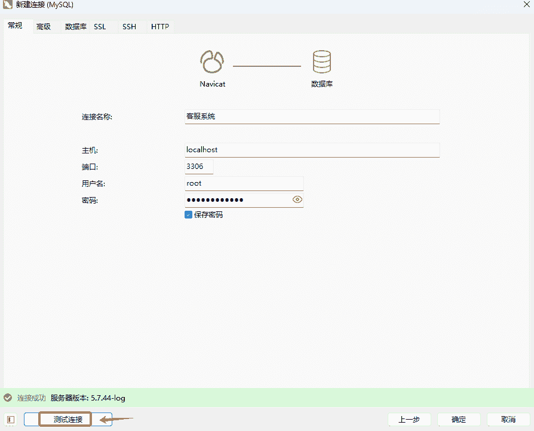
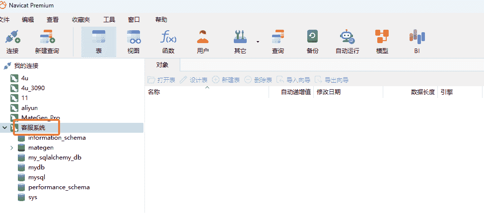
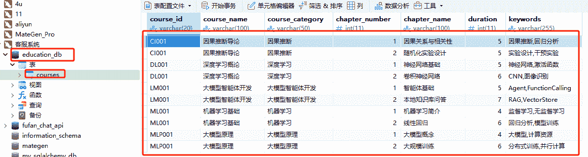
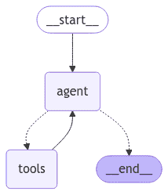
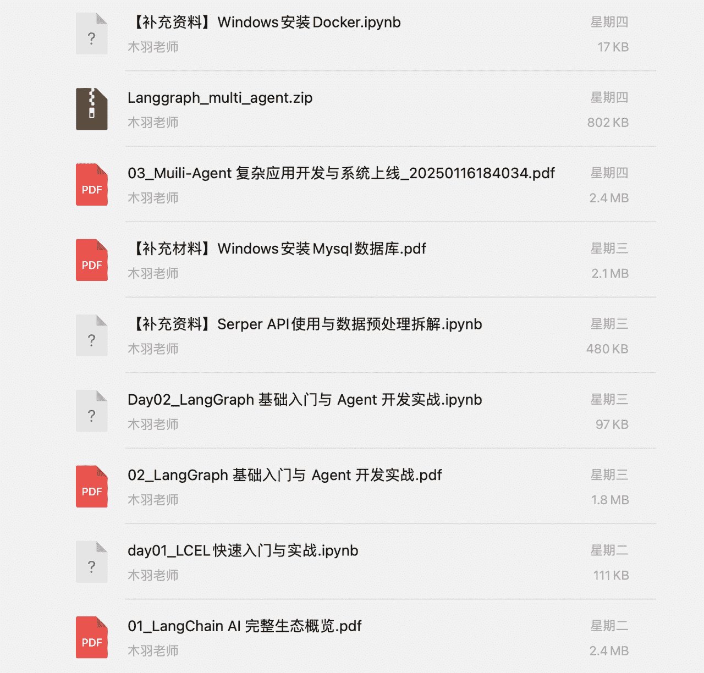

# LangGraph 基础入门与 Agent 开发实战

> 来源：[https://kq4b3vgg5b.feishu.cn/docx/ZUTvdjFYdoX0tcxndOLcVlnHnwb](https://kq4b3vgg5b.feishu.cn/docx/ZUTvdjFYdoX0tcxndOLcVlnHnwb)

## 课程说明

体验课内容节选自《2025大模型Agent智能体开发实战》完整版付费课程。

体验课时间有限，若想深度学习大模型技术，欢迎大家报名由我主讲的《2025大模型Agent智能体开发实战》。


此外，公开课全部课件，以及项目代码、数据等学习资料，扫码⬆️联系助教即可领取～

---

## 《2025大模型智能体Agent开发实战》体验课

### LangChain AI+ DeepSeek v3 企业 Agent 开发实战

### Part 2. LangGraph 基础入门与 Agent 开发实战

#### 1. LangGraph 接入 DeepSeek v3 模型

LangGraph 中的 `StateGraph` 类，这个类允许我们创建图，其节点通过读取和写入共享状态进行通信。`StateGraph` 类由开发者定义的 `State` 对象进行参数化，该对象表示图中的节点将通过其进行通信的共享数据结构。

```python
from typing import Annotated
from langgraph.graph import StateGraph
from typing_extensions import TypedDict
from langgraph.graph.message import add_messages

class State(TypedDict):
    messages: Annotated[list, add_messages]

graph_builder = StateGraph(State)
```

定义模型实例，这里使用DeepSeek v3 模型。

```python
from langchain_openai import ChatOpenAI

model = ChatOpenAI(model="deepseek-chat",
                   api_key='sk-98f37d04e1374105b31cb994ae0c9c96',
                   base_url='https://api.deepseek.com')
```

定义大模型对话节点。

```python
def chatbot(state: State):
    # print(state)
    return {"messages": [model.invoke(state["messages"])]}
```

添加节点并编译图。同样，我们先看普通边。如果直接想从节点A到节点B，可以直接使用`add_edge`方法。注意：LangGraph有两个特殊的节点：`START`和`END`。`START`表示将用户输入发送到图的节点。使用该节点的主要目的是确定应该首先调用哪些节点。`END`节点是代表终端节点的特殊节点。当想要指示哪些边完成后没有任何操作时，将使用该节点。因此，一个完整的图就可以使用如下代码进行定义：

```python
from langgraph.graph import START, END

# 添加自定义节点
graph_builder.add_node("chatbot", chatbot)

# 构建边
graph_builder.add_edge(START, "chatbot")
graph_builder.add_edge("chatbot", END)

# 编译图
graph = graph_builder.compile()
```

LangGraph还提供了多种内置的图形可视化方法，能够将任意`Graph`以图形的形式展示出来，帮助我们更好地理解节点之间的关系和流程的动态变化。可视化最大的好处是：直接从代码中生成图形化的表示，可以检查图的执行逻辑是否符合构建的预期。LangGraph提供的三种图形可视化方法如下：

+ `Mermaid.Ink`：一个开源服务，可根据 Mermaid 代码生成图表的 URL。它通过 API 提供多种输出格式，包括 PNG、JPEG、SVG 和 PDF，并可以自定义尺寸、主题和背景颜色等选项。开源仓库👉：mermaid

+ `Mermaid` + `Pyppeteer`：使用 `Mermaid` 结合 `Pyppeteer` 的主要区别在于如何将 `Mermaid` 图表转换成图像或其他格式。`Mermaid` 本身是一个轻量级的工具，用于通过文本描述生成图表的图形表示。而 `Pyppeteer` 是一个 Python 库，它提供了一个接口来控制 Chrome，自动打开包含 `Mermaid` 图表的网页，然后通过浏览器自动截图功能捕获这些图表，生成图像文件。

+ `Graphviz`：`Graphviz` 是一个图形可视化软件，主要用于自动图形布局。它非常适合于复杂图形的生成，如有向图和无向图，而且它支持多种格式的图像输出，如 PNG、SVG、PDF 等，有更精细的布局控制。

> https://langchain-ai.github.io/langgraph/how-tos/visualization/



如果是Linux操作系统，建议使用`Graphviz`工具。而Windows系统建议使用`Mermaid` + `Pyppeteer`方法，因为在Windows中`Graphviz`并不能直接通过 `pip install`的形式安装，编译安装的方法较为复杂。这里我们就使用`Mermaid` + `Pyppeteer`来进行图的可视化操作。首先，在当前的虚拟环境中安装依赖包，执行如下代码：

```bash
# ! pip install pyppeteer ipython
```

生成图结构的可视化非常直接，只需一行代码即可完成。具体代码如下：

```python
from IPython.display import Image, display

display(Image(graph.get_graph(xray=True).draw_mermaid_png()))
```



当通过 `builder.compile()` 方法编译图后，编译后的 `graph` 对象提供了 `invoke` 方法，该方法用于启动图的执行。我们可以通过 `invoke` 方法传递一个初始状态，这个状态将作为图执行的起始输入。代码如下：

```python
input_message = {"messages": ["你好，请你介绍一下你自己"]}

result = graph.invoke(input_message)
print(result)
```

```text
{'messages': [HumanMessage(content='你好，请你介绍一下你自己', additional_kwargs={}, response_metadata={}, id='7ce1accb-1de7-432a-b77e-6617a45eb24f'), AIMessage(content='你好！我是一个由OpenAI开发的人工智能助手，旨在帮助用户解答问题、提供信息、协助学习和完成各种任务。我可以处理多种语言，理解自然语言，并根据你的需求提供相应的帮助。\n\n我的功能包括但不限于：\n1. **信息查询**：提供关于科学、历史、文化、技术等领域的知识。\n2. **学习辅助**：帮助解答作业问题、解释复杂概念或提供学习建议。\n3. **语言翻译**：支持多种语言之间的翻译。\n4. **写作支持**：协助撰写文章、邮件、报告等。\n5. **日常建议**：提供生活、健康、旅行等方面的建议。\n6. **编程帮助**：解答编程问题、调试代码或提供算法思路。\n\n我没有个人情感或意识，但会尽力以友好和专业的方式与你互动。如果你有任何问题或需要帮助，随时告诉我！ 😊', additional_kwargs={'refusal': None}, response_metadata={'token_usage': {'completion_tokens': 179, 'prompt_tokens': 8, 'total_tokens': 187, 'completion_tokens_details': None, 'prompt_tokens_details': None, 'prompt_cache_hit_tokens': 0, 'prompt_cache_miss_tokens': 8}, 'model_name': 'deepseek-chat', 'system_fingerprint': 'fp_3a5770e1b4', 'finish_reason': 'stop', 'logprobs': None}, id='run-dadb251b-b1a5-4651-a8f2-785d21114bed-0', usage_metadata={'input_tokens': 8, 'output_tokens': 179, 'total_tokens': 187, 'input_token_details': {}, 'output_token_details': {}})]}
```

```python
print(result["messages"][-1].content)
```

```text
你好！我是一个由OpenAI开发的人工智能助手，旨在帮助用户解答问题、提供信息、协助学习和完成各种任务。我可以处理多种语言，理解自然语言，并根据你的需求提供相应的帮助。

我的功能包括但不限于：
1. **信息查询**：提供关于科学、历史、文化、技术等领域的知识。
2. **学习辅助**：帮助解答作业问题、解释复杂概念或提供学习建议。
3. **语言翻译**：支持多种语言之间的翻译。
4. **写作支持**：协助撰写文章、邮件、报告等。
5. **日常建议**：提供生活、健康、旅行等方面的建议。
6. **编程帮助**：解答编程问题、调试代码或提供算法思路。

我没有个人情感或意识，但会尽力以友好和专业的方式与你互动。如果你有任何问题或需要帮助，随时告诉我！ 😊
```

通过一个程序构建可交互式的聊天机器人。完整代码如下：

```python
def stream_graph_updates(user_input: str):  
    for event in graph.stream({"messages": [("user", user_input)]}):
        for value in event.values():
            print("模型回复:", value["messages"][-1].content)


while True:
    try:
        user_input = input("用户提问: ")
        if user_input.lower() in ["退出"]:
            print("下次再见！")
            break

        stream_graph_updates(user_input)
    except:
        break
```

```text
用户提问:  退出


下次再见！
```

掌握`State`的定义模式和消息传递是LangGraph中最关键，也是构建应用最核心的部分，所有的高阶功能，如工具调用、上下文记忆，人机交互等依赖`State`的管理和使用，所以大家务必理解并掌握上述相关内容。

#### 2. 工具调用代理

`Tool Calling Agent`（工具调用代理）是LangGraph支持的一种AI `Agent`代理架构。这个代理架构是在`Router Agent`的基础上，大模型可以自主选择并使用多种工具来完成某个条件分支中的任务。当我们希望代理与外部系统交互时，工具就非常有用。外部系统（例如`API`）通常需要特定的输入模式，而不是自然语言。例如，当我们绑定 API 作为工具时，我们赋予大模型对所需输入模式的感知，大模型就能根据用户的自然语言输入选择调用工具，并将返回符合该工具架构的输出。



在LangGraph框架中，可以直接使用预构建`ToolNode`进行工具调用，其内部实现原理和我们之前介绍的手动实现的`Function Calling`流程思路基本一致，即：

> LangGraph `ToolNode` 源码：https://langchain-ai.github.io/langgraph/reference/prebuilt/#langgraph.prebuilt.tool_node.ToolNode

```python
tools_by_name = {tool.name: tool for tool in tools}
def tool_node(state: dict):
    result = []
    for tool_call in state["messages"][-1].tool_calls:
        tool = tools_by_name[tool_call["name"]]
        observation = tool.invoke(tool_call["args"])
        result.append(ToolMessage(content=observation, tool_call_id=tool_call["id"]))
    return {"messages": result}
```

##### 2.1 使用ToolNode接入工具

经过`ToolNode`工具后，其返回的是一个LangChain `Runnable`对象，会将图形状态（带有消息列表）作为输入并输出状态更新以及工具调用的结果，通过这种设计去适配LangGraph中其他的功能组件。比如我们LangGraph预构建的更高级AI Agent架构 - `ReAct`，两者搭配起来可以开箱即用，同时通过`ToolNode`构建的工具对象也能与任何`StateGraph`一起使用。由此，对于`ToolNode`的使用，有三个必要的点需要满足，即：

1. 状态必须包含消息列表。
2. 最后一条消息必须是`AIMessage`。
3. `AIMessage`必须填充`tool_calls`。

我们尝试进行一下实践。首先，既然是工具调用代理，我们就准备一下需要用的外部工具/函数。这里我们使用`Serper API`去构建实时联网检索的功能。

```bash
# ! pip install requests
```

```python
import requests
import json

def fetch_real_time_info(query):
    """Get real-time Internet information"""
    
    url = "https://google.serper.dev/search"
    
    payload = json.dumps({
      "q": query,
      "num": 3,
    })
    
    headers = {
      'X-API-KEY': 'd9c2c002085468d95712cbc71d76c4302b4f7342',
      'Content-Type': 'application/json'
    }
    
    response = requests.post(url, headers=headers, data=payload)
    
    data = json.loads(response.text)  # 将返回的JSON字符串转换为字典
    if 'organic' in data:
        return json.dumps(data['organic'], ensure_ascii=False)  # 返回'organic'部分的JSON字符串
    else:
        return json.dumps({"error": "No organic results found"}, ensure_ascii=False)  # 如果没有'organic'键，返回错误信息
```

定义好`fetch_real_time_info`实时联网检索函数后，我们可以先进行一下连通性测试：


# 使用示例

```
query = "DeepSeek v3 相关的新闻"
result = fetch_real_time_info(query)
print(result)
```

```
[{"title": "DeepSeek崛起AI经济模型或将开启全面重构 - 21财经", "link": "https://www.21jingji.com/article/20250115/a4cf46d7e05505af03f59aad1f78450d.html", "snippet": "在高端芯片禁运的情况下，DeepSeek V3靠着往年囤积的“阉割版”H卡，用区区五百万美元，在惊人的不到三百万H800 GPU小时里完成了预训练，获得了聊天机器人竞技场 ...", "date": "8 hours ago", "position": 1}, {"title": "DeepSeek推出App版本，使用V3大模型，网友：终于等到了 - 腾讯新闻", "link": "https://news.qq.com/rain/a/20250113A05E1Z00", "snippet": "该App的商店页面显示，这是DeepSeek官方推出的AI助手，可“免费体验与全球领先AI模型的互动交流”。其使用开源的DeepSeek-V3 大模型，多项性能指标对齐海外顶尖 ...", "date": "2 days ago", "position": 2}, {"title": "深度求索大模型：“花小钱办大事” - 科技日报", "link": "https://www.stdaily.com/web/gdxw/2025-01/14/content_286087.html", "snippet": "... DeepSeek-V3模型，同时公布长达53页的技术报告，介绍关键技术和训练细节。 和很多语焉不详的报告相比，这份报告真正做到了开源。其中最抓人眼球的部分是，V3 ...", "date": "18 hours ago", "position": 3}]
```

如果功能正常，该函数将根据用户的输入，返回实时的网页检索信息，这包括标题、链接、摘要等等有效的信息。而如果想要将普通的函数变成`ToolNode`可以应用的外部函数，只需要在函数定义时添加`@tool`装饰器。

## 定义可调用工具函数

```
from langchain_core.tools import tool

@tool
def fetch_real_time_info(query):
    """Get real-time Internet information"""
    url = "https://google.serper.dev/search"
    payload = json.dumps({
      "q": query,
      "num": 1,
    })
    headers = {
      'X-API-KEY': 'd9c2c002085468d95712cbc71d76c4302b4f7342',
      'Content-Type': 'application/json'
    }
    
    response = requests.post(url, headers=headers, data=payload)
    data = json.loads(response.text)  # 将返回的JSON字符串转换为字典
    if 'organic' in data:
        return json.dumps(data['organic'],  ensure_ascii=False)  # 返回'organic'部分的JSON字符串
    else:
        return json.dumps({"error": "No organic results found"},  ensure_ascii=False)  # 如果没有'organic'键，返回错误信息
```

```
print(f'''
name: {fetch_real_time_info.name}
description: {fetch_real_time_info.description}
arguments: {fetch_real_time_info.args}
''')
```

```
name: fetch_real_time_info
description: Get real-time Internet information
arguments: {'query': {'title': 'Query'}}
```

## ToolNode 实例化与单工具调用

接下来使用`ToolNode`对函数进行实例化，代码如下：

```
from langgraph.prebuilt import ToolNode

tools = [fetch_real_time_info]
tool_node = ToolNode(tools)
```

```
tool_node
```

```
tools(tags=None, recurse=True, func_accepts_config=True, func_accepts={'writer': False, 'store': True}, tools_by_name={'fetch_real_time_info': StructuredTool(name='fetch_real_time_info', description='Get real-time Internet information', args_schema=<class 'langchain_core.utils.pydantic.fetch_real_time_info'>, func=<function fetch_real_time_info at 0x0000023B318F45E0>)}, tool_to_state_args={'fetch_real_time_info': {}}, tool_to_store_arg={'fetch_real_time_info': None}, handle_tool_errors=True, messages_key='messages')
```

`ToolNode`使用消息列表对图状态进行操作。所以它要求消息列表中的最后一条消息是带有`tool_calls`参数的`AIMessage`，比如我们可以手动调用工具节点：

```
from langchain_core.messages import AIMessage

message_with_single_tool_call = AIMessage(
    content="",
    tool_calls=[
        {
            "name": "fetch_real_time_info",
            "args": {"query": "DeepSeek v3 最新的新闻"},
            "id": "tool_call_id",
            "type": "tool_call",
        }
    ],
)

tool_node.invoke({"messages": [message_with_single_tool_call]})
```

```
{'messages': [ToolMessage(content='[{"title": "DeepSeek崛起AI经济模型或将开启全面重构 - 证券时报", "link": "https://www.stcn.com/article/detail/1494815.html", "snippet": "在高端芯片禁运的情况下，DeepSeek V3靠着往年囤积的“阉割版”H卡，用区区五百万美元，在惊人的不到三百万GPU小时里完成了预训练，获得了聊天机器人竞技场（ ...", "date": "3 hours ago", "position": 1}]', name='fetch_real_time_info', tool_call_id='tool_call_id')]}
```

## 并行调用多个工具

同时，如果将多个工具调用同时传递给`AIMessage`的`tool_calls`参数，仍然可以使用`ToolNode`进行并行工具调用：

```
@tool
def get_weather(location):
    """Call to get the current weather."""
    if location.lower() in ["beijing"]:
        return "北京的温度是16度，天气晴朗。"
    elif location.lower() in ["shanghai"]:
        return "上海的温度是20度，部分多云。"
    else:
        return "不好意思，并未查询到具体的天气信息。"
```

```
tools = [fetch_real_time_info, get_weather]
tool_node = ToolNode(tools)
```

```
tool_node
```

```
tools(tags=None, recurse=True, func_accepts_config=True, func_accepts={'writer': False, 'store': True}, tools_by_name={'fetch_real_time_info': StructuredTool(name='fetch_real_time_info', description='Get real-time Internet information', args_schema=<class 'langchain_core.utils.pydantic.fetch_real_time_info'>, func=<function fetch_real_time_info at 0x0000023B318F45E0>), 'get_weather': StructuredTool(name='get_weather', description='Call to get the current weather.', args_schema=<class 'langchain_core.utils.pydantic.get_weather'>, func=<function get_weather at 0x0000023B36036A20>)}, tool_to_state_args={'fetch_real_time_info': {}, 'get_weather': {}}, tool_to_store_arg={'fetch_real_time_info': None, 'get_weather': None}, handle_tool_errors=True, messages_key='messages')
```

```
message_with_multiple_tool_calls = AIMessage(
    content="",
    tool_calls=[
        {
            "name": "fetch_real_time_info",
            "args": {"query": "DeepSeek v3 最新的新闻"},
            "id": "tool_call_id",
            "type": "tool_call",
        },
        {
            "name": "get_weather",
            "args": {"location": "beijing"},
            "id": "tool_call_id_2",
            "type": "tool_call",
        },
    ],
)

tool_node.invoke({"messages": [message_with_multiple_tool_calls]})
```

```
{'messages': [ToolMessage(content='[{"title": "DeepSeek崛起AI经济模型或将开启全面重构 - 证券时报", "link": "https://www.stcn.com/article/detail/1494815.html", "snippet": "在高端芯片禁运的情况下，DeepSeek V3靠着往年囤积的“阉割版”H卡，用区区五百万美元，在惊人的不到三百万GPU小时里完成了预训练，获得了聊天机器人竞技场（ ...", "date": "3 hours ago", "position": 1}]', name='fetch_real_time_info', tool_call_id='tool_call_id'),
  ToolMessage(content='北京的温度是16度，天气晴朗。', name='get_weather', tool_call_id='tool_call_id_2')]}
```

## Tool Calling Agent 原理

而Tool Calling Agent的本质原理是：让大模型根据用户的输入，自动的去判断应该使用哪个函数，并实际的执行，最后结合工具的响应结果 + 用户的原始问题作为完整的Prompt生成最终的问题。即如下图所示：



通过`ToolNode(tools)`可以根据参数来执行函数，并返回结果。而其前一步，根据自然语言生成执行具体某个函数必要参数的过程，则由大模型决定，所以一个完整的基于大模型的工具调用过程应该是，在实例化大模型的时候，就告诉大模型你都有哪些工具可以使用。这个过程可以通过`bind_tools`函数来实现。代码如下：

```
from langchain_openai import ChatOpenAI

model = ChatOpenAI(model="deepseek-chat",
                   api_key='sk-98f37d04e1374105b31cb994ae0c9c96',
                   base_url='https://api.deepseek.com')
```

```
tools = [fetch_real_time_info, get_weather]
model_with_tools = model.bind_tools(tools)
```

```
model_with_tools
```


```
RunnableBinding(bound=ChatOpenAI(client=<openai.resources.chat.completions.Completions object at 0x0000023B3603D310>, async_client=<openai.resources.chat.completions.AsyncCompletions object at 0x0000023B36012F50>, root_client=<openai.OpenAI object at 0x0000023B3603FE50>, root_async_client=<openai.AsyncOpenAI object at 0x0000023B36013DD0>, model_name='deepseek-chat', model_kwargs={}, openai_api_key=SecretStr('**********'), openai_api_base='https://api.deepseek.com'), kwargs={'tools': [{'type': 'function', 'function': {'name': 'fetch_real_time_info', 'description': 'Get real-time Internet information', 'parameters': {'properties': {'query': {}}, 'required': ['query'], 'type': 'object'}}}, {'type': 'function', 'function': {'name': 'get_weather', 'description': 'Call to get the current weather.', 'parameters': {'properties': {'location': {}}, 'required': ['location'], 'type': 'object'}}}]}, config={}, config_factories=[])
```

```
model_with_tools.kwargs
```

```
{'tools': [{'type': 'function',
   'function': {'name': 'fetch_real_time_info',
    'description': 'Get real-time Internet information',
    'parameters': {'properties': {'query': {}},
     'required': ['query'],
     'type': 'object'}}},
  {'type': 'function',
   'function': {'name': 'get_weather',
    'description': 'Call to get the current weather.',
    'parameters': {'properties': {'location': {}},
     'required': ['location'],
     'type': 'object'}}}]}
```

```
model_with_tools.invoke("DeepSeek v3 最新的新闻").tool_calls
```

```
[{'name': 'fetch_real_time_info',
  'args': {'query': 'DeepSeek v3 最新新闻'},
  'id': 'call_0_ddc20394-315e-452d-ad61-4268102e5ffe',
  'type': 'tool_call'}]
```

```
model_with_tools.invoke("北京现在多少度呀？").tool_calls
```

```
[{'name': 'get_weather',
  'args': {'location': '北京'},
  'id': 'call_0_35200dd5-423b-4844-a2a9-4de463b66da6',
  'type': 'tool_call'}]
```

由此可见，借助大模型可以正确的填充`tool_calls`信息，因此我们可以将其直接传递给`ToolNode`，从而完成完整的`Tool Calling Agent`链路。代码如下：

```
tool_node.invoke({"messages": [model_with_tools.invoke("DeepSeek v3")]})
```

```
{'messages': [ToolMessage(content='[{"title": "DeepSeek-V3", "link": "https://www.deepseek.com/", "snippet": "DeepSeek-V3 is now fully available, with leading performance and improved speed. Click to view details. Brand-new experience, redefining possibilities.", "sitelinks": [{"title": "DeepSeek Platform", "link": "https://platform.deepseek.com/"}, {"title": "DeepSeek Service Status", "link": "https://status.deepseek.com/"}, {"title": "DeepSeek API Upgrade", "link": "https://api-docs.deepseek.com/news/news0725"}], "position": 1}]', name='fetch_real_time_info', tool_call_id='call_0_d9c37e37-1292-4597-9277-5a51017040bd')]}
```

```
tool_node.invoke({"messages": [model_with_tools.invoke("北京现在多少度呀")]})
```

```
{'messages': [ToolMessage(content='不好意思，并未查询到具体的天气信息。', name='get_weather', tool_call_id='call_0_a237fa85-0f43-4a67-b922-1a581850e40d')]}
```

## 2.2 Tool Calling Agent的完整实现案例

接下来，我们来构建完整的`Tool Calling Agent`。这里我们对`Router Agent`实现的图做进一步的升级，即用户输入问题后，如果不需要外部工具的信息，则直接生成回复，否则，则进入一个工具库中，选择最合适的工具执行，并返回最终的响应。因此，我们首先来定义工具库：

+ Step 2. 构建`Mysql`后台数据

首先，我们需要构造一份商家后台的模拟数据。那么，如何存储这些数据呢？对于结构化数据，通常使用关系型数据库来进行存储。常见的选择包括`SQLite`、`MySQL`和`MongoDB`等。我们这里选择使用`MySQL`作为数据存储的方案，然后再借助`pymysql`库在本地`Python`环境中进行连接。关于在`Windows`安装`Mysql`服务的过程，我们就不在直播过程中进行讲解，大家可以添加专属助理领取非常详细的安装教程：


按照上述教程安装完成并启动`Mysql`服务后，我们可以使用一些可视化的工具来进行直观的测试连接。常用的像 [`workbench`](https://www.mysql.com/products/workbench/)、[`DBeaver`](https://dbeaver.io/)、[`Navicat`](https://www.navicat.com/en/) 等，大家按个人喜好选择就行。安装的方法非常简单，点击链接选择对应自己操作系统的版本执行傻瓜式安装即可。我们这里通过`Navicat`进行演示。

首先启动 `Navicat` 客户端，进入主界面，创建新的连接： 在 `Navicat` 主界面左上方，点击 “连接” 按钮，选择 `MySQL`：



在弹出的连接设置窗口中，填写你的 `MySQL` 数据库连接信息，其中：

+ 连接名称：给你的连接起个名字，方便识别（例如：智能客服系统）。
+ 主机名/IP 地址：如果安装在本地计算机上，可以填写 `localhost` 或 `127.0.0.1`。
+ 端口：默认情况下，`MySQL` 使用端口 `3306`，除非你有修改，保持默认即可。
+ 用户名：输入你的 `MySQL` 用户名（例如：`root`，或者你设置的其他用户名）。
+ 密码：输入对应的密码（如果是 `root` 用户，默认是你安装时设置的密码）。

填写完连接信息后，点击窗口下方的 “测试连接” 按钮。如果连接成功，`Navicat` 会显示 "连接成功" 的提示。如果连接失败，则需要上述配置是否填写正确。



最后，如果测试连接成功，点击 “确定” 按钮，`Navicat` 会保存连接并尝试连接到你的 `MySQL` 数据库，并显示在左侧的数据库列表，至此就可以选择并管理该数据库了。



接下来，我们需要使用`Python`来连接本地的`Mysql`数据库，同时创建`education_db`库并插入生成的模拟数据，代码如下：


# 基于 PyMySQL 的 MySQL 数据库操作

## 创建数据库、表并插入数据

```python
import pymysql

def create_and_populate_mysql():
    # 连接到MySQL服务器（未指定数据库）
    conn_mysql = pymysql.connect(
        host='localhost',         # 这里替换成你自己的 MySQL 主机地址
        user='root',              # 这里替换成你自己的用户名
        password='snowball2019',  # 这里替换成你自己的密码
        charset='utf8mb4'         # 字符集
    )
    cursor_mysql = conn_mysql.cursor()

    # 创建数据库 education_db（如果不存在）
    cursor_mysql.execute("CREATE DATABASE IF NOT EXISTS education_db CHARACTER SET utf8mb4 COLLATE utf8mb4_unicode_ci")

    # 切换到 education_db 数据库
    cursor_mysql.execute('USE education_db;')

    # 创建课程信息表
    create_courses_table_query = '''
    CREATE TABLE IF NOT EXISTS courses (
        course_id VARCHAR(20),                  -- 课程ID
        course_name VARCHAR(100) CHARACTER SET utf8mb4 COLLATE utf8mb4_unicode_ci,  -- 课程名称
        course_category VARCHAR(50) CHARACTER SET utf8mb4 COLLATE utf8mb4_unicode_ci,  -- 课程类别
        chapter_number INT,                      -- 章节编号
        chapter_name VARCHAR(100) CHARACTER SET utf8mb4 COLLATE utf8mb4_unicode_ci,  -- 章节名称
        duration INT,                            -- 课程时长（小时）
        keywords VARCHAR(255) CHARACTER SET utf8mb4 COLLATE utf8mb4_unicode_ci,   -- 关键词
        PRIMARY KEY (course_id, chapter_number)   -- 组合主键（课程ID + 章节编号）
    );
    '''
    cursor_mysql.execute(create_courses_table_query)

    # 插入示例数据
    insert_data_query = '''
    INSERT INTO courses (course_id, course_name, course_category, chapter_number, chapter_name, duration, keywords)
    VALUES
    ('ML001', '机器学习基础', '机器学习', 1, '机器学习简介', 4, '监督学习,无监督学习'),
    ('ML001', '机器学习基础', '机器学习', 2, '线性回归', 6, '回归分析,模型训练'),
    ('DL001', '深度学习概论', '深度学习', 1, '神经网络基础', 5, '神经网络,激活函数'),
    ('DL001', '深度学习概论', '深度学习', 2, '卷积神经网络', 6, 'CNN,图像识别'),
    ('LM001', '大模型智能体开发', '大模型智能体开发', 1, '智能体基础', 5, 'Agent,FunctionCalling'),
    ('LM001', '大模型智能体开发', '大模型智能体开发', 2, '本地知识库问答', 7, 'RAG,VectorStore'),
    ('MLP001', '大模型原理', '大模型原理', 1, '大模型概念', 4, '大模型,计算资源'),
    ('MLP001', '大模型原理', '大模型原理', 2, '大规模训练', 6, '分布式训练,并行计算'),
    ('CI001', '因果推断导论', '因果推断', 1, '因果关系与相关性', 5, '因果推断,回归分析'),
    ('CI001', '因果推断导论', '因果推断', 2, '随机化实验设计', 5, '实验设计,干预实验');
    '''
    try:
        cursor_mysql.execute(insert_data_query)
        conn_mysql.commit()  # 提交事务
        print("数据插入成功！")
    except pymysql.MySQLError as e:
        print(f"插入数据时出错：{e}")
        conn_mysql.rollback()  # 回滚事务

    # 提交更改并关闭连接
    conn_mysql.close()

# 调用函数创建数据库并插入数据
create_and_populate_mysql()
```

```
数据插入成功！
```

上述代码的执行过程是：首先，程序通过 `pymysql` 连接到本地的 `MySQL` 服务器，并检查是否存在名为 `education_db` 的数据库。如果该数据库不存在，程序会创建一个新的数据库 `education_db`。然后，切换到该数据库并检查是否已经创建了名为 `courses` 的表，如果没有，会自动创建此表。接着，将一组预设的产品数据插入到 `courses` 表中。插入完成后，提交这些更改，并关闭数据库连接，最后输出提示信息，表示数据库和数据已经成功创建并插入 `MySQL` 中。接下来我们执行这个函数以生成模拟数据：

执行完上述函数后，将在本地 `MySQL` 数据库中创建一个名为 `courses` 的表。



## 按关键字查询课程

如果希望根据关键字来搜索数据，可以通过在查询中使用 `LIKE` 操作符来查找包含特定关键字的记录。我们可以对 `SQL` 查询进行修改，让它支持根据 `keywords` 字段进行搜索。

```python
def query_by_keyword(keyword):
    # 连接 MySQL 数据库
    conn_mysql = pymysql.connect(
        host='localhost',
        user='root',
        password='snowball2019',
        database='education_db',
        charset='utf8mb4'
    )
    cursor_mysql = conn_mysql.cursor()

    # 使用 SQL 查询按关键字查找课程。'%' 符号允许部分匹配。
    cursor_mysql.execute("SELECT * FROM courses WHERE LOWER(keywords) LIKE %s", ('%' + keyword.lower() + '%',))

    # 获取所有查询到的数据
    rows = cursor_mysql.fetchall()

    # 字段说明
    field_descriptions = {
        'course_id': '课程唯一标识符',
        'course_name': '课程名称',
        'course_category': '课程所属类别',
        'chapter_number': '章节的编号',
        'chapter_name': '章节名称',
        'duration': '课程时长（小时）',
        'keywords': '与课程相关的关键词'
    }

    # 关闭连接
    conn_mysql.close()

    # 返回数据和字段说明
    return {
        'data': rows,
        'field_descriptions': field_descriptions
    }
```

```python
query_by_keyword("Agent")
```

```
{'data': (('LM001',
   '大模型智能体开发',
   '大模型智能体开发',
   1,
   '智能体基础',
   5,
   'Agent,FunctionCalling'),),
 'field_descriptions': {'course_id': '课程唯一标识符',
  'course_name': '课程名称',
  'course_category': '课程所属类别',
  'chapter_number': '章节的编号',
  'chapter_name': '章节名称',
  'duration': '课程时长（小时）',
  'keywords': '与课程相关的关键词'}}
```

## 封装为大模型可调用的外部工具

将其封装成大模型可以调用的外部工具。

```python
@tool
def fetch_real_time_info(query):
    """Get real-time Internet information"""
    url = "https://google.serper.dev/search"
    payload = json.dumps({
      "q": query,
      "num": 1,
    })
    headers = {
      'X-API-KEY': 'd9c2c002085468d95712cbc71d76c4302b4f7342',
      'Content-Type': 'application/json'
    }
    
    response = requests.post(url, headers=headers, data=payload)
    data = json.loads(response.text)  # 将返回的JSON字符串转换为字典
    if 'organic' in data:
        return json.dumps(data['organic'],  ensure_ascii=False)  # 返回'organic'部分的JSON字符串
    else:
        return json.dumps({"error": "No organic results found"},  ensure_ascii=False)  # 如果没有'organic'键，返回错误信息

@tool
def query_by_keyword(keyword):
    """Search course details in local database according to keywords"""
    # 连接 MySQL 数据库
    conn_mysql = pymysql.connect(
        host='localhost',
        user='root',
        password='snowball2019',
        database='education_db',
        charset='utf8mb4'
    )
    cursor_mysql = conn_mysql.cursor()

    # 使用 SQL 查询按关键字查找课程。'%' 符号允许部分匹配。
    cursor_mysql.execute("SELECT * FROM courses WHERE LOWER(keywords) LIKE %s", ('%' + keyword.lower() + '%',))

    # 获取所有查询到的数据
    rows = cursor_mysql.fetchall()

    # 字段说明
    field_descriptions = {
        'course_id': '课程唯一标识符',
        'course_name': '课程名称',
        'course_category': '课程所属类别',
        'chapter_number': '章节的编号',
        'chapter_name': '章节名称',
        'duration': '课程时长（小时）',
        'keywords': '与课程相关的关键词'
    }

    # 关闭连接
    conn_mysql.close()

    # 返回数据和字段说明
    return {
        'data': rows,
        'field_descriptions': field_descriptions
    }
```

```python
tools = [query_by_keyword, fetch_real_time_info, get_weather]
tool_node = ToolNode(tools)
```

```python
tool_node
```


# 工具配置与模型绑定

```
tools(tags=None, recurse=True, func_accepts_config=True, func_accepts={'writer': False, 'store': True}, tools_by_name={'query_by_keyword': StructuredTool(name='query_by_keyword', description='Search course details in local database according to keywords', args_schema=<class 'langchain_core.utils.pydantic.query_by_keyword'>, func=<function query_by_keyword at 0x0000023B37271D00>), 'fetch_real_time_info': StructuredTool(name='fetch_real_time_info', description='Get real-time Internet information', args_schema=<class 'langchain_core.utils.pydantic.fetch_real_time_info'>, func=<function fetch_real_time_info at 0x0000023B37271BC0>), 'get_weather': StructuredTool(name='get_weather', description='Call to get the current weather.', args_schema=<class 'langchain_core.utils.pydantic.get_weather'>, func=<function get_weather at 0x0000023B36036A20>)}, tool_to_state_args={'query_by_keyword': {}, 'fetch_real_time_info': {}, 'get_weather': {}}, tool_to_store_arg={'query_by_keyword': None, 'fetch_real_time_info': None, 'get_weather': None}, handle_tool_errors=True, messages_key='messages')
```

```
from langchain_openai import ChatOpenAI

model = ChatOpenAI(model="deepseek-chat",
                   api_key='sk-98f37d04e1374105b31cb994ae0c9c96',
                   base_url='https://api.deepseek.com')

llm = model.bind_tools(tools)
```

# 构建 ReAct Agent

```
from langgraph.prebuilt import create_react_agent

graph = create_react_agent(llm, tools=tools)
```

# 可视化 Agent 图结构

```
from IPython.display import Image, display

display(Image(graph.get_graph().draw_mermaid_png()))
```



理解了上面的`create_react_agent`方法内部的构建原理后，其实就能明白：当通过`create_react_agent(llm, tools=tools)`一行代码的执行，现在得到的已经是一个编译后、可执行的图了。我们可以通过`mermaid`方法来可视化经过`create_react_agent`方法构造出来的图结构，代码如下所示：

返回的是编译好的`LangGraph`可运行程序，可直接用于聊天交互。调用方式则和之前使用的方法一样，我们可以依次针对不同复杂程度的需求依次进行提问。首先是测试是否可以不使用工具，直接调用大模型生成响应。

```
# query = "你好，请你介绍一下你自己"
# input_message = {"messages": [HumanMessage(content=query)]}

# 可以自动处理成 HumanMessage 的消息格式
finan_response = graph.invoke({"messages": ["你好，请你介绍一下你自己"]})
finan_response
```

```
{'messages': [HumanMessage(content='你好，请你介绍一下你自己', additional_kwargs={}, response_metadata={}, id='4a4f31e2-1cf4-478d-9b84-088a88476d26'),
  AIMessage(content='你好！我是一个人工智能助手，专门设计来帮助用户获取信息、解答问题、提供建议和执行各种任务。我可以帮助你查找资料、学习新知识、规划日程、解决问题等。无论你有什么问题或需要帮助，我都会尽力提供支持。请问有什么我可以帮你的吗？', additional_kwargs={'refusal': None}, response_metadata={'token_usage': {'completion_tokens': 57, 'prompt_tokens': 246, 'total_tokens': 303, 'completion_tokens_details': None, 'prompt_tokens_details': None, 'prompt_cache_hit_tokens': 192, 'prompt_cache_miss_tokens': 54}, 'model_name': 'deepseek-chat', 'system_fingerprint': 'fp_3a5770e1b4', 'finish_reason': 'stop', 'logprobs': None}, id='run-a0dd0b3d-7414-4e79-b491-26be1e967b7b-0', usage_metadata={'input_tokens': 246, 'output_tokens': 57, 'total_tokens': 303, 'input_token_details': {}, 'output_token_details': {}})]}
```

```
finan_response["messages"][-1].content
```

```
'你好！我是一个人工智能助手，专门设计来帮助用户获取信息、解答问题、提供建议和执行各种任务。我可以帮助你查找资料、学习新知识、规划日程、解决问题等。无论你有什么问题或需要帮助，我都会尽力提供支持。请问有什么我可以帮你的吗？'
```

# 复杂查询测试（自动调用工具）

加大输入问题的复杂度，接下来我们提问的问题希望它能够自动找到正确的工具函数，基于工具的执行结果作为既定的事实，引导生成最终的回复。

```
finan_response = graph.invoke({"messages": ["课程中有没有Agent相关的内容？"]})

finan_response
```


```
{'messages': [HumanMessage(content='课程中有没有Agent相关的内容？', additional_kwargs={}, response_metadata={}, id='11cfbacf-359d-41f7-ab28-9d4824d0f53c'),
  AIMessage(content='', additional_kwargs={'tool_calls': [{'id': 'call_0_0f7ef5dd-b42a-45fd-afd8-2e9164532ef5', 'function': {'arguments': '{"keyword":"Agent"}', 'name': 'query_by_keyword'}, 'type': 'function', 'index': 0}], 'refusal': None}, response_metadata={'token_usage': {'completion_tokens': 20, 'prompt_tokens': 248, 'total_tokens': 268, 'completion_tokens_details': None, 'prompt_tokens_details': None, 'prompt_cache_hit_tokens': 192, 'prompt_cache_miss_tokens': 56}, 'model_name': 'deepseek-chat', 'system_fingerprint': 'fp_3a5770e1b4', 'finish_reason': 'tool_calls', 'logprobs': None}, id='run-0ec27a86-b645-441e-95d8-f75d538741b2-0', tool_calls=[{'name': 'query_by_keyword', 'args': {'keyword': 'Agent'}, 'id': 'call_0_0f7ef5dd-b42a-45fd-afd8-2e9164532ef5', 'type': 'tool_call'}], usage_metadata={'input_tokens': 248, 'output_tokens': 20, 'total_tokens': 268, 'input_token_details': {}, 'output_token_details': {}}),
  ToolMessage(content='{"data": [["LM001", "大模型智能体开发", "大模型智能体开发", 1, "智能体基础", 5, "Agent,FunctionCalling"]], "field_descriptions": {"course_id": "课程唯一标识符", "course_name": "课程名称", "course_category": "课程所属类别", "chapter_number": "章节的编号", "chapter_name": "章节名称", "duration": "课程时长（小时）", "keywords": "与课程相关的关键词"}}', name='query_by_keyword', id='e205b29f-0a80-48ee-868f-6aeb6b29483d', tool_call_id='call_0_0f7ef5dd-b42a-45fd-afd8-2e9164532ef5'),
  AIMessage(content='', additional_kwargs={'tool_calls': [{'id': 'call_0_4c7cfd4a-0704-4d9c-a798-99e49550e58a', 'function': {'arguments': '{"keyword": "智能体"}', 'name': 'query_by_keyword'}, 'type': 'function', 'index': 0}], 'refusal': None}, response_metadata={'token_usage': {'completion_tokens': 22, 'prompt_tokens': 385, 'total_tokens': 407, 'completion_tokens_details': None, 'prompt_tokens_details': None, 'prompt_cache_hit_tokens': 192, 'prompt_cache_miss_tokens': 193}, 'model_name': 'deepseek-chat', 'system_fingerprint': 'fp_3a5770e1b4', 'finish_reason': 'tool_calls', 'logprobs': None}, id='run-76d4ffcf-7dcc-4efd-bce9-80e84cab5830-0', tool_calls=[{'name': 'query_by_keyword', 'args': {'keyword': '智能体'}, 'id': 'call_0_4c7cfd4a-0704-4d9c-a798-99e49550e58a', 'type': 'tool_call'}], usage_metadata={'input_tokens': 385, 'output_tokens': 22, 'total_tokens': 407, 'input_token_details': {}, 'output_token_details': {}}),
  ToolMessage(content='{"data": [], "field_descriptions": {"course_id": "课程唯一标识符", "course_name": "课程名称", "course_category": "课程所属类别", "chapter_number": "章节的编号", "chapter_name": "章节名称", "duration": "课程时长（小时）", "keywords": "与课程相关的关键词"}}', name='query_by_keyword', id='97431846-5762-4ccb-9a4f-27be4245a4c2', tool_call_id='call_0_4c7cfd4a-0704-4d9c-a798-99e49550e58a'),
  AIMessage(content='', additional_kwargs={'tool_calls': [{'id': 'call_0_0d4b96b6-2c12-4c76-8868-4b4a84bdc1c9', 'function': {'arguments': '{"keyword": "FunctionCalling"}', 'name': 'query_by_keyword'}, 'type': 'function', 'index': 0}], 'refusal': None}, response_metadata={'token_usage': {'completion_tokens': 45, 'prompt_tokens': 494, 'total_tokens': 539, 'completion_tokens_details': None, 'prompt_tokens_details': None, 'prompt_cache_hit_tokens': 384, 'prompt_cache_miss_tokens': 110}, 'model_name': 'deepseek-chat', 'system_fingerprint': 'fp_3a5770e1b4', 'finish_reason': 'tool_calls', 'logprobs': None}, id='run-500aa448-606f-4c01-98cb-4ad9f556f6dd-0', tool_calls=[{'name': 'query_by_keyword', 'args': {'keyword': 'FunctionCalling'}, 'id': 'call_0_0d4b96b6-2c12-4c76-8868-4b4a84bdc1c9', 'type': 'tool_call'}], usage_metadata={'input_tokens': 494, 'output_tokens': 45, 'total_tokens': 539, 'input_token_details': {}, 'output_token_details': {}}),
  ToolMessage(content='{"data": [["LM001", "大模型智能体开发", "大模型智能体开发", 1, "智能体基础", 5, "Agent,FunctionCalling"]], "field_descriptions": {"course_id": "课程唯一标识符", "course_name": "课程名称", "course_category": "课程所属类别", "chapter_number": "章节的编号", "chapter_name": "章节名称", "duration": "课程时长（小时）", "keywords": "与课程相关的关键词"}}', name='query_by_keyword', id='9eeb7535-5570-4e72-9834-063dd6d72ebb', tool_call_id='call_0_0d4b96b6-2c12-4c76-8868-4b4a84bdc1c9'),
  AIMessage(content='根据搜索结果，课程中有与Agent相关的内容。具体来说，课程“大模型智能体开发”中有一个章节名为“智能体基础”，该章节的时长为5小时，关键词包括“Agent”和“FunctionCalling”。这表明该章节涵盖了智能体开发和函数调用等相关内容。', additional_kwargs={'refusal': None}, response_metadata={'token_usage': {'completion_tokens': 61, 'prompt_tokens': 633, 'total_tokens': 694, 'completion_tokens_details': None, 'prompt_tokens_details': None, 'prompt_cache_hit_tokens': 448, 'prompt_cache_miss_tokens': 185}, 'model_name': 'deepseek-chat', 'system_fingerprint': 'fp_3a5770e1b4', 'finish_reason': 'stop', 'logprobs': None}, id='run-f143d9cd-8696-4ef9-8344-5fcb61394a3a-0', usage_metadata={'input_tokens': 633, 'output_tokens': 61, 'total_tokens': 694, 'input_token_details': {}, 'output_token_details': {}})]}
```

```
finan_response["messages"][-1].content
```

```
'根据搜索结果，课程中有与Agent相关的内容。具体来说，课程“大模型智能体开发”中有一个章节名为“智能体基础”，该章节的时长为5小时，关键词包括“Agent”和“FunctionCalling”。这表明该章节涵盖了智能体开发和函数调用等相关内容。'
```

```
finan_response = graph.invoke({"messages":["你知道 OpenAI 最近的动态吗？请用中文回复我"]})

finan_response
```


```
{'messages': [HumanMessage(content='你知道 OpenAI 最近的动态吗？请用中文回复我', additional_kwargs={}, response_metadata={}, id='5dbcb35a-1ae4-478d-b1ba-17cdd19bbeca'),
  AIMessage(content='', additional_kwargs={'tool_calls': [{'id': 'call_0_f4ef169a-4a55-4793-ab63-2e0db5742405', 'function': {'arguments': '{"query":"OpenAI 最近动态"}', 'name': 'fetch_real_time_info'}, 'type': 'function', 'index': 0}], 'refusal': None}, response_metadata={'token_usage': {'completion_tokens': 24, 'prompt_tokens': 253, 'total_tokens': 277, 'completion_tokens_details': None, 'prompt_tokens_details': None, 'prompt_cache_hit_tokens': 192, 'prompt_cache_miss_tokens': 61}, 'model_name': 'deepseek-chat', 'system_fingerprint': 'fp_3a5770e1b4', 'finish_reason': 'tool_calls', 'logprobs': None}, id='run-7277402f-f673-480d-b6de-83a8ece4035f-0', tool_calls=[{'name': 'fetch_real_time_info', 'args': {'query': 'OpenAI 最近动态'}, 'id': 'call_0_f4ef169a-4a55-4793-ab63-2e0db5742405', 'type': 'tool_call'}], usage_metadata={'input_tokens': 253, 'output_tokens': 24, 'total_tokens': 277, 'input_token_details': {}, 'output_token_details': {}}),
  ToolMessage(content='[{"title": "OpenAI最新资讯 - 快科技- 驱动之家", "link": "https://news.mydrivers.com/tag/openai.htm", "snippet": "微软组建新的AI团队瞄准端到端应用开发与部署 · 当地时间周一，美国科技巨头微软宣布，正在组建一个新的部门，专注于开发人工智能(AI)应用程序，并为第三方客户提供工具。", "position": 1}]', name='fetch_real_time_info', id='0ea50574-a337-47df-a0b7-29a53e6b9132', tool_call_id='call_0_f4ef169a-4a55-4793-ab63-2e0db5742405'),
  AIMessage(content='OpenAI 最近的动态包括微软组建了一个新的AI团队，专注于开发人工智能应用程序，并为第三方客户提供工具。这一举措显示了AI技术在应用开发和部署方面的重要性和潜力。你可以通过以下链接了解更多详情：[OpenAI最新资讯 - 快科技- 驱动之家](https://news.mydrivers.com/tag/openai.htm)。', additional_kwargs={'refusal': None}, response_metadata={'token_usage': {'completion_tokens': 71, 'prompt_tokens': 386, 'total_tokens': 457, 'completion_tokens_details': None, 'prompt_tokens_details': None, 'prompt_cache_hit_tokens': 384, 'prompt_cache_miss_tokens': 2}, 'model_name': 'deepseek-chat', 'system_fingerprint': 'fp_3a5770e1b4', 'finish_reason': 'stop', 'logprobs': None}, id='run-5eda0277-2afe-45ec-a1fb-848c2007cacf-0', usage_metadata={'input_tokens': 386, 'output_tokens': 71, 'total_tokens': 457, 'input_token_details': {}, 'output_token_details': {}})]}
```

```
finan_response["messages"][-1].content
```

```
'OpenAI 最近的动态包括微软组建了一个新的AI团队，专注于开发人工智能应用程序，并为第三方客户提供工具。这一举措显示了AI技术在应用开发和部署方面的重要性和潜力。你可以通过以下链接了解更多详情：[OpenAI最新资讯 - 快科技- 驱动之家](https://news.mydrivers.com/tag/openai.htm)。'
```

```
def stream_graph_updates(user_input: str):
    # 初始化一个变量来累积输出
    accumulated_output = []

    for event in graph.stream({"messages": [("user", user_input)]}):
        for value in event.values():
            # 将模型回复的内容添加到累积输出中
            accumulated_output.append(value["messages"][-1].content)

    # 返回累积的输出
    return accumulated_output

while True:
    try:
        user_input = input("用户提问: ")
        if user_input.lower() in ["退出"]:
            print("下次再见！")
            break

        # 获取累积的输出
        updates = stream_graph_updates(user_input)

        # 打印最后一个输出
        if updates:
            print("模型回复:")
            print(updates[-1])
    except:
        break
```

```
用户提问:  你好


模型回复:
你好！请问有什么我可以帮助你的吗？


用户提问:  请问我们有图像识别的课程吗？


模型回复:
我们有关于图像识别的课程。以下是相关的课程信息：

- 课程唯一标识符: DL001
- 课程名称: 深度学习概论
- 课程所属类别: 深度学习
- 章节的编号: 2
- 章节名称: 卷积神经网络
- 课程时长（小时）: 6
- 与课程相关的关键词: CNN, 图像识别

这门课程涵盖了卷积神经网络（CNN）和图像识别的内容，适合对深度学习感兴趣的学习者。


用户提问:  openai 最近有什么新闻？
```

公开课全部课件，以及项目代码、数据等学习资料，扫码⬇️联系助教即可领取～

此外我们还创办了赋范大模型技术交流群，超活跃氛围，来遇见更多志同道合的小伙伴~




+ 体验课时间有限，若想深度学习大模型技术，欢迎大家报名由我主讲的《2025大模型Agent智能体开发实战》

**《2025大模型Agent智能体开发实战》为【100+小时】体**系大课，总共20大模块精讲精析，零基础直达大模型企业级应用！了解详细信息可扫码咨询
