# Codex快速上手指南

> 来源：[https://kq4b3vgg5b.feishu.cn/docx/S6rUd4MvRoUi5Xxe0kXcgajgnFd](https://kq4b3vgg5b.feishu.cn/docx/S6rUd4MvRoUi5Xxe0kXcgajgnFd)

## 课程说明

体验课内容节选自《2025大模型Agent智能体开发实战》(5月班)完整版付费课程

体验课时间有限，若想深度学习大模型技术，欢迎大家报名由九天老师主讲的《2025大模型Agent智能体开发实战》(5月班)


此外，公开课全套学习资料，已上传至网盘

（链接: https://pan.baidu.com/s/1d1OjRnZnZC0usxjRKfYF8A 提取码: 45cv）

需要更系统深入学习大模型可扫码⬆️添加助教咨询喔～

## 一、Codex核心特性介绍


+   `Codex`介绍主页：https://openai.com/index/introducing-codex/

OpenAI `Codex`（2025研究预览版）是一个基于云端的软件工程智能体，能够并行处理多项编程任务。它可以根据用户的自然语言指令自动编写代码、回答代码库相关的问题、修复代码中的错误，甚至为代码仓库生成 Pull Request 提案。每个任务都会在云端一个隔离的沙盒容器中独立执行，并预先加载用户的代码仓库环境。这意味着 `Codex` 能读取和编辑仓库中的文件，运行测试、`lint` 检查、类型检查等命令来验证代码。当 `Codex` 完成任务后，会在沙盒环境中提交代码更改并提供可验证的证据（例如终端日志、测试输出的引用），方便用户审查每一步操作。用户可以查看 `Codex` 的修改结果，要求进一步调整，或将这些更改转换为 GitHub 上的 Pull Request，亦或直接合并到本地环境。为了使 `Codex` 更好地理解项目，开发者还可以在仓库中添加 `AGENTS.md` 文件，对项目背景、测试命令、编码规范等进行说明，帮助指导 `Codex` 进行更符合项目需求的操作。

`Codex` 背后的模型是 `codex-1`，这是 OpenAI `o3` 系列 AI 推理模型专门针对软件工程优化的一个版本。`codex-1` 在大量真实编码任务环境中通过强化学习进行训练，能够生成风格接近人类且符合项目 PR 习惯的“干净”代码，更精确地遵循指令意图，并会反复运行测试直到通过为止。值得注意的是，`codex-1` 支持超大上下文：在内部测试中它被验证可处理最多约 192k tokens 的上下文长度（远超 ChatGPT 等先前模型的上下文长度），这使其可以加载大型代码库并理解其中的关系。总体而言，`Codex` 的架构融合了强大的大模型推理能力与真实开发环境的集成，使其能够像人类程序员一样在理解上下文的基础上自主编写、修改和验证代码。

OpenAI `Codex` 的出现，为多个领域的工作流程带来变革。以下是 `Codex` 在主要场景中的典型应用：

+   软件开发：`Codex` 最直接的用途是在软件开发生命周期中担当“编码助手”。在日常开发中，`Codex` 可以分担重复且明确的任务，例如重构代码、批量重命名、添加单元测试等，从而避免开发者频繁上下文切换。它也擅长构建新功能框架、连接组件、修复 Bug，以及撰写文档。OpenAI 自身的工程团队已将 `Codex` 纳入日常工具，用于快速处理待办事项、在每日规划中让多个代理同时工作，加速开发迭代。在早期封闭测试中，一些企业合作伙伴分享了 `Codex` 的用例：例如 Cisco 希望利用 `Codex` 加速实现创新想法并反馈改进方向；Temporal 用 `Codex` 来开发新特性、调试问题、编写并执行测试，用后台代理保持工程师“心流”不断档；邮件应用 Superhuman 则用 `Codex` 快速提高测试覆盖率、修复集成错误，甚至让产品经理也能借助 `Codex` 提交小规模代码改动（工程师只需最后代码审查）；Kodiak Robotics 将 `Codex` 应用于自动撰写调试工具、重构庞大代码库，加速其自动驾驶代码的开发，同时把 `Codex` 当作参考助手，以获取对陌生代码的背景理解。这些案例显示，在软件项目中引入 `Codex` 后，小团队和个人开发者的生产力都有望显著提升，复杂项目的迭代速度也会加快。

+   数据分析：借助 `Codex` 的编程能力，数据分析工作也能受益。例如，用户可以让 `Codex` 根据自然语言指令生成数据处理脚本或分析代码，`Codex` 会在沙盒环境中执行这些代码并返回结果。这类似于 ChatGPT 的“代码解释器”功能，但 `Codex` 能处理更复杂的多文件项目和更长时间运行。例如，给定一个数据集 `CSV` 文件，用户可以提示 `Codex` 清洗数据并绘制统计图表，`Codex` 会写出代码、运行所需的库（如 `Pandas`、`Matplotlib`），直至生成图表或报告。由于 `Codex` 暂不支持图片输入等前端交互，它在数据可视化上可能需要结合文本输出或保存结果文件供用户下载查看。不过，在复杂的数据管道、自动化报告生成等场景下，`Codex` 能充当数据工程助手：自动化执行重复的分析任务，或快速搭建分析原型，让数据科学家将精力更多放在问题洞见上而非繁杂的编码细节。

+   教育领域：`Codex` 也被寄望于辅助编程教育和训练。对于编程初学者，`Codex` 可以扮演“智能辅导员”的角色：学生可以用自然语言提出编程问题或作业要求，`Codex` 将给出代码答案并逐步解释实现思路。这有助于初学者理解代码逻辑，提高学习效率。例如，一个学生想实现一个排序算法，只需用日常语言描述需求，`Codex` 就能提供相应的代码并注释说明关键步骤。同时，教师可以让 `Codex` 批改学生提交的代码、找出其中的错误或不佳之处，并给出改进建议，从而节省批改时间并提供个性化反馈。在更高级的学习场景，`Codex` 支持多语言编程，它可以将同一道题的解法用不同编程语言实现，这对学习比较语言差异、算法实现技巧都很有帮助。总的来说，`Codex` 把强大的编码生成和理解能力以自然语言接口提供出来，让非专业人士也可以通过简单指令“让计算机编程”，这将降低学习编程的门槛，培养更多软件开发人才。

综上，OpenAI 最新发布的 `Codex` 智能体融合了先进的大模型能力和实际软件开发流程，通过并行自主执行代码任务，展现出变革编程范式的巨大潜力。从官方声明、媒体报道到开发者社群的热烈讨论来看，`Codex` 有望在软件开发、数据分析、教育等领域催生新的高效工作模式。但同时，OpenAI 也强调目前 `Codex` 仍是研究预览版，需要开发者审慎地审查其产出，并与之保持协作监督的关系。未来，随着 OpenAI 对 `Codex` 持续打磨（例如引入实时交互、扩展输入模态等），我们或许将见证更加通用且智能的“AI 工程师”逐步走入开发者的日常工作。开发者们也正拭目以待，期待利用 `Codex` 构建出更丰富、更强大的软件应用。

## 2. Codexi前置指导

> 截止目前，`Codex` 只针对 Pro 用户和企业用户开放，并计划很快向 Plus 用户开放。OpenAI 注册及充值流程可以参考课件：


> 此外，`Codex` 的实际使用过程需要和 `GitHub` 绑定，因此在使用 `Codex` 之前需要提前准备好 `GitHub` 账号：https://github.com/

在一切准备就绪后，接下来我们就借助一个名叫 `codex-debug-test` 的原创项目，来测试 `Codex` 的相关功能。

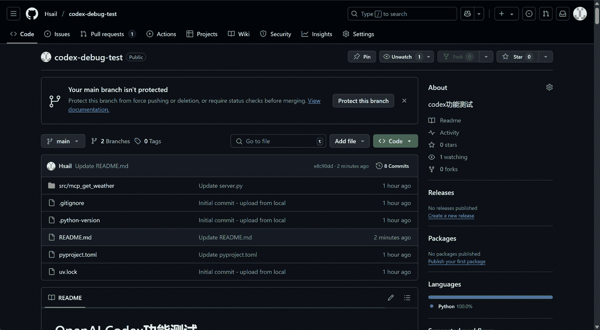

> 项目主页：https://github.com/Hsail/codex-debug-test/tree/main

## 3. codex-debug项目下载与使用流程

`codex-debug` 项目其实是一个查询天气的流式 HTTP `MCP` 工具，项目功能本身非常完整，且可以直接运行。但从实际使用层面来说，还可以进一步优化项目功能，如将 `API-KEY` 写在核心代码内部，从而避免每次调用的时候都单独输入 `API-KEY`。借助 `Codex`，我们可以在完全不了解项目源码的情况下，对其提出需求，令其改变项目功能，并将其创建为自己单独的项目。

> 项目主页：https://github.com/Hsail/codex-debug-test/tree/main

+   下载项目

```
git clone https://github.com/Hsail/codex-debug-test.git
cd codex-debug-test
```

+   安装环境

```
uv venv
uv pip install -e .
```

+   功能测试

```
mcp-get-weather --api-key YOUR_OPENWEATHER_KEY
```

+   启动后效果

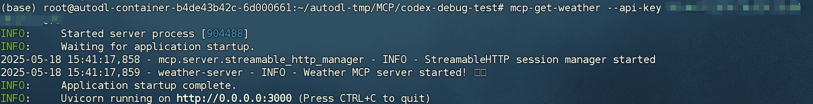

+   调用测试

需要注意的是，这是一个流式 HTTP 的用于天气查询的 `MCP` 服务器，默认项目功能是需要在启动时输入 `OpenWeather KEY`，启动后在 3000 端口即可发起流式 `MCP` 工具调用请求。例如在 `Cherry Studio` 中，调用流式 `MCP` 进行天气查询如下：

+   先创建 `MCP` 工具

+   然后进行调用测试

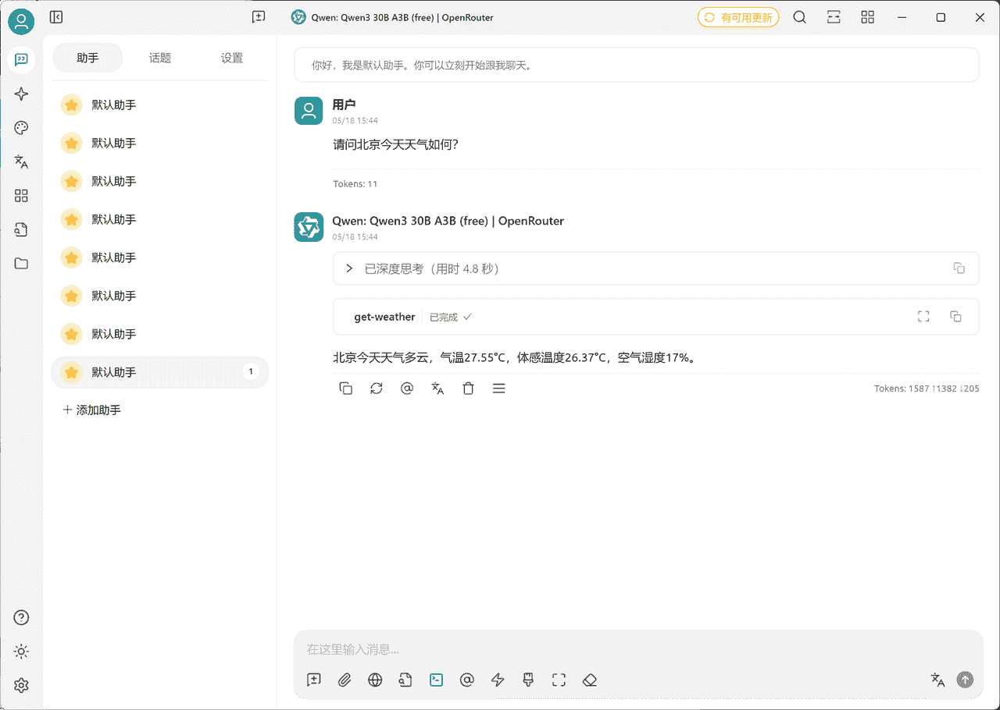

能够看到，此时项目是可以顺利运行的。

## 4. 借助 `Codex` 进行项目功能优化

接下来进一步进行项目功能优化。能够发现，此时启动的时候需要人工手动输入 `API-KEY`，并不方便，因此我们考虑借助 `Codex` 进行项目功能优化。

### 4.1 `Codex` 核心特性介绍


> `Codex` 介绍主页：https://openai.com/index/introducing-codex/

OpenAI `Codex`（2025 研究预览版）是一个基于云端的软件工程智能体，能够并行处理多项编程任务。它可以根据用户的自然语言指令自动编写代码、回答代码库相关的问题、修复代码中的错误，甚至为代码仓库生成 Pull Request 提案。每个任务都会在云端一个隔离的沙盒容器中独立执行，并预先加载用户的代码仓库环境。这意味着 `Codex` 能读取和编辑仓库中的文件，运行测试、`lint` 检查、类型检查等命令来验证代码。当 `Codex` 完成任务后，会在沙盒环境中提交代码更改并提供可验证的证据（例如终端日志、测试输出的引用），方便用户审查每一步操作。用户可以查看 `Codex` 的修改结果，要求进一步调整，或将这些更改转换为 GitHub 上的 Pull Request，亦或直接合并到本地环境。为了使 `Codex` 更好地理解项目，开发者还可以在仓库中添加 `AGENTS.md` 文件，对项目背景、测试命令、编码规范等进行说明，帮助指导 `Codex` 进行更符合项目需求的操作。

`Codex` 背后的模型是 `codex-1`，这是 OpenAI `o3` 系列 AI 推理模型专门针对软件工程优化的一个版本。`codex-1` 在大量真实编码任务环境中通过强化学习进行训练，能够生成风格接近人类且符合项目 PR 习惯的“干净”代码，更精确地遵循指令意图，并会反复运行测试直到通过为止。值得注意的是，`codex-1` 支持超大上下文：在内部测试中它被验证可处理最多约 192k tokens 的上下文长度（远超 ChatGPT 等先前模型的上下文长度），这使其可以加载大型代码库并理解其中的关系。总体而言，`Codex` 的架构融合了强大的大模型推理能力与真实开发环境的集成，使其能够像人类程序员一样在理解上下文的基础上自主编写、修改和验证代码。

OpenAI `Codex` 的出现，为多个领域的工作流程带来变革。以下是 `Codex` 在主要场景中的典型应用：

+   软件开发：`Codex` 最直接的用途是在软件开发生命周期中担当“编码助手”。在日常开发中，`Codex` 可以分担重复且明确的任务，例如重构代码、批量重命名、添加单元测试等，从而避免开发者频繁上下文切换。它也擅长构建新功能框架、连接组件、修复 Bug，以及撰写文档。OpenAI 自身的工程团队已将 `Codex` 纳入日常工具，用于快速处理待办事项、在每日规划中让多个代理同时工作，加速开发迭代。在早期封闭测试中，一些企业合作伙伴分享了 `Codex` 的用例：例如 Cisco 希望利用 `Codex` 加速实现创新想法并反馈改进方向；Temporal 用 `Codex` 来开发新特性、调试问题、编写并执行测试，用后台代理保持工程师“心流”不断档；邮件应用 Superhuman 则用 `Codex` 快速提高测试覆盖率、修复集成错误，甚至让产品经理也能借助 `Codex` 提交小规模代码改动（工程师只需最后代码审查）；Kodiak Robotics 将 `Codex` 应用于自动撰写调试工具、重构庞大代码库，加速其自动驾驶代码的开发，同时把 `Codex` 当作参考助手，以获取对陌生代码的背景理解。这些案例显示，在软件项目中引入 `Codex` 后，小团队和个人开发者的生产力都有望显著提升，复杂项目的迭代速度也会加快。

+   数据分析：借助 `Codex` 的编程能力，数据分析工作也能受益。例如，用户可以让 `Codex` 根据自然语言指令生成数据处理脚本或分析代码，`Codex` 会在沙盒环境中执行这些代码并返回结果。这类似于 ChatGPT 的“代码解释器”功能，但 `Codex` 能处理更复杂的多文件项目和更长时间运行。例如，给定一个数据集 `CSV` 文件，用户可以提示 `Codex` 清洗数据并绘制统计图表，`Codex` 会写出代码、运行所需的库（如 `Pandas`、`Matplotlib`），直至生成图表或报告。由于 `Codex` 暂不支持图片输入等前端交互，它在数据可视化上可能需要结合文本输出或保存结果文件供用户下载查看。不过，在复杂的数据管道、自动化报告生成等场景下，`Codex` 能充当数据工程助手：自动化执行重复的分析任务，或快速搭建分析原型，让数据科学家将精力更多放在问题洞见上而非繁杂的编码细节。

+   教育领域：`Codex` 也被寄望于辅助编程教育和训练。对于编程初学者，`Codex` 可以扮演“智能辅导员”的角色：学生可以用自然语言提出编程问题或作业要求，`Codex` 将给出代码答案并逐步解释实现思路。这有助于初学者理解代码逻辑，提高学习效率。例如，一个学生想实现一个排序算法，只需用日常语言描述需求，`Codex` 就能提供相应的代码并注释说明关键步骤。同时，教师可以让 `Codex` 批改学生提交的代码、找出其中的错误或不佳之处，并给出改进建议，从而节省批改时间并提供个性化反馈。在更高级的学习场景，`Codex` 支持多语言编程，它可以将同一道题的解法用不同编程语言实现，这对学习比较语言差异、算法实现技巧都很有帮助。总的来说，`Codex` 把强大的编码生成和理解能力以自然语言接口提供出来，让非专业人士也可以通过简单指令“让计算机编程”，这将降低学习编程的门槛，培养更多软件开发人才。

综上，OpenAI 最新发布的 `Codex` 智能体融合了先进的大模型能力和实际软件开发流程，通过并行自主执行代码任务，展现出变革编程范式的巨大潜力。从官方声明、媒体报道到开发者社群的热烈讨论来看，`Codex` 有望在软件开发、数据分析、教育等领域催生新的高效工作模式。但同时，OpenAI 也强调目前 `Codex` 仍是研究预览版，需要开发者审慎地审查其产出，并与之保持协作监督的关系。未来，随着 OpenAI 对 `Codex` 持续打磨（例如引入实时交互、扩展输入模态等），我们或许将见证更加通用且智能的“AI 工程师”逐步走入开发者的日常工作。开发者们也正拭目以待，期待利用 `Codex` 构建出更丰富、更强大的软件应用。

### 4.2 `Codex` 关联 `GitHub` 账号

+   登录 `ChatGPT`，选择左侧 `Codex`：

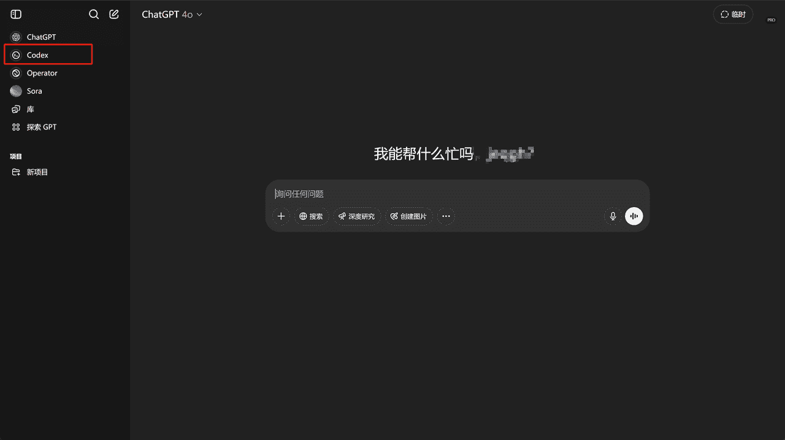

+   首次登录的时候提示需要绑定 `GitHub` 账号：

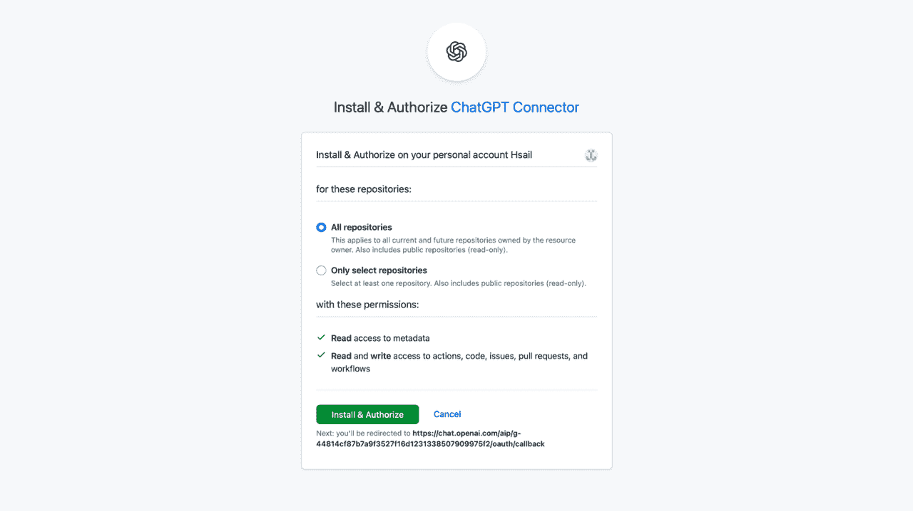

绑定后即可开始使用 `Codex`。

### 4.3 Fork 项目与创建环境

由于 `Codex` 和 `GitHub` 直接绑定，因此我们需要先 Fork 当前项目（也可以上传自己的项目），然后对项目进行功能优化。点击 Fork，然后即可在自己的 `GitHub` 项目主页中看到拷贝的项目版本。

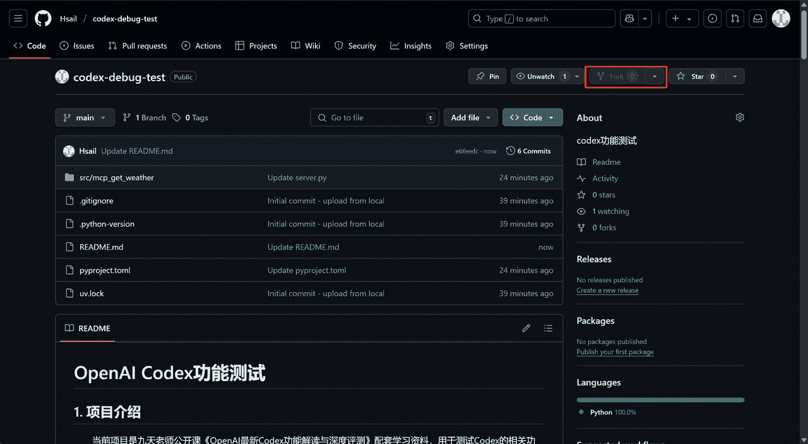

此时打开 `Codex`，点击环境——创建环境，就能 `codex-debut-test` 项目了：

然后选择 `codex-debug-test` 项目，点击创建环境：

创建成功：

### 4.4 进行 `codex-debug-test` 项目对话

接下来回到 `codex` 主页，选择 `codex-debug-test` 项目，并简单询问项目功能（注意点击询问，而不是验证码），开启 `codex` 使用：

此时 `codex` 会先创建一个任务，点击任务就能看到 `codex` 正在创建沙盒环境容器，并查询项目核心功能：

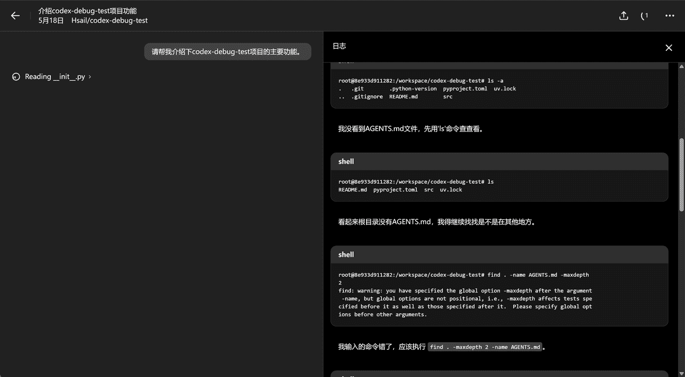

在执行每个任务时，`codex` 都会尽量遍历更多的代码和 `README` 文档，因此每个任务，哪怕是比较小的任务，都需要花费一小段时间。查询结束后回答结果如下：

关于其他任何项目问题，也都可以直接提问。

### 4.5 借助 `Codex` 进行项目功能优化


# Codex功能优化与代码推送

接下来我们尝试让Codex对我们的项目进行功能优化，我们希望改进的地方在于，目前这个`codex-debug-test`项目启动时需要手动输入OpenWeather的`API-KEY`，非常麻烦，我希望将`API-KEY`设置放在核心代码内部，`API-KEY`具体内容为`ABCTESTAPI`，请帮我修改项目代码完成该需求，并进行相关功能尝试。需要注意，如果希望Codex进行项目功能测试，则需要给与正确的OpenWeather `API-KEY`。

此时Codex实际运行效果如下：

+ 启动运行：

+ 完成代码和`README`文档修改：

+ 本地测试，接下来尝试将Codex修改后的代码直接copy覆盖原始项目代码，在本地进行测试：

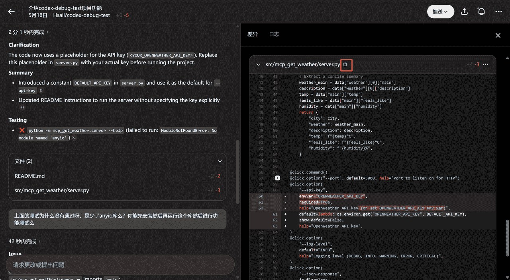

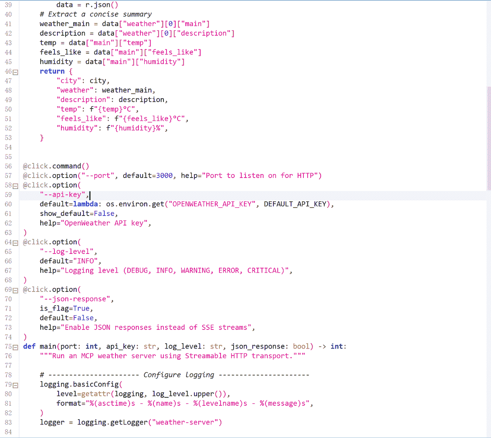

修改完代码后即可直接运行，此时不再需要输入`API-KEY`即可运行：

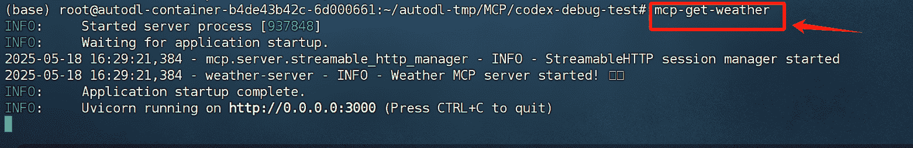

测试可以顺利连接：

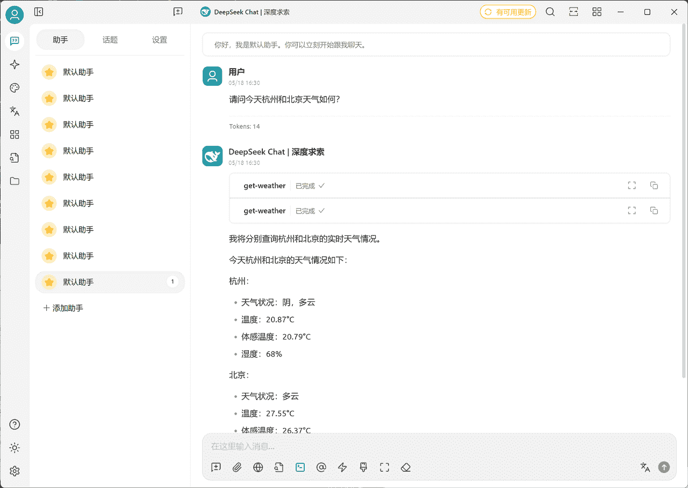

至此，Codex修改代码工作顺利完成。

## 4.6 Codex代码推送

最后，当我们修改完代码并且本地测试无误后，即可进行代码推送，创建PR或者创建PR草案了：

然后就能在项目主页中看到Codex编写的PR：

仔细看到这里的小伙伴，九天老师还为大家额外准备了一个单独的GitHub项目，用于进行CodeX的功能测试！

项目主页：`https://github.com/Hsail/codex-debug-test/`

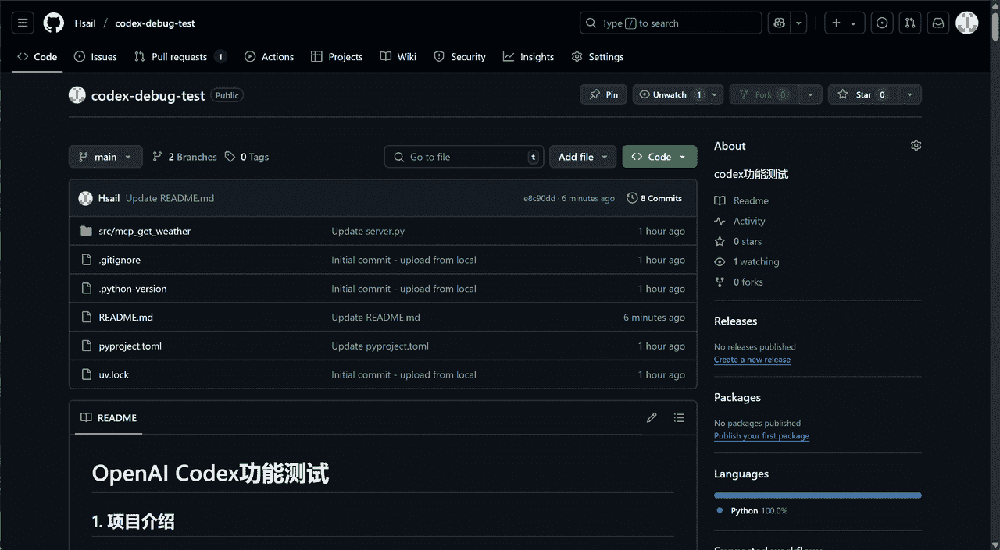

如果对你有帮助，千万不要吝啬你的星星哦~
