# GPT-5.1-Codex-MAX上手指南

> 来源：[https://kq4b3vgg5b.feishu.cn/docx/Ifrhd17XGoXmAux0MskcLrPHnMd](https://kq4b3vgg5b.feishu.cn/docx/Ifrhd17XGoXmAux0MskcLrPHnMd)

目前全套公开课资料、Vide Coding提示词和项目源码等：

> GPT-5.1-Codex-Max公开课资料

> 链接: https://pan.baidu.com/s/1h3L0qetOg_ua0KrIcvYInA?pwd=j89s 提取码: j89s

# Cursor接入GPT-5.1-Codex-MAX指南

如果大家还没有安装Cursor，可以先在官网下载最新版Cursor 2.0安装包

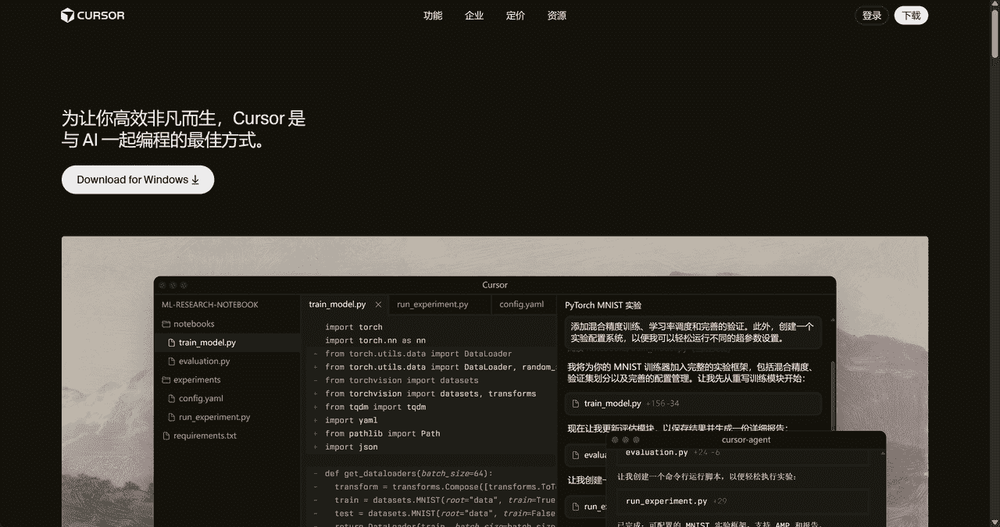

也可以在课件网盘中下载安装包并进行安装。

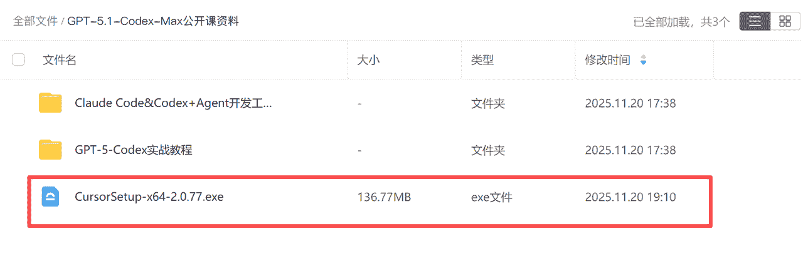

安装完成后先打开Cursor，

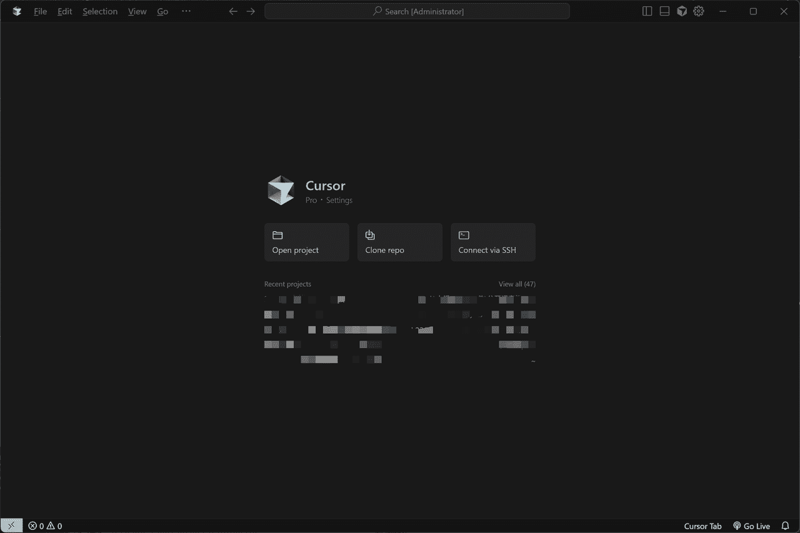

接下来继续下载Codex IDE插件，我们需要登录Codex官网主页，然后点击Cursor按钮，然后点击打开Cursor，就会自动跳转到Cursor的Codex插件页面，直接点击Installing安装即可。


[2025-09-16 14-42-45.mp4](https://internal-api-drive-stream.feishu.cn/space/api/box/stream/download/all/JO0hbuAk6oxTp6xJSJocwBnnnTf)

安装完成后需要重启Cursor，然后点击打开左侧侧边栏，然后选择Codex，即可选择使用ChatGPT账号登录Codex了。

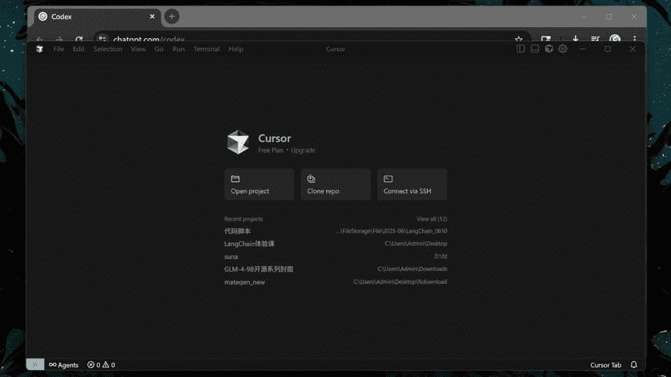

[2025-09-16 14-48-03.mp4](https://internal-api-drive-stream.feishu.cn/space/api/box/stream/download/all/EveCbpsKPoX9yzxrZB5cd9S8n0g)

具体过程我们只需要在弹出的网页里授权登录ChatGPT账号即可。

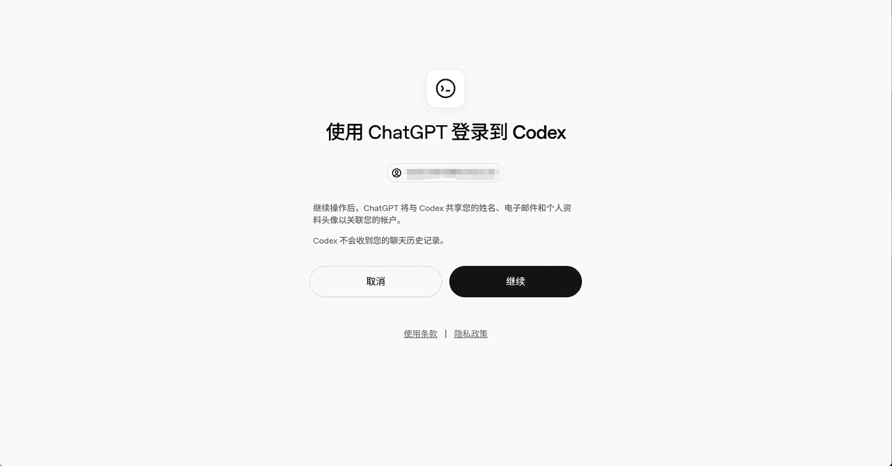

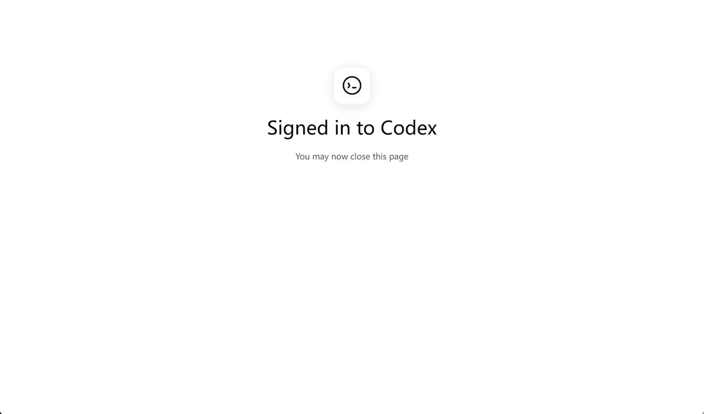

如果大家还没注册ChatGPT账号，可以在某宝上购买，也可以参考公开课课件网盘中的《OpenAI账号注册指南进行操作》

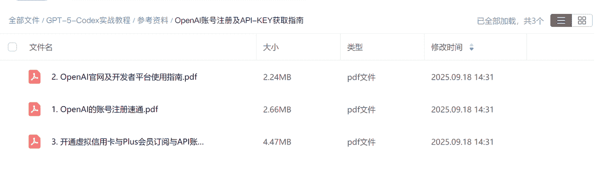

登录完成，我们还需要将Codex对话窗口放到右侧，以免和左侧文件管理页面重叠。

这里我们需要点击Cursor光标打开Chat对话页面，然后点击Open Chat as Editor，然后再点击Configure Editors进入设置页面，然后进入workbench.activite页面，找到默认布局，并设置为垂直。


[2025-09-18 14-26-36.mp4](https://internal-api-drive-stream.feishu.cn/space/api/box/stream/download/all/B🐧fb4WJnoDRDUx8JrGclkfCnig)

设置完重启Cursor，我们就能把Codex功能按钮拖拽到右侧了。


[2025-09-18 14-27-08.mp4](https://internal-api-drive-stream.feishu.cn/space/api/box/stream/download/all/YWcxbLnrDoi8APxmMKycQ5PwnKb)

做好了所有的工作后，接下来正式上手尝试使用Codex。

在Codex对话页面，我们能自由的设置对话上下文，同时在默认情况下Codex也会开启自动上下文（Auto context）模式，灵活的自主添加上下文。此外，我们还可以选择Codex三种不同的模式，分别是Chat对话模式、Agent开发模式、以及拥有全部权限的Agent开发模式。此外，开发者还能选择各种不同的模型和思考程度，以便于执行各类任务。


[2025-11-20 19-14-14.mp4](https://internal-api-drive-stream.feishu.cn/space/api/box/stream/download/all/XIKIb910JoiGu6x5e5CcDdl4npg)

接下来就让我们先尝试完成一个简单的单HTML页面的网页开发。这是一个模拟行星运行的程序，可以自由设定行星参数来观察天体运行状态，提示词如图所示。

```
**制作这个应用：****
名称****： S****olar ****System**** Gr**avity Well Sandbox（太阳系引力势井沙盒）
目标： 可视化展示物体在二维引力势场中的运动，并支持我在场景中平移和围绕中心旋转观察。
功能需求：
点击放置具有质量的天体；再次点击可为测试粒子设置初始速度向量。
提供滑块，用于调整中心天体的质量，以及全局时间缩放比例。
可选项：显示粒子轨迹，以及选中粒子的能量（动能 + 势能）读数。
提供“重置”和“全部清除”按钮。
UI 中增加一些测试质量选项，质量大小类似行星，让我能选择测试粒子的颜色。
应包含一些预设的测试粒子，其质量类似行星，并提供一个类似太阳质量的天体。
UI 要求：
 界面需保持轻量化，轨道与轨迹应具备平滑动画效果。
输出： 保存为 index.html
```

而在实际运行过程中，Codex会自动规划任务（task），并在对话页面下方打印任务完成情况。同时对于每一项任务，还会拆分具体执行环节，并在上方打印每个环节的完成进度，并且会根据运行情况不断反馈调整，


[2025-11-20 20-03-18.mp4](https://internal-api-drive-stream.feishu.cn/space/api/box/stream/download/all/TOBQbAat3ouPMcx9iC7cd1YWnpT)

而完成任务后，我们点击运行HTML文件，就可以在浏览器中查看前端展示效果。能够看出这个模拟行星运行的程序功能完整、视觉效果美观，各种交互功能也非常健全。需要注意的是，AI编程存在一定的随机性，大家创建的页面可能和我的会有所不同。

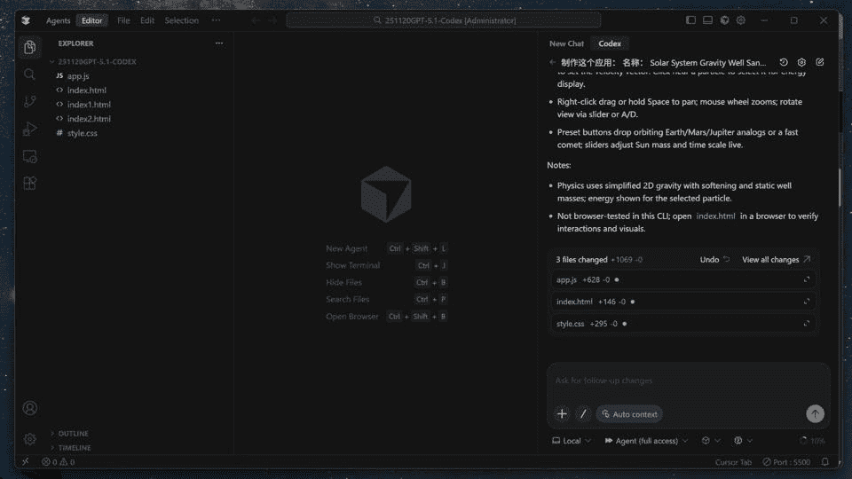

[2025-11-20 20-12-11.mp4](https://internal-api-drive-stream.feishu.cn/space/api/box/stream/download/all/NI8BbgpMpo7V9MxiQ9ic6uQun8d)

这其实是一个OpenAI官网的一个小示例，用于快速展示Codex-Max模型的编程性能，不过呢，这也只是一个玩具级的项目，如果想要完成一个工业级的项目开发，例如片头所展示的这些Agent项目，要如何使用Codex来完成开发呢？


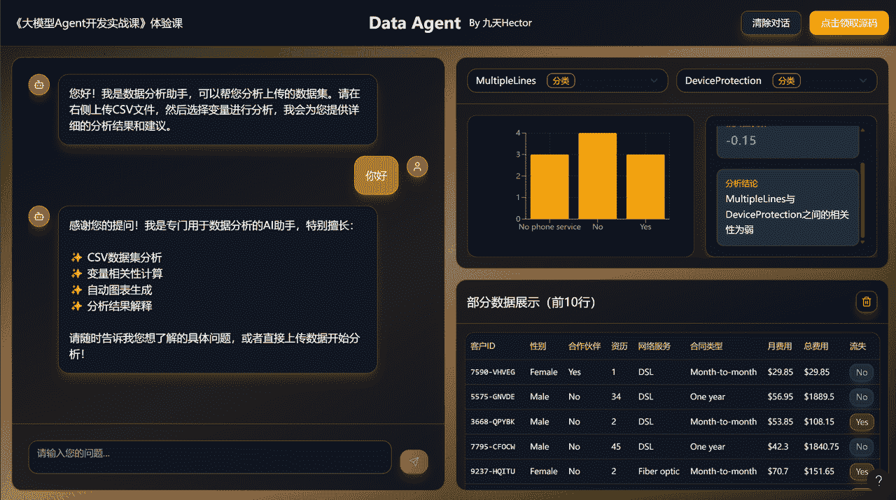

# 企业级Vide Coding的四个阶段

分别是交互式需求梳理、生成式前端开发、后端上下文工程以及后端功能开发与测试，

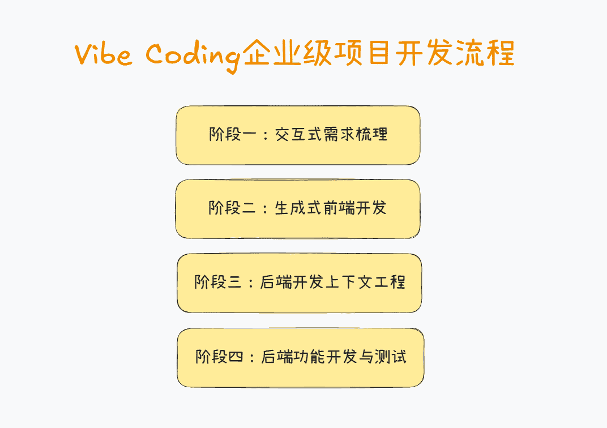

而每个阶段又细分为3-5个具体的执行步骤和若干个提示技巧。我将完整的流程整理成了这张表：

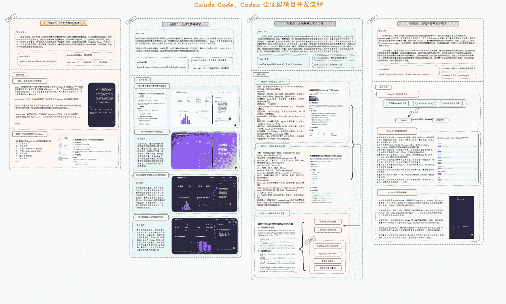

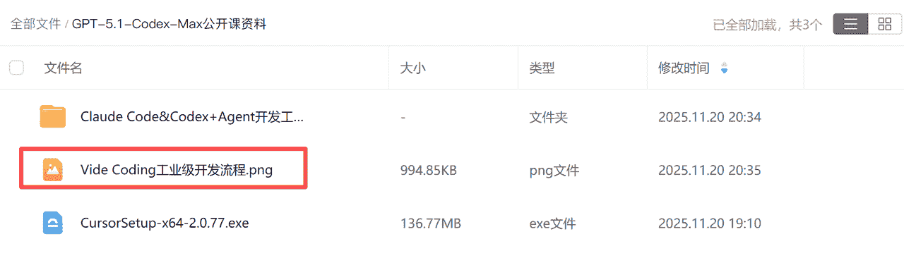

同时课件网盘中还包含了上述RAG系统的四个阶段开发相关资料和提示词，大家可以自行参考运行。

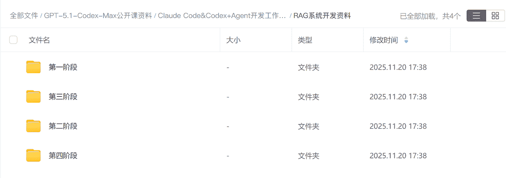

一般来说按照这个流程，2个小时即可完成一个功能完整的前后端分离的项目开发，这里我们还是以刚才大家看到的RAG系统为例，介绍大家整个开发流程的几个关键节点。

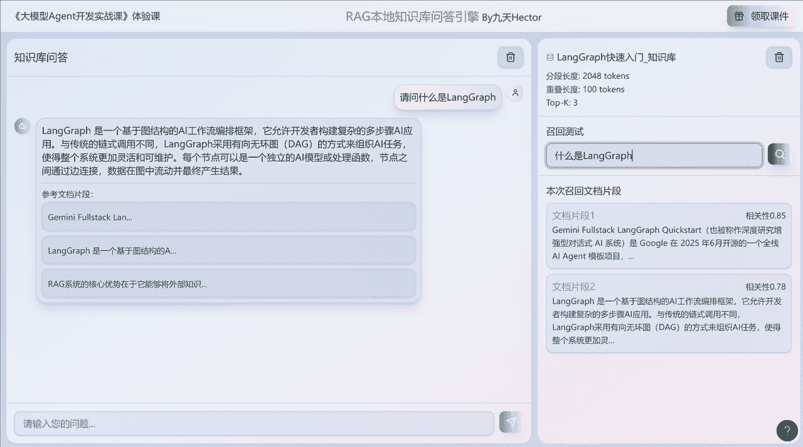

首先Vibe Coding的开发顺序是先从前端到后端，最后再进行前后端联调，因此第一阶段我们需要制作一份非常详细的前端需求文档（完整文档见课件网盘），一般来说这个文档可以模型一起来编写。

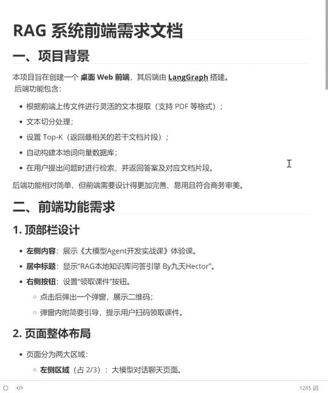

[20251120204109_rec_.mp4](https://internal-api-drive-stream.feishu.cn/space/api/box/stream/download/all/Uooeb4XzRoajKXxT9w6cfCFFnLf)

然后紧接着第二阶段就是将文档作为上下文，带入Codex中进行前端开发。

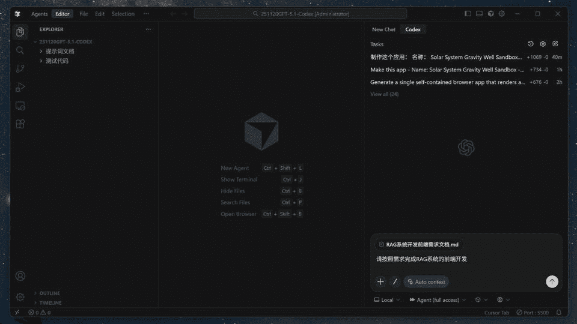

[2025-11-20 20-44-15.mp4](https://internal-api-drive-stream.feishu.cn/space/api/box/stream/download/all/T0EebZxKQo4iKwxcZ2hcfifDnxf)

对于工业级复杂的开发项目，Vide Coding很难一步到位开发得到一个满意的前端，此时就需要我们在第一版开发完成后持续引导Codex进行样式或者功能方面的修改。

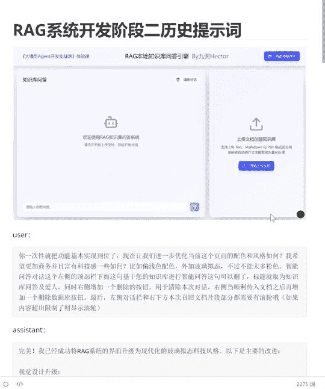

[20251120204230_rec_.mp4](https://internal-api-drive-stream.feishu.cn/space/api/box/stream/download/all/NEqNbjUX2ovIE5xYYtQcn3MKnqb)

而当我们完成前端开发后，接下来第三阶段，就需要进一步规划后端的功能了，后端开发是个非常复杂的流程，因此我们需要至少准备两份文档，分别是后端功能需求文档和后端技术栈规划，如果遇到大模型不知道的技术点，例如最新的LangChain 1.0的语法规则，还需要补充相关技术资料，

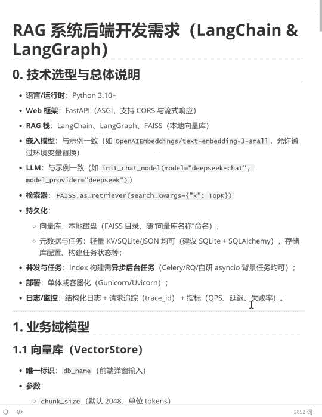

[20251120204950_rec_.mp4](https://internal-api-drive-stream.feishu.cn/space/api/box/stream/download/all/BVdsbII4IoVF0zx8LHXcU8PmnRc)

此外还需要准备一个标准的后端接口文档。当然这些文档也是可以和大模型共同完成的。

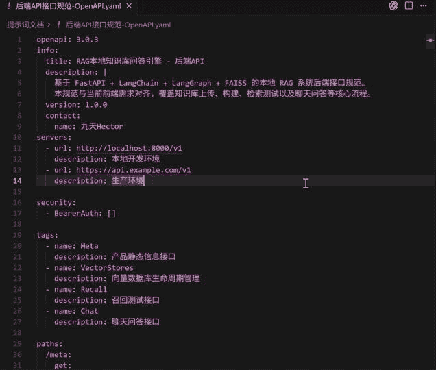

[20251120205046_rec_.mp4](https://internal-api-drive-stream.feishu.cn/space/api/box/stream/download/all/CiXkbARwxoZkKvxmzwCc9bpon5b)

最后第四个阶段，则是后端开发与前后端联调了，首先我们需要将上一个阶段准备好的文档带入上下文，引导模型完成后端开发，

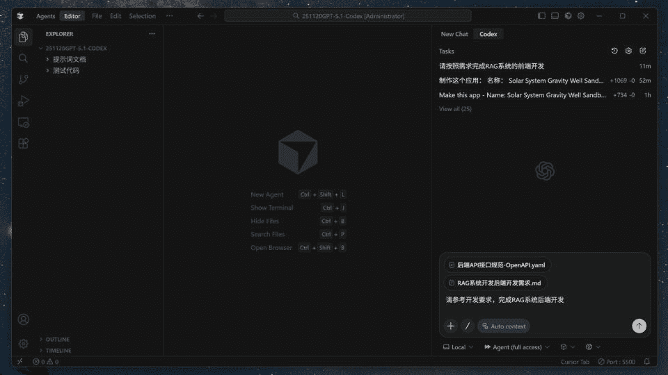

[2025-11-20 20-56-56.mp4](https://internal-api-drive-stream.feishu.cn/space/api/box/stream/download/all/EBdXbuQuRoglWtxNGIFco7QZnNd)

然后通过提示，我们再让Codex自行测试前后端功能能否联通，如果遇到端口不一致的情况则需要自行进行修改。

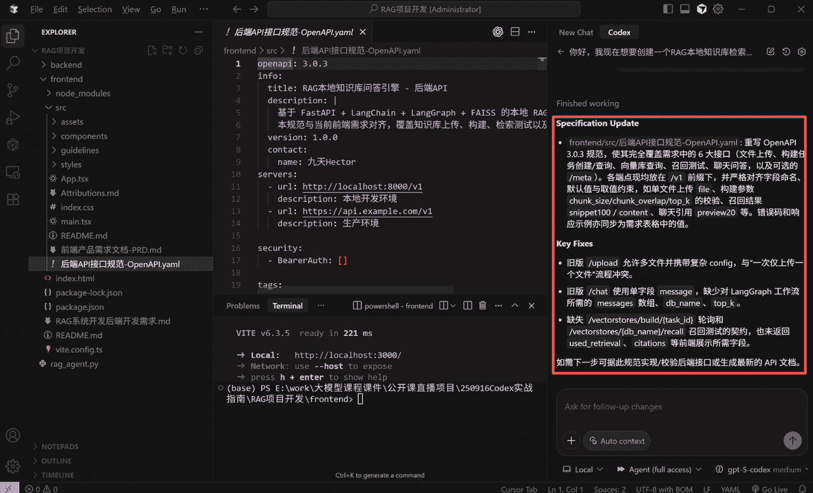

最终我们的RAG系统就开发完成啦，接下来就可以进行人工测试，并准备部署上线了。

此外，大家如果还想继续深入学习更加进阶AI编程技巧，或者想要学习大模型Agent开发技术，也欢迎大家报名我主讲的《大模型Agent开发实战》课程进行学习，大家扫码回复“大模型”即可看到课程的详细介绍。

