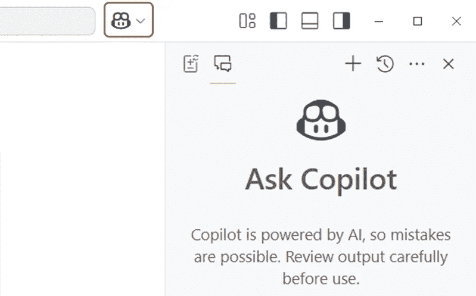

# 【中文版】GitHub Copilot使用指南

> 来源：[https://kq4b3vgg5b.feishu.cn/docx/A6NKdpZF4okncGx0kJhcyl8bnQg](https://kq4b3vgg5b.feishu.cn/docx/A6NKdpZF4okncGx0kJhcyl8bnQg)

> Github Copilot官网文档：https://docs.github.com/en/enterprise-cloud@latest/copilot/using-github-copilot

# 一、GitHub Copilot项目简介

GitHub Copilot 是一款 AI 编程辅助工具。它利用大型语言模型（LLMs）对自然语言和代码的理解能力，在开发者编码过程中提供智能建议，从而提升开发效率、减少重复劳动。

该工具能够根据用户的输入内容实时生成代码片段、解释已有代码、重构函数结构，甚至通过对话式交互完成特定任务。GitHub 官方将其定位为“AI pair programmer”。

GitHub Copilot 不仅可以提升个人开发者的编程效率，也已逐步融入企业级工作流，成为自动化协作流程中的重要组成部分。

## 1.1 Copilot 的核心功能

根据 GitHub 官方文档，Copilot 支持多种使用方式，主要包括：

### 1.1.1 代码建议（自动补全）

用户在 IDE 中编写代码时，Copilot 会根据已有上下文，自动补全函数体、变量定义、流程控制结构等内容。建议以灰色字体呈现，可通过快捷键直接接受。

Copilot 也支持根据自然语言注释生成相应代码。例如，输入 `//` 将字符串反转，Copilot 可自动生成对应的 JavaScript 函数。

### 1.1.2 Copilot Chat（对话式交互）

Copilot Chat 提供了自然语言交互接口，用户可以通过提问方式请求代码建议、调试辅助、文档说明或重构建议等。该功能可在以下环境中使用：

+   Visual Studio Code、Visual Studio、JetBrains IDE 等支持的编辑器

+   GitHub.com 的 Pull Request、Issue、文件视图等位置

+   GitHub Mobile App

Chat 模式下，用户可以提出如“解释这段代码含义”“帮我生成测试用例”等请求，Copilot 将给出相应回答。

### 1.1.3 Coding Agent（自动完成任务）

在 Copilot Pro+ 或 Enterprise 版本中，Copilot 支持 coding agent 功能。用户可以通过分配 Issue 或发出指令，委托 Copilot 自动完成开发任务，包括：

+   创建新的代码分支

+   实现功能代码

+   提交并发起 Pull Request

+   根据审查意见继续修改

该能力已支持多轮任务迭代，适用于构建自动化协作流程。

---

## 1.2 支持的编程语言与开发环境

GitHub Copilot 支持多种主流编程语言，包括但不限于：

+   JavaScript / TypeScript

+   Python

+   Go

+   Java

+   C++

+   C#

+   Ruby

+   Shell

支持的开发环境包括：

+   Visual Studio Code

+   Visual Studio

+   JetBrains IDE（如 IntelliJ IDEA、PyCharm）

+   GitHub.com 网页端

+   GitHub Mobile App

---

# 二、如何开通和配置 GitHub Copilot

## 2.1 账户要求与可用计划

GitHub Copilot 的使用需要满足以下两个前提条件：

1.  拥有一个有效的 GitHub 账户；

1.  订阅 Copilot 的对应计划（Free、Pro、Business 或 Enterprise）。

GitHub 根据不同用户群体提供了多种订阅计划，以满足个人开发者、教育用户和企业团队的差异化需求。

+   **计划类型概览**

详细订阅说明请参考：https://github.com/features/copilot

---

## 2.2 开通流程（以个人开发者为例）

以下流程以开通 **Copilot Pro** 为例，适用于大多数个人用户。

+   **第一步：登录 GitHub**

进入 [github.com](https://github.com/)，使用你的 GitHub 账户登录。如尚未注册，请先完成注册流程。

+   第二步：访问 Copilot 设置页

前往：https://github.com/settings/copilot

在该页面中可进行：

+   订阅管理（试用、升级、取消）

+   功能开关控制（是否启用 Copilot 补全、Chat 等）

+   IDE 授权管理

+   **第三步：选择订阅计划**

点击“升级到 Copilot Pro”后，按照提示完成付款流程（支持 Visa、MasterCard、PayPal 等）。

如你是符合条件的学生、教师或开源维护者，在教育认证页面申请后，将自动获得 Copilot Pro 的免费访问权。

申请地址：`https://education.github.com/benefits`

---

## 2.3 启用 Copilot 功能

成功订阅后，你需要在 GitHub 设置中确认是否已启用 Copilot 各项功能，包括：

+   IDE 中的代码建议

+   Copilot Chat（对话功能）

+   模型选择能力（Pro 用户专属）

**设置路径：**

`GitHub Settings > Copilot > Features`

---

## 2.4 安装并配置 IDE 插件

GitHub Copilot 支持主流 IDE，如 Visual Studio Code、Visual Studio、JetBrains IDE（IntelliJ IDEA、PyCharm、WebStorm 等）。

以下以 Visual Studio Code 为例说明插件安装与配置步骤：

+   **第一步：安装插件**

1.  打开 Visual Studio Code；

1.  点击左侧扩展图标（或按 `Ctrl+Shift+X`）；

1.  搜索 "GitHub Copilot"，点击“安装”。

+   第二步：登录 GitHub 账号授权

安装插件后，VS Code 会自动弹出 GitHub 登录窗口，点击授权按钮，完成账户绑定。

+   **第三步：确认插件可用状态**

安装成功后，VS Code 右下角会显示 GitHub Copilot 状态图标；在输入代码时，若自动弹出建议，说明配置成功。

---

## 2.5 企业用户的开通方式

对于企业或组织使用 Copilot，需要通过 GitHub 管理员进行集中配置和授权。

管理员需完成以下操作：

1.  在 GitHub Admin Center 中订阅 Copilot Business 或 Enterprise；

1.  分配许可给组织成员；

1.  配置组织策略，如是否允许代码建议中引用公共代码、是否启用 Chat 或 coding agent；

1.  为私有仓库启用 Copilot（默认对部分私有仓库禁用）；

1.  可通过组织策略控制成员对 Chat 功能、agent 功能的访问级别。

详见：[GitHub 企业策略设置文档](https://docs.github.com/en/enterprise-cloud@latest/copilot)

---

## 2.6 常见问题与处理建议

---

# 三、在编辑器中使用 GitHub Copilot

本章将介绍如何在本地开发环境中使用 GitHub Copilot 的核心功能——代码建议（Code Suggestions）。重点内容包括使用场景、操作方式、支持的编辑器平台、快捷键说明以及常见配置问题排查。

## 3.1 支持的编辑器平台

截至目前，GitHub Copilot 支持以下主流编辑器：

+   Visual Studio Code

+   Visual Studio（2022 及更高版本）

+   JetBrains 系列 IDE（如 IntelliJ IDEA、PyCharm、WebStorm 等）

+   **Neovim**（通过官方插件）

其中，Visual Studio Code 是支持最完整、功能最先进的平台，适合作为主要参考环境。

---

## 3.2 插件安装与登录授权（以 VS Code 为例）

如果尚未完成插件安装和账户登录，请参考第二章的 2.4 节，确保插件已正确启用并完成 GitHub 授权。

插件名称：**GitHub Copilot**

---

## 3.3 使用代码建议功能

GitHub Copilot 的补全建议将基于当前文件内容、上下文代码和自然语言注释生成。

建议通常以灰色字体呈现，位于光标后方，可通过快捷键进行接受或切换。

### 3.3.1 示例：函数体补全

输入：

```
def calculate_area(radius):
```

Copilot 会自动生成以下建议：

```
    return 3.14159 * radius * radius
```

你可以按下 `Tab` 键接受该建议。

---

### 3.3.2 示例：基于注释生成代码

输入注释：

```
// 将数组中的所有偶数筛选出来
```

Copilot 可自动生成：

```
const evenNumbers = array.filter(n => n % 2 === 0);
```

---

### 3.3.3 示例：多行补全与连续生成

当你输入结构性代码（如函数开头、for 循环等），Copilot 会尝试生成多行逻辑。

例如：

```
for i := 0; i < len(nums); i++ {
```

将自动补全一整段处理逻辑。

---

## 3.4 快捷键与操作方式

以下为各平台的默认快捷键操作（以 VS Code 为主）：

建议可通过快捷键循环浏览，选择最合适的一条。

---

## 3.5 个性化配置选项

在 VS Code 中，可通过命令面板或设置面板调整 Copilot 行为：

+   启用/禁用自动建议弹出

+   控制是否在注释中触发建议

+   设置建议来源模型（需 Copilot Pro）

配置路径：

```
File > Preferences > Settings > Extensions > GitHub Copilot
```

或使用命令面板：

```
Ctrl+Shift+P → “Copilot: Toggle”/“Copilot: Enable”
```

---

## 3.6 使用建议的上下文依赖特性

Copilot 在生成建议时，会自动考虑：

+   当前光标所在位置

+   当前文件内容与语言

+   项目中其他打开的文件（特别是在大型项目中）

+   注释与自然语言说明

为了提升建议质量，建议在编辑器中只保留与当前任务相关的文件。

---

## 3.7 常见问题及处理建议

---

# 四、使用 Copilot Chat

Copilot Chat 是 GitHub Copilot 的对话交互功能模块，允许用户以自然语言与模型交流，以便获取代码生成、解释、修改、调试等帮助。相比传统的代码补全功能，Copilot Chat 提供了更强的交互能力，并支持用户在开发流程中提出复杂的多轮问题。

## 4.1 功能概述

Copilot Chat 可用于：

+   生成函数或模块代码

+   解释现有代码的含义或逻辑

+   调试错误、识别潜在问题

+   优化已有代码结构或性能

+   回答与框架、库、语言相关的问题

+   指定角色和风格生成不同类型的回答

+   参与 PR 审查、解释提交更改等协作任务

该功能目前在以下平台中可用：

+   Visual Studio Code

+   **Visual Studio**

+   JetBrains IDE（如 IntelliJ IDEA）

+   **GitHub.com** 网页端

+   GitHub Mobile App

---

## 4.2 启用 Copilot Chat

使用 Chat 功能前，需满足以下前提条件：

+   拥有 **Copilot Pro** 或 Copilot Enterprise 订阅

+   所在组织或账户启用了 Chat 功能（由管理员控制策略）

+   安装并启用最新版本的 Copilot 插件（IDE 端）

---

## 4.3 在 Visual Studio Code 中使用 Copilot Chat

### 4.3.1 打开 Chat 界面

在 VS Code 左侧活动栏中，点击 Copilot 图标，即可打开 Chat 面板。在该面板中，可以输入自然语言问题，获得 AI 响应。



也可通过快捷命令启动 Chat：

```
Ctrl + Shift + P → Copilot: Open Chat
```

### 4.3.2 支持的上下文类型

Copilot Chat 在回答问题时，会自动利用以下上下文：

+   当前打开的文件内容

+   当前选中的代码区域（如果有）

+   项目工作区中的其他文件（在语义索引开启的前提下）

+   之前在同一对话中提交的问题与回答（对话记忆）

用户可通过选择代码后右键点击 `Ask Copilot` 来发起上下文绑定的提问。

---

## 4.4 在 GitHub 网页端使用 Chat

在 GitHub.com 网页中，Copilot Chat 集成于以下界面：

+   **Pull Request 页面**：可在右侧使用 Chat 询问本次改动内容含义、是否存在问题等

+   **文件查看页面**：可选中某段代码直接提问

+   **提交记录页面**：可对特定提交发起解释请求

如启用 Semantic Index，Chat 可调用当前仓库的语义信息，以提升回答质量。

---

## 4.5 在 GitHub Mobile 中使用 Chat

在 GitHub 移动端（iOS / Android）中，Copilot Chat 可用于：

+   提问项目相关问题

+   回顾对话历史

+   获取建议或修改提示

+   进行协作交流（如对 PR 留言）

注意：Mobile 端 Chat 功能需由组织启用，部分企业账号默认禁用。

---

## 4.6 Chat 响应样式与操作

在聊天过程中，Copilot 的响应可能包含以下类型：

+   纯文本回答（例如概念解释）

+   代码块（带语法高亮）

+   Markdown 结构的说明、表格、引用等

+   按钮操作（如复制代码、插入到文件、继续生成等）

用户可通过下方按钮执行：

+   插入到当前文件

+   复制到剪贴板

+   让 Copilot 接着生成

+   修改提示重新提问

---

## 4.7 多轮对话与上下文管理

Copilot Chat 支持连续多轮交互，会自动记录当前会话历史，用于理解用户意图。用户可通过以下方式管理上下文：

+   手动删除不相关消息（点击消息右上角“…”）

+   重新开始新会话（避免上下文干扰）

+   切换至不同的工作目录或文件（影响回答内容）

---

## 4.8 可选模型设置

在 Copilot Pro 和 Enterprise 中，用户可以选择使用的语言模型。可选模型包括：

用户可在 Chat 设置中切换默认模型，用于对比不同模型输出效果。

---

## 4.9 常见问题与解决方式

---

# 五、编写有效的 Copilot Chat 提示词

在 Copilot Chat 中，用户与 AI 的互动完全基于提示词（prompt）。提示词是用户向 Copilot Chat 发送的自然语言指令，决定了模型生成回答的质量、准确性和上下文相关性。

相比代码补全，Copilot Chat 对提示词的构造更为敏感。良好的提示词能够显著提升回答效果，减少模糊、不相关、过度冗长的输出。

本章将介绍提示词的基本结构、编写技巧、角色设定、常见指令模板以及 GitHub 官方提供的提示词工程建议。

## 5.1 什么是提示词（Prompt）

提示词（Prompt）是用户输入给 Copilot Chat 的自然语言文本，通常是指令或问题。Copilot Chat 会解析提示词，并结合代码上下文与模型能力，生成对应的回答。

提示词可以包括：

+   问题描述（你希望 Chat 做什么）

+   输入代码（直接粘贴或通过上下文引用）

+   输出要求（格式、语言、风格）

+   角色假设（希望 Chat 扮演的身份）

+   限制条件（仅使用某个库、避免某种方法等）

---

## 5.2 编写提示词的基本原则

GitHub 官方建议编写提示词时遵循以下四条基本原则：

---

## 5.3 常见提示词模板（推荐结构）

以下是几种常见任务的提示词构造方式，供教学时参考使用。

### 示例一：代码解释类

```
请解释以下代码的作用和逻辑，并逐行加注释：
[粘贴代码段]
```

### 示例二：重构与优化类

```
请以高级 Python 开发者的视角，重构以下函数，使其更简洁并提高可读性：
[函数代码]
```

### 示例三：生成测试用例

```
请基于以下函数生成 3 个具有代表性的单元测试，使用 pytest 框架：
[目标函数代码]
```

### 示例四：迁移语言

```
请将以下 JavaScript 函数改写为等价的 Python 实现：
[JavaScript 代码]
```

### 示例五：限定约束的回答

```
请使用标准 SQL（不使用数据库特有语法）实现以下功能：
[描述需求]
```

---

## 5.4 使用角色设定（Role Prompting）


# 五、GitHub Copilot Chat 进阶使用

## 5.4 Copilot Chat 角色设定

GitHub Copilot Chat 支持通过提示词指定“角色”，以模拟不同身份的回答风格或专业领域。以下是常用角色设定方式：

---

## 5.5 控制输出风格与格式

用户可以通过提示词精细控制输出内容的样式与排版。例如：

+   要求带注释输出：请为每一行添加注释

+   指定代码语言：请使用 `Python` 输出

+   控制行数：限制输出不超过 10 行

+   要求结构化回答：以表格形式列出差异点

这些指令有助于获得格式清晰、可用于复制粘贴的代码内容。

---

## 5.6 上下文提示技巧

Copilot Chat 会默认读取当前编辑器中的上下文（例如打开的文件、光标所在位置、选中的代码块等）。

为获得更准确回答，建议：

+   使用代码选择功能：选中目标代码后点击 `Ask Copilot`，比直接粘贴效果更好

+   减少不相关上下文干扰：关闭与当前任务无关的编辑器窗口

+   重启对话清除记忆：避免旧会话中的问题影响当前输出

---

## 5.7 官方建议：可用命令指令类型（摘自 Cheat Sheet）

---

## 5.8 常见问题与排查建议

---

# 六、使用 Copilot Coding Agent 自动完成任务

Copilot coding agent 是 GitHub Copilot Enterprise 中提供的一项高级功能，允许开发者通过自然语言或 issue 分配的方式，指令 Copilot 自动完成一项完整的开发任务，包括创建分支、修改代码、发起 Pull Request（PR）并响应代码审查意见进行迭代。

本章将系统介绍 Copilot coding agent 的任务流程、PR 交付结构、审查交互机制以及日志跟踪方法，并说明实际项目中如何安全有效地集成 agent 工作流。

---

## 6.1 功能概述

Copilot coding agent 能够根据用户指令自动执行如下操作：

+   创建新分支并切换至该分支

+   修改代码实现特定功能

+   提交更改并生成 Pull Request（PR）

+   根据代码审查意见继续修改并更新 PR

+   日志化记录 agent 的任务执行路径与操作行为

该功能可通过以下方式触发：

+   在 `GitHub.com` 网页端将 Issue 分配给 Copilot

+   在 `Chat` 中明确指令请求 Copilot 完成特定任务（需具备权限）

目前该功能仅面向 Enterprise 用户开放，需由管理员在组织层级启用。

---

## 6.2 启用 Coding Agent

要使用 coding agent 功能，需完成以下配置流程：

1.  管理员进入 `GitHub Admin Center`；

1.  导航至 `Copilot 设置` > `Coding agent`；

1.  启用功能并接受服务协议；

1.  分配 agent 使用权限（可按组织/仓库/个人维度控制）；

1.  用户需接受 Copilot 的 [Modified Code Policy（MCP）] 以启用 agent。

启用成功后，用户即可在指定仓库中向 Copilot 指派任务。

---

## 6.3 指派任务给 Copilot

### 6.3.1 方式一：在 Issue 页面分配任务

在 GitHub 仓库的 Issue 页面中，选择某个 issue，点击“Assignees”区域，在下拉列表中选择 `@github-copilot`。

分配成功后，GitHub 将提示你确认是否允许 Copilot 访问该仓库并启动 agent。

确认后，Copilot 将：

+   创建一个以 issue 为主题的分支（命名示例：`copilot/123-fix-navbar`）；

+   修改文件并提交初步实现；

+   生成一个 Pull Request（PR），并附带实现说明。

### 6.3.2 方式二：在 Chat 中直接指令（需有权限）

在 GitHub Copilot Chat 中输入类似以下提示：

> “请为导航栏修复错误并发起一个 PR。”

系统会自动识别任务请求，并启动 agent 执行相关操作。

---

## 6.4 任务执行流程（Agent 行为说明）

当 Copilot 接收到任务后，其行为流程如下：

1.  分析 issue 或 prompt 内容，明确任务目标；

1.  **检查依赖**，自动安装项目中缺失的依赖项（如 `npm install`）；

1.  **创建分支** 并切换环境；

1.  **修改代码文件**，实现预期功能；

1.  **提交更改并创建 PR**，附带实现说明；

1.  **等待审查意见**，根据评审反馈继续修改并更新 PR（自动支持多轮交互）；

1.  **记录日志**，可供开发者查看 agent 的执行路径与内容。

### Pull Request 特征示意：

+   **标题**：根据 issue 或 prompt 自动生成；

+   **描述**：包括任务目标、所做更改、构建说明等；

+   **作者**：`@github-copilot`；

+   **标签**：可能包含 `copilot`, `automated`, `draft` 等；

+   **操作入口**：

+   “`View Session Log`” 查看日志；

+   “`Ask Copilot`” 使用 Chat 留审查意见；

+   “`Continue with changes`” 执行后续修改。

---

## 6.5 审查与协作反馈机制

审查者可像审查普通 PR 一样阅读并评论 Copilot 的提交。常用交互方式如下：

### 方式一：标准 GitHub 审查流程

+   行内评论

+   总体建议

+   `Approve` / `Request Changes` 操作

### 方式二：通过 Chat 与 Copilot 协作

在 PR 页右侧的 Chat 面板输入自然语言提示：

```
请使用 async/await 重写此异步函数；
将此错误处理逻辑提取成一个 retry 工具；
组件命名不规范，请重命名为 NavMenu；
```

agent 将解析反馈，并自动提交新的 commit 更新 PR 内容。

---

## 6.6 多轮修改与 Session 日志查看

+   **日志入口：**

在 PR 页面中点击 “`View Session Log`” 即可查看 agent 行为。

+   **日志内容包括：**

---

## 6.7 错误处理与排查建议

GitHub 官方提供了常见的 agent 异常及处理建议：

---

## 6.8 使用建议与最佳实践

根据 GitHub 官方推荐，使用 agent 时建议：

+   **先在小范围仓库进行试点验证**，再推广至团队使用；

+   **将任务拆分为具体明确的子任务**，避免 prompt 过于模糊；

+   **结合 Chat 留评审意见**，逐步推动 agent 学会多轮修改；

+   通过日志监控 agent 执行过程，确保可控性和代码质量；

+   搭配 `CI` 流程检查 agent 提交代码的可用性；

---

# 七、典型应用场景与进阶使用指南

GitHub Copilot 在实际开发工作中可用于完成大量高频但费时的任务，例如生成单元测试、重构遗留代码、在语言或框架间迁移逻辑、提取通用模块，或辅助将旧项目现代化。

本章基于 GitHub 官方发布的任务指南模块（Copilot Guides），总结出多个典型业务场景下的推荐使用方式，并结合 Chat 与 coding agent 的能力提供具体操作方法。

---

## 7.1 自动生成单元测试

生成测试代码是 Copilot 最具代表性的功能之一。

+   **场景说明：**

+   项目中已有业务函数，但测试覆盖率不足；

+   希望快速为某个模块补齐基础测试；

+   采用如 `Jest`、`pytest`、`unittest` 等主流测试框架；

+   **使用方式：**

1.  打开目标函数所在文件；

1.  在 Chat 中输入提示词：

```
请为以下函数生成 3 个具有代表性的单元测试，使用 pytest：
```

1.  Copilot 会识别函数结构并自动生成测试代码；

1.  可将测试代码插入测试文件或由 coding agent 提交为新的测试模块。

---

## 7.2 重构复杂或冗长的函数

+   **场景说明：**

+   函数长度超过合理范围；

+   包含重复逻辑、嵌套过深、命名不清晰；

+   希望提升可读性、维护性或结构一致性；

+   **使用方式：**

选中目标函数，右键点击 `Ask Copilot`，输入：

```
请以更具可读性的方式重构此函数，并将嵌套结构拆分为子函数。
```

Copilot 会输出结构更清晰、命名更合理的新版本函数。

如使用 coding agent，可指示其以 PR 的形式完成函数重构。

---

## 7.3 将旧项目现代化

+   **场景说明：**

+   遗留项目使用旧版本框架、旧式语法；

+   函数命名不规范、未使用模块化结构；

+   希望统一代码风格，迁移到现代构建方式或框架（如从 `CommonJS` → `ESModules`）；

+   **使用方式：**

通过 Chat 输入如下指令：

```
请将以下 JavaScript 模块转换为基于 ESModules 的结构，使用 import/export。
```

或：

```
将本项目中所有 require() 替换为标准 import，保持功能不变。
```

Copilot 将基于文件上下文逐步输出结构转换结果，可结合 agent 执行自动批量替换。

---

## 7.4 跨语言逻辑迁移

+   **场景说明：**

+   将已有代码从一种语言迁移至另一种语言；

+   需要语法等价、逻辑保持一致；

+   常见迁移方向如：`JavaScript` → `Python`、`Java` → `Go`；

+   **使用方式：**

```
请将以下 JavaScript 函数转换为 Python 实现，保持功能一致：
[粘贴代码段]
```

Copilot 会输出迁移后的代码，并解释实现方式变化（如异步结构、数据类型差异等）。

---

## 7.5 提取组件或通用函数模块

+   **场景说明：**

+   代码中存在可复用逻辑；

+   希望将其抽象为独立函数、组件、hooks 或工具模块；

+   **使用方式：**

在 Chat 中提问：

```
请将以下逻辑提取为通用函数，并将该函数命名为 `formatCurrency`。
```

或使用 agent 提示：

```
将价格格式化逻辑封装为单独模块并创建 PR。
```

Copilot 会识别重复使用的代码片段，并创建独立文件导出函数。

---

## 7.6 提高代码注释质量

+   场景说明：

+   代码可读性较差、缺乏注释；

+   希望快速补齐函数说明、参数注释或模块说明文档；

+   **使用方式：**

```
请为以下函数添加中文注释，逐行解释其逻辑，并说明每个参数的含义。
```

Copilot 可根据代码逻辑自动插入注释，输出格式可指定 Markdown、`JSDoc`、`reStructuredText` 等风格。

---

## 7.7 整合 CI/CD 任务或配置生成

+   场景说明：

+   希望生成 `.github/workflows` 配置；

+   自动化执行测试、部署、代码检查等流程；

+   **使用方式：**

```
请为 `Node.js` 项目生成一个 `GitHub Actions` 流水线，用于在每次 `push` 时运行 `Jest` 测试。
```

生成的 `YAML` 文件可由 agent 创建并直接提交为新文件。

---

## 7.8 Chat 与 Agent 使用建议总结
