# AgentScope快速入门实战

> 来源：[https://kq4b3vgg5b.feishu.cn/docx/BNgsdzUjQom3h9xjWedcncvKnce](https://kq4b3vgg5b.feishu.cn/docx/BNgsdzUjQom3h9xjWedcncvKnce)

## 一、国产最强！AgentScope框架快速入门介绍

### 1. 大模型性能飞跃推动Agent开发范式转变

**    ** ** 从2025**年**起，人工智能**领**域迎来了**一个显著的转折点：以 DeepSeek‑R1 模型的问世为标志，基础大语言模型（Large Language Models, LLM）在 推理能力、工具调用能力、自主规划能力和调试能力等多个维度都实现了跳跃式发展。

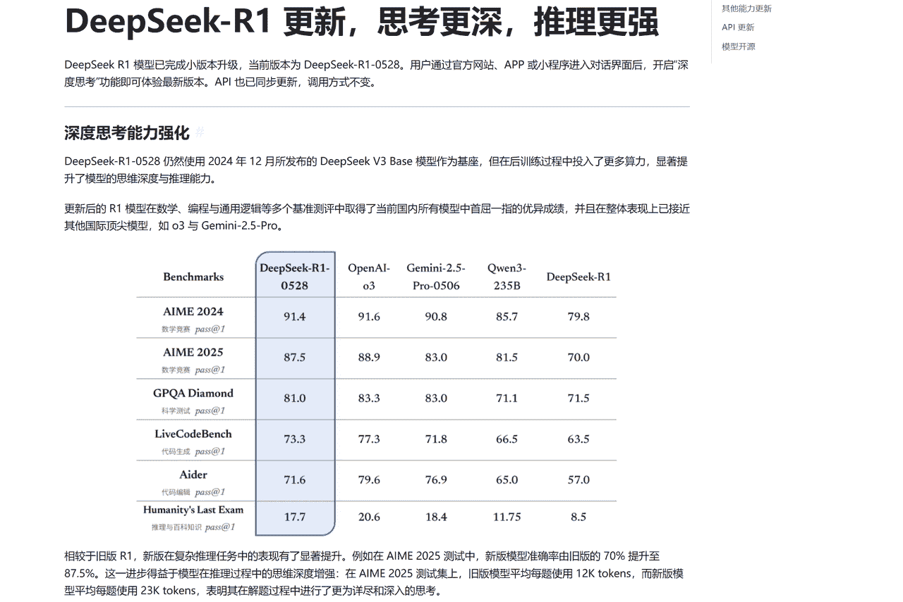

传统的智能体开发方式多依赖于工作流式的脚本化结构——例如早期的 LangChain 提供了模块化的 Prompt Chain、工具调用和多步骤流程，这在当时是非常实用的范式。但随着大模型自身能力的大幅提升，这类「预定义流程 + 序列化调用」的方式逐渐暴露出局限：它们依赖于人为提前设计流程，智能体的自主性和灵活性受限。

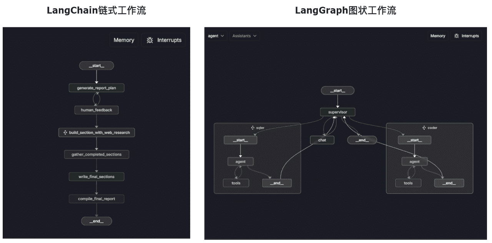

相比之下，当下被广泛采用的开发范式是 ReAct Agent（Reason + Act 智能体）。在这一范式中，智能体不仅接收输入，还能：

+   在同一轮对话中自行决定 **是否调用工具**、**调用哪一个工具**；

+   决定是否需要 **并发调用多个工具** 或 **多步使用工具**；

+   自主评估并 **调试自身输出**，例如在思考链 (“chain-of-thought”) 过程中发现偏差并更正。

例如，当前热门模型如 Qwen3、Gemini 2.5、Claude 4.5 在 2025 年都被报道支持丰富的函数调用接口、结构化输出、甚至长上下文推理能力。在这样的背景下，传统的工作流式、脚本化智能体开发方式显得越来越不合时宜。

此外，智能体开发框架也迎来新一轮迭代。以往依赖 “工具注册 + 模块调用 +结果拼接” 的体系，被更为“智能化”且具有内建 agent 控制能力的框架所替代。例如：

+   Agents SDK（OpenAI 出品）强调 Agent 自主决策能力；

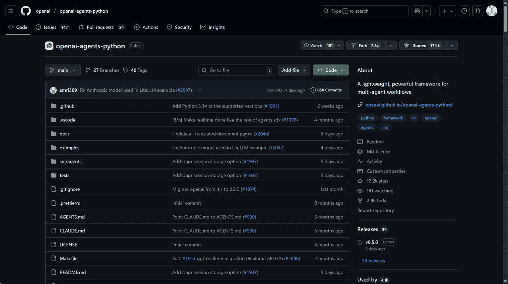

+   ADK (Agent Development Kit)（谷歌推出）也将 ReAct 模式作为默认范式；

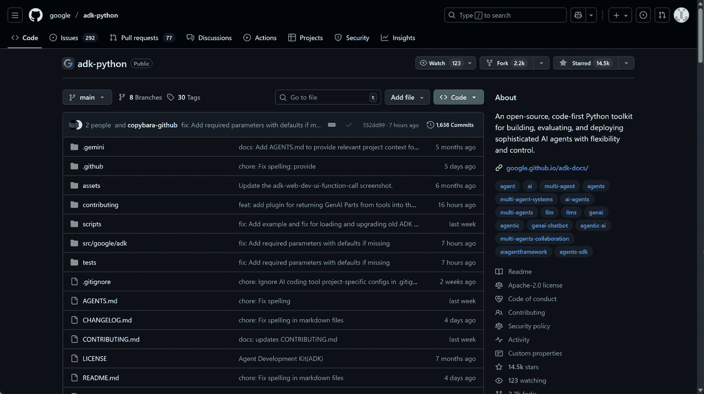

+   而 LangChain 在 2025 年 9 月末发布的 1.0 版本也全面拥抱了 ReAct Agent 模式。

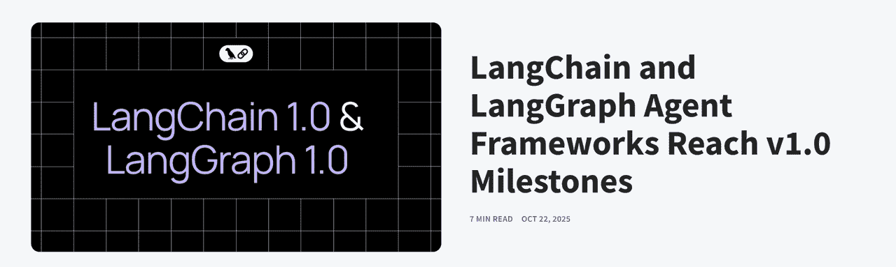

在这一浪潮中，AgentScope 正是**出生于这样一个时代背景——它作**为一个以 构建 ReAct 智能体为核心 的开发框架，定位清晰：既适应了新一代大模型的能力释放，也为开发者提供了更高层次的抽象能力。相比传统方式，它将“Prompt → 工具调用 → 结果处理”封装为“Agent 自主思考并行动”的整体闭环，使智能体开发更加模块化、结构化且易于控制。

### 2. AgentsScope核心功能与技术定位

+   项目主页：https://github.com/agentscope-ai/agentscope/


#### 2.1 项目基本情况

自 2025 年 8 月起，AgentScope 正式向开源社区发布，由 Alibaba Tongyi Lab（阿里巴巴 “通义” 实验室）主导研发。根据其 GitHub 项目页面，该框架自版本 v1.0 起全面面向多智能体（Multi-Agent）开发范式，强调“开发者优先、可控、模块化”的设计理念。

在国内代理开发工具链尚在快速发展阶段的背景下，AgentScope 被视为“国产最强”的 Agent 开发框架之一，不仅功能完备，而且性能表现优异。其开发团队明确目标——打造国产版的 LangChain，将 “智能体开发” 从单纯的语言模型调用提升为一套系统化、工程化的解决方案。

因此，在这一课件中，我们将围绕 AgentScope 的核心定位与其丰富功能进行系统介绍，以便新人用户能够清晰理解该框架为何与众不同、以及它能为智能体开发带来哪些技术层面的提升。

#### 2.2 核心功能亮点

下面分别从六大维度梳理 AgentScope 的技术特点，深度解析其背后的设计逻辑。

**（1）完善的基座模型接入方法**

AgentScope 支持多种大语言模型（LLM）作为 “智能体的大脑”，并采用“不同模型对应不同库 + 不同模型的格式化器”这种接入机制，从而实现消息与响应在不同模型之间的流程无缝转换。其 README 中提到：“Model-Agnostic: Programming once, run with all models.”

具体来说：开发者选择如 Qwen3、Claude 4.5、DeepSeek‑R1等主流模型后，只需配置相应的 ChatModel 类和对应 Formatter 类，即可让 AgentScope 在该模型之上快速运行。这样，模型切换的成本大幅降低，同时也为用户提供了高灵活性。

举例来说，若将模型替换为 Qwen3，则只需将 model = Qwen3ChatModel(...) 且 formatter = Qwen3ChatFormatter()，而大部分业务逻辑（工具调用、对话管理、结构化输出等）无须改动。这种设计哲学使 AgentScope 成为一个“模型非绑定”的开发框架，有别于某些只能与特定模型绑定的工具库。这一点，对国内希望搭建“多个模型、多个场景、多智能体协作”系统的开发者而言，尤为关键。

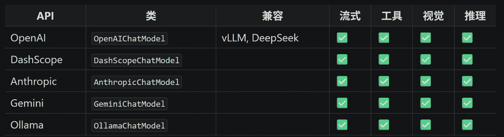

（2）支持多模态消息格式、完善记忆管理与跨 Agent 消息机制

AgentScope 对齐了 ADK 等前沿框架的思路，支持多模态（文本、图片、音频、视频）消息传递。根据其架构论文，AgentScope 实现了 “消息流 + 工具调用 + 多模态数据” 的统一机制，其中 Message 对象不仅包含 content 文本字段，还可包含 URL、metadata 等，用于引用外部多模态资源。

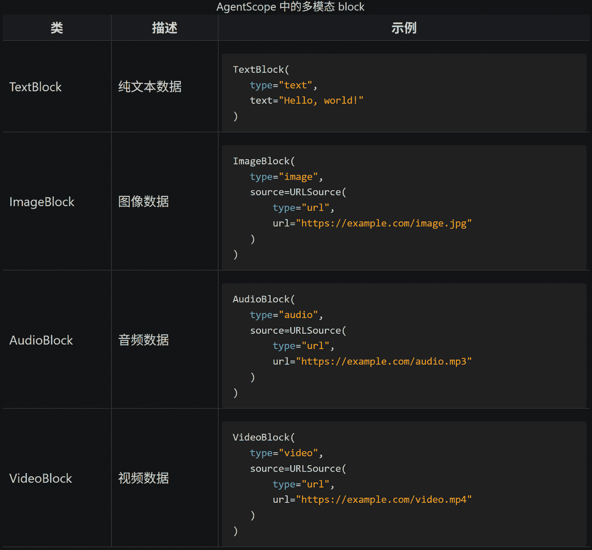

在记忆管理方面，该框架同时支持“短期记忆（Short‐Term Memory）”和“长期记忆（Long-Term Memory)”两层结构，并兼容第三方记忆框架如 ReMe、mem0。其 GitHub README 明确指出：“Support agent-controlled long-term memory”。

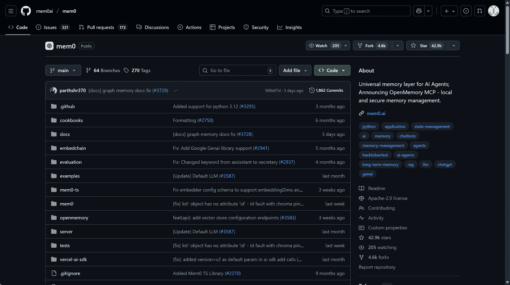

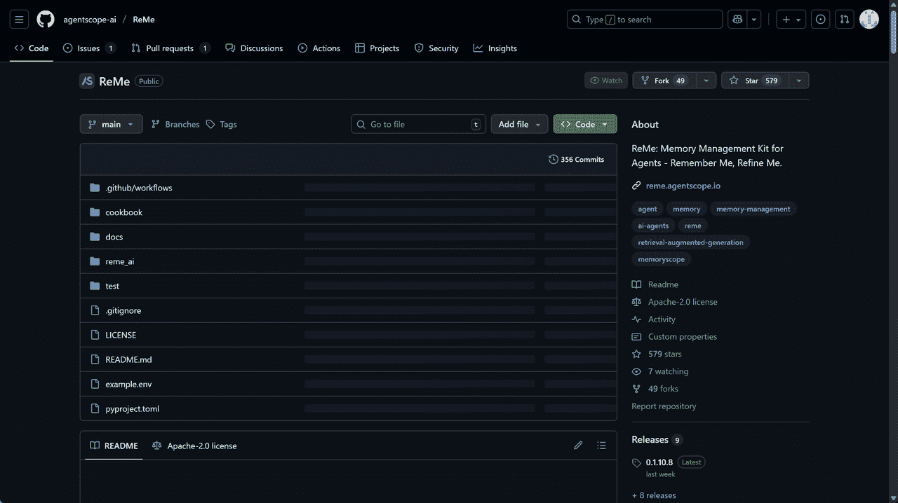

更进一步，在多智能体协作场景，AgentScope 提供统一的消息格式与 MsgHub、pipeline 等机制，使得不同 Agent 之间的消息、工具调用结果、结构化输出可透明流转。以“九人狼人杀”示例为例，多名 Agent 轮流发言、投票、工具调用，全过程通过 AgentScope 管道化管理，这正体现了其“跨 Agent 消息管理”的能力。

**（3）支持 ReAct 模式：工具并行**／多步调用／自动调试／自定义 Agent

ReAct（Reason + Act）是当前智能体开发的主流范式之一。AgentScope 在设计时充分拥抱这一范式，实现智能体能够：在一轮对话中自主决定是否调用工具、选择哪一个工具、是否并发调用多个工具、再基于工具结果进一步决策。其官方说明中指出 “Support parallel tool calls” 与 “Realtime steering and interruption” 等能力。

举个典型场景：一个 Agent 在分析用户指令后，判断需要同时执行“网页搜索”与“数据库查询”，于是并行调用两个工具，待结果返回后再生成最终回复。与此同时，如发现当前流程偏差，该 Agent 也可通过 Hook 机制自动进入调试流程，修正思路并生成更精确输出。

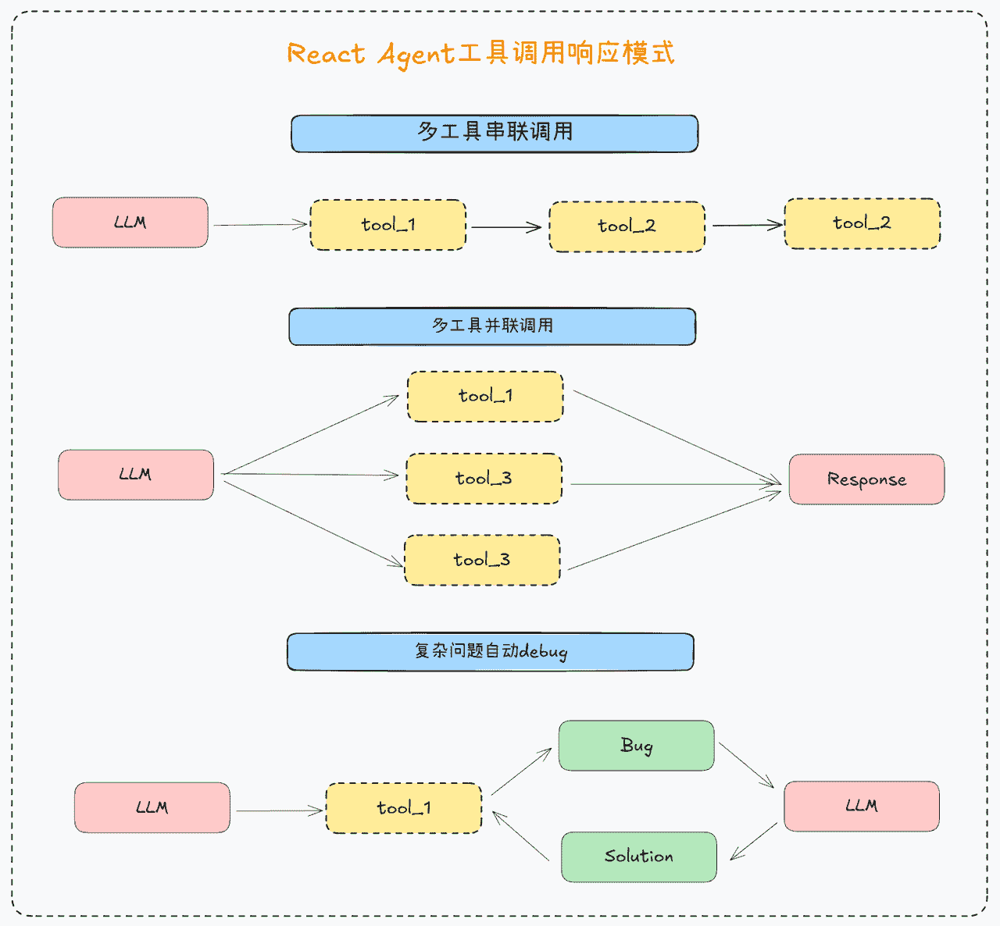

此外，AgentScope 鼓励开发者自行定义 Agent 类型：不仅限于 ReActAgent 这一类，还支持继承扩展、插入自定义 Hook、控制生命周期。这使得无论你是构造简单对话机器人，还是复杂策略智能体，框架都能提供支撑。

（4）高性能 RAG 与多模态 RAG 支持

对于需要外部知识支撑或多模态检索生成 (Retrieval-Augmented Generation, RAG) 的场景，AgentScope 提供完善的 API 支持。其 RAG 模块包括知识库构建（读取文档、切块、生成嵌入）、向量数据库接入（如 Qdrant）、多模态读取器（ImageReader、PDFReader 等），以及将其作为工具整合至 Agent 体系。

开发者可以选择两种 RAG 集成方式：一是 Agentic 方式 — Agent 自主决定何时检索、检索什么；二是通用方式 — 在每次回复前统一检索再附加知识。这样设计既保障灵活性，也兼顾易用性。

值得一提的是，多模态 RAG 支持文本 + 图像 +其他形式输入，使 AgentScope 在“视觉－语言”融合任务中具有优势。这在国内多媒体智能体应用场景中尤具价值。

**（5）钩子函数机制与中间件支持 **

AgentScope 引入了丰富的中间件化机制，开发者可以在 Agent 执行流程的多个阶段（如 pre_reasoning、post_acting、pre_reply）注册钩子函数，从而实现细粒度控制。例如：监控工具调用时长、捕捉异常结果、动态调整 prompt、日志追踪等。GitHub 文档中提及：“Support agent hooks”。

```
举例：在一个复杂 Agent 中，当工具返回结果但其语义置信度低时，可通过 `post_acting` 钩子自动触发“自我反省”子任务，要求 Agent 重写思路或再调用一次工具。如此，中间件的介入使智能体不仅仅自动运行，而且具备“自我校正”能力。
```

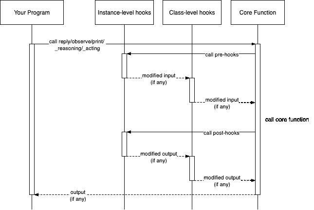

**（6）可视化平台 AgentScope St**udio 与 Agentic RL 支撑

除了核心框架，AgentScope 还配备了一个前端平台 AgentScope Studio，用于实时对话展示、智能体追踪、工具调用可视化、日志与指标监控。据其网站介绍，该 Studio 支持消息流回放、结构化输出 查看、工具调用痕迹分析等。

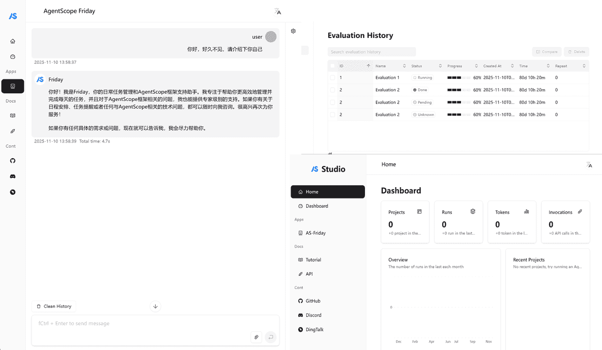

此外，在评测与强化学习（Reinforcement Learning, RL）方面，AgentScope 也有所布局：其 README 中提及“Agentic RL via integrating Trinity-RFT library”。这一功能允许智能体在模拟环境或多智能体对抗环境中，通过 RL 的方式优化其决策策略，实现“长期学习与优化”。例如，你可以构建多个 Agent 玩一局游戏（如狼人杀），然后利用 RL 回放其游戏轨迹、分析胜负、调整策略，从而逐代提升智能体表现。

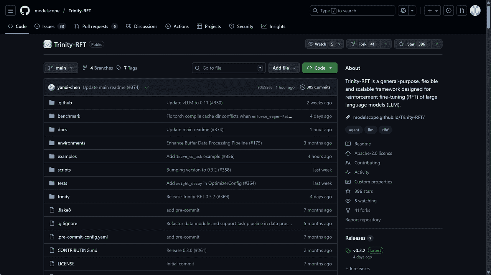

### 3. AgentScope和其他Agent开发框架综合对比

#### 3.1 Agent 开发框架的整体格局

自 2023 年至 2025 年，随着大模型的能力持续增强，智能体（Agent）框架从早期的单一任务执行器，逐步演化为多智能体协作、具备记忆、感知、推理、规划、执行、评估等完整能力的“操作系统级平台”。

目前主流的 Agent 开发框架大致可分为三类：

1.  以工作流与工具链为**核心的传统框架 **—**— 代表如 L**angChain 0.x 系列、Haystack、Flowise。这些框架以模块化、可视化的方式搭建智能体流程，强调可复用性与稳定性，但智能性相对不足。

1.  以 ReAct** 范式为核心的新一代**框架 —— 包括 AgentScope、OpenAI Agents SDK、Google ADK (Agent Development Kit) 等。这类框架更强调大模型自身的推理能力，允许模型在执行过程中动态决策、调用工具、规划行动。

1.  以 Graph 或 **Agentic Runtime** 为核心的图式框架 —— 代表如 LangChain 1.0 + LangGraph、DeepAgents (来自 LangChain 官方 R&D)、Parlant Runtime 等。这类框架引入状态机与图结构，专注于复杂多智能体控制、并发执行和条件跳转。

AgentScope 处于第二与第三类型之间的交汇点：既继承了 ReAct 范式的灵活性，又吸收了 LangGraph 式的图式控制思维，形成了兼具“模型智能”与“工程管控”的混合体系。

#### 3.2 AgentScope vs LangChain 1.0

LangChain 1.0** 的定位 是“通用 **AI 工作流框架”，其重点在于提供一套统一抽象（如 Runnable、Tool、Memory、Retriever、Graph 等），使开发者能够组合组件搭建完整的 LLM 应用。

相比之下，AgentScope 的定位更加聚焦——它不是通用的 AI 编排框架，而是“专门用于构建 ReAct Agent 与 Multi-Agent 系统的核心引擎”。

| 对比维度 | LangChain 1.0 | AgentScope |
| --- | --- | --- |
| **核心范式** | 图式 (Graph) 工作流 + Runnable 节点 | ReAct 智能体范式 + 管道式消息流 |
| **执行模式** | 静态编排，依赖图结构控制节点执行 | 动态决策，Agent 可在执行中主动规划与切换 |
| **模型适配性** | LangChain 官方以 OpenAI 生态为主 | 支持 Qwen、DeepSeek、Gemini、Claude 等多源模型 |
| **消息结构** | Message 依然偏 text-only 或 metadata 轻量 | 支持 content block 结构，可原生承载 text、image、audio、video 多模态内容 |
| **并发与协作** | LangGraph 支持并发节点执行，但配置复杂 | AgentScope 原生支持 Multi-Agent 并行协作与统一 MsgHub |
| **可视化工具** | LangGraph Studio （需本地 Dev Server） | AgentScope Studio （前后端一体，可追踪 Agent 内部消息流） |
| **学习曲线** | 概念多、接口分层复杂 | 结构清晰，学习成本相对更低 |
| **适用场景** | 企业级 RAG 系统、长流程 QA 与检索 | 需要 Agent 决策、自主推理、多角色协作的任务，如 游戏、对话、策略执行 |

从整体来看，LangChain 1.0 仍然是通用 LLM 应用的首选框架，尤其适合构建知识问答与检索增强系统。而 AgentScope 更适合以 “智能体决策与交互”为核心的项目，例如自动化客服、游戏 AI、企业 Agent 协同办公、智能助理等。

#### 3.3 AgentScope vs OpenAI Agents SDK

**        Op**enAI 在 2025 年正式推出 Agents SDK，其目标是将 ReAct Agent 机制标准化，并让开发者基于 OpenAI 生态快速构建 “带有工具、记忆、上下文”的 Agent”。

**主要差异在于生态与开放性：**

+   AgentScope 开源且生态中立：它既能对接 OpenAI 的 GPT-5 ，也能无缝调用 Qwen3、Gemini 2.5、DeepSeek-R1 等 API。

+   **Agents SDK 生态锁定**：其强项是与 OpenAI 自家 Responses API、File API、Vector Store 等组件紧密集成，但扩展到其他模型需额外封装。

+   **在多智能体协作方面**，AgentScope 内置 MsgHub 和 pipeline 机制，可实现多 Agent 同步/异步协作，而 Agents SDK 更倾向于单 Agent + Tool 链路。

+   在 RL （强化学习）与 评测支持上，AgentScope 具备 Agentic RL 功能，可让 Agent 在多局对战或任务中自我优化，而 OpenAI 生态目前尚未公开同类模块。

因此，如果项目主要运行在 OpenAI 云端、模型固定为 GPT-5 系列、并依赖官方 API 体系，那么 Agents SDK 是效率最高的选择；

但若希望在本地或多模型环境中构建跨 Agent 协作、可视化与 RL 评测体系，则 AgentScope 无疑更具灵活性与控制力。

#### 3.4 AgentScope vs Google ADK (Agent Development Kit)

**Google ADK** 是 Gemini 生态下的重要基础框架，定位为“多模态、可插拔、可编排的智能体开发套件”。

两者在理念上有许多共通点：均支持多模态 message block、并行工具调用、长短期记忆与 hook 机制。但 ADK 更偏向 “服务化集成 + 低代码接口”，适合企业级应用，而 AgentScope 更强调“开发者可控 + 研究导向”。

| 对比维度 | Google ADK | AgentScope |
| --- | --- | --- |
| **生态定位** | Gemini 生态核心组件 | 中立开源框架，适配 Qwen / DeepSeek / Gemini / Claude 等 |
| **多模态能力** | 原生支持文本、图像、音频、视频 | 同样原生 content block 机制，可扩展自定义类型 |
| **执行方式** | API 服务化调用，自动规划任务流 | Python SDK 级别操作，允许开发者深度定制控制流 |
| **记忆系统** | 长短期记忆统一管理（内建 Gemini Memory API） | 短期记忆 + 可接 mem0 / Re Me 等外部长期记忆 |
| **Agent 类型** | 系统级 Agent（App、Service、Assistant） | 开发者自定义 Agent（ReActAgent、UserAgent 等） |
| **可追踪性** | 通过 Google AI Studio 可视化 | 通过 AgentScope Studio 本地或私有部署追踪 |

综上，如果团队主要在 Google Cloud 生态内部署， ADK 是天然选择；但若需要更多自定义、私有化部署、以及对模型与工具的精细控制， AgentScope 的开发灵活度更高。

#### 3.5 AgentScope vs DeepAgents / Parlant Runtime

DeepAgents（LangChain 官方项目） 与 Parlant Runtime（微软开源） 代表了另一种趋势：以 Agent 图与状态机为核心的多智能体运行时系统。

它们注重“可视化流程与节点控制”，为多 Agent 提供复杂条件分支、事件触发、并发执行等能力。

AgentScope 与其的差别在于：

+   DeepAgents / Parlant 更偏向编排层（orchestration layer），而 AgentScope 同时涵盖执行层（execution layer）；

+   AgentScope 的设计更贴近 “模型直接驱动 Agent 行为”，而非单纯的流程调度。
换言之，AgentScope 将 “智能” 本身嵌入在 Agent 之中，而非在外层编排引擎中实现。
这使它特别适合需要动态决策、上下文强依赖的场景，如游戏 AI、对话 Agent 协同推理等。

#### 3.6 典型场景选择建议

| 应用场景 | 推荐框架 | 说明 |
| --- | --- | --- |
| 通用 RAG 系统 / 企业问答 | LangChain 1.0 + LangGraph | 成熟 Retriever + Vector API 体系，适合企业内部知识管理 |
| 单智能体 Tool Use 任务 | OpenAI Agents SDK | 工具集成便捷，适合固定模型环境 |
| 多智能体协作 / 游戏 / 对话体系统 | AgentScope | 原生 Multi-Agent 机制、MsgHub 支持 |
| 视觉 + 文本多模态 Agent | Google ADK 或 AgentScope | 两者均具 content block 机制，后者可私有化 |
| 强化学习 Agent 实验与优化 | AgentScope | 内建 Agentic RL 接口，可回放并优化策略 |
| **企业级工作流 AI 编排** | DeepAgents 或 Parlant Runtime | 更适合流程复杂、需可视化监控的场景 |

## 二、AgentScope快速上手指南

### 1. AgentScope安装流程

+   项目主页：https://github.com/agentscope-ai/agentscope/

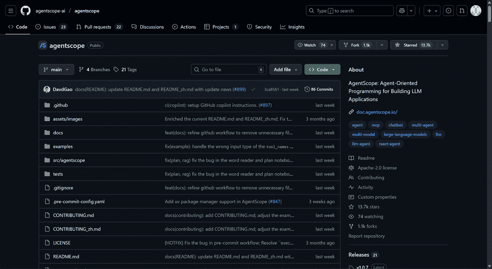

我们可以通过pip进行快速安装：

```
# 创建虚拟环境
conda create --name agc python=3.12
conda init
conda activate agc

# 安装AgentScope
pip install agentscope[full]

# 安装对应虚拟环境的Jupyter Kernel
conda install jupyterlab
conda install ipykernel
python -m ipykernel install --user --name agc --display-name &quot;Python agc&quot;
pip install -U ipywidgets
```

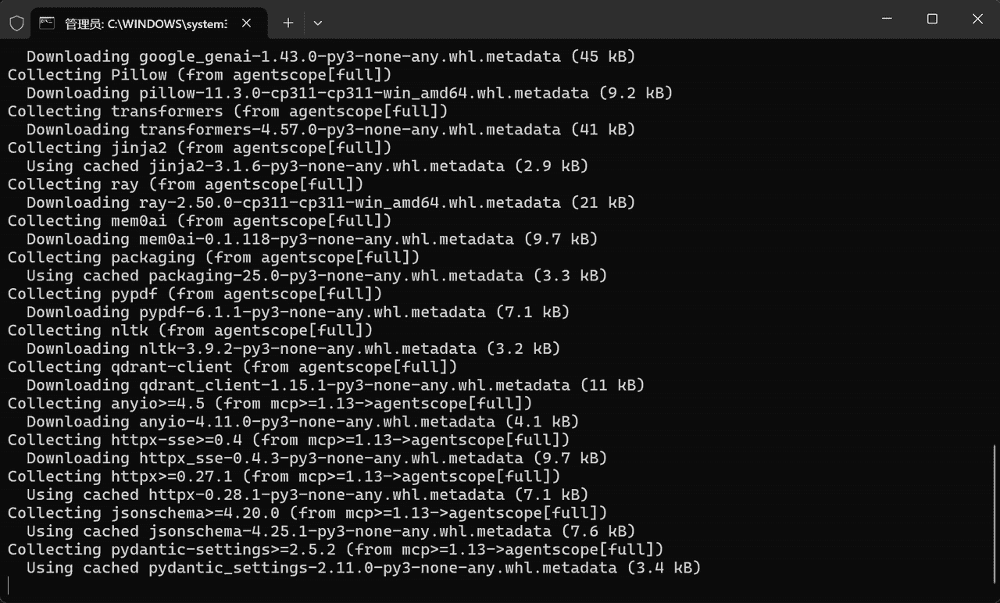

安装完成后，打开Jupyter输入如下代码，即可查看是否安装成功以及对应的版本号：

```
import agentscope

print(agentscope.__version__)
```

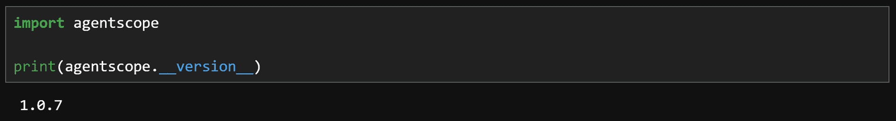

除此之外，作为最新一代的Agent开发框架，AgentScope还配置了一整套前端运行与运维监督框架，可以通过npm进行一键安装与调用：

```
npm install -g @agentscope/studio
```

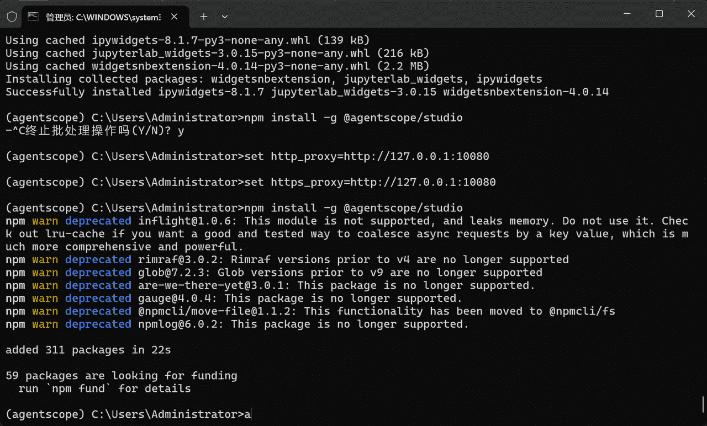

> 注，没有安装node.js的同学可以直接在官网下载软件包：https://nodejs.org/en

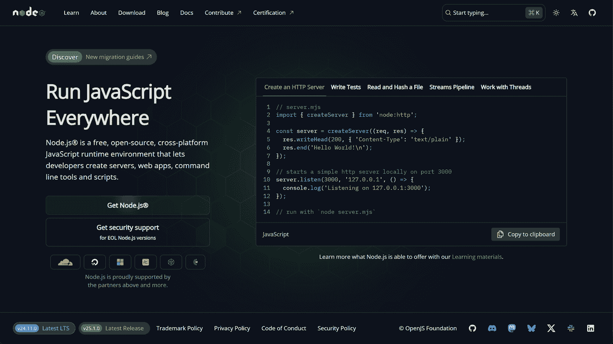

> 也可以在网盘中进行下载和安装：

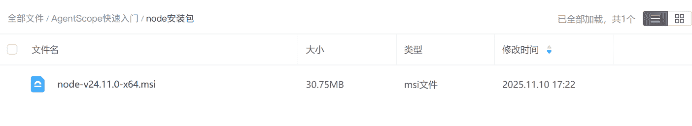


然后输入如下命令即可运行：

```
as_studio
```

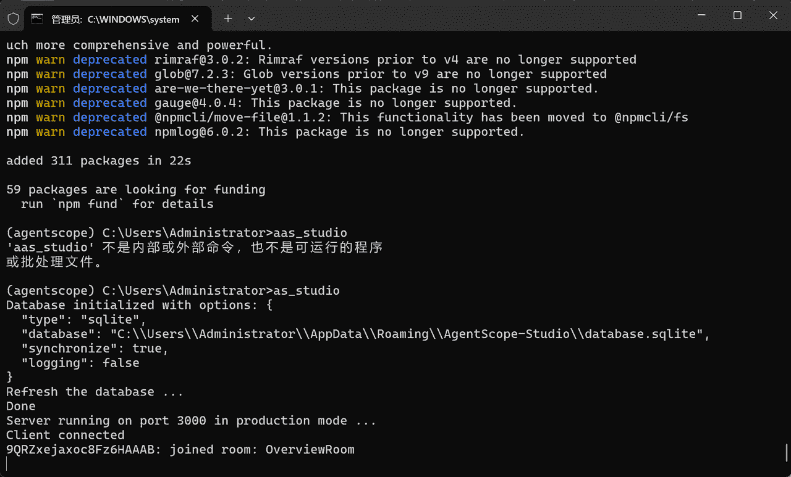

然后进入http://localhost:3000/ ，即可查看完整前端功能：

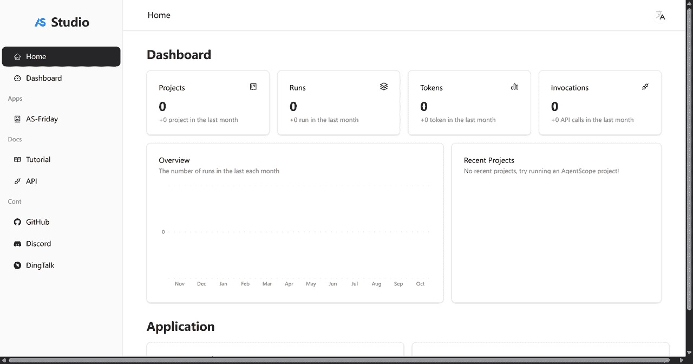

同时，AgentScope Studio还自带了一个Friday的Agent，

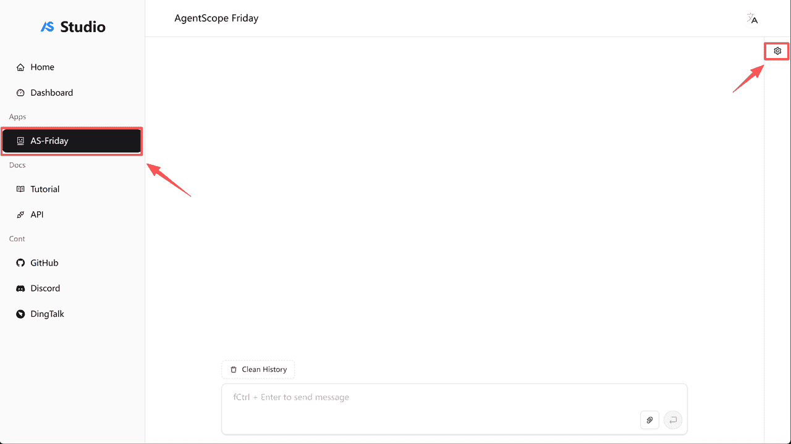

完成相关配置即可进行对话测试：

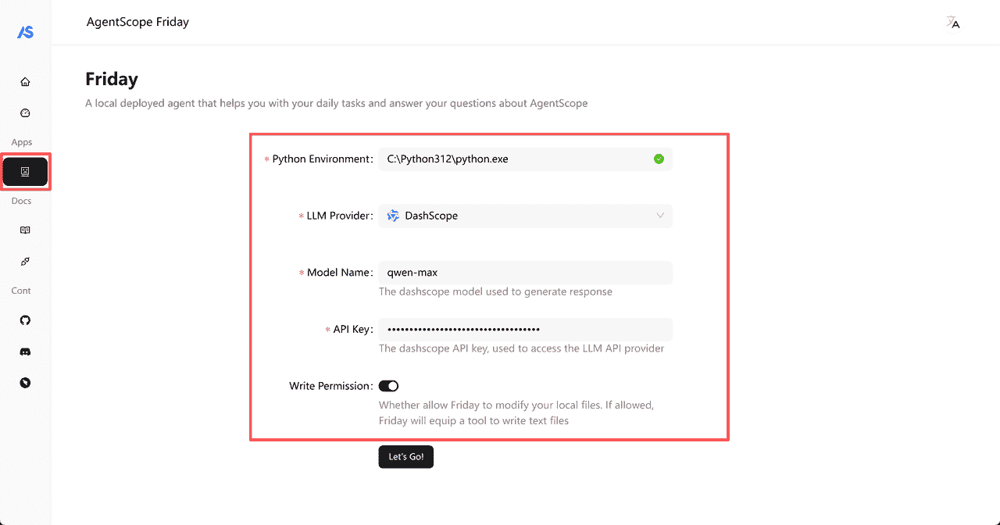

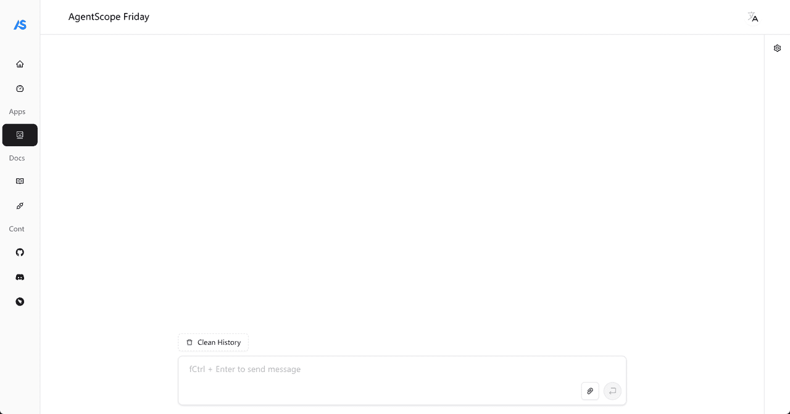

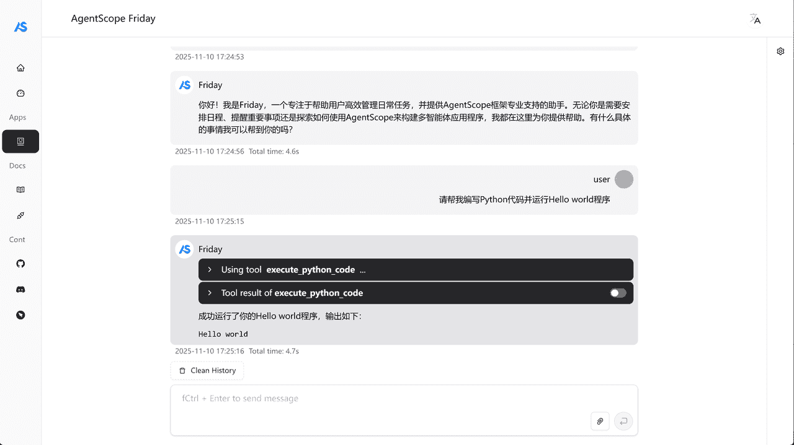

> 注，本节公开课各项实验主要使用DashScope阿里百炼API，API获取地址：https://bailian.console.aliyun.com/

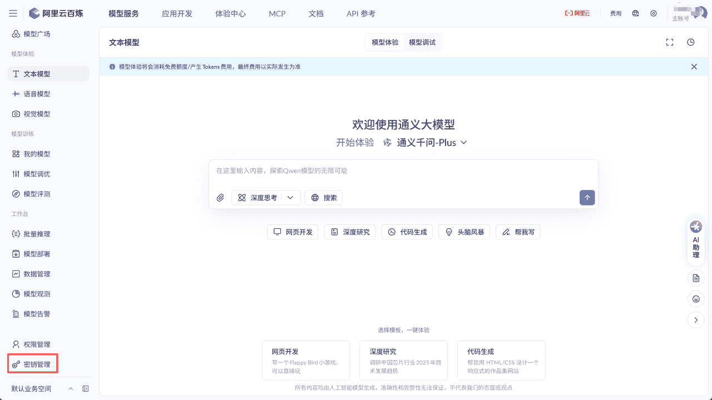

>

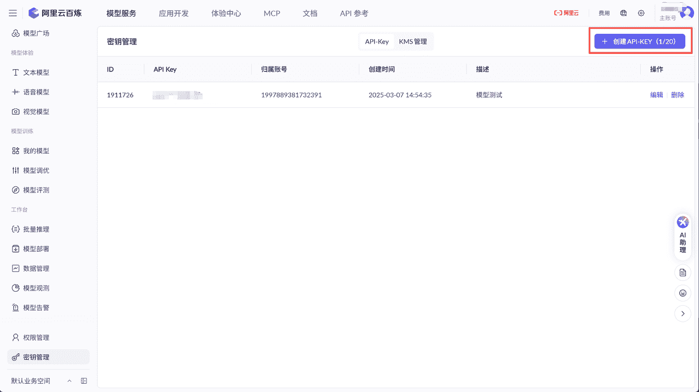

> 获取后，建议将其设置为系统环境变量DASHSCOPE_API_KEY，方便后续进行调用：

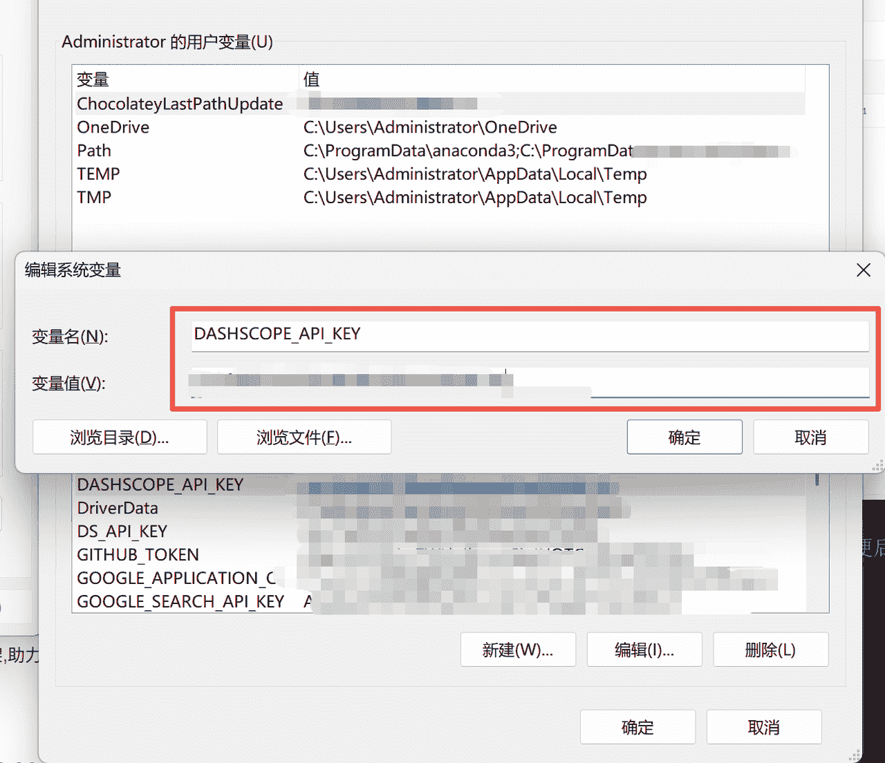

注：2-5部分在Jupyter课件中

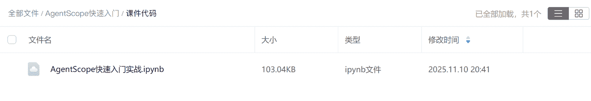


### 6. Agent Studio使用方法介绍

在掌握了AgentScope基础API的使用方法之后，接下来让我们尝试将开发好的简易Agent使用AgentScope Studio进行调用和监控。

+   创建.env文件

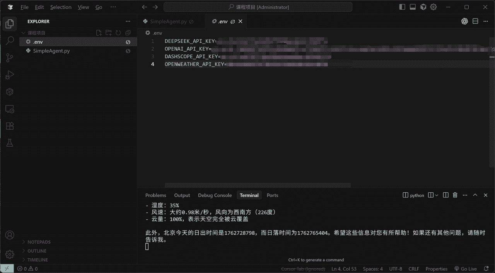

+   创建SimpleAgent.py核心代码文件

```
import asyncio
import os
import requests, json
from datetime import datetime
from dotenv import load_dotenv 
load_dotenv(override=True)

from agentscope.agent import ReActAgent, UserAgent
from agentscope.formatter import DashScopeChatFormatter
from agentscope.memory import InMemoryMemory
from agentscope.model import DashScopeChatModel
from agentscope.tool import Toolkit, ToolResponse
from agentscope.message import Msg, TextBlock

# 创建自定义工具
def get_weather(loc: str) -&gt; ToolResponse:
    &quot;&quot;&quot;查询即时天气函数。

    Args:
        loc (str):
            查询天气的城市名称，注意不要输入中文，中文城市请以拼音代替（例如 &#x27;Beijing&#x27;、&#x27;New York&#x27;）。
    &quot;&quot;&quot;
    url = &quot;https://api.openweathermap.org/data/2.5/weather&quot;
    params = {
        &quot;q&quot;: loc,
        &quot;appid&quot;: os.getenv(&quot;OPENWEATHER_API_KEY&quot;),
        &quot;units&quot;: &quot;metric&quot;,
        &quot;lang&quot;: &quot;zh_cn&quot;,
    }

    response = requests.get(url, params=params)
    data = response.json()

    return ToolResponse(
        content=[TextBlock(type=&quot;text&quot;, text=json.dumps(data, ensure_ascii=False))]
    )

def write_file(content: str) -&gt; ToolResponse:
    &quot;&quot;&quot;将指定内容写入本地文件。

    Args:
        content (str): 需要写入的文档内容。

    Returns:
        ToolResponse: 写入结果的反馈消息。
    &quot;&quot;&quot;
    try:
        # Step 1️⃣ 生成唯一文件名
        timestamp = datetime.now().strftime(&quot;%Y%m%d_%H%M%S&quot;)
        filename = f&quot;output_{timestamp}.txt&quot;

        # Step 2️⃣ 写入文件
        with open(filename, &quot;w&quot;, encoding=&quot;utf-8&quot;) as f:
            f.write(content)

        abs_path = os.path.abspath(filename)
        result_msg = f&quot;✅ 已成功写入本地文件：{abs_path}&quot;

    except Exception as e:
        result_msg = f&quot;❌ 文件写入失败：{str(e)}&quot;

    # Step 3️⃣ 返回标准 ToolResponse
    return ToolResponse(
        content=[
            TextBlock(type=&quot;text&quot;, text=result_msg)
        ]
    )

async def main() -&gt; None:
    &quot;&quot;&quot;The main entry point for the ReAct agent example.&quot;&quot;&quot;

    import agentscope
    agentscope.init(
        studio_url=&quot;http://localhost:3000&quot;,
        project=&quot;SimpleAgent&quot;,
    )

    toolkit = Toolkit()
    toolkit.clear()
    toolkit.register_tool_function(get_weather)
    toolkit.register_tool_function(write_file)

    agent = ReActAgent(
        name=&quot;SimpleAgent&quot;,
        sys_prompt=&quot;你叫SimpleAgent，是一名助人为乐的助手，能够帮助用户进行天气查询、本地信息写入等各项工作。请热情耐心的回复用户的问题。&quot;,
        model=DashScopeChatModel(
            api_key=os.environ.get(&quot;DASHSCOPE_API_KEY&quot;),
            model_name=&quot;qwen-max&quot;,
            enable_thinking=False,
            stream=True,
        ),
        formatter=DashScopeChatFormatter(),
        toolkit=toolkit,
        memory=InMemoryMemory(),
    )
    user = UserAgent(&quot;User&quot;)

    msg = None
    while True:
        msg = await user(msg)
        if msg.get_text_content() == &quot;exit&quot;:
            break
        msg = await agent(msg)


asyncio.run(main())
```

+   完整项目源码领取

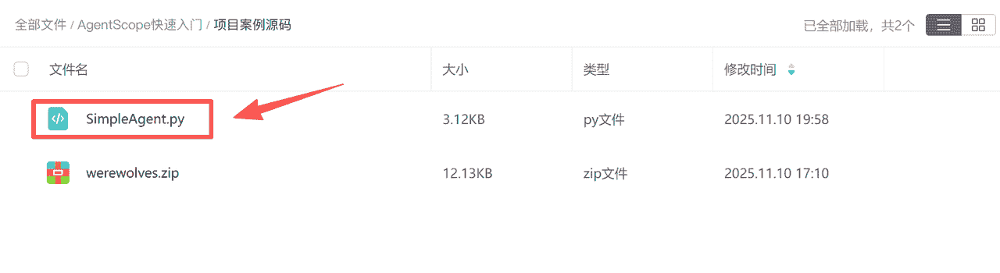


然后输入即可开启运行（注意需要提前开启前端3000服务）

```
python .\SimpleAgent.py
```

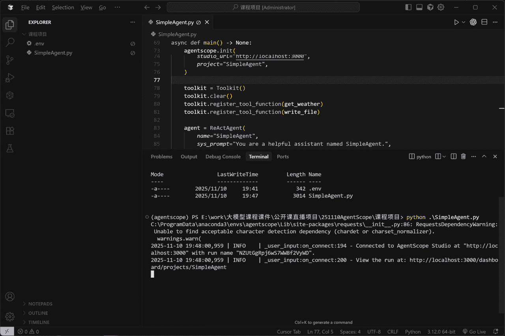

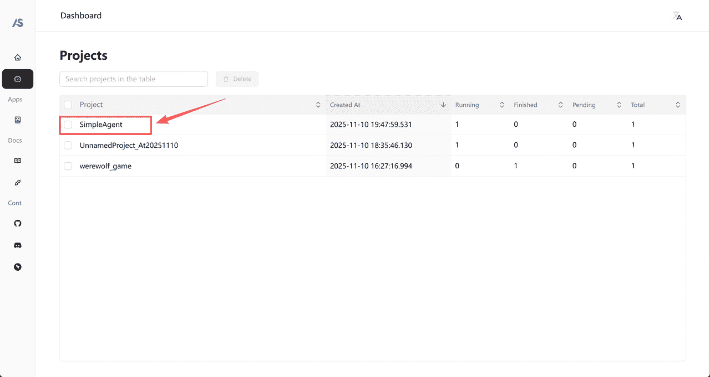

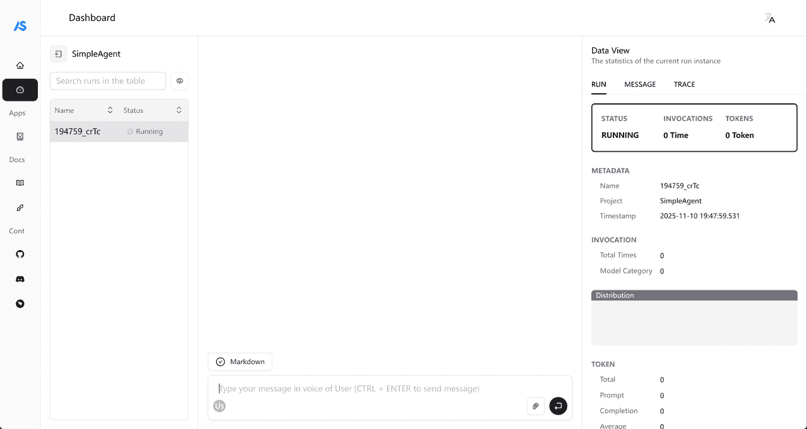

+   交互效果演示

## 实操案例：基于Multi-Agent的狼人杀游戏开发

### 1. 项目介绍与项目开启

#### 1.1 狼人杀游戏介绍

狼人杀游戏是一款基于文字的多人角色扮演推理游戏，共有九名玩家参与，分别扮演三名狼人、三名村民、一名预言家、一名女巫和一名猎人。游戏以“昼夜交替”的形式展开：在夜晚，狼人秘密商议并选择一名玩家进行袭击，预言家可以查验一名玩家的身份，女巫则拥有一次性的解药和毒药，可以救人或反击；而白天到来时，所有存活玩家都会睁眼讨论、辩论、互相指认，最终投票决定要处决的对象。随着玩家的不断出局，游戏将在两大阵营——狼人阵营与村民阵营之间展开心理博弈与策略对抗。当狼人全部被消灭，或狼人数量达到存活玩家的一半时，游戏宣告结束。整个过程充满了推理、欺骗与合作的张力，每一轮的选择都可能影响最终的胜负走向。

#### 1.2 项目演示

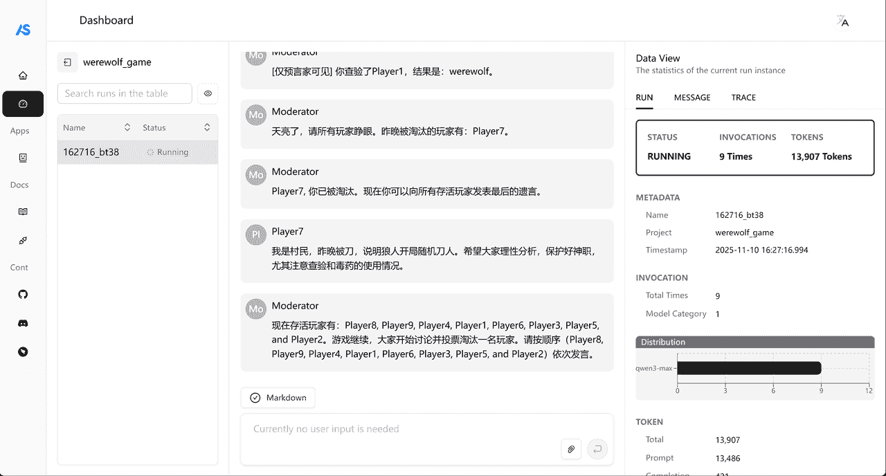

#### 1.3 项目上手运行流程

+   下载源码

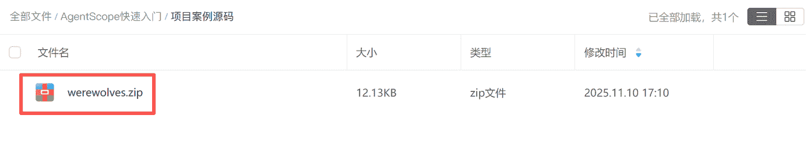


解压后如图所示

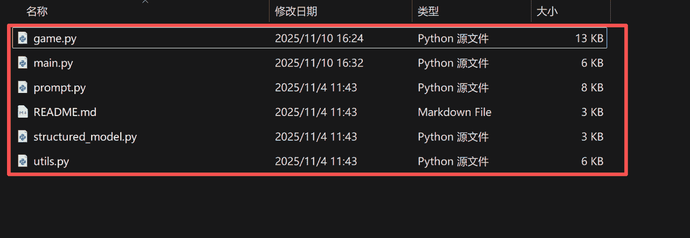

Werewolves 模块概览：

+   game.py 负责整局流程：打乱分配身份，执行夜晚阶段（狼人密聊与投票、女巫操作、预言家验人、猎人触发），白天阶段（公布死讯、sequential_pipeline 轮流发言、majority_vote 得出投票结果、胜负判定）。它借助 EchoAgent 担任主持人，并用 AgentScope 的 MsgHub 与流水线控制信息广播。

+   utils.py 提供公共工具：majority_vote、names_to_str、主持人 EchoAgent，以及 Players 状态管理器，记录玩家名称 ↔ 身份、存活列表，并负责胜负判断。

+   structured_model.py 定义一组动态生成的 Pydantic 模型，针对当前存活玩家定制投票、讨论、女巫/预言家/猎人操作的结构化输出，确保 ReAct Agent 必须按预期字段作答。

+   prompt.py 收录英中双语提示模板（默认英语，可切换中文），涵盖主持人台词、阶段提示、角色指令、结果公告与赛后复盘提示。

+   main.py 充当入口：创建九名带统一系统提示的 ReActAgent，用 JSONSession 读写进度，配置 DashScope 模型与格式器，并调用 werewolves_game 启动整局游戏。

项目开启流程：

+   在环境变量中设置DASHSCOPE_API_KEY变量

+   在项目主目录下输入python main.py开启运行Agent

+   开启AgentScope Studio：as_studio

+   打开浏览器，在对应页面http://localhost:3000/dashboard/ 找到werewolf项目，点击即可查看实时运行情况：

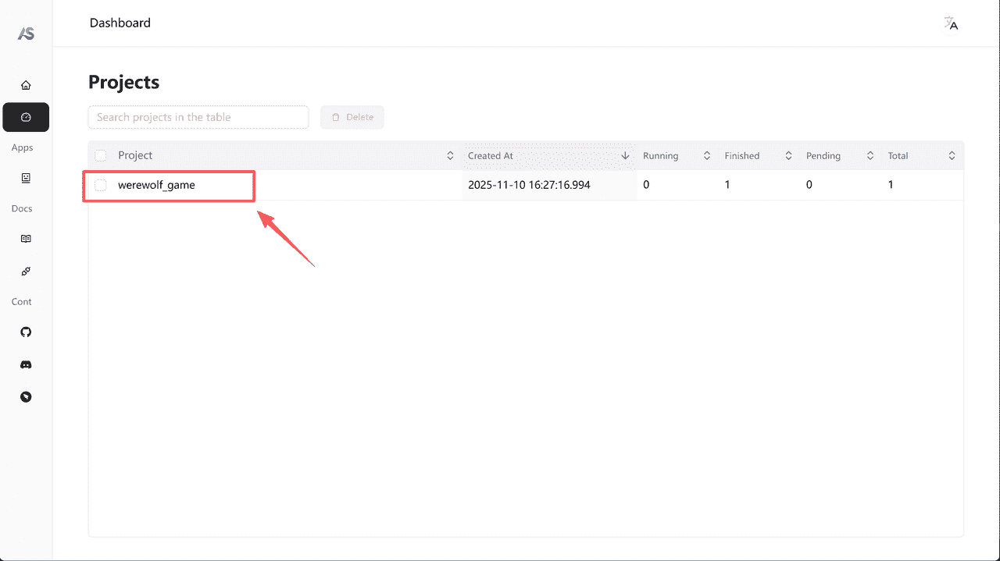

### 2. 项目核心功能特点

| 层级 | 技术特征 | 具体体现 |
| --- | --- | --- |
| 架构层 | 多智能体异步通信系统 | MsgHub, fanout_pipeline, sequential_pipeline |
| 智能体层 | ReActAgent 抽象 | 推理 + 行动分离、Hook 机制、结构化输出 |
| 数据层 | Structured Output Schema | Pydantic 模型校验、动态 Literal 限制 |
| 状态层 | JSONSession | Agent 状态持久化、断点续玩 |
| 模型层 | Model + Formatter 解耦 | Qwen3 + DashScope Formatter |
| 可视化层 | AgentScope Studio | 实时消息流、状态追踪 |
| 可扩展性 | 异步架构与模块解耦 | 易于嵌入新角色、规则或模型 |

### 3. 项目核心代码解释

#### 3.1 核心代码game.py解释

```
开局 → 分配身份(单独 observe) → 回合循环:
  夜:
    公告 → 狼人小群(讨论→投票) → 女巫(救/毒) → 预言家(查) → 猎人(若夜死且非毒)
    更新存活
  白天:
    公告死讯/和平 → (首夜遗言)
    判胜(可能结束)
    讨论(轮流发言)
    投票出局 → 出局遗言 → 猎人(若被投)
    更新存活
    判胜(可能结束)
  标记 first_day=False
结束:
  全员反思
```

+   原始代码

```
import numpy as np

from utils import (
    majority_vote,
    names_to_str,
    EchoAgent,
    MAX_GAME_ROUND,
    MAX_DISCUSSION_ROUND,
    Players,
)
from structured_model import (
    DiscussionModel,
    get_vote_model,
    get_poison_model,
    WitchResurrectModel,
    get_seer_model,
    get_hunter_model,
)
from prompt import EnglishPrompts as Prompts

# Uncomment the following line to use Chinese prompts
from prompt import ChinesePrompts as Prompts


from agentscope.agent import ReActAgent
from agentscope.pipeline import (
    MsgHub,
    sequential_pipeline,
    fanout_pipeline,
)


moderator = EchoAgent()


async def hunter_stage(
    hunter_agent: ReActAgent,
    players: Players,
) -&gt; str | None:
    &quot;&quot;&quot;Because the hunter&#x27;s stage may happen in two places: killed at night
    or voted during the day, we define a function here to avoid duplication.&quot;&quot;&quot;
    global moderator
    msg_hunter = await hunter_agent(
        await moderator(Prompts.to_hunter.format(name=hunter_agent.name)),
        structured_model=get_hunter_model(players.current_alive),
    )
    if msg_hunter.metadata.get(&quot;shoot&quot;):
        return msg_hunter.metadata.get(&quot;name&quot;, None)
    return None


async def werewolves_game(agents: list[ReActAgent]) -&gt; None:
    &quot;&quot;&quot;The main entry of the werewolf game

    Args:
        agents (`list[ReActAgent]`):
            A list of 9 agents.
    &quot;&quot;&quot;
    assert len(agents) == 9, &quot;The werewolf game needs exactly 9 players.&quot;

    # Init the players&#x27; status
    players = Players()

    # If the witch has healing and poison potion
    healing, poison = True, True

    # If it&#x27;s the first day, the dead can leave a message
    first_day = True

    # Broadcast the game begin message
    async with MsgHub(participants=agents) as greeting_hub:
        await greeting_hub.broadcast(
            await moderator(
                Prompts.to_all_new_game.format(names_to_str(agents)),
            ),
        )

    # Assign roles to the agents
    roles = [&quot;werewolf&quot;] * 3 + [&quot;villager&quot;] * 3 + [&quot;seer&quot;, &quot;witch&quot;, &quot;hunter&quot;]
    np.random.shuffle(agents)
    np.random.shuffle(roles)

    for agent, role in zip(agents, roles):
        # Tell the agent its role
        await agent.observe(
            await moderator(
                f&quot;[{agent.name} ONLY] {agent.name}, your role is {role}.&quot;,
            ),
        )
        players.add_player(agent, role)

    # Printing the roles
    players.print_roles()

    # GAME BEGIN!
    for _ in range(MAX_GAME_ROUND):
        # Create a MsgHub for all players to broadcast messages
        async with MsgHub(
            participants=players.current_alive,
            enable_auto_broadcast=False,  # manual broadcast only
            name=&quot;alive_players&quot;,
        ) as alive_players_hub:
            # Night phase
            await alive_players_hub.broadcast(
                await moderator(Prompts.to_all_night),
            )
            killed_player, poisoned_player, shot_player = None, None, None

            # Werewolves discuss
            async with MsgHub(
                players.werewolves,
                enable_auto_broadcast=True,
                announcement=await moderator(
                    Prompts.to_wolves_discussion.format(
                        names_to_str(players.werewolves),
                        names_to_str(players.current_alive),
                    ),
                ),
                name=&quot;werewolves&quot;,
            ) as werewolves_hub:
                # Discussion
                n_werewolves = len(players.werewolves)
                for _ in range(1, MAX_DISCUSSION_ROUND * n_werewolves + 1):
                    res = await players.werewolves[_ % n_werewolves](
                        structured_model=DiscussionModel,
                    )
                    if _ % n_werewolves == 0 and res.metadata.get(
                        &quot;reach_agreement&quot;,
                    ):
                        break

                # Werewolves vote
                # Disable auto broadcast to avoid following other&#x27;s votes
                werewolves_hub.set_auto_broadcast(False)
                msgs_vote = await fanout_pipeline(
                    players.werewolves,
                    msg=await moderator(content=Prompts.to_wolves_vote),
                    structured_model=get_vote_model(players.current_alive),
                    enable_gather=False,
                )
                killed_player, votes = majority_vote(
                    [_.metadata.get(&quot;vote&quot;) for _ in msgs_vote],
                )
                # Postpone the broadcast of voting
                await werewolves_hub.broadcast(
                    [
                        *msgs_vote,
                        await moderator(
                            Prompts.to_wolves_res.format(votes, killed_player),
                        ),
                    ],
                )

            # Witch&#x27;s turn
            await alive_players_hub.broadcast(
                await moderator(Prompts.to_all_witch_turn),
            )
            msg_witch_poison = None
            for agent in players.witch:
                # Cannot heal witch herself
                msg_witch_resurrect = None
                if healing and killed_player != agent.name:
                    msg_witch_resurrect = await agent(
                        await moderator(
                            Prompts.to_witch_resurrect.format(
                                witch_name=agent.name,
                                dead_name=killed_player,
                            ),
                        ),
                        structured_model=WitchResurrectModel,
                    )
                    if msg_witch_resurrect.metadata.get(&quot;resurrect&quot;):
                        killed_player = None
                        healing = False

                # Has poison potion and hasn&#x27;t used the healing potion
                if poison and not (
                    msg_witch_resurrect
                    and msg_witch_resurrect.metadata[&quot;resurrect&quot;]
                ):
                    msg_witch_poison = await agent(
                        await moderator(
                            Prompts.to_witch_poison.format(
                                witch_name=agent.name,
                            ),
                        ),
                        structured_model=get_poison_model(
                            players.current_alive,
                        ),
                    )
                    if msg_witch_poison.metadata.get(&quot;poison&quot;):
                        poisoned_player = msg_witch_poison.metadata.get(&quot;name&quot;)
                        poison = False

            # Seer&#x27;s turn
            await alive_players_hub.broadcast(
                await moderator(Prompts.to_all_seer_turn),
            )
            for agent in players.seer:
                msg_seer = await agent(
                    await moderator(
                        Prompts.to_seer.format(
                            agent.name,
                            names_to_str(players.current_alive),
                        ),
                    ),
                    structured_model=get_seer_model(players.current_alive),
                )
                if msg_seer.metadata.get(&quot;name&quot;):
                    player = msg_seer.metadata[&quot;name&quot;]
                    await agent.observe(
                        await moderator(
                            Prompts.to_seer_result.format(
                                agent_name=player,
                                role=players.name_to_role[player],
                            ),
                        ),
                    )

            # Hunter&#x27;s turn
            for agent in players.hunter:
                # If killed and not by witch&#x27;s poison
                if (
                    killed_player == agent.name
                    and poisoned_player != agent.name
                ):
                    shot_player = await hunter_stage(agent, players)

            # Update alive players
            dead_tonight = [killed_player, poisoned_player, shot_player]
            players.update_players(dead_tonight)

            # Day phase
            if len([_ for _ in dead_tonight if _]) &gt; 0:
                await alive_players_hub.broadcast(
                    await moderator(
                        Prompts.to_all_day.format(
                            names_to_str([_ for _ in dead_tonight if _]),
                        ),
                    ),
                )

                # The killed player leave a last message in first night
                if killed_player and first_day:
                    msg_moderator = await moderator(
                        Prompts.to_dead_player.format(killed_player),
                    )
                    await alive_players_hub.broadcast(msg_moderator)
                    # Leave a message
                    last_msg = await players.name_to_agent[killed_player]()
                    await alive_players_hub.broadcast(last_msg)

            else:
                await alive_players_hub.broadcast(
                    await moderator(Prompts.to_all_peace),
                )

            # Check winning
            res = players.check_winning()
            if res:
                await moderator(res)
                break

            # Discussion
            await alive_players_hub.broadcast(
                await moderator(
                    Prompts.to_all_discuss.format(
                        names=names_to_str(players.current_alive),
                    ),
                ),
            )
            # Open the auto broadcast to enable discussion
            alive_players_hub.set_auto_broadcast(True)
            await sequential_pipeline(players.current_alive)
            # Disable auto broadcast to avoid leaking info
            alive_players_hub.set_auto_broadcast(False)

            # Voting
            msgs_vote = await fanout_pipeline(
                players.current_alive,
                await moderator(
                    Prompts.to_all_vote.format(
                        names_to_str(players.current_alive),
                    ),
                ),
                structured_model=get_vote_model(players.current_alive),
                enable_gather=False,
            )
            voted_player, votes = majority_vote(
                [_.metadata.get(&quot;vote&quot;) for _ in msgs_vote],
            )
            # Broadcast the voting messages together to avoid influencing
            # each other
            voting_msgs = [
                *msgs_vote,
                await moderator(
                    Prompts.to_all_res.format(votes, voted_player),
                ),
            ]

            # Leave a message if voted
            if voted_player:
                prompt_msg = await moderator(
                    Prompts.to_dead_player.format(voted_player),
                )
                last_msg = await players.name_to_agent[voted_player](
                    prompt_msg,
                )
                voting_msgs.extend([prompt_msg, last_msg])

            await alive_players_hub.broadcast(voting_msgs)


            # If the voted player is the hunter, he can shoot someone
            shot_player = None
            for agent in players.hunter:
                if voted_player == agent.name:
                    shot_player = await hunter_stage(agent, players)
                    if shot_player:
                        await alive_players_hub.broadcast(
                            await moderator(
                                Prompts.to_all_hunter_shoot.format(
                                    shot_player,
                                ),
                            ),
                        )

            # Update alive players
            dead_today = [voted_player, shot_player]
            players.update_players(dead_today)

            # Check winning
            res = players.check_winning()
            if res:
                async with MsgHub(players.all_players) as all_players_hub:
                    res_msg = await moderator(res)
                    await all_players_hub.broadcast(res_msg)
                break

        # The day ends
        first_day = False

    # Game over, each player reflects
    await fanout_pipeline(
        agents=agents,
        msg=await moderator(Prompts.to_all_reflect),
    )
```

1.  顶部导入 & 全局对象

```
import numpy as np
from utils import (majority_vote, names_to_str, EchoAgent, MAX_GAME_ROUND, MAX_DISCUSSION_ROUND, Players)
from structured_model import (DiscussionModel, get_vote_model, get_poison_model, WitchResurrectModel, get_seer_model, get_hunter_model)
from prompt import EnglishPrompts as Prompts
from prompt import ChinesePrompts as Prompts  # ← 实际上这里把中文覆盖为默认
from agentscope.agent import ReActAgent
from agentscope.pipeline import (MsgHub, sequential_pipeline, fanout_pipeline)
moderator = EchoAgent()
```

+   Players：维护玩家名→角色、存活/死亡集合、分组（狼人、预言家、女巫、猎人）、以及一些辅助映射 name_to_agent、name_to_role 等。

+   EchoAgent 充当**主持人/旁白**（moderator）。它不会“思考”，只是把文本包装成消息对象并广播，便于在对话里保持统一格式。

+   str**uctured**_model.*：都是结构化输出模型（通常基于 Pydantic/JSON schema）。ReActAgent 根据它们“填表式”地给出带结构的回复，框架把解析好的字段放到 msg.metadata 里（例如 metadata['vote']、metadata['shoot'] 等）。

+   MsgHub：消息中枢。你可以把它当作“聊天室”/“总线”。进入 async with MsgHub(...) 块后，参与者发送的消息会广播给指定对象；enable_auto_broadcast 决定是否自动把某个 Agent 的输出转发给其它参与者。

+   sequential_pipeline：按顺序让一组 Agent 依次说话（适合“讨论轮流发言”）。

+   fanout_pipeline：并行地向多名 Agent **同时发起**一次调用（适合“发同一个投票指令给所有存活玩家”）。

+   Prompts：提示词集合。注意这份代码中**把中文导入放在后面**，覆盖了英文导入——因此默认就是中文提示。

1.  猎人阶段的复用函数

```
async def hunter_stage(hunter_agent: ReActAgent, players: Players) -&gt; str | None:
    msg_hunter = await hunter_agent(
        await moderator(Prompts.to_hunter.format(name=hunter_agent.name)),
        structured_model=get_hunter_model(players.current_alive),
    )
    if msg_hunter.metadata.get(&quot;shoot&quot;):
        return msg_hunter.metadata.get(&quot;name&quot;, None)
    return None
```

+   **这段封装**了**“猎人放箭”的**询问与解析逻辑，因为猎人可能在夜里被杀或白天被投票出局两处触发。

+   输入：给猎人一个主持人消息 + 针对“猎人开枪”的结构化 schema。

+   输出：如果 metadata['shoot'] == True，返回被射击者的名字；否则 None。

1.  主流程：werewolves_game(agents)

3.1 初始化

```
assert len(agents) == 9
players = Players()
healing, poison = True, True         # 女巫两瓶药的可用性
first_day = True
```

+   断言 9 人；healing/poison 记录女巫解药/毒药是否还在；first_day 用于首日“遗言”开关。

开场广播

```
async with MsgHub(participants=agents) as greeting_hub:
    await greeting_hub.broadcast(await moderator(Prompts.to_all_new_game.format(names_to_str(agents))))
```

+   所有参与者进一个 Hub，主持人宣布开局（这时候所有人都能看到）。

分配角色（随机）

```
roles = [&quot;werewolf&quot;] * 3 + [&quot;villager&quot;] * 3 + [&quot;seer&quot;, &quot;witch&quot;, &quot;hunter&quot;]
np.random.shuffle(agents); np.random.shuffle(roles)
for agent, role in zip(agents, roles):
    await agent.observe(await moderator(f&quot;[{agent.name} ONLY] {agent.name}, your role is {role}.&quot;))
    players.add_player(agent, role)
players.print_roles()  # 控制台打印，便于人类读者调试
```

+   随机排列玩家数组 + 角色数组，然后两两 zip 分配。

+   **observe**：只告诉各自身份（主持人消息注明“ONLY”），不广播给他人。

+   Players.add_player 内部会把人加入对应角色列表（如 players.werewolves）并建好各种映射。

3.2 回合循环（昼夜交替）

```
for _ in range(MAX_GAME_ROUND):
    async with MsgHub(participants=players.current_alive, enable_auto_broadcast=False, name=&quot;alive_players&quot;) as alive_players_hub:
        # ……夜晚 -&gt; 白天 -&gt; 讨论 -&gt; 投票 -&gt; 生死更新 -&gt; 胜负判断
```

+   每个“大回合”分“夜晚阶段”和“白天阶段”。

+   一进回合，创建一个只包含**当前存活者**的 Hub，默认 **不自动广播**（减少“无意泄露”）。

+   下面逐段看每个阶段。

夜晚阶段（Night）

广播“天黑请闭眼”：

```
await alive_players_hub.broadcast(await moderator(Prompts.to_all_night))
killed_player, poisoned_player, shot_player = None, None, None
```

狼人讨论与投票（**狼人小群**）

```
async with MsgHub(players.werewolves, enable_auto_broadcast=True,
                  announcement=await moderator(Prompts.to_wolves_discussion.format(
                      names_to_str(players.werewolves), names_to_str(players.current_alive))),
                  name=&quot;werewolves&quot;) as werewolves_hub:
    # 讨论：轮流发言，最多 MAX_DISCUSSION_ROUND * 狼人人数 次
    n_werewolves = len(players.werewolves)
    for i in range(1, MAX_DISCUSSION_ROUND * n_werewolves + 1):
        res = await players.werewolves[i % n_werewolves](structured_model=DiscussionModel)
        if i % n_werewolves == 0 and res.metadata.get(&quot;reach_agreement&quot;):
            break

    # 投票：先关闭 auto_broadcast，避免“跟风票”
    werewolves_hub.set_auto_broadcast(False)
    msgs_vote = await fanout_pipeline(
        players.werewolves,
        msg=await moderator(Prompts.to_wolves_vote),
        structured_model=get_vote_model(players.current_alive),
        enable_gather=False,
    )
    killed_player, votes = majority_vote([m.metadata.get(&quot;vote&quot;) for m in msgs_vote])

    # 投票结果**延后统一广播**，仍在狼人小群内
    await werewolves_hub.broadcast([*msgs_vote,
        await moderator(Prompts.to_wolves_res.format(votes, killed_player))])
```

+   **讨论环节**：enable_auto_broadcast=True 让发言自动转发给群内其他狼人；循环里按取模让狼人轮流说话。每轮结束（i % n_werewolves == 0）检查 reach_agreement，约定式停止条件。

+   **投票环节**：把统一的“投票提示词 + 结构化投票模型”一次性发给所有狼人（fanout_pipeline），返回多条带 metadata['vote'] 的消息；majority_vote 统计多数字符串并返回赢家与计票详情。

+   **信息安全**：投票时**关闭自动广播**避免互相看票；最后再统一广播“每个人投了谁 + 统计结果”，保证更公平。

女巫回合（救/毒）

```
await alive_players_hub.broadcast(await moderator(Prompts.to_all_witch_turn))
msg_witch_poison = None
for agent in players.witch:
    msg_witch_resurrect = None
    if healing and killed_player != agent.name:
        msg_witch_resurrect = await agent(
            await moderator(Prompts.to_witch_resurrect.format(witch_name=agent.name, dead_name=killed_player)),
            structured_model=WitchResurrectModel,
        )
        if msg_witch_resurrect.metadata.get(&quot;resurrect&quot;):
            killed_player = None
            healing = False

    # 只有当没用解药时，才可能用毒药（避免同夜双动）
    if poison and not (msg_witch_resurrect and msg_witch_resurrect.metadata[&quot;resurrect&quot;]):
        msg_witch_poison = await agent(
            await moderator(Prompts.to_witch_poison.format(witch_name=agent.name)),
            structured_model=get_poison_model(players.current_alive),
        )
        if msg_witch_poison.metadata.get(&quot;poison&quot;):
            poisoned_player = msg_witch_poison.metadata.get(&quot;name&quot;)
            poison = False
```

+   逻辑细节：

+   **不能自救**：killed_player != agent.name。

+   **同夜双动限制**：如果用了**解药**，本夜就**不能再用毒药**（通过 not (resurrect…) 约束）。

+   均通过结构化模型拿到布尔开关和对象名。

预言家回合（查验）

```
await alive_players_hub.broadcast(await moderator(Prompts.to_all_seer_turn))
for agent in players.seer:
    msg_seer = await agent(
        await moderator(Prompts.to_seer.format(agent.name, names_to_str(players.current_alive))),
        structured_model=get_seer_model(players.current_alive),
    )
    if msg_seer.metadata.get(&quot;name&quot;):
        player = msg_seer.metadata[&quot;name&quot;]
        await agent.observe(await moderator(
            Prompts.to_seer_result.format(agent_name=player, role=players.name_to_role[player])))
```

+   预言家提交“查谁”**的结构**化答案（name），主持人仅告知他/她结果（不广播）。

猎人（夜死触发）

```
for agent in players.hunter:
    if killed_player == agent.name and poisoned_player != agent.name:
        shot_player = await hunter_stage(agent, players)
```

+   **只在“被狼**人刀死（或被救之前确定的刀死）且不是被毒死”时，可以放箭。

结算夜晚死亡并更新

```
dead_tonight = [killed_player, poisoned_player, shot_player]
players.update_players(dead_tonight)
```

白天阶段（Day）

公布死讯 / 和平夜

```
if len([_ for _ in dead_tonight if _]) &gt; 0:
    await alive_players_hub.broadcast(await moderator(
        Prompts.to_all_day.format(names_to_str([_ for _ in dead_tonight if _]))
    ))
    # 首夜被杀者可以留遗言
    if killed_player and first_day:
        msg_moderator = await moderator(Prompts.to_dead_player.format(killed_player))
        await alive_players_hub.broadcast(msg_moderator)
        last_msg = await players.name_to_agent[killed_player]()
        await alive_players_hub.broadcast(last_msg)
else:
    await alive_players_hub.broadcast(await moderator(Prompts.to_all_peace))
```

+   “首日遗言”只给**夜里被狼刀死**的玩家（killed_player）一次机会。

+   players.name_to_agent[name]()：直接调用被害玩家的 Agent 说一句遗言。

**胜负判定（第一轮）**

```
res = players.check_winning()
if res:
    await moderator(res)
    break
```

+   例如狼人全灭/好人阵营人数条件满足等，返回主持人公告内容字符串。

白天讨论（顺序发言）

```
await alive_players_hub.broadcast(await moderator(
    Prompts.to_all_discuss.format(names=names_to_str(players.current_alive))))
alive_players_hub.set_auto_broadcast(True)
await sequential_pipeline(players.current_alive)
alive_players_hub.set_auto_broadcast(False)
```

+   开启自动广播；sequen**ti**al_pipeline 让每个活人依次发言一轮；结束后关闭自动广播，避免后续投票被互相影响。

白天投票出局

```
msgs_vote = await fanout_pipeline(
    players.current_alive,
    await moderator(Prompts.to_all_vote.format(names_to_str(players.current_alive))),
    structured_model=get_vote_model(players.current_alive),
    enable_gather=False,
)
voted_player, votes = majority_vote([_.metadata.get(&quot;vote&quot;) for _ in msgs_vote])
voting_msgs = [*msgs_vote, await moderator(Prompts.to_all_res.format(votes, voted_player))]
```

+   与狼人夜投相同：并行“收票”，再统计多数。

+   **统一打包广播**，避免“先看到别人票”而产生连锁反应。

被投出者遗言（白天）

```
if voted_player:
    prompt_msg = await moderator(Prompts.to_dead_player.format(voted_player))
    last_msg = await players.name_to_agent[voted_player](prompt_msg)
    voting_msgs.extend([prompt_msg, last_msg])

await alive_players_hub.broadcast(voting_msgs)
```

+   白天出局者有遗言（这里传了一个提示词 prompt_msg 让他围绕主题说）。

猎人（白天被投触发）

```
shot_player = None
for agent in players.hunter:
    if voted_player == agent.name:
        shot_player = await hunter_stage(agent, players)
        if shot_player:
            await alive_players_hub.broadcast(await moderator(
                Prompts.to_all_hunter_shoot.format(shot_player)))
```

更新白天死亡 & 再次判胜

```
dead_today = [voted_player, shot_player]
players.update_players(dead_today)

res = players.check_winning()
if res:
    async with MsgHub(players.all_players) as all_players_hub:
        res_msg = await moderator(res)
        await all_players_hub.broadcast(res_msg)
    break
```

+   如果此时游戏结束，会创建一个面向**所有玩家（含死人）**的 Hub 统一宣布结果。

结束当日标记

```
first_day = False
```

3.3 收尾：赛后复盘

```
await fanout_pipeline(agents=agents, msg=await moderator(Prompts.to_all_reflect))
```

+   所有 Agent 按提示做一次“反思/总结”。（这可为“连续游戏/策略优化”提供素材。）

#### 3.2 prmpt.py代码解释

+   原始代码

```
class EnglishPrompts:
    &quot;&quot;&quot;English prompts used to guide the werewolf game.&quot;&quot;&quot;

    to_dead_player = (
        &quot;{}, you&#x27;re eliminated now. Now you can make a final statement to &quot;
        &quot;all alive players before you leave the game.&quot;
    )

    to_all_new_game = (
        &quot;A new game is starting, the players are: {}. Now we randomly &quot;
        &quot;reassign the roles to each player and inform them of their roles &quot;
        &quot;privately.&quot;
    )

    to_all_night = (
        &quot;Night has fallen, everyone close your eyes. Werewolves open your &quot;
        &quot;eyes and choose a player to eliminate tonight.&quot;
    )

    to_wolves_discussion = (
        &quot;[WEREWOLVES ONLY] {}, you should discuss and &quot;
        &quot;decide on a player to eliminate tonight. Current alive players &quot;
        &quot;are {}. Remember to set `reach_agreement` to True if you reach an &quot;
        &quot;agreement during the discussion.&quot;
    )

    to_wolves_vote = &quot;[WEREWOLVES ONLY] Which player do you vote to kill?&quot;

    to_wolves_res = (
        &quot;[WEREWOLVES ONLY] The voting result is {}. So you have chosen to &quot;
        &quot;eliminate {}.&quot;
    )

    to_all_witch_turn = (
        &quot;Witch&#x27;s turn, witch open your eyes and decide your action tonight...&quot;
    )
    to_witch_resurrect = (
        &quot;[WITCH ONLY] {witch_name}, you&#x27;re the witch, and tonight {dead_name} &quot;
        &quot;is eliminated. You can resurrect him/her by using your healing &quot;
        &quot;potion, &quot;
        &quot;and note you can only use it once in the whole game. Do you want to &quot;
        &quot;resurrect {dead_name}? Give me your reason and decision.&quot;
    )

    to_witch_resurrect_no = (
        &quot;[WITCH ONLY] The witch has chosen not to resurrect the player.&quot;
    )
    to_witch_resurrect_yes = (
        &quot;[WITCH ONLY] The witch has chosen to resurrect the player.&quot;
    )

    to_witch_poison = (
        &quot;[WITCH ONLY] {witch_name}, as a witch, you have a one-time-use &quot;
        &quot;poison potion, do you want to use it tonight? Give me your reason &quot;
        &quot;and decision.&quot;
    )

    to_all_seer_turn = (
        &quot;Seer&#x27;s turn, seer open your eyes and check one player&#x27;s identity &quot;
        &quot;tonight...&quot;
    )

    to_seer = (
        &quot;[SEER ONLY] {}, as the seer you can check one player&#x27;s identity &quot;
        &quot;tonight. Who do you want to check? Give me your reason and decision.&quot;
    )

    to_seer_result = (
        &quot;[SEER ONLY] You&#x27;ve checked {agent_name}, and the result is: {role}.&quot;
    )

    to_hunter = (
        &quot;[HUNTER ONLY] {name}, as the hunter you&#x27;re eliminated tonight. You &quot;
        &quot;can choose one player to take down with you. Also, you can choose &quot;
        &quot;not to use this ability. Give me your reason and decision.&quot;
    )

    to_all_hunter_shoot = (
        &quot;The hunter has chosen to shoot {} down with him/herself.&quot;
    )

    to_all_day = (
        &quot;The day is coming, all players open your eyes. Last night, &quot;
        &quot;the following player(s) has been eliminated: {}.&quot;
    )

    to_all_peace = (
        &quot;The day is coming, all the players open your eyes. Last night is &quot;
        &quot;peaceful, no player is eliminated.&quot;
    )

    to_all_discuss = (
        &quot;Now the alive players are {names}. The game goes on, it&#x27;s time to &quot;
        &quot;discuss and vote a player to be eliminated. Now you each take turns &quot;
        &quot;to speak once in the order of {names}.&quot;
    )

    to_all_vote = (
        &quot;Now the discussion is over. Everyone, please vote to eliminate one &quot;
        &quot;player from the alive players: {}.&quot;
    )

    to_all_res = &quot;The voting result is {}. So {} has been voted out.&quot;

    to_all_wolf_win = (
        &quot;There are {n_alive} players alive, and {n_werewolves} of them are &quot;
        &quot;werewolves. &quot;
        &quot;The game is over and werewolves win🐺🎉!&quot;
        &quot;In this game, the true roles of all players are: {true_roles}&quot;
    )

    to_all_village_win = (
        &quot;All the werewolves have been eliminated.&quot;
        &quot;The game is over and villagers win🏘️🎉!&quot;
        &quot;In this game, the true roles of all players are: {true_roles}&quot;
    )

    to_all_continue = &quot;The game goes on.&quot;

    to_all_reflect = (
        &quot;The game is over. Now each player can reflect on their performance. &quot;
        &quot;Note each player only has one chance to speak and the reflection is &quot;
        &quot;only visible to themselves.&quot;
    )


class ChinesePrompts:
    &quot;&quot;&quot;Chinese prompts used to guide the werewolf game.&quot;&quot;&quot;

    to_dead_player = &quot;{}, 你已被淘汰。现在你可以向所有存活玩家发表最后的遗言。&quot;

    to_all_new_game = &quot;新的一局游戏开始，参与玩家包括：{}。现在为每位玩家重新随机分配身份，并私下告知各自身份。&quot;

    to_all_night = &quot;天黑了，请所有人闭眼。狼人请睁眼，选择今晚要淘汰的一名玩家...&quot;

    to_wolves_discussion = (
        &quot;[仅狼人可见] {}, 你们可以讨论并决定今晚要淘汰的玩家。当前存活玩家有：{}。&quot;
        &quot;如果达成一致，请将 `reach_agreement` 设为 True。&quot;
    )

    to_wolves_vote = &quot;[仅狼人可见] 你投票要杀死哪位玩家？&quot;

    to_wolves_res = &quot;[仅狼人可见] 投票结果为 {}，你们选择淘汰 {}。&quot;

    to_all_witch_turn = &quot;轮到女巫行动，女巫请睁眼并决定今晚的操作...&quot;
    to_witch_resurrect = (
        &quot;[仅女巫可见] {witch_name}，你是女巫，今晚{dead_name}被淘汰。&quot;
        &quot;你可以用解药救他/她，注意解药全局只能用一次。你要救{dead_name}吗？&quot;
        &quot;请给出理由和决定。&quot;
    )

    to_witch_resurrect_no = &quot;[仅女巫可见] 女巫选择不救该玩家。&quot;
    to_witch_resurrect_yes = &quot;[仅女巫可见] 女巫选择救活该玩家。&quot;

    to_witch_poison = &quot;[仅女巫可见] {witch_name}，你有一瓶一次性毒药，今晚要使用吗？请给出理由和决定。&quot;

    to_all_seer_turn = &quot;轮到预言家行动，预言家请睁眼并查验一名玩家身份...&quot;

    to_seer = &quot;[仅预言家可见] {}, 你是预言家，今晚可以查验一名玩家身份。你要查谁？请给出理由和决定。&quot;

    to_seer_result = &quot;[仅预言家可见] 你查验了{agent_name}，结果是：{role}。&quot;

    to_hunter = &quot;[仅猎人可见] {name}，你是猎人，今晚被淘汰。你可以选择带走一名玩家，也可以选择不带走。请给出理由和决定。&quot;

    to_all_hunter_shoot = &quot;猎人选择带走 {} 一起出局。&quot;

    to_all_day = &quot;天亮了，请所有玩家睁眼。昨晚被淘汰的玩家有：{}。&quot;

    to_all_peace = &quot;天亮了，请所有玩家睁眼。昨晚平安夜，无人被淘汰。&quot;

    to_all_discuss = &quot;现在存活玩家有：{names}。游戏继续，大家开始讨论并投票淘汰一名玩家。请按顺序（{names}）依次发言。&quot;

    to_all_vote = &quot;讨论结束。请大家从存活玩家中投票淘汰一人：{}。&quot;

    to_all_res = &quot;投票结果为 {}，{} 被淘汰。&quot;

    to_all_wolf_win = (
        &quot;当前存活玩家共{n_alive}人，其中{n_werewolves}人为狼人。&quot;
        &quot;游戏结束，狼人获胜🐺🎉！&quot;
        &quot;本局所有玩家真实身份为：{true_roles}&quot;
    )

    to_all_village_win = &quot;所有狼人已被淘汰。游戏结束，村民获胜🏘️🎉！本局所有玩家真实身份为：{true_roles}&quot;

    to_all_continue = &quot;游戏继续。&quot;

    to_all_reflect = &quot;游戏结束。现在每位玩家可以对自己的表现进行反思。注意每位玩家只有一次发言机会，且反思内容仅自己可见。&quot;
```

+   代码结构与代码解释

| 模块 | 内容 | 功能 |
| --- | --- | --- |
| EnglishPrompts | 英文游戏提示词集合 | 驱动游戏叙事逻辑（主持人台词） |
| ChinesePrompts | 中文游戏提示词集合 | 与英文结构一一对应，用于多语言支持 |
| 模板占位符 {} | 变量替换 | 实时插入玩家名、角色名、存活列表等 |
| 用途 | 提供给 ReActAgent 的上下文 prompt | 决定智能体在该轮如何思考、行动、投票 |
| 结合 structured_model | 约束 LLM 输出结构 | 保证每个角色能返回可解析的决策数据 |

prompt.py 主要定义了两个类：

```
class EnglishPrompts: ...
class ChinesePrompts: ...
```

每个类都封装了一组字符串模板（prompt），用于控制主持人与各类智能体（狼人、女巫、预言家、猎人、村民）之间的沟通语言。换句话说，这个文件是整个游戏的对话脚本（narrative script），它并不包含逻辑代码，而是负责定义在不同阶段中每个角色“看到”什么、要“怎么回答”。

1.  语言机制（Language System）

AgentScope 的狼人杀示例支持多语言运行。

+   默认使用 EnglishPrompts

+   但在 game.py 中最后一行导入时：

```
from prompt import ChinesePrompts as Prompts
```

+   覆盖了英文，因此游戏启动时默认是中文语境。

**每个 pr**ompt 变量都是一个 字符串模板，内部用 Python 的 {变量名} 占位符，

这些变量在游戏运行时由 Prompts.to_xxx.format(...) 填充生成最终文字。

例如：

```
Prompts.to_witch_resurrect.format(witch_name=&quot;Alice&quot;, dead_name=&quot;Bob&quot;)
```

会变成：

```
&quot;Alice，你是女巫，今晚Bob被淘汰。你可以用解药救他/她……&quot;
```

1.  EnglishPrompts 类详解

EnglishPrompts 主要用于控制游戏的英文提示内容。

2.1 游戏通用阶段提示

| Prompt 名称 | 用途 | 游戏阶段 | 示例输出 |
| --- | --- | --- | --- |
| to_all_new_game | 宣布新局开始，列出所有玩家 | 开局前 | “A new game is starting, the players are: Alice, Bob, Charlie...” |
| to_all_reflect | 游戏结束，邀请玩家反思 | 结束后 | “The game is over. Now each player can reflect on their performance...” |
| to_all_continue | 游戏继续（无人胜出） | 每轮判定后 | “The game goes on.” |

2.2 夜晚阶段提示（Night Phase）

| Prompt 名称 | 用途 | 说明 |
| --- | --- | --- |
| to_all_night | 全体提示“天黑请闭眼” | 所有玩家进入夜晚 |
| to_wolves_discussion | 狼人小群讨论 | 包含变量：狼人名列表 {} 和存活玩家 {}。狼人可设定 reach_agreement=True 来终止讨论。 |
| to_wolves_vote | 狼人投票杀人提示 | 狼人内部投票指令 |
| to_wolves_res | 宣布狼人票选结果 | 广播给狼人群 |
| to_all_witch_turn | 提示轮到女巫 | “Witch&#x27;s turn, witch open your eyes...” |
| to_witch_resurrect | 女巫询问是否使用解药 | 带参数 {witch_name}、{dead_name} |
| to_witch_resurrect_yes / no | 系统广播女巫选择 | 内部调试或主持反馈 |
| to_witch_poison | 女巫询问是否下毒 | 参数 {witch_name} |
| to_all_seer_turn | 提示预言家查验身份 | 轮到预言家阶段 |
| to_seer | 给预言家具体指令 | 包含参数 {}（预言家名字） |
| to_seer_result | 主持人向预言家反馈查验结果 | 参数 {agent_name}、{role} |
| to_hunter | 猎人被杀触发 | 参数 {name} |
| to_all_hunter_shoot | 宣布猎人带走谁 | 参数 {}（被带走的名字） |

这些 prompt 一一对应 game.py 的夜晚逻辑：

```
to_all_night → 狼人阶段 (讨论 + 投票)

to_all_witch_turn → 女巫阶段 (救/毒)
to_all_seer_turn → 预言家阶段 (查人)
to_hunter → 猎人阶段 (可能放箭)
```

2.3 白天阶段提示（Day Phase）

| Prompt 名称 | 用途 | 游戏阶段 | 示例输出 |
| --- | --- | --- | --- |
| to_all_day | 宣布天亮及死亡名单 | 早晨开场 | “The following player(s) has been eliminated: Alice, Bob.” |
| to_all_peace | 宣布平安夜 | 若无人死亡 | “Last night is peaceful, no player is eliminated.” |
| to_dead_player | 被淘汰者遗言提示 | 早晨或白天投票后 | “Alice, you&#x27;re eliminated now. Now you can make a final statement...” |

2.4 讨论与投票阶段

| Prompt 名称 | 用途 | 阶段 | 说明 |
| --- | --- | --- | --- |
| to_all_discuss | 通知进入讨论阶段 | 白天前半 | 参数 {names} 表示当前存活玩家顺序 |
| to_all_vote | 通知进入投票阶段 | 白天后半 | “Everyone, please vote to eliminate one player from ...” |
| to_all_res | 宣布投票结果 | 投票结束 | “The voting result is {votes}. So {name} has been voted out.” |

2.5 胜负结果提示

| Prompt 名称 | 用途 | 阵营胜利时广播 |
| --- | --- | --- |
| to_all_wolf_win | 狼人胜利 | 包含 {n_alive}, {n_werewolves}, {true_roles} |
| to_all_village_win | 村民胜利 | 同样会展示所有玩家真实身份 |

这些提示在 players.check_winning() 触发胜负判断后由主持人调用。

1.  ChinesePrompts 类详解

ChinesePrompts 是 EnglishPrompts 的逐句翻译版本，同时保留了占位变量。它们的用途、调用顺序、逻辑结构与英文版完全一致，只是语义更符合中文表达。比如：

| 英文版 | 中文版 |
| --- | --- |
| &quot;Night has fallen, everyone close your eyes...&quot; | &quot;天黑了，请所有人闭眼。狼人请睁眼...&quot; |
| &quot;The game is over and werewolves win🐺🎉!&quot; | &quot;游戏结束，狼人获胜🐺🎉！&quot; |
| &quot;Now each player can reflect on their performance...&quot; | &quot;现在每位玩家可以对自己的表现进行反思...&quot; |

这保证了整个系统可以通过简单修改 Prompts 变量实现语言切换，不需要改动游戏逻辑。

1.  Prompts 与结构化输出（Structured Output）的关系

在 game.py 里，所有 Prompts.to_xxx 的内容并不只是自然语言提示，它们会成为 模型输入的一部分（prompt template），指导 LLM 生成结构化结果。例如：

```
msg = await agent(
    await moderator(Prompts.to_witch_resurrect.format(
        witch_name=agent.name,
        dead_name=killed_player,
    )),
    structured_model=WitchResurrectModel,
)
```

模型会收到以下内容：

```
[仅女巫可见] Alice，你是女巫，今晚Bob被淘汰。
你可以用解药救他/她... 你要救Bob吗？请给出理由和决定。
```

而 WitchResurrectModel 会定义结构化 schema：

```
class WitchResurrectModel(BaseModel):
    reason: str
    resurrect: bool
```

LLM 输出：

```
{&quot;reason&quot;: &quot;I think Bob is a villager, so I will save him.&quot;, &quot;resurrect&quot;: true}
```

于是 msg.metadata['resurrect'] == True，控制逻辑继续执行。这就是语言模板与结构化输出模型的配合机制。

#### 3.3 structured_model.py代码解释

+   代码功能介绍

本段 str**uctured_**model.py 是**“结构**化输出协议层”：它把狼人杀中每个决策点（讨论是**否达成一致、投票给谁、**女巫是否救/毒、预言家查谁、猎人是否开枪/射谁）定义成 Pydantic **模型。当 ReActAgen**t 被调用时，会把这些模型作为 structured_model=... 传入，要求**大模型按照给定 sche**ma 输出（一般是 JSON），框架再把解析后的字段放进 msg.metadata，供 game.py 的流程控制使用（比如 metadata['vote']、metadata['shoot'] 等）。好处：强约束、可校验、可国际化，并且随着“当前存活玩家列表”动态生成可选项，避免模型输出无效名字。

+   原始代码

```
# -*- coding: utf-8 -*-
&quot;&quot;&quot;The structured output models used in the werewolf game.&quot;&quot;&quot;
from typing import Literal

from pydantic import BaseModel, Field
from agentscope.agent import AgentBase


class DiscussionModel(BaseModel):
    &quot;&quot;&quot;The output format for discussion.&quot;&quot;&quot;

    reach_agreement: bool = Field(
        description=&quot;Whether you have reached an agreement or not&quot;,
    )


def get_vote_model(agents: list[AgentBase]) -&gt; type[BaseModel]:
    &quot;&quot;&quot;Get the vote model by player names.&quot;&quot;&quot;

    class VoteModel(BaseModel):
        &quot;&quot;&quot;The vote output format.&quot;&quot;&quot;

        vote: Literal[tuple(_.name for _ in agents)] = Field(  # type: ignore
            description=&quot;The name of the player you want to vote for&quot;,
        )

    return VoteModel


class WitchResurrectModel(BaseModel):
    &quot;&quot;&quot;The output format for witch resurrect action.&quot;&quot;&quot;

    resurrect: bool = Field(
        description=&quot;Whether you want to resurrect the player&quot;,
    )


def get_poison_model(agents: list[AgentBase]) -&gt; type[BaseModel]:
    &quot;&quot;&quot;Get the poison model by player names.&quot;&quot;&quot;

    class WitchPoisonModel(BaseModel):
        &quot;&quot;&quot;The output format for witch poison action.&quot;&quot;&quot;

        poison: bool = Field(
            description=&quot;Do you want to use the poison potion&quot;,
        )
        name: Literal[  # type: ignore
            tuple(_.name for _ in agents)
        ] | None = Field(
            description=&quot;The name of the player you want to poison, if you &quot;
            &quot;don&#x27;t want to poison anyone, just leave it empty&quot;,
            default=None,
        )

    return WitchPoisonModel


def get_seer_model(agents: list[AgentBase]) -&gt; type[BaseModel]:
    &quot;&quot;&quot;Get the seer model by player names.&quot;&quot;&quot;

    class SeerModel(BaseModel):
        &quot;&quot;&quot;The output format for seer action.&quot;&quot;&quot;

        name: Literal[tuple(_.name for _ in agents)] = Field(  # type: ignore
            description=&quot;The name of the player you want to check&quot;,
        )

    return SeerModel


def get_hunter_model(agents: list[AgentBase]) -&gt; type[BaseModel]:
    &quot;&quot;&quot;Get the hunter model by player agents.&quot;&quot;&quot;

    class HunterModel(BaseModel):
        &quot;&quot;&quot;The output format for hunter action.&quot;&quot;&quot;

        shoot: bool = Field(
            description=&quot;Whether you want to use the shooting ability or not&quot;,
        )
        name: Literal[  # type: ignore
            tuple(_.name for _ in agents)
        ] | None = Field(
            description=&quot;The name of the player you want to shoot, if you &quot;
            &quot;don&#x27;t want to the ability, just leave it empty&quot;,
            default=None,
        )

    return HunterModel
```

代码解释如下：

1.  讨论是否达成一致

```
class DiscussionModel(BaseModel):
    &quot;&quot;&quot;The output format for discussion.&quot;&quot;&quot;
    reach_agreement: bool = Field(
        description=&quot;Whether you have reached an agreement or not&quot;,
    )
```

+   **用途**：狼人小群“讨论阶段”每轮发言的结构化结果。

+   **字段**：

+   reach_agreement: bool：是否达成一致（在 game.py 中每轮讨论结束会检查这个布尔值；若为 True，则提前结束讨论）。

+   **在 ****game.py**** 的位置**：狼人讨论 DiscussionModel → 若一轮结束（轮数整除狼人数量）并且 reach_agreement=True 则 break。

1.  动态投票模型（全部投票点通用）

```
def get_vote_model(agents: list[AgentBase]) -&gt; type[BaseModel]:
    class VoteModel(BaseModel):
        &quot;&quot;&quot;The vote output format.&quot;&quot;&quot;
        vote: Literal[tuple(_.name for _ in agents)] = Field(  # type: ignore
            description=&quot;The name of the player you want to vote for&quot;,
        )
    return VoteModel
```

+   **用途**：要求模型输出“投给谁”的**单选**结果。

+   **关键点**：Literal[tuple(_.name for _ in agents)]

+   用传入的 agents（通常是**当前存活玩家**）构造一个**字面量枚举**，从而把 vote **限制在名字列表之内**。

+   这样无论是夜里的狼人投票，还是白天全员投票，都能保证只会投给“当下有效的人”。

+   **为什么是函数里定义类**：因为**可选项依赖“当前参与者列表”**，每次进入新阶段（存活者变了）都要重新生成一个新的 VoteModel。

+   **# type: ignore**：因为 typing.Literal 按类型系统严格要求“静态字面值”，这里用运行期构造（元组推导）会触发类型检查器告警，故忽略。

+   **在 ****game.py**** 的位置**：

+   狼人夜投：get_vote_model(players.current_alive)

+   白天全民投票：同上。

**JSON 示例**：

```
{&quot;vote&quot;: &quot;Alice&quot;}
```

1.  女巫是否救人

```
class WitchResurrectModel(BaseModel):
    &quot;&quot;&quot;The output format for witch resurrect action.&quot;&quot;&quot;
    resurrect: bool = Field(
        description=&quot;Whether you want to resurrect the player&quot;,
    )
```

+   **用途**：女巫“解药”决策。

+   **字段**：

+   resurrect: bool：是否救被刀的那位（game.py 会据此把 killed_player=None 并把 healing=False）。

+   **在 ****game.py**** 的位置**：女巫回合第一段逻辑（且不能自救的约束在 game.py 中判断）。

**JSON 示例**：

```
{&quot;resurrect&quot;: true}
```

1.  女巫是否下毒 & 下毒目标（动态）

```
def get_poison_model(agents: list[AgentBase]) -&gt; type[BaseModel]:
    class WitchPoisonModel(BaseModel):
        &quot;&quot;&quot;The output format for witch poison action.&quot;&quot;&quot;
        poison: bool = Field(
            description=&quot;Do you want to use the poison potion&quot;,
        )
        name: Literal[tuple(_.name for _ in agents)] | None = Field(  # type: ignore
            description=&quot;The name of the player you want to poison, if you don&#x27;t want to poison anyone, just leave it empty&quot;,
            default=None,
        )
    return WitchPoisonModel
```

+   **用途**：女巫“毒药”决策。

+   **字段**：

+   poison: bool：是否使用毒药。

+   name: Literal[...] | None：若使用，目标是谁；若不使用，可以是 None（空）。

+   **注意**：

+   代码**没写**“条件依赖校验”（比如当 poison=True 时 name 必须不为 None）。这个约束目前是靠提示词引导与上层逻辑默认行为来保证。若要更严谨，可在模型里加 @model_validator 做依赖校验（改进建议见文末）。

+   **在 ****game.py**** 的位置****：女**巫回**合第**二段逻辑（且当晚如果用了解药，就不能再用毒药——这在 game.py 中判断 not (msg_witch_resurrect and msg_witch_resurrect.metadata["resurrect"])）。

**JSON 示例**：

```
{&quot;poison&quot;: true, &quot;name&quot;: &quot;Bob&quot;}
```

1.  预言家查验对象（动态）

```
def get_seer_model(agents: list[AgentBase]) -&gt; type[BaseModel]:
    class SeerModel(BaseModel):
        &quot;&quot;&quot;The output format for seer action.&quot;&quot;&quot;
        name: Literal[tuple(_.name for _ in agents)] = Field(  # type: ignore
            description=&quot;The name of the player you want to check&quot;,
        )
    return SeerModel
```

+   **用途**：预言家查谁。

+   **字段**：

+   name**: Li**teral[...]：必须是当前存活的某个玩家名。

+   **在 ****game.py**** 的位置**：预言家阶段，拿到 name 后主持人**只告诉预言家**该玩家真实身份（不广播）。

**JSON 示例**：

```
{&quot;name&quot;: &quot;Charlie&quot;}
```

1.  猎人是否开枪 & 射谁（动态）

```
def get_hunter_model(agents: list[AgentBase]) -&gt; type[BaseModel]:
    class HunterModel(BaseModel):
        &quot;&quot;&quot;The output format for hunter action.&quot;&quot;&quot;
        shoot: bool = Field(
            description=&quot;Whether you want to use the shooting ability or not&quot;,
        )
        name: Literal[tuple(_.name for _ in agents)] | None = Field(  # type: ignore
            description=&quot;The name of the player you want to shoot, if you don&#x27;t want to the ability, just leave it empty&quot;,
            default=None,
        )
    return HunterModel
```

+   **用途**：猎人开枪选择。

+   **字段**：

+   shoot: bool：是否使用技能。

+   name: Literal[...] | None：若 shoot=True，应当给出目标；否则可 None。

+   **在 ****game.py**** 的位置**：

+   夜里被刀且不是被毒死时触发一次；

+   白天被投出局时再触发一次。

+   主持人随后会广播 to_all_hunter_shoot。

**JSON 示例**：

```
{&quot;shoot&quot;: true, &quot;name&quot;: &quot;Diana&quot;}
```

与 game.py 的对应关系

| 决策点 | 在 game.py 的调用 | 结构化模型 |
| --- | --- | --- |
| 狼人讨论 | structured_model=DiscussionModel | reach_agreement: bool |
| 狼人夜投 | structured_model=get_vote_model(current_alive) | vote: Literal[...] |
| 女巫解药 | structured_model=WitchResurrectModel | resurrect: bool |
| 女巫毒药 | structured_model=get_poison_model(current_alive) | poison: bool, `name: Literal[...] |
| 预言家查人 | structured_model=get_seer_model(current_alive) | name: Literal[...] |
| 猎人开枪 | structured_model=get_hunter_model(current_alive) | shoot: bool, `name: Literal[...] |

#### 3.4 utils.py代码解释

+   代码功能定位

本段代码是狼人杀项目的**工具与核心状态管理模块**，它主要承担三个职能：

1.  通用工具函数层（Utility Functions）：例如计票函数、字符串拼接函数；

1.  系统角色层（System Agent）：定义一个特殊的主持人智能体 EchoAgent；

1.  状态管理层（Game State Management）：用 Players 类维护整个游戏的动态状态，包括身份分配、死亡更新与胜负判定。

整个文件的定位相当于**游戏引擎底座**，是 game.py 的重要依赖之一，负责支撑游戏流程的运行逻辑和数据结构。

+   原始代码：

```
from collections import defaultdict
from typing import Any

import numpy as np

from prompt import EnglishPrompts as Prompts

from agentscope.message import Msg
from agentscope.agent import ReActAgent, AgentBase

MAX_GAME_ROUND = 30
MAX_DISCUSSION_ROUND = 3


def majority_vote(votes: list[str]) -&gt; tuple:
    &quot;&quot;&quot;Return the vote with the most counts.&quot;&quot;&quot;
    result = max(set(votes), key=votes.count)
    names, counts = np.unique(votes, return_counts=True)
    conditions = &quot;, &quot;.join(
        [f&quot;{name}: {count}&quot; for name, count in zip(names, counts)],
    )
    return result, conditions


def names_to_str(agents: list[str] | list[ReActAgent]) -&gt; str:
    &quot;&quot;&quot;Return a string of agent names.&quot;&quot;&quot;
    if not agents:
        return &quot;&quot;

    if len(agents) == 1:
        if isinstance(agents[0], ReActAgent):
            return agents[0].name
        return agents[0]

    names = []
    for agent in agents:
        if isinstance(agent, ReActAgent):
            names.append(agent.name)
        else:
            names.append(agent)
    return &quot;, &quot;.join([*names[:-1], &quot;and &quot; + names[-1]])


class EchoAgent(AgentBase):
    &quot;&quot;&quot;Echo agent that repeats the input message.&quot;&quot;&quot;

    def __init__(self) -&gt; None:
        super().__init__()
        self.name = &quot;Moderator&quot;

    async def reply(self, content: str) -&gt; Msg:
        &quot;&quot;&quot;Repeat the input content with its name and role.&quot;&quot;&quot;
        msg = Msg(
            self.name,
            content,
            role=&quot;assistant&quot;,
        )
        await self.print(msg)
        return msg

    async def handle_interrupt(
        self,
        *args: Any,
        **kwargs: Any,
    ) -&gt; Msg:
        &quot;&quot;&quot;Handle interrupt.&quot;&quot;&quot;

    async def observe(self, msg: Msg | list[Msg] | None) -&gt; None:
        &quot;&quot;&quot;Observe the user&#x27;s message.&quot;&quot;&quot;


class Players:
    &quot;&quot;&quot;Maintain the players&#x27; status.&quot;&quot;&quot;

    def __init__(self) -&gt; None:
        &quot;&quot;&quot;Initialize the players.&quot;&quot;&quot;
        # The mapping from player name to role
        self.name_to_role = {}
        self.role_to_names = defaultdict(list)
        self.name_to_agent = {}
        self.werewolves = []
        self.villagers = []
        self.seer = []
        self.hunter = []
        self.witch = []
        self.current_alive = []
        self.all_players = []

    def add_player(self, player: ReActAgent, role: str) -&gt; None:
        &quot;&quot;&quot;Add a player to the game.

        Args:
            player (`ReActAgent`):
                The player to be added.
            role (`str`):
                The role of the player.
        &quot;&quot;&quot;
        self.name_to_role[player.name] = role
        self.name_to_agent[player.name] = player
        self.role_to_names[role].append(player.name)
        self.all_players.append(player)
        if role == &quot;werewolf&quot;:
            self.werewolves.append(player)
        elif role == &quot;villager&quot;:
            self.villagers.append(player)
        elif role == &quot;seer&quot;:
            self.seer.append(player)
        elif role == &quot;hunter&quot;:
            self.hunter.append(player)
        elif role == &quot;witch&quot;:
            self.witch.append(player)
        else:
            raise ValueError(f&quot;Unknown role: {role}&quot;)
        self.current_alive.append(player)

    def update_players(self, dead_players: list[ReActAgent]) -&gt; None:
        &quot;&quot;&quot;Update the current alive players.

        Args:
            dead_players (`list[ReActAgent]`):
                A list of dead players to be removed.
        &quot;&quot;&quot;
        self.werewolves = [
            _ for _ in self.werewolves if _.name not in dead_players
        ]
        self.villagers = [
            _ for _ in self.villagers if _.name not in dead_players
        ]
        self.seer = [_ for _ in self.seer if _.name not in dead_players]
        self.hunter = [_ for _ in self.hunter if _.name not in dead_players]
        self.witch = [_ for _ in self.witch if _.name not in dead_players]
        self.current_alive = [
            _ for _ in self.current_alive if _.name not in dead_players
        ]

    def print_roles(self) -&gt; None:
        &quot;&quot;&quot;Print the roles of all players.&quot;&quot;&quot;
        print(&quot;Roles:&quot;)
        for name, role in self.name_to_role.items():
            print(f&quot; - {name}: {role}&quot;)

    def check_winning(self) -&gt; str | None:
        &quot;&quot;&quot;Check if the game is over and return the winning message.&quot;&quot;&quot;

        # Prepare true roles string
        true_roles = (
            f&#x27;{names_to_str(self.role_to_names[&quot;werewolf&quot;])} are werewolves, &#x27;
            f&#x27;{names_to_str(self.role_to_names[&quot;villager&quot;])} are villagers, &#x27;
            f&#x27;{names_to_str(self.role_to_names[&quot;seer&quot;])} is the seer, &#x27;
            f&#x27;{names_to_str(self.role_to_names[&quot;hunter&quot;])} is the hunter, &#x27;
            f&#x27;and {names_to_str(self.role_to_names[&quot;witch&quot;])} is the witch.&#x27;
        )

        if len(self.werewolves) * 2 &gt;= len(self.current_alive):
            return Prompts.to_all_wolf_win.format(
                n_alive=len(self.current_alive),
                n_werewolves=len(self.werewolves),
                true_roles=true_roles,
            )
        if self.current_alive and not self.werewolves:
            return Prompts.to_all_village_win.format(
                true_roles=true_roles,
            )
        return None
```

解释如下：

1.  常量定义

```
MAX_GAME_ROUND = 30
MAX_DISCUSSION_ROUND = 3
```

+   MAX_GAME_ROUND：游戏最多进行多少昼夜循环（防止死循环）。

+   MAX_DISCUSSION_ROUND：每个讨论阶段（如狼人讨论）最多几轮发言。

这些常量在 game.py 中直接使用，控制循环次数。

1.  投票与格式化工具函数

majority_vote(votes: list[str]) -> tuple

```
def majority_vote(votes: list[str]) -&gt; tuple:
    &quot;&quot;&quot;Return the vote with the most counts.&quot;&quot;&quot;
    result = max(set(votes), key=votes.count)
    names, counts = np.unique(votes, return_counts=True)
    conditions = &quot;, &quot;.join(
        [f&quot;{name}: {count}&quot; for name, count in zip(names, counts)],
    )
    return result, conditions
```

功能：

+   接收一组投票（例如 ["Alice", "Bob", "Alice"]），统计出：

1.  得票最多的玩家（result）

1.  投票统计文本（conditions），例如 "Alice: 2, Bob: 1"。

逻辑分解：

+   set(votes)：去重，为 max() 计算候选项。

+   key=votes.count：以得票数量为最大值准则。

+   np.unique(votes, return_counts=True)：返回每个名字及其计数。

+   ", ".join([...])：拼成人类可读的计票报告。

返回值：

```
(result: str, conditions: str)
# 示例：
(&quot;Alice&quot;, &quot;Alice: 2, Bob: 1&quot;)
```

在 game.py 中的用法：

```
killed_player, votes = majority_vote([_.metadata.get(&quot;vote&quot;) for _ in msgs_vote])
```

狼人或村民投票后会用该函数统计结果。

names_to_str(agents: list[str] | list[ReActAgent]) -> str

```
def names_to_str(agents: list[str] | list[ReActAgent]) -&gt; str:
    &quot;&quot;&quot;Return a string of agent names.&quot;&quot;&quot;
    if not agents:
        return &quot;&quot;

    if len(agents) == 1:
        if isinstance(agents[0], ReActAgent):
            return agents[0].name
        return agents[0]

    names = []
    for agent in agents:
        if isinstance(agent, ReActAgent):
            names.append(agent.name)
        else:
            names.append(agent)
    return &quot;, &quot;.join([*names[:-1], &quot;and &quot; + names[-1]])
```

功能：

+   把玩家列表（字符串或 ReActAgent 对象）格式化为自然语言字符串。

示例：

```
names_to_str([&quot;Alice&quot;, &quot;Bob&quot;, &quot;Charlie&quot;])
# 输出: &quot;Alice, Bob and Charlie&quot;
```

关键逻辑：

+   支持两种输入：玩家名字符串 或 ReActAgent 对象。

+   判断 len(agents)==1 时直接返回名字。

+   用 "and" 拼接最后一个，保持自然语言风格。

用途：

+   在主持人播报时动态插入玩家名单，例如：

```
Prompts.to_all_new_game.format(names_to_str(agents))
```

1.  系统主持人：EchoAgent

```
class EchoAgent(AgentBase):
    &quot;&quot;&quot;Echo agent that repeats the input message.&quot;&quot;&quot;
```

功能概述

EchoAgent 是整个狼人杀游戏中的“主持人（Moderator）”，

它继承自 AgentBase，但并不像 ReActAgent 那样使用大模型。

它只是把传入的内容包装成消息对象 Msg 并原样返回。

代码详解

```
def __init__(self) -&gt; None:
    super().__init__()
    self.name = &quot;Moderator&quot;
```

+   定义主持人名称为 "Moderator"。

```
async def reply(self, content: str) -&gt; Msg:
    &quot;&quot;&quot;Repeat the input content with its name and role.&quot;&quot;&quot;
    msg = Msg(
        self.name,
        content,
        role=&quot;assistant&quot;,
    )
    await self.print(msg)
    return msg
```

+   reply()：核心方法。

+   构建一条 Msg（AgentScope 的标准消息格式）。

+   role="assistant" 表示这是 AI 角色（非用户）。

+   调用 await self.print(msg) 输出日志（控制台显示“Moderator: ...”）。

+   返回这条消息。

主持人的作用相当于：

+   广播公告（如“天黑请闭眼”、“狼人请睁眼”）

+   给各个角色发私信（如“女巫，你是否使用解药？”）

```
async def handle_interrupt(self, *args: Any, **kwargs: Any) -&gt; Msg:
    &quot;&quot;&quot;Handle interrupt.&quot;&quot;&quot;
```

+   预留接口，用于中断机制。

```
async def observe(self, msg: Msg | list[Msg] | None) -&gt; None:
    &quot;&quot;&quot;Observe the user&#x27;s message.&quot;&quot;&quot;
```

+   主持人不需要存储记忆，也不需处理观察逻辑，因此为空实现。

1.  玩家状态管理：Players 类

```
class Players:
    &quot;&quot;&quot;Maintain the players&#x27; status.&quot;&quot;&quot;
```

功能概述:Players 是整个游戏的“数据中心”，维护所有玩家的身份、状态（生死）、分组、映射关系。它相当于一个小型数据库，让游戏逻辑得以运行。

初始化结构

```
def __init__(self) -&gt; None:
    self.name_to_role = {}
    self.role_to_names = defaultdict(list)
    self.name_to_agent = {}
    self.werewolves = []
    self.villagers = []
    self.seer = []
    self.hunter = []
    self.witch = []
    self.current_alive = []
    self.all_players = []
```

+   name_to_role：玩家名 → 角色

+   role_to_names：角色 → 所有玩家名（反向映射）

+   name_to_agent：玩家名 → 对应的 ReActAgent 对象（便于直接调用）

+   werewolves / villagers / seer / hunter / witch：按身份分类的存活者列表。

+   current_alive：当前仍存活的所有 ReActAgent 对象。

+   all_players：所有玩家（包括死亡）。

添加玩家

```
def add_player(self, player: ReActAgent, role: str) -&gt; None:
```

功能：把一个 ReActAgent 注册进游戏系统，并更新各映射表。

逻辑：

1.  建立 name_to_role、name_to_agent。

1.  记录进 role_to_names[role]。

1.  添加到 all_players。

1.  分类存入具体阵营列表（狼人、村民、女巫等）。

1.  把玩家加入 current_alive。

若出现未知身份（非法字符串），会抛 ValueError。

例子：

```
players.add_player(agent1, &quot;werewolf&quot;)
players.add_player(agent2, &quot;seer&quot;)
```

更新玩家状态

```
def update_players(self, dead_players: list[ReActAgent]) -&gt; None:
    &quot;&quot;&quot;Update the current alive players.&quot;&quot;&quot;
```

功能：移除死亡玩家，从所有阵营列表中同步清理。

实现：每个身份列表都执行过滤：

```
self.werewolves = [_ for _ in self.werewolves if _.name not in dead_players]
```

最终更新 self.current_alive，确保后续阶段的逻辑（如投票、查验）只作用于仍存活玩家。

打印身份表

```
def print_roles(self) -&gt; None:
    print(&quot;Roles:&quot;)
    for name, role in self.name_to_role.items():
        print(f&quot; - {name}: {role}&quot;)
```

+   用于调试：在游戏开始时打印各玩家身份（实际游戏中主持人隐藏，但控制台调试时输出）。

判断胜负

```
def check_winning(self) -&gt; str | None:
```

功能：判断是否满足游戏结束条件，并生成相应提示信息。

关键逻辑：

1.  拼接角色总览字符串：

```
true_roles = (
    f&#x27;{names_to_str(self.role_to_names[&quot;werewolf&quot;])} are werewolves, &#x27;
    f&#x27;{names_to_str(self.role_to_names[&quot;villager&quot;])} are villagers, &#x27;
    f&#x27;{names_to_str(self.role_to_names[&quot;seer&quot;])} is the seer, &#x27;
    f&#x27;{names_to_str(self.role_to_names[&quot;hunter&quot;])} is the hunter, &#x27;
    f&#x27;and {names_to_str(self.role_to_names[&quot;witch&quot;])} is the witch.&#x27;
)
```

+   提供最终战报时显示所有真实身份。

1.  胜负条件：

+   **狼人胜利**：狼人数量 * 2 ≥ 存活人数
意思是“狼人数量 ≥ 平民+好人数量”，即狼人控制投票局面。

+   **村民胜利**：not self.werewolves（所有狼人已死）。

1.  生成提示语：

```
return Prompts.to_all_wolf_win.format(...)
return Prompts.to_all_village_win.format(...)
```

+   使用在 prompt.py 定义的模板输出自然语言提示。

1.  若都不满足，返回 None（继续游戏）。

+   总结数据流动关系

| 功能点 | 来源 | 输出 | 在 game.py 中的使用 |
| --- | --- | --- | --- |
| majority_vote | 投票结果列表 | (赢家, 计票报告) | 夜间狼人投票、白天全民投票 |
| names_to_str | 玩家对象列表 | 拼接字符串 | 广播台词中动态插入名字 |
| EchoAgent | 系统主持人 | 输出消息对象 Msg | 所有阶段的台词输出者 |
| Players.add_player | 初始分配 | 建立映射 | 游戏开局角色分配 |
| Players.update_players | 死亡名单 | 更新存活列表 | 夜晚和白天死亡后调用 |
| Players.check_winning | 当前状态 | 返回胜利公告 | 每回合末检查游戏是否结束 |

#### 3.5 主程序main.py代码解释

+   代码定位

本段 main.py 是“**入口脚本**”：它负责**构造 9 个参赛智能体**、配置所用大模型与输出格式、（可选）连接 AgentScope Studio 进行可视化、加载/保存对局状态（实现“连续游戏”），并最终调用 werewolves_game(...) 启动一整局九人狼人杀。

+   原始代码

```
import asyncio
import os

from game import werewolves_game

from agentscope.agent import ReActAgent
from agentscope.formatter import DashScopeMultiAgentFormatter
from agentscope.model import DashScopeChatModel
from agentscope.session import JSONSession


def get_official_agents(name: str) -&gt; ReActAgent:
    &quot;&quot;&quot;Get the official werewolves game agents.&quot;&quot;&quot;
    agent = ReActAgent(
        name=name,
        sys_prompt=f&quot;&quot;&quot;You&#x27;re a werewolf game player named {name}.

# YOUR TARGET
Your target is to win the game with your teammates as much as possible.

# GAME RULES
- In werewolf game, players are divided into three werewolves, three villagers, one seer, one hunter and one witch.
    - Werewolves: kill one player each night, and must hide identity during the day.
    - Villagers: ordinary players without special abilities, try to identify and eliminate werewolves.
        - Seer: A special villager who can check one player&#x27;s identity each night.
        - Witch: A special villager with two one-time-use potions: a healing potion to save a player from being killed at night, and a poison to eliminate one player at night.
        - Hunter: A special villager who can take one player down with them when they are eliminated.
- The game alternates between night and day phases until one side wins:
    - Night Phase
        - Werewolves choose one victim
        - Seer checks one player&#x27;s identity
        - Witch decides whether to use potions
        - Moderator announces who died during the night
    - Day Phase
        - All players discuss and vote to eliminate one suspected player

# GAME GUIDANCE
- Try your best to win the game with your teammates, tricks, lies, and deception are all allowed, e.g. pretending to be a different role.
- During discussion, don&#x27;t be political, be direct and to the point.
- The day phase voting provides important clues. For example, the werewolves may vote together, attack the seer, etc.
## GAME GUIDANCE FOR WEREWOLF
- Seer is your greatest threat, who can check one player&#x27;s identity each night. Analyze players&#x27; speeches, find out the seer and eliminate him/her will greatly increase your chances of winning.
- In the first night, making random choices is common for werewolves since no information is available.
- Pretending to be other roles (seer, witch or villager) is a common strategy to hide your identity and mislead other villagers in the day phase.
- The outcome of the night phase provides important clues. For example, if witch uses the healing or poison potion, if the dead player is hunter, etc. Use this information to adjust your strategy.
## GAME GUIDANCE FOR SEER
- Seer is very important to villagers, exposing yourself too early may lead to being targeted by werewolves.
- Your ability to check one player&#x27;s identity is crucial.
- The outcome of the night phase provides important clues. For example, if witch uses the healing or poison potion, if the dead player is hunter, etc. Use this information to adjust your strategy.
## GAME GUIDANCE FOR WITCH
- Witch has two powerful potions, use them wisely to protect key villagers or eliminate suspected werewolves.
- The outcome of the night phase provides important clues. For example, if the dead player is hunter, etc. Use this information to adjust your strategy.
## GAME GUIDANCE FOR HUNTER
- Using your ability in day phase will expose your role (since only hunter can take one player down)
- The outcome of the night phase provides important clues. For example, if witch uses the healing or poison potion, etc. Use this information to adjust your strategy.
## GAME GUIDANCE FOR VILLAGER
- Protecting special villagers, especially the seer, is crucial for your team&#x27;s success.
- Werewolves may pretend to be the seer. Be cautious and don&#x27;t trust anyone easily.
- The outcome of the night phase provides important clues. For example, if witch uses the healing or poison potion, if the dead player is hunter, etc. Use this information to adjust your strategy.

# NOTE
- [IMPORTANT] DO NOT make up any information that is not provided by the moderator or other players.
- This is a TEXT-based game, so DO NOT use or make up any non-textual information.
- Always critically reflect on whether your evidence exist, and avoid making assumptions.
- Your response should be specific and concise, provide clear reason and avoid unnecessary elaboration.
- Generate your one-line response by using the `generate_response` function.
- Don&#x27;t repeat the others&#x27; speeches.&quot;&quot;&quot;,
        model=DashScopeChatModel(
            api_key=os.environ.get(&quot;DASHSCOPE_API_KEY&quot;),
            model_name=&quot;qwen3-max&quot;,
        ),
        formatter=DashScopeMultiAgentFormatter(),
    )
    return agent


async def main() -&gt; None:
    &quot;&quot;&quot;The main entry point for the werewolf game.&quot;&quot;&quot;

    # Uncomment the following lines if you want to use Agentscope Studio
    # to visualize the game process.
    import agentscope
    agentscope.init(
        studio_url=&quot;http://localhost:3000&quot;,
        project=&quot;werewolf_game&quot;,
    )

    # Prepare 9 players, you can change their names here
    players = [get_official_agents(f&quot;Player{_ + 1}&quot;) for _ in range(9)]

    # Note: You can replace your own agents here, or use all your own agents

    # Load states from a previous checkpoint
    session = JSONSession(save_dir=&quot;./checkpoints&quot;)
    await session.load_session_state(
        session_id=&quot;players_checkpoint&quot;,
        **{player.name: player for player in players},
    )

    await werewolves_game(players)

    # Save the states to a checkpoint
    await session.save_session_state(
        session_id=&quot;players_checkpoint&quot;,
        **{player.name: player for player in players},
    )


asyncio.run(main())
```

代码解释如下：

1.  依赖与入口组织

```
import asyncio
import os

from game import werewolves_game

from agentscope.agent import ReActAgent
from agentscope.formatter import DashScopeMultiAgentFormatter
from agentscope.model import DashScopeChatModel
from agentscope.session import JSONSession
```

+   asyncio：整局游戏是异步流程（各阶段会 await），这里作为程序的事件循环框架。

+   werewolves_game：上一节你已读过，是整局流程的“导演”。

+   ReActAgent：AgentScope 内置的 ReAct 智能体实现（支持结构化输出、工具、钩子等）。

+   DashScopeChatModel：阿里云 DashScope 上的聊天模型（此处使用 qwen3-max）。

+   DashScop**eMult**iAgentFormatter：多智能体对话的输出格式器，帮助把模型生成的文本整理为 AgentScope 期望的结构（尤其是配合“结构化输出”）。

+   JSONSession：把智能体会话状态落盘/恢复，方便断点续玩、连续多局“成长”。

1.  工厂方法：构造一个“官方配置”的参赛智能体

```
def get_official_agents(name: str) -&gt; ReActAgent:
    agent = ReActAgent(
        name=name,
        sys_prompt=f&quot;&quot;&quot;You&#x27;re a werewolf game player named {name}.
        ...
        - Generate your one-line response by using the `generate_response` function.
        - Don&#x27;t repeat the others&#x27; speeches.&quot;&quot;&quot;,
        model=DashScopeChatModel(
            api_key=os.environ.get(&quot;DASHSCOPE_API_KEY&quot;),
            model_name=&quot;qwen3-max&quot;,
        ),
        formatter=DashScopeMultiAgentFormatter(),
    )
    return agent
```

关键点逐条说明

1.  name=name

+   给每个智能体一个唯一名字（例如 Player1）。该名字在身份分配、投票、日志打印中都会用到。

1.  sys_prompt=...

+   这是**系统提示词**（System Prompt），在整个对局中为该 Agent 定义“行为边界与策略偏好”。

+   结构分为几大段：

+   **YOUR TARGET**：总目标是与队友合作赢下游戏（允许“伪装与欺骗”）。

+   **GAME RULES**：讲清 3 狼 + 3 民 +（预言家、女巫、猎人）共 9 人的规则与昼夜流程。

+   **GAME GUIDANCE**（总则 + 各角色专项）：

+   Werewolf/Seer/Witch/Hunter/Villager 各自的策略建议（例如：狼人需重点寻找并击杀预言家；预言家不要过早暴露；女巫谨慎用药；猎人开枪会暴露身份；村民保护关键位等）。

+   **NOTE（重要约束）**：

+   不能凭空捏造不存在的信息；文本游戏，不得使用非文本信息；保持证据意识；输出简洁具体；使用 generate_response 生成单行回答；避免复读他人内容。

+   这些规范与 prompt.py** 的阶段提示结合使用，**引导 LLM 在每个回合产出符合规则且结构化的决策。

1.  model=DashScopeChatModel(...)

+   绑定 DashScope 对话模型（qwen3-max）。

+   api_key 来自环境变量 DASHSCOPE_API_KEY（在运行前需正确导出）。

```
export DASHSCOPE_API_KEY=xxx  # Linux/macOS
setx DASHSCOPE_API_KEY xxx    # Windows (PowerShell 用 $env: 也可)
```

1.  formatter=DashScopeMultiAgentFormatter()

+   用于**多智能体对话**的消息编解码/格式调整，保证模型的输出能被 AgentScope 识别并转换成 Msg 与 metadata（尤其是当 structured_model= 指定了 Pydantic schema 时，formatter 会帮助校验/提取结构化字段）。

1.  main()：组织整局开跑（含可视化与断点续跑）

```
async def main() -&gt; None:
    &quot;&quot;&quot;The main entry point for the werewolf game.&quot;&quot;&quot;
```

3.1 （可选）接入 AgentScope Studio 可视化

```
import agentscope
agentscope.init(
    studio_url=&quot;http://localhost:3000&quot;,
    project=&quot;werewolf_game&quot;,
)
```

+   这段代码把运行过程**连接到本地 Studio**（默认端口 3000），
你可以在浏览器里以“时间线/消息流/结构化输出”的方式可视化地看对局进展。

+   **代码注**释里写“Uncomment…”，而当前示例是已启用状态；若你不需要可视化，可以注释掉这几行。

3.2 构造 9 位选手

```
players = [get_official_agents(f&quot;Player{_ + 1}&quot;) for _ in range(9)]
# 也可以在这里替换成你自己的 Agent 实现
```

+   通过工厂函数统一创建 Player1~Player9。

+   你也可以替换其中若干为自定义 Agent（或把 9 个都替换），只要满足 ReActAgent 接口即可。

+   例如用不同模型、不同系统提示（人设更鲜明）、或把其中一个换成 UserAgent 实现“人机混战”。

3.3 加载历史对局的会话状态（实现“连续游戏”）

```
session = JSONSession(save_dir=&quot;./checkpoints&quot;)
await session.load_session_state(
    session_id=&quot;players_checkpoint&quot;,
    **{player.name: player for player in players},
)
```

+   JSONSession 会把**每个智能体的对话/内部状态**序列化到 ./checkpoints 目录。

+   这里用 session_id="players_checkpoint" 来标识一次会话组；
通过 **{player.name: player ...} 传入一个“名字 → agent 实例”的映射，JSONSession 会按名称查找并把对应状态注入进各个 Agent。

+   这使得同一批 Agent 可以连着玩多局，在一定程度上“记住”之前发生过的事（例如学会更好的骗术/识狼策略），实现“持续学习/优化策略”的味道。

3.4 启动整局游戏

```
await werewolves_game(players)
```

+   直接把 players 交给 game.py 的导演函数。

+   游戏内部会负责：随机身份分配 → 夜/昼循环 → 讨论/投票 → 结算/胜负 → 赛后反思。

3.5 保存状态（用于下次继续）

```
await session.save_session_state(
    session_id=&quot;players_checkpoint&quot;,
    **{player.name: player for player in players},
)
```

+   把本局结束后的最新状态再次写入 ./checkpoints（按相同 session_id 覆盖/更新），下次跑时即可从此处接着玩。

---

+   体验课内容节选自《2025大模型Agent智能体开发实战》(秋季班)完整版付费课程

体验课时间有限，若想深度学习大模型技术，欢迎大家报名由我主讲的《2025大模型Agent智能体开发实战》(秋季班)