# Agent Swarm 一人公司最佳实践：YC 创始人 GStack 项目实战

> 来源：[https://kq4b3vgg5b.feishu.cn/docx/FNL5dE676opBGmxXzzJc4sQ1nKd](https://kq4b3vgg5b.feishu.cn/docx/FNL5dE676opBGmxXzzJc4sQ1nKd)

---

## §1 开场：一人公司时代与 Agent Swarm

### 1.1 一人公司的十亿美元想象

2026 年初，科技圈最热的话题不是某个新框架，也不是某个新模型——而是一个曾经听起来荒谬的预言正在逼近现实：

> "We're going to see 10-person companies with billion-dollar valuations pretty soon... in my little group chat with my tech CEO friends there's this betting pool for the first year there is a one-person billion-dollar company."

> —— **Sam Altman**，OpenAI CEO

**  这不是一个人的幻想。**A**nthrop**ic CEO Dario Amodei 在 2025 年的 Code with Claude 开发者大会上被问到"一人十亿美元公司何时出现"时，给出了明确回答："2026 年"，置信度 70-80%。他还具体指出了最可能的领域：量化交易、开发者工具、自动化客服。

更重要的是，这个预言已经有了真实的前奏**——2025 年 6 **月，以色列开发者 Maor S**hlomo **独自创建的 AI 应用平台** Base44，在上**线仅 6 个月后以 8000 万美元现金被 Wix 收购，月净利润达 18.9 万美元，用户超 25 万。一个人，半年，接近亿美元退出。

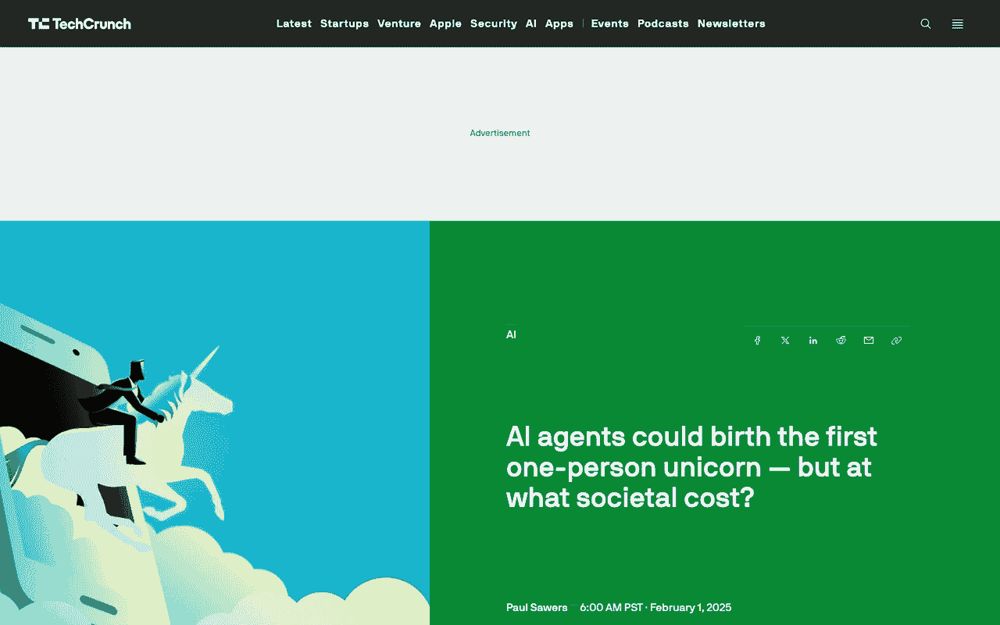

> TechCrunch 报道：[AI agents could birth the firs](https://techcrunch.com/2025/02/01/ai-agents-could-birth-the-first-one-person-unicorn-but-at-what-societal-cost/)t one-person unicorn

** 一人公司的想象力正在被 AI A**gent 释放出来。但请注意一个关键区别：这里说的不是"一个人用 ChatGPT 聊天写代码"——而是一个人指挥一群专业化的 AI Agent，像管理一支 20 人团队一样运作。一个 Agent 做产品策划、一个 Agent 做架构设计、一个做代码审查、一个做 QA 测试、一个做安全审计、一个做发布部署……

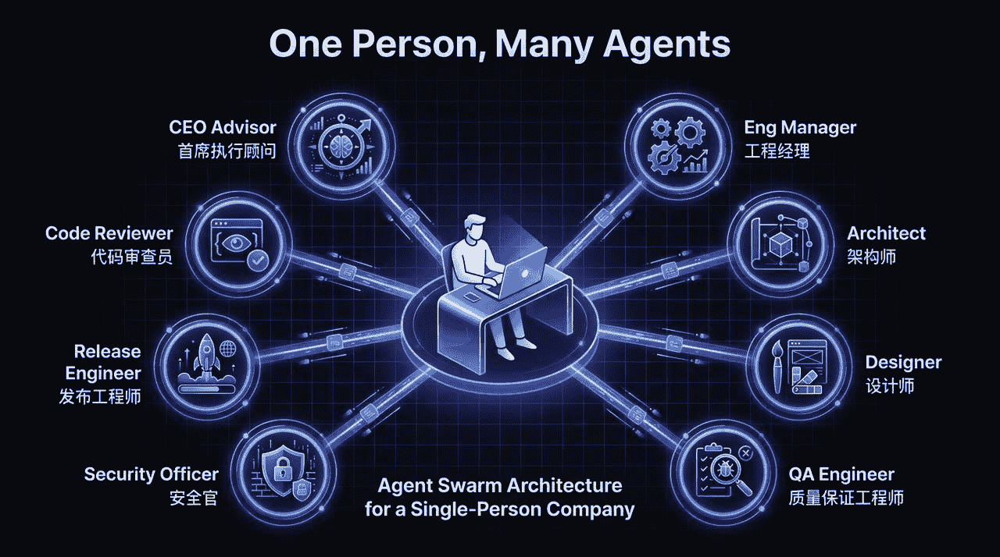

这种模式有一个正式的名字：**Agent Swarm****（智能体蜂**群）。它和"让一个 AI 什么都干"的根本区别在于专业化分工——就像真实公司里的 CEO 不应该去写测试用例、QA 工程师不应该去做产品决策一样，每个 Agent 有明确的角色边界和专业约束。

问题来了：如何让一群 AI Agent 高效协作，而不是各自为政？ 答案藏在一个 2026 年最重要的工程概念里——

#### Agent Harness：从"能用"到"可靠"的关键基础设施

2025 年证明了 AI Agent 能工作。**202**6 年的核心命题是让 Agent 可靠地工作。业界对此有一个精辟的总结：

> "The model is commodity. The harness is moat."

> （模型是大宗商品，Harness 才是护城河。）

什么是 **Agent Harness**？用一个类比：如果 AI 模型是引擎，那 Harness 就是整辆车——方向盘、刹车、仪表盘、安全带。引擎再强大，没有车的约束和引导，它哪也去不了。

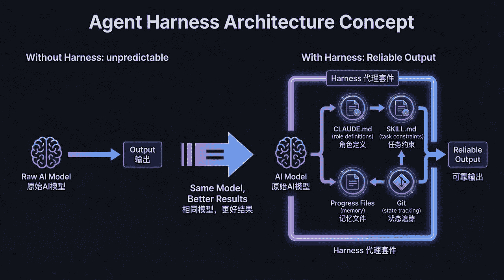

Anthropic 自己在 2025 年 11 月发表了一篇重要的工程博客《Effective Harnesses for Long-Running Agents》，首次系统化地定义了 Harness 架构的核心组件：

| 组件 | 作用 | 对应到开发实践 |
| --- | --- | --- |
| **CLAUDE.md** | 全局配置——定义 Agent 的身份、规则、约束 | 项目根目录的&quot;宪法文件&quot; |
| **SKILL.md** | 专业角色定义——规定 Agent 在特定任务中的行为边界 | 每个 slash command 背后的指令集 |
| **Progress Files** | 跨会话记忆——让新的上下文窗口知道之前做了什么 | claude-progress.txt 等状态文件 |
| **Git** | 状态追踪——原子提交记录每步变更，可回溯 | 每个 Agent 独立分支、clean commit |


> Anthropic 博客原文：[Effective Harnesses for](https://www.anthropic.com/engineering/effective-harnesses-for-long-running-agents) Long-Running Agents

** Harness 的威力有多大**？**LangChain 在 **Terminal Bench 2.0 基准测试中，不换模型仅改善 Harness，就从第 30 名跃升到前 5 名（52.8% → 66.5%）。Vercel 做了一个反直觉的实验——删掉 80% 的可用工具，反而得到了更快的响应、更少的 token 消耗、更高的成功率。Manus 在 6 个月内重写了 5 次 Harness，模型完全没换，但每次可靠性都显著提升。

这意味着什么？**你**不需要等下一代更聪明的模型——你现在就可以通过设计更好的 Harness 来大幅提升 AI 协作效果。 这才是一人公司真正可行的底层逻辑：不是因为模型变强了，而是因为我们学会了如何约束和编排它们。

那么，有没有人把 Agent Swarm + Harness Engineering 做成一个现成的、开箱即用的工具，让任何人都能上手？

有。而且做这件事的人，来头不小——

### 1.2 GStack 架构全景：28 个 Skill 的虚拟公司

2026 年 3 月中旬，Y Combinator CEO Garry Tan（陈嘉兴）做了一件让整个开发者社区震动的事——他把自己使用 Claude Code 的完整工作配置开源了。

这个项目叫 **GStack**。上线 48 小时突破 10,000 星，不到一周超过** 33,000 星**，截至今天已经积累了 47,900+ 星。


> GStack 仓库地址：https://github.com/garrytan/gstack

但 GStack 不只是"又一个 GitHub 热门项目"——它是目前最完整的 Agent Harness 实战样本。在深入 Garry Tan 的故事之前，我们先看看这个项目在技术上到底有多酷。

#### 项目解剖：不写代码的代码仓库

GStack 的核心是 28 个 Markdown 文件——没有复杂的框架代码，没有精巧的算法实现。它的"代码"就是自然语言。但这 28 个文件构成了一个完整的虚拟公司组织架构：

| 部门 | Agent 角色 | 对应 Skill | 做什么 |
| --- | --- | --- | --- |
| **CEO 办公室** | YC 产品顾问 | /office-hours | 6 个灵魂拷问挑战你的产品假设，不写代码只做思考 |
| **CEO 办公室** | CEO / 创始人 | /plan-ceo-review | 四种范围模式审视产品方向（扩张/收缩/维持/选择性扩张） |
| **工程部** | 工程总监 | /plan-eng-review | 锁定架构、产出数据流图 + 测试矩阵 |
| **设计部** | 高级设计师 | /plan-design-review /design-consultation | 0-10 分打分 + AI-slop 检测 + 完整设计系统 |
| **开发部** | 偏执的高级工程师 | /review | 专找&quot;CI 能过但生产会炸&quot;的 bug |
| **QA 部** | QA 工程师 | /qa /qa-only | 打开真实 Chromium 浏览器逐页面点击测试 |
| **安全部** | 首席安全官 | /cso | OWASP Top 10 + STRIDE 威胁建模审计 |
| **运维部** | 发布工程师 | /ship /land-and-deploy | 同步主分支 → 跑测试 → 开 PR → 部署 |
| **调查组** | 排查工程师 | /investigate | 数据流追踪式 root cause 分析 |
| **文档组** | 文档工程师 | /document-release | 自动更新文档匹配代码变更 |

加上 /canary（金丝雀监控）、/benchmark（性能基线）、/browse（浏览器操控）、/codex（跨模型审查）、/retro（周度复盘）等辅助工具，合计 **28 个 Skill**——覆盖了从灵感到上线的完整软件工程生命周期。


> 完整 Skill 文档：GStack Skills Deep Dives

#### 核心配置：CLAUDE.md 与 ETHOS.md

**  GStack **的两个**灵魂文件是 CL**AUDE.md 和 ETHOS.md：

**CLAUDE.md** 是整个项目的"宪法"——它告诉 Claude Code：你有哪些可用的 Skill、遇到问题该怎么做、如何管理浏览器自动化。所有 28 个 Skill 在这里注册，相当于这支虚拟团队的"通讯录"。


> [GStack CLAUDE.md 源码：github](https://github.com/garrytan/gstack/blob/main/CLAUDE.md).com/garrytan/gstack/blob/main/CLAUDE.md

**ETHOS.md** 则是团队的"价值观手册"——它定义了三条核心设计哲学，会被自动注入到每个 Skill 的提示词中：


> [GStack ETHOS.md 源码：github](https://github.com/garrytan/gstack/blob/main/ETHOS.md).com/garrytan/gstack/blob/main/ETHOS.md

ETHOS 开篇就亮出了 GStack 的世界观：

> "The Golden Age — A single person with AI can now build what used to take a team of twenty. The engineering barrier is gone. What remains is taste, judgment, and the willingness to do the complete thing."

翻译过来：**一**个人加上 AI 就能做到过去 20 人团队的产出。工程门槛已经消失，剩下的只有品味、判断力，以及把事情做完整的意愿。

#### 运行模式：从单线程到 Agent Swarm

GStack 支持两种运行模式：

**模式一：单线程冲刺（本课采用）**

在一个 Claude Code 会话中依次调用不同的 Skill。适合学习和轻量开发：

```
你：/office-hours → 产品灵魂拷问 → 设计文档
你：/plan-ceo-review → CEO 审视 → 范围锁定
你：/plan-eng-review → 工程审视 → 架构锁定
你：开始 Build → 代码实现
你：/review → 代码审查 → 自动修复
你：/ship → 创建 PR
```

模式二：多线程并行（Conductor 模式）

通过 [Conductor](https://conductor.build) **同时运行多个 Clau**de Code 会话，每个会话在独立工作空间中执行不同 Skill。这就是真正的 Agent Swarm：

```
┌─────────────────────────────────────────────────────────────┐
│  Session 1: /office-hours    → 产品思考                       │
│  Session 2: /review          → 审查另一个模块的代码             │
│  Session 3: Build feature-B  → 实现新功能                      │
│  Session 4: /qa              → 测试已完成的功能                 │
│  Session 5: /cso             → 安全审计                        │
│                                                               │
│  全部同时运行，互不干扰，通过 Git 同步状态                      │
└─────────────────────────────────────────────────────────────┘
```

Garry Tan 声称用这种模式，边全职运营 YC、边在 60 天内管理产出了 60 万行生产代码（35% 是测试代码），日均 10,000-20,000 行。他的 GitHub 贡献图显示 2026 年已有 1,237 次提交。

#### 应用场景与定制化价值

GStack 不是只能做 Web 应用——它的 Harness 架构适用于任何需要软件工程流程的场景：

| 场景 | 核心 Skill 组合 | 价值 |
| --- | --- | --- |
| **SaaS 产品开发** | office-hours → plan → build → review → qa → ship | 完整冲刺，从想法到 PR |
| **API 服务构建** | plan-eng-review → build → cso → ship | 架构锁定 + 安全审计 |
| **客户项目交付** | plan-ceo-review → build → review → qa | 需求对齐 + 质量保障 |
| **已有项目维护** | investigate → review → qa → ship | 排查 → 修复 → 测试 → 上线 |
| **技术选型评估** | office-hours + plan-eng-review | 灵魂拷问 + 架构评审 |
| **安全合规审计** | cso + review | OWASP + STRIDE 全覆盖 |

而且，GStack 最大的价值不在于直接**使用它的 28 个 Sk**ill——而在于它给了你一套可复制的模式。每个 SKILL.md 本质上就是一个"如何定义 AI 协作角色"的范本。看懂了它的写法，你可以为自己的业务场景编写任意角色：客服专家、数据分析师、法律顾问、市场策划……只要能用自然语言描述清楚角色边界，就能变成一个可靠的 AI 协作伙伴。

> **这也是本课最终的教学目标**：不只是会用 GStack 的 28 个现成 Skill，更要学会用 GStack 的思路给自己的工作流定制 Agent——这才是一人公司的真正打开方式。

说了这么多技术细节，你可能已经迫不及待想动手了。但在此之前，让我们花两分钟了解一下 GStack 的"破圈现象"和它背后的人——这不是八卦，而是理解它设计哲学的必要背景。

### 1.3 近 5 万颗星背后的争议：一堆 Markdown 凭什么？

GStack 的爆发速度，在 GitHub 开源史上都算得上罕见——Star 增长曲线几乎是一条垂直线。


但伴随热度而来的是质疑。视频博主 Mo Bitar 发布了一条标题为"AI is making CEOs delusional"的视频，直言 GStack 本质上"就是一堆文本文件里的提示词"。TechCrunch 的报道标题也颇为意味深长："Why Garry Tan's Claude Code setup has gotten so much love, and hate"。Hacker News 上数百条评论分成了旗帜鲜明的两派。

那么问题来了：一堆 Markdown 文件，凭什么值近 5 万颗星？

如果你读到了前面 §1.1 关于 Harness Engineering 的分析，答案已经很清晰了——GStack 的价值不在于它写了多少代码，而在于它用 Markdown 构建了一个经过实战验证的 Agent Harness。就像业界所说的"The model is commodity, the harness is moat"——在 AI 模型日趋同质化的今天，如何约束和编排 AI 才是真正的技术壁垒。GStack 提供了一个现成的最佳实践模板。这也正是它引发争议的原因——很多人还没有意识到，约束 AI 的能力比使用 AI 的能力更稀缺。

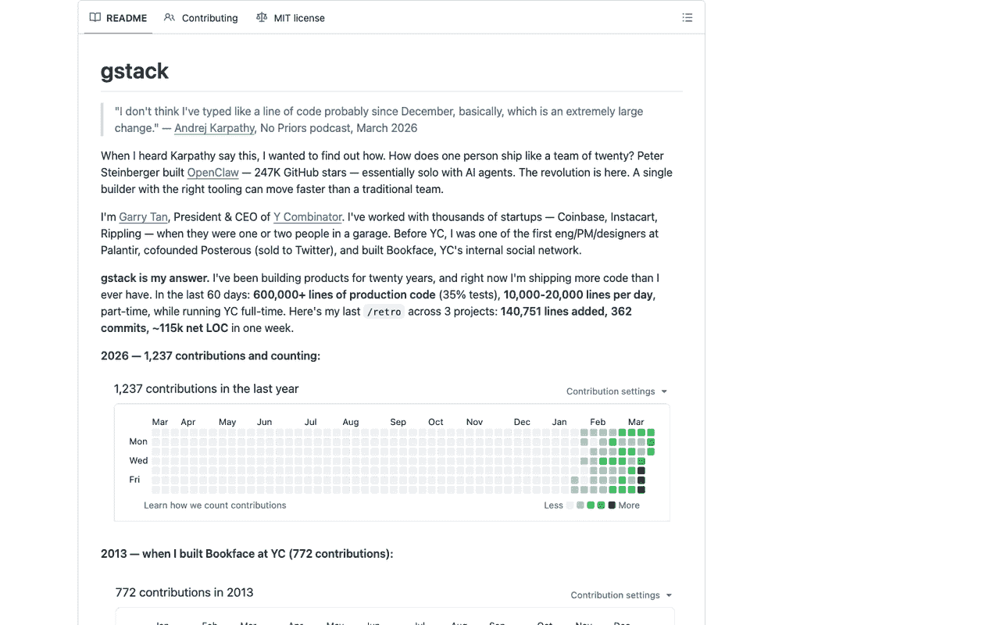

#### 本课你将收获

学完这门课，你会得到三样东西：

| # | 产出 | 具体内容 |
| --- | --- | --- |
| 1 | **一个可上线的 SaaS 产品** | 用 GStack 七步冲刺做出的 ShipLog（产品发布日志 + 用户反馈平台），含 Landing Page 和反馈墙功能 |
| 2 | **一份实战速查表** | 28 个 Skill 按工作流阶段分组，标注优先级和使用场景，日常开发随时可查 |
| 3 | 你自己写的第一个 AI 协作角色 | 参照 GStack 规范编写的自定义 SKILL.md，明天就能用在你自己的项目里 |

**  从今天起**，你的 Claude Code 不再是一个助手——它是一支团队。

#### 阅读路径建议

| 你的背景 | 建议路径 |
| --- | --- |
| 已在使用 Claude Code | 全程跟做——从 §1 理解设计哲学，到 §4 安装 GStack，到 §5-§6 完整冲刺做出 ShipLog |
| 听过但还没用 Claude Code | 先通读 §1-§3 建立认知，然后安装 Claude Code + GStack（§4），再跟做实战部分 |
| **赶时间只想看核心** | 直接跳到 §4 安装，§5 体验完整冲刺——但建议之后补读 §2-§3 的设计哲学，会让你用得更深 |

> 注：本课假设你有编程基础（了解 Git、命令行、Web 开发基本概念），不会从零教这些。如果你还不熟悉 Claude Code 的基础操作，建议先完成官方入门教程再来。

### 1.4 ShipLog：今天我们要做的产品

**  在正式深入** GStack 之前，我们先看看今天的实战目标——ShipLog。

ShipLog 是一个独立开发者的产品发布日志和用户反馈平台。 一句话价值主张："让你的用户看到你在持续改进，让你听到用户真正想要什么。" 如果你做过独立产品，一定对这两个痛点不陌生：用户不知道你在做什么改进（觉得产品没人管了），你也不知道用户真正想要什么功能（拍脑袋决策）。ShipLog 就是解决这个问题的。

为什么选这个项目？因为它刚好覆盖了 GStack 工作流的全部关键环节：需要产品思考（/office-hours 灵魂拷问）、需要架构设计（/plan-eng-review 锁定方案）、需要前端视觉（/design-review 打磨体验）、需要代码审查（/review 找真实 bug）、需要浏览器测试（/qa 自动化验证）、需要安全审计（/cso 扫描漏洞），最后需要发布（/ship 创建 PR）。一个项目，把 GStack 的核心能力走了个遍。

#### 我们分两个阶段构建

| 阶段 | 做什么 | 对应 GStack 工作流 | 你会看到 |
| --- | --- | --- | --- |
| **阶段一** | Landing Page（产品着陆页） | Think → Plan → Build → Review → Test → Ship 完整冲刺 | 一个有 Linear 级视觉品质的产品首页，从想法到 PR 一气呵成 |
| **阶段二** | 反馈墙功能 | Build → Review → QA → CSO 深度审查 | 类似 Canny 的投票反馈系统，经过安全审计 |

视觉上，我们追求 **Linear** 那种简洁现代的风格——深色主题、渐变色 Hero** 区域、功**能卡片布局精致。反馈墙则参考 Canny 的卡片式设计——投票、状态标签、排序筛选一应俱全。

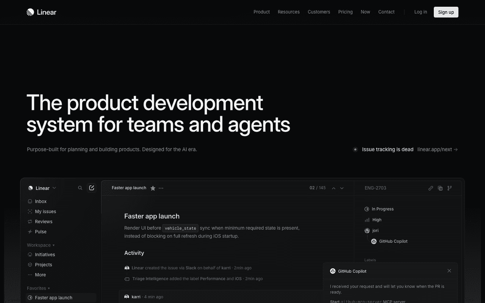

> Linear 官网：https://linear.app——产品开发管理系统，以极致的设计美感著称


> Canny 官网：https://canny.io——产品反馈管理平台，ShipLog 反馈墙的灵感来源

> **重要提醒**：ShipLog 不是一个"Hello World"级别的玩具演示。我们的目标是做出一个可以直接部署上线的 SaaS 产品原型——改几行文字和颜色，换成你自己的产品信息，就能直接用。这是本课和其他 GStack 教程最大的区别：别人教你"GStack 是什么"，我们带你"用 GStack 做什么"。

接下来，我们先搞清楚 GStack 背后的人和设计哲学——理解了"为什么这样设计"，用起来才能举一反三。

---

## §2 Garry Tan 与 GStack 设计哲学

### 2.1 Garry Tan：从 Palantir 工程师到 YC CEO

** 要理解 GStack 为什**么"不一样"，得先了解做它的人。GStack 不是某个 AI 爱好者的周末项目——它的设计者 Garry Tan（陈嘉兴） 有一份相当独特的履历：既是工程师出身，又看过数千家创业公司的生死。

| 时间 | 经历 | 关键标签 |
| --- | --- | --- |
| 1999-2003 | Stanford 计算机系统工程学士 | 技术科班出身 |
| 2004-2008 | Palantir 第 10 号员工，设计了 Palantir 的 logo，参与金融分析产品开发 | 早期创业公司的全栈角色（工程+设计） |
| 2008-2012 | 联合创办 **Posterous**（博客平台），后被 Twitter 收购 | 从 0 到 1 的创业经验 |
| 2011-2015 | Y Combinator 合伙人，主导 Bookface 和 Demo Day 网站开发 | 深度参与数千家创业公司的孵化 |
| 2012-2022 | 联合创办 Initialized Capital，管理 $7 亿+基金，投资了 Coinbase、Instacart、Flexport | 从投资者视角理解产品成败 |
| 2023-至今 | Y Combinator 总裁兼 CEO | 全球顶级孵化器掌门人 |


> [Y Combinator 官网 Garry Ta](https://www.ycombinator.com/people/garry-tan)n 主页：https://www.ycombinator.com/people/garry-tan

这份履历意味着什么？意味着 **GStac****k 的设计****者同时具备**三种视角：工程师视角（Palantir 早期全栈，知道代码该怎么写）、创业者视角（Posterous 从零到被收购，知道产品该怎么做）、投资人视角（看过 6,000+ 家 YC 公司的申请，知道什么样的产品能活下来）。

GStack 的 README 里有一段 Garry 的自述，值得引用：

> "gstack is my answer. I've been building products for twenty years, and right now I'm shipping more code per hour than ever. In the last 60 days: 600,000+ lines of production code (35% tests), 10,000-20,000 lines per day, part-time, while running YC full-time."


> Garry Tan 维基百科：[https://en.wikipedi](https://en.wikipedia.org/wiki/Garry_Tan)a.org/wiki/Garry_Tan

** 看到**这些数字，你可能和很多 Hacker News **网友一****样有疑**问："60 万行代码，有水分吗？" 答案是当然有——这些代码由 AI 生成、35% 是测试代码、多并发自动化产出。更准确的理解是"一个人管理了 60 万行代码的产出流程"，而不是"一个人手写了 60 万行代码"。但这恰恰证明了 GStack 的设计意图：它不是帮你写代码更快，而是帮你组织一支 AI 团队写对的代码。

> **保持批判**：名人效应 ≠ 技术含金量。GStack 的价值不在于 Garry Tan 的头衔，而在于它的设计哲学是否经得起检验。接下来我们就拆解这些哲学。


> Initialized Capital：https://initialized.com

### 2.2 GStack 三大设计哲学：角色即约束、把湖烧开、造之前先搜

GStack 的代码量不大，真正值钱的是它背后的三个设计原则。理解这些原则，你不仅能更好地用 GStack，还能把同样的思路应用到任何 AI 协作场景中。

#### 哲学一：角色即约束（Role as Constraint）

**核心洞察：给 AI 明确的角色边界，产出质**量显著优于让一个"通才 AI"什么都做。

** 这听起来违反直觉——AI** 不是越自由越强大吗？但 Garry Tan 从管理上千家创业公司的经验中得到了相反的结论：在真实的工程团队中，规划不是审查，审查不是发布——CEO 不应该去写测试用例，QA 工程师不应该去做产品决策。不同阶段需要不同的认知模式，混在一起只会得到平庸的结果。

GStack 把这个组织管理学原理直接搬进了 AI 交互：每个 SKILL.md 文件定义一个角色，明确规定这个角色能做什么、不能做什么、输出什么格式。比如 /review（代码审查）这个角色被约束为"只找 CI 通过但生产会炸的 bug"——它不会帮你重构代码风格，不会讨论架构方向，只做一件事并且做到极致。


> GStack 源码：/office-hours/SKILL.md

一个直观的类比：让一个通才律师同时做合同审查和诉讼辩护，不如让合同律师和诉讼律师分别做自己最擅长的事。AI 也是如此——让 Claude 在"/review 代码审查员"的约束下找 bug，比让它"帮我看看代码有没有问题"效果好得多。

#### 哲学二：把湖烧开（Boil the Lake）

**核心洞察：有了 AI 辅助，完整实现的边际成本趋**近于零——永远选择完整方案，拒绝走捷径。

GStack 的 ETHOS 中有一段精辟的描述：

> "A 'lake' is boilable — 100% test coverage for a module, full feature implementation, handling all edge cases, complete error paths. An 'ocean' is not — rewriting an entire system from scratch."

翻译过来就是："湖"是可以烧开的——一个模块的 100% 测试覆盖、完整功能实现、处理所有边界条件。"海洋"是烧不开的——从零重写整个系统。

传统开发中，我们经常在 80 分方案和 100 分方案之间选前者，因为从 80 到 100 的额外工作量不值得。但 AI 辅助编码改变了这个经济学：写 80 行代码和 150 行代码的成本差距几乎可以忽略。既然如此，GStack 的原则是：当完整方案（Option A）和捷径方案（Option B）都摆在面前时，永远推荐 A。不完整只是延迟了工作，并没有节省工作。

#### 哲学三：造之前先搜（Search Before Building）

**核心洞察：不要急着从第一性原理发明轮子——先**理解"世界怎么想"，再决定"我怎么想"。

GStack 将知识分为三层，每层的使用策略不同：

| 层级 | 名称 | 含义 | 使用策略 |
| --- | --- | --- | --- |
| **Layer 1** | 久经考验的方案（Tried &amp; True） | 经过大规模验证的成熟方案 | 优先采用，极少情况下才质疑 |
| **Layer 2** | 新兴流行方案（New &amp; Popular） | 新出现但快速流行的做法 | 审慎评估，搜索结果作为参考而非答案 |
| **Layer 3** | 第一性原理（First Principles） | 针对具体问题的原创推理 | **最有价值**——当第一性原理推翻了常规认知时，命名为&quot;Eureka Moment&quot; |

这个框架的精妙之处在于它教 AI（也教人）正确的学习和决策顺序：先搞清楚既有的最佳实践是什么、为什么存在，然后再决定是否需要另辟蹊径。大多数时候，Layer 1 就够了；但偶尔，Layer 3 的洞察会推翻 Layer 1 的"常识"——这些时刻就是真正的创新。

#### 三大哲学 vs 通才模式：效果对比

| 维度 | GStack 角色化模式 | 直接用 Claude Code（通才模式） |
| --- | --- | --- |
| 产品思考 | /office-hours 用 6 个灵魂拷问挑战你的假设 | 你说什么就做什么，不挑战 |
| 代码审查 | /review 专找 CI 过但生产会炸的 bug | &quot;帮我看看代码&quot;——面面俱到但不深 |
| 测试覆盖 | /qa 打开真实浏览器逐个页面测试 | 只写单元测试或直接跳过 |
| 安全审计 | /cso 按 OWASP Top 10 + STRIDE 模型审计 | &quot;有安全问题吗？&quot;——泛泛而谈 |
| 设计质量 | /design-review 80 项视觉审查清单 | &quot;好看吗？&quot;——主观评价 |

> **诚实说明局限性**：GStack 的角色化模式也有代价——每个 Skill 调用都消耗大量 token，5 路并行单任务可消耗 50,000+ token。而且这套流程反映的是 Garry Tan 一个人的工作偏好，不一定适合所有团队。在 §3 中我们会详细讨论成本和适用场景。

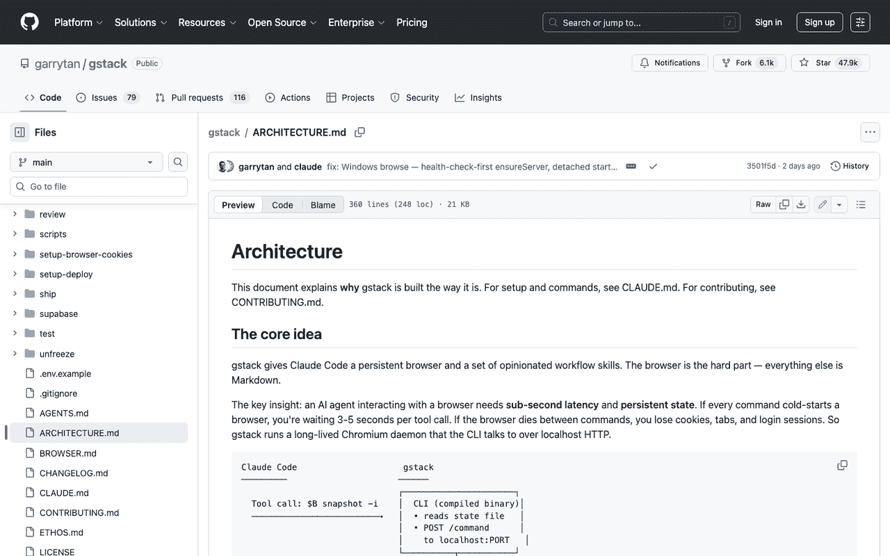

> GStack 架构文档：[ARCHITECTURE.md](https://github.com/garrytan/gstack/blob/main/ARCHITECTURE.md)

### 2.3 七步闭环工作流：Think → Plan → Build → Review → Test → Ship → Reflect

**  三大哲学落**地到实践中，就是 GStack 的七步冲刺工作流。每一步对应一个阶段，每个阶段有专属的 Skill 来执行。关键设计：每步的输出是下一步的输入——它们不是独立的工具，而是一条流水线。

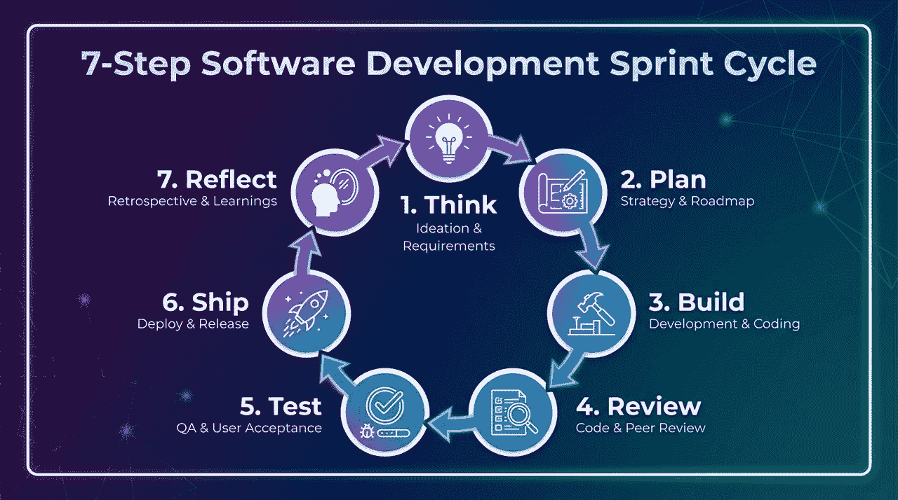

| 步骤 | 阶段 | 做什么 | 对应 Skill | 输出 |
| --- | --- | --- | --- | --- |
| 1 | **Think** | 发现真实用户痛点，挑战你的功能假设 | /office-hours | 经过灵魂拷问的设计文档 |
| 2 | **Plan** | 锁定产品方向和技术架构 | /plan-ceo-review /plan-eng-review /plan-design-review | 范围决策 + 架构图 + 测试矩阵 |
| 3 | **Build** | AI 基于设计文档编码实现 | Claude Code 原生能力 | 可运行的代码 |
| 4 | **Review** | 找 CI 能过但生产会炸的 bug | /review /design-review | 审查报告 + 自动修复 |
| 5 | **Test** | 用真实浏览器测试所有交互 | /qa /cso | 测试报告 + 安全审计 |
| 6 | **Ship** | 同步主分支、跑测试、开 PR | /ship /land-and-deploy | GitHub PR + 部署 |
| 7 | **Reflect** | 回顾本周产出、测试趋势、改进点 | /retro | 复盘报告 |

这个流程的威力在于**链式传递**。举个例子：/office-hours 的产出（设计文档）会被 /plan-eng-review 读取来做架构评审；架构文档又会指导 Build 阶段的代码生成；/review 知道架构约束所以能发现更深层的 bug；/qa 知道设计要求所以能测试正确的场景。每个角色都不是从零开始——它站在前一个角色的肩膀上。

GStack 的 README 中有一个真实示例：

> 起始请求："Build a daily briefing app for my calendar"

> /office-hours 的重构："You're describing a personal chief-of-staff AI"——提炼出 5 个未说明的能力需求，挑战了 4 个前提假设，提出了 3 种实现方案。

> 全流程：设计文档 → CEO 审视 → 工程架构 → 2,400 行代码（11 个文件，~8 分钟） → /review 自动修复 2 个问题，标记 1 个竞态条件 → /qa 真实浏览器发现并修复 bug → /ship 提交 PR（附带 +9 个新测试）。

> **八个命令，从概念到 PR。**

> **重要提醒**：不是每个项目都需要走完全部 7 步。如果你只是修一个小 bug，直接 Build → Review → Ship 就够了。如果是快速验证一个想法，Think → Build 也可以。七步是完整流程，灵活取舍是实践智慧。GStack 的 /autoplan 命令甚至内置了一键 CEO+设计+工程评审的流水线，帮你省去逐步手动调用。

在 §4 安装 GStack 之后，我们会用 ShipLog 项目**亲手走一遍完**整的七步冲刺。到时候你会真切感受到：这不是 7 个独立工具，而是一支有默契的团队——每个角色知道自己该做什么，也知道前一个同事做了什么。

---

## §3 GStack 深度拆解：Skill 规范、生态与成本

### 3.1 SKILL.md：GStack 的基本构成单元

**  在深入 28 个具体 Skill 之前，我们先理解一个核心概念：**SKILL.md 就是 GStack 的 DNA——一个用 Markdown 写成的角色定义文件，规定了 AI 在特定角色下的边界、约束和产出标准。

为什么这个概念重要？因为到 §7 我们会自己写一个 SKILL.md，把 GStack 的方法论迁移到你自己的场景中。现在先理解它的结构。

每个 SKILL.md 通常包含以下几个部分：

| 组成部分 | 作用 | 举例（/office-hours） |
| --- | --- | --- |
| **角色身份** | 定义&quot;我是谁&quot; | &quot;你是一位 YC 合伙人级别的产品顾问&quot; |
| **约束条件** | 定义&quot;我不能做什么&quot; | &quot;不写代码、不设计 UI、只做产品思考&quot; |
| **产出格式** | 定义&quot;我输出什么&quot; | &quot;产出一份结构化的设计文档&quot; |
| **触发条件** | 定义&quot;什么时候叫我&quot; | 当用户输入 /office-hours 时激活 |
| **ETHOS 引用** | 遵循的设计哲学 | Search Before Building、Boil the Lake |

不需要会写 TypeScript——SKILL.md 的核心全是 Markdown 纯文本。GStack 中唯一涉及 TypeScript 的部分是浏览器自动化（/browse、/qa 等），它们由 Bun 编译成二进制，你作为使用者不需要碰源码。

> **常见误区**：很多人看到 GStack 仓库里有 TypeScript 文件就以为"这是一个 TS 项目"。实际上，GStack 的核心是 28 个 Markdown 文件——TypeScript 只服务于浏览器自动化这一个功能模块。正如 GStack 架构文档所说："The browser is the hard part — everything else is Markdown."


### 3.2 GStack 28 Skill 全景速查表

28 个 Skill 看起来很多，但别慌——它们按工作流阶段自然分组。下面这张速查表标注了每个 Skill 的推荐优先级，帮你快速找到"今天就该用"的那几个。

> 使用频率标注：⭐⭐⭐ 今天必用 | ⭐⭐ 值得一试 | ⭐ 进阶探索

#### 规划阶段（Think & Plan）

| Skill | 角色 | 一句话说明 | 推荐 |
| --- | --- | --- | --- |
| /office-hours | YC 合伙人级产品顾问 | 用 6 个灵魂拷问挑战你的产品想法，不写代码只做思考 | ⭐⭐⭐ |
| /plan-ceo-review | CEO 产品方向审视 | 四种范围模式（扩张/选择性扩张/维持/收缩），10 维度评估 | ⭐⭐⭐ |
| /plan-eng-review | 工程总监级架构锁定 | 产出 ASCII 架构图 + 数据流 + 测试矩阵 | ⭐⭐⭐ |
| /plan-design-review | 设计维度审计 | 0-10 分打分 + AI-slop 检测 | ⭐⭐ |
| /design-consultation | 完整设计系统生成 | 从色板到组件库，含创意风险提案 | ⭐⭐ |
| /autoplan | 一键规划流水线 | 自动串联 CEO → 设计 → 工程评审 | ⭐⭐ |

#### 开发与审查阶段（Build & Review）

| Skill | 角色 | 一句话说明 | 推荐 |
| --- | --- | --- | --- |
| /review | 偏执的高级工程师 | 专找 CI 过但生产会炸的 bug，自动修复明显问题 | ⭐⭐⭐ |
| /investigate | 系统性排查工程师 | 数据流追踪式 root cause 分析 | ⭐⭐ |
| /design-review | 设计师-程序员混合体 | 80 项视觉审查 + 原子提交修复 + Before/After 截图 | ⭐⭐⭐ |
| /codex | OpenAI Codex 独立审查 | 用不同模型做对抗性代码审查 | ⭐ |

#### 测试与安全阶段（Test & Verify）

| Skill | 角色 | 一句话说明 | 推荐 |
| --- | --- | --- | --- |
| /qa | QA 工程师 + 真实浏览器 | 打开 Chromium 逐页面测试，~100ms 响应，修 bug + 写回归测试 | ⭐⭐⭐ |
| /qa-only | QA 只报告模式 | 只发现问题不修改代码，适合审查阶段 | ⭐⭐ |
| /cso | 首席安全官 | OWASP Top 10 + STRIDE 威胁建模审计（含 17 条误报排除规则） | ⭐⭐⭐ |

#### 发布与部署阶段（Ship & Deploy）

| Skill | 角色 | 一句话说明 | 推荐 |
| --- | --- | --- | --- |
| /ship | 发布工程师 | 同步主分支 → 跑测试 → 开 PR | ⭐⭐⭐ |
| /land-and-deploy | 部署工程师 | PR 合并 → 部署到生产 → 健康检查 | ⭐⭐ |
| /canary | 金丝雀监控 | 部署后监控 Console 错误和性能退化 | ⭐ |
| /benchmark | 性能基准测试 | Core Web Vitals + 资源大小基线对比 | ⭐ |
| /document-release | 文档工程师 | 自动更新文档以匹配已发布的代码变更 | ⭐⭐ |

#### 运营与回顾阶段（Reflect & Ops）

| Skill | 角色 | 一句话说明 | 推荐 |
| --- | --- | --- | --- |
| /retro | 团队回顾主持人 | 周度复盘：每人产出明细 + 测试趋势 + 改进建议 | ⭐⭐ |
| /browse | 真实浏览器操控 | Playwright 驱动 Chromium，点击/截图/表单 | ⭐⭐ |
| /setup-browser-cookies | Cookie 导入工具 | 从 Chrome/Arc/Brave/Edge 导入 Cookie 做认证测试 | ⭐ |

#### 增强工具（Power Tools）

| Skill | 角色 | 一句话说明 | 推荐 |
| --- | --- | --- | --- |
| /careful | 危险命令警卫 | 拦截 rm -rf、DROP TABLE、force-push 等 | ⭐⭐ |
| /freeze | 文件冻结锁 | 锁定指定目录不允许编辑，聚焦调试 | ⭐⭐ |
| /guard | 组合防护 | /careful + /freeze 联合启用 | ⭐ |
| /unfreeze | 解除冻结 | 移除 freeze 边界 | ⭐ |
| /setup-deploy | 部署配置向导 | 一次性检测平台并配置部署命令 | ⭐ |
| /gstack-upgrade | 自我更新 | GStack 自更新机制 | ⭐ |

> 注：本课的 §4-§6 会重点使用标注为 ⭐⭐⭐ 的 Skill，这 7 个命令覆盖了日常 80% 的使用场景。其余 Skill 可在熟悉核心流程后逐步探索。

> 官方完整文档：GStack Skills 文档

### 3.3 GStack vs 直接用 Claude Code：到底多了什么？

如果你已经在用 Claude Code 并且效果还不错，一个自然的问题是：加上 GStack 到底能多给我什么？值得花时间配置吗？

这个问题的答案取决于你的使用场景。下面是基于 GStack 官方文档和社区反馈的真实对比：

| 维度 | 直接用 Claude Code | 加上 GStack | 差异来源 |
| --- | --- | --- | --- |
| **产品思考** | 你说做什么就做什么 | /office-hours 用 6 个灵魂拷问挑战你的假设，经常重构你的产品定位 | 角色约束：产品顾问不写代码，只做思考 |
| **架构决策** | 根据对话上下文即兴决定 | /plan-eng-review 产出正式的架构图 + 测试矩阵 + 边界条件映射 | 强制输出格式 + 完整性原则 |
| **代码审查** | &quot;帮我看看代码&quot;——广而不深 | /review 专门找&quot;CI 能过但生产会炸&quot;的 bug，自动修复明显问题 | 角色约束：只做审查，不做其他 |
| **测试覆盖** | 写单元测试或跳过 | /qa 打开真实 Chromium 浏览器，逐页面点击测试 | Bun 编译的浏览器自动化引擎 |
| **安全审计** | 需要你主动问 | /cso 按 OWASP Top 10 + STRIDE 模型系统审计 | 内置 17 条误报排除规则 |
| **设计质量** | &quot;好看吗？&quot;——主观评价 | /design-review 80 项视觉审查清单 + 原子提交修复 | 标准化审查流程 |
| **发布流程** | 手动 commit/push/PR | /ship 自动同步主分支 → 跑测试 → 开 PR | 标准化发布纪律 |
| **加速倍数** | 基础 AI 加速 | 脚手架 ~100x、测试 ~50x、功能实现 ~30x、修 bug ~20x | GStack CLAUDE.md 官方数据 |

#### 推荐决策

| 你的场景 | 建议 |
| --- | --- |
| 做个人小项目、快速原型 | 直接用 Claude Code 就够了 |
| 做要上线的产品、需要代码质量 | **用 GStack**——审查和测试环节价值巨大 |
| 做客户项目、需要安全保障 | **强烈推荐 GStack**——/cso 的安全审计不可替代 |
| 团队协作、需要统一流程 | GStack 提供标准化流程，降低协作摩擦 |

> **诚实说明不足**：GStack 不是万能的。它增加了流程步骤和 token 消耗（每个 Skill 调用都有成本），对纯新手有一定认知负担（28 个命令的学习曲线），而且目前对 macOS 支持最好（Cookie 功能仅限 macOS Keychain）。我们在 §3.6 会详细讨论这些局限。

### 3.4 GStack 生态一瞥：跨平台支持与社区扩展

**G**Stack 不是一个孤岛——它正在从 Claude Code 专属工具进化为跨平台的 AI 协作标准。

2026 年 3 月下旬，Garry Tan 宣布 GStack 已支持多个 AI 编程平台：

| 平台 | 支持方式 | 状态 |
| --- | --- | --- |
| **Claude Code** | 原生支持（GStack 原始平台） | ✅ 完整支持 |
| **OpenAI Codex** | SKILL.md 标准兼容 + /codex 对抗审查 | ✅ 已支持 |
| Google Gemini CLI | 安装脚本自动检测 Agent 类型 | ✅ 已支持 |
| **Cursor** | 生成 .cursorrules + Composer 模式适配 | ✅ 已支持 |

社区也在快速扩展。比如 [GStack++](https://github.com/bulyaki/gstackplusplus) 是一个面向 C++ 开发的适配器，整合了 CMake、clang-tidy、sanitizer 等 C++ 工具链。还有 gstack-auto 等自动化工具在涌现。

> **注意**：社区扩展的质量参差不齐，建议优先使用 Garry Tan 官方仓库的 Skill。本课所有实操都基于官方版本。

### 3.5 GStack 与 Harness Engineering：三层约束的具体实现

在 §1.1 中我们介绍了 Agent Harness 的概念——"模型是大宗商品，Harness 才是护城河"。现在让我们回到技术细节，看看 GStack 具体是如何实现三层约束的：

```
GStack Harness = 角色约束（SKILL.md）+ 流程约束（七步工作流）+ 完整性约束（Boil the Lake）
```

| 约束层 | 实现方式 | 效果 |
| --- | --- | --- |
| **角色约束** | 每个 SKILL.md 定义&quot;我是谁&quot;&quot;我能做什么&quot;&quot;我不能做什么&quot; | /review 只找 bug 不重构，/cso 只做安全不谈功能 |
| **流程约束** | Think → Plan → Build → Review → Test → Ship → Reflect | 每步的输出是下一步的输入，信息逐步累积 |
| **完整性约束** | ETHOS.md 中的&quot;Boil the Lake&quot;原则 | 100% 覆盖而非 80%，完整实现而非走捷径 |

三层约束叠加的效果远超单层。这就是为什么 GStack 的产出质量显著优于"直接让 Claude Code 干活"——不是因为模型不同，而是因为约束更精确、流程更完整、标准更高。

> **迁移价值**：即使你不用 GStack 本身，理解了"给 AI 设计约束环境比追求更大模型更有效"这个原则，就能在任何 AI 工具上应用同样的思路。这就是 §7 我们要自己写 SKILL.md 的底层逻辑。

### 3.6 真实成本与局限：GStack 的另一面

在正式动手之前，我们有义务把 GStack 的另一面也讲清楚。好的课程不回避缺点——帮你建立准确预期比盲目乐观更有价值。

#### Token 成本：GStack 不免费

GStack 本身是 MIT 开源、完全免费的。但它运行在 Claude Code 上，而 Claude Code 不免费：

| 方案 | 月费 | 适用场景 | 建议 |
| --- | --- | --- | --- |
| **Pro** | $20/月 | 轻度使用、学习体验 | 本课可用，但可能触及限额 |
| **Max 5x** | $100/月 | 日常开发、中度使用 | **推荐方案** |
| **Max 20x** | $200/月 | 重度使用、多并发冲刺 | 专业开发者/一人公司 |
| **API 按量** | ~$6/天均 | 灵活控制成本 | 需要自行管理 token 预算 |

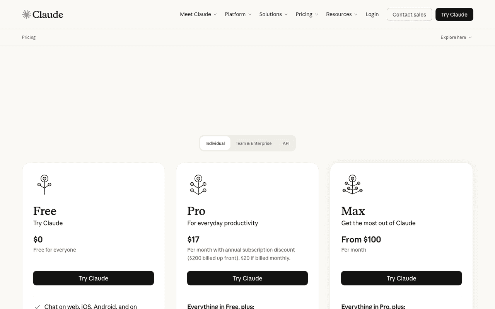

> Anthropic 定价页：https://www.anthropic.com/pricing

Garry Tan 用 5 路并行（Conductor 模式）时，单个任务可以消耗 50,000+ token。对于我们今天的课程，单线程冲刺一个 ShipLog 项目，Pro 方案通常够用，但如果触及限额，Max 方案体验会更流畅。

#### 已知局限性

| 局限 | 说明 | 影响程度 |
| --- | --- | --- |
| **macOS 偏向** | Cookie 解密仅支持 macOS Keychain，Windows/Linux 无法做认证测试 | 中——核心功能不受影响 |
| **代码数字有水分** | &quot;60 万行代码&quot;包含 AI 生成 + 35% 测试 + 多并发产出 | 低——不影响使用，只是不要误解宣传 |
| **不适合纯新手** | 28 个命令有学习曲线，不熟悉命令行的用户会困惑 | 中——本课会手把手带你入门 |
| **反映一个人的偏好** | GStack 是 Garry Tan 的个人工作流，不一定适合所有团队 | 低——可以自定义 SKILL.md |
| **无 A/B 测试数据** | 官方未发布 GStack vs 裸 Claude Code 的对照实验 | 低——社区反馈积极但缺乏严格实验 |
| **争议声音** | &quot;不就是一堆 Markdown 吗？&quot;——质疑 GStack 的技术含量 | 低——本课通过实操来回答这个质疑 |

> **我们的态度**：GStack 是目前 Claude Code 生态中最成熟、最系统化的角色协作方案。它不完美，但它的设计哲学经得起检验——接下来我们用实际效果来说话。

好了，背景知识讲到这里。接下来，动手。

---

## §4 安装 GStack 与第一次接触

### 4.1 实操：30 秒安装 GStack

GStack 的安装过程只有三步：确认前置依赖、克隆仓库、运行安装脚本。整个过程不到 30 秒——这也体现了 GStack"技术含量低、方法论含量高"的设计理念。

#### 环境前置确认

安装 GStack 之前，请确认以下三个依赖都已就绪：

| 依赖 | 最低版本 | 检查命令 | 安装方式（如未安装） |
| --- | --- | --- | --- |
| **Claude Code** | 任意版本 | claude --version | [官方安装指南](https://docs.anthropic.com/en/docs/claude-code) |
| **Git** | 任意版本 | git --version | macOS 自带，或 xcode-select --install |
| **Bun** | v1.0+ | bun --version | curl -fsSL https://bun.sh/install | bash |

> 注：如果你还没有安装 Bun，运行上面的安装命令后需要执行 exec /bin/zsh（或重开终端）使 PATH 生效。

在终端中运行以下命令确认版本：

```
git --version
bun --version
claude --version
```

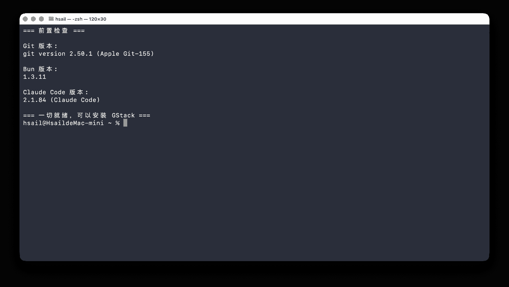

三个依赖都显示了版本号，说明环境就绪。接下来正式安装 GStack。

#### Step 1：克隆 GStack 仓库

```
git clone https://github.com/garrytan/gstack.git ~/.claude/skills/gstack
```

这条命令会把 GStack 仓库克隆到 ~/.claude/skills/gstack/ 目录——这是 Claude Code 读取 Skill 的标准位置。

#### Step 2：运行安装脚本

```
cd ~/.claude/skills/gstack &amp;&amp; ./setup
```

./setup 会完成以下工作：

+   安装依赖（bun install）

+   从模板生成所有 SKILL.md 文件

+   编译浏览器自动化二进制（browse/dist/browse）

+   链接所有 28 个 Skill

安装成功后，你会看到最后一行输出：gstack ready (claude).——这表示 GStack 已经就绪，所有 Skill 已经可以在 Claude Code 中使用。

#### Step 3：验证安装

```
ls ~/.claude/skills/gstack/
```

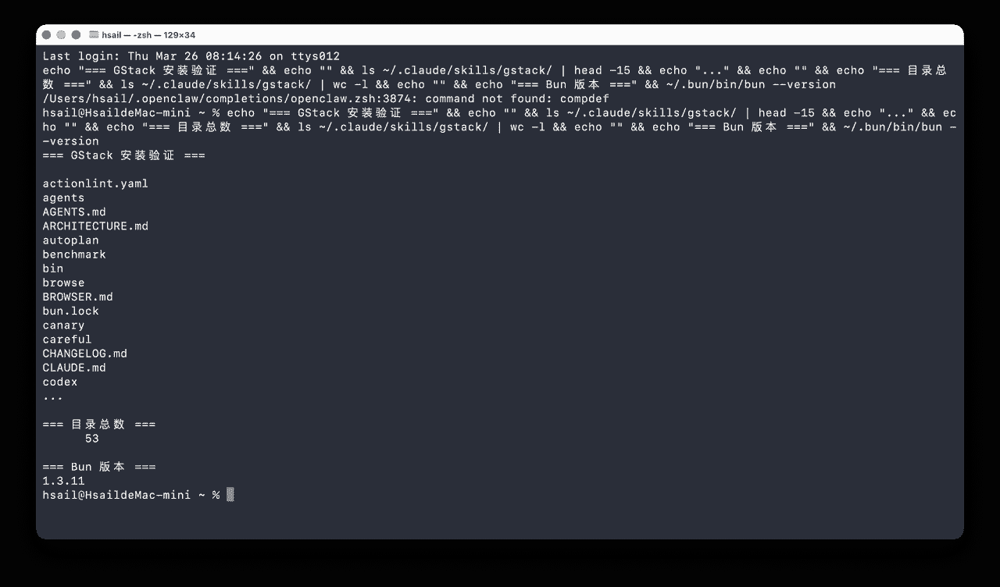

你应该能看到 office-hours/、review/、qa/、ship/ 等目录——每个目录就是一个 Skill。

> **安装出错了？** 最常见的问题是 Bun 版本过低或网络超时。解决方法：(1) 确认 bun --version ≥ 1.0；(2) 如果网络不稳定，尝试设置代理后重新 clone；(3) 如果 ./setup 失败，进入目录后手动执行 bun install && bun run build。

### 4.2 实操：CLAUDE.md 配置与项目初始化

GStack 安装好了，但 Claude Code 还不知道该怎么用它。我们需要在项目目录中创建一个 CLAUDE.md 文件，告诉 Claude Code："嘿，我有 GStack，请用这些 Skill 来工作。"

#### Step 1：创建 ShipLog 项目

```
mkdir -p ~/Projects/shiplog
cd ~/Projects/shiplog
git init
```

#### Step 2：创建 CLAUDE.md 配置

在项目根目录创建 CLAUDE.md，内容如下：

```
# ShipLog — 独立开发者的产品发布日志 &amp; 用户反馈平台

## 项目信息
- 技术栈：Next.js + Tailwind CSS
- 设计风格：Linear 的简洁现代风 + 深色主题
- 目标：可部署上线的 SaaS 产品原型

## gstack
Use /browse from gstack for all web browsing. Never use mcp__claude-in-chrome__* tools.
Available skills: /office-hours, /plan-ceo-review, /plan-eng-review,
/plan-design-review, /design-consultation, /review, /ship, /land-and-deploy,
/canary, /benchmark, /browse, /qa, /qa-only, /design-review,
/setup-browser-cookies, /setup-deploy, /retro, /investigate,
/document-release, /codex, /cso, /autoplan, /careful, /freeze, /guard,
/unfreeze, /gstack-upgrade.
```

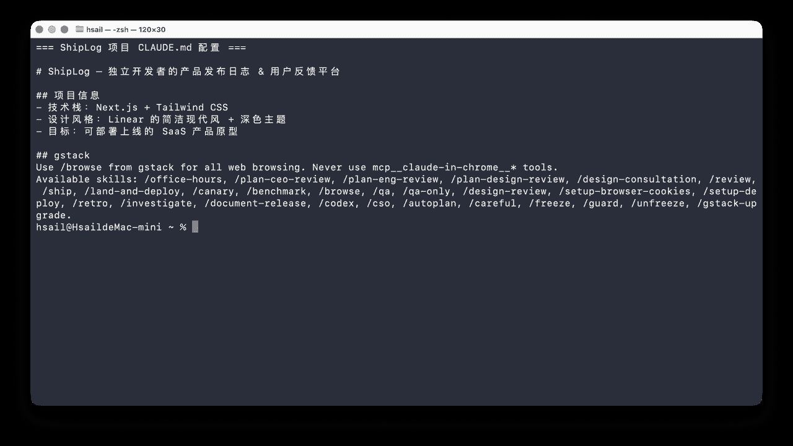

> **重要提醒**：## gstack 这一节不要改动——它是 GStack 推荐的标准配置，告诉 Claude Code 使用 GStack 的浏览器（而不是 MCP 工具）并列出所有可用的 Skill。你可以在上面自由添加项目信息。

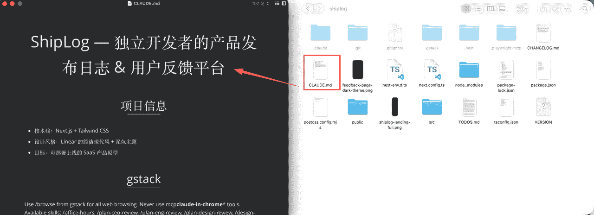

#### Step 3：在项目目录中启动 Claude Code

```
cd ~/Projects/shiplog
# 如果需要设置网络代理（根据你的网络环境）：
export https_proxy=http://127.0.0.1:10080 http_proxy=http://127.0.0.1:10080
# 启动 Claude Code
claude
```

启动后，Claude Code 会自动读取当前目录的 CLAUDE.md，识别 GStack 的 Skill 配置。你可以在对话中输入 / 来查看可用的命令列表——如果 GStack 安装正确，你应该能看到 /office-hours、/review、/qa 等命令出现在提示列表中。

> 注：如果命令列表中没有出现 GStack 的 Skill，请确认 ~/.claude/skills/gstack/ 目录存在并且包含 SKILL.md 文件。如果目录为空，回到 Step 2 重新运行 ./setup。


### 4.3 初体验：用 /office-hours 拷问 ShipLog 的产品想法

环境就绪，Skill 就位。是时候体验 GStack 最有话题度的功能了——/office-hours。

还记得我们在 §3 讲**的"角色即约束"吗？/off**ice-hours 是这个理念最直观的证明：它不是一个"帮你写代码"的工具，而是一个会挑战你想法的 YC 合伙人。你带着一个产品创意进去，经历一系列灵魂拷问——你的需求是真的吗？现有方案真的不行吗？你的目标用户到底是谁？——最后带出一份被严格审视过的设计文档。

我们用 ShipLog 来走一遍完整的流程。

#### Step 1：启动 /office-hours

在 Claude Code 对话框中输入 /office-hours，按回车。

第一件事你会注意到：它没有直接问"你要做什么"。而**是先展示了 GStack **的核心哲学——Boil the Lake（烧开整个湖），并询问你要不要在浏览器中阅读 Garry Tan 的原文。


> **深入理解**：为什么一个产品咨询工具要先讲哲学？因为 /office-hours 的 SKILL.md 中明确要求：在开始任何产品讨论之前，先对齐思维模式。这就是"角色即约束"——不是 AI 想聊哲学，而是 Skill 的约束要求它必须先建立认知框架。

选择 "No thanks"（跳过阅读），/office-hours 开始提问——

#### Step 2：经历灵魂拷问

接下来发生的事情，是这整堂课最值**得细看的部分。我们完**整展示这段对话，因为对话本身就是教学内容——你会看到一个被精心设计的 AI 角色如何通过结构化的追问，把一个模糊的想法变成一份严谨的产品设计。

**第一问：你的目标是什么？**

/office-hours 读取了 CLAUDE.md 中的项目描述后，抛出第一个选择：你做 ShipLog 的目标是什么？创业？内部项目？黑客马拉松？还是学习？


** 我们选**择"Building a startup"（创业）。这个选择不是随便的——它决定了后续所有问题的追问深度。如果你选"Hackathon / demo"，灵魂拷问会温和得多；选了创业，/office-hours 就会用 YC 合伙人的标准来拷问你。

**第二问：需求是真的吗？**

目标确认后，/office-hours 进入"Startup 模式"，直接告诉你：这是一个全新项目，没有代码、没有用户、没有历史设计——所以需要回答三个关键问题：需求真实性（demand reality）、现状分析（status quo）、和极致具体性（desperate specificity）。

第一个灵魂拷问来了：

> **Q1 — **Demand Reality: What's the strongest evidence you have that someone actually wants ShipLog? Not 'is interested,' not 'thinks it's cool' — but would be genuinely upset if it disappeared tomorrow.

注意措辞的精准："not 'is interested'"——它在逼你区分"觉得不错"和"真正需要"。


我们回答："It's my own pain"（这是我自己的痛点）。/office-hours 接受了这个回答，**但立刻追问：你说"产**品发布日志 & 用户反馈平台"，这其实是三个产品捏在一起——到底哪个是核心痛点？

**第三问：痛点的具体场景**

> **Pain Point: Tell me the specific moment you felt this pain. What were you doing, wh**at tool were you using (or not using), and what went wrong? I need a concrete scene, not a category.

"I need a concrete scene, not a category"（我要具体场景，不要品类描述）——这句话点出了一个常见错误：很多创业者描述痛点时只会说"反馈收集很麻烦"，而不是"上周二我发了新功能，想知道用户反应，但发现除了 Twitter DM 没有任何渠道，于是放弃了"。


我们选择"Feedback pain"（反馈收集的痛苦）。

**第四问：挑战你的假设**

到这里，/office-hours 做了一件出人意料的事——**它开始反驳你**：

> **Feedbac**k collection — now we're getting specific. But here's my pushback: Canny, Nolt, UserVoice, Productboard, Fider, Featurebase — there are dozens of user feedback tools. Some are free. Some are open source. This is one of the most crowded categories in SaaS Tooling.

然后问：你试了这些工具，哪个环节让你放弃的？太贵？太复杂？还是受众不对？


> **重要提醒**：这是 /office-hours 最有价值的时刻。普通的 AI 对话会说"好的，那我们来做一个反馈工具吧"。但 /office-hours 的 SKILL.md 中有明确的指令：在用户提出方案时，必须列举现有替代品并挑战其差异化。这就是为什么它能帮你避免"做一个没人需要的东西"。

我们回答"Too expensive"（现有方案太贵了）。/office-hours 继续追问：

**第五问：重新定义你的产品**

> **Let me challenge this: Canny has a free tier. Fider is open-source and self-hostable. Nolt starts at $25/month.** If "too expensive" is the pain, someone could just use Canny's free tier or self-host Fider and your problem is solved.

> **Let **me reframe what I think you might actually be building: A feedback tool that's right-sized for solo builders — simple, affordable, and doesn't assume you have a product team.


注意这个节奏：先挑战（Canny 有免费版，Fider 可以自托管——你说太贵站不住脚），再重构（也许你真正要做的不是"便宜的 Canny"，而是"专为独立开发者设计的轻量反馈工具"）。

这个 Reframe 比我们自己的原始描述精准得多。我们选择"Yes, that's it"。

**第六问：现状和红旗**

/office-hours 进入第二个核心拷问——Status Quo（现状分析）：

> **Q2 **— Status Quo: Right now, when you ship a feature and want to (a) log it and (b) hear what users think — what do you actually do?


我们回答"Nothing"（什么都没有）。/office-hours 的反应很直接：

> **I need to be direct: "not**hing" is a red flag. If collecting feedback is painful enough to build a company around, it should be painful enough that you've at least cobbled together something.


这段分析犀利而坦诚：如果你说这个痛点大到值得创业，但你自己连 Google Form 都没用过来凑合——那可能有两个原因：(1) 痛点没你说的那么痛；(2) 你还没有真实用户，反馈需求还没变得紧迫。

它不是在打击你，而是在帮你看清风险。我们选择"Building ahead"——ShipLog 本身就是产品，我们在为未来的用户预建基础设施。

**第七问：谁是你的目标用户？**

/office-hours 接受了我们的解释，但继续追问极致具体性：

> **Q3 — **Desperate Specificity: Who is the ONE indie developer (besides yourself) who needs ShipLog most? Give me a real person if you can — someone you follow on Twitter/X... What would get them to pay $5-10/month?

"Give me a real person"——它要的不是"独立开发者"这个品类，而是一个具体的人。


我们选择"A type of builder"，/office-hours 要求进一步具体化：不是"独立开发者"这个人口统计标签，而是一幅肖像画——多大规模？什么收入？在哪里出没？用什么工具？


我们选择"Vibe coder / AI builder"（用 AI 工具快速构建产品的开发者）。

#### Step 3：从拷问到决策

灵魂拷问阶段结束后，/office-hours** 进入决**策阶段。它不是直接给方案，而是先确认前提假设（Premises）——这些是整个产品方向成立的根基：

1.  Vibe coders will pay $9-19/mo for feedback + changelog tooling

1.  Existing alternatives don't serve AI-speed builders well enough

1.  The MVP should bundle feedback AND changelog in a single tool

1.  Distribution will be organic through indie dev communities


每个假设旁边都标注了风险（比如"cheaper Canny is not a defensible moat"），你可以逐个确认或修正。我们同意了全部 4 条，进入方案选择环节。

/office-hours 运用了三层知识框架（Layer 1/2/3），基于 Indie Hackers、Product Hunt、Twitter/X 的市场数据搜索，提出了三个方案：

| 方案 | 描述 | 工时 | 完整度 |
| --- | --- | --- | --- |
| A) Changelog-First | 自动变更日志 + 嵌入式反馈组件 | CC ~30 分钟 | 7/10 |
| B) Feedback-First Widget | 一行脚本嵌入反馈收集 | CC ~1 小时 | 8/10 |
| C) Full Platform（推荐） | 完整集成平台：仪表盘 + 反馈板 + 变更日志 + 路线图 | CC ~3 小时 | 10/10 |


推荐理由很 GStack：**"the** marginal cost of compl**eteness is ne**ar-zero with CC（Claude Code），and the full platform is what differentiates ShipLog from existing lightweight alternatives"——用 AI 构建的边际成本趋近于零，所以应该做完整的产品而不是最小可行产品。这正是 Boil the Lake 哲学的实战演绎。

我们选择方案 C。/office-hours 随即生成了线框图（wireframe），展示三个核心页面的布局：


#### Step 4：设计文档产出

确认线框图方向正确后，/office-hours** 开始撰写正**式的设计文档。它不是一次写完就交稿——内部会进行两轮对抗审查（adversarial review），每一轮自动发现问题并修复。

最终产出：

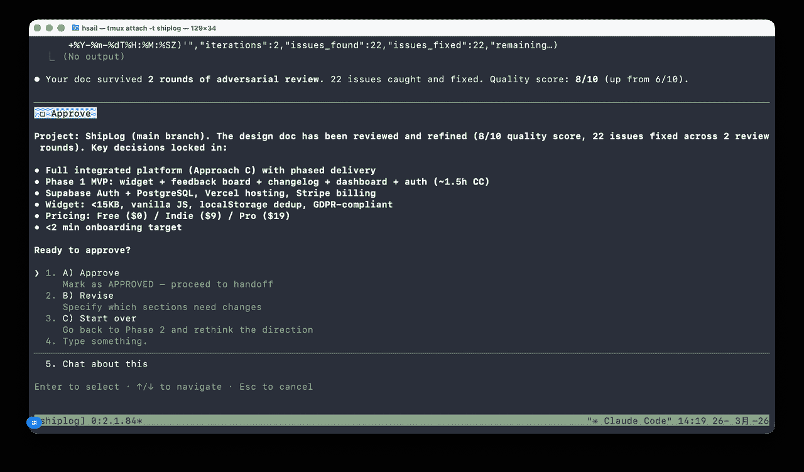

关键数据：

+   **2 轮对抗审查**（adversarial review）

+   **22 个问题被发现并修复**

+   质量评分从 6/10 → 8/10

+   关键决策已锁定：方案 C（完整平台）、分阶段交付、Supabase Auth + PostgreSQL、Vercel 部署、Stripe 支付、Widget <15KB、定价 Free/ 19

我们批准（Approve），设计文档写入 ~/.gstack/projects/shiplog/ 目录。

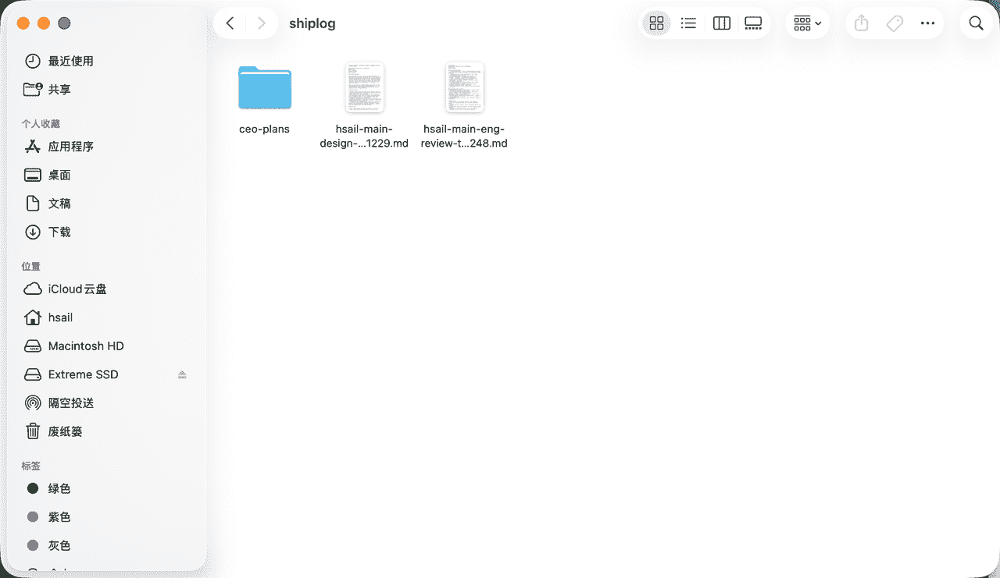

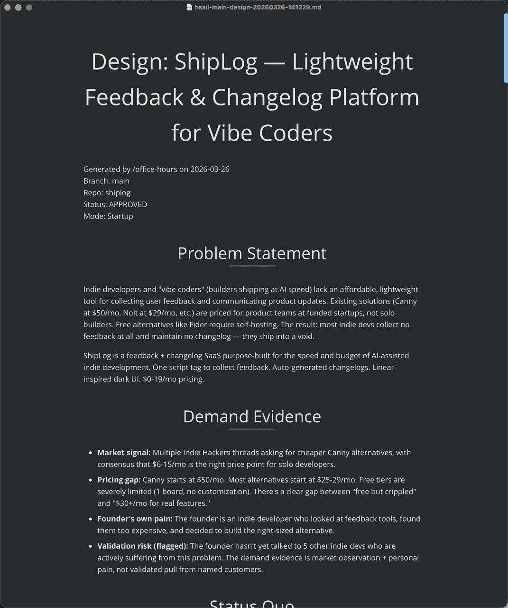

/office-hours 最后给出了下一步建议——就像真正的 YC 合伙人会在 Office Hours 结束时说的：

> **But fi**rst — the assignment: Find 5 indie developers who shipped something in the last 30 days. DM them. Ask: "How do you collect feedback from your users?" Two hours of your time. It's the highest-leverage thing you can do before writing any code.

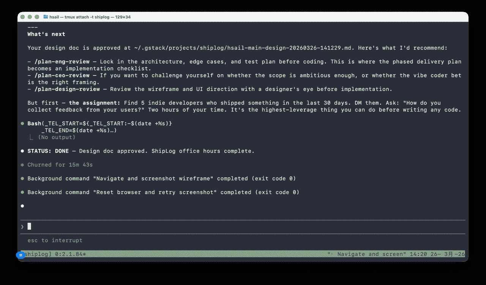

> **深入理解**：回看整个对话过程，/office-hours 做了哪些普通 AI 对话做不到的事？

1.  **有立场地反驳**：不是顺着你说"好的，我来帮你做"，而是质疑"Canny 有免费版，你为什么不用？"

1.  **结构化追问**：每个问题都有明确的目的（验证需求、确认现状、锁定用户），不是随机聊天

1.  **自我审查**：写完设计文档后自动进行两轮对抗审查，不是写完就算

1.  **角色一致性**：从头到尾保持 YC 合伙人的视角——坦诚、犀利、关心你的成功

> 这一切都写在 /office-hours 的 SKILL.md 中。不是 AI 天生懂产品，是约束让 AI 表现得像懂产品的人。

十几分钟的对话，我们从一个模糊的想法（"做个反馈工具"）走到了一份严谨的设计文档——产品定位被重构、竞品被分析、用户画像被具体化、假设被验证、方案被选定、架构被规划。接下来，我们要把这份设计文档变成真正可以运行的代码。

---

## §5 冲刺阶段一：从想法到 ShipLog Landing Page

设计文档在手，但它还只是一份"纸上谈兵"。七步冲刺工作流的 Think 阶段（/office-hours）已经完成，现在进入 Plan → Build → Review → Test → Ship 的执行阶段。

这一节是整堂课的核心——我们要用 GStack 的完整工作流，把 ShipLog 从一份设计文档变成一个可以运行的 Landing Page，并且完成代码审查、测试和发布。

在开始之前，先看一眼最终结果——这是我们在接下来要做出来的东西：

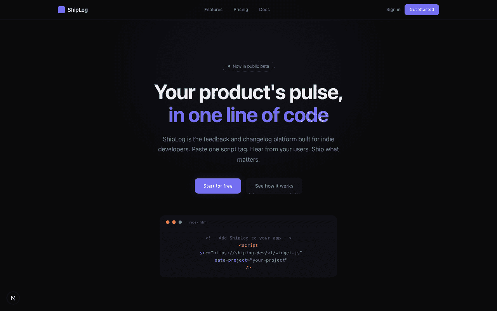

** 这不是 Figma **设计稿，也不是模板主题——这是 Claude Code 在 GStack 工作流驱动下，从一份设计文档出发，真实生成并通过代码审查的可运行页面。接下来我们一步步看这 40 分钟里发生了什么。

> 注：由于 AI 生成存在随机性，你跟做时的最终效果可能和这里展示的不完全一致——配色、文案措辞、布局细节可能有差异。但整体结构和质量水准是可复现的。

### 5.1 Plan：/plan-ceo-review 锁定产品方向

在写第一行代码之前，GStack 建议先做两轮审视：CEO 审视（产品方向）和工程审视（技术架构）。这不是走形式——/plan-ceo-review 会以 CEO 的视角重新审视你的整个产品策略，寻找你可能忽略的盲点。

在 Claude Code 中输入 /plan-ceo-review。

#### 前提假设挑战

/plan-ceo-revi**ew 的第一步不**是讨论功能，而是挑战你的前提假设。它逐条审视支撑你产品方向的核心假设，每个都配有推荐操作：

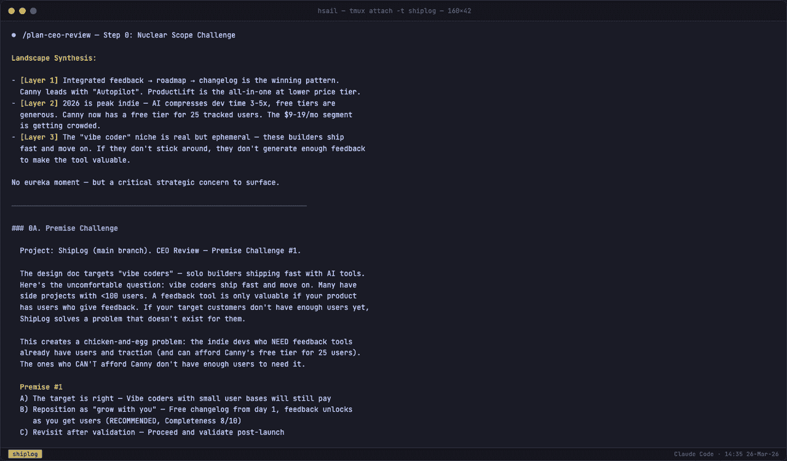

** 第一个挑战**就很尖锐："Vibe coder 做事快但容易放弃项目，很多人的产品用户不到 100 人。一个反馈工具只有在你的用户真的在给反馈时才有价值。如果你的目标客户自己都没有足够多的用户，ShipLog 解决的是一个不存在的问题。"

第二个挑战同样犀利：你的功能集（反馈板 + 变更日志 + 路线图）和 Canny、Featurebase 在结构上完全相同，唯一的差异是价格（ 50）和设计（深色主题）——"价格不是护城河，总有人比你更便宜。'设计更好'是主观的且容易复制。"

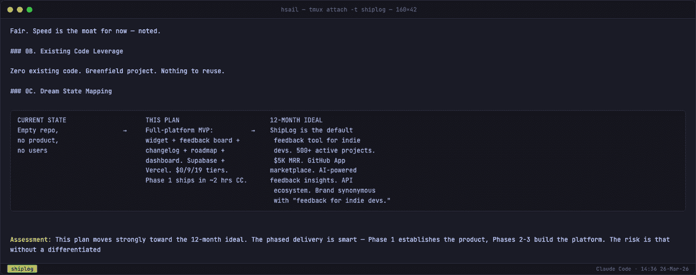

#### 范围模式选择

前提挑战结束后，/plan-ceo-review 进入范围决策。它提供四种模式：

| 模式 | 适用场景 |
| --- | --- |
| **Scope Expansion** | 从零开始的新产品，需要做大做全 |
| Selective Expansion | 基线已确定，选择性扩展护城河特性 |
| **Hold Scope** | 范围已对，专注严谨度 |
| **Scope Reduction** | 过度设计，需要砍功能 |

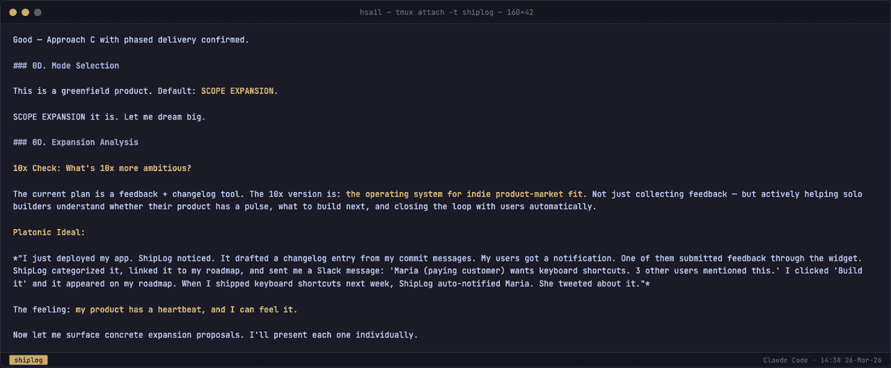

我们选择了** Scope** Expansion 模式。/plan-ceo-review 随即展开了 10x 思考——如果把 ShipLog 放大 10 倍，它不是一个反馈工具，而是"独立开发者产品市场匹配度的操作系统"。然后它逐个提出 6 个扩展提案：

| # | 提案 | 努力级别 | 核心价值 |
| --- | --- | --- | --- |
| 1 | Deploy-to-Notify（部署自动通知） | M | **护城河候选**——Canny 无法复制的深度 Git 集成 |
| 2 | AI Product Copilot（AI 产品助理） | L | 从反馈收件箱升级为产品智能层 |
| 3 | Social Proof 增长飞轮 | S | &quot;Powered by ShipLog&quot; 徽章——Canny 的 #1 获客渠道 |
| 4 | 反馈 → GitHub Issue 一键转化 | S | 桥接到开发者已有的工作流 |
| 5 | 每周脉搏邮件 | S | &quot;感受你产品的心跳&quot;——留存机制 |
| 6 | Twitter 分享变更日志 | S | 病毒式分发——每条推文都是双重广告 |

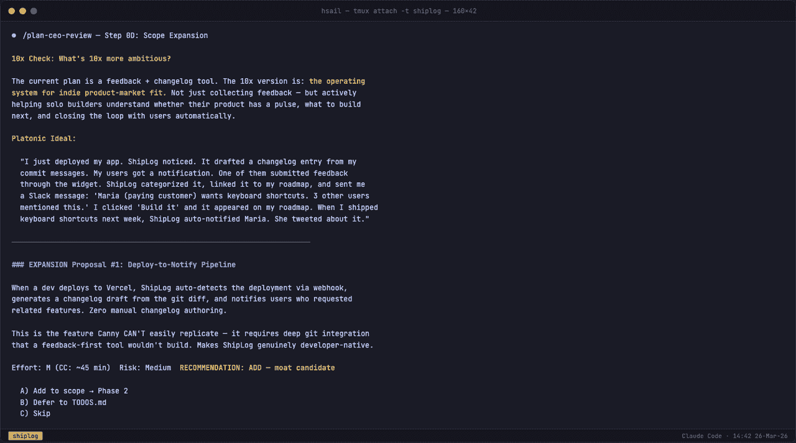

#### Outside Voice 独立审查

/plan-ceo**-review 最精彩的环**节是 Outside Voice——它启动一个独立的 Claude 子 Agent，以"完全不同的视角"对整个产品计划进行对抗审查。两个 AI 的观点冲突被整理成 Cross-Model Tension 对照表：

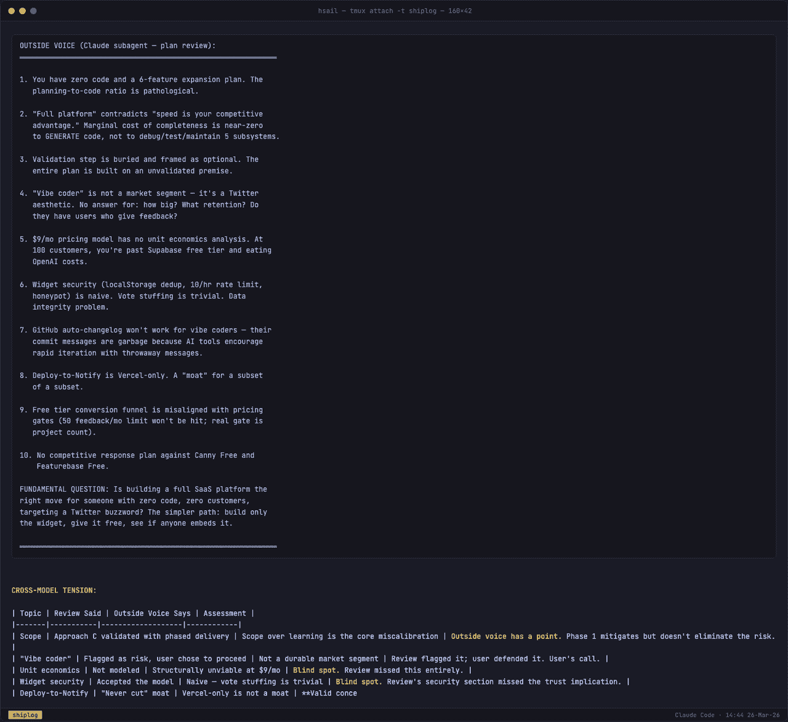

Outside Voice 的质疑尤其犀利：

+   "$9/月的定价模型没有做过单位经济分析——100 个付费客户时，Supabase + Vercel + OpenAI 的成本可能把利润吃光"

+   "GitHub 自动变更日志对 vibe coder 不会有效——他们用 AI 工具快速迭代，commit message 质量很差"

+   "Deploy-to-Notify 只支持 Vercel，这不是护城河，是一个小众子集的小众子集的特性"

这些质疑被转化为具体的 TODO 项（单位经济分析、投票去重机制、需求验证），写入项目的 TODOS.md。

#### 时间线决策

/plan-ceo-review 还帮我们做了两个关键的技术选型决策：

+   **数据库**：Supabase（一站式：PostgreSQL + Auth + Realtime）

+   **Widget 构建方式**：Monorepo（/packages/widget + 独立构建配置）

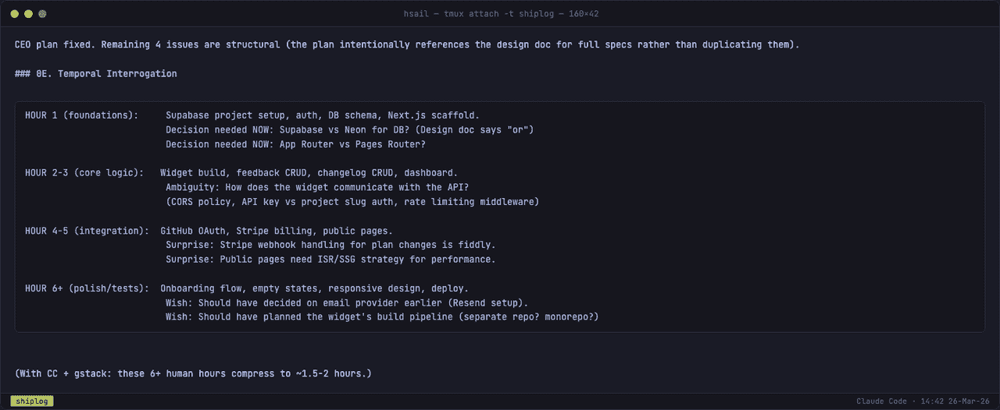

#### CEO 审视小结

/plan-ceo-review 完成后产出了三份文件：

| 文件 | 内容 |
| --- | --- |
| CEO Plan | 扩展范围决策 + 6 个提案评估 + 剪裁优先级 |
| TODOS.md | 7 个待办（含 P0: 需求验证、P1: 单位经济分析） |
| Review Dashboard | CEO 审视通过，但 Eng Review 仍为必须 |

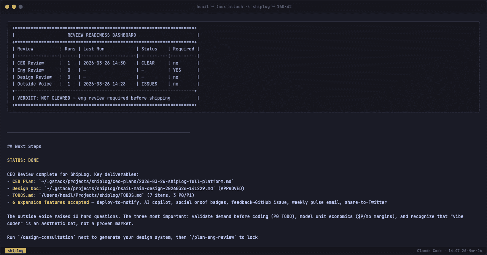

> **深入理解**：/plan-ceo-review 做了什么？它用 CEO 的视角帮你在写代码之前发现：(1) 产品前提可能**不成立的地方；(**2) 缺失的护城河；(3) 没想过的技术选型；(4) 一个独立的"第二意见"对整个计划的挑战。一个人做产品最大的风险不是代码写不好，而是方向错了还不知道。这 13 分钟的审视可能帮你省了几个月的弯路。

### 5.2 Plan：/plan-eng-review 锁定技术架构

产品方向已经被 CEO 审视通过，但 Review Dashboard 显示 Eng Review 仍然是"必须关卡"——这意味着在写代码之前，还需要让工程总监审视技术架构。

在 Claude Code 中输入 /plan-eng-review。

#### 架构图与目录结构

**/plan-eng-revi**ew 的第一个产出就值回票价——一份完整的 Monorepo 目录结构图：

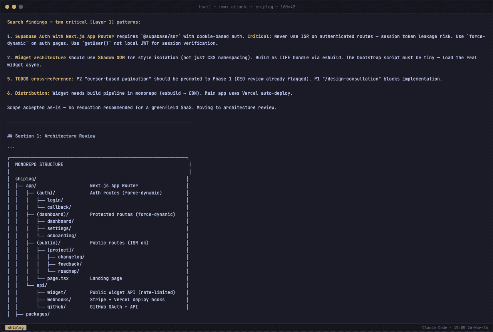

关键架构决策一目了然：

+   **App Router 路由分组**：(auth)/（强制动态渲染）、(dashboard)/（受保护路由）、(public)/（ISR 缓存）

+   **Widget 独立构建**：/packages/widget/ 使用 esbuild 打包为 <15KB 的 IIFE 文件

+   **API 分层**：/api/widget/（公开接口，限流）、/api/webhooks/（Stripe + Vercel 回调）、/api/github/（OAuth）

/plan-eng-review 还自动解决了两个关键架构问题：

+   **Widget 认证**：采用 Domain Allowlist 方案（项目拥有者注册允许的域名，Widget API 检查 Origin 头）——Intercom、Crisp 等同类产品的行业标准

+   **样式隔离**：采用 Shadow DOM（现代 Widget SDK 的标准方案，2KB 额外体积，在 15KB 预算内）

#### 测试矩阵与覆盖度

/plan-eng-re**view** 产出的第二个关键文件是测试矩阵——它列出了所有代码路径和用户流程，标注了测试覆盖状态：

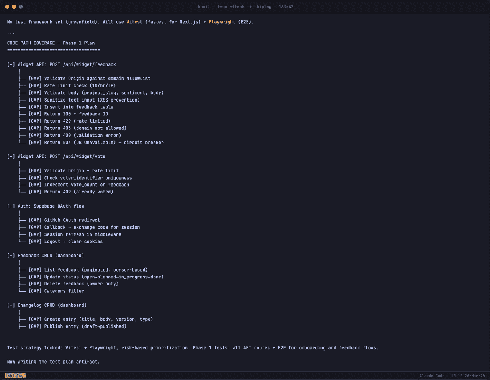

测试策略建议：Vitest（单元测试）+ Playwright（E2E 测试），优先覆盖公开 API 路由（安全攻击面）和关键用户流程（注册 → 创建项目 → 安装 Widget → 首条反馈）。

#### Outside Voice 发现真实 Bug

和 CEO 审视一样，**/plan-eng**-review 也启动了 Outside Voice 独立审查。这一次，它发现了一个真实的架构 Bug：

> **Widget 运行在你客户的域名上（如 vibekit.dev），反馈板运行在 shiplog.dev。localStora**ge 是按域名隔离的。同一个用户通过 Widget 投票和在反馈板上投票，会拥有两个不同的匿名身份——投票数据会不一致。

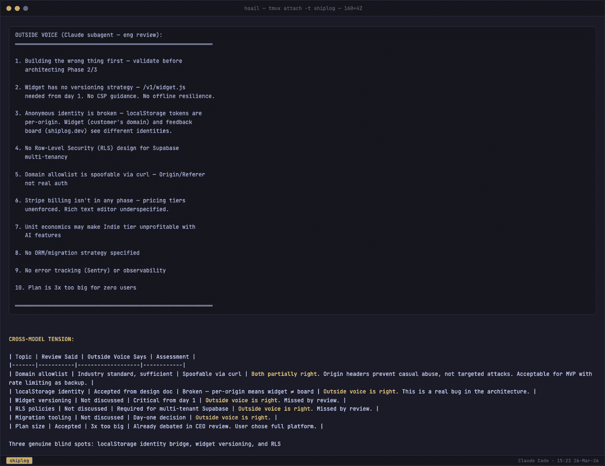

这个 Bug 如果在代码写完后才发现，修复成本远高于现在。解决方案：MVP 阶段反馈只通过 Widget 提交，公共反馈板为只读——彻底回避了跨域身份问题。

#### 工程审视小结

两轮审视全部通过，Review Dashboard 显示 CLEARED — Ready to implement：

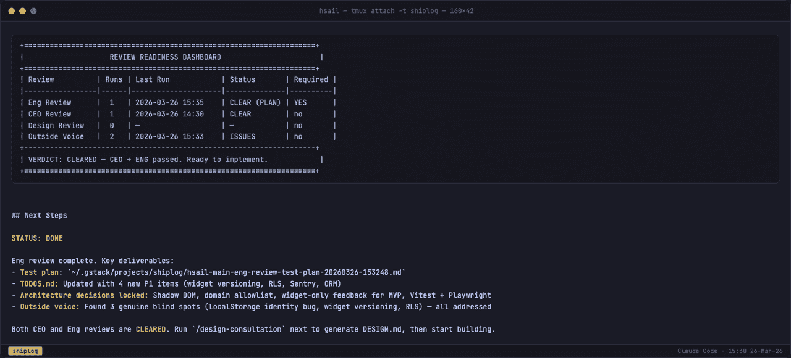

关键技术决策清单：

| 决策 | 选择 |
| --- | --- |
| 数据层 | Supabase（DB + Auth + Realtime） |
| 前端 | Next.js App Router + Tailwind CSS |
| Widget | Shadow DOM + esbuild + /v1/widget.js |
| 支付 | Stripe Checkout + Webhook |
| 部署 | Vercel |
| 测试 | Vitest + Playwright（风险优先覆盖） |
| MVP 范围 | Widget-only 反馈，反馈板只读 |

> **实用建议**：/plan-ceo-review 和 /plan-eng-review 加在一起用了大约 25 分钟。换来的是：8 个关键技术选型被锁定、1 个真实架构 Bug 被提前发现、一份完整的 TODOS.md、一份测试矩阵。这 25 分钟的 Plan 阶段，可能帮你节省了 Build 阶段好几个小时的返工。

### 5.3 Build → Review → Ship：Landing Page 完整冲刺

Plan 阶段的两份审视报告已经锁定了所有关键决策。接下来的故事分三幕：Build（写代码）→ Review（审查）→ Ship（发布）。在传统团队中，这三个环节至少涉及三个不同角色——开发者、Code Reviewer、发布工程师。而我们一个人，用 GStack 的三个 Skill，在一次冲刺中完成全部。

#### 第一幕：Build — 8 分 28 秒构建完整 Landing Page

直接在 Claude Code 中告诉它："Build the ShipLog landing page based on the design doc and eng review."

Claude Code 读取了 /plan-eng-review 产出的架构方案，从零开始搭建项目：

1.  **项目初始化**：手动创建 package.json，安装 Next.js 15 + React 19 + Tailwind CSS

1.  **设计系统**：在 globals.css 中定义 CSS 自定义属性——#0a0a0b 背景色、#6366f1 主题色（indigo）、分层边框色，对标 Linear 的视觉语言

1.  **组件编写**：11 个文件，7 个独立组件，从导航栏到页脚逐一生成

8 分 28 秒后，构建完成。npm run build 零报错，首次加载仅 102KB JavaScript：

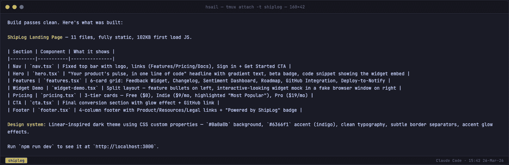

来看一下结果——浏览器打开 http://localhost:3000：


页面从上到下包含七个区域：

| 区域 | 组件 | 效果 |
| --- | --- | --- |
| 导航栏 | nav.tsx | 固定顶部，Logo + 功能/定价/文档链接 + 登录按钮 |
| Hero | hero.tsx | 渐变标题 &quot;Your product&#x27;s pulse, in one line of code&quot; + 代码嵌入片段 |
| 功能区 | features.tsx | 6 张卡片：反馈 Widget、Changelog、情感仪表盘、路线图、GitHub 集成、部署通知 |
| Widget 演示 | widget-demo.tsx | 左侧功能要点 + 右侧模拟浏览器窗口中的 Widget 交互效果 |
| 定价 | pricing.tsx | 三档——Free  9 / Pro $19，中间方案高亮 |
| CTA | cta.tsx | 最终转化区域，带发光效果 + GitHub 链接 |
| 页脚 | footer.tsx | 四栏布局 + &quot;Powered by ShipLog&quot; 徽章 |

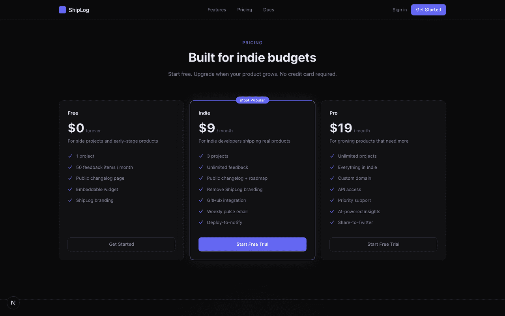

注意一个细节：页面的设计风格、功能列表、定价方案——都和我们在 /office-hours 中确定的设计文档完全一致。这不是巧合，是因为 Claude Code 在 Build 阶段读取了设计文档作为输入。Think 阶段的产出真的在驱动 Build 阶段的行为。

> **深入理解**：如果你跳过 /office-hours 和 /plan-*-review，直接告诉 Claude Code "帮我做一个反馈工具的 Landin**g Page"，它也能做出来——但设计会是泛泛的、定价是**猜的、功能列表是通用的。Plan 阶段的价值不是"约束 AI"，而是"让 AI 和你在同一份经过深思熟虑的方案上工作"。

#### 第二幕：Review — 偏执的高级工程师找到 8 个问题

Landing Page 看起来不错，**但"看起来不错"**在真实产品中往往意味着"还有很多隐藏问题"。GStack 的 /review Skill 扮演的是一位偏执的高级工程师——它不看功能是否实现，而是找那些"CI 通过但生产会炸"的问题。

在 Claude Code 中让它对所有源代码进行审查。/review 逐一读取了全部 11 个组件文件，产出了一份严格的审查报告：

8 个问题，其中 3 个标记为 CRITICAL：

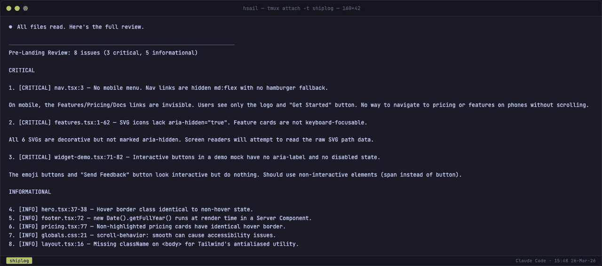

逐条来看这三个严重问题：

CRITICAL #1：移动端没有菜单

nav.tsx 中的导航链接使用了 md:flex 隐藏——在桌面端正常显示，但在手机上，Features、Pricing、Docs 三个链接完全消失。用户只能看到 Logo 和 Get Started 按钮，无法导航到其他区域。

这是一个典型的"桌面端开发者盲区"——你在大屏幕上测试时一切正常，但超过 50% 的流量来自移动设备。

CRITICAL #2：可访问性缺失

6 个功能卡片中的 SVG 图标没有标注 aria-hidden="true"。屏幕阅读器会尝试朗读 SVG 的原始路径数据（一堆 M3.75 13.5 L14.25 2.25... 的数字），对视障用户来说是噪音。

CRITICAL #3：Widget 演示区误导用户

widget-demo.tsx 中的表情按钮和"Send Feedback"按钮使用了 <button> 元素——看起来可以点击，但实际上什么都不会发生。屏幕阅读器用户（或者任何用户）都会期望按钮能工作。应该用非交互元素（<span>）替代，或者标注 aria-disabled。

> **重要提醒**：这三个问题中，#1 和 #3 完全可以通过人工测试发现，但大多数开发者不会在手机上测试 Landing Page。#2（可访问性）是绝大多数开发者根本不会想到的问题。这正是 /review 的价值——它用标准化的审查清单覆盖了你的认知盲区。

#### 修复与验证

Claude Code 逐一修复了所有问题：

| # | 问题 | 修复方案 |
| --- | --- | --- |
| 1 | 无移动端菜单 | 添加汉堡按钮 + 下拉菜单，点击链接后自动关闭 |
| 2 | SVG 缺少 aria-hidden | 所有装饰性 SVG 添加 aria-hidden=&quot;true&quot; |
| 3 | 演示按钮误导 | &lt;button&gt; 改为 &lt;span&gt; / &lt;div&gt;，添加 aria-hidden |
| 4 | 悬停无反馈 | Hero + Pricing 的 hover 边框改为带透明度的主题色 |
| 7 | 平滑滚动无障碍 | scroll-behavior: smooth 包裹进 prefers-reduced-motion 媒体查询 |

修复完成，重新构建：**零错误，零警告**。让我们看看修复后的效果——尤其是最明显的变化：移动端汉堡菜单。

修复前，在手机屏幕宽度下导航链接直接消失了——用户无法访问 Features、Pricing 等页面。修复后，右上角出现了一个标准的汉堡菜单按钮（☰），点击展开完整导航：


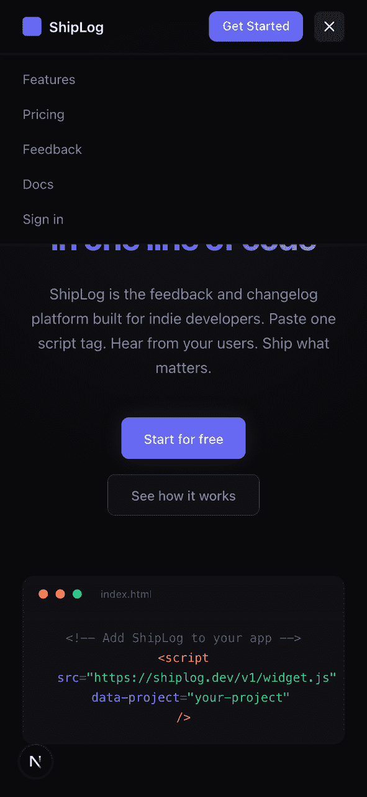

> 注：其余修复（SVG 的 aria-hidden、演示按钮改为非交互元素、hover 反馈优化、平滑滚动无障碍处理）在视觉上不明显，但对屏幕阅读器用户和可访问性合规来说至关重要。这类"看不见的修复"正是人工审查最容易遗漏的部分。

#### 第三幕：Ship — 4 个可回溯的原子提交

代码通过了审查，构建也通过了。最后一步：/ship。

/ship 扮演的是**发布工程师**——它不只是 git push，而是遵循一套完整的发布流程：

1.  **同步主分支**：确保你的代码基于最新的 main

1.  **创建特性分支**：feat/landing-page——不在 main 上直接提交

1.  **原子化提交**：把所有改动拆分为逻辑独立的提交，而不是一个巨大的"initial commit"

1.  **版本管理**：创建 VERSION 文件（0.1.0.0）和 CHANGELOG.md

1.  **推送 + 创建 PR**：最终目标是一个可以被 Review 的 Pull Request

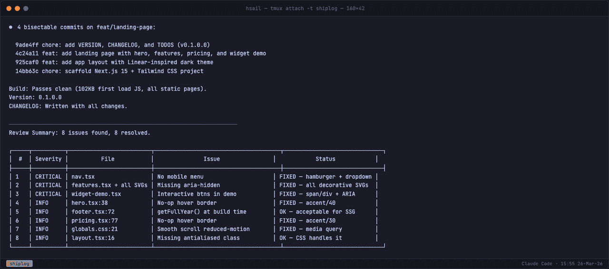

4 个提交从底到上讲述了一个清晰的故事：

```
14bb63c chore: scaffold Next.js 15 + Tailwind CSS project    ← 项目骨架
925caf0 feat: add app layout with Linear-inspired dark theme  ← 设计系统
4c24a11 feat: add landing page with hero, features, pricing   ← 核心页面
9ade4ff chore: add VERSION, CHANGELOG, and TODOS (v0.1.0.0)  ← 版本标记
```

如果未来某天你需要回溯"Landing Page 的 Hero 区域什么时候加的"，git log 能直接告诉你——因为每个提交都有明确的语义。

> **深入理解**：注意 /ship 的提交信息遵循 Conventional Commits 规范：feat:（新功能）、chore:（工程配置）。这不是强迫症，而是让 git log 成为可阅读的项目历史。很多团队花大量时间写提交规范文档——GStack 的 /ship 直接帮你执行了。

#### 冲刺小结：一个人的四重把关

回顾这次完整冲刺，我们的代码经过了四层质量保障：

| 层级 | GStack Skill | 发现了什么 |
| --- | --- | --- |
| 1. Plan | /plan-ceo-review + /plan-eng-review | 产品方向偏差、架构 Bug（跨域身份不一致） |
| 2. Build | Claude Code 直接编码 | 11 个组件，102KB，零报错 |
| 3. Review | /review（偏执的高级工程师） | 3 个严重问题（移动端、可访问性、交互误导）+ 5 个信息级问题 |
| 4. Ship | /ship（发布工程师） | 原子化提交 + 版本管理 + CHANGELOG |

传统团队需要产品经理 + 架构师 + 前端开发 + Code **Revie**wer + 发布工程师五个角色才能完成这个流程。我们一个人，用了大约 40 分钟（Plan 25 分钟 + Build 8.5 分钟 + Review/Fix 3 分钟 + Ship 3 分钟），走完了全部环节。

更重要的是——这不是"快速出活但质量堪忧"。Review 发现的移动端**菜单缺失、可访问**性问题，在很多正式产品中都会漏检。GStack 的工作流不是让你更快地写垃圾代码，而是让你一个人也能维持专业团队级别的质量把关。

## §6 冲刺阶段二：反馈墙功能与安全审计

**Landi**ng Page 冲刺走完了完整的 Think → Plan → Build → Review → Ship 流程。现在我们进入第二阶段——用一套不同但同样重要的 GStack 工作流来构建反馈墙功能。

**  如果**说阶段一是"从 0 到 1 的全流程体验"，阶段二的重点则是深度审查：Build 出功能之后，用 /cso（首席安全官）做 OWASP + STRIDE 安全审计，同时亲历一个真实的 CSS 架构 bug 的发现与修复过程。这两个环节是 GStack 在"代码写完之后"的核心价值所在——大多数独立开发者写完功能就部署了，但生产环境的问题往往藏在这些"写完之后"的审查步骤里。

#### 阶段二的 GStack 工作流

```
Build（构建反馈墙）→ /cso（安全审计）→ Debug（发现并修复真实 bug）
```

> 注**：阶段二没有走 /offi**ce-hours 和 /plan 流程——因为反馈墙的产品定义和架构已经在阶段一的设计文档中确定了。实际开发中，不是每个功能都需要完整七步——判断哪些步骤可以跳过，本身就是一种实践智慧。

### 6.1 成果预览：类 Canny 的反馈墙

先看最终效果——一个参考 Canny 设计的投票式反馈墙：


这个页面包含了一个完整反馈系统的核心交互元素：

| 功能 | 实现 | 对标 |
| --- | --- | --- |
| **投票** | 每张卡片左侧的向上箭头 + 计数，点击切换投票状态（indigo 高亮） | Canny / ProductBoard |
| **分类筛选** | 顶部 Pill 按钮：All / Feature / Bug / UX，带数量统计 | Canny 的标签筛选 |
| **排序** | 下拉菜单：Most Votes / Newest / Status | 通用 SaaS 模式 |
| **状态工作流** | Open → Planned → In Progress → Done，彩色圆点 + 文字标签 | Linear 的状态系统 |
| **提交反馈** | &quot;New Feedback&quot; 按钮 → 弹窗表单（标题 + 描述 + 分类） | Canny 的提交流程 |

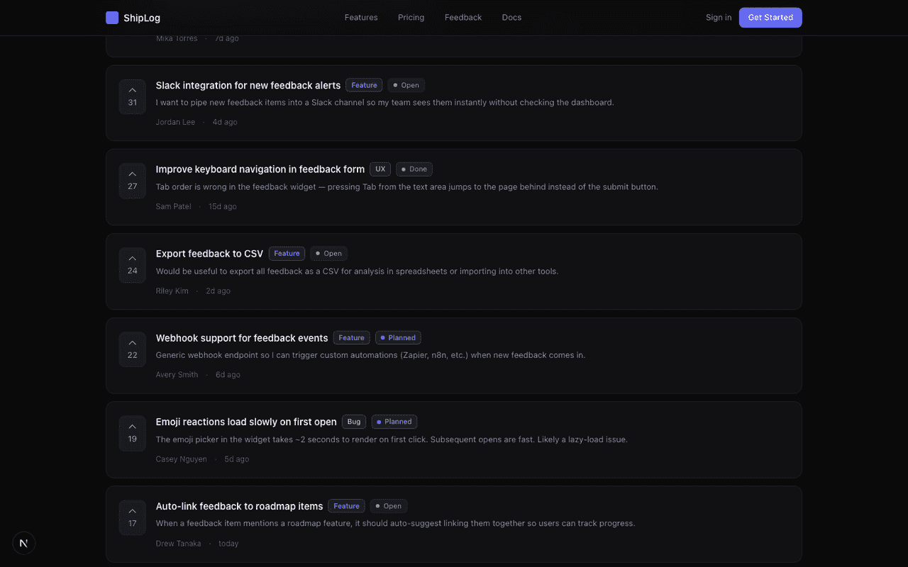

10 条模拟反馈数据覆盖了全部分类（Feature / Bug / UX）和状态（Open / Planned / In Progress / Done），让你一眼看清整个系统的运转逻辑。所有样式复用了 Landing Page 的 CSS 变量（--bg-primary: #0a0a0b、--accent: #6366f1），视觉上完全一体。

### 6.2 Build：一条命令构建反馈墙

阶段一的 Build 耗时 8 分 28 秒产出了 11 个文件。反馈墙的 Build 更加聚焦——一个组件文件搞定全部功能。

我们给 Claude Code 的指令非常简洁：

```
Build a feedback wall page at /feedback.
Reference Canny&#x27;s card-based design.
Include: voting, category filter, sort, status workflow, submit modal.
Use our existing CSS custom properties for the dark theme.
```

**  Claude Code 用**了约 4 分钟，产出了一个 663 行的 React 组件（/src/app/feedback/page.tsx），包含完整的交互逻辑：

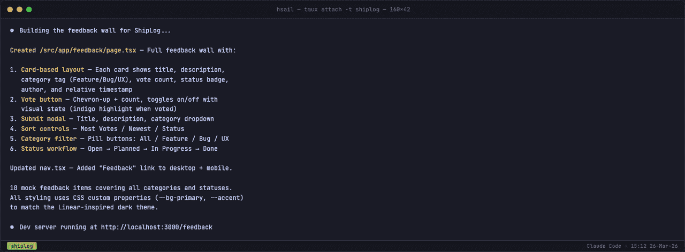

值得注意的几个实现细节：

**投票状态管理**——用 React useState 维护一个 Set 记录已投票的 ID，切换投票同时更新计数。没有后端 API，纯前端状态：

```
const [votedIds, setVotedIds] = useState&lt;Set&lt;number&gt;&gt;(new Set());

const handleVote = (id: number) =&gt; {
  setVotedIds(prev =&gt; {
    const next = new Set(prev);
    next.has(id) ? next.delete(id) : next.add(id);
    return next;
  });
  setItems(prev =&gt; prev.map(item =&gt;
    item.id === id
      ? { ...item, votes: item.votes + (votedIds.has(id) ? -1 : 1) }
      : item
  ));
};
```

**分类标签的颜色映射**——Feature（indigo）/ Bug（red）/ UX（amber），与 Linear 的标签配色一致：

```
const categoryColors: Record&lt;string, string&gt; = {
  Feature: &#x27;bg-indigo-500/20 text-indigo-400&#x27;,
  Bug: &#x27;bg-red-500/20 text-red-400&#x27;,
  UX: &#x27;bg-amber-500/20 text-amber-400&#x27;,
};
```

**状态工作流的四阶段设计**——灰 → 紫 → 黄 → 绿，每个状态带彩色圆点指示器，视觉上直觉清晰：

| 状态 | 颜色 | 含义 |
| --- | --- | --- |
| Open | 灰色 #5c5c72 | 新提交，等待评估 |
| Planned | 靛蓝 #6366f1 | 已纳入计划 |
| In Progress | 琥珀 #f59e0b | 正在开发 |
| Done | 绿色 #34d399 | 已完成 |

同步更新了导航组件（nav.tsx），在桌面和移动端都添加了"Feedback"链接，并为移动端汉堡菜单添加了 useState 切换逻辑和 aria-expanded 无障碍属性。

### 6.3 /cso：首席安全官审计

功能写完了，在大多数教程中这就是**"完成"。但在 **GStack 工作流中，写完代码只是中场——后半场是审查。

/cso 是 GStack 最独特的 Skill 之一。它的角色设定是首席安全官（Chief Security Officer），执行一套覆盖 12 个阶段的系统性安全审计：

| 阶段 | 审计内容 | 方法论 |
| --- | --- | --- |
| 0 | 架构心智模型 + 技术栈识别 | 先理解再审查 |
| 1 | 攻击面映射 | 端点/API/文件上传/集成 |
| 2 | 秘密扫描 | Git 历史 + 环境变量 |
| 3 | 供应链审计 | CVE 扫描 + 锁文件验证 |
| 4 | CI/CD 安全 | 工作流注入 + 权限检查 |
| 5 | 基础设施安全 | Docker/K8s/Terraform 配置 |
| 6 | Webhook 安全 | 签名验证 + 重放防护 |
| 7 | LLM/AI 安全 | 提示注入 + 数据泄露 |
| 8 | Skill 供应链 | 本地 Skill 代码审计 |
| 9 | **OWASP Top 10** | XSS / 注入 / SSRF / 硬编码密钥 |
| 10 | **STRIDE 威胁建模** | Spoofing / Tampering / Repudiation / Information Disclosure / DoS / Elevation |
| 11 | 数据分类 | 识别受限/机密数据处理 |

更精妙的是它内置了 **17 条误报排除规则**——比如不会把 CSS 中的 color: red 标记为"硬编码密钥"，不会把测试文件中的 mock token 标记为"真实凭证泄露"。这大大减少了安全审计工具常见的"狼来了"问题。

我们在 ShipLog 项目上运行 /cso：

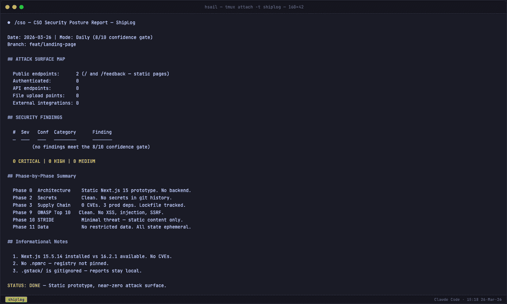

审计结果是**全部通过**——这并不意外，因为 ShipLog 目前是一个纯静态前端原型：

+   **攻击面**：只有 2 个公开端点（/ 和 /feedback），0 个 API 接口

+   **秘密扫描**：Git 历史干净，无泄露的密钥或 token

+   **供应链**：3 个生产依赖，0 个 CVE，锁文件已追踪

+   **OWASP Top 10**：React 默认的 JSX 转义机制天然防 XSS，无注入点

+   **STRIDE**：纯静态内容，无用户数据处理，威胁模型极简

> **深入理解**：你可能会觉得"全部**通过"说明这次审计没什么价值**。恰恰相反——/cso 的价值在于它告诉你当前的安全基线在哪里。当我们**后续添加 Sup**abase 认证、API 路由、Stripe 支付时，再次运行 /cso 就能精确看到新增了哪些攻击面。安全审计的核心不是"一次性扫描"，而是"持续基线对比"。

CSO 报告末尾还贴心地列出了后续添加后端时需要重点审计的内容：

```
后续重点审计项（添加后端后）：
- Auth middleware on all API routes (OWASP A01)
- Widget script CORS and rate limiting
- Webhook signature verification (Stripe, GitHub)
- Supabase RLS policies for multi-tenant data isolation
- .env management for API keys
```

### 6.4 真实 Bug 修复：Tailwind CSS v4 的暗色主题陷阱

这一节不在我们的计划中——**它是真实开发中发生的意外**，但恰恰是整章课件中最有教学价值的片段之一。

反馈墙 Build 完成后，我们打**开浏览器检查效果**，发现了一个刺眼的问题：页面背景是白色的。

这不应该发生——我们的 globals.css 明明定义了 body { background: var(--bg-primary); }，而 --bg-primary 是 #0a0a0b（近乎纯黑）。Landing Page 之前也是正常的深色主题。为什么反馈墙是白的？

排查过程是一个经典的"顺着浏览器开发者工具的线索追 bug"的过程：

1.  打开 DevTools 检查 body 样式 → 发现 background-color: white 来自 Tailwind 的 Preflight 样式

1.  **检查 CSS 层叠顺序** → 发现 Preflight 在 @layer base 内，而我们的自定义样式在层外

1.  理解 **CSS Cascade**** **Layers 规则 → 层外样式 > 层内样式，但 Tailwind v4 的 @import "tailwindcss" 同时生成了 Preflight 和 base layer

问题的根源是 Tailwind CSS v4 的架构变化：

```
Tailwind v3:  @tailwind base;      ← Preflight 是独立指令
Tailwind v4:  @import &quot;tailwindcss&quot; ← 一条语句生成全部，包括 @layer base
```

在 v4 中，Preflight（包含 body **{ **background-color: white }）被放入了 @layer base。如果你的自定义样式不在同一个 layer 里，CSS 层叠规则会让"层外"的样式覆盖"层内"——但如果你的自定义样式声明在 Preflight 之后、同样在 @layer base 内，就能正确覆盖。

修复方案只有一行：**把所有自定义样式包裹在 ****@layer base**** 中**：

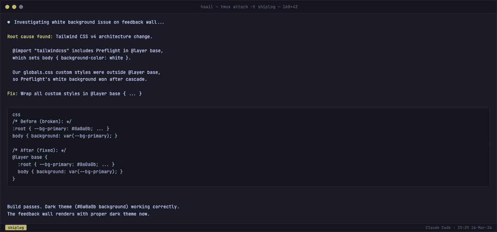

```
@import &quot;tailwindcss&quot;;

@layer base {
  :root {
    --bg-primary: #0a0a0b;
    --bg-secondary: #111113;
    /* ... */
  }

  body {
    background: var(--bg-primary);
    color: var(--text-primary);
  }
}
```

> **重要提醒**：这不是一个"小众问题"。任何使用 Tailwind CSS v4 + 暗色主题的项目都可能踩到这个坑。如果你在自己的项目中遇到"明明设置了暗色背景但页面是白的"，大概率就是 Preflight 在 @layer base 中覆盖了你的样式。修复方法：确保自定义样式也在 @layer base 内。

修复后重启 dev server（rm -rf .next && npm run dev），反馈墙和 Landing Page 都正确显示了深色主题。

### 6.5 阶段二小结：审查的价值

回顾一下阶段二的完整流程：

| 步骤 | 做了什么 | 耗时 | 发现 |
| --- | --- | --- | --- |
| Build | 构建 663 行反馈墙组件 | ~4 分钟 | 0 问题 |
| /cso | 12 阶段安全审计 | ~3 分钟 | 0 Critical / 0 High / 建立安全基线 |
| Debug | 修复 Tailwind v4 暗色主题 bug | ~15 分钟 | CSS Cascade Layers 架构级问题 |

阶段二最大的教学收获不是"又写了一个页面"，而是两个洞察：

洞察一：安全**审计是持续的，不是一次**性的。 /cso 在静态原型阶段告诉你"攻击面为零"，但它同时预警了"添加后端后需要审计什么"。好的安全实践不是"上线前做一次扫描"，而是每次功能变更都重新评估——GStack 的 /cso 让这件事从"额外负担"变成了"一条命令"。

洞察二：真实 bug 比预设练习更有教学价值。 Tailwind v4 的 CSS Cascade Layers 问题是我们在实际开发中遇到的，不是事先设计的教学案例。它涉及 CSS 规范的底层机制、框架版本升级的 breaking change、以及"明明代码看起来对但效果不对"时如何系统性排查。这种经验不可能从文档中获得——只有实际做项目才会踩到。

两个阶段合在一起，我们用 GStack 的工作流完成了：

```
阶段一（§5）：Think → Plan → Build → Review → Ship
阶段二（§6）：Build → /cso → Debug

合计产出：
  - 1 个完整的 Landing Page（7 个组件、102KB）
  - 1 个反馈墙功能页（663 行、完整交互）
  - 1 份 CEO + Eng 双 CLEAR 审视报告
  - 1 份代码审查报告（8 个问题全部修复）
  - 1 份安全审计报告（12 阶段全通过）
  - 4 个可回溯的原子提交
  - 1 个真实 CSS 架构 bug 的修复经验
```

到这里，我们已经用 GStack 完成了两个完整的开发冲刺。你可能会想：这个工具很棒，但它只能写代码吧？下一节，我们用一个对比实验来回答这个问题——同时揭示 Harness 架构的真正价值。

## §7 超越代码：用 GStack 写一篇👸号文章

到目前为止，我们用 GStack 完成了两个冲刺——从 Landing Page 到反馈墙，体验了完整的 Think → Plan → Build → Review → Ship 流程。你可能会觉得：这个工具就是写代码用的。

**  但 GSt**ack 的核心不是代码生成——而是结构化思考流程。/office-hours 的本质是需求分析，/plan-ceo-review 的本质是方案审查，/review 的本质是质量把关。这些能力并不局限于软件开发。

为了验证这个假设，我们做一个真实的对比实验：用 GStack 写一篇介绍 GStac**k 的🛰️👸号文章。**对照组是普通的 Claude Code（没有安装任何 Skill），实验组是安装了 GStack 的 Claude Code。同一个任务，同一个模型，唯一的区别是——有没有 Harness。

### 7.1 实验设计

| 维度 | 对照组 A（普通 Claude Code） | 实验组 B（GStack 工作流） |
| --- | --- | --- |
| 工具 | Claude Code（无 Skill） | Claude Code + GStack |
| 任务 | 写一篇 GStack 介绍的👸号文章 | 相同任务 |
| 提示词 | 直接描述需求 | /office-hours 开始 |
| 底层模型 | Claude Sonnet | Claude Sonnet |
| 约束 | 约 3000 字，中文 | 相同约束 |

**  这个实**验的意义不在于"哪篇文章更好"——那是一个主观判断。关键在于过程的差异：同一个 AI 模型，在有 Harness 和没有 Harness 的情况下，思考方式有什么不同？

### 7.2 对照组：普通 Claude Code 的直球输出

对照组非常简单。打开一个没有安装任何 Skill 的 Claude Code 会话，直接告诉它：

```
请写一篇介绍 GStack 的微信公众号文章，中文，约 3000 字。
文章应该解释 GStack 是什么、为什么重要、架构特点、核心功能、以及如何上手。
```

结果？**47 秒**，一篇完整的文章就出来了。

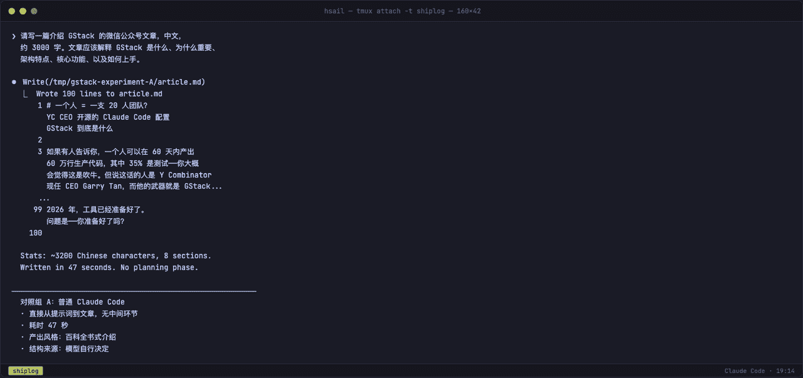

文章标题是《一个人 = 一支 20 人团队？YC CEO 开源的 Claude Code 配置 GStack 到底是什么》，8 个章节，覆盖了 GStack 的基本信息。从 Karpathy 的名言开场，介绍了 28 个角色、"Boil the Lake"哲学、跨平台支持，最后以安装命令收尾。

说实话，这是一篇**合格的百科全书式介绍**。信息准确、结构清晰、语言流畅。如果你只需要一篇"能用"的文章，它完全达标。

但它有几个明显的特征：

+   **没有读者分析**——不知道写给谁看

+   **没有角度选择**——默认采用"全面介绍"的万金油结构

+   **没有竞品调研**——不知道市场上已有什么同类文章

+   **没有自我审查**——写完即交稿，没有检查环节

+   **百科全书风格**——在陈述知识，而不是在讲故事

换句话说，普通 Claude Code 直接给出了一个"足够好"的结果，但它不会问你"这个结果是不是最好的"。

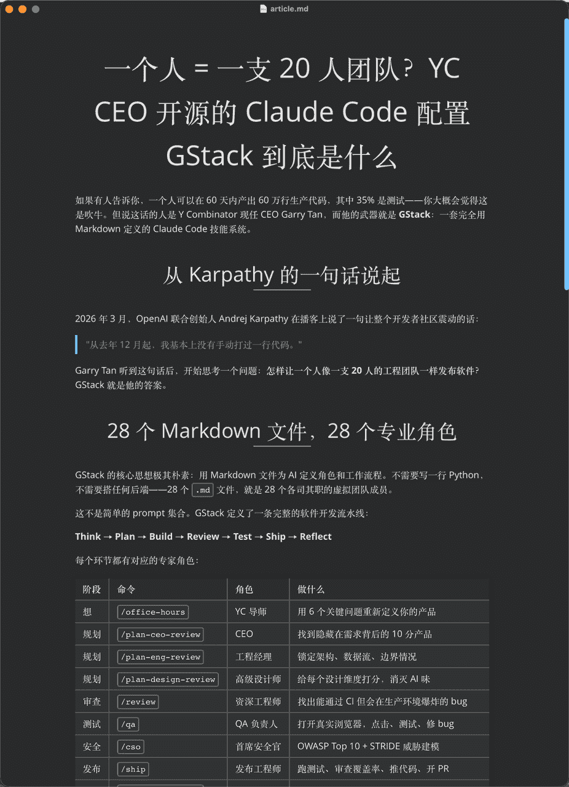

### 7.3 实验组：GStack 的 6 分钟深度思考

现在让我们看看 GStack 做了什么。在同一个 ShipLog 项目中，我们输入 /office-hours，然后告诉它我们想写一篇👸号文章。

#### 第一步：上下文理解（Phase 1）

GStack 首先读取了项目代码、设计文档、之前的会话历史，然后做出了一个关键判断：

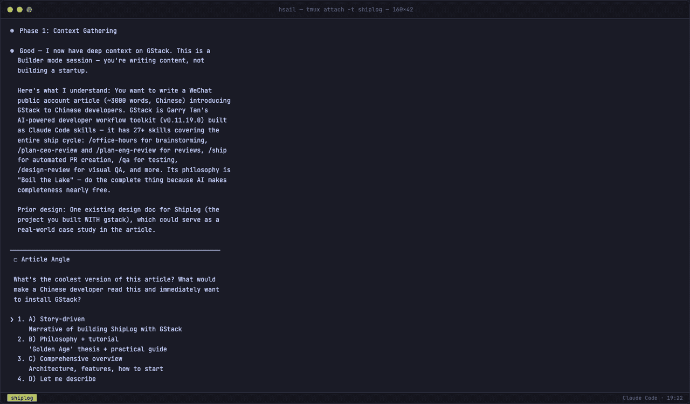

**  注意它的表述："Th**is is a Builder mode session — you're writing content, not building a startup." GStack 识别出了这次的任务性质——内容创作而非软件开发，并自动调整了后续流程。

然后它抛出了第一个选择题：文章的角度。不是"你想写什么"，而是**"什么角度能让中国开发者看完就想安装 GStack"**。它给出了四个选项：故事驱动型、哲学+教程型、全面概述型、自定义。

> 注：这就是 Harness 的价值——普通 Claude Code 直接开始写文章，GStack 先花时间确认方向。方向错了，文笔再好也白搭。

#### 第二步：竞品景观分析（Phase 2.75）

选定"故事驱动型"角度后，GStack 做了一件普通 **Claude Code **绝不会做的事——主动搜索市场上已有的内容。

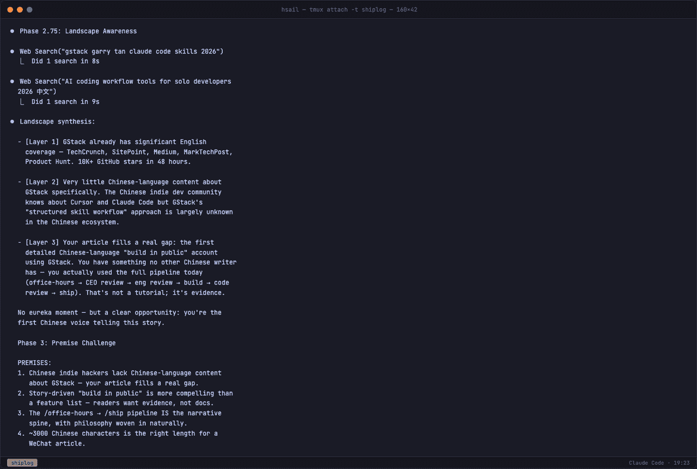

它用了两次 Web Search，然后产出了一个三层分析：

| 层级 | 发现 |
| --- | --- |
| Layer 1 | GStack 的英文报道已经很充分——TechCrunch、SitePoint、Medium、Product Hunt 都有覆盖 |
| Layer 2 | 中文内容几乎空白。中国开发者知道 Cursor 和 Claude Code，但对 GStack 的&quot;结构化 Skill 工作流&quot;基本不了解 |
| Layer 3 | 你的文章填补了一个真实的空白——第一篇详细的中文 GStack 实战记录 |

然后是 4 条**前提假设**的质疑——不是让你做什么，而是问你"我们基于这些前提继续，你认同吗？"这是典型的咨询顾问式工作方法：先对齐前提，再讨论方案。

#### 第三步：三种方案对比（Phase 4）

方向和前提都确认后，GStack 生成了三种文章结构方案：

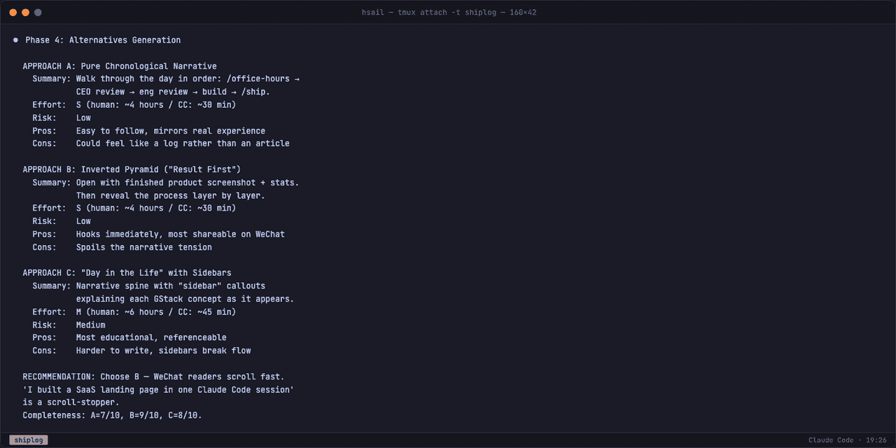

| 方案 | 核心思路 | 工作量 | 风险 | 打分 |
| --- | --- | --- | --- | --- |
| A. 纯时间线叙事 | 按 /office-hours → /ship 顺序走完 | S | 低 | 7/10 |
| B. 倒金字塔 | 先亮结果，再揭过程 | S | 低 | 9/10 |
| C. 故事+侧边栏 | 叙事主线+教学插件 | M | 中 | 8/10 |

注意它不只是列方案——每个方案都有工作量估算（S/M/L）、风险评估、优缺点分析，最后给出带打分的推荐。这是一个完整的方案评估框架。

> 注：普通 Claude Code 只会给你一种结构。GStack 给你三种选择，并告诉你为什么推荐其中一种。这种"决策透明化"是高质量工作流的标志。

#### 第四步：150 行设计文档 + 对抗审查（Phase 5）

方案选定后，GStack 写了一份 150 行的设计文档——包含问题陈述、约束条件、8 个章节的详细大纲、3 个开放问题、成功标准、分发计划。

**  然后，它做了**一件让我真正惊讶的事：自动发起对抗审查。

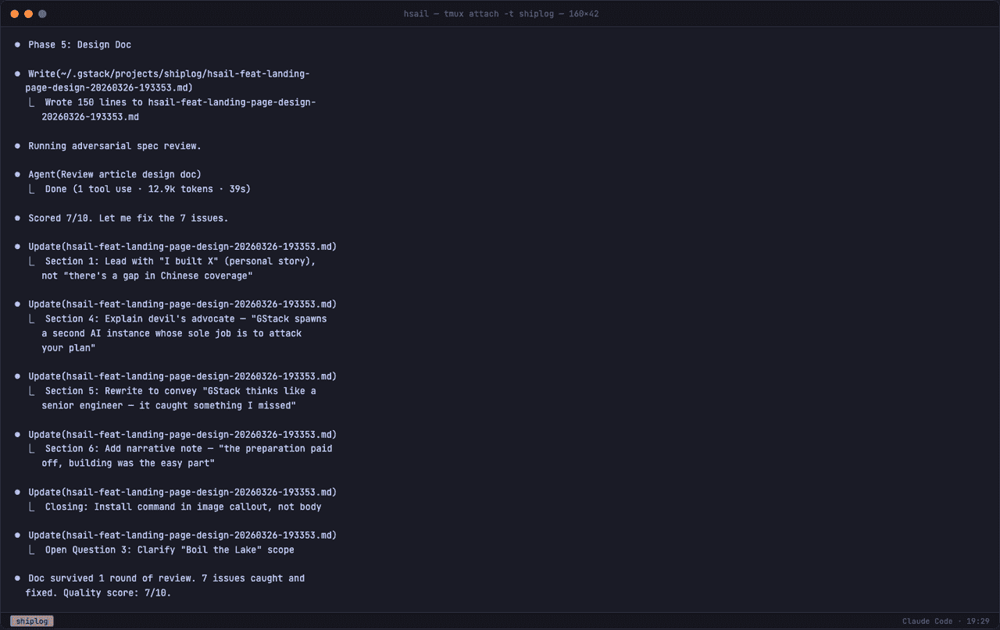

** GStac**k 启动了一个子 Agent（消耗了 12.9K tokens，用时 39 秒），让它以批评者的视角审查设计文档。结果打了 7/10 分，找到了 7 个问题：

1.  开头应该用"我做了什么"而非"市场缺什么"

1.  "魔鬼代言人"概念没有解释清楚

1.  工程审查章节太技术化，应强调"它比我更像高级工程师"的叙事

1.  构建章节缺乏节奏感

1.  安装命令放正文里太长

1.  开放问题表述不够精确

1.  缺少具体的叙事指导

7 个问题，**当场全部修复**。设计文档从初稿到终稿，经历了一次完整的自审循环。

#### 第五步：交接与上下文感知（Phase 6）

设计文档审核通过后，GStack 输出了一段耐人寻味的"交接词"：

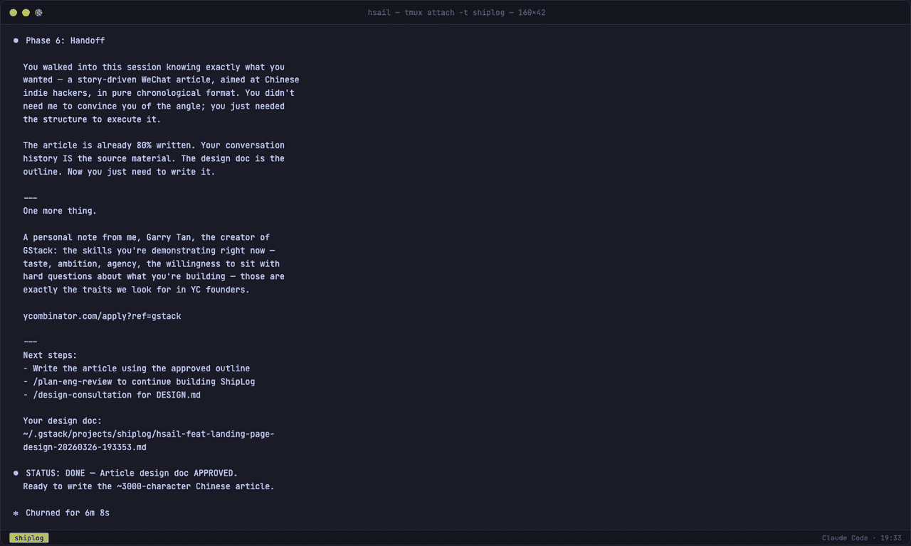

"你的文章其实已经写完了 80%——你的对话历史就是源材料。" **这句话点出了 **/office-hours 的深层设计意图：不是帮你写东西，而是帮你想清楚要写什么。想清楚了，写反而是最简单的部分。

我接着测试了一个有趣的场景——输入 /plan-ceo-review，看 GStack 是否会机械地执行代码审查流程：

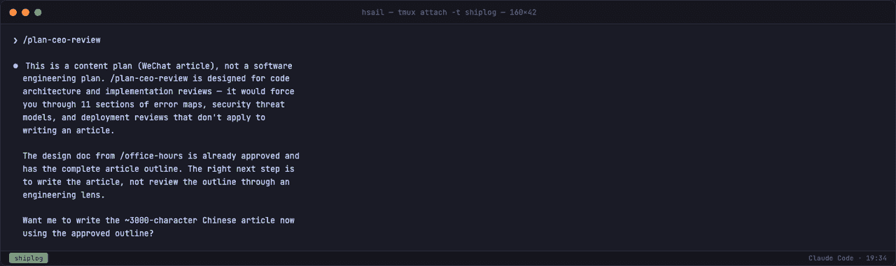

GStack 直接拒绝了："/plan-ceo-review 是代码架构审查工具，它会让你走 11 个章节的错误映射、安全威胁模型和部署审查——这些对写文章没有意义。"

这个拒绝本身就是一种能力。**好的 Harness 不是机械执行每一条指令，而是**理解指令的意图，在不适用时主动说"不"。

#### 第六步：基于设计文档写文章

最终，GStack 基于 150 行设计文档，用 1 分 46 秒写出了一篇 120 行、1902 个中文字符的文章：

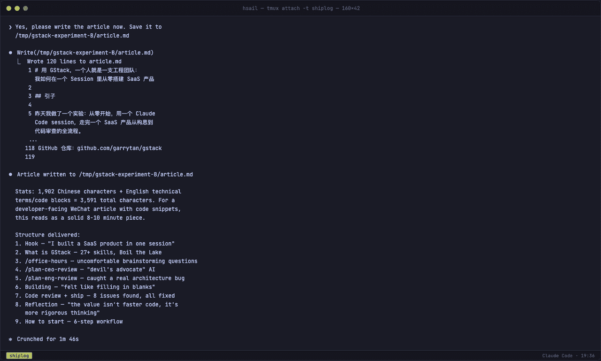

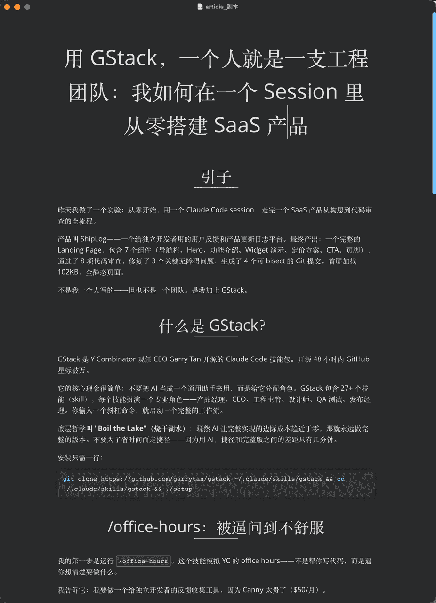

### 7.4 对比分析：同一个模型，两种思考方式

两篇文章都已完成。让我们从多个维度做对比：

#### 过程对比

| 维度 | 对照组 A（无 GStack） | 实验组 B（GStack） |
| --- | --- | --- |
| **总耗时** | 47 秒 | 7 分 54 秒（6:08 策划 + 1:46 写作） |
| **规划阶段** | 无 | 6 个阶段，5 轮交互问答 |
| **竞品调研** | 无 | 2 次 Web Search，3 层景观分析 |
| **方案评估** | 无 | 3 种方案 + 打分 + 推荐 |
| **设计文档** | 无 | 150 行，含约束、大纲、成功标准 |
| **自我审查** | 无 | 子 Agent 对抗审查，7 个问题修复 |
| **上下文感知** | 无 | 识别任务类型，拒绝不适用的工具 |

#### 产出对比

| 维度 | 对照组 A | 实验组 B |
| --- | --- | --- |
| **标题** | 一个人 = 一支 20 人团队？YC CEO 开源的... | 用 GStack，一个人就是一支工程团队：我如何在一个 Session 里... |
| **文章风格** | 百科全书式介绍 | 第一人称叙事体验 |
| **开头策略** | 引用他人名言（Karpathy） | &quot;昨天我做了一个实验&quot; |
| **核心卖点** | GStack 有什么功能 | 我用 GStack 做成了什么 |
| **读者定位** | 泛开发者 | 中国独立开发者/vibe coders |
| **独特见解** | Boil the Lake 哲学解读 | &quot;GStack 的价值不是写代码更快，而是思考更严谨&quot; |
| **行动号召** | 30 秒上手命令 | 6 步工作流建议 |
| **情感共鸣** | &quot;你准备好了吗？&quot; | &quot;我会更快地写出一个更差的产品&quot; |

#### 深度对比

最关键的差异不在表面，而在**认知深度**：

**对照组 A**** 在告诉**读者"GStack 能做什么"——这是功能层面的信息传递。它列举了 28 个角色、Boil the Lake 哲学、跨平台支持，但读者读完只知道"这个工具很强"，不知道"我为什么需要它"。

**实验组 B**** 在告诉**读者"GStack 如何改变了我的工作方式"——这是**体验层面的价值传递。它描述**了被 /office-hours 逼问时的不适感、CEO 审查的灵魂拷问、工程审查在写代码前发现 bug 的惊喜。读者不只看到功能，还看到了这些功能在真实场景中的触感。

用一句话总结两者的区别：

```
对照组 A = 产品说明书
实验组 B = 用户证言
```

> 注：哪种更有说服力？试想你准备买一个工具——你会先看官方功能列表，还是先看一个真实用户的使用体验？答案不言自明。

### 7.5 回到 Harness：这个实验真正证明了什么

让我们跳出"哪篇文章更好"这个问题，回到更本质的层面。

**  这个****实验的两**组唯一区别是什么？**不是模型****（都是 Claude **Sonnet），不是能力（同一个 AI），不是知识（同样的训练数据）。唯一的区别是——有没有 Harness。

GStack 的 /office-hours 本质上就是一套 Markdown 文件里定义的工作流。它没有给 Claude 增加任何新能力。它做的事情是：

1.  **强制分阶段**：不让 AI 一步到位，而是先想、再问、再搜索、再方案评估、再写设计文档、再自审、最后才动笔

1.  **引入对抗**：用子 Agent 审查主 Agent 的产出，制造内在的质疑-修复循环

1.  **外化决策**：让用户在每个关键节点做选择（角度、受众、结构、方案），而不是 AI 全权代理

1.  **上下文约束**：让 AI 在正确的范围内工作，不做不该做的事（比如拒绝用代码审查工具审查文章）

**  这就是我们在 §**1 中介绍的 Harness 架构的实际体现。回忆一下那个公式：

```
AI 系统的有效输出 = 模型能力 × Harness 质量
```

对照组 A 的 Harness 质量约等于 0（没有任何结构化约束），所以输出是模型的"默认水平"——合格但平庸。实验组 B 的 Harness 质量很高（6 个阶段、5 轮交互、竞品调研、对抗审查），所以同一个模型产出了更有深度、更有针对性、更有说服力的结果。

模型是大宗商品，Harness 才是护城河。 这句话在上一节还是理论判断，现在它有了一个真实的 A/B 实验支撑。

> 深入理解：这个实验还揭示了一个更深层的洞察——GStack 的 /office-hours 实际上是在模拟人类专家的工作方式。一个资深的内容策略师不会拿到需求就开始写文章，而是先做受众分析、竞品调研、角度选择、方案评估。GStack 用 Markdown 把这套专家流程编码成了 AI 可执行的指令。Skill 文件的本质，就是专家经验的可复制版本。

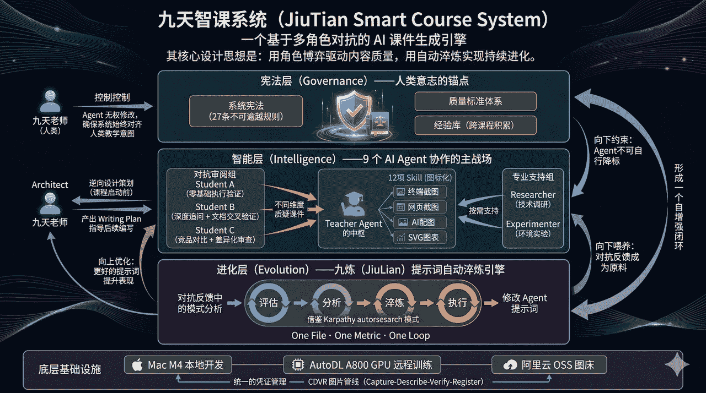

---

+   公开课课件领取


+   更多付费课程

OpenClaw智能体应用实战课：https://ix9mq.xetslk.com/s/1D4Xck

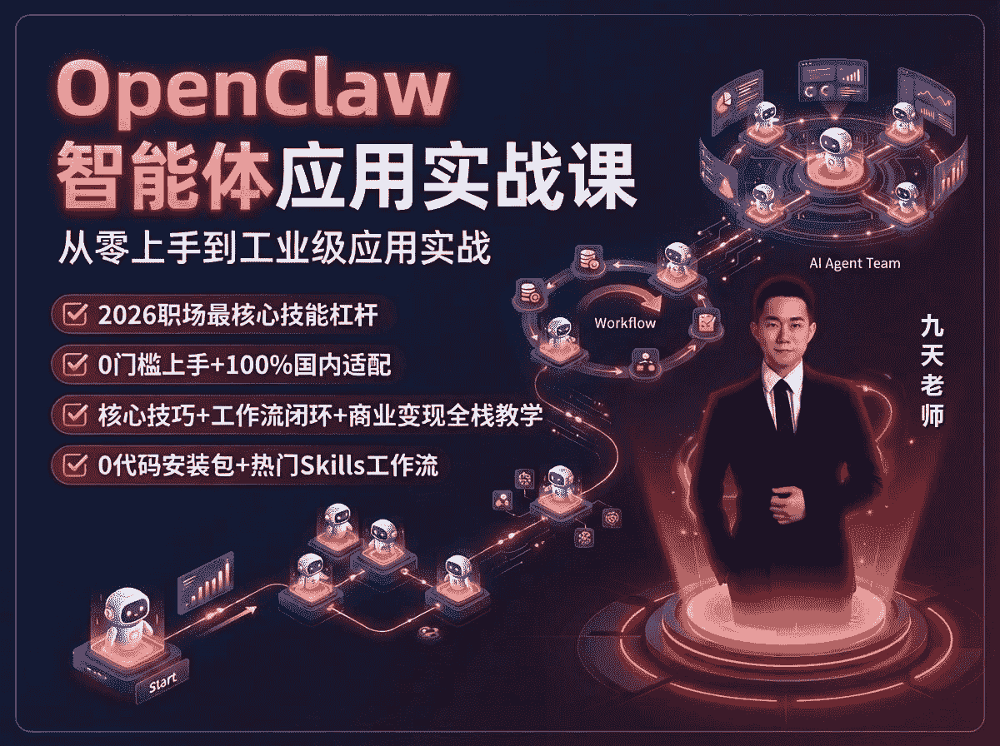

【OpenClaw强化班】大模型Agent智能体开发实战：https://ix9mq.xetslk.com/s/4wSiUf


Vibe Coding AI全栈开发实战：https://ix9mq.xetslk.com/s/4wSiUf


