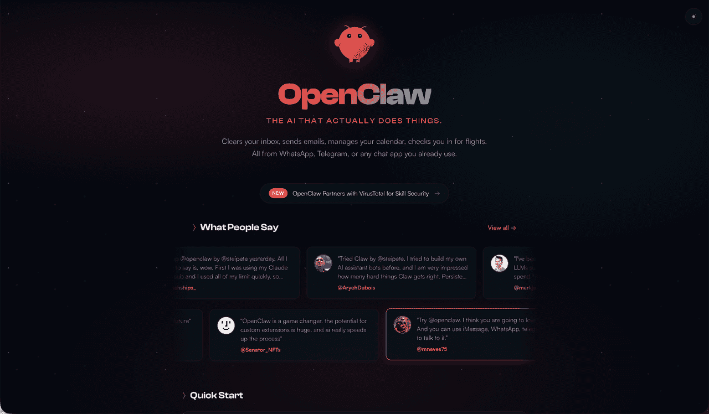
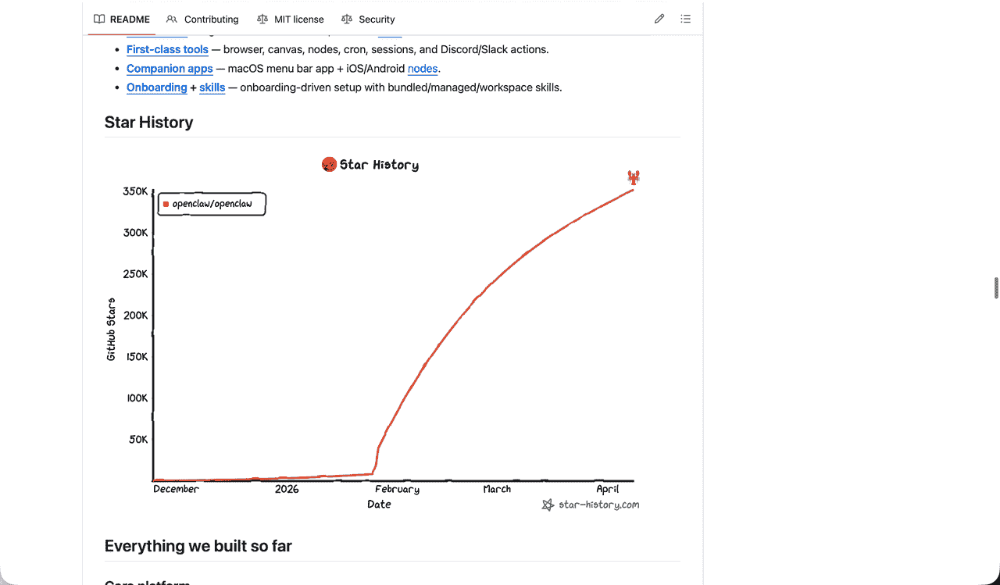

# Harness Engineering 最佳实践：Hermes Agent 快速入门实战（上）

> 来源：[https://kq4b3vgg5b.feishu.cn/docx/LarBd04aQocnnTxOksBcr6Knn1b](https://kq4b3vgg5b.feishu.cn/docx/LarBd04aQocnnTxOksBcr6Knn1b)

## 1 开场：从智能体大普及到驾驭难题

### 1.1 智能体的奇点时刻

2026 年的 AI 模型，已经强大到让人重新定义"可能"这个词。

GPT-5.4 在 3 月 5 日发布，支持 100 万 token 上下文窗口和原生 Computer Use（计算机操控）能力，推理效率比前代提升 33%。Claude Opus 4.6 在 2 月 5 日上线，同样拥有 100 万 token 上下文、12.8 万 token 的超长输出，以及被 Anthropic 称为"有史以来最高智能体编码分数"的实力。这两个模型代表了当前大语言模型的能力天花板——它们不只是"能聊天"，而是真正具备了长时间自主工作的基础能力。

但模型的强大，要有人把它变成生产力。

#### Claude Code：编码智能体率先突破

Anthropic 内部做了一个疯狂的实验：让 16 个 Claude Agent 并行协作，在一个共享代码仓库里从零编写一个 C 语言编译器——用 Rust 实现，整整 10 万行代码。这个编译器能编译 Linux 6.9 内核（跨 x86、ARM、RISC-V 三个架构）、能编译 QEMU、FFmpeg、SQLite、PostgreSQL、Redis，在 GCC 测试套件上达到 99% 的通过率。全程没有人类写一行代码，花费约 2 万美元 API 费用。

这件事的意义不在于"AI 能写编译器"——而在于16 个 Agent 并行协作写出了 10 万行高质量代码。这是 Agent 能力从"辅助工具"跨入"独立生产力"的标志性时刻。

更夸张的是，Anthropic 用 Claude Code 的 vibe coding（氛围编程——用自然语言描述需求，AI 全程编写代码）模式，在一周半时间内设计并实现了 Cowork 这个全新产品的全部代码。对，你没看错——一个完整的商业产品，代码全部由 AI 编写，人类零行手写代码。

#### Claude Cowork：从开发者到知识工作者

2026 年 1 月底，Anthropic 发布了 Claude Cowork 的研究预览版。如果说 Claude Code 面向的是开发者，Cowork 则把智能体的能力推向了更广泛的知识工作者——项目管理、数据分析、文档撰写、邮件处理，那些占据我们每天大量时间但并非"写代码"的工作。

2026 年 4 月 1 日，Bloomberg 报道了 Anthropic 高管的判断：Cowork 的市场空间将比 Claude Code 更大。这个判断的逻辑很直接——全世界的开发者可能只有几千万，但知识工作者有数亿。智能体从代码世界走向日常工作，这是一个量级的跃迁。

#### OpenClaw：开源引爆通用智能体

但真正让智能体"飞入寻常百姓家"的，不是大厂的商业产品，而是一个开源项目——OpenClaw。



OpenClaw 的故事颇具传奇色彩。它最早是奥地利开发者 Peter Steinberger（PSPDFKit 创始人，公司以约 8 亿美元出售）的个人项目。2025 年 11 月开源后迅速走红，到 2026 年 1 月底已经火遍全球开发者社区。Steinberger 随后加入 OpenAI，并将项目转交给一个独立的 501(c)(3) 基金会运营。

数据说明一切：OpenClaw 在 GitHub 上拥有 346K+ Stars，超越 React 成为 GitHub 历史上 Stars 最多的软件项目。React 花了十年多才积累到约 24.3 万 Stars，OpenClaw 在 60 天内就突破了 25 万。它支持 20+ 消息渠道（WhatsApp、Telegram、Slack、飞书、🛰️等），让任何人——不只是开发者——都能拥有一个随时在线的个人 AI 助手。



这是一个标志性的时刻：智能体不再是开发者的专属工具，而是每个人的日常助手。 Claude Code 和 Cowork 证明了 Agent 的能力天花板，OpenClaw 则证明了 Agent 的普及速度。两件事叠加在一起，我们正在经历的，是智能体的奇点时刻。

### 1.2 简单上手，难以驾驭

通用智能体的大普及看起来一片光明——安装简单，上手即用，让 AI 帮你处理日常琐事。但用过一段时间之后，几乎每个认真使用智能体的人都会撞上同一堵墙："上手"很容易，"驾驭"才是真正的挑战。

#### 复合失败：成功率的数学陷阱

让我们做一道简单的数学题。假设 Agent 执行每一步操作的成功率是 95%——这已经相当高了。但如果一个任务需要 20 步才能完成呢？

> 端到端成功率 = `0.95^20 = 0.358 = 35.8%`

每一步都"很靠谱"，但串起来只有三分之一的概率能走完全程。这不是某个模型的问题，这是概率论的铁律。而现实中的复杂任务——部署一个服务、配置一套监控、迁移一个数据库——动辄就是 20 步以上。

#### 上下文溢出：Agent 会"忘事"

即使单步都没出错，Agent 还有另一个结构性弱点：它会在长任务中"忘记"早期目标。当对话进行到第 50 轮，上下文窗口被中间产物、工具调用结果、错误日志填满时，最初设定的任务目标和约束条件早已被"挤"到了注意力的边缘。Agent 不是"不想记住"，而是上下文管理机制没有帮它区分"什么重要、什么可以丢弃"。

#### 质量退化：没有人类审美厌恶的后果

还有一种更隐蔽的失败模式：质量的无声滑坡。让 Agent 持续维护一个项目，你会发现代码规范在悄悄退化——变量命名开始随意，死代码悄悄堆积，注释从详细变成潦草。为什么？因为 Agent 缺少人类与生俱来的两个质量守护机制：对丑陋代码的"审美厌恶"，以及对同事评审的"社会问责"。没有这两层压力，质量在没有任何显式错误的情况下持续下滑。

#### 问题不在模型

以上三个问题的共同特征是什么？它们都不是"模型不够聪明"导致的。 GPT-5.4 的推理能力足够强，Claude Opus 4.6 的上下文窗口足够大。问题不在模型本身——问题在模型之外的一切：工具如何编排、上下文如何管理、错误如何恢复、质量如何验证、记忆如何持久化。

模型是发动机，但光有发动机跑不了。你还需要底盘、刹车、方向盘和导航系统。

### 1.3 Harness Engineering 应运而生

2026 年 2 月 5 日，一篇博文给这个问题起了一个精准的名字。

Mitchell Hashimoto——HashiCorp 联合创始人、Terraform 的作者——在他的博文 "My AI Adoption Journey" 中，提出了一个影响深远的公式：

> `Agent = Model + Harness`

"Harness"直译是"缰绳"。Hashimoto 的核心观点朴素但深刻：不是让 AI 更聪明，而是系统性地改进模型之外的一切——工具编排、上下文管理、错误恢复、验证闭环、安全防护。这些模型周围的基础设施，统称为 Harness（驾驭层）。

他的实践方法论更是直击要害：

> "Every time the agent makes a mistake, take the time to engineer a solution so it never makes that mistake again."
> "每当 Agent 犯错，就花时间工程化一个方案，让它不再犯同样的错。"

这不是什么高深的理论——就是把软件工程里"发现 Bug 就写测试"的思路，迁移到了 Agent 的驾驭层。但正是因为朴素，它才具有普适性。

#### 行业共识：不是一家之言

Hashimoto 命名后仅 6 天，2 月 11 日，OpenAI 发表了一篇工程博客 "Harness engineering: leveraging Codex in an agent-first world"，分享了他们的实践：一个小团队在五个月内，用 Codex Agent 交付了一个包含约 100 万行代码的内部产品——没有手动编写一行源代码。他们的核心发现和 Hashimoto 如出一辙：当代码不再由人类编写时，工程师的工作就变成了"设计环境、明确意图、构建反馈循环"。

随后，Anthropic 在 3 月 24 日的工程博客中发表了 "Harness design for long-running application development"，分享了他们从多 Agent 到单 Agent 的 Harness 架构演进经验。Martin Fowler 站点也在 2 月 17 日发布了备忘录、4 月 2 日发表了完整的 Harness Engineering 分析文章，将其拆解为上下文工程、架构约束和垃圾回收三个维度。

当 HashiCorp 创始人、OpenAI、Anthropic、Martin Fowler 在两个月内先后就同一个概念发声时，这已经不是一家之言——这是行业共识。2026 年智能体领域最重要的认知转变，就是从"让模型更聪明"转向"让模型周围的一切更工程化"。

### 1.4 从方法论到落地：百花齐放

Harness Engineering 给了我们一个思考框架，但光有方法论还不够——如何落地，才是当前智能体前沿工程师们热议的核心问题。2026 年第一季度，一批项目几乎同时涌现，各自从不同角度尝试将 Harness 思路变成可运行的代码。

#### Gstack：用 SKILL.md 模拟一支工程团队

2026 年 3 月 12 日，Y Combinator CEO Garry Tan 在 GitHub 上开源了他的 Claude Code 配置——Gstack。核心思路是用一组 `SKILL.md` 文件定义不同角色（CEO、设计师、工程经理、QA、安全官、发布工程师），让单个 Claude Code 实例在不同角色间切换，模拟一整支工程团队的协作。Tan 本人用这套配置，在运营 YC 的同时，每天兼职写出 1 万到 2 万行生产代码。48 小时内 GitHub Stars 破万。

#### Claude Managed Agents：托管式 Agent 基础设施

2026 年 4 月 8 日——就在昨天——Anthropic 推出了 Claude Managed Agents 平台的公开测试版。这是一套云托管的 Agent 基础设施 API，开发者无需自己搭建沙箱环境、状态管理和错误恢复机制，Anthropic 替你搞定这些"脏活累活"。定价是模型用量费用加上每小时 0.08 美元的 Agent 运行时费用。Notion、Rakuten（乐天）、Asana 是首批企业用户——Notion 用它让工程师直接在工作区内通过自定义 Agent 编写代码和生成演示文稿，Rakuten 在一周内为产品、销售、市场、财务、HR 五个部门部署了专属 Agent。

#### AutoHarness：让模型自己写约束规则

Google DeepMind 的研究团队提出了一个有趣的思路：既然 Harness 的核心是"约束"，那能不能让 AI 自动生成这些约束？AutoHarness 用 Gemini-2.5-Flash 从工具的 schema（接口定义）出发，通过 Thompson 采样和树搜索，自动合成运行时约束代码。在 145 个 TextArena 游戏的测试中，它消除了所有非法操作，并且让 Gemini-2.5-Flash（小模型）的表现超过了更大的 Gemini-2.5-Pro。这篇论文已提交至 ICLR 2026 Recursive Self-Improvement Workshop。

#### Letta：OS 级记忆管理架构

Letta（前身是 MemGPT）将操作系统的内存管理思路搬到了 Agent 领域，设计了三层记忆架构：Core Memory（核心记忆，类比 RAM，始终在上下文中）、Archival Memory（归档记忆，类比磁盘，存在向量数据库中可检索）、Recall Memory（回溯记忆，完整对话历史的索引）。最关键的设计决策是：Agent 不是被动地接收上下文注入，而是主动调用函数在三层记忆之间搬运数据——它自己决定什么该记、什么该忘、什么该翻出来。

#### mem0：跨会话记忆的即插即用方案

mem0 则选了一条更"轻量化"的路。它提供用户级、会话级、Agent 级三个维度的记忆作用域，底层融合向量搜索、图关系和键值存储三种引擎。2026 年，mem0 成为 AWS Agent SDK（Strands）的独家记忆供应商，拿到了 2450 万美元融资和 48K GitHub Stars。对于想快速给现有 Agent 加上"跨会话记忆"能力的团队来说，mem0 可能是最省事的选择。

#### OpenClaw 最新更新：上下文管理全面开放

OpenClaw 自身也在 Harness 方向上持续演进。2026 年 3 月 7 日发布的 v2026.3.7 版本引入了 `ContextEngine` 插件槽位，开放了完整的生命周期钩子：`bootstrap`（初始化）、`ingest`（注入）、`assemble`（组装）、`compact`（压缩）、`afterTurn`（回合结束后处理），甚至包括 `prepareSubagentSpawn`（子 Agent 生成前）和 `onSubagentEnded`（子 Agent 结束后）。开发者现在可以完全自定义上下文处理逻辑，而不需要修改 OpenClaw 的核心代码。

纵观这些项目，它们聚焦的领域各不相同：Gstack 做角色编排，Managed Agents 做基础设施托管，AutoHarness 做约束自动生成，Letta 和 mem0 做记忆管理，OpenClaw 做上下文引擎开放。每一个都是 Harness Engineering 在某个维度上的深入探索。

但有没有一个项目，试图把所有这些维度都做了？

### 1.5 集大成者登场：Hermes Agent

有。

Hermes Agent 来自 NousResearch——一个在开源大模型微调领域深耕多年的 AI 研究团队。如果你关注 HuggingFace 的开源模型排行榜，你大概率见过 Hermes 这个名字：Nous-Hermes 系列微调模型曾在 ARC、HellaSwag、OpenBookQA 等多个基准上拿到过第一，最新的 Hermes 4 系列在 RefusalBench 上超越了所有主流闭源和开源模型。这不是一个从天而降的团队——他们对"如何让模型表现更好"这件事，有着长期的工程积累。

核心开发者 teknium 是 NousResearch 的联合创始人，在 v0.8.0 这一个版本中就贡献了 179 个 PR（Pull Request），占全部 209 个 PR 的 86%。这种深度投入带来了极高的开发节奏：

| 版本 | 发布日期 | 代号 | 核心特性 |
| --- | --- | --- | --- |
| v0.1.0 | 2026-02-25 | 首次发布 | 基础架构 |
| v0.2.0 | 2026-03-12 | — | 多平台网关、`MCP` 客户端、70+ 技能 |
| v0.3.0 | 2026-03-17 | 流式与插件 | 实时 token 流式输出、插件架构 |
| v0.4.0 | 2026-03-23 | — | OpenAI 兼容 API、安全加固 |
| v0.5.0 | 2026-03-28 | — | 157 PRs 全面迭代 |
| v0.6.0 | 2026-03-30 | — | `MCP` Server 模式 |
| v0.7.0 | 2026-04-03 | 韧性版 | 可插拔记忆、凭证池轮换 |
| v0.8.0 | 2026-04-08 | 智能版 | 后台任务通知、模型热切换、`MCP OAuth 2.1` |

从 Hashimoto 命名 Harness Engineering（2 月 5 日），到 Hermes Agent 首次发布（2 月 25 日），仅隔 20 天。从首版到 v0.8.0（4 月 8 日），42 天迭代了 8 个大版本。40K+ GitHub Stars，MIT 开源协议。

#### 为什么说它是"集大成者"

回头看上一节那些项目，每个都在 Harness 的某个维度上做出了深入探索。而 Hermes Agent 的野心是：不是做某一个方面，而是把 Harness 的所有维度都做了。

+   工具编排：47 个内置工具，按功能分成 20 个 `Toolset`（终端执行、浏览器操控、网页搜索、文件管理、视觉理解、语音交互、定时调度......），开箱即用

+   消息网关：14+ 消息平台内建网关——Telegram、Discord、Slack、WhatsApp、Signal、Email、Home Assistant、DingTalk（钉钉）、Feishu（飞书）、WeCom（企业🛰️）......一个 Agent 同时活跃在所有平台

+   记忆系统：四层持久记忆架构（`MEMORY.md` + `USER.md` + `SQLite` `FTS5` 全文检索 + 8 种外部 `Provider` 可插拔），每次对话都在积累经验

+   技能自生成：成功完成的复杂任务自动提炼为可复用技能，下次直接调用

+   自我进化：集成 `DSPy`（Stanford 提示词自动优化框架）+ `GEPA`（反思式提示词进化，Reflective Prompt Evolution），自动分析失败原因、生成改进变体、评估后提交最优方案。`GEPA` 是 ICLR 2026 的 Oral Paper，跨 6 个任务平均超越 `GRPO`（强化学习方法）6%，最高超越 20%，而所需的 `rollout`（推演）次数少 35 倍

+   国产模型原生支持：DeepSeek、Kimi（Moonshot）、MiniMax、智谱 GLM 通过直连 `Provider` 或 OpenRouter 接入，不需要🪜


+   国内通信平台内建：飞书、钉钉、企业🛰️网关开箱即用，不需要自己写一行对接代码

它的口号是 "The agent that grows with you"——越用越强的 Agent。这不是营销话术，而是由四层记忆 + 技能自生成 + GEPA 进化优化三套独立但协作的工程系统支撑的真实能力。官方数据显示，同类任务执行 10-20 次后，Agent 的效率可以提升 2-3 倍。

## Hermes Agent vs OpenClaw：同源但不同路

到这里你可能会想：这两个项目不是差不多吗？都是开源、都接多种模型、都支持消息平台。但仔细看它们的"骨骼"，会发现根本是两种物种。OpenClaw 的口号是 "Your own personal AI assistant"——它的核心价值是做一个更好的聊天机器人：接入更多平台、支持更多模型、让你在任何设备上都能方便地和 AI 对话。它的 Dreaming 记忆系统、Task Flow 编排，本质上都是在让"对话体验"更顺滑。而 Hermes Agent 的口号是 "The agent that grows with you"——它的野心不是当聊天助手，而是做一个可以自我成长的 Agent 运行时。它有四层记忆系统（`MEMORY.md` + `USER.md` + SQLite FTS5 + 8 种外部 `Provider`），让 Agent 真正"记住"你的一切；有技能自生成机制，成功解决复杂任务后自动提炼为可复用的 `Skill` 文件；更有 GEPA 进化优化（ICLR 2026 Oral Paper），用反思式进化搜索自动改进自己的 `Skill` 和提示词。这套组合拳在开源 Agent 中独一无二。技术路线上，OpenClaw 更偏传统的 prompt-response 增强模式，通过插件和平台适配扩展能力边界；Hermes Agent 则是 Harness Engineering 范式的实践者，强调 "`Agent = Model + Harness`"——模型之外的工具编排、状态管理、错误恢复、验证循环才是核心竞争力。一句话总结：OpenClaw 是"更好的聊天机器人"，Hermes Agent 是"可以自我成长的 Agent 系统"。

---

这门课就是要带你深入理解并动手实操这个集大成者。我们不会停留在"听说过 Hermes Agent"的层面——你将在自己的机器上完成安装部署，用 DeepSeek 国内直连跑通第一个对话，理解它背后的 Harness Engineering 架构，并亲手体验它"越用越强"的核心机制。

让我们开始。

## 2 Harness Engineering 底层原理

上一节我们认识了 Hermes Agent 这个"新物种"——一个越用越强的通用 Agent 运行时。但如果只知道它"很厉害"，不理解它为什么厉害，我们就只是在盲目使用工具，而不是真正掌握它。

Hermes Agent 之所以能做到越用越强，背后有一套正在改变整个 Agent 领域的工程范式——Harness Engineering。这个概念在 2026 年 2 月由 HashiCorp 联合创始人 Mitchell Hashimoto 正式命名，随后两个月内 OpenAI、Anthropic、Martin Fowler 站点先后发表深度分析，LangChain 用它在基准测试中实现了不换模型得分跳涨 13.7 个百分点的壮举。

这一节，我们要把 Harness Engineering 从概念层拆解到机制层——不仅理解它是什么，更要理解它为什么有效、怎么运作。这是整节课最"硬核"的部分，也是你理解 Hermes Agent 设计哲学的钥匙。

---

### 2.1 Agent = Model + Harness：一个公式改变认知

2026 年 2 月 5 日，Mitchell Hashimoto——HashiCorp 联合创始人、Terraform 和 Vagrant 的创造者——发表了一篇题为 My AI Adoption Journey 的博文。这篇文章记录了他从 AI 怀疑论者到深度使用者的六个阶段，其中第五阶段，他用一个简洁的短语命名了一种全新的工程实践：Harness Engineering。

他给出的原始定义极其精炼：

> "Anytime you find an agent makes a mistake, you take the time to engineer a solution such that the agent never makes that mistake again."

> ——每当你发现 Agent 犯了一个错误，就花时间工程化一个方案，确保它再也不会犯同样的错。

这句话看似简单，实则包含了一个深刻的认知转变：当 Agent 出错时，问题不在 Agent 本身，而在于它运行的环境——Harness——没有设计好。

#### 什么是 Harness

Harness 直译是"挽具"——套在马身上用来引导方向、控制力量的装置。在 Agent 语境中，Harness 指的是模型之外的一切基础设施：

| Harness 组件 | 做什么 | 类比 |

| --- | --- | --- |

| 工具编排（Tool Orchestration） | 决定 Agent 能调用哪些工具、以什么顺序 | 工匠的工具箱 |

| 上下文工程（Context Engineering） | 在正确的时间给 Agent 正确的信息 | 教练赛前给的战术板 |

| 状态管理（State Management） | 跨步骤、跨会话保持信息连续性 | 项目经理的会议纪要 |

| 错误恢复（Error Recovery） | 检测失败并自动重试或降级 | 飞机的备份系统 |

| 验证循环（Verification Loops） | 执行后检查结果是否符合预期 | 代码审查流程 |

| 安全防护（Safety Guardrails） | 限制 Agent 的行动边界 | 赛道的护栏 |

| 生命周期管理（Lifecycle Management） | 管理 Agent 的启动、运行、暂停、恢复 | 操作系统的进程调度 |

一个公式概括：

```
Agent = Model + Harness
```

Model 是大语言模型本身的能力——推理、生成、理解。Harness 是包裹在 Model 外面的整套工程系统——它决定了 Model 的能力能不能被稳定、可靠、可扩展地释放出来。

#### 为什么这个公式重要

如果你觉得这只是一个定义问题，看一组数据。

2026 年 3 月，LangChain 团队在 Terminal Bench 2.0 基准测试中做了一个实验：他们完全没有更换底层模型（始终使用 GPT-5.2-Codex），仅仅改进了 Harness——加入了四层中间件（后面会详细讲），结果得分从 52.8 跳到 66.5，提升了 13.7 个百分点，排名从 Top 30 之外一跃进入 Top 5。

这意味着什么？同一个模型，同一个任务，不改一行模型代码，仅仅优化 Agent 运行的"环境"，性能就提升了 26%。相比之下，换一个更大的模型带来的提升往往不到 10%，而且成本翻倍。

> 深入理解：这就是为什么 Harness Engineering 正在成为 2026 年 Agent 领域最重要的工程范式——改 Harness 的投入产出比远超换更大的模型。对于开发者来说，提升 Agent 能力最有效的方式不是等下一代模型，而是工程化你现在的 Harness。

---

### 2.2 三条路殊途同归：Harness Engineering 的诞生故事

一个概念真正重要的信号不是有人提出了它，而是多个独立的团队几乎同时从不同角度发现了同一件事。Harness Engineering 的诞生恰恰符合这个模式——两个月内，至少六篇重量级文章从不同方向汇聚到同一个核心观点。

#### 时间线

| 日期 | 谁 | 做了什么 | 视角 |

| --- | --- | --- | --- |

| 2026-02-05 | Mitchell Hashimoto | My AI Adoption Journey | 个人实践者——从 AI 怀疑论者到重度用户的六阶段旅程，第五阶段命名 Harness Engineering |

| 2026-02-11 | OpenAI（Ryan Lopopolo） | [Harness Engineering: Leveraging Codex](https://openai.com/index/harness-engineering/) | 规模化生产——七名工程师用 Codex 生成 100 万行代码、1500 个 PR，零行手写代码 |

| 2026-02-17 | Birgitta Bockeler | Harness Engineering 初步备忘录（Martin Fowler 站点） | 软件工程理论——首次将 Harness 纳入控制论框架分析 |

| 2026-02-26 | NousResearch | 发布 [Hermes Agent](https://github.com/NousResearch/hermes-agent) | 产品实践——把 Harness 理念做成开箱即用的开源产品 |

| 2026-03-24 | Anthropic（Prithvi Rajasekaran） | [Harness Design for Long-running Apps](https://www.anthropic.com/engineering/harness-design-long-running-apps) | 深度分析——三 Agent 架构 + Generator-Evaluator 循环 |

| 2026-04-02 | Birgitta Bockeler | [完整版文章](https://martinfowler.com/articles/harness-engineering.html)（Martin Fowler 站点） | 系统分类——Guides vs Sensors 框架，Harness 组件全分类 |


#### 三条独立路径

仔细看这条时间线，你会发现三条独立的路径最终汇聚到了同一个认知：

路径一：个人实践（Hashimoto）。一个资深工程师在日常使用 Agent 的过程中，通过反复试错总结出了一种方法论：别怪 Agent 蠢，去优化它的运行环境。他给了两个具体做法——一是用 `AGENTS.md` 文件记录 Agent 的常见错误和应对方案；二是编写脚本工具（截图、测试过滤等）作为 Agent 的"外挂"。

路径二：规模化生产（OpenAI）。OpenAI 内部团队做了一个极端实验：用五个月时间，让 Codex Agent 生成了 100 万行代码和 1500 个 PR，期间没有一行代码是人手写的。他们发现工程师的角色完全改变了——从"写代码的人"变成了"让 Agent 能够有效写代码的人"。他们称之为 Harness Engineer。

路径三：产品设计（NousResearch）。Hermes Agent 的发布时间（2026-02-26）恰好在 Hashimoto 和 OpenAI 之后三周。NousResearch 没有发论文、没有写博客，而是直接把 Harness 思想做成了产品——四层记忆系统是上下文工程的产品化，GEPA 进化是反馈循环的产品化，47 个内置工具是工具编排的产品化。

当三个完全独立的团队从不同角度得出相同结论时，这个结论大概率不是偶然的。

#### Anthropic 的精辟概括

2026 年 3 月 24 日，Anthropic 工程师 Prithvi Rajasekaran 发表了一篇深度分析，其中有一句话把 Harness 的本质说透了：

> "Every component in a harness encodes an assumption about what the model can't do on its own."

> ——Harness 中的每一个组件，都编码了一个关于"模型自身做不到什么"的假设。

这句话有两层深意。第一层很直白：Harness 是用来弥补模型缺陷的。比如模型会忘记上下文——所以我们加记忆系统；模型会犯低级错误——所以我们加 `Linter` 检查；模型无法自评——所以我们加独立评估 Agent。

第二层更微妙：**这些假设会过期**。当模型能力提升后，原本必要的 Harness 组件可能变得多余。Rajasekaran 特别指出，当 Opus 4.6 发布后，他们直接移除了之前为 Sonnet 4.5 设计的 Sprint 分解机制——因为更强的模型不再需要这种"手把手拆解任务"的辅助了。所以优秀的 Harness 不是一劳永逸的架构，而是需要随模型演进持续调整的活系统。

---

### 2.3 Harness 的核心机制

理解了"Harness 是什么"和"为什么重要"之后，我们进入最关键的部分：Harness 到底是怎么工作的？它有哪些核心机制？这些机制如何协作？

综合 Hashimoto、OpenAI、Anthropic、LangChain 和 Bockeler 的文章，我们可以把 Harness 的核心机制归纳为四个层面。

#### 2.3.1 Context Engineering：精准上下文管理

如果要选一个 Harness 中最重要的单一机制，大部分从业者会选 Context Engineering（上下文工程）。原因很简单：从 Agent 的视角看，不在上下文窗口里的信息等于不存在。你的架构文档写得再好，如果 Agent 看不到，就跟没写一样。

Context Engineering 解决的核心问题是：在正确的时间，把正确的信息，以正确的格式，放进 Agent 的上下文窗口。

##### 层级加载策略

最朴素的做法是"把所有信息一股脑塞给 Agent"——但上下文窗口有大小限制，信息太多反而会导致注意力稀释，Agent 找不到关键信息。成熟的 Harness 采用层级加载策略：Agent 只在当前阶段接触到当前阶段需要的信息。

以 OpenClaw（Claude Code）的三层结构为例，这是目前最成熟的 Context Engineering 实践之一：

| 层级 | 文件 | 加载时机 | 内容 |

| --- | --- | --- | --- |

| 第一层：全局上下文 | `CLAUDE.md` | 每次会话自动加载 | 项目级别的规则、约定、禁忌 |

| 第二层：技能上下文 | `Skill` 指令文件 | 执行特定任务时按需加载 | 该任务的具体操作步骤和约束 |

| 第三层：参考材料 | 参考文件/搜索结果 | 需要时动态获取 | 具体的 API 文档、示例代码、外部知识 |

LangChain 的做法更加自动化。他们实现了一个叫 `LocalContextMiddleware` 的中间件：Agent 启动时，这个中间件会自动扫描当前工作目录和上下级目录、检测可用的工具链（Python 版本、包管理器等），把这些环境信息注入 Agent 的上下文。LangChain 发现，Agent 之前浪费了大量步骤去"搞清楚自己在哪里"——这个中间件直接省掉了这些无效探索。

##### Hermes Agent 中的上下文工程

Hermes Agent 的四层记忆系统本质上就是一套 Context Engineering 方案：

+   `MEMORY.md`（短期记忆）：当前会话的偏好和上下文

+   `USER.md`（用户画像）：跨会话的用户偏好积累

+   SQLite FTS5（长期记忆）：全文检索历史对话和经验

+   外部 `Provider`（扩展记忆）：对接 8 种以上外部知识源

每次对话开始时，Hermes Agent 不是把所有记忆都倒进上下文，而是根据当前任务的语义相关性检索最相关的记忆片段，精准注入。这就是层级加载在产品中的具体实现。

> 重要提醒：Context Engineering 有一个反直觉的要点——信息太多和信息太少一样有害。OpenAI 在 Harness Engineering 文章中的一条核心教训是："Give Codex a map, not a 1,000-page instruction manual."——给 Agent 一张地图，而不是一本千页手册。过度加载上下文不仅浪费 `token`，还会稀释 Agent 的注意力，导致关键信息被淹没。

#### 2.3.2 Mechanical Enforcement：机械式约束

Context Engineering 告诉 Agent"应该做什么"，但 Agent 未必会听。Mechanical Enforcement（机械式约束）的思路完全不同：不是告诉 Agent"写好代码"，而是用代码机械地定义什么是"好代码"，然后强制执行。

一个直觉的类比：Context Engineering 是给厨师一本菜谱，Mechanical Enforcement 是在厨房里只放允许使用的食材——不管厨师想做什么，他只能用这些材料。

##### 常见的机械式约束手段

| 约束类型 | 做什么 | 举例 |

| --- | --- | --- |

| 静态分析（`Linter`） | 自动检测代码风格和简单错误 | `ESLint` 规则、`Pylint` 检查 |

| 类型检查（Type Checker） | 强制类型正确性 | TypeScript 编译、`mypy` 检查 |

| 架构约束（Structural Test） | 强制模块边界和依赖方向 | `ArchUnit` 测试、层级依赖检查 |

| 格式验证（Schema Validation） | 强制输出符合预定义格式 | JSON Schema、`Pydantic` 模型 |

| 权限白名单（Permission） | 限制 Agent 可以访问的资源 | 文件系统白名单、API 权限控制 |

| Pre-commit Hook | 在提交前拦截不合格的修改 | `Husky` + `lint-staged` |


关键洞察在于：这些约束是确定性的、不可绕过的。`Linter` 不关心 Agent 有多"聪明"，违反规则就是报错，没有商量余地。这种确定性恰恰是 LLM 最缺乏的——LLM 是概率性的、有时会"想当然"，而机械式约束把"想当然"拦在了门外。

#### 约束 = 生产力

一个常见误解是"约束会限制 Agent 的能力"。实际恰恰相反。`NxCode` 的分析指出："Constraining the solution space makes agents more productive, not less."（约束解空间反而让 Agent 更高效。）

原因很直观：如果一个编码任务有 100 种可能的实现路径，其中 80 种会触发 `Linter` 错误、10 种不满足类型约束，Agent 只需要在剩下的 10 种中选择——探索空间缩小了 90%，速度自然更快、出错率也更低。

#### Hermes Agent 中的机械式约束

`Hermes Agent` 的 `Toolset` 权限系统是机械式约束的典型实现。管理员可以精确控制每个 `Toolset` 的开关——比如禁用 `code_execution` 工具集就彻底阻止 Agent 执行代码，不是"建议"不执行，而是物理上不可能执行。这就是机械式约束和提示词约束的根本区别。

### 2.3.3 Feedback Loops & Verification：反馈闭环与验证

Context Engineering 确保 Agent 有正确的信息，Mechanical Enforcement 确保 Agent 不犯低级错误——但谁来确保 Agent 的最终输出真的达到了预期？

答案是 Feedback Loops（反馈闭环）。这也是 Harness 中最有"系统工程"味道的一环。

#### 为什么 Agent 无法自评

Anthropic 在三 Agent 架构实验中发现了一个关键问题：模型对自己工作的评价几乎总是"满意"——即使输出质量很差。这种"自评偏差"是 LLM 的结构性缺陷：生成答案的模型和评估答案的模型是同一个，它天然倾向于认为自己的输出是合理的。

类比到人类世界：这就是为什么论文需要同行评审、代码需要 Code Review、财务报表需要外部审计——自己检查自己的工作，可靠性是有上限的。

**所以，成熟的** `Harness` 一定包含外部化的验证系统——验证者和被验证者不是同一个 `Agent`。

#### 四种验证模式

| 验证模式 | 机制 | 可靠性 | 速度 |

| --- | --- | --- | --- |

| 确定性测试 | 单元测试、集成测试、E2E 测试 | 最高 | 快 |

| 静态扫描 | 安全扫描、依赖审查、许可证检查 | 高 | 快 |

| Agent 互审 | 独立 `Agent` 评估另一个 `Agent` 的输出 | 中高 | 中 |

| 人类审查 | 人工检查关键节点 | 最高 | 慢 |

#### Anthropic 的 Generator-Evaluator 循环

Anthropic 在这方面做了最系统的实验。他们设计了一个受 GAN（对抗生成网络）启发的三 Agent 架构：

1. `Planner`（规划者）：将用户需求分解为可执行的任务列表

1. `Generator`（生成者）：逐个执行任务，生成代码和设计

1. `Evaluator`（评估者）：独立测试 `Generator` 的输出（用 `Playwright` 在真实浏览器中测试），按照预设标准评分，提供详细的改进意见

**关键**设计：`Evaluator` 被刻意校准为怀疑论者（skeptical），而不是"鼓励型评审"。Rajasekaran 特别提到："Separating the agent doing the work from the agent judging it proves to be a strong lever."——让做事的 `Agent` 和评判的 `Agent` 分离，是一个强大的杠杆。

**一个对比数据来自** `Anthropic` 的实验：不使用 `Harness` 的简单"提示-运行"模式，花费 200 产出了一个完整可用的应用。成本增加了 22 倍，但从"不可用"变成了"可用"——这才是真正的 ROI。

#### Hermes Agent 中的反馈闭环

`Hermes Agent` 的 `GEPA`（反思式提示词进化，Reflective Prompt Evolution）系统就是一个产品化的反馈闭环：每次技能执行的结果都被记录和评估，成功的模式被保留和强化，失败的模式被淘汰和改进。这不是一次性的验证，而是持续运行的进化压力——和生物进化的逻辑一样。

### 2.3.4 中间件模式：把 Harness 变成可组合的管道

前面三个机制回答了"做什么"，中间件模式回答的是"怎么组织"——当你有上下文管理、机械约束、反馈循环这么多组件时，如何优雅地把它们组装在一起？

`LangChain` 给出了目前最清晰的答案：中间件管道（Middleware Pipeline）。

#### LangChain 的四层中间件架构

在 `Terminal Bench 2.0` 的实验中，`LangChain` 为他们的 `DeepAgents` 编码 Agent 实现了四层中间件，每一层解决一类具体问题：

```
Agent Request
    ↓
┌─────────────────────────────────┐
│  LocalContextMiddleware         │ ← 启动时扫描环境，注入目录结构和工具链信息
├─────────────────────────────────┤
│  LoopDetectionMiddleware        │ ← 追踪每个文件的编辑次数，超过 N 次则介入
├─────────────────────────────────┤
│  ReasoningSandwichMiddleware    │ ← 不同阶段分配不同推理预算
├─────────────────────────────────┤
│  PreCompletionChecklistMiddleware│ ← 退出前强制验证，防止"虎头蛇尾"
└─────────────────────────────────┘
    ↓
Agent Response
```

逐层拆解：

| 中间件 | 解决什么问题 | 怎么做 |

| --- | --- | --- |

| `LocalContextMiddleware` | `Agent` 不知道自己在哪里、有什么工具 | 启动时自动扫描 `cwd` 及上级目录，检测 Python 版本、包管理器等，注入上下文 |

| `LoopDetectionMiddleware` | `Agent` 陷入"死循环"——反复修改同一个文件 | 追踪每个文件的编辑计数，超过阈值后注入"请换个思路"的引导 |

| `ReasoningSandwichMiddleware` | 推理预算分配不合理——全程最高推理会超时 | 规划阶段用最高推理，实现阶段用普通推理，验证阶段再拉回最高——“三明治”策略 |

| `PreCompletionChecklistMiddleware` | `Agent` 草草收工，不检查就退出 | 在 `Agent` 尝试退出时拦截，强制运行验证清单，未通过则继续工作 |

这个架构的优雅之处在于**可组合性**：每一层中间件是独立的、可插拔的。你可以根据具体场景自由组合——不需要 `Loop` 检测？去掉那一层就行。需要加安全扫描？插入一个新的 `SecurityScanMiddleware` 即可。核心 `Agent` 逻辑完全不需要修改。

> **实用建议**：`LangChain` 团队对这些中间件有一个坦诚的认知——他们承认这些 guardrails 是"当前模型局限性的临时补丁"（temporary patches for current model limitations）。随着模型能力提升，某些中间件可能变得不再必要。这和 `Anthropic` 的"假设编码"理论一脉相承：`Harness` 中的每个组件都是一个关于模型缺陷的假设，假设可能会过期。

#### Hermes Agent 的中间件思维

虽然 `Hermes Agent` 没有显式地使用"中间件"这个术语，但它的架构体现了同样的思想。它的 20 个 `Toolset` 可以独立启用/禁用（可组合性），技能系统支持按需加载（层级上下文），`GEPA` 进化系统在后台持续优化（反馈循环中间件）。本质上，`Hermes Agent` 是把中间件模式"包装"成了一个开箱即用的产品，而不是让用户自己去组装管道。

---

### 2.4 Guides 与 Sensors：Bockeler 的分类框架

前面我们从"机制"的角度理解了 `Harness` 的四大核心——但还缺一个统一的分类视角。2026 年 4 月 2 日，[`Birgitta Bockeler`](https://martinfowler.com/articles/harness-engineering.html) 在 Martin Fowler 站点发表了一篇系统性文章 `Harness Engineering for Coding Agent Users`，提出了一个简洁有力的分类框架：`Guides`（引导）与 `Sensors`（感知）。

#### 控制论视角

Bockeler 的洞察来自控制论（Control Theory）——一个研究"如何让系统行为符合预期"的工程学科。控制论把控制手段分为两类：

+ 前馈控制（Feedforward）：在系统行动之前干预，预防错误发生

+ 反馈控制（Feedback）：在系统行动之后检测，发现并纠正错误

映射到 `Harness` 上：

+ `Guides` = 前馈控制——在 `Agent` 行动之前引导它走正确的方向

+ `Sensors` = 反馈控制——在 `Agent` 行动之后检测输出是否合格

#### 对比表

| | `Guides`（引导） | `Sensors`（感知） |

| --- | --- | --- |

| **控制时机** | 行动前（预防） | 行动后（检测+纠正） |

| **核心问题** | "`Agent` 怎么做才对？" | "`Agent` 做的对不对？" |

| **典型手段** | `AGENTS.md`/`CLAUDE.md` 规则文件 项目引导脚本 `LSP` 代码智能提示 参考文档和技能指令 | `Linter`/Type Checker 静态分析 测试套件（单元/集成/E2E） 架构适配性测试（`ArchUnit`） 独立 `Agent` 代码审查 |

| **执行方式** | 注入上下文（确定性或推理型） | 检查输出（确定性或推理型） |

| **失败代价** | `Agent` 走弯路，效率降低 | 缺陷流入下游，修复成本高 |

#### 两个子维度

Bockeler 进一步把 `Guides` 和 `Sensors` 各分为两种执行类型：

+ `Computational`（确定性的）：由代码执行，速度快（毫秒级）、结果确定——比如 `Linter`、类型检查、格式验证

+ `Inferential`（推理型的）：由 `LLM` 执行，速度慢、结果不确定，但能处理语义级问题——比如 `Agent` 审查代码的架构合理性

组合起来就是一个 2x2 矩阵：

| | `Computational`（确定性） | `Inferential`（推理型） |

| --- | --- | --- |

| **`Guides`** | 引导脚本、`LSP` 提示 | `AGENTS.md` 指令、技能描述 |

| **`Sensors`** | `Linter`、测试套件 | `Agent` 代码审查、语义评分 |

#### Hermes Agent 中的 `Guides` 与 `Sensors`

用 Bockeler 的框架来审视 `Hermes Agent`，你会发现它两者兼备：

| 类型 | `Hermes Agent` 中的实现 |

| --- | --- |

| `Computational` `Guide` | `Toolset` 权限配置（确定性地限制 `Agent` 能用的工具） |

| `Inferential` `Guide` | 四层记忆系统注入的上下文（基于语义检索的相关经验） |

| `Computational` `Sensor` | 命令执行的退出码检测（非零退出码触发错误处理） |

| `Inferential` `Sensor` | `GEPA` 进化评估（`LLM` 评判技能执行的成功与否） |

> **深入理解**：Bockeler 的框架之所以有**价值**，不仅因为它帮助分类——更因为它帮助发现盲区。如果你的 `Harness` 只有 `Guides` 没有 `Sensors`，`Agent` 可能"看起来在正确地工作"但输出质量无人把关。如果只有 `Sensors` 没有 `Guides`，`Agent` 会反复试错才能找到正确方向——每次试错都有时间和 `token` 成本。好的 `Harness` 两者兼备，前馈和反馈形成闭环。

---

### 2.5 与 Prompt Engineering、Context Engineering 的关系

"`Harness Engineering` 和 `Prompt Engineering` 是什么关系？和 `Context Engineering` 呢？"——这是很多人初次接触这个概念时的第一个问题。

答案是一个清晰的**三层递进关系**：

| 层级 | 名称 | 时期 | 核心关注 | 一句话定义 |

| --- | --- | --- | --- | --- |

| 1 | `Prompt Engineering` | 2022-2024 | 指令措辞 | 如何**说话**让 AI 给出好答案 |

| 2 | `Context Engineering` | 2025 | 信息管理 | 如何**喂信息**让 AI 有足够的决策依据 |

| 3 | `Harness Engineering` | 2026 | 环境设计 | 如何**造环境**让 AI `Agent` 稳定、可靠地自主工作 |

一个直观的类比：

+ `Prompt Engineering` = 给新员工写一封邮件，告诉他"把这件事做好"

+ `Context Engineering` = 给新员工一个完整的 onboarding 包——项目文档、代码库、历史决策记录

+ `Harness Engineering` = 给新员工设计整个工作环境——办公系统、审批流程、代码审查制度、导师制度、绩效评估体系

这三层是**包含关系，不是替代关系**。`Harness Engineering` 包含 `Context Engineering`，`Context Engineering` 包含 `Prompt Engineering`——就像操作系统包含文件系统，文件系统包含单个文件。每一层增加了新的维度，但没有消灭前一层。你仍然需要写好 `prompt`，仍然需要管理好 `context`——只是仅仅做这些已经不够了。

换一种说法：

+ `Prompt` 告诉 `Agent` 做什么

+ `Context` 告诉 `Agent` 知道什么

+ `Harness` 告诉 `Agent` 在哪里工作、用什么工具、怎么被检查、犯了错怎么办

当你理解了这个关系，就能明白为什么 2026 年的 `Agent` 领域在谈论 `Harness` 而不是更好的 `Prompt`——因为在 `Agent` 自主执行多步骤复杂任务的场景下，一条再好的 `prompt` 也无法替代一套完整的运行环境。

---

### 2.6 诚实面对：概念仍在早期

在结束这一节之前，我们需要诚实地面对一个事实：`Harness Engineering` 是一个极其年轻的概念。

从 `Hashimoto` 首次命名（2026 年 2 月 5 日）到今天（2026 年 4 月），满打满算只有两个月。这意味着：

**第一，没有统一标准。** `Hashimoto` 说的 `Harness Engineering`、`OpenAI` 说的 `Harness Engineering`、`Bockeler` 说的 `Harness Engineering`——虽然核心思想一致，但具体定义和范围并不完全相同。`Hashimoto` 侧重个人实践层面（`AGENTS.md` + 脚本工具），`OpenAI` 侧重生产流程层面（零手写代码的极端实验），`Bockeler` 侧重系统工程层面（`Guides`/`Sensors` 分类框架），`Anthropic` 侧重架构设计层面（`Generator`-`Evaluator` 循环）。

**第二，成功样本有限。** `LangChain` 的 `Terminal Bench 2.0` 实验是目前最有说服力的定量数据——但这只是一个基准测试，不是生产环境。`OpenAI` 的"百万行零手写"实验很震撼，但那是在 `OpenAI` 内部、使用 `OpenAI` 自家模型——不是所有团队都能复制这个条件。

**第三，与已有概念的边界模糊。** 如果你是软件工程老手，会发现 `Harness Engineering` 的很多组件——测试驱动开发、`CI/CD` 管道、代码审查流程——都不是新东西。`Harness Engineering` 的创新到底在哪里？是真正的范式转换，还是给已有实践贴了个新标签？这个问题目前没有定论。

**第四，可能被过度炒作。** 任何两个月内从零到成为"年度最热概念"的东西，都有被炒作的风险。已经有人开始用"`Harness Engineering`"来包装各种已有的工程实践，就像几年前什么都叫"`DevOps`"一样。

**但是。**

当 `Hashimoto`（`HashiCorp` 创始人）、`OpenAI`（全球最大的 AI 公司之一）、`Anthropic`（`Claude` 的创造者）、`Bockeler`（Martin Fowler 团队的杰出工程师）在两个月内从完全不同的角度阐述了同一个核心理念——"`Agent` 的可靠性取决于模型之外的工程系统"——这件事本身就值得认真对待。

**无论**这个概念最终叫什么名字、边界在哪里，它指向的底层洞察是真实的：在 `Agent` 时代，最重要的工程能力不是训练更好的模型，而是设计更好的运行环境。`Hermes Agent` 是这个洞察的一个产品化实践——当我们后面动手安装和使用它时，你会看到这些"底层原理"如何变成真实的产品功能。


## 参考来源

本节内容综合自以下一手来源（按时间排序）：

1. Mitchell Hashimoto, My AI Adoption Journey, 2026-02-05

1. [R](https://openai.com/index/harness-engineering/)yan Lopopolo / OpenAI, Harness Engineering: Leveraging Codex in an Agent-first World, 2026-02-11

1. [Birgitta Bockele](https://martinfowler.com/articles/exploring-gen-ai/harness-engineering-memo.html)r, Harness Engineering — First Thoughts（Martin Fowler 站点备忘录）, 2026-02-17

1. NousResearch, [Hermes Agent](https://github.com/NousResearch/hermes-agent)（GitHub 发布）, 2026-02-26

1. [P](https://www.anthropic.com/engineering/harness-design-long-running-apps)rithvi Rajasekaran / Anthropic, Harness Design for Long-running Application Development, 2026-03-24

1. LangChain, [Improving Deep Agents with](https://blog.langchain.com/improving-deep-agents-with-harness-engineering/) Harness Engineering, 2026-03

1. [Birgitta Bockeler, Har](https://martinfowler.com/articles/harness-engineering.html)ness Engineering for Coding Agent Users（Martin Fowler 站点完整文章）, 2026-04-02

1. [R](https://developers.redhat.com/articles/2026/04/07/harness-engineering-structured-workflows-ai-assisted-development)ed Hat Developer, Harness Engineering: Structured Workflows for AI-assisted Development, 2026-04-07

## 3 认识 Hermes Agent

前两章我们从宏观到微观，理解了智能体大普及的背景和 Harness Engineering 的底层原理。现在，是时候正式"打开盒子"了——让我们走进 Hermes Agent 这个项目本身，从团队背景、项目数据、系统架构、用户反馈到版本迭代，做一次完整的、百科式的深度认识。

不急着动手装，先把地图看清楚。

### 3.1 Hermes Agent：越用越强的 Agent 运行时

#### 它是什么

Hermes Agent 是 NousResearch 推出的开源 Agent 运行时框架——你不需要写一行代码，一行 `curl` 安装后通过 CLI 或消息平台直接使用，它会在使用过程中自动学习和成长。

这里有两个关键词需要拆开理解。

第一个是 "Agent 运行时"（Agent Runtime）。什么叫运行时？简单说，就是让 Agent 能跑起来的一整套基础设施——模型调用、工具执行、状态管理、错误恢复、安全防护、生命周期管理。和 OpenClaw 等同类产品相比，Hermes Agent 更强调运行时层面的工程化：不只是"能执行任务"，更是系统性地解决"如何让 Agent 持续、可靠、安全地运行"。它内置 47 个工具、支持 18+ 模型提供商、接入 14+ 消息平台，终端命令执行、网页搜索、浏览器自动化、文件管理、视觉分析、语音合成、定时任务，开箱即用。

第二个是 "越用越强"（The agent that grows with you）。这不是一句营销口号，而是三套独立但协作的成长系统支撑的技术事实：

| 成长机制 | 做什么 | 怎么理解 |

| --- | --- | --- |

| **四层记忆系统** | 记住你的偏好、环境、历史对话 | 越来越了解你的同事——知道你用什么编辑器、喜欢什么代码风格、常访问哪些服务器 |

| 技能自动生成（Skill Auto-Creation） | 把成功完成的复杂任务自动提炼为可复用技能 | 相当于给自己写了一本操作手册，下次遇到同类任务直接翻 |

| **GEPA 进化优化** | 分析执行失败的原因，自动改进技能和提示词 | 每次做完复盘，调整下次的工作方法——而且是自动复盘 |

官方数据显示，10-20 次同类任务后，Agent 的执行速度可以提升 2-3 倍。这个提速不是来自更快的模型，而是来自积累的技能和记忆——Agent 不再每次从零开始思考"该怎么做"，而是直接调用上次总结好的方法。

安装方式也值得一提：一行命令搞定。

```bash
curl -fsSL https://hermes-agent.nousresearch.com/install.sh | bash
```

不需要 Python 虚拟环境，不需要 Docker，不需要写任何配置文件。装完就有 `hermes` 命令可用，运行 `hermes` 即进入交互式终端。对于消息平台用户，配置好 API Token 后运行 `hermes gateway` 即可在飞书、钉钉、Telegram 等平台上与 Agent 对话。

#### GitHub 项目一览

让我们用数据说话。打开 Hermes Agent 的 GitHub 主页（`github.com/NousResearch/hermes-agent`），你会看到一组令人印象深刻的数字：

| 指标 | 数值 | 备注 |

| --- | --- | --- |

| **Stars** | 38.4k+ | 截至 2026 年 4 月 9 日 |

| **Forks** | 5,100+ | 活跃的二次开发社区 |

| **Watchers** | 158 | 关注项目动态的开发者 |

| **Contributors** | 142+ | 社区贡献者（v0.2.0 时已有 63 位） |

| **License** | MIT | 最宽松的开源协议，商用无限制 |

| **主要语言** | Python 93.8% | 其余为 TeX 3.0%、BibTeX 1.1%、Shell 0.5%、Nix 0.4%、JavaScript 0.3% |

| **首次发布** | 2026 年 2 月 25 日（v0.1.0） | Harness Engineering 概念命名后仅 20 天 |

| **最新版本** | v0.8.0（2026 年 4 月 8 日） | "The Intelligence Release" |

| **迭代速度** | 41 天内 8 个版本（v0.1.0 → v0.8.0） | 平均每 5 天一个新版本 |

| **测试覆盖** | 3,289+ 测试用例 | 覆盖 Agent、Gateway、Tools、Cron、CLI 五大模块 |

**增长速度对比**：作为参考，LangChain 在 2022 年 10 月首次发布后，大约用了一年多时间达到 40K Stars。Hermes Agent 在不到两个月内就做到了同等规模。当然，2026 年的 AI 开源生态和 2022 年不可同日而语——项目基数更大、传播更快。但即便考虑到时代因素，这个增速依然说明社区对"越用越强的 Agent"有着强烈的真实需求。

**核心开发者**：项目由 Teknium（[@teknium1](https://github.com/teknium1)）主导开发，他同时也是 NousResearch 的联合创始人。在 v0.2.0 版本中 Teknium 贡献了 43 个 PR，涵盖核心架构、Provider Router、Sessions、Skills、CLI 和文档；到 v0.7.0 时累计贡献已达 179 个 PR。作为 Hermes 系列大模型的核心开发者，Teknium 对模型能力边界有着极为深刻的理解——这也解释了为什么 Hermes Agent 的 Harness 设计如此"懂模型"。

#### NousResearch 背景

要理解 Hermes Agent 为什么会是这个样子，就需要了解它背后的团队。

**NousResearch**（`nousresearch.com`）是一家独立的 AI 研究实验室，由 Jeffrey Quesnelle、Teknium 和 Shivani Mitra 等人于 2023 年联合创立，最初是一个志愿者驱动的开源社区。2024 年 1 月完成了 520 万美元种子轮融资，由 Distributed Global 和 OSS Capital 联合领投。

**NousResearch** 在 AI 开源社区的名声，首先是靠大模型微调打下来的。他们的 Hermes 模型系列——从 Nous-Hermes-13B 到 Hermes 2、OpenHermes 2.5、Hermes 3，再到最新的 Hermes 4——长期占据 HuggingFace 开源模型排行榜前列。仅 Hermes、Hermes 2 和 OpenHermes 2.5 三个版本，累计下载量就超过 3,300 万次。2026 年发布的 Hermes 4 系列更是被 VentureBeat 报道为"在多个基准测试中超越 ChatGPT"的开源模型。

从"做模型"到"做 Agent 运行时"——这个跨越看似突兀，实则顺理成章。NousResearch 团队花了两年多时间微调和评估各种大模型，比任何人都清楚模型的能力边界在哪里：模型能做什么、不能做什么、什么时候会犯错、犯错的模式是什么。这恰好是 Harness Engineering 最需要的知识——回忆 Anthropic 的那句话："every component in a harness encodes an assumption about what the model can't do on its own." NousResearch 对模型局限性的深刻理解，直接转化为了 Hermes Agent 的 Harness 设计。

换一个角度理解：做模型的人来做 Agent 运行时，就像造引擎的人来设计整辆车——他最清楚引擎的输出特性，所以能造出最匹配的传动系统和底盘。

### 3.2 Hermes Agent 架构全景

现在我们从外向内，拆解 Hermes Agent 的完整技术架构。这一节的信息密度较高，目标不是让你记住每一个组件，而是建立一张"我知道它有什么、在哪里"的索引地图——后续实操时随时可以回来查。

#### 四大入口

用户与 Hermes Agent 交互有四个入口，覆盖从命令行到消息平台到 IDE 的全场景：

| 入口 | 代码位置 | 规模 | 适用场景 |

| --- | --- | --- | --- |

| **CLI**（`cli.py`） | 交互式终端 UI | 约 8,500 行 | 开发者日常使用——直接在终端和 Agent 对话，支持多行编辑、斜杠命令自动补全、流式输出 |

| **Gateway**（`gateway/run.py`） | 消息网关服务器 | 约 7,500 行 | 在飞书/钉钉/Telegram 等 14+ 平台上使用 Agent，单进程多渠道 |

| **ACP**（`acp_adapter/`） | 编辑器集成 | stdio/JSON-RPC | VS Code、Zed、JetBrains 等 IDE 内直接调用 Agent（Agent Communication Protocol） |

| **Cron**（调度器） | 定时任务引擎 | JSON 任务存储 | 无人值守的定时任务——每天早上 9 点发新闻摘要、每小时检查服务器状态 |


此外还有一个 **Batch Runner**（`batch_runner.py`），用于 RL 训练的轨迹批量生成，面向研究者而非日常用户。

一个关键设计：四个入口共享同一个核心 Agent 引擎（`AIAgent` 类）。这意味着无论你从 CLI、飞书还是 VS Code 发起对话，Agent 的行为逻辑完全一致——相同的工具集、相同的记忆体系、相同的技能库。不存在"CLI 版功能比飞书版多"的情况。

#### 核心编排层：AIAgent 类

所有入口最终都汇聚到核心编排层——`run_agent.py` 中的 `AIAgent` 类（约 9,200 行），它是整个系统的心脏：

Prompt Builder（提示词组装器）——从多个来源动态组装系统提示词：

| 来源 | 文件 | 作用 |

| --- | --- | --- |

| 人格定义 | `SOUL.md` | 定义 Agent 的性格、说话风格、行为准则 |

| 工作记忆 | `MEMORY.md` | Agent 自维护的长期事实记忆 |

| 用户画像 | `USER.md` | 用户偏好、环境、工作习惯 |

| 技能文档 | `skills/` | 已安装的自定义技能的使用说明 |

| 项目上下文 | `.hermes.md` / `AGENTS.md` | 当前项目的特定约束和指导 |

| 工具指引 | 自动生成 | 模型专属的工具使用说明 |

你可以把 Prompt Builder 想象成一个"行前准备清单"——每次 Agent 开始工作前，它会把所有需要知道的信息打包成一个系统提示词注入模型。这就是为什么 Hermes Agent 越用越懂你：`MEMORY.md` 和 `USER.md` 在不断积累，每次对话的系统提示词都比上一次更丰富。

Provider Resolution（提供商解析器）——运行时动态选择模型。支持 18+ 提供商：Nous Portal、OpenRouter（200+ 模型）、OpenAI、Anthropic、Google AI Studio、DeepSeek、Kimi、MiniMax、智谱、Hugging Face 等。通过 `resolve_runtime_provider()` 函数实现多层凭证发现：显式指定 > 配置文件 > OAuth Token > 环境变量。支持 OAuth 设备流（Nous Portal）、凭证池轮换、和自动故障转移。一个 `/model` 命令即可在对话中途切换模型，无需重启。

Tool Dispatch（工具调度器）——47 个工具 x 20 个 Toolset 的统一调度中心。工具通过注册表模式（Registry Pattern）在导入时自注册，`get_tool_definitions()` 根据启用/禁用配置过滤可用工具，`handle_function_call()` 将模型的 JSON 工具调用请求桥接到 Python 处理函数。

Context Compressor（上下文压缩器）——当对话上下文超过阈值时自动触发，将中间对话轮次摘要化，防止长对话时上下文窗口爆满。会话有血统追踪（lineage tracking），压缩后的会话记录父/子关系。

**三种 API 模式**：`chat_completions`（OpenAI 兼容）、`codex_responses`（Codex 专用）、`anthropic`（Claude 原生 Messages API）。根据选择的模型自动切换，对用户透明。

#### 工具系统详解

Hermes Agent 的工具系统是其作为"运行时框架"最直观的体现。47 个工具按功能分为 20 个 Toolset（工具集），每个 Toolset 可以独立启用或禁用：

| Toolset | 典型工具 | 能力 |

| --- | --- | --- |

| `terminal` | `terminal` | 在 6 种后端执行命令（Local/Docker/SSH/Daytona/Modal/Singularity） |

| `file` | `read_file`, `patch` | 文件读写、搜索、补丁 |

| `web` | `web_search`, `web_extract` | 网页搜索和内容提取 |

| `browser` | `browser_navigate`, `browser_snapshot`, `browser_vision` 等 11 个工具 | 完整的浏览器自动化——导航、截图、填表、点击 |

| `vision` | `vision_analyze` | 图像理解和分析 |

| `image_gen` | `image_generate` | AI 图像生成 |

| `tts` | `text_to_speech` | 语音合成 |

| `code_execution` | `execute_code` | 沙箱化代码执行 |

| `skills` | 技能管理 | 创建、列出、编辑、删除技能 |

| `memory` | `memory` | 持久记忆操作 |

| `session_search` | `session_search` | 全文搜索历史会话 |

| `cronjob` | `cronjob` | 定时任务的增删改查 |

| `delegation` | `delegate_task` | 子 Agent 委派——生成隔离上下文的子 Agent 处理子任务 |

| `todo` | `todo` | 任务规划和追踪 |

| `clarify` | `clarify` | 向用户请求澄清 |

| `moa` | — | 多模型推理（Mixture of Agents） |

| `homeassistant` | `ha_*` | 智能家居控制 |

| `rl` | `rl_*` | RL 训练环境交互 |


此外还有动态 MCP 工具集（`mcp-<server>`）——通过 MCP（Model Context Protocol）协议接入外部工具服务器，支持 stdio 和 HTTP 传输。

### 六种终端后端：Hermes Agent 工具系统的一大亮点

| 后端 | 适用场景 | 特点 |
| --- | --- | --- |
| `Local` | 本机命令执行 | 最简单直接，适合个人开发 |
| `Docker` | 容器隔离执行 | 安全隔离，namespace 和硬化 |
| `SSH` | 远程服务器操作 | 管理远程机器 |
| `Daytona` | 云开发环境 | 支持休眠/唤醒，按需付费 |
| `Modal` | Serverless 执行 | 无服务器架构，自动伸缩 |
| `Singularity` | HPC 集群容器 | 适合 GPU 集群和学术计算 |

通过 `config.yaml` 中的 `terminal.backend` 配置或 `TERMINAL_ENV` 环境变量切换，对 Agent 完全透明。

### MCP 集成与插件架构

v0.3.0 引入了插件系统，v0.8.0 进一步扩展。插件从三个位置发现：

+   `~/.hermes/plugins/`（用户级）
+   `.hermes/plugins/`（项目级）
+   `pip` entry points（Python 包）

插件可以注册工具、Hook、CLI 子命令，接收请求级别的 API Hook（带 correlation ID），提示安装时的环境变量需求，以及 Hook 进会话生命周期事件（`finalize`/`reset`）。

### 记忆系统

记忆系统是 Hermes Agent "越用越强"的基石。它不是简单的"聊天记录存储"，而是一个多层、多后端、可插拔的持久记忆体系。

#### 四层记忆架构

| 层 | 存储 | 内容 | 温度 |
| --- | --- | --- | --- |
| `MEMORY.md` | Markdown 文件 | Agent 自维护的长期事实记忆——你的开发环境、偏好、项目约定 | 热（每次对话注入系统提示词） |
| `USER.md` | Markdown 文件 | 用户画像——沟通风格、工作习惯、技能水平 | 热 |
| `SQLite FTS5` | 本地数据库 | 全部历史会话的全文搜索索引 + LLM 摘要 | 冷（按需检索） |
| External Memory Providers | 可插拔后端 | v0.7.0 后支持 8 种外部记忆后端 | 冷/热视配置而定 |

前两层（`MEMORY.md`、`USER.md`）是"热"记忆——每次对话开始时 `Prompt Builder` 会自动将它们注入系统提示词，Agent 天然就"知道"这些信息。`SQLite FTS5` 是"冷"记忆——Agent 通过 `session_search` 工具按需检索历史会话，类似于翻阅笔记本。

#### 8 种外部 Memory Provider（v0.7.0+）

| Provider | 特点 |
| --- | --- |
| `Honcho` | 辩证用户建模——不是简单存储，而是通过辩证推理（dialectic reasoning）主动分析用户的偏好、目标、行为模式 |
| `Mem0` | AI 原生记忆层 |
| `OpenViking` | 向量记忆后端 |
| `Hindsight` | 语义/图检索混合记忆 |
| `Holographic` | 全息记忆后端 |
| `RetainDB` | 持久化记忆数据库 |
| `ByteRover` | 字节级记忆 |
| `Supermemory` | 超级记忆后端 |

其中 `Honcho` 值得特别关注。普通的记忆系统是"你告诉我什么我记什么"，`Honcho` 则更进一步——它在每次对话结束后主动分析对话内容，推导出关于用户的"结论"（`conclusions`）：你的偏好、习惯、目标、沟通风格。这些结论随时间积累，Agent 对你的理解会越来越深入，甚至超越你明确告诉它的信息。

> 实用建议：`Honcho` 提供了很强大的用户建模能力，但有一个坑——它默认是关闭的。尽管 Hermes Agent 的口号是"越用越强"，但最核心的用户建模组件需要你手动在 `config.yaml` 中启用。这是目前社区反馈最集中的吐槽点之一。Lesson 2 案例 C 会手把手带你配置。

### Gateway 网关架构

Gateway 是 Hermes Agent 连接外部世界的桥梁——它让 Agent 不只是一个终端工具，而是一个随时可触达的 AI 助手。

#### 三层架构

```
Platform Layer（平台适配层）
  ├─ Telegram Adapter
  ├─ Discord Adapter
  ├─ Slack Adapter
  ├─ WhatsApp Adapter
  ├─ Signal Adapter
  ├─ Feishu/Lark Adapter     ← 飞书
  ├─ DingTalk Adapter         ← 钉钉
  ├─ WeCom Adapter             ← 企业微信
  ├─ Matrix Adapter
  ├─ Mattermost Adapter
  ├─ Email (IMAP/SMTP) Adapter
  ├─ SMS (Twilio) Adapter
  ├─ Home Assistant Adapter
  ├─ BlueBubbles Adapter
  └─ Webhook Adapter（通用 HTTP 接入）

Orchestration Layer（编排层）
  ├─ Authorization（Allowlist + DM Pairing）
  ├─ Session Routing（per-chat 会话隔离）
  ├─ Message Delivery（平台专属消息格式转换）
  └─ Hook System（可扩展钩子）

Agent Layer（Agent 层）
  └─ AIAgent（与 CLI 完全相同的核心引擎）
```

#### 关键设计决策

+   **单进程多渠道**：启动一个 `hermes gateway` 进程，即可同时服务飞书、钉钉、Telegram 等所有已配置平台。不需要每个平台单独部署一个实例。
+   **`per-chat` 会话管理**：每个聊天（`chat/channel/DM`）维护独立的会话状态和记忆，不同用户之间完全隔离。
+   **跨平台记忆共享**：虽然会话是隔离的，但 `MEMORY.md` 和 `USER.md` 是共享的。你在 Telegram 上教会 Agent 的偏好，在飞书上同样生效。
+   **平台专属消息格式转换**：`delivery.py` 模块自动将 Agent 的 Markdown 输出转换为各平台的原生富文本格式——Telegram 的 HTML、Slack 的 `Block Kit`、飞书的卡片消息等。

#### 完整的 14+ 平台列表

| 平台 | 引入版本 | 备注 |
| --- | --- | --- |
| Telegram | v0.2.0 | 长轮询 + Webhook 双模式 |
| Discord | v0.2.0 | 支持语音频道 |
| Slack | v0.2.0 | v0.6.0 加入多 Workspace OAuth |
| WhatsApp | v0.2.0 | 通过 WhatsApp Business API |
| Signal | v0.4.0 | 端到端加密 |
| Email | v0.2.0 | IMAP/SMTP |
| Home Assistant | v0.2.0 | 智能家居集成 |
| DingTalk（钉钉） | v0.4.0 | 企业版机器人 |
| SMS | v0.4.0 | 通过 Twilio |
| Mattermost | v0.4.0 | 自托管团队聊天 |
| Matrix | v0.4.0 | v0.8.0 升级为 Tier 1：反应、已读回执、富文本、房间管理 |
| Webhook | v0.4.0 | 通用 HTTP 接入，对接任意系统 |
| Feishu/Lark（飞书） | v0.6.0 | 国际版 Lark 和国内版飞书均支持 |
| WeCom（企业🛰️） | v0.6.0 | 企业内部沟通 |

> 注：个人🛰️（`WeChat`）目前不在官方支持列表中。社区有第三方 Bridge 方案，但稳定性参差不齐。

### Skill 系统与 GEPA 自演化

如果说记忆系统让 Agent "记住经验"，那 Skill 系统就让 Agent "把经验变成能力"，而 GEPA 则让 Agent "自动优化这些能力"。三者组合在一起，构成了"越用越强"最核心的闭环。

#### 技能自动生成

当你让 Hermes Agent 完成一个复杂任务（比如"分析这个 GitHub 仓库的代码质量并生成报告"），如果任务成功完成，Agent 会自动将这个过程提炼为一个可复用的技能（Skill），保存在 `~/.hermes/skills/` 目录下。

技能遵循 `agentskills.io` 开放标准——一个简单的文件夹结构，核心是一个 `SKILL.md` 文件，包含 YAML 元数据和 Markdown 格式的操作步骤、注意事项、验证方法。这意味着：

+   Hermes Agent 创建的技能可以被其他兼容 `agentskills.io` 的 Agent 平台使用
+   你可以手动编辑技能文件来微调 Agent 的行为
+   社区可以共享和交换技能（实际上已经有人在做了——`awesome-hermes-agent` 列表中收录了大量社区技能）

技能的加载采用渐进式披露（progressive disclosure）：启动时只加载技能的名称和描述（几个 token），完整的技能指令在使用时按需加载，最小化 token 消耗。

Hermes Agent 内置了 70+ 个 bundled 和 optional skills，覆盖 15+ 个类别——从代码分析、数据处理到系统管理、内容创作。

#### GEPA 进化优化（Reflective Prompt Evolution）

GEPA（反思式提示词进化，Reflective Prompt Evolution）是 Hermes Agent 最具学术深度的组件。它基于 Stanford 大学的 `DSPy` 框架（提示词自动优化框架），核心论文 "GEPA: Reflective Prompt Evolution Can Outperform Reinforcement Learning"（Agrawal et al.）被接收为 ICLR 2026 Oral Paper——这是顶级机器学习会议上仅约 1% 的论文能获得的殊荣。

GEPA 的核心思路：

1. **执行任务** → 记录完整的执行轨迹（`trace`），包括每一步的输入、输出、错误信息、性能数据
2. **反思分析** → 不是简单地看"成功还是失败"（那是 `RL` 的做法），而是用 `LLM` 阅读完整轨迹，理解为什么失败——是提示词不够清晰？是工具选择错误？是步骤遗漏？
3. **进化搜索** → 用自然语言反馈进行多目标进化搜索，自动变异和改进技能的提示词和代码
4. **验证评估** → 在测试任务集上评估改进后的技能，只保留真正变好的变异

论文数据：GEPA 在所有任务和模型上平均超越 `MIPROv2`（`DSPy` 之前的优化器）13%，在 `MATH` 基准测试上用 `DSPy` `ChainOfThought` 程序达到 93% 准确率（未优化基线为 67%）。

**实际使用成本**：每次优化运行 $2-10 的 API 调用费用，不需要 GPU。技能作为 `DSPy` 模块被包装，纯文本形式，易于变异，可直接测量效果。

独立仓库 [NousResearch/hermes-agent-self-evolution](https://github.com/NousResearch/hermes-agent-self-evolution) 提供了完整的实现。

### 3.3 用户社区与真实反馈

官方文档告诉你一个项目"能做什么"，但只有真实用户才能告诉你它"实际做得怎样"。我们从多个渠道收集了社区反馈，好的坏的都给你看。

#### Reddit 社区反馈

Reddit 的 `r/LocalLLaMA` 和 `r/AIAgents` 社区是 Hermes Agent 讨论最活跃的地方。几组有意思的数据和观点：

迁移用户的体验对比（`OpenClaw` → Hermes）：

+   多位用户反馈，执行同一个终端任务，`OpenClaw` 需要 50+ 次 `tool calls`，而 Hermes Agent 用 5 次就完成了，速度快了约 2.5 分钟。原因是 Hermes Agent 的 `terminal` 工具覆盖面更广（一次调用可以执行多步操作），而 `OpenClaw` 的工具设计更细粒度。
+   但也有用户指出：`OpenClaw` 的细粒度控制在审计和调试时更有优势——你能清楚看到 Agent 每一步做了什么。Hermes 的"大步快走"风格有时会让出错时难以定位问题。

#### Token 消耗的真相

+   一位 Reddit 用户做了精确测量，发现 Hermes Agent 每次 API 调用中 73% 是固定开销——光是列出所有可用工具的 `schema` 就要烧掉约 14,000 tokens，还没读你的消息就花了这么多。这在使用按 token 计费的模型时是一个需要注意的成本因素。

> 实用建议：可以通过 `config.yaml` 中的 `toolsets.disabled` 配置关闭不需要的工具集来降低固定开销。比如你不用浏览器自动化，关掉 `browser` `toolset` 可以省下不少 `token`。

#### 开发者评价

##### DEV.to 社区评价

+   "Hermes Agent: A Self-Improving AI Agent That Runs Anywhere" — 文章重点赞了跨平台一致性和技能自生成机制
+   一位评测者在 v0.5.0 上测试：11 分钟完成安装，2 小时内 Agent 自动创建了 3 个技能文档，用这些技能完成同类研究任务时速度提升 40%

##### Medium 长文评测

+   "The Quiet Shift in AI Agents: Why Hermes Is Gaining Ground Beyond `OpenClaw`" — 重点分析了 Hermes 在"记忆 + 技能 + 进化"三维度上的差异化优势
+   "`ElizaOS` vs. `OpenClaw` vs. Hermes: What Actually Matters in 2026" — 三方对比中 Hermes 在自演化和安全性维度领先（零 Agent `CVE`），但在生态规模上落后于 `OpenClaw`

##### 非技术用户体验

+   一位自称"非技术用户"的评测者写道："this one feels like it was made for people like me"——安装简单（一行命令），任务配置是`if-then`逻辑而非真正的编程
+   另一位用户 1 小时内就用 Hermes Agent 搭建了一个"自动收集 `Reddit` 和 `X` 上 Top 5 热门 AI 开源话题"的定时报告系统

#### 已知问题和坑

社区反馈中被提到最多的问题，我们直接列出来，省得你踩：

| 问题 | 严重程度 | 现状 |
| --- | --- | --- |
| `Honcho` 默认关闭 | 高——直接影响"越用越强"的体验 | 需手动在 `config.yaml` 中启用 |
| `Token` 固定开销高 | 中——使用按量计费模型时费用明显 | 可通过禁用不需要的 toolset 缓解 |
| 文档不足 | 中——官方文档覆盖面不错但深度不够 | 社区在不断补充第三方教程 |
| 多 Agent 协作弱 | 中——只有 `delegate_task`，无真正多 Agent 通信 | 在路线图中（GitHub Issue #344） |
| 破坏性版本变更风险 | 中——迭代太快，版本间不保证完全兼容 | 建议锁定版本使用 |
| `Skills` 自动创建不可控 | 低——Agent 自动创建的技能不一定符合预期 | `OpenClaw` 的做法是需要用户确认才创建 |

#### 社区生态

围绕 Hermes Agent 已经形成了一个活跃的社区生态：

`awesome-hermes-agent`——社区策展的资源列表，收录了 80+ 个项目：

| 类别 | 数量 | 代表项目 |
| --- | --- | --- |
| 官方资源 | 8 | 核心仓库、文档站、self-evolution |
| 社区技能 | 8 | 跨平台技能库（380+ Stars） |
| `agentskills.io` 生态 | 10 | `Chainlink` 官方技能、安全审计技能 |
| 插件 | 7 | 目标管理、Agent 桥接、模型选择、成本控制 |
| 工具和 UI | 10+ | `Mission Control`（3,700+ Stars）、`Hermes Workspace`（500+ Stars） |
| 部署方案 | 4 | `Docker`、`Nix`、`WSL`、云部署 |
| 多 Agent 编排 | 4 | 跨 Agent 桥接、Swarm |
| 领域应用 | 10+ | 机器人、区块链、法律、创意写作、DevOps |

**成熟度分布**：约 15 个项目达到 `Production` 级别，40 个处于 `Beta`，25 个处于 `Experimental` 阶段。整体生态还很年轻，但增速很快。

### 3.4 OpenClaw vs Hermes Agent：两个通用 Agent 的不同侧重

很多同学的第一个问题是："我已经在用 `OpenClaw` 了，Hermes Agent 跟它是什么关系？要替换吗？"


答案很简单：不是替换，是互补。两者解决的是完全不同的核心问题。

## 核心定位对比

**OpenClaw** 是目前最流行的通用个人 AI 助手——346K Stars、20+ 消息渠道、44K+ 技能、50+ 平台支持。它的核心抽象是 "多渠道消息网关 + 个人助手"：把所有平台连起来，让一个 AI 助手无处不在。

**Hermes Agent** 同样是一个通用 Agent，但它的侧重点完全不同：不只是"帮你做事"，更是"在做事的过程中学习并持续变强"。47 个工具、14+ 平台、四层记忆、技能自生成、GEPA 进化优化——它的核心抽象是 "Harness 工程化的 Agent 运行时"。

一句话区分：**OpenClaw 侧重"连接一切"，Hermes Agent 侧重"越用越强"**。

## 七维度对比表

| 维度 | OpenClaw | Hermes Agent |
| --- | --- | --- |
| **核心侧重** | 多渠道个人 AI 助手（连接一切） | Harness 工程化 Agent 运行时（越用越强） |
| **上手方式** | 多平台部署 + 渠道接入 | 一行 `curl` 安装，零代码启动 |
| **渠道覆盖** | 20+ 渠道（WhatsApp/Telegram/Slack/飞书/🛰️/邮件等） | 14+ 平台内建网关（Telegram/Discord/Slack/飞书/钉钉/企微等） |
| **记忆与成长** | 会话记忆 + 用户偏好存储 | 四层记忆（`MEMORY.md` + `USER.md` + SQLite FTS5 + 8 种外部 Provider）+ 技能自生成 + GEPA 进化 |
| **多 Agent 协作** | 多 Agent 架构成熟 | 仅子 Agent 委派（隔离上下文），完整多 Agent 在路线图 |
| **工具生态** | 核心工具链 + 44K+ 社区技能 | 47 个工具 x 20 个 Toolset（终端/浏览器/搜索/文件/视觉/语音/调度等） |
| **自演化能力** | 无自动进化机制（技能需用户手动编写和确认） | DSPy + GEPA 自动进化（ICLR 2026 Oral Paper），$2-10/次 |

> 注：对比数据基于 OpenClaw 当前版本与 Hermes Agent v0.8.0，来源为各自官方文档和 GitHub 仓库。

## 真实用户怎么说

Reddit 社区有一组有意思的迁移数据：多位用户反馈，执行同一个终端任务，OpenClaw 需要 50+ 次工具调用（tool calls），而 Hermes Agent 用 5 次就完成了，速度快了约 2.5 分钟。

但这不是说 Hermes Agent"更好"——这只是说明两者的设计哲学不同。OpenClaw 侧重细粒度控制和可审计性，Hermes Agent 侧重执行效率和自主性。工具调用粒度也不同：OpenClaw 倾向精细控制，Hermes Agent 的单个 terminal 工具覆盖面更广。

## 诚实承认各自的短板

Hermes Agent 的短板：

+   **多 Agent 协作是弱项**。当前只有 `delegate_task`（生成隔离的子 Agent，不能互通），真正的多 Agent 架构还在路线图上（GitHub Issue #344）。如果你的场景需要多个 Agent 协作分工，OpenClaw 的方案目前成熟得多。

+   渠道覆盖面略窄于 OpenClaw。OpenClaw 支持 20+ 消息渠道（含个人🛰️、WhatsApp），Hermes Agent 当前为 14+ 平台，部分渠道仍在开发中。

+   **生态体量差距大**。OpenClaw 有 346K Stars 和 44K+ 社区技能，Hermes Agent 的 40K Stars 和 80+ 社区项目在规模上不在一个量级。

**OpenClaw 的相对弱项：**

+   **自演化能力缺失**。没有类似 GEPA 的自动进化机制，技能需要用户手动编写和维护，Agent 不会从失败中自动学习改进。

+   **持久记忆体系较浅**。有会话记忆和用户偏好存储，但缺少 Hermes Agent 那样的多层持久记忆体系（四层记忆 + 跨会话全文搜索 + 8 种外部 Provider + Honcho 辩证建模）。

+   **Harness 工程化程度不够**。OpenClaw 更像一个"功能集合"，Hermes Agent 更像一个"架构体系"。

## 什么场景用哪个

| 你的场景 | 推荐工具 | 原因 |
| --- | --- | --- |
| 多渠道消息接入（WhatsApp/个人🛰️/邮件等） | OpenClaw | 渠道覆盖面最广，50+ 平台原生支持 |
| 需要 Agent 越用越强、自动积累经验 | Hermes Agent | 技能自生成 + GEPA 进化 + 四层持久记忆 |
| 终端深度自动化（47 个工具覆盖终端/浏览器/视觉/语音） | Hermes Agent | 工具覆盖面和终端后端选择最丰富 |
| 飞书/钉钉 AI 助手 | 两者均可 | 都原生支持飞书/钉钉 |
| 需要 Agent 从失败中自动学习改进 | Hermes Agent | GEPA 进化优化是独有能力 |
| 需要成熟的多 Agent 协作 | OpenClaw | Hermes 在此维度尚处早期 |
| 需要最大的社区生态和技能市场 | OpenClaw | 346K Stars + 44K+ 技能 |
| 两者都想用 | 两者并行 | OpenClaw 管连接，Hermes Agent 管成长，互不冲突 |

一句话总结：**OpenClaw 强在"连接一切"，Hermes Agent 强在"越用越强"**。不是二选一，是各取所长。

## 【参考】3.5 Hermes 的四大 Harness 层级

理解了 Hermes Agent 的技术架构之后，我们用一个更高层的框架来理解它——四大 Harness 层级。这个框架把 Hermes Agent 的所有能力组织成四个递进的层次，每一层都在解决"模型自己做不了什么"的不同维度。

### 四层架构表

| 层级 | 名称 | 解决什么问题 | 核心能力 | Lesson 2 对应案例 |
| --- | --- | --- | --- | --- |
| **L1** | Agent 运行时基座 | 模型不能直接操作终端/文件/网页 | 47 个工具 x 20 Toolset + 6 种终端后端 + CLI | 案例 A：Terminal Agent |
| **L2** | 消息网关（Gateway） | 模型不能直接连接飞书/钉钉 | 14+ 消息平台适配器 + per-chat 会话管理 | 案例 B：飞书 AI 助手 |
| **L3** | 持久记忆 | 模型没有跨会话记忆 | `MEMORY.md` + `USER.md` + SQLite FTS5 + 8 种外部 Provider | 案例 C：持久记忆 |
| **L4** | Skill 自主进化 | 模型不会从经验中自动提炼方法 | 技能自动生成 + GEPA 进化优化（ICLR 2026） | 案例 D：Skill 自进化 |

### 为什么是这四层

这四层不是随意划分的。回忆 Anthropic 的那句话：

> "Every component in a harness encodes an assumption about what the model can't do on its own."
>
> （Harness 中的每一个组件，都编码了一个关于"模型自己做不了什么"的假设。）

每一层都对应着模型能力的一个缺口：

+   **L1 填补执行缺口**：再聪明的模型，不能亲自运行一条 `git push` 命令。运行时基座给模型装上了"手脚"。

+   **L2 填补连接缺口**：模型不能主动给你发飞书消息。消息网关让 Agent 从终端走进你的日常沟通工具。

+   **L3 填补记忆缺口**：每次新会话，模型不记得你是谁、之前聊过什么。持久记忆让 Agent 从"金鱼"变成"老同事"。

+   **L4 填补学习缺口**：模型不会自动总结"上次这个任务我怎么做的，下次做更快"。Skill 自主进化让 Agent 真正"越用越强"。

从 L1 到 L4，每一层都是在上一层基础上的递进。没有 L1 的工具执行能力，L2 的消息网关无从发挥；没有 L3 的记忆积累，L4 的技能进化缺乏数据基础。

### 四层递进：从"能用"到"越用越强"

如果你只用 L1（Terminal Agent），Hermes Agent 就是一个功能丰富的终端 AI 助手——有用，但和很多工具差别不大。

加上 L2（Gateway），它变成了一个随时可触达的 AI 助手——不用打开终端，在飞书里就能和它对话。

加上 L3（Memory），它变成了一个了解你的 AI 助手——记得你的开发环境、编码偏好、常用工具链。

加上 L4（Skill Evolution），它变成了一个会成长的 AI 助手——今天做过的复杂任务，明天变成一键复用的技能。

这四层叠加在一起，就是 "The agent that grows with you" 的完整含义。

> **重要提醒**：本章只建立四大层级的概念地图，帮你理解 Hermes Agent 的整体架构。每个层级的详细机制——如何配置记忆 Provider、如何触发 Skill 自动生成、如何部署飞书网关——全部在 Lesson 2 中通过四个动手案例逐一展开。现在只需记住这张地图，不需要深入每一层的细节。

## 【参考】3.6 版本迭代与发展路线

Hermes Agent 的版本迭代速度，即便在 2026 年快节奏的 AI 开源世界中也是令人瞠目的。41 天内 8 个版本（v0.1.0 → v0.8.0），平均每 5 天一个正式发布。让我们快速浏览这条时间线，理解项目的进化轨迹。

### 版本发布时间线

| 版本 | 发布日期 | 主题 | 关键更新 |
| --- | --- | --- | --- |
| **v0.1.0** | 2026-02-25 | Foundation Release | 初始发布——核心 Agent 引擎、CLI、基本工具链。内部基础版本 |
| **v0.2.0** | 2026-03-12 | Platform Release | 里程碑式版本：216 个 PR、63 位贡献者。Telegram/Discord/Slack/WhatsApp/Signal/Email/HomeAssistant 七大平台、MCP 集成、70+ 技能、ACP 编辑器集成、3,289 测试用例 |
| **v0.3.0** | 2026-03-17 | Streaming & Plugins | 统一流式输出、插件架构、Anthropic 原生 Provider、智能审批、语音模式、并发工具执行、Honcho 记忆集成 |
| **v0.4.0** | 2026-03-23 | Platform Expansion | OpenAI 兼容 API 服务器、6 个新平台适配器（Signal/DingTalk/SMS/Mattermost/Matrix/Webhook）、4 个新 Provider、MCP OAuth 2.1、200+ Bug 修复 |
| **v0.5.0** | 2026-03-28 | Hardening Release | 供应链安全审计、50+ 安全修复、HuggingFace Provider、Modal SDK、Nix flake、插件生命周期 Hook |
| **v0.6.0** | 2026-03-30 | Multi-Instance Release | Profile 多实例系统、MCP Server 模式、Docker 容器、Provider 故障链、飞书/Lark 支持、企业🛰️支持、Slack 多 Workspace OAuth |
| **v0.7.0** | 2026-04-03 | Resilience Release | 可插拔记忆 Provider（8 种后端）、凭证池轮换、Camofox 反检测浏览器、内联 diff 预览、深度安全修复。168 个 PR、46 个 Issue 解决 |
| **v0.8.0** | 2026-04-08 | Intelligence Release | 后台任务自动通知、在线模型切换、自优化 GPT/Codex 引导、Google AI Studio 原生 Provider、MCP OAuth 2.1 PKCE + OSV 恶意软件扫描、集中日志、插件扩展、Matrix Tier 1 |

### 迭代速度意味着什么

这个迭代速度值得从两面来看。

**好的一面：**

+   **项目生命力极强**。41 天 8 个版本，每个版本都不是小修小补而是实质性功能发布。v0.2.0 一次性拿出 7 大平台、70+ 技能和 3,289 个测试用例，这是非常高的工程产出效率。

+   **社区参与度高**。仅 v0.2.0 就有 63 位贡献者贡献了 216 个 PR，这对一个不到两个月的项目来说非常罕见。

+   **主题清晰递进**。从基础（v0.1-0.2）→ 流式和插件（v0.3）→ 平台扩展（v0.4）→ 安全加固（v0.5）→ 多实例（v0.6）→ 弹性（v0.7）→ 智能化（v0.8），每个版本有明确的主题和定位。

**需要注意的一面：**

+   **高速迭代 = 教程容易过时**。你今天看到的博客教程可能基于 v0.3.0，而你安装的是 v0.8.0，配置项和行为可能已经变了。这也是本课程锁定 v0.8.0 的原因之一。

+   **破坏性变更风险**。项目还在 v0.x 阶段（未到 v1.0），意味着不保证向后兼容。版本间的配置格式、API 接口、工具行为都可能发生变化。

+   **生态早期**。awesome-hermes-agent 中 80+ 个项目里只有约 15 个达到 Production 级别，大多数还在 Beta 或 Experimental 阶段。

### 课程锁定 v0.8.0 的原因

本课程全程锁定 v0.8.0（2026 年 4 月 8 日发布），所有命令、截图、配置基于此版本。选择这个版本的原因：

1.  它是"Intelligence Release"——包含了后台任务通知、在线模型切换、自优化引导等重要功能，是截至发稿时功能最完整的版本

1.  **安全修复到位**——经过 v0.5.0 的供应链审计和 v0.7.0 的深度安全修复，v0.8.0 的安全性是最高的

1.  **飞书/钉钉/企微已稳定**——这三个对国内用户最重要的平台在 v0.6.0 引入、v0.7.0-v0.8.0 加固，已经相对成熟

> 注：如果你在学习时 Hermes Agent 已有更新版本，建议先按 v0.8.0 完成课程，掌握核心概念后再升级。可以用 `hermes --version` 确认当前版本。

### 别被 Stars 冲昏头

最后一个诚实的提醒。

40,000 Stars 很亮眼，但我们需要清醒地评估这个项目的成熟度：

+   **极其年轻**：从首次发布（2026-02-25）到今天（2026-04-09）只有 43 天历史。43 天的软件项目，无论 Stars 多少，都还没有经过时间的检验。

+   **尚未 v1.0**：v0.x 版本号意味着开发者自己也认为项目还没达到"稳定 API"的标准。

+   **生态早期**：社区项目多为 Beta/Experimental，生产环境使用需要承担先行者的风险。

+   **文档有缺口**：官方文档覆盖面不错但深度不够，很多高级用法需要读源码。

+   **单点依赖**：核心开发高度集中在 Teknium 一人，项目的长期可持续性取决于团队扩展。

这些都不是劝退，而是帮你建立合理预期。 Hermes Agent 的设计理念（Harness Engineering + 自演化）是真正有价值的方向，项目的工程质量也在快速提升。但"Star 数"和"生产就绪"之间还有距离。我们学习它，既是因为它的理念值得理解，也是因为在项目早期参与能获得最大的学习收益。

下一节，我们就要离开"看地图"模式，进入"动手做"模式——在真实的 DGX Spark 服务器上安装和体验 Hermes Agent。

## 【参考】4 模型、工具与版本详解

前面三章我们从宏观背景到 Harness 原理再到 Hermes Agent 全景完成了认知建设。这一章是实用速查表——模型提供商的详细配置、工具系统的完整清单、v0.8.0 的核心亮点，每一项都是你上手实操时需要翻阅的参考。

### 4.1 模型提供商支持清单（v0.8.0）

Hermes Agent 不绑定任何特定模型——它兼容所有 OpenAI-compatible API，原生支持 18+ 模型提供商。对国内用户而言，最重要的信息是：国产四大模型（DeepSeek / Kimi / MiniMax / 智谱）均有原生支持，API 端点在国内，无需🪜。

#### 云端 API 提供商

| 提供商 | 环境变量 | 国内可用性 | 备注 |
| --- | --- | --- | --- |
| **DeepSeek** | `DEEPSEEK_API_KEY` | 直连可用 | 本课程默认模型，性价比最高 |
| **Kimi（Moonshot）** | `KIMI_API_KEY` | 直连可用 | 128K 超长上下文 |
| **MiniMax** | `MINIMAX_API_KEY` | 直连可用 | v0.8.0 新增 TTS（Text-to-Speech，文字转语音）Provider（speech-2.8） |
| **智谱（z.ai / GLM）** | `GLM_API_KEY` | 直连可用 | Z.AI 端点自动探测（v0.8.0） |
| Nous Portal | OAuth（开放授权协议）授权 | 需🪜 | Hermes 系列模型原生托管，含免费 MiMo v2 Pro |


| OpenRouter | `OPENROUTER_API_KEY` | 需🪜 | 200+ 模型聚合（Claude / GPT-5 / Gemini 等） |

| OpenAI | `OPENAI_API_KEY` | 需🪜 | GPT-5 / o-series / Codex 系列 |

| Anthropic | `ANTHROPIC_API_KEY` | 需🪜 | Claude 系列 |

| Google Gemini | `GOOGLE_API_KEY` | 需🪜 | v0.8.0 新增原生 Google AI Studio 集成 |

| Hugging Face | `HF_TOKEN` | 需🪜 | 17+ Inference Providers |

| GitHub Copilot | `GH_TOKEN` | 需🪜 | 通过 Device Code Flow 认证 |

| 阿里（DashScope / Qwen） | `DASHSCOPE_API_KEY` | 直连可用 | 通义千问系列 |

| xAI（Grok） | `XAI_API_KEY` | 需🪜 | v0.8.0 新增 Prompt Caching |

#### 本地 / 自托管模型

| 方案 | 说明 | 适用场景 |

| --- | --- | --- |

| Ollama | 本地运行开源模型，零配置 | 隐私优先、离线使用 |

| vLLM | 高性能推理服务器 | 团队共享 `GPU`（图形处理器，AI 训练/推理的核心硬件）推理 |

| llama.cpp | 轻量级 `CPU`（中央处理器）/`GPU` 推理 | 资源受限环境 |

| LM Studio | 桌面 `GUI`（图形用户界面）+ 本地 API | 不想碰命令行的用户 |

| 任何 OpenAI-compatible | 自定义 `base_url` | 企业内部模型服务 |

#### 多 Provider 网关

| 网关 | 说明 |

| --- | --- |

| LiteLLM Proxy | 统一 100+ Provider 的接口和密钥管理 |

| OpenRouter | 自动跨 Provider fallback 和成本优化 |

#### 模型切换方式

通过 `hermes model` 命令或 v0.8.0 新增的 `/model` 会话内热切换即可完成，无需修改代码或重启（Lesson 2 Lab 中会实际操作）：

```
# 查看当前模型
hermes model

# 切换到 DeepSeek
hermes model deepseek

# 会话中热切换（v0.8.0，模型 ID 可能随版本更新而变化）
/model claude-sonnet-4-6
```

> 注：国内用户的最佳实践是日常使用 DeepSeek（性价比高、响应快），遇到复杂推理任务时通过 `/model` 临时切换到 Claude 或 GPT-5。Nous Portal 的免费 MiMo v2 Pro 可用于辅助操作（压缩、摘要等），进一步降低成本。

数据来源：Hermes Agent 官方文档 — AI Providers，版本 v0.8.0。

### 4.2 47 个工具 x 20 Toolset 全景图（v0.8.0）

Hermes Agent 内置 47 个工具，分属 20 个 Toolset。每个 Toolset 可以在启动时按需启用或禁用（`hermes chat --toolsets 'web,terminal'`），也可以在 `config.yaml` 中为不同平台（CLI / Telegram / Discord 等）配置不同的工具组合。

以下按功能分区列出全部 Toolset。标注了本课程重点使用的工具，帮助你建立全景认知。

#### 核心交互区

| Toolset | 工具 | 功能一句话 | 课程重点 |

| --- | --- | --- | --- |

| `terminal` | `terminal`、`process` | 执行终端命令 + 进程管理，支持 6 种后端（本地 / Docker / SSH（远程安全连接）/ Modal / Daytona / Singularity） | 重点 |

| `file` | `read_file`、`patch` | 文件读取与差异补丁编辑 |  |

| `browser` | `browser_navigate`、`browser_snapshot`、`browser_vision`、`browser_click`、`browser_type`、`browser_scroll`、`browser_select`、`browser_tabs`、`browser_wait`、`browser_execute`、`browser_console` | 11 个浏览器自动化工具，集成 `Camofox`（反指纹检测浏览器，基于 `Firefox`） |  |

| `web` | `web_search`、`web_extract` | 网页搜索与内容提取 |  |

| `code_execution` | `execute_code` | 通过 `RPC`（远程过程调用）执行 Python 脚本，v0.8.0 支持远程后端 |  |

#### 记忆与成长区

| Toolset | 工具 | 功能一句话 | 课程重点 |

| --- | --- | --- | --- |

| `memory` | `memory` | 记忆读写（`add` / `replace` / `remove`），Agent 自主维护的核心记忆 | 重点 |

| `session_search` | `session_search` | `SQLite FTS5`（全文搜索引擎）跨会话全文搜索，~10ms 检索 10k+ 会话 | 重点 |

| `skills` | `skills` | 技能搜索、加载与管理——Agent "越用越强"的载体 | 重点 |

#### 自动化与调度区

| Toolset | 工具 | 功能一句话 | 课程重点 |

| --- | --- | --- | --- |

| `cronjob` | `cronjob` | 自然语言定义定时任务（"每天晚上 10 点备份数据库"） | 重点 |

| `send_message` | `send_message` | 跨 14+ 平台的消息投递 | 重点 |

| `delegation` | `delegate_task` | 生成隔离子 Agent 并行处理任务 |  |

| `todo` | `todo` | 任务管理（创建 / 追踪 / 完成） |  |

#### 多模态区

| Toolset | 工具 | 功能一句话 | 课程重点 |

| --- | --- | --- | --- |

| `vision` | `vision_analyze` | 图像分析（截图理解、图表解读、`OCR`（光学字符识别）） |  |

| `image_gen` | `image_generate` | AI 图像生成 |  |

| `tts` | `text_to_speech` | 语音合成，v0.8.0 新增 `MiniMax TTS Provider` |  |

#### 高级与扩展区

| Toolset | 工具 | 功能一句话 | 课程重点 |

| --- | --- | --- | --- |

| `clarify` | `clarify` | 任务不明确时主动向用户提问（而非硬猜） |  |

| `moa` | `moa` | `Mixture of Agents`——多模型混合生成并综合 |  |

| `homeassistant` | `ha_*` 系列 | 智能家居控制（灯光、温度、设备状态） |  |

| `rl` | `rl_*` 系列 | 强化学习训练（关联 `tinker-atropos`） |  |

| `MCP` | 动态注册的 `mcp_<server>_<tool>` | `Model Context Protocol` 扩展——无限可扩展的工具生态 |  |

#### 课程重点工具速查

本课程重点使用以下 6 个 Toolset，对应 Lesson 2 的四大案例：

| Toolset | Lesson 2 对应案例 | 核心演示场景 |

| --- | --- | --- |

| `terminal` | 案例 A：终端 Agent | 让 Agent 分析开发环境、管理文件、执行部署 |

| `memory` + `session_search` | 案例 C：持久记忆 | 展示 Agent 如何跨会话记住信息 |

| `cronjob` + `send_message` | 案例 B：飞书 IM Agent | 定时任务 + 消息推送 = 7x24 自主工作 |

| `skills` | 案例 D：Skill 自主进化 | 观察 Agent 自动提炼可复用技能 |

> 注：完整工具列表可通过 `hermes tools` 命令查看。Toolset 的启用/禁用支持按会话配置，你可以为不同场景创建不同的工具组合。

数据来源：Hermes Agent 官方文档 — Tools，版本 v0.8.0。

### 4.3 v0.8.0 核心亮点速览

v0.8.0（代号 "The Intelligence Release"）于 2026 年 4 月 8 日发布，距上个大版本 v0.7.0 仅 5 天。本次更新包含 209 个合并 PR、82 个已解决 Issue，18 位社区贡献者参与。如果说 v0.7.0 让 Hermes Agent 从"实验性"走向"企业级"（安全加固、凭证轮换、沙箱），那 v0.8.0 让它在"智能化"上跃升了一个台阶。

以下挑出三个对日常使用感知最强的亮点详述，其余以要点列表呈现。

---

#### 亮点一：会话中模型热切换（`/model` 命令）

**痛点**：之前想换个模型试试，需要退出当前会话、修改配置、重新启动。对话上下文全部丢失。

**v0.8.0 方案**：在 CLI、Telegram、Discord、Slack 以及所有 Gateway 平台上，一条命令即可在会话中切换模型和 Provider，对话上下文保持不变。

```
/model deepseek          # 切到 DeepSeek
/model claude-sonnet     # 遇到复杂推理，临时切 Claude
/model mimo-v2-pro       # 简单任务切回免费模型
```

技术细节：

+   `Aggregator-aware resolution`：优先通过 `OpenRouter` / `Nous Portal` 聚合路由，自动跨 Provider fallback

+   `Telegram` / `Discord` 交互式 picker：内联按钮选择模型，支持分页浏览

+   `--global` 持久化：`/model deepseek --global` 将选择保存到配置文件

**实际用法**：日常聊天用 DeepSeek（便宜），遇到复杂推理任务临时切到 Claude 或 GPT-5，一条命令完成，不用退出会话。

---

#### 亮点二：免费 MiMo v2 Pro（Nous Portal）

**痛点**：Agent 的辅助操作（上下文压缩、视觉处理、摘要提取等）虽然不是主对话，但也在消耗 API 额度，日积月累成本可观。

**v0.8.0 方案**：`Nous Portal` 提供小米 `MiMo v2 Pro` 模型的免费访问，专门用于这些辅助操作。主对话继续用你选择的模型（DeepSeek / Claude / GPT-5），后台的辅助调用走免费通道。

**成本影响**：对于日常使用场景，辅助操作大约占总 token 消耗的 20-30%。这部分归零后，`Hermes Agent` 的日常使用成本进一步降低——配合 DeepSeek 作为主模型，月均成本可以控制在几元人民币级别。

---

#### 亮点三：后台任务自动通知（`notify_on_complete`）

**痛点**：让 Agent 在后台跑一个长耗时任务（模型训练、测试套件、部署构建），然后 Agent 要么反复轮询浪费 token，要么干脆"忘了"有任务在跑。

**v0.8.0 方案**：新增 `notify_on_complete` 功能。后台任务完成时系统主动回调通知 Agent，Agent 可以做到真正的 fire-and-forget——"你去跑这个测试套件，跑完告诉我结果，我先做别的事"。

**为什么重要**：这是 Agent 自主性的关键一步。以前 Agent 处理长任务的方式和人类一样低效（隔一会儿查一下），现在它可以真正地并行处理多件事，被动等待通知而不是主动轮询。

---

#### 其他 v0.8.0 改进要点

**Provider 层**：

+   `Google AI Studio`（`Gemini`）原生集成，自动上下文长度检测

+   `GPT` / `Codex` 系列 5 种 `tool calling` 失败模式自动修复

+   `xAI`（`Grok`）`Prompt Caching` 支持

+   非 agentic 模型警告（识别不支持 `tool calling` 的模型）

**安全层**：

+   `MCP OAuth 2.1 PKCE`（`Proof Key for Code Exchange`，授权码交换证明密钥）认证——安全连接企业内部 `MCP Server`

+   `OSV`（`Open Source Vulnerabilities`，开源漏洞数据库）恶意软件扫描——自动检测 `MCP` 扩展包已知漏洞

+   `SSRF`（`Server-Side Request Forgery`，服务端请求伪造）防护、定时攻击缓解、`tar` 遍历防护

**平台层**：

+   `Matrix` 升级为 `Tier 1` 支持（`reactions`、已读回执、富文本）

+   `Slack` / `Telegram` 危险命令审批改为原生按钮（不用打字 `/approve` 了）

+   基于活跃度的超时——长时间运行但持续活跃的任务不再被误杀

**插件系统**：

+   `CLI` 子命令注册

+   `Request-scoped API hooks`（带 `correlation ID`）

+   `Session lifecycle hooks`（`on_session_finalize` / `on_session_reset`）

**记忆层**：

+   新增 `Supermemory Provider`（语义图谱 + `context fencing`）

+   `Profile-scoped` 记忆隔离

+   `Shared thread sessions` 默认启用

**文档与质量**：

+   全面文档审计，修复 `40+` 差异

+   `57` 个失败 `CI`（持续集成，代码提交后自动运行的测试流程）测试修复

+   `3` 个新教程（`Docker setup` / 本地 `LLM` 指南 / `Signal` 配置）

数据来源：`Hermes Agent v0.8.0 Release Notes`。

到这里，我们已经从概念、架构、生态、实用参考四个维度完成了对 `Hermes Agent` 的全面认识。纸上得来终觉浅——接下来，让我们动手把它装到你的机器上。

## 5 动手实操

### 5.1 三条命令跑通你的第一个 Agent

前面我们花了不少篇幅建立认知框架——`Harness Engineering` 的理论、`OpenClaw` 的对比、项目生态的全景。现在，是时候动手了。

接下来我们要做三件事：安装 `Hermes Agent v0.8.0`、配置 `DeepSeek` 国内直连、跟 `Agent` 进行第一次真正的中文对话。整个过程不需要🪜，不需要写代码，不需要提前安装 `Python` 或 `Node.js`——安装脚本会自动搞定一切。

> 注：本节所有操作在 `macOS`（`Mac Mini M4`）上执行并截图。`Linux` 用户操作完全相同，`Windows` 用户需要先安装 `WSL2`。

#### 第一步：一行命令安装

打开你的终端，输入这行命令：

```
curl -fsSL https://raw.githubusercontent.com/NousResearch/hermes-agent/main/scripts/install.sh | bash
```

按下回车后，你会看到一个颇有仪式感的安装横幅——`Hermes Agent Installer / An open source AI agent by Nous Research`：

安装脚本会自动检测你的系统环境，逐项确认需要的依赖：

| 依赖 | 用途 | 安装脚本的处理 |

| --- | --- | --- |

| `uv` | `Python` 包管理器（替代 `pip`） | 自动安装 |

| `Python 3.11` | `Hermes Agent` 核心运行环境 | 自动安装 |

| `Node.js v22` | 浏览器自动化等前端工具 | 自动安装 |

| `ripgrep` | 高速文件搜索 | 自动安装 |

| `ffmpeg` | 语音消息转换 | 自动安装 |

| `Git` | 代码仓库管理 | 需提前安装（`macOS` 自带） |

你不需要手动安装以上任何一项——安装脚本会检测已有的版本，缺什么补什么。整个过程大约 5-10 分钟。

> **如果安装在 "Installing Node.js dependencies" 这一步卡住了——别慌。** 这一步需要下载浏览器引擎（约 200MB），在国内网络环境下可能需要 10-15 分钟。安装脚本有容错机制，即使这一步下载失败也不影响核心功能，浏览器工具会在首次使用时自动重试。

安装完成后，重新加载终端配置：

```
source ~/.zshrc   # macOS 默认 shell
# 或者 source ~/.bashrc（如果你用 bash）
```

#### 第二步：确认安装成功

运行版本检查命令：

```
hermes --version
```

你应该看到类似这样的输出：

```
Hermes Agent v0.8.0 (2026.4.8)
Project: /Users/你的用户名/.hermes/hermes-agent
Python: 3.11.15
OpenAI SDK: 2.31.0
```

确认版本号是 `v0.8.0`，就说明安装成功了。如果提示 "`Update available`"，暂时忽略——我们整个课程锁定这个版本。


## 环境体检与 DeepSeek 配置

### 环境体检

接下来跑一遍环境体检：

```
hermes doctor
```

`hermes doctor` 会对 Hermes Agent 的所有组件做一次全面体检，分成 11 个大类逐项检查。重点关注以下几项：

| 检查项 | 预期状态 | 说明 |
| --- | --- | --- |
| Python Environment | ✓ 全绿 | Python 3.11 + 虚拟环境激活 |
| Required Packages | ✓ 全绿 | `OpenAI SDK`、`Rich`、`HTTPX` 等核心包 |
| Configuration Files | ✓ 全绿 | `.env` 和 `config.yaml` 存在 |
| Directory Structure | ✓ 全绿 | `~/.hermes` 目录结构完整 |
| Tool Availability | ✓ 核心工具全绿 | `terminal` / `file` / `skills` / `browser` / `memory` |

你可能会看到一些黄色警告（⚠），比如 `Docker not found` 或 `OpenRouter API not configured`——这些都是可选功能，不影响核心使用。只要 Python 环境、核心包、配置文件、目录结构这四大类全绿，就可以放心进入下一步。

### 第三步：配置 DeepSeek 国内直连

Hermes Agent 支持 18+ 模型提供商，但对国内用户来说，最推荐的首选是 DeepSeek——完全不需要🪜，API 稳定，价格亲民（100 万 tokens 约 1 元人民币）。

配置只需要三条命令：

```
# 1. 设置默认模型为 DeepSeek Chat
hermes config set model.default deepseek-chat

# 2. 设置模型提供商为 DeepSeek
hermes config set model.provider deepseek

# 3. 在 .env 文件中写入 API Key
echo 'DEEPSEEK_API_KEY=你的API Key' >> ~/.hermes/.env
```

三条命令执行完毕，`config.yaml` 中的 `model.default` 变为 `deepseek-chat`，`model.provider` 变为 `deepseek`，`.env` 中已写入 API Key。

### 如何获取 DeepSeek API Key

如果你还没有 DeepSeek 的 API Key，获取步骤如下：

1. 打开 [DeepSeek 开放平台](https://platform.deepseek.com)
2. 使用手机号注册/登录（支持 Google 账号登录）
3. 进入"API Keys"页面，点击"创建 API Key"
4. 复制生成的 Key（格式类似 `sk-xxxxxxxxxxxxxxxx`）

新注册用户通常有免费额度，足够完成本课程所有实验。

> **Watch-out**：如果你之前使用过其他模型提供商（如 OpenRouter），`config.yaml` 中可能残留 `base_url` 配置。这个遗留配置会干扰 DeepSeek 直连。遇到配置后行为异常时，运行 `hermes config set model.base_url ''` 清除它。

### 见证时刻：第一次中文对话

一切就绪，现在来跟 Hermes Agent 进行第一次对话。我们不做无聊的 `Hello World`——让 Agent 做一件有实际价值的事情：

```
hermes chat -q '帮我分析一下当前的开发环境——装了什么编程语言、什么包管理器、磁盘还剩多少空间'
```

按下回车的瞬间，你会看到 Hermes Agent 标志性的 ASCII 启动画面：

让我们一起看看发生了什么：

**启动画面**——巨大的 `HERMES-AGENT` ASCII 字符画，加上版本号 `v0.8.0` 和当前使用的模型 `deepseek-chat`。面板右侧列出了 28 个可用工具和 77 个可安装技能。这不是一个简单的聊天机器人——这是一个装备齐全的 Agent。

**Agent 开始工作**——收到我们的中文提问后，Agent 首先回复："我来帮你分析当前的开发环境。让我通过执行一些命令来检查编程语言、包管理器和磁盘空间。" 然后它主动调用了 `terminal` 工具（`execute_code`），在你的机器上真实执行了系统命令。

**第一次工具调用（10.6 秒）**——Agent 调用 `terminal` 工具，执行了一系列系统命令来检测编程语言和磁盘空间。

**第二次工具调用（4.1 秒）**——Agent 判断信息还不够完整，主动发起了第二次工具调用，补充检查了内存使用和更详细的包管理器信息。

**最终报告**——Agent 输出了一份结构化的中文开发环境分析报告：

| 分析维度 | 我们实验中的结果 |
| --- | --- |
| 操作系统 | `macOS` 26.3.1 (Apple M4) |
| 磁盘空间 | 主盘剩余 113GB（228GB 总容量） |
| 编程语言 | ✅ `Python` / ✅ `Node.js` / ✅ `Ruby` |
| 包管理器 | ✅ `pip` / ✅ `npm` / ✅ `pnpm` / ✅ `bun` / ✅ `Homebrew` |

整个对话耗时 1 分 18 秒，Agent 共调用了 4 次工具。从输入一行中文到得到一份完整的系统分析报告——这就是 Agent 运行时的力量。

> 注：你在自己的机器上跑会看到不同的结果——这正是 Agent 的价值所在：它不是在背诵固定答案，而是真实地在你的系统上执行命令，分析你的实际环境。

### Hermes Agent 的对话方式全览

`hermes chat -q` 只是冰山一角。Hermes Agent 围绕一个 `AIAgent` 核心类，同时服务五种入口，覆盖从个人终端到团队协作再到 IDE 集成的全场景。

| 对话方式 | 说明 | 示例命令 |
| --- | --- | --- |
| 交互式终端（默认） | 全功能 TUI，支持多行编辑、斜杠命令自动补全、流式工具输出 | `hermes` 或 `hermes chat` |
| 快速提问（Non-interactive） | 单次提问直接返回，适合脚本调用和自动化 | `hermes chat -q "用 Python 写一个快排"` |
| 指定模型 | 覆盖默认模型，临时切换 | `hermes chat -m "anthropic/claude-sonnet-4"` |
| 指定 Provider | 强制走某个模型提供商 | `hermes chat --provider deepseek` |
| 指定工具集 | 只启用部分工具，减少 token 开销 | `hermes chat -t "web,terminal"` |
| 预加载技能 | 启动时加载特定 Skill | `hermes chat -s github-pr-workflow` |
| 会话恢复 | 恢复上次或指定会话的完整上下文 | `hermes -c` 或 `hermes -r <session_id>` |
| Git Worktree 隔离 | 在独立 worktree 中工作，适合并行任务 | `hermes -w -q "Fix issue #123"` |
| YOLO 模式 | 跳过所有危险命令审批提示 | `hermes --yolo` |
| 静默模式（Programmatic） | 抑制 banner/spinner/工具预览，适合程序集成 | `hermes chat -Q -q "查询天气"` |
| 消息网关 | 接入 14+ 平台（Telegram/Discord/Slack/飞书/钉钉等） | `hermes gateway` |
| ACP Server（IDE 集成） | 作为 Agent Client Protocol 服务器运行，接入 VS Code/Zed/JetBrains | `hermes acp` |
| MCP Server | 将 Hermes 暴露为 MCP 服务器，供其他 MCP 客户端调用 | `hermes mcp serve` |
| Cron 定时任务 | 自然语言配置定时任务，Agent 按计划自动执行 | `hermes cron create` |
| Webhook 驱动 | 外部事件触发 Agent 执行 | `hermes webhook subscribe` |
| Batch 轨迹生成 | 批量生成 Agent 交互轨迹，用于 RL 训练数据集 | `batch_runner.py`（研究用途） |

几个值得注意的细节：第一，全局标志 `-c`、`-w`、`--yolo` 等可以直接挂在 `hermes` 后面而不必写 `hermes chat`，比如 `hermes -c` 等价于 `hermes chat -c`。第二，会话中可以用 `/model` 斜杠命令热切换模型，无需退出重进——在 Telegram 和 Discord 上甚至提供内联按钮选择器。第三，`-Q`（`--quiet`）静默模式是程序化集成的关键：它抑制所有装饰性输出，只返回 Agent 的纯文本回复，方便管道拼接和脚本解析。

### 这一步完成后你拥有了什么

恭喜，你现在拥有了一个完整可用的 Hermes Agent `v0.8.0` 环境：

+   **安装就绪**：所有依赖自动配置完成

+   **国内直连**：DeepSeek 模型无需🪜

+   **端到端验证**：Agent 已成功完成工具调用 + 中文对话

从现在开始，你可以随时打开终端输入 `hermes` 启动交互式对话，让 Agent 帮你做文件管理、信息搜索、代码分析等各种任务。在 Lesson 2 中，我们将深入探索 Hermes Agent 的四大核心能力——飞书集成、持久记忆、Skill 自动生成——每一个都会让你对 Agent 运行时有更深的理解。

动手安装完成后，我们已经亲身体验了 Hermes Agent 的基本能力。在结束本节课之前，让我们把视角拉高一层——把 Hermes Agent 放进整个 Agent 技术生态中，看看它和 LangChain、Google ADK、Claude Code 这些名字到底是什么关系。

## 6 Agent 技术生态定位

### 6.1 两大阵营：通用智能体 vs Agent 开发框架

LangChain、Google ADK、Claude Code、Manus、Hermes Agent——这些名字都跟 Agent 有关，但它们解决的问题截然不同。与其按产品逐个介绍，不如用一条更清晰的线来划分：你需不需要写代码？

**通用智能体**（也叫 `Agent Runtime`）——安装即用，自然语言交互。OpenClaw、Claude Code、Hermes Agent、Manus 都属于这一阵营。它们内置工具生态和记忆系统，通过 `Skill` / `Agent Team` / 插件扩展能力。Claude Code 的 `Agent Teams` 模式已经可以让多个 Agent 共享任务列表、并行协作——早已超越了 `编码助手` 的定位。

**Agent 开发框架**—[—提供组件和编排能力](https://google.github.io/adk-docs/)，[需要写代码构建定制 ](https://github.com/modelscope/agentscope)Agent。`LangChain` / `LangGraph`、`Google ADK`、`AgentScope`、`CrewAI` 属于这一阵营。`LangGraph` 用有向图定义状态机来精确控制流程，`Google ADK` 提供多语言支持和原生 `Vertex AI` 集成。它们的受众是开发者，产出的是 Agent 应用。

| 维度 | 通用智能体 | Agent 开发框架 |
| --- | --- | --- |
| **上手方式** | 安装即用，自然语言交互 | 写 `Python` / `TS` 代码定义 Agent |
| **代码量** | 0（配置为主） | 50 - 500+ 行起步 |
| **扩展机制** | `Skill` / 插件 / `Agent Team` | 自定义 `Tool` / `Chain` / `Graph` |
| **适合谁** | 所有人（含非开发者） | 有编程能力的开发者 |
| **典型场景** | 日常助手、IM 集成、自动化 | 企业级工作流、定制 Agent 产品 |

### 6.2 通用智能体时代，还需要学开发框架吗？

通用智能体越来越强——Hermes Agent 的技能自生成让 Agent 越用越聪明（10-20 次同类任务后效率提升 2-3 倍），Claude Code `Agent Teams` 可以并行多个子 Agent 协作。既然 `开箱即用` 已经这么能干，为什么还要费劲去写 `LangGraph`？

答案取决于场景。**日常使用，通用智能体足够了**——消息平台集成、文件管理、信息搜索、代码分析，Hermes Agent 加 OpenClaw 就能搞定。但生产级应用，开发框架仍然不可替代。`LangChain` 2026 年行业报告显示 57% 的受访企业已将 Agent 部署到生产环境，这些系统需要精确流程控制、跨系统状态持久化、合规审计和安全策略——通用智能体目前做不到这种深度定制。

简单判断：用 Agent 做事，选通用智能体；造 Agent 产品，用开发框架。

### 6.3 边界正在融合：Claude Managed Agents 的启示

2026 年 4 月 8 日，Anthropic 发布了 Claude Managed Agents——这个产品代表了两大阵营融合的趋势。

传统 Agent 开发，你不仅要写逻辑，还要搞定容器编排、状态管理、错误恢复、可观测性。Claude Managed Agents 的做法是：Anthropic 负责所有基础设施，你只写 Agent 核心逻辑。自动隔离容器、管理状态、编排工具调用、错误恢复，甚至支持 Agent 派生子 Agent。Notion、Rakuten、Asana 已是首批用户，定价为 `token` 费用加每小时 0.08 美元运行时。

以前的选择是：要么用现成通用智能体，要么从头搭建一切。Managed Agents 创造了中间地带——写 Agent 逻辑，不写基础设施代码。`Google ADK` 的 `Vertex AI` 托管部署、`LangChain` 与 NVIDIA 的企业平台，走的都是同一方向。

### 6.4 选择建议：你应该学什么？

| 你的目标 | 建议路径 |
| --- | --- |
| 提高日常工作效率 | **先学通用智能体**（本课程重点）。Hermes Agent + OpenClaw 覆盖绝大多数个人场景 |
| 构建定制 Agent 产品 | **两者都学**。先用通用智能体理解能力边界，再用 `LangGraph` 或 `Google ADK` 做精确编排 |
| 深度理解 Agent 工程化 | 从 `Harness Engineering` 入手（本课程核心方法论），再选框架深入实践 |

一个务实的标准：如果需求能用自然语言描述清楚，通用智能体大概率能搞定；如果需要画流程图定义 Agent 行为，该上开发框架了。这门课从 Hermes Agent 切入，正是因为它能让你最快地从 `了解 Agent` 变成 `用好 Agent`——而 `Harness Engineering` 的思维方式，无论将来用什么工具都能迁移。

[数据来源：各产品 GitHub 仓库及官方文档](https://github.com/langchain-ai/langchain)。LangChain / [Google ADK](https://google.github.io/adk-docs/) / [AgentScope](https://github.com/modelscope/agentscope) / [Hermes Agent](https://github.com/NousResearch/hermes-agent)。

## 7 回顾与展望

### 7.1 本章回顾与 Lesson 2 预告

### 五个要点回顾

1. OpenClaw 和 Hermes Agent 不是竞品，是不同侧重。 两者都是通用 Agent，但 OpenClaw 侧重多渠道连接和个人助手体验，Hermes Agent 侧重 Harness 工程化和自演化能力。两者并行，各取所长。

2. `Agent = Model + Harness`，改 `Harness` 的回报可能远超换模型。 `LangChain` 在 `Terminal Bench 2.0` 上的实验表明，仅改进 Harness 就能提升 13.7 个百分点（52.8 → 66.5），模型不变。这是 2026 年 Agent 领域最重要的认知转变。

3. Hermes Agent 的 `越用越强` 由三个独立系统支撑。 四层记忆系统记住你的偏好和历史，技能自动生成把成功经验提炼为可复用模板，`GEPA` 进化优化分析失败原因并自动改进——不是营销话术，是实打实的工程实现。

4. `四大 Harness 层级` 构成了 Hermes Agent 的完整架构。 `L1` 运行时基座（47 个工具）→ `L2` 消息网关（14+ 平台）→ `L3` 持久记忆（四层记忆 + 8 种 `Provider`）→ `L4` `Skill` 自主进化（GEPA + ICLR 2026）。每一层都在填补模型能力的一个缺口。

5. 安装只需三条命令，国内直连不🪜。 一行 `curl` 安装 `v0.8.0`，`hermes doctor` 全绿确认环境，DeepSeek API Key 配置后即可用中文对话。Agent 启动即内置 28 个工具和 77 个技能，开箱即用。

回答开篇的三个问题

`OpenClaw 我已经用得不错了，Hermes Agent 到底和它有什么不同？`

两者都是通用 Agent，但侧重不同。OpenClaw 是目前最流行的多渠道个人 AI 助手，强在 `连接一切`——20+ 消息渠道、邮件、日程管理。Hermes Agent 强在 `越用越强`——四层持久记忆、技能自生成、`GEPA` 进化优化。两者并行使用，各取所长。


# Harness Engineering 是什么？跟我日常用 Agent 有什么关系？

Harness Engineering 是系统性地改进 Agent 中模型之外的一切——工具、记忆、错误恢复、验证循环。它意味着你不需要等更强的模型才能让 Agent 更好用，从 Harness 入手往往投入产出比更高。这个概念由 Hashimoto 命名，OpenAI、Anthropic、Martin Fowler 站点在两个月内先后验证。

## Hermes 说“越用越强”，这是真的吗？具体靠什么机制？

真的。三套独立但协作的系统：四层记忆让 Agent 记住你是谁、喜欢什么；技能自动生成让 Agent 把复杂任务变成可复用的操作手册；GEPA 进化优化让 Agent 从失败中学习并自动改进。官方数据：10-20 次同类任务后执行速度提升 2-3 倍。

### 四大层级 → 四大案例：Lesson 2 预告

| Harness 层级 | Lesson 1 建立的认知 | Lesson 2 你将亲手实现 |
| --- | --- | --- |
| L1 运行时基座 | 47 个工具 + 6 种终端后端 | 案例 A：Terminal Agent — 让 Agent 完成复合终端任务 |
| L2 消息网关 | 14+ 平台内建适配器 | 案例 B：飞书 AI 助手 — 在手机上和 Agent 对话 |
| L3 持久记忆 | `MEMORY.md` + `USER.md` + SQLite FTS5 | 案例 C：持久记忆 — 让 Agent 真正记住你 |
| L4 Skill 自主进化 | 技能自生成 + GEPA | 案例 D：Skill 自进化 — 亲眼见证 Agent 成长 |

Lesson 1 建立了认知地图，Lesson 2 将在地图上逐层落地。下一节课，你将亲手实现刚才看到的四个案例。

### 方法回顾：从已知出发认识未知

这节课我们采用了一个简单但有效的学习路径：从通用 Agent 的真实痛点出发，引入 Harness Engineering 的认知框架理解"问题不在模型，在 Harness"，再认识 Hermes Agent 如何将这套理论付诸实践，最后动手安装验证。从痛点到理论，从理论到实践——这也是 Lesson 2 四个案例的学习节奏。

---

+ 公开课课件领取


