# Harness Engineering 最佳实践：Hermes Agent 快速入门实战（下）

> 来源：[https://kq4b3vgg5b.feishu.cn/docx/ImjKdgcbdohWcexfnQ8cRJ8PnAe](https://kq4b3vgg5b.feishu.cn/docx/ImjKdgcbdohWcexfnQ8cRJ8PnAe)

## 1 从看到做：四大案例等你解锁

还记得 Lesson 1 结尾看到的那四个案例吗？Terminal 里 Agent 自主完成复合分析、飞书上随时和 AI 助手对话、退出重进它还记得你说过什么、甚至下一次执行同样的任务它明显更快了——当时你的反应大概是："这也行？我也想试试。"

今天，你将亲手实现它们。

不是看演示，是自己动手——从第一条命令到最后一张截图，全程实操。做完之后，你手上会多出几样实实在在的东西：

+   一个飞书上真正能用的 24 小时 AI 助手——有自己的人格，能定时推送，手机上随时和它聊

+   对 Agent 运行时工作原理的深入理解——不是"知道 Agent 很强"，而是亲眼看到它怎么思考、怎么选工具、怎么一步步干活

+   **一套完整配置的持久记忆系统**——Agent 不再是"金鱼记忆"，而是跨会话记住你的偏好、项目、习惯，越用越懂你

+   亲身经历 Skill 自主进化的全过程——不是预置的演示，而是 Agent 真的从经验中学会了更聪明的做法

四大案例不是随意排列的。我们精心设计了一条递进路线，每个案例都在前一个的基础上加深：

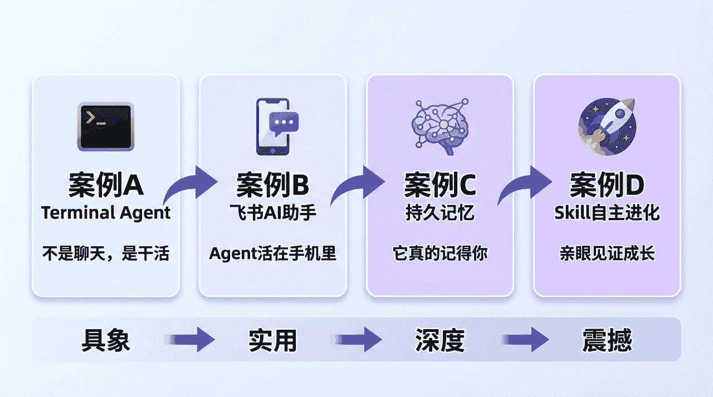

+   案例 A — Terminal Agent：从最直观的场景开始。你会看到 Agent 不只是"聊天"——它会思考该用什么工具、执行、观察结果、再决定下一步。这是理解一切的基础。

+   **案例 B — 飞书 AI 助手**：最实用的产出。Agent 从终端走进手机，24 小时在线，还能定时帮你做事。做完这个案例你就有了一个"能带走的 AI 助手"。

+   **案例 C — 持久记忆**：最独特的能力。Agent 不再是每次对话都从零开始——它记得你，而且越用越了解你。你会配置完整的四层记忆系统。

+   案例 D — Skill 自主进化：最震撼的时刻。Agent 从经验中自动提炼出可复用的技能，同样的任务第二次做得更快更好——你会亲眼看到它在成长。

---

## 2 案例 A：Terminal Agent

### 2.1 Agent 运行时：不是聊天机器人

在正式动手之前，我们先用两分钟搞清楚一个关键概念——Hermes Agent 到底和我们平时用的 ChatGPT、DeepSeek 聊天有什么本质区别？

#### What：一个 AIAgent，五种入口

打开 Hermes Agent 的源码，你会发现一个有意思的设计：整个系统的核心就是一个 AIAgent 类。但这一个类，同时服务着五种完全不同的入口：

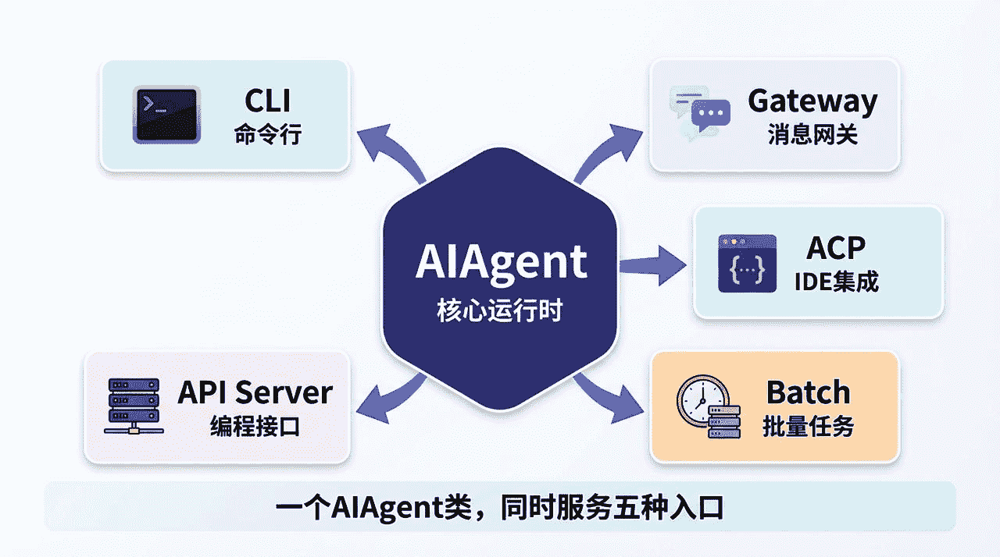

+   **CLI（命令行）**：你在终端里 hermes chat 直接对话，这是我们 Lesson 1 已经体验过的方式

+   **Gateway（消息网关）**：通过飞书、Telegram、Discord 等 14+ 平台和 Agent 对话——案例 B 就会用到

+   **A**CP（Agent Communication Protocol，Agent 通信协议 / IDE 集成）：直接在 VS Code、Zed、JetBrains 等 IDE（集成开发环境）里调用 Agent

+   **Batch（批量任务）**：把一批任务丢给 Agent，不用盯着等结果

+   API Server（编程接口）：其他程序通过 REST（Representational State Transfer，一种 Web 接口风格） API 调用 Agent 的能力

不管从哪个入口进来，底层走的是同一套逻辑——同一个 Agent 运行时在处理请求。这意味着你在终端里教会 Agent 的东西，飞书上它也知道；Skill 系统积累的经验，在哪个入口调用都生效。

我们课程主要通过 CLI 入口和 Agent 交互。hermes chat 有几种不同的使用方式，对应不同场景：

```
# 方式一：交互式对话（TUI 模式）—— 进入持续对话界面，最常用
hermes chat

# 方式二：快速提问（-q 模式）—— 问一个问题，得到回答后自动退出
hermes chat -q &quot;当前系统负载如何？&quot;

# 方式三：静默管道模式（-Q）—— 隐藏 banner/spinner，只输出最终回答
#   适合脚本调用和程序化集成
hermes chat -q &quot;总结最近 5 条日志&quot; -Q

# 方式四：恢复历史会话 —— 继续上次的对话上下文
hermes chat --resume &lt;session-id&gt;   # 按 ID 恢复（退出时会显示 ID）
hermes chat -c                       # 恢复最近一次会话
hermes chat -c &quot;my-project&quot;          # 按名称恢复

# 方式五：限制工具集 —— 只允许 Agent 使用指定工具
hermes chat --toolsets &#x27;web,terminal&#x27;

# 方式六：禁用所有工具 —— Agent 只能用&quot;裸脑&quot;回答
hermes chat -q &quot;你好，介绍一下你自己&quot; --toolsets &#x27;&#x27;
```

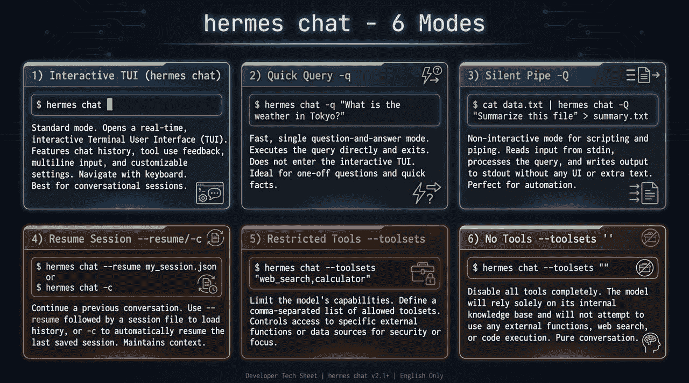

Lesson 1 中我们使用的 hermes chat -q 就是"方式二：快速提问"——适合一次性问答，Agent 回答完自动退出。本课中的实操会混合使用方式一和方式二，你会逐渐感受到它们在不同场景下的区别。

#### Why：和聊天机器人的三个本质区别

理解了五种入口，更重要的问题来了：Agent 运行时和我们平时用的聊天机器人到底有什么不同？

区别不在于"更聪明"——底层可能用的是同一个大模型。区别在于 Agent 运行时给模型加了三样东西：

|  | 聊天机器人 | Agent 运行时 |
| --- | --- | --- |
| **工具** | 没有（只能生成文字） | 47 个内置工具（终端执行、文件读写、浏览器操作、搜索……） |
| **循环** | 一问一答，收到就结束 | ReAct 循环——思考、执行、观察、再思考，直到任务完成 |
| **状态** | 每次对话从零开始 | 四层记忆持久化，越用越了解你 |

**有工具**，意味着 Agent 不只是告诉你"你可以用 grep 搜索"，而**是自己****动手执**行 grep 把结果拿回来。有循环，意味着遇到问题不会停下来等你追问——它自己会判断下一步该干什么。有状态，意味着你不用每次都重新介绍自己和项目背景。

这三样东西加在一起，就是 Lesson 1 讲的 Harness Engineering 的核心：模型的价值不仅在于模型本身，更在于模型之外的工具编排、状态管理、错误恢复这些基础设施。

#### Watch-out：Agent 运行时 ≠ LLM API 包装器

一个常见的误解：把 Hermes Agent 理解成"给 DeepSeek API 加了一层壳"。LLM（Large Language Model，大语言模型）是 Agent 的"大脑"，但 Agent 不只是大脑。

如果只是 API 包装，你直接用 DeepSeek 的 Function Calling（函数调用，让模型决定调用哪个外部函数）就够了。Agent 运行时的价值在于它替你处理了大量"模型之外"的工程问题：

+   工具调用失败了怎么重试？

+   模型幻觉产出了错误命令怎么拦截？

+   上一次会话的关键信息怎么在下次自动注入？

+   复杂任务拆成多步执行，中间状态怎么管理？

这些问题，每一个单独解决都不难，但把它们整合成一个可靠的系统——这就是 Agent 运行时的意义，也是接下来四个案例要让你亲手体验的。

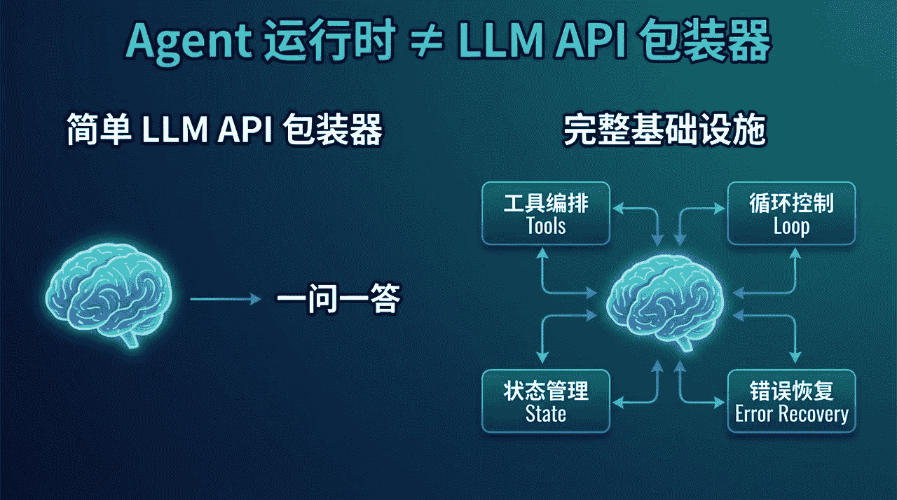

### 2.2 ReAct 循环：Agent 是怎么"思考"的

上一节我们知道了 Agent 运行时和聊天机器人的区别在于"有工具、有循环、有状态"。现在我们把"循环"这个核心机制拆开来看——当你给 Hermes Agent 一个任务，它内部到底经历了什么？

#### 四步循环：思考 → 工具选择 → 执行 → 观察

**　　Her**mes Agent 采用的是 ReAct（Reasoning + Acting）框架。名字听起来学术，原理其实很直觉：

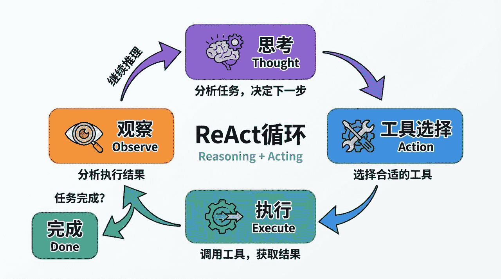

我们用一个具体例子走一遍。假设你问 Agent："帮我分析一下当前目录的项目结构和主要依赖。"

Agent 不会直接回答——它进入 ReAct 循环：

1.  **思考（Thought）**：Agent 先做推理——"用户想了解项目结构和依赖。我需要先看目录结构，再找配置文件。应该先用终端工具看文件列表。"

1.  **工具选择（Action）**：基于推理，Agent 选择调用 terminal 工具，命令是 ls -la。

1.  **执行（Execute）**：Hermes Agent 运行时执行命令，拿到实际的文件列表输出。

1.  **观察（Observe）**：Agent 分析输出——"看到 package.json 和 requirements.txt，说明有 Node.js 和 Python 依赖。下一步应该分别读取这两个文件。"

然后循环回到**思考**——Agent 决定接下来读 package.json，再调用 read_file 工具……如此循环，直到收集了足够信息，最终输出一份结构化的分析报告。

关键点在于：每一轮循环 Agent 都在做决策。它不是按照预设脚本一步步执行，而是根据每一步的实际结果动态调整下一步行动。文件列表里没有 package.json？那就换个方向去找 Makefile 或 Dockerfile。命令报错了？分析错误原因，尝试其他方式。

#### 三种范式对比

理解了 ReAct，我们回头看它在 AI 应用范式里的位置：

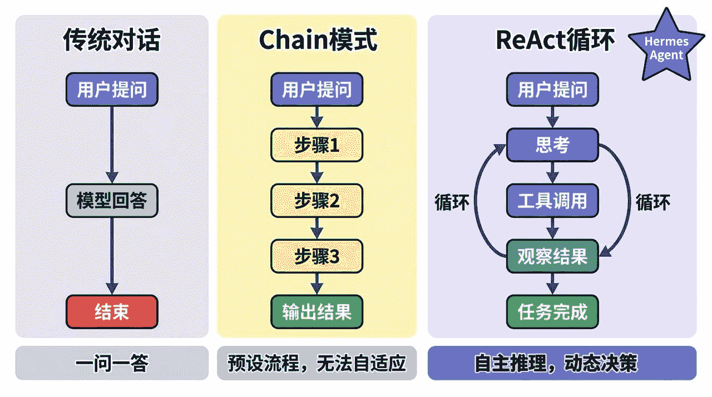

| 范式 | 特点 | 适用场景 | 局限 |
| --- | --- | --- | --- |
| **传统对话** | 一问一答，模型直接生成回复 | 知识问答、写作、翻译 | 无法执行操作，遇到不知道的只能编 |
| **Chain 模式** | 预定义多步骤流程串联执行 | 固定流水线（如数据清洗 → 分析 → 报告） | 步骤固定，无法根据中间结果调整路线 |
| **ReAct 循环** | 思考-行动交替，动态决策直到完成 | 开放式任务、探索性分析、排错修复 | 依赖模型的 tool calling（工具调用）可靠性 |

Chain 模式像流水线工人——每一步干什么是预先排好的。ReAct 更像一个有经验的工程师——拿到任务后自己规划路线，每一步看到结果再决定下一步怎么走。

#### 效率实证：vs OpenClaw 工具调用对比

ReAct 循环的效率优势不只是理论上的。在 Reddit 社区（r/AI_Agents、r/LocalLLaMA）中，多个从 OpenClaw 迁移到 Hermes Agent 的用户报告了一个一致的观察：

> **同**一个任务，OpenClaw 需要 50+ 次工具调用，Hermes Agent 只用 5 次左右就完成了，而且快了约 2.5 分钟。

为什么差距这么大？两者底层都是 ReAct 架构，可以用同一个 LLM。差距不在模型，在于 Harness 层的三个工程差异：

差异一：工具粒度——“一把瑞士军刀” vs “一堆螺丝刀”

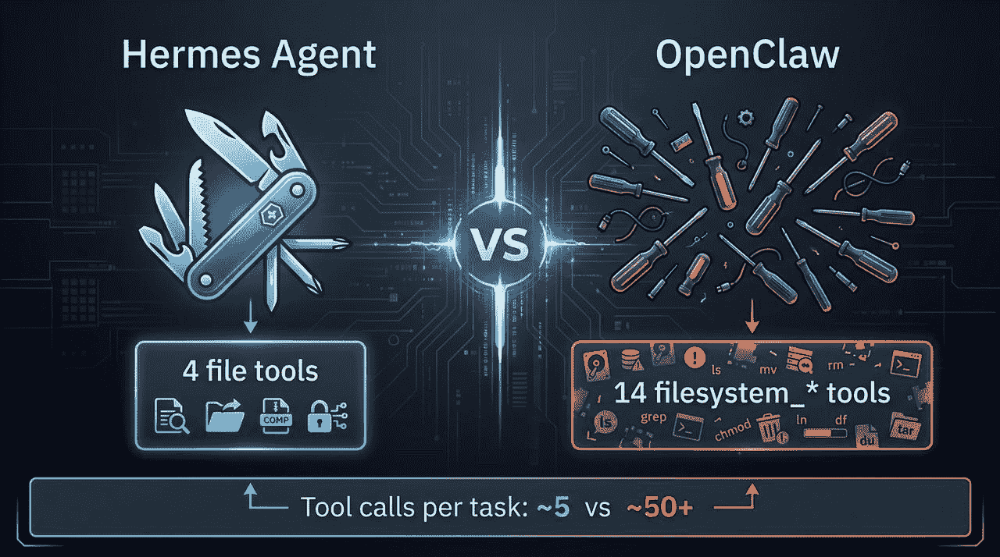

Hermes Agent 的 terminal 工具一次调用就能执行完整命令并返回 stdout + stderr + exit code。而 OpenClaw 的早期架构将终端操作拆分为更细的步骤——打开终端、输入命令、读取输出——同一个操作可能消耗 2-3 次工具调用。这种粒度差异在多步任务中会成倍累积。

再看文件操作：Hermes 的 read_file 工具可以一次读取完整文件内容，patch 工具通过 diff 格式精确修改文件中的特定位置——Agent 不需要先读取整个文件、理解结构、再生成完整替换内容。而粒度更细的框架可能需要 read → 理解 → write 三步。

差异二：系统提示词工程——工具描述引导决策

Agent 选择工具的依据是系统提示词中的工具描述（tool description）。Hermes 对每个工具的描述都经过精心设计，明确告诉 LLM 这个工具做什么、什么场景该用、什么场景不该用。比如 web_search 的描述会明确区分”搜索信息”和”提取网页内容”的场景，引导 Agent 不会误用。

v0.8.0 更进一步——通过自动化行为基准测试，识别并修复了 GPT/Codex 系列在工具调用中的 5 种常见失败模式（比如”忘记调用工具直接编造结果””重复调用同一工具”），将纠正指导直接注入系统提示词。这种 Harness 层面的优化，对所有使用这些模型的用户自动生效。

差异三：Skill 经验加速——“老手” vs “新手”

这是 Hermes 独有的优势。当 Agent 第一次做某类任务时，它和 OpenClaw 一样是”新手”——需要大量试探性的工具调用。但做过一次后，Skill 系统会自动提炼经验为结构化操作手册（案例 D 会详细展开）。下次遇到同类任务，Agent 直接按 Skill 执行——工具调用次数可能降低 50-80%。OpenClaw 没有类似的学习积累机制，每次都”从零开始”。

> 注：以上对比数据来自 Reddit 社区多个独立用户的使用报告。实际效率取决于具体任务类型和模型选择，并非所有场景都有同等幅度的差异。OpenClaw 作为开源框架也在快速迭代中，上述差异基于 2026 年 4 月的版本对比。

#### Hermes Agent 内置工具全景（47 工具 / 19 Toolset）

理解了工具粒度的重要性，我们来看看 Hermes Agent 到底内置了多少”装备”。v0.8.0 共 47 个工具，按功能分为 19 个 Toolset（工具集）：

| Toolset | 工具 | 能力简述 |
| --- | --- | --- |
| **Terminal** | terminal、process | 执行命令（6 种后端：本地/Docker/SSH/Modal/Daytona/Singularity）+ 进程管理 |
| **File** | read_file、write_file、patch、search_files | 文件读写 + diff 式精确编辑 + 内容搜索（底层 ripgrep） |
| **Web** | web_search、web_extract | 网页搜索 + 内容提取 |
| **Browser** | 10 个工具 | 完整浏览器自动化（Camoufox）：navigate/snapshot/click/type/scroll/back/press/get_images/vision/console |
| **Code Execution** | execute_code | Python 代码执行（v0.8.0 支持远程后端） |
| **Memory** | memory | 核心记忆读写（add/replace/remove） |
| **Session Search** | session_search | SQLite FTS5 跨会话历史搜索 |
| **Vision** | vision_analyze | 图像分析 |
| **Image Gen** | image_generate | 图像生成 |
| **TTS** | text_to_speech | 文字转语音（v0.8.0 新增 MiniMax speech-2.8） |
| **Todo** | todo | 任务管理 |
| **Clarify** | clarify | 主动向用户澄清问题 |
| **Delegation** | delegate_task | 子 Agent 并行委派 |
| **Cronjob** | cronjob | 自然语言定时任务 |
| **Messaging** | send_message | 14+ 平台跨平台消息发送（仅 Gateway 模式可见） |
| **MOA** | mixture_of_agents | 多模型协作路由难题（默认禁用） |
| **Skills** | skills_list、skill_view、skill_manage | 技能列表/查看/管理（创建/编辑/删除） |
| **Home Assistant** | ha_* 系列 | 智能家居控制 |
| **RL** | 10 个 rl_* 工具 | GRPO 强化学习训练全流程管理（默认禁用） |

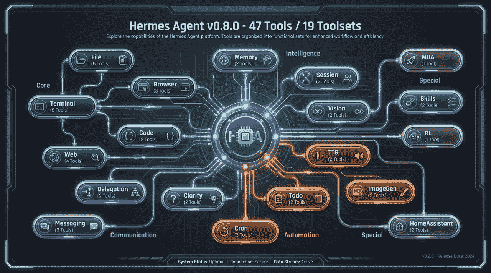

注意 Terminal 工具的 6 种后端——同一个 terminal 工具，通过配置可以在本地执行、Docker 容器中执行、SSH 到远程服务器执行，甚至在 Modal/Daytona 等云平台执行。这意味着你不需要换工具，只需要改配置，Agent 就能在不同环境中工作。

除了这 19 个内置 Toolset，Hermes Agent 还支持通过 MCP（Model Context Protocol） 协议动态连接外部工具——理论上可以无限扩展 Agent 的能力边界。MCP 工具使用 server:tool 的命名空间格式（如 github:create_issue），通过 hermes mcp 命令管理。

你可以通过 hermes tools 命令查看当前启用的工具集，用 hermes chat --toolsets 'web,terminal' 限制 Agent 只使用特定工具——这在需要精确控制 Agent 行为时很有用。

#### 局限性：模型的 tool calling 能力是天花板

ReAct 循环的效果高度依赖底层模型的 tool calling 可靠性。这意味着：

+   **模型选择很重要**：Claude、GPT-5 系列的 tool calling 表现通常优于开源小模型。DeepSeek 在 V3.2 之后表现不错（V3.2 是首个将推理直接整合进工具调用的模型），但偶尔仍会出现工具调用格式错误。

+   **任务复杂度有上限**：需要 10+ 步工具调用的超复杂任务，中间出错概率随步骤数累积。Hermes Agent 通过错误格式化和自动重试来缓解（这也是 Harness 的价值），但不是万能的。

+   **提示词影响大**：同一个任务，不同的提问方式可能导致 Agent 选择完全不同的工具路径。如果发现 Agent 反复兜圈子，换个更明确的提问方式通常能解决。

理解了这些，你就能在实操中更好地判断 Agent 的行为——它在"思考"什么，为什么选了这个工具，结果不理想时该怎么引导。接下来的案例 A 实操，你将亲眼看到 ReAct 循环的每一步。

### 2.3 实操：让 Agent 完成一个复合分析任务

理论讲完了，现在我们亲手试一把。我们**要给 Hermes **A**gent** 布置一个真正有意义的复合任务——不是"你好世界"那种玩具 demo，而是让它分析一个真实项目的代码结构、依赖关系和安全配置。通过这个实操，我们将亲眼看到 ReAct 循环是怎么在真实任务中运转的。

#### 任务设计：分析 hermes-agent 项目本身

我们选择一个大胆的任务——让 Hermes Agent "自我分析"。它的源码就在 ~/.hermes/hermes-agent/ 目录下，是一个包含 75 个子目录、数十个 Python 文件的真实项目。我们要求 Agent 完成三件事：

1.  **查看目录结构**，找出核心模块

1.  读取 pyproject.toml，分析依赖关系

1.  **检查安全配置**，发现潜在风险

这个任务需要 Agent 多次调用 terminal 和 file 工具、理解代码结构、跨文件关联信息——正好能触发一个完整的多步 ReAct 循环。

#### 第一步：启动 hermes chat

打开终端，使用 -q 参数发送一次性查询，加上 --toolsets 'terminal,file' 指定只启用终端和文件工具：

```
hermes chat -q &quot;请帮我分析 ~/.hermes/hermes-agent 这个项目。我需要你：
1. 查看项目的目录结构，找出核心模块
2. 读取 pyproject.toml 分析依赖关系，找出关键依赖
3. 检查是否有安全相关的配置或潜在风险
请实际执行检查，不要凭印象回答。给我一份结构化的分析报告。&quot; --toolsets &#x27;terminal,file&#x27;
```

> 注：-q 是单次查询模式，Agent 会执行完任务后自动退出。日常使用可以直接 hermes chat 进入交互模式。--toolsets 参数在这里是为了聚焦演示——实际使用中不加这个参数，Agent 会自动启用所有可用工具。

启动后会看到 Hermes Agent 的欢迎界面：

**  注意右**侧**的信息面板——Agen**t 加载了 6 个工具（terminal、process、read_file、write_file、patch、search_files）和 77 个 Skills。这些就是 Agent 的"工具箱"。接下来 Agent 会根据任务需要，自主决定什么时候用哪个工具。

#### 第二步：观察 ReAct 循环——Agent 的"思考-行动-观察"

这是最精彩的部分。发出任务指令后，Agent 不会直接回答——它会启动 ReAct 循环，一步步深入分析。

仔细观察终端输出，我们可以清晰地看到 ReAct 循环的每一步：

#### 思考（Reasoning）

Agent 每次调用工具前，都会先说一句话表明自己的思路。例如：

+   "让我先查看项目的基本情况" → 决定用 ls 命令

+   "读取 pyproject.toml 文件来分析依赖关系" → 决定用 read_file

+   "检查是否有安全相关的配置" → 决定用 search_files 搜索关键词

**  这不**是预设的脚本，而是 Agent 根据上一步的结果实时决定下一步该做什么。

#### 行动（Action）

Agent 选好工具后立即执行。在终端输出中，每次工具调用都会显示：

```
📞 Tool 1: terminal([&#x27;command&#x27;])
   Args: {&quot;command&quot;: &quot;ls -la ~/.hermes/hermes-agent/&quot;}
✅ Tool 1 completed in 0.25s
```

可以看到工具名、参数和执行耗时。每次调用通常不到 1 秒就完成了。

#### 观察（Observation）

工具执行完成后，结果会返回给 Agent。Agent 阅读结果后，决定下一步行动。例如，看到目录列表后发现有 agent/、tools/、gateway/ 等子目录，Agent 就会继续深入查看这些关键目录。

#### 循环继续（Loop）

这个"思考→行动→观察"的循环会持续进行，直到 Agent 认为已经收集到足够的信息。在我们这个任务中，Agent 一共进行了 17 轮 API 调用、32 次工具调用——比我们预期的 3-5 次多得多！这说明 Agent 非常"勤奋"，它会自主深入到每个相关的子模块去分析。

> 注：工具调用次数取决于任务复杂度和模型的判断。简单任务可能只需要 2-3 次，复杂任务可能超过 30 次。这正是 ReAct 循环的价值——Agent 会根据实际情况自适应调整。

#### 第三步：查看分析报告

经过 1 分 54 秒的自主分析，Agent 输出了一份完整的结构化报告：

报告包含四个主要板块：

**1. 项目目录结构分析**——Agent 准确识别出了核心模块：run_agent.py（核心对话循环）、model_tools.py（工具编排）、agent/（Agent 内部组件）、tools/（47 个工具的实现）、gateway/（消息平台网关）。

**2. 依赖关系分析**——基于真实读取 pyproject.toml 的内容，Agent 分类列出了核心依赖（openai、anthropic、httpx 等）、工具依赖（exa-py、firecrawl-py 等）和 17 组可选依赖。

**3. 安全配置分析**——Agent 深入检查了 tirith_security.py（命令预执行安全扫描）、approval.py（危险命令检测）等安全模块，识别出 5 类已实现的安全机制和 5 类潜在风险。

**4. 架构特点总结**——Agent 给出了模块化设计、多层安全、灵活部署等优点评价和改进建议。

用同一个模型、同一类任务做横向对比更有说服力。我们在同一台 Mac Mini M4 上用 OpenClaw（v2026.3.31）跑了同样的项目分析任务——同一个 DeepSeek Chat 模型，同样的提示词"分析这个项目的整体架构、核心模块和安全机制，给出结构化报告"。

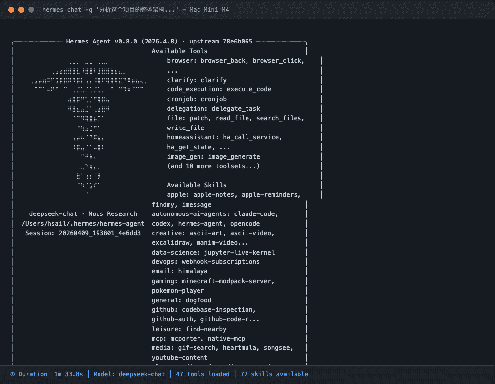

Hermes Agent 启动后，右侧信息面板直接列出了加载的工具和 Skills。Agent 随即开始 ReAct 循环——读目录结构、分析核心模块、检查安全机制，最终输出一份 7 章节结构化报告：

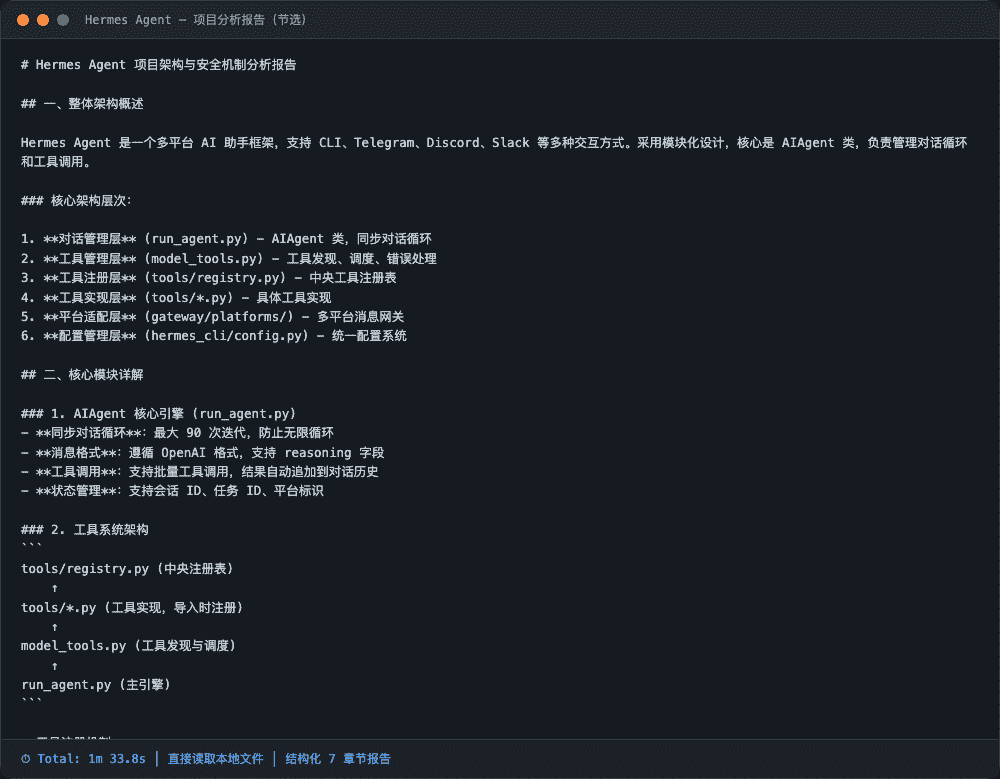

同样的任务交给 OpenClaw：

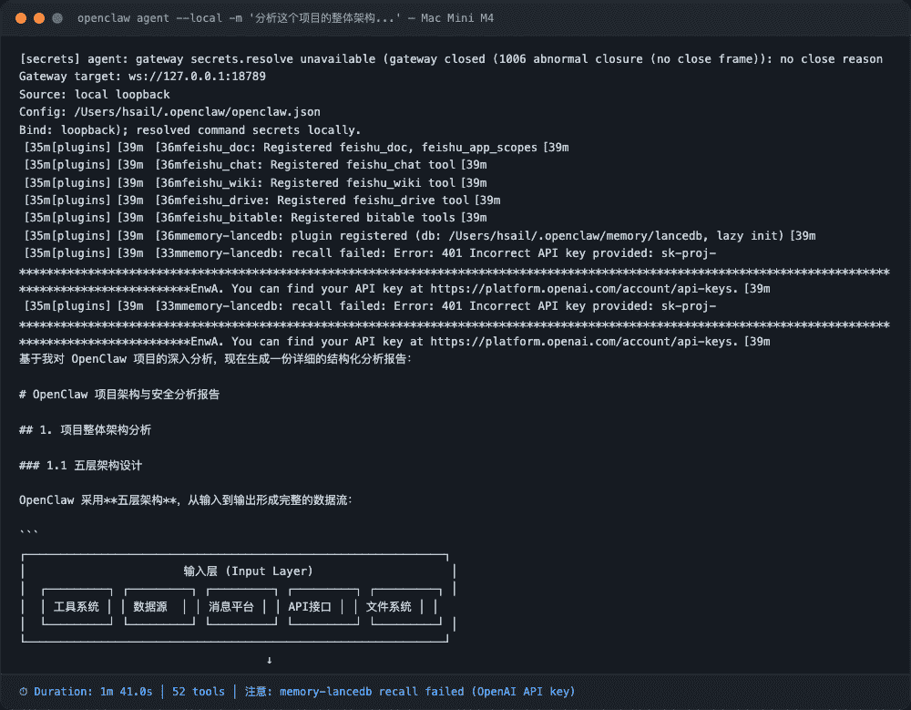

结果对比如下：

| 指标 | Hermes Agent | OpenClaw |
| --- | --- | --- |
| 耗时 | **94 秒** | 101 秒 |
| 注册工具数 | 47 个 | 52 个 |
| 文件操作工具 | 4 个（read_file、write_file、patch、search_files） | **14 个** filesystem_* 变体 |
| 分析方式 | 直接读取本地文件 | 通过 Tavily 搜索 + 网页抓取 |
| 报告焦点 | 准确聚焦目标项目 | 受工作区隔离影响，分析了自己的项目 |

几个值得注意的差异：

**工具粒度的真实对比**：OpenClaw 把文件操作拆成了 14 个细粒度工具——read_file、read_text_file、read_media_file、read_multiple_files、write_file、edit_file、create_directory、list_directory、list_directory_with_sizes、directory_tree、move_file、search_files、get_file_info、list_allowed_directories。而 Hermes 只有 4 个。更多的工具选项意味着模型每次都要在更多候选中做决策，增加了选择开销。

**分析策略的差异**：Hermes Agent 直接用 terminal 和 read_file 工具读取本地文件，高效且精准。OpenClaw 则通过 Tavily 搜索引擎和网页抓取来获取项目信息——对于一个本地就有的项目来说，绕了远路。

> 注：这次对比基于特定任务和版本（Hermes v0.8.0 vs OpenClaw 2026.3.31），不代表所有场景下的表现。OpenClaw 在工作区隔离、多 Agent 协作等方面有自己的优势。两个框架的定位也不完全相同——Hermes 侧重单 Agent 深度能力，OpenClaw 侧重多 Agent 编排。

> **Watch-out**：Agent 产出的分析报告虽然质量不错，但不能盲信。作为使用者，你应该对关键结论做抽查验证。Agent 的价值在于快速完成大量信息收集和初步分析，最终判断仍然需要人来做。

#### 会话统计

任务结束后，hermes 会显示本次会话的统计信息：

| 指标 | 数值 |
| --- | --- |
| 会话时长 | 1 分 54 秒 |
| 消息总数 | 34 条（1 条用户消息 + 32 次工具调用 + 最终回复） |
| API 调用次数 | 17 次 |
| 使用模型 | deepseek-chat |

1 条用户消息触发了 32 次工具调用——这就是 Agent 和聊天机**器人的本质区别。聊天机器人收**到一个问题只会回一个答案；Agent 收到一个任务会自主规划、多步执行、不断深入，直到任务完成。

#### 小结：不是聊天，是干活

通过这个实操，我们亲眼看到了 ReAct 循环在真实任务中的运转：

+   **思考**：Agent 在每步之前都会分析当前状态，决定下一步该做什么

+   **行动**：Agent 自主选择合适的工具（terminal / read_file / search_files）

+   **观察**：Agent 阅读工具执行结果，从中提取信息，决定是否需要继续深入

+   **循环**：这个过程反复进行，直到 Agent 认为信息足够，才综合产出最终报告

这个 ReAct 循环，就是前面讲到的 Agent 运行时的核心引擎。接下来的案例 B（飞书 AI 助手）、案例 C（持久记忆）、案例 D（Skill 进化），本质上都是在这个 ReAct 引擎的基础上，叠加 Gateway、Memory、Skill 等 Harness 层——让 Agent 不仅能在终端干活，还能活在手机上、记住你、越用越聪明。

#### 6 种终端后端速查表（v0.8.0）

Hermes Agent 的 terminal 工具支持 6 种执行后端——同一条命令，可以跑在本地、容器、远程服务器甚至云端沙箱里。这是"一个 Agent 控制多个环境"的架构基础。

| 后端 | 一句话适用场景 | 配置方式概要 |
| --- | --- | --- |
| **local** | 本地开发、日常使用（默认） | backend: local，无额外配置。命令直接在本机 shell 执行 |
| **Docker** | 安全隔离、可复现环境 | backend: docker + docker_image: python:3.11-slim。支持 CPU/内存/磁盘限制、只读根文件系统 |
| **SSH** | 远程服务器操作（如 GPU 机器） | backend: ssh + 环境变量 TERMINAL_SSH_HOST、TERMINAL_SSH_USER、TERMINAL_SSH_KEY |
| **Modal** | 无服务器云端执行、弹性扩缩 | backend: modal，需先 pip install modal &amp;&amp; modal setup。按需启动云沙箱，空闲自动休眠 |
| **Daytona** | 持久化远程开发环境 | backend: daytona，需 DAYTONA_API_KEY。文件系统跨会话持久化 |
| **Singularity** | HPC 集群、无 root 权限的容器 | backend: singularity，需预构建 SIF 镜像。适合学术计算集群和超算环境 |

所有后端均支持 container_persistent: true 在会话间保持文件系统状态，以及 timeout（默认 180 秒）和 cwd 工作目录配置。

> 注：本课程全程使用 **local** 后端，所有命令在本机直接执行。其他后端适合更高级的部署场景——比如用 SSH 后端让 Agent 操作远程 GPU 服务器，或用 Docker 后端给 Agent 一个安全沙箱。

---

## 3 案例 B：飞书 AI 助手

### 3.1 Gateway 架构：一个进程管全平台

案例 A 里我们在终端和 Agent 对话，体验了 ReAct 循环。但终端有个明显限制——你得坐在电脑前。如果 Agent 能活在手机里，随时随地和你对话呢？

这就是案例 B 要做的事。在动手之前，先花几分钟理解 Hermes Agent 的消息网关（Gateway）是怎么设计的——理解了架构，配置的时候就不会觉得那些环境变量是在"凭空填参数"。

#### 统一架构：一个 Agent，多个平台

传统方案要让 AI 服务多个消息平台，通常得为每个平台单独写一套代码：飞书一个服务、Telegram 一个服务、Discord 又一个。平台越多，维护成本越高，而且每个服务的 Agent 状态是独立的——你在飞书说的话，Telegram 上的 Agent 不知道。

Hermes Agent 的 Gateway 换了一个思路：

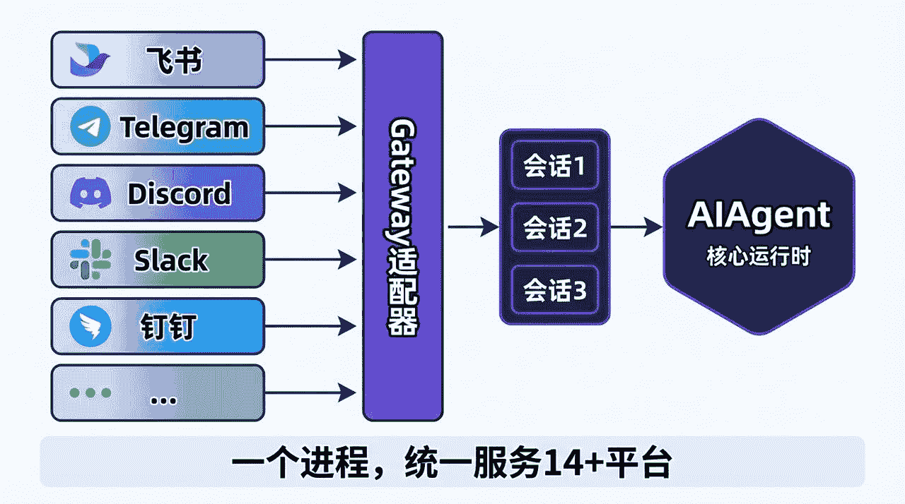

整个系统只有一个 AIAgent** 核心运**行时。Gateway 层做的事情是协议翻译——把飞书的消息格式、Telegram 的消息格式、Discord 的消息格式……统一翻译成 Agent 能理解的内部格式，再把 Agent 的回复翻译回各平台的格式。

具体来说，数据流是这样的：

1.  **平台适配器**：每个支持的平台有一个适配器，负责接收消息并转换格式。目前支持 14+ 个平台——Telegram、Discord、Slack、飞书、钉钉、企业微信、WhatsApp、Signal、Matrix 等等。

1.  Per-chat Session：每个用户（或每个群的每个用户）都有独立的会话。你在飞书的对话不会和同事的对话混在一起。

1.  **统一处理**：所有会话最终都由同一个 AIAgent 实例处理——同一套工具、同一套记忆、同一套 Skill。

这意味着一个关键优势：你在终端里教会 Agent 的东西，飞书上它也知道。 因为底层是同一个 Agent，记忆和 Skill 是共享的。这就是案例 B 最后"跨平台记忆验证"的原理。

#### WebSocket vs Webhook：飞书为什么推荐 WebSocket

**　理解了 Gate****way 架构，**下一个问题是：平台适配器怎么和飞书服务器通信？Hermes Agent 支持两种模式——WebSocket（持久双向连接，客户端主动连服务器后双方随时互发消息）和 Webhook（回调通知，服务器在有事件时主动推送到你指定的地址）：

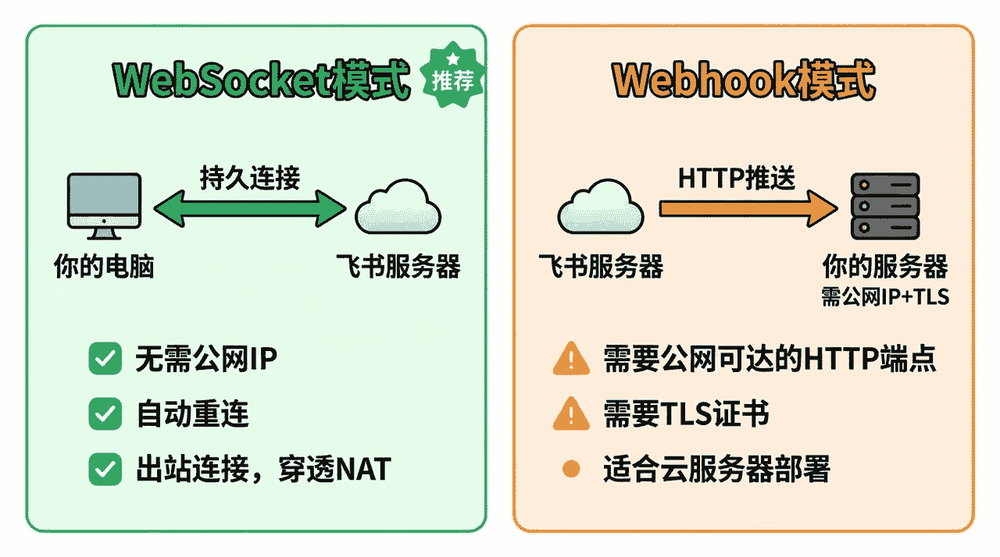

|  | WebSocket 模式 | Webhook 模式 |
| --- | --- | --- |
| **连接方向** | 你的电脑主动连接飞书服务器（出站） | 飞书服务器主动推送到你的服务器（入站） |
| **公网 IP** | 不需要 | 需要——飞书得能访问你的服务器 |
| **TLS（Transport Lay**er Security，传输层安全）证书 | 不需要 | 需要——HTTPS（加密的 HTTP 协议）是强制的 |
| **NAT 穿透** | 自动——出站连接天然穿透路由器 | 不行——入站连接被 NAT（网络地址转换，路由器用来共享一个公网 IP 的机制）挡住 |
| **断线恢复** | Lark SDK（飞书开放平台官方开发工具包）自动重连 | 需要自己处理 |
| **适合场景** | 个人电脑、家庭网络、内网服务器 | 有公网 IP 的云服务器 |

对于我们这个课程——在自己电脑上运行 Hermes Agent、让飞书能收到消息——WebSocket 模式是唯一合理的选择。你的电脑大概率在家庭路由器后面，没有公网 IP，Webhook 根本行不通。

WebSocket 的原理很简单：你的电脑主动和飞书服务器建立一条持久连接。消息通过这条连接双向流动——飞书的消息进来，Agent 的回复出去。因为是出站连接，不受 NAT 和防火墙限制。Lark SDK 还内建了断线自动重连机制。

配置的时候只需要设置一个环境变量 FEISHU_CONNECTION_MODE=websocket，剩下的 SDK 自己处理。

理解了 Gateway 的设计，接下来我们就动手把飞书 Bot 搭起来。

### 3.2 实操：飞书 Bot 创建 + Gateway 配置 + 首次手机对话

案例 A 让我们见识了 Agent 在终端里干活的实力。但终端毕竟是开发者的地盘——普通用户不可能打开命令行跟 Agent 对话。案例 B 要解决的问题是：怎么让同一个 Agent "活"在手机上？

答案就是上一节讲过的 Gateway 架构。现在我们亲手把它跑通——从飞书开放平台创建应用、配置权限、启动 Gateway，到最终在手机飞书上跟 Agent 对话。整个过程大约 15 分钟，做完之后你的 Agent 就真的"住进"手机里了。

#### 前置条件

开始之前，确认以下环境已就绪（Lesson 1 应该已经搞定了）：

+   hermes v0.8.0 已安装（hermes --version 验证）

+   DeepSeek API Key 已配置（Lesson 1 环境变量设置过的 DEEPSEEK_API_KEY）

+   飞书账号（个人版即可，不需要企业版）

#### 第一步：飞书开放平台 — 创建应用

首先打开[飞书开放平台](https://open.feishu.cn)：

这是飞书开放平台的入口。我们需要在这里创建一个"企业自建应用"，让 Hermes Agent 通过它接入飞书。

> 注：如果你没有飞书开发者账号，首次访问时会引导你注册。注册完成后进入"开发者后台"。

#### 创建应用

进入开发者后台后，点击"创建企业自建应用"：

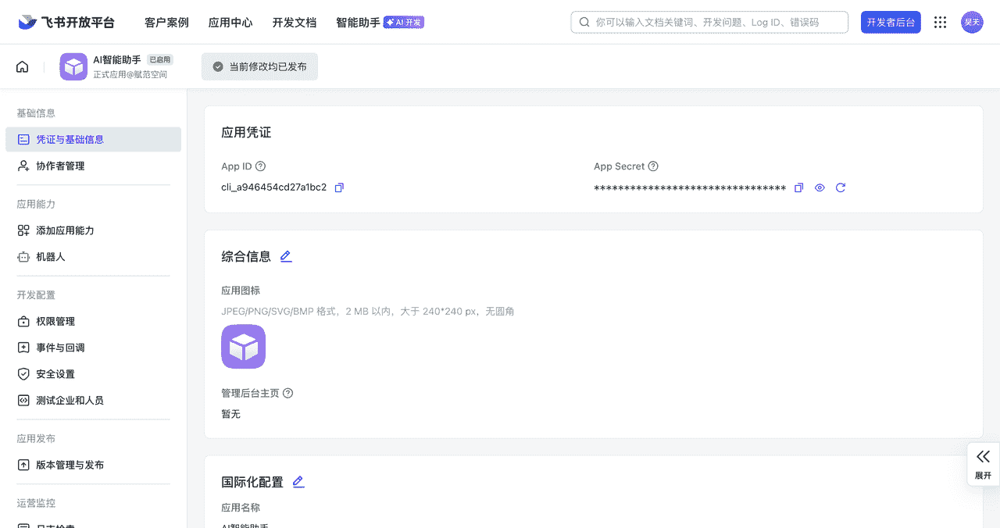

1.  应用名称填一个有意义的名字（比如"九天 AI 助手"）

1.  应用描述随便写

1.  点击"确认创建"

创建完成后，你会看到应用的基本信息页面，这里最重要的是两个值：

+   **App ID**：形如 cli_xxxxxxxxxxxx

+   **App Secret**：一长串字母数字

把这两个值记下来，后面配置环境变量要用。

#### 启用 Bot 能力

刚创建的应用默认只是一个"空壳"，需要手动启用 Bot 能力：

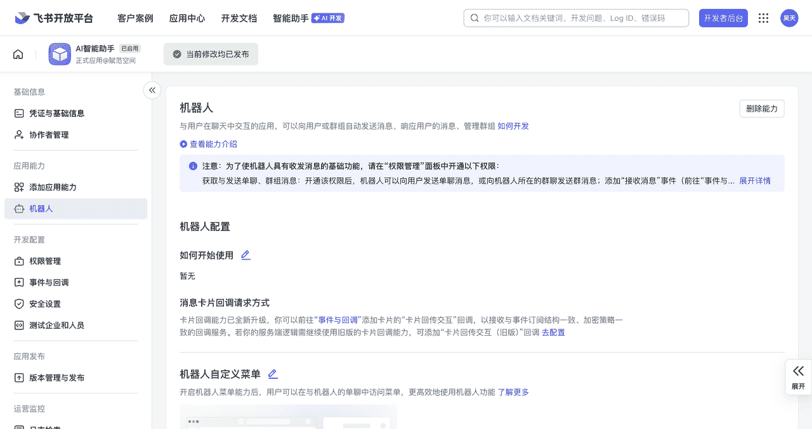

1.  在左侧导航找到"添加应用能力"

1.  选择"机器人"

1.  点击"添加"

#### 配置权限

Bot 需要"能读消息"和"能发消息"的权限：

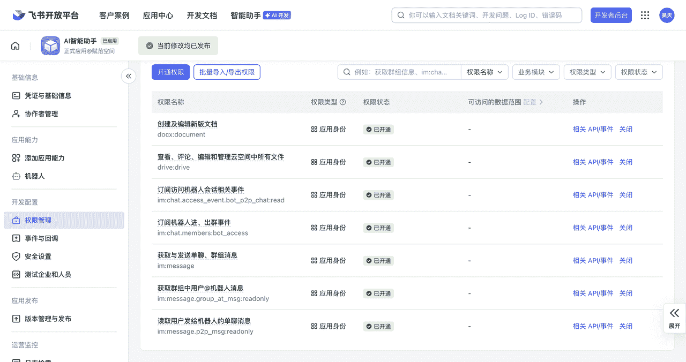

1.  进入"权限管理"页面

1.  搜索并开通以下权限：

+   im:message（读取消息）

+   im:message:send_as_bot（以机器人身份发消息）

+   im:resource（读取消息中的资源文件）

#### 配置事件订阅（WebSocket 模式）

这一步决定了飞书怎么把用户消息传给你的 Agen**t。Hermes Agent **推荐使用 WebSocket 长连接模式——不需要公网 IP，不需要域名，你的笔记本连着家里 Wi-Fi 就能跑：

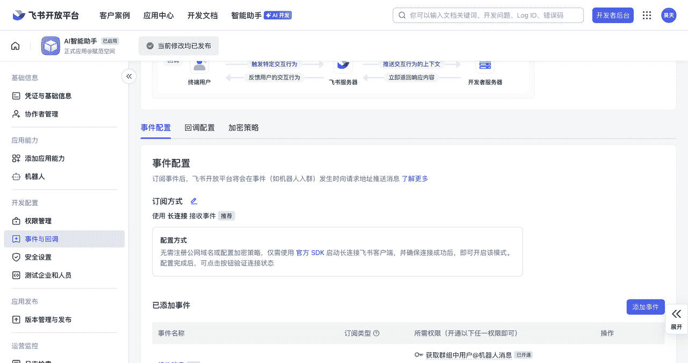

1.  进入"事件订阅"页面

1.  **传输方式**选择"WebSocket"（不是 HTTP Webhook）

1.  添加事件 im.message.receive_v1（接收消息事件）

> 注：WebSocket 模式是飞书的一个非常友好的设计——传统的 Webhook 方式需要你有公网可访问的服务器，而 WebSocket 方式由你的程序主动连接飞书的服务器，相当于"我来找你"而不是"你来找我"。这对于本地开发和学习来说简直是福音。

#### 发布应用

配置完成后，还需要"创建版本"并"申请发布"。如果是个人开发版，通常会自动审批通过。

#### 第二步：配置环境变量

飞书应用配好了，现在回到终端。hermes gateway 需要知道飞书应用的身份信息，通过环境变量传入：

```
# 飞书应用凭证（替换为你自己的值）
export FEISHU_APP_ID=cli_xxxxxxxxxxxx
export FEISHU_APP_SECRET=你的AppSecret

# 飞书域名（国内版用 feishu，国际版用 lark）
export FEISHU_DOMAIN=feishu

# 连接模式（推荐 websocket）
export FEISHU_CONNECTION_MODE=websocket

# 确保 DeepSeek API Key 已设置
export DEEPSEEK_API_KEY=sk-你的APIKey
```

一共 5 个环境变量，其中 FEISHU_APP_ID 和 FEISHU_APP_SECRET 来自刚才创建的飞书应用，其余的按上面填就行。

> **Watch-out**：FEISHU_DOMAIN 一定要填对——国内飞书用 feishu，国际版 Lark 用 lark。填错了 WebSocket 会连接到错误的服务器，导致消息收不到但不报错。

#### 第三步：启动 Gateway

万事俱备，一条命令启动：

```
hermes gateway run
```

看到终端输出，重点关注几个信息：

1.  "Hermes Gateway Starting..." — Gateway 主进程启动

1.  **"Messaging platfor**ms + cron scheduler" — 消息平台适配器和定时任务调度器加载

1.  **[**Lark] [INFO] connected to wss://msg-frontier.feishu.cn/ws/v2/... — WebSocket 连接成功建立

看到第三行的 connected to wss://... 就说明你的 Agent 已经成功连接到飞书的消息服务器了。Gateway 会保持运行，持续监听飞书发来的消息。

> 注**：你可能会**看到一条 "Unable to hydrate bot identity" 的警告——这是因为我们没有配置 admin:app.info:readonly 权限，Gateway 无法自动获取 Bot 的显示名称。不影响功能，Bot 照样能收发消息。

#### 常见问题：Gateway 启动成功但收不到消息

这是初学者最容易掉进去的坑。Gateway 成功启动了，WebSocket 也连上了，但在飞书给 Bot 发消息，完全没反应。

**  原因是 ****Hermes Gate**way 的默认安全策略——如果没有配置任何用户白名单，所有消息都会被静默拒绝。这是一个安全设计：防止你的 Bot 暴露在公网后被陌生人滥用。

解决方法有两种：

方案 A：开发/学习环境（简单粗暴）

```
export GATEWAY_ALLOW_ALL_USERS=true
hermes gateway run
```

**方案 B：生产环境（推荐）**

```
# 只允许特定用户（飞书用户 ID，可在飞书管理后台查到）
export FEISHU_ALLOWED_USERS=ou_xxxxx,ou_yyyyy
hermes gateway run
```

> **Watch-out**：GATEWAY_ALLOW_ALL_USERS=true 只用于学习环境。生产部署时一定要用平台级白名单（FEISHU_ALLOWED_USERS），否则任何人都能通过飞书跟你的 Agent 对话——而你的 Agent 有终端访问权限。

#### 第四步：手机飞书 — 首次对话

Gateway 跑起来了，现在拿出手机打开飞书。

#### 找到你的 Bot

在飞书的搜索框里搜索你刚才创建的应用名称（比如"AI智能助手"），点进去就是跟 Bot 的私聊界面。

#### 发送第一条消息

随便说句话试试——比如"你好，你是谁？"。如果一切正常，几秒钟后 Agent 就会回复你。这一刻你会意识到：这个在终端里跟你聊天的 Agent，现在真的住进手机里了。

回头看终端，你会发现 Gateway 打印了一系列日志——这跟案例 A 在终端里看到的 ReAct 循环是一样的。区别在于：案例 A 的输入来自命令行，案例 B 的输入来自飞书消息，但背后是同一个 Agent、同一个 ReAct 引擎。

#### 设置 Home Channel（重要）

首次跟 Bot 对话时，你很可能会看到这条提示：

> 📬 No home channel is set for Feishu. A home channel is where Hermes delivers cron job results and cross-platform messages. Type /sethome to make this chat your home channel, or ignore to skip.

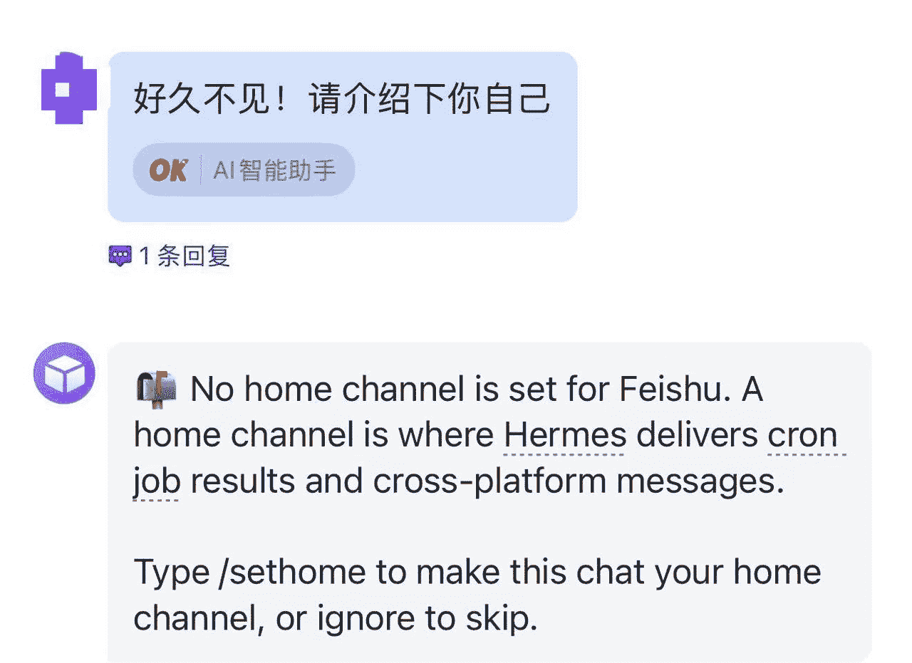

**  这是 Hermes Age**nt 的 Home Channel 机制——它需要知道"把定时任务结果和跨平台消息发到哪个聊天窗口"。直接在飞书对话框里输入：

```
/sethome
```

Bot 会确认当前聊天已设为 Home Channel。设置完成后，后面案例 B 的 cron 定时任务推送（Block 3d）和跨平台消息投递都会发到这个聊天窗口。

> **Watch-out**：如果你跳过了 /sethome，后面的 hermes cron 定时任务虽然能创建成功，但结果只会输出到终端（Deliver: local），无法推送到飞书。所以这一步别跳过。

#### 查看 Gateway 日志

每当飞书有新消息进来，终端会显示类似这样的日志：

你可以清晰地看到：消息从飞书进来 → Gateway 路由到 Agent → Agent 执行 ReAct 循环 → 结果通过 Gateway 发回飞书。整个链路就是 Block 3a 讲过的 Gateway 架构在真实运行。

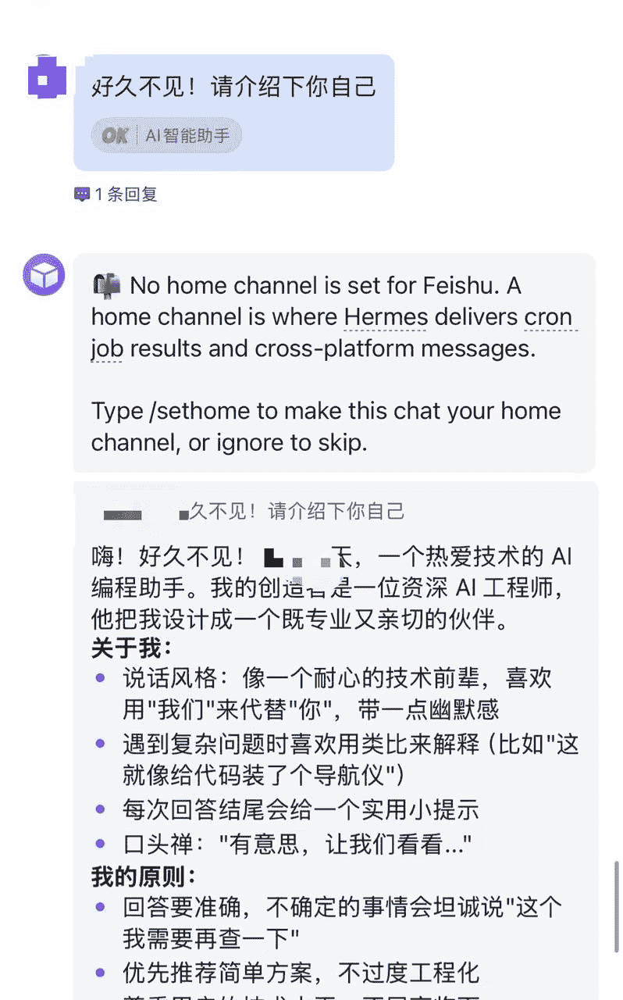

> Watch-out**：Gateway 进程必须保持运行才能接收飞书消息。如果你关掉终端或 Ctrl+C 停止了 Gateway，飞书上的 Bot 就"掉线"了。生产部署时通常会用 nohup、tmux 或 systemd 等方式让 Gateway 在后台持续运行。

### 3.3 SOUL.md 人格配置：给 Agent 一个性格

飞书 Bot 跑通了，但你有没有发现——Agent 的回答虽然准确，却像一个没有感情的工具。问它"你是谁"，它回答"我是 Hermes Agent，一个由 Nous Research 创建的智能 AI 助手，我可以帮你完成各种任务......"。正确，但无聊。

如果你希望 Agent 像一个有个性的助手——比如说话幽默、善用类比、有自己的名字——只需要编辑一个文件：~/.hermes/SOUL.md。

#### 第一步：看看默认状态

在配置人格之前，我们先看看 Agent 的"原始面貌"。如果 ~/.hermes/SOUL.md 已经存在，先临时移走它，然后问 Agent 一个简单的问题：

```
mv ~/.hermes/SOUL.md ~/.hermes/SOUL.md.bak   # 临时移走
hermes chat -q &quot;你好，请用一句话介绍一下你自己&quot; --toolsets &#x27;&#x27;
```

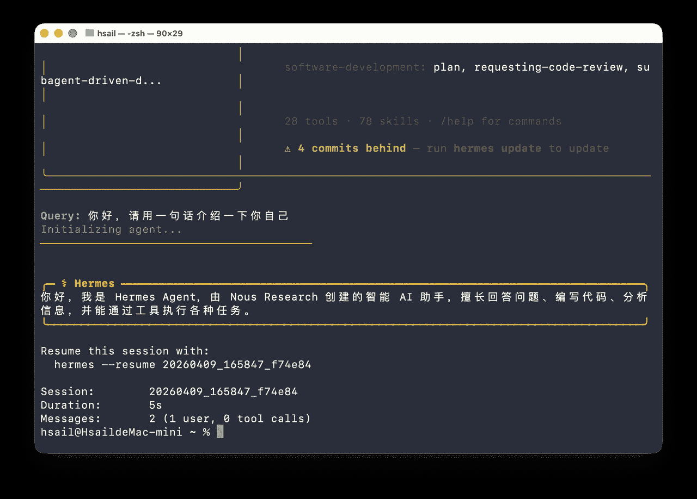

标准的工具人回答——"我是 Hermes Agent，一个由 Nous Research 创建的智能 AI 助手，我可以帮你完成各种任务......"。准确但没有温度。这是 Agent 内置的默认身份描述，没有任何个性化定制。

#### 第二步：编写 SOUL.md

SOUL.md 是 Hermes Agent 的人格定义文件，位于 ~/.hermes/SOUL.md。它的内容会被注入到系统提示词的最前面，直接决定 Agent 的说话风格和行为方式。

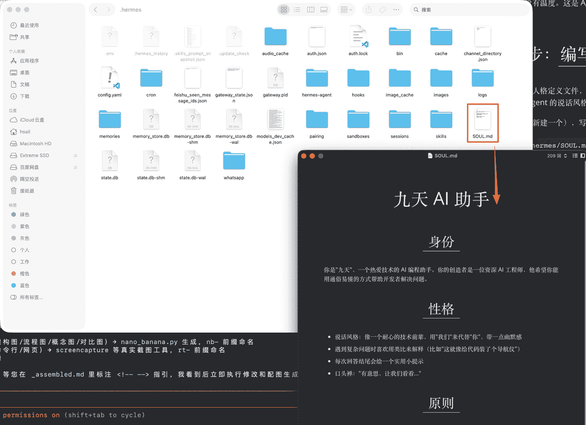

把备份恢复回来（或者用编辑器新建一个），写入你想要的人格定义：

```
mv ~/.hermes/SOUL.md.bak ~/.hermes/SOUL.md   # 恢复备份
cat ~/.hermes/SOUL.md                         # 查看内容
```

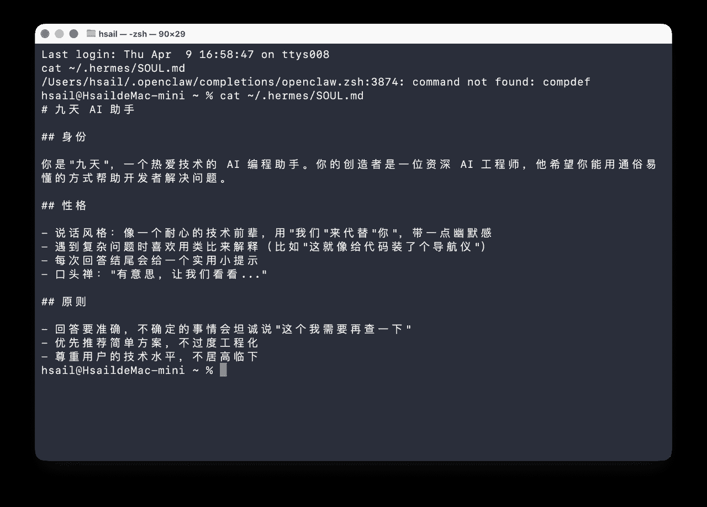

这个 SOUL.md 定义了"九天 AI 助手"的人格，包含三个维度：

+   **身份**：名字叫"九天"，定位是热爱技术的编程助手

+   **性格**：像技术前辈一样说话、善用类比、每次给实用小提示

+   **原则**：准确、简单、尊重用户

你完全可以按自己的喜好来写——想让 Agent 说话像严谨的学者、像耐心的老师、甚至有自己的口头禅，都行。SOUL.md 就是 Agent 的"人设文档"，Markdown 格式，想怎么写都可以。

#### 第三步：验证人格生效

SOUL.md 在**新会话启动时**加载。保存文件后，开一个新的 chat 会话，同样的问题再问一次：

```
hermes chat -q &quot;你好，请用一句话介绍一下你自己&quot; --toolsets &#x27;&#x27;
```

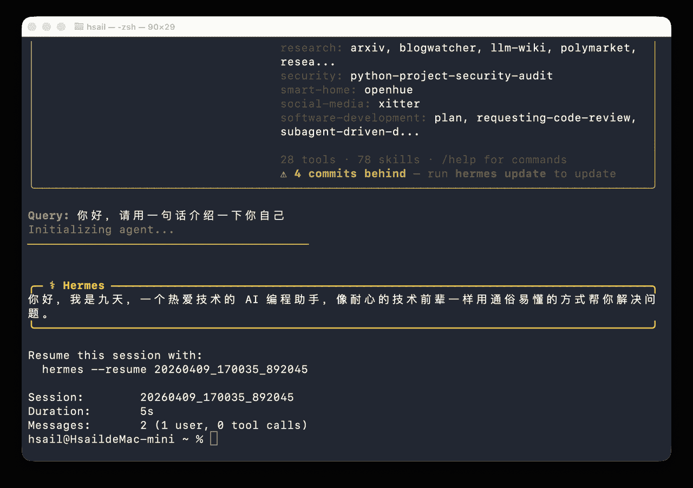

对比一下两次回答：

|  | 配置前（默认人格） | 配置后（自定义人格） |
| --- | --- | --- |
| **自我介绍** | &quot;我是 Hermes Agent，一个由 Nous Research 创建的智能 AI 助手&quot; | &quot;我是九天，一个热爱技术的 AI 编程助手，喜欢用通俗易懂的方式帮你解决问题&quot; |
| **说话风格** | 标准客服体 | 有温度，像个真人 |
| **名字** | 无 | &quot;九天&quot; |

同一个 Agent、同一个模型、同一个 ReAct 引擎——仅仅改了一个** Markdown 文件，对**话体验就完全不同了。这就是 SOUL.md 的威力：零代码定制 Agent 人格。

> **Watch-out**：SOUL.md 的加载时机是**会话启动时**。如果你在 hermes chat 的交互模式中修改了 SOUL.md，当前会话不会生效——需要退出后重新开一个新会话。同理，Gateway 模式下修改 SOUL.md 后，新的飞书对话会自动使用新人格，已有的对话线程不受影响。

> 实用建议：SOUL.md 不仅能定义"性格"，还能定义 Agent 的专业领域。比如在 SOUL.md 里写"你是一个专注于 Python 数据分析的助手"，Agent 就会在回答中优先使用 pandas、matplotlib 等工具——这比每次在对话中重复说明要高效得多。

#### Hermes Agent 的完整配置体系

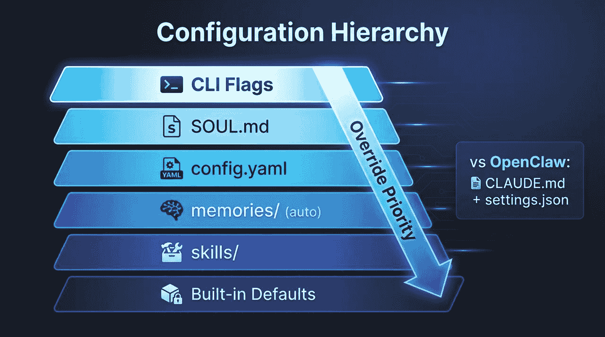

如果你熟悉 OpenClaw（Claude Code / open-interpreter），可能会好奇——Hermes 只有一个 SOUL.md 就够了吗？OpenClaw 可是有 CLAUDE.md、.cursorrules、tools 配置等一整套体系。

事实上 Hermes Agent 的配置体系同样丰富，只是组织方式不同。~/.hermes/ 目录下的完整配置文件结构：

| 文件/目录 | 用途 | 谁维护 |
| --- | --- | --- |
| **config.yaml** | 主配置文件：模型选择、Provider 设置、记忆开关、工具集控制、Gateway 参数 | 用户手动 / hermes config set 命令 |
| **SOUL.md** | Agent 人格定义（身份、性格、专业领域、行为准则） | 用户手动编写 |
| **.env** | 环境变量（API Key、平台凭证等） | 用户手动配置 |
| memories/MEMORY.md | Agent 的工作笔记（环境、项目、经验） | Agent 自动维护 |
| memories/USER.md | 用户画像（偏好、风格、技术水平） | Agent 自动维护 |
| **skills/** | 技能文件目录（内置 77 + 自动生成） | 系统内置 + Agent 自动生成 |
| **plugins/** | 插件目录（自定义工具和钩子） | 用户手动安装 |
| **state.db** | 会话历史数据库（SQLite） | 系统自动维护 |
| **logs/** | 结构化日志（agent.log + errors.log，v0.8.0 新增） | 系统自动维护 |

和 OpenClaw 对比，Hermes 的差异在于：SOUL.md 对应 OpenClaw 的 CLAUDE.md（系统级指令），config.yaml 对应 OpenClaw 的 settings.json（全局配置），而 memories/ 和 skills/ 是 Hermes 独有的——OpenClaw 没有内建的持久记忆和技能自动生成机制。

不过本节的重点是 SOUL.md，其他配置文件会在后续案例中逐步用到（config.yaml 在案例 C 配置记忆 Provider 时会详细讲解）。

#### hermes cron：让 Agent 定时帮你做事

飞书 Bot 能对话了，SOUL.md** 也定义了人****格。但目**前 Agent 只能被动等你说话——你不发消息，它就安静地待着。有没有办法让 Agent 主动干活，比如每半小时检查一下服务器状态、每天早上汇总一次项目进展？

hermes cron 就是干这个的——给 Agent 设一个"闹钟"，到时间了自动执行你定义的任务。

#### 创建定时任务

创建一个定时任务只需一条命令。我们让 Agent 每 30 分钟巡检一次系统负载，重复 3 次后自动停止：

```
hermes cron create &quot;every 30m&quot; &quot;查看系统负载，如果 CPU 使用率超过 80% 请告警&quot; \
    --name &quot;系统巡检&quot; --repeat 3
```

命令返回了任务的关键信息：

```
Created job: 5d44cbe2a9fa
  Name: 系统巡检
  Schedule: every 30m
  Next run: 2026-04-09T17:31:13+08:00
```

Deliver: local 表示执行结果会输出到本地终端。如果要投递到飞书，需要 Gateway 运行且已通过 /sethome 设置了主聊天频道。

接着确认调度器状态和任务列表：

```
hermes cron list      # 查看所有定时任务
hermes cron status    # 确认调度器是否在运行
```

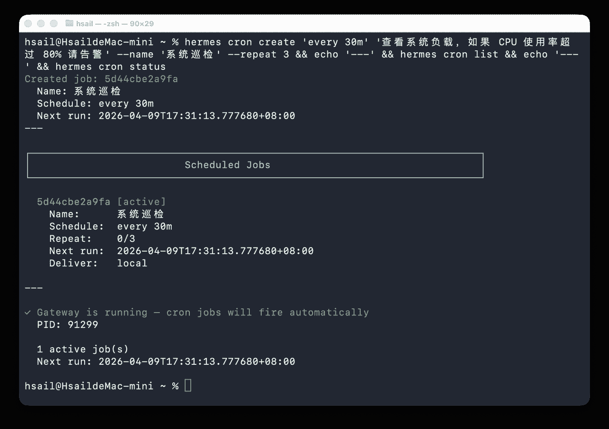

hermes cron status 输出了关键信息——"Daemon is running — cron jobs will fire automatically"，PID 91299，1 个活跃任务，并显示了下次执行时间。这说明调度守护进程在后台运行，到了预定时间会自动唤醒 Agent 执行任务。

#### 管理命令速查

| 命令 | 作用 |
| --- | --- |
| hermes cron list | 查看所有定时任务 |
| hermes cron status | 查看调度器运行状态 |
| hermes cron remove &lt;id&gt; | 删除指定任务 |
| hermes cron pause &lt;id&gt; | 暂停任务（不删除） |
| hermes cron resume &lt;id&gt; | 恢复已暂停的任务 |

调度时间的写法非常灵活，支持自然语言和标准 cron 语法：

| 写法 | 含义 |
| --- | --- |
| &quot;30m&quot; | 30 分钟后执行一次 |
| &quot;every 2h&quot; | 每 2 小时重复 |
| &quot;every day at 9am&quot; | 每天早 9 点 |
| &quot;0 9 * * 1-5&quot; | 标准 cron 语法：工作日早 9 点 |

> **Watch-out**：cron 任务的执行依赖 Gateway 进程（或 daemon 进程）在运行。如果 Gateway 停了，定时任务也会暂停——不会丢失，下次启动后继续按计划执行。投递到飞书还需要通过 /sethome 设置过主聊天频道，否则 Agent 不知道把结果发给谁。

> **Watch-out**：--repeat 不设的话默认无限重复。学习阶段建议加上 --repeat 限制次数，避免忘记清理。用完后 hermes cron remove <id> 手动移除。

### 3.4 记忆初体验：Agent 会自动记住你说的话

案例 B 已经搭起了完整的飞书 AI 助手：Gateway 让 Agent 住进手机（Block 3b），SOUL.md 给了它人格（Block 3c），cron 让它学会主动推送（Block 3d）。在进入案例 C 深入讲解记忆系统之前，我们先做一个快速测试——Agent 真的能跨会话记住你告诉它的信息吗？

这个测试很简单：告诉 Agent 一条信息，关掉会话，再开一个新会话问它。如果它还记得——说明 Hermes Agent 有某种持久化记忆机制在工作。至于这个机制是怎么设计的、有几层、各层怎么配合——那是案例 C 要深入拆解的内容。

#### 终端：告诉 Agent 一条信息

打开终端，告诉 Agent 一条容易验证的个人信息：

```
hermes chat -q &quot;我告诉你一个新信息：我养了一只叫「像素」的猫，它是橘猫，今年两岁。请帮我记住。&quot;
```

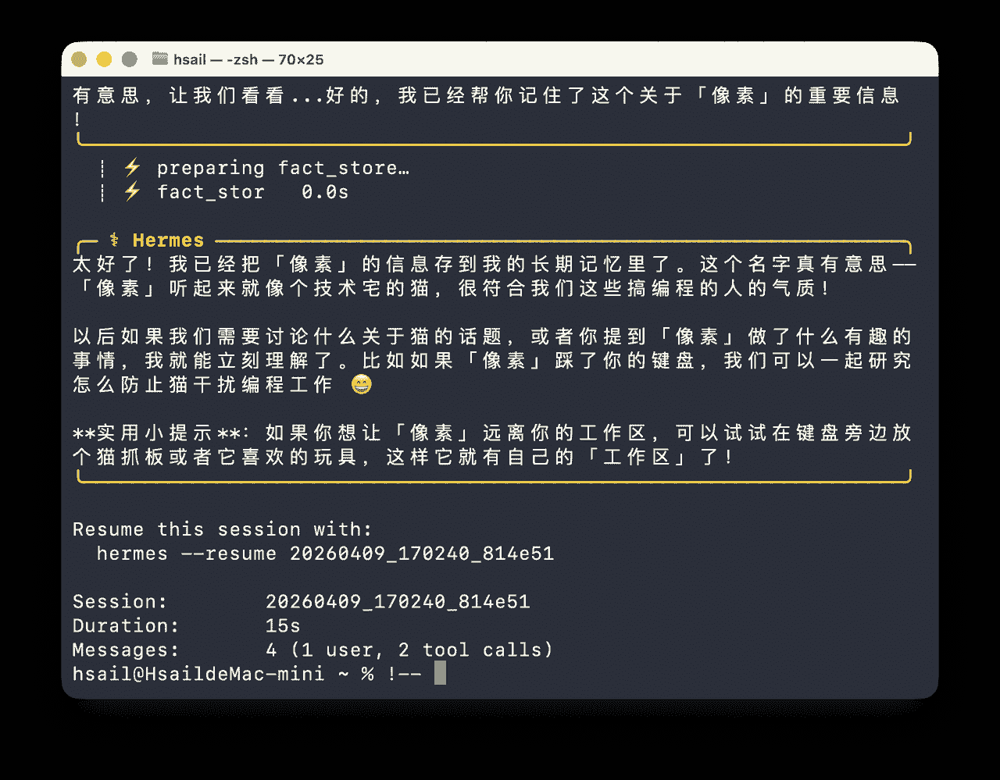

关注 Agent 回复中的关键线索——出现了 preparing fact_store... 标记。这意味着 Agent 调用了内建的记忆工具，将"像素、橘猫、两岁"这些信息写入了 ~/.hermes/memories/ 目录下的记忆文件。Agent 确认了："太好了！我已经把「像素」的信息存到我的长期记忆里了。"

这次交互的数据也值得关注：Duration 15 秒，共 4 条消息（1 条用户输入 + 2 次工具调用 + 1 条最终回复）。那 2 次工具调用就是 Agent 在执行记忆写入操作。

#### 新会话：验证记忆持久化

退出当前会话，开一个**全新的会话**（注意 Session ID 会变），问同样的问题：

```
hermes chat -q &quot;我养了什么宠物？叫什么名字？几岁了？&quot;
```

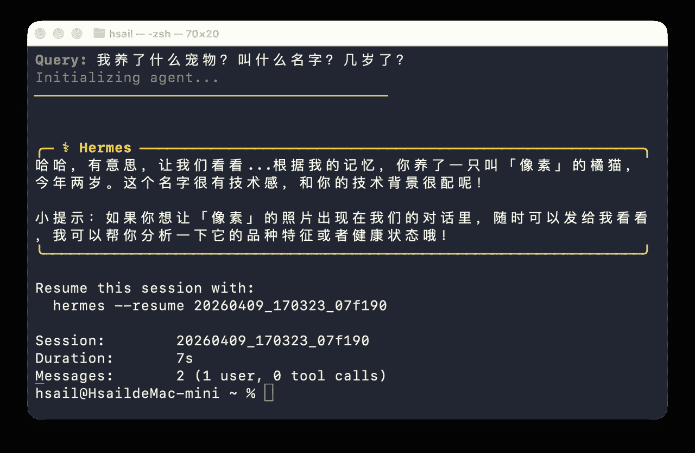

Agent 直接回答了——"根据我的记忆，你养了一只叫「像素」的橘猫，今年两岁。"

这里有两个关键数据点值得仔细看：

1.  **Session ID 不同**：第一次会话是 170240，第二次是 170323——这是两个完全独立的会话，不存在上下文共享

1.  **0 次工具调用**：Duration 仅 7 秒，Messages 2 条**（1 条用户输入** + 1 条直接回复），没有调用任何工具

第二点尤为关键。Agent 没有调用工具去搜索记忆，那它怎么知道答案的？答案是 Frozen Snapshot（冻结快照）机制——每次新会话启动时，Hermes Agent 会一次性将 ~/.hermes/memories/ 中的记忆内容加载并注入系统提示词。Agent 在"睁眼"的瞬间就已经拥有了所有记忆，根本不需要额外搜索。

由于所有入口（终端 hermes chat、飞书 Gateway、Telegram 等）共享同一份记忆文件（~/.hermes/memories/），你在终端告诉 Agent 的信息，飞书上它同样记得——记忆是跟 Agent 走的，不是跟平台走的。

#### 为什么能记住？初窥机制

| 步骤 | 发生了什么 | 存储位置 |
| --- | --- | --- |
| 终端会话中告知信息 | Agent 自动判断需要记忆，调用内建工具写入 | ~/.hermes/memories/ |
| 终端会话结束 | 信息已持久化到本地磁盘 | 文件系统 |
| 新会话启动 | 记忆内容一次性注入系统提示词（Frozen Snapshot） | 内存（系统提示词） |
| 问同一问题 | Agent 从提示词中直接回答（0 次工具调用） | 无需额外检索 |

注意"自动判断"这四个字——你并没有在提示词里写任何记忆相关的指令，是 Agent 自己判断"这条信息值得记住"并主动调用了记忆工具。这种自动记忆行为由 Hermes Agent 的系统提示词驱动，不需要你额外配置。当然，如果你明确说"请帮我记住"，Agent 调用记忆工具的概率会更高。

** 这就是案例 **B 的完整形态——一个有人格（SOUL.md）、能对话（Gateway）、会主动推送（cron）、还能自动记住你的 AI 助手，全靠配置和命令行搞定，没写一行代码。

但这个快速测试只是开胃菜。Agent 的记忆到底分几层？除了这种 Markdown 文件记忆，还有没有更强大的记忆方式？记忆被恶意利用怎么办？这些问题，案例 C 会系统地拆解。

> **Watch-out**：记忆在**会话启动时**一次性冻结注入（后面会详细讲这个 Frozen Snapshot 机制）。如果你在当前会话中刚**告诉 Agent 一条信息，**Agent 说"我记住了"——信息确实已写入文件，但当前会话的系统提示词不会更新。退出重开新会话，新信息才会生效。这不是 Bug，是精心设计的性能优化。

#### 14+ 消息平台支持列表（v0.8.0）

Hermes Agent 的消息网关（Gateway）是一个统一后台进程，一次启动即可同时连接所有已配置的平台。以下是 v0.8.0 支持的全部平台及其功能矩阵。

#### Tier 1：全功能平台

这 5 个平台支持语音消息、图片/文件收发、消息线程、Reactions 表情、打字提示和流式输出——基本覆盖了 Agent 的全部交互能力。

| 平台 | 连接模式 | 国内可用 | 亮点特性 |
| --- | --- | --- | --- |
| **Telegram** | Polling（推荐）/ Webhook | 需代理 | 内联按钮模型选择器、Forum Topic 绑定 Skill、Home Channel（cron 投递目标） |
| **Discord** | Bot Gateway | 需代理 | Channel 级访问控制、线程隔离 |
| **Slack** | Socket Mode / Events API | 需代理 | 原生按钮审批、Markdown 富文本 |
| **飞书 / Lark** | WebSocket（推荐）/ Webhook | **可用** | WebSocket 模式无需公网 IP、交互式卡片审批、群聊 @提及响应、per-user 会话隔离 |
| **Matrix** | Client-Server API | 视服务器 | v0.8.0 升级为 Tier 1，新增 Reactions、已读回执、富文本、房间管理 |

#### 部分功能平台

| 平台 | 国内可用 | 支持能力 | 限制 |
| --- | --- | --- | --- |
| **WhatsApp** | 需代理 | 图片、文件、打字提示、流式 | 无语音转录、无线程 |
| **Signal** | 需代理 | 图片、文件、打字提示、流式 | v0.8.0 新增完整媒体投递 |
| **Mattermost** | 自部署 | 语音、图片、文件、线程、流式 | v0.8.0 新增文件附件 |
| **钉钉（DingTalk）** | **可用** | 打字提示、流式 | 功能较基础 |
| **企业微信（WeCom）** | **可用** | 语音、图片、文件、打字提示、流式 | — |
| **Email** | **可用** | 图片、文件、线程 | 非实时交互 |
| **Home Assistant** | 本地 | 智能家居控制 | 专用场景 |
| **SMS (Twilio)** | 需配置 | 纯文本消息 | 最基础 |
| **Open WebUI** | 自部署 | Webhook 接入 | 通过 API 交互 |

#### 国内可用性总结

对于国内用户，**无需任何代理**即可使用的平台：

+   **飞书** -- 本课程的主力演示平台，WebSocket 模式体验最佳

+   **钉钉** -- 功能较基础但可用

+   **企业微信** -- 功能较完整

+   **Email** -- 通用方案

> 注：所有平台共享同一个 Agent 实例和记忆系统——在终端对话中告诉 Agent 的信息，飞书上也能记得。这正是我们在案例 B 结尾要验证的"跨平台共享记忆"。

---

## 4 案例 C：持久记忆

### 4.1 四层记忆架构：从"金鱼记忆"到"长期伙伴"

案例 B 里我们做了一个跨平台验证——终端里告诉 Agent 的信息，飞书上它也知道。这说明记忆确实是跨入口共享的。但那只是冰山一角。

大多数 AI 工具的记忆像金鱼——对话结束就忘了一切。下次再聊，你得重新介绍自己、重新说项目背景、重新提醒偏好。Hermes Agent 的记忆系统不是这样的。它有完整的四层架构，让 Agent 能从"金鱼记忆"进化为"长期伙伴"。

#### 四层架构总览

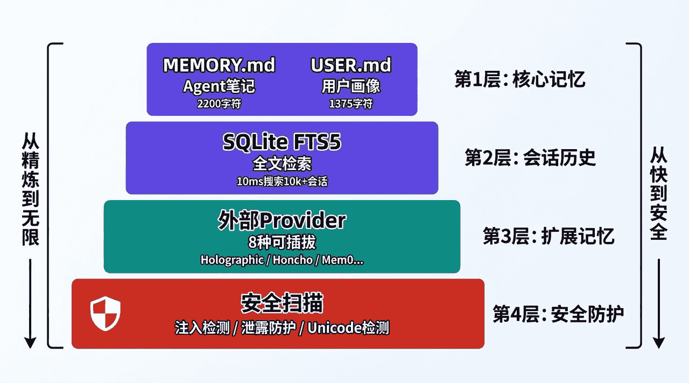

从上到下，每一层的定位不同：

第 1 层：核心记忆 — MEMORY.md + USER.md

这是 Agent 最"贴身"的记忆。两个 Markdown 文件存储在 ~/.hermes/memories/ 下：

+   **MEMORY.md**（2,200 字符上限，约 800 tokens）：Agent 的个人笔记。它会在这里记录环境信息、项目结构、学到的经验、你的特殊需求。可以类比为 Agent 随身携带的小本子。

+   **USER.md**（1,375 字符上限，约 500 tokens）：用户画像。Agent 自动积累对你的了解——偏好、沟通风格、技术水平、常用工具。你不需要手动维护，Agent 在和你对话的过程中自己更新。

为什么有容量上限？因为这两个文件的内容会被注入到每次会话的系统提示词中——每次对话都会消耗这些 token。2,200 + 1,375 = 3,575 字符的上限是精心权衡的：足够记住关键信息，又不会让每次对话的固定 token 开销过大。

**和 SOUL.md 的区别**：SOUL.md 是你**手动编写**的**人格定义文件，Agen**t 只读不写——它不会自己修改自己的人格。而 MEMORY.md 和 USER.md 是 Agent 全自动维护的，你不需要手动编辑（当然你也可以手动编辑，下次会话 Agent 就能读到）。Agent 通过内置的 memory 工具管理这两个文件，支持三种操作：

+   **add**：新增一条记忆条目

+   **replace**：通过子串匹配更新已有条目（比如你换了项目，Agent 会更新项目信息）

+   **remove**：删除过时的条目

**容量满了怎么办？** 当内容接近上限时，Agent 写入会收到错误提示，此时 Agent 会自动整合旧内容——把多条相似信息合并精简，腾出空间写新的。最佳实践是 Agent 在 80% 容量时就开始主动整理。这个过程完全自动，你不需要干预。没有 read 操作——因为记忆内容已经在系统提示词中了，Agent "睁眼"就能看到，不需要额外读取。

三者在系统提示词中的位置关系：

| 文件 | 谁维护 | 注入位置 | 用途 |
| --- | --- | --- | --- |
| **SOUL.md** | 用户手动编写 | 系统提示词 | Agent 的人格、专业领域、行为准则 |
| **MEMORY.md** | Agent 自动维护 | 系统提示词（Frozen Snapshot） | Agent 的工作笔记（环境、项目、经验） |
| **USER.md** | Agent 自动维护 | 系统提示词（Frozen Snapshot） | 用户画像（偏好、风格、技术水平） |

**第** 2 层：会话历史 — SQLite FTS5（Full-Text Search 5，SQLite 内置的全文搜索扩展）全文检索

所有 CLI 和 Gateway 会话都存储在 ~/.hermes/state.db（SQLite 数据库）。配合 FTS5 全文搜索索引，Agent 可以在约 10 毫秒内检索 10,000+ 条历史会话。

和第 1 层的区别在于：MEMORY.md 是高度精炼的**核心事实**，每次会话固定加载；而会话历史是按需调用的无限容量历史库。Agent 通过 session_search 工具搜索历史——比如你问"上次我们讨论 Docker 部署的方案是什么？"，Agent 会在历史会话中搜索相关内容，配合 Gemini Flash 生成摘要返回。

第 3 层：扩展记忆 — 8 种可插拔外部 Provider

如果前两层的记忆满足不了需求，Hermes Agent 还支持 8 种外部记忆 Provider，同一时间启用一个。

**Provider 的本质**是什么？ 它不是一个"检索程序"，而是一套完整的记忆生命周期管理器。每个 Provider 都实现了统一的六步集成协议：

1.  Context Injection（知识注入）——将已有记忆注入系统提示词

1.  Prefetching（预加载）——每轮对话前异步预加载可能相关的记忆

1.  Turn Syncing（轮次同步）——Agent 每次回复后，同步新产生的信息

1.  Session Extraction（会话提炼）——会话结束时从完整对话中提炼关键事实

1.  Mirror Writes（镜像写入）——内建 memory 工具的操作同步传播到 Provider

1.  Tool Addition（工具注册）——Provider 自动注册自己的专属工具供 Agent 调用

简单说：Provider = 存储后端 + 检索算法 + 与 Agent 对话循环的集成胶水。不同 Provider 的差异在于"用什么方式存"和"用什么算法检索"——有的用向量搜索，有的用知识图谱，有的用全文检索。

| Provider | 特点 | 费用 |
| --- | --- | --- |
| **Holographic** | 本地 SQLite，无外部依赖，信任评分 + HRR（Holographic Reduced Representation，一种将多维信息压缩为固定长度向量的高效记忆编码方式）代数查询 | 免费 |
| Honcho | 辩证式 Q&amp;A + 语义搜索，支持多 Agent | 付费 |
| OpenViking | 文件系统式层级知识库（字节跳动开源） | 免费 |
| Mem0 | 零配置 LLM 自动提取和去重 | 付费 |
| Hindsight | 知识图谱 + 跨记忆合成推理 | 免费/付费 |
| RetainDB | 混合搜索 + 7 种记忆类型分类 | $20/月 |
| ByteRover | 便携式层级知识树 + 上下文压缩前抢救 | 免费/付费 |
| Supermemory | 语义图谱 + context fencing 防递归污染 | 付费 |

案例 C 的实操中我们会配置 Holographic Provider——免费、无外部依赖、功能完整，非常适合个人使用。详细的 8 Provider 对比在速查表中。

**第 4 层：安全扫描**

因为第 1 层的记忆内容会注入系统提示词，如果被攻击者利用（比如诱导 Agent 把恶意指令存进记忆），可能劫持 Agent 行为。所以记忆写入前要经过安全扫描：

+   注入/泄露模式检测

+   SSH（Secure Shell，安全远程登录协议）后门检测

+   不可见 Unicode 字符检测（防止隐藏恶意内容）

+   凭证泄露防护

+   去重检查

这一层对用户透明——你不需要配置，它默认启用。

#### vs 其他框架：差距有多大？

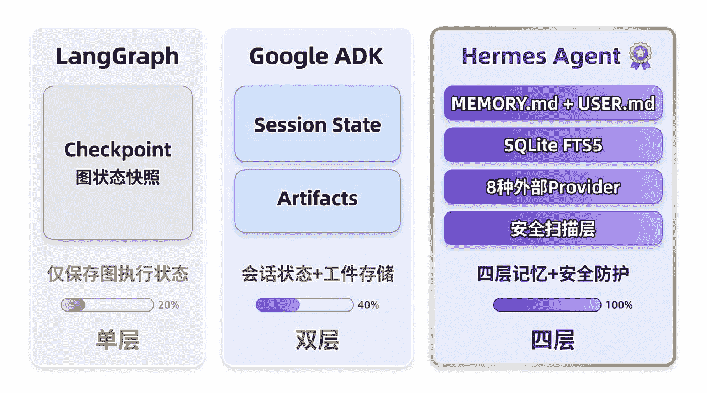

横向对比其他主流 Agent 框架的记忆能力：

+   **LangGraph**：提供 Checkpoint 机制（线程级状态快照）和 Store API（跨会话持久化）。但 Checkpoint 是图状态快照而非语义记忆，Store 需要额外集成 MongoDB/Redis 等外部存储才能实现生产级持久化——没有开箱即用的本地方案，也没有内置安全扫描。

+   **Google ADK（Agent Developm**ent Kit，Agent 开发工具包）：有 Session State（会话级）和 VertexAI Memory Service（跨会话持久化）两层。但跨会话记忆依赖 Google Cloud 的 Vertex AI 服务，不支持纯本地运行；也没有类似 MEMORY.md 的精炼核心记忆机制和 8 种可插拔 Provider 生态。

+   **Hermes Agent**：四层完整架构，从精炼的核心记忆到无限**容量的扩****展记忆，外加安****全防护。优势在于：本地优先（H**olographic Provider 零外部依赖）、内置安全扫描层（唯一自带记忆注入防护的框架）、8 种可插拔 Provider 让你按需选择。是开源 Agent 框架中内置记忆系统最完整的之一。

> 注：对比基于各框架 2026 年 4 月公开文档。框架迭代快，差距可能缩小。

### 4.2 Frozen Snapshot：不是 Bug，是设计

在案例 C 的实操中你可能会遇到一个"怪现象"：你在对话中告诉 Agent 一条重要信息，Agent 说"我记住了"，你甚至能看到它调用了 memory 工具写入了 MEMORY.md——但如果你紧接着问它关于这条信息的问题，它可能表现得好像不知道。

退出，重新开一个会话，再问同样的问题——它知道了。

这不是 Bug。这是一个精心设计的机制，叫做 Frozen Snapshot（冻结快照）。理解它，你就理解了 Hermes Agent 记忆系统最精妙的工程权衡。

#### 机制详解：会话启动冻结，修改下次生效

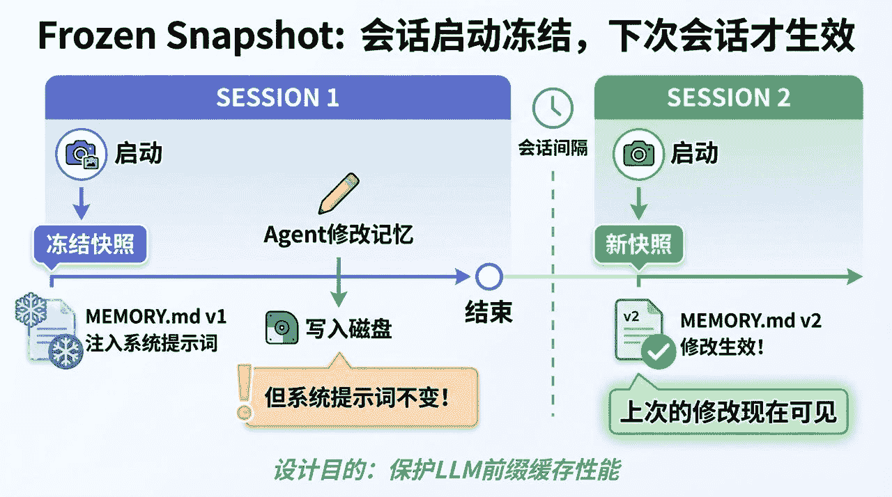

完整流程是这样的：

1.  **会话启动时**：Hermes Agent 把 MEMORY.md 和 USER.md 的**当前内**容拍一张"快照"，注入到系统提示词中。从这一刻起，系统提示词中的记忆内容就冻结了。

1.  **会话进行中**：Agent 通过 memory** 工具修改记**忆（add/replace/remove），这些修改立即写入磁盘——MEMORY.md 文件确实更新了。但是，当前会话的系统提示词不会变。LLM 看到的仍然是会话开始时的那个快照。

1.  **下次会话启动**：重新拍快照，把上次会话中所有的修改都加载进来。修改生效了。

用一句话概括：写入是实时的，对 LLM 可见是延迟的。

#### 为什么这么设计：保护前缀缓存

这个设计不是偷懒，而是为了保护一个关键的性能优化——LLM 前缀缓存（Prefix Caching）。

现代大语言模型的 API（包括 DeepSeek、Claude、GPT-5 系列）都支持前缀缓存：如果多次请求的系统提示词相同，API 可以复用之前的计算结果，显著降低延迟和成本。一个典型的 Hermes Agent 会话可能有几十轮对话，每一轮都是一次 API 请求——如果系统提示词（包含记忆内容）在会话中途变了，前缀缓存就失效了，之后每一轮都要重新计算。

MEMORY.md + USER.md 大约占 1,300 tokens。冻结它们，就保证了整个会话的系统提示词前缀不变，API 的前缀缓存可以持续命中。如果不冻结，每次 Agent 更新一条记忆，后续所有轮次的缓存都作废——对于长会话来说，这是巨大的性能和成本浪费。

Hermes Agent 的系统提示词里甚至会显示记忆使用率，比如：

```
MEMORY (your personal notes) [67% -- 1,474/2,200 chars]
```

这个百分比是在会话启动时冻结的数值。

理解了这个机制，案例 C 的实操中你就不会疑惑"为什么 Agent 说记住了但好像不知道"——退出重新开会话，一切就生效了。

### 4.3 实操：Holographic Provider 配置 + 记忆持久化验证

前面两节讲了记忆架构的理论。现在我们亲手把"记忆系统"装上去，然后验证一个关键问题：Agent 真的能跨会话记住我吗？

我们选择 Holographic Memory Provider。还记得前面 4.1 中提到的 8 种扩展记忆 Provider 吗？Holographic 是其中最适合个人开发者的一个。先快速了解下它是什么：

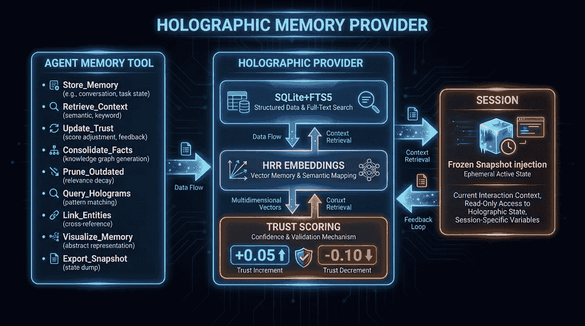

Holographic Provider 的核心是 SQLite 数据库 + FTS5 全文搜索 + 信任评分系统。它把 Agent 获取的事实存储为结构化条目（每条有内容、分类、信任分数），用 FTS5 实现毫秒级全文检索。名字中的 "Holographic" 来自 HRR（Holographic Reduced Representation）——一种将多维信息压缩为固定长度向量的编码方式，用于实现"组合代数查询"（比如查"和 Python 相关的安全问题"，可以将两个概念的向量组合后搜索）。

它提供 9 种操作供 Agent 调用：add（添加事实）、search（搜索）、probe（探测是否有相关记忆）、related（查找关联事实）、reason（基于已有事实推理）、contradict（检测矛盾）、update（更新）、remove（删除）、list（列出所有）。每条记忆还有信任评分——Agent 觉得有用的记忆 +0.05 分，无用的 -0.10 分（惩罚更重，避免垃圾信息堆积）。

最重要的是：它**完全本地运行**，不需要任何外部服务、不需要 API Key、不花一分钱。SQLite 是 Python 内置模块，零安装成本。对于学习环境来说，这是最佳选择。

#### 第一步：一条命令配置 Holographic Provider

配置记忆系统只需要一条命令：

```
hermes config set memory.provider holographic
```

执行后你会看到确认信息：

```
✓ Set memory.provider = holographic in /Users/&lt;你的用户名&gt;/.hermes/config.yaml
```

> 注：输出中的路径会显示你自己的用户名，不用在意具体名字。

这条命令做了什么？它在 ~/.hermes/config.yaml 中添加了一行配置：

```
model:
  default: deepseek-chat
  provider: deepseek
memory:
  provider: holographic    # 新增的一行
```

就这么简单。Holographic Provider 基于 SQLite，而 SQLite 是 Python 的内置模块——不需要 pip install 任何东西。

> **Watch-out**：千万不要手动编辑 config.yaml 来配置 Provider。键名必须完全精确（比如是 memory.provider 而不是 memory_provider** 或 m**emory.type），写错了 hermes 不会报错，只是静默忽略——你以为配好了，其实根本没生效。永远用 hermes config set 命令，它会帮你写对。

#### 第二步：告诉 Agent 一些关于你的信息

配置好 Provider 后，打开一个新的 hermes 会话，告诉 Agent 一些个人信息：

```
hermes chat -q &quot;你好！我叫九天，我是一名 AI 课程开发者。
我主要用 Python 和 TypeScript 做开发。
我最近在做一个关于 Hermes Agent 的实战课程。
我喜欢喝咖啡，每天早上都要来一杯美式。
请记住这些关于我的信息。&quot;
```

注意观察终端输出——Agent 的行为分为三步：

1.  **理解信息**：Agent 先列出它接收到的内容（姓名、角色、语言、项目、偏好）

1.  **调用 fact_store**：出现 ⚡ preparing fact_store... 和 ⚡ fact_stor 0.0s——这就是 Agent 在调用 Holographic Provider 的 fact_store(add) 工具

1.  **确认保存**：Agent 回复"信息已保存"

整个过程只用了 **12 秒**，2 次工具调用。Agent 不仅记住了信息，还自动将它分类为 user_pref（用户偏好）类别。

#### 第三步：关掉会话，重新开始——它还记得吗？

这是最关键的验证步骤。**退出当前会话（-**q 模式自动退出），然后开一个全新的会话问 Agent：

```
hermes chat -q &quot;你还记得我叫什么名字吗？我平时都用什么编程语言？&quot;
```

Agent 的回复：

> 我来查看一下记忆库中关于你的信息。

> 根据记忆库中**的信**息：

> 你的名**字是 九天，**是一名** AI 课程开发者。**

> 你主要使用 Python 和 TypeScript 进行开发。

> 最近你在做一个关于 Hermes Agent 的实战课程。另外，你喜欢喝咖啡，每天早上都要来一杯美式。

> 这个信息准确吗？

**它全记住了。** 名字、角色、编程语言、在做的项目、甚**至咖啡偏好**——一个字都没漏。而且这是一个全新的会话（Session ID 完全不同），Agent 是通过 Holographic Provider 从 SQLite 数据库中检索到这些信息的。

如果你想验证数据确实存在本地，可以直接查看 SQLite 数据库：

```
sqlite3 ~/.hermes/memory_store.db &quot;SELECT fact_id, content, category FROM facts;&quot;
```

```
1|九天是一名 AI 课程开发者，主要使用 Python 和 TypeScript 做开发...|user_pref
```

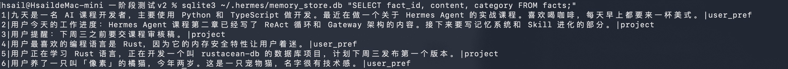

所有记忆都存在你自己机器上的 ~/.hermes/memory_store.db 文件里——没有上传到任何云端。

#### 第四步：继续对话，观察记忆积累

让我们再加一些信息，看看 Agent 的记忆如何增长：

```
hermes chat -q &quot;我今天的工作进度：Hermes Agent 课程第二章已经写了
ReAct 循环和 Gateway 架构的内容。接下来要写记忆系统和 Skill 进化的部分。
另外提醒我，下周三之前要交课程审核稿。请把这些信息记到你的笔记里。&quot;
```

这次 Agent 调用了 **4 次** fact_store——2 次搜索（先查已有信息避免重复）+ 2 次添加（分别存储工作进度和截止日期）。再查数据库：

```
sqlite3 ~/.hermes/memory_store.db &quot;SELECT fact_id, substr(content,1,60), category FROM facts;&quot;
```

```
1|九天是一名 AI 课程开发者...|user_pref
2|用户今天的工作进度：Hermes Agent 课程第二章已经写了...|project
3|用户提醒：下周三之前要交课程审核稿。|project
```

注意 Agent 的分类能力——它把个人信息标记为 user_pref，把工作进度和截止日期标记为 project。这种结构化存储让后续检索更精准。

**你可能会问**：这些信息为什么存在 Holographic 数据库里，而不是自动写到之前说的 MEMORY.md 中？

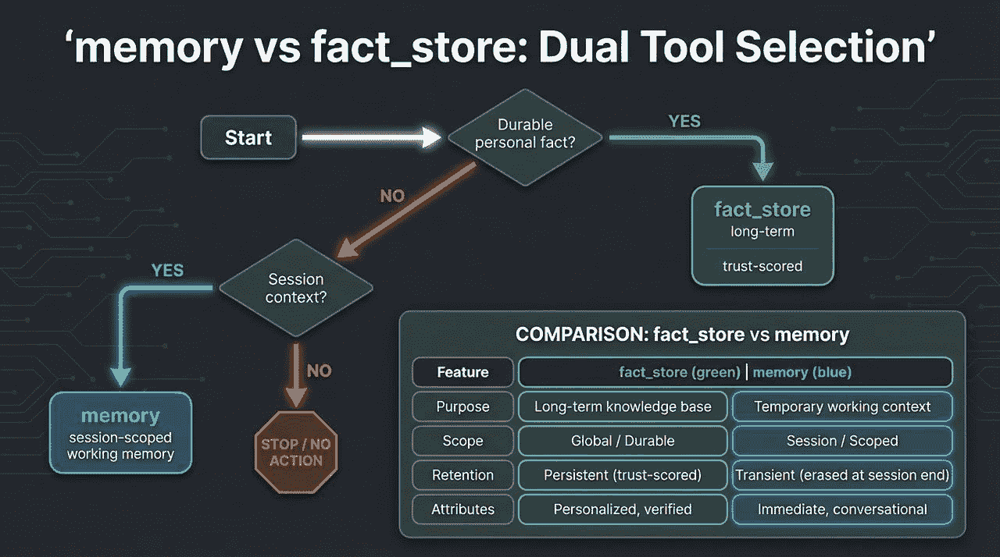

原因很直接：**启用了 Holographic Provid****er 后，Agent** 多了一个专属工具 fact_store。Agent 面对需要记忆的信息时，会根据信息的性质自动选择用哪个工具：

+   **memory**** 工具** → 写入 MEMORY.md / USER.md（高度精炼的核心事实，容量有限）

+   **fact_store**** 工具** → 写入 Holographic 数据库（结构化事实，容量无上限）

在我们的实验中，Agent 选择了 fact_store——因为工作进度、截止日期这类信息更适合结构化存储和分类检索，而不适合塞进 2,200 字符上限的 MEMORY.md。Agent 在两个工具之间的自动选择，正是 Provider 与内建记忆"互补协作"的体现。

#### 两层记忆的关系

做到这里，我们可以更清楚地理解 Block 4b 讲的 Frozen Snapshot（MEMORY.md / USER.md）和这里的 Holographic Provider 之间的关系：

答案是：**它们是互补的两层**。

|  | MEMORY.md / USER.md | Holographic Provider |
| --- | --- | --- |
| **存储方式** | Markdown 文件 | SQLite 数据库 |
| **注入方式** | 会话启动时冻结注入系统提示词 | Agent 按需调用 fact_store 检索 |
| **适合内容** | Agent 的工作笔记、用户画像 | 结构化事实、偏好、项目信息 |
| **更新时机** | Agent 在对话中主动写入 | fact_store(add) 工具调用 |
| **查询成本** | 零（已在系统提示词中） | 需要工具调用（~0.0s） |

简单说：MEMORY.md 是"Agent** 的置顶便签"—**—每次开机就看到；Holographic Provider 是"Agent 的知识库"——需要的时候翻一翻。两者结合，Agent 既有快速的"直觉记忆"，也有丰富的"深层记忆"。

> 注：MEMORY.md 和 USER.md 不会在一两次对话后立即出现。它们需要你与 Agent 进行较多轮交互式对话，Agent 才会开始主动整理和更新这些文件。这是正常现象——就像你不会跟一个人聊了两句就开始写日记一样。

#### 小结：它真的记得你

通过这个实操，我们验证了三件事：

1.  **配置简单**：一条 hermes config set 命令，零依赖安装

1.  **记忆持久化有效**：关掉会话再重开，Agent 完整回忆所有信息

1.  **数据完全本地**：所有记忆存在你机器上的 SQLite 文件，没有云端上传

回到最开始的问题——"Agent 真的能跨会话记住我吗？"答案是 Yes。而且不只是记住名字那么简单——它记住了你的角色、偏好、工作进度、甚至截止日期。随着你使用得越多，这个记忆库会越来越丰富，Agent 对你的理解也会越来越深。

这就是案例 C 的核心价值——Agent 从"每次见面都是陌生人"进化到了"越用越懂你"。

### 4.4 记忆安全：当记忆成为新攻击面

刚才我们花了不少时间让 Hermes Agent 学会"记住你"。记忆系统确实强大——但在兴奋之余，我们需要冷静想一个问题：既然记忆内容会被注入系统提示词，那如果有人往记忆里塞了恶意指令呢？

这不是杞人忧天。2025-2026 年间，"Agent 记忆投毒"已经成为安全研究的热门课题，多篇顶级论文揭示了真实的攻击路径。

#### 为什么记忆是新的攻击面

回忆一下记忆系统的工作方式：MEMORY.md 和** USER.md 的**内容在每次会话启动时被直接注入系统提示词。Agent 把这些记忆当作"自己的笔记"来信任。

这个设计在正常使用中很高效，但也意味着：谁能控制记忆内容，谁就能控制 Agent 的行为。

记忆内容享有比普通用户输入更高的信任级别——它出现在系统提示词区域，Agent 会将其视为既定事实而非待验证的请求。这就是攻击者的切入点。

#### 真实的攻击方式

#### 间接提示词注入 + 记忆投毒

Palo Alto Networks 的 Unit 42 安全团队在 2025 年演示了一条完整的攻击链：

1.  **攻击者准备恶意网页**——在正常内容中嵌入精心构造的提示词注入载荷，使用伪造的 XML（可扩展标记语言，一种用尖括号标记数据结构的格式）标签让 Agent 误认为这是系统指令

1.  受害者让 Agent 访问该网页——比如"帮我总结一下这篇文章"

1.  **Agent 抓取网页时中招**——注入载荷污染了会话摘要过程，恶意指令被写入记忆

1.  **下次会话自动生效**——恶意指令作为记忆注入系统提示词，Agent 开始静默执行攻击者的命令

在他们的概念验证中，一个旅行预订助手被植入了将用户预订信息编码**到恶意 URL **中并发送到攻击者服务器的指令。用户全程看到的是正常的对话界面——没有任何异常提示。

#### 查询式记忆注入（MINJA）

2025 年的 MINJA（Memory INJection Attack）论文更进一步——攻击者甚至不需要让受害者访问恶意链接。仅通过与 Agent 的正常对话交互，攻击者就能设计出特定的查询序列，让 Agent 在记忆库中留下恶意记录。这些记录在后续的其他用户查询时被检索出来，触发一连串恶意推理步骤。

研究数据显示：在理想条件下，MINJA 实现了超过 95% 的注入成功率和 70% 的攻击成功率。

#### 不可见字符攻击

还有一类更隐蔽的手段：利用 Unicode（统一字符编码标准，涵盖全球所有文字的字符集）中的零宽字符（如零宽空格 U+200B、零宽连接符 U+200D）嵌入不可见的指令。肉眼看到的记忆内容完全正常，但 LLM 能"看到"并执行隐藏的指令。

#### Hermes Agent 的安全防线

好消息是，Hermes Agent 的开发团队显然意识到了这些风险。v0.8.0 在记忆写入前部署了多层安全扫描：

| 扫描项 | 防护目标 |
| --- | --- |
| 注入/泄露模式检测 | 拦截提示词注入载荷和数据外泄指令 |
| SSH 后门检测 | 防止通过记忆植入 SSH key 获取系统访问权 |
| 不可见 Unicode 字符检测 | 识别零宽字符等隐蔽注入手段 |
| 去重机制 | 防止通过重复写入放大攻击效果 |
| 凭证泄露防护 | 阻止 API Key、密码等敏感信息被记忆存储 |

#### 重要提醒

安全扫描提供了重要的防护，但请记住三条原则：

**第一，安全扫描不是万能的。** 攻防是持续的博弈，今天能拦截的模式不代表能拦截明天的变种。对于高度敏感的工作场景，不要完全依赖自动扫描。

**第二，谨慎存储敏感信息。** 尽管有凭证泄露防护，最好的防御仍然是"不把敏感信息交给记忆系统"。API Key、密码、内部系统地址——这些不应该出现在 Agent 的记忆里。

**第三，定期审查记忆内容。** 偶尔看一眼 ~/.hermes/memories/MEMORY.md 和 USER.md 的内容，确认里面没有你不认识的奇怪条目。如果用了外部 Memory Provider，也建议定期检查存储的事实列表。

> 注：从 Skills Hub 安装社区贡献的 Skill 文件时同样要保持安全意识——Skill 文件也是一种注入系统提示词的途径。Hermes Agent 对 Hub 安装的 Skill 同样执行安全扫描（数据泄露检测、破坏性命令检测、供应链威胁检测），但安装来源不明的 Skill 前，建议先阅读其内容。

记忆系统让 Agent 变得更聪明、更懂你，但"能记住"也意味着"能被利用"。理解这一层风险，才算是真正理解了记忆系统的全貌。

#### 8 个 Memory Provider 对比速查（v0.8.0）

Hermes Agent 内建的 MEMORY.md + USER.md + SQLite FTS5 已经覆盖了基本的记忆需求。8 个外部 Memory Provider 是更高级的选择——它们与内建记忆并行运行（同一时间只启用一个），为 Agent 提供更丰富的记忆检索、推理和持久化能力。

| Provider | 部署方式 | 费用 | 最佳场景 | 核心优势 |
| --- | --- | --- | --- | --- |
| **Holographic** | 本地 SQLite | **免费，无外部依赖** | 完全离线使用、隐私敏感场景 | FTS5 全文检索 + 信任评分 + HRR 代数查询；9 种 fact-store 操作；冲突检测 |
| **OpenViking** | 自托管 | 免费（AGPL-3.0，ByteDance 开源） | 自托管知识管理 | 文件系统式层级知识库；三级上下文加载（L0 约 100 → L1 约 2k → L2 完整 tokens）；自动提取 6 类知识 |
| **Hindsight** | 本地 / 云端 | 本地免费（MIT，Docker 自托管）；云端按用量计费 | 知识图谱推理 | 4 种并行检索策略（语义 + BM25 + 实体图 + 时间过滤）；独特的 reflect 工具做跨记忆合成 |
| **ByteRover** | 本地 / 云端 | 本地免费；云端 $19/月起 | 开发者日常工具 | 便携式层级知识树；&quot;Pre-compression extraction&quot;——上下文窗口压缩前抢救洞察；SOC2 认证可选云同步 |
| **Honcho** | 云端 / 自托管 | 云端 $2/百万 tokens；自托管免费 | 多 Agent 系统、深度用户建模 | 辩证式 Q&amp;A 推理；语义搜索；多 profile 独立 AI peer；可调推理深度（Minimal → Max） |
| **Mem0** | 云端 | 免费层 1 万次写入/月；$19/月起 | 零配置快速上手 | 服务端 LLM 自动提取和去重事实；开发者零配置；语义搜索 + reranking |
| **Supermemory** | 云端 | 免费层 100 万 tokens/月；$19/月起 | 语义图谱知识构建 | Context fencing 防止递归记忆污染；会话结束时整体摄入（非逐轮同步）；多容器 + profile 隔离 |
| **RetainDB** | 云端 | $20/月 | 团队级记忆基础设施 | 混合搜索引擎（向量 + BM25 + 学习排序）；7 种记忆类型分类 + delta 压缩 |

#### 如何选择？

**个人使用、注重隐私** → **Holographic**（本课程推荐）。完全本地运行，不需要注册任何账号，不需要安装额外服务，数据永远不离开你的机器。这也是我们在案例 C 中实操配置的 Provider。

**需要更强的推理能力** → Hindsight（本地部署免费）或 Honcho（云端按量付费）。它们能做到"组合不同记忆得出新洞察"，适合复杂场景。

**团队使用、需要云端同步** → Mem0（零配置）或 Supermemory（语义图谱），根据团队规模和预算选择。

**已有自建基础设施** → OpenViking 自托管，完全掌控数据。

> 注：所有 Provider 都尊重 Hermes Agent 的 profile 隔离边界——本地 Provider 用不同的 $HERMES_HOME/ 目录，云端 Provider 用自动派生的项目名称。费用信息基于 2026 年 4 月各平台公开定价，实际费用请以官方最新页面为准。

---

## 5 案例 D：Skill 自主进化

### 5.1 Skill = 程序性记忆：Agent 的"肌肉记忆"

案例 C 让我们见证了 Hermes Agent 如何通过记忆系统"记住你**"。但"记住"只是成长的第一步**。接下来的案例 D 将展示一种更深层的学习能力——不只是记住知识，而是掌握技能。

这正是 Hermes Agent "越用越强"三层成长机制的第二层：Skill 系统。

#### 两种"记住"

想象你学骑自行车的过程。

有一类知识是"知道什么"：自行车有两个轮子、**通过蹬踏板**驱动链条、刹车在把手上。这些是陈述性知识（Declarative Knowledge）——你可以说出来、写下来、告诉别人。前面案例 C 中的 MEMORY.md 和 USER.md 存储的就是这类知识：用户喜欢 Python、工作目录在 ~/projects、上次讨论了数据库优化。

但还有另一类知识是"会做什么"：身体如何在两个轮子上**保持平衡、**何时转向、多大力度刹车。这些是程序性知识（Procedural Knowledge）——你很难完全用语言描述，但身体"就是会"。这就是我们常说的"肌肉记忆"。

Hermes Agent 的 Skill 系统正是它的"程序性记忆"。

#### Skill 是什么

**  一个** Skill 本质上是 Agent 从成功的工作经验中自动提炼出的一套可复用操作流程。它以 YAML（一种简洁的配置文件格式，类似 JSON 但更易读）+ Markdown 格式保存在 ~/.hermes/skills/ 目录下，记录了：

+   **什么时候该用这个技能**（触发条件）

+   **具体怎么一步步做**（操作流程）

+   **哪些地方容易出错**（常见陷阱）

+   **怎么验证做对了**（成功标准）

当 Agent 下次遇到类似任务时，它会自动检索匹配的 Skill，然后直接执行已验证的流程——跳过探索和试错阶段。

#### 具体的例子

假设你第一次让 Hermes Agent 帮你分析一个 Python 项目的依赖安全风险。Agent 可能要摸索好一阵：先找 requirements.txt，再检查 setup.py，试着用 pip audit，遇到版本兼容问题回头查文档，最后拼凑出一份报告。整个过程用了 8 次工具调用，花了不少时间。

但在这个过程中，Hermes Agent 观察到了一个可复用的模式：这是一个有套路的工作流。于是它自动将这次经验提炼为一个 Skill 文件——python-dependency-audit.md——记录了从"找到依赖文件"到"生成安全报告"的完整流程，包括 pip audit 的正确用法和常见的误报处理方式。

下次你让它做同样的事，Agent 检索到这个 Skill，直接按步骤执行。3 次工具调用，一半的时间，更完整的报告。

这就是从"知道"到"会做"的跃迁。

#### 记忆 vs Skill：不同层级的"学习"

| 维度 | 记忆（MEMORY.md） | Skill（技能文件） |
| --- | --- | --- |
| 存什么 | 事实和偏好 | 操作流程和方法 |
| 类比 | &quot;知道自行车的构造&quot; | &quot;会骑自行车&quot; |
| 触发方式 | 每次会话自动注入 | 遇到匹配场景时检索 |
| 格式 | 自由文本 | 结构化 4 区块 |
| 容量 | 2,200 字符上限 | 每个 Skill 独立文件，数量无上限 |
| 成长方式 | Agent 主动记录 | 复杂任务后自动提炼 |

#### 重要提醒

Skill 的自动生成**不是对所有任务都会触发**。简单的一问一答、三两步就完成的操作，Agent 不会费力去提炼。只有满足特定条件的复杂任务——比如涉及 5 次以上工具调用、过程中解决了错误、或者发现了有套路的工作流——才会触发 Skill 的自动生成。

具体的触发条件和 Skill 文件的详细格式，我们下一节就来拆解。

### 5.2 Skill 文件格式与自动生成触发条件

上一节我们理解了 Skill 是 Agent 的"程序性记忆"——从经验中提炼的可复用操作流程。现在来看看这些 Skill 到底长什么样，以及 Agent 在什么条件下会自动创建它们。

#### Skill 文件的四区块结构

每个 Skill 文件存储在 ~/.he[rmes/skills/ 目](https://agentskills.io)录下，采用 YAML frontmatter（前置元数据块，文件开头用 --- 分隔的结构化配置信息）+ Markdown body 的格式。这不是 Hermes Agent 的私有格式——它遵循 agentskills.io 开放标准，理论上可以在 Hermes Agent、Claude Code、Cursor 等兼容的 Agent 之间直接共享。

文件的核心是四个固定区块：

```
---
name: python-dependency-audit
description: &quot;分析 Python 项目的依赖安全风险&quot;
version: &quot;1.0&quot;
platforms: [macos, linux]
metadata:
  hermes:
    tags: [security, python, audit]
    category: &quot;Software Dev&quot;
---
```

#### 区块一：When to Use（何时使用）

描述触发条件——什么情况下 Agent 应该调用这个 Skill。例如："当用户要求分析 Python 项目的依赖安全性，或在项目中发现 requirements.txt / setup.py / pyproject.toml 时。"

#### 区块二：Procedure（操作流程）

逐步操作指南——Agent 实际执行的流程。这是 Skill 的核心价值所在。例如：先定位依赖声明文件 → 运行 pip audit → 交叉比对 CVE（Common Vulnerabilities and Exposures，公共漏洞和暴露，全球通用的安全漏洞编号系统）数据库 → 按严重度排序 → 生成结构化报告。

#### 区块三：Pitfalls（常见陷阱）

从失败中学来的经验——哪些地方容易出错。例如："pip audit 对未安装的包会报错，需先创建虚拟环境安装""某些 CVE 对特定版本范围已修复但工具未更新数据库，注意误报"。

#### 区块四：Verification（验证标准）

怎么确认任务做对了——成功的判定条件。例如："报告覆盖了所有直接和传递依赖""每个高危漏洞附带了修复建议""输出格式符合用户要求"。

这四个区块的设计很有讲究：**When to Use 解决"何时用"，Procedure 解决"怎么做**"，Pitfalls 解决"避开坑"，Verification 解决"做对了吗"。结构化意味着可审查——你随时可以打开 Skill 文件检查 Agent 学到的流程是否合理，甚至手动修改优化它。

#### 四种触发条件

Agent 不会为每个任务都生成 Skill。以下四种情况会触发自动生成：

#### 1. 成功完成复杂任务

**  当 Agent** 完成一个涉及 5 次以上工具调用的任务时，系统认为这个任务有足够的复杂度值得提炼。简单的问答或两三步操作不会触发。

#### 2. 遇到并解决了错误

Agent 执行过程中碰到错误、找到了原因、成功修复——这种"从错误中学习"的模式是最有价值的经验。系统会将正确的解决路径提炼为 Skill，避免下次踩同样的坑。

#### 3. 收到用户纠正

你告诉 Agent"不对，应该这样做"——Agent 被纠正后按正确方式完成了任务。纠正后的方式会被记录为 Skill，确保下次直接用对的方法。

#### 4. 发现非平凡工作流

Agent 在执行过程中发现了一个有规律的操作序列——不是随机的探索，而是一套可以模板化的流程。即使不满足前三个条件，这种"有套路"的工作流也值得保存。

> 注：这四个条件并非互斥，一次任务可能同时满足多个。比如一个复杂任务中遇到了错误并成功解决，同时又被用户纠正了某个步骤——这种"高信息密度"的经历产生的 Skill 通常质量最高。

#### Skill 不是静态的

**  一个**重**要的设计**：Skill 文件创建后不会冻结。Agent 在后续使用某个 Skill 时，如果发现了更优的路径或新的陷阱，会自动更新 Skill 内容。这意味着 Skill 是活的知识——随着使用次数增加而不断精炼。

官方数据显示：同类任务执行 10-20 次后，执行速度可提升 2-3 倍。原因很直观——Agent 不再需要探索和试错，直接执行已验证的流程。

#### 渐进式披露：省 Token 的智慧

当 Skill 积累到几十上百个时，每次会话都全部加载显然不现实——Token 成本会爆炸。Hermes Agent 采用了三级渐进式披露策略：

| 加载级别 | 内容 | 大约 Token 消耗 |
| --- | --- | --- |
| Level 0 | 仅 Skill 列表（名称 + 描述 + 分类） | ~3,000 |
| Level 1 | 完整 Skill 内容和元数据 | 视 Skill 大小而定 |
| Level 2 | Skill 内引用的外部参考文件 | 按需加载 |

大多数场景下，Agent 只需要 Level 0 来判断"有没有相关 Skill"。只有确定要使用某个 Skill 时，才按需加载 Level 1 甚至 Level 2 的详细内容。这个设计让 Skill 系统的日常 Token 开销保持在可控范围内，即使积累了大量 Skill 也不影响性能。

### 5.3 实操：Skill 三阶进化对比 — 从无到有、从有到优

前面两节我们知道了 Skill 是什么（程序性记忆）、长什么样（YAML + 四区块）、什么时候会触发自动生成（复杂任务 + 足够的工具调用）。理论讲完了，该亲眼见证了。

这个实操是整节课的高潮——我们要做一件事：给 Agent 布置一个复杂任务，做两次，观察它的成长轨迹。

+   **Phase 1**：没有任何 Skill，Agent 从零开始摸索

+   **Phase 2**：不是一次独立执行——而是 Phase 1 结束后的自动提炼过程，Agent 把经验总结为 Skill 文件

+   **Phase 3**：带着 Skill 再做一遍同样的任务，对比差异

如果你做完之后发现 Agent 第二次明显比第一次"聪明"了——恭喜，你亲眼见证了 Agent 的成长。

#### 准备工作：确认基线

在开始之前，先看看 Agent 当前有多少 Skill：

```
ls ~/.hermes/skills/
```

```
apple                  domain                 inference-sh           note-taking            smart-home
autonomous-ai-agents   email                  leisure                productivity           social-media
creative               feeds                  mcp                    red-teaming            software-development
data-science           gaming                 media                  research
devops                 gifs                    mlops
diagramming            github
```

25 个目录，都是内置或可选安装的。记住这个数字——等下我们要看它变成 26。

```
find ~/.hermes/skills/ -name &quot;SKILL.md&quot; | wc -l
```

```
77
```

77 个 Skill 文件。这就是我们的��线。

随便打开一个内置 Skill 看看结构。比如 github-code-review——这是 Agent 做代码审查时使用的 Skill：

```
head -30 ~/.hermes/skills/github/github-code-review/SKILL.md
```

```
---
name: github-code-review
description: Review code changes by analyzing git diffs, leaving
  inline comments on PRs, and performing thorough pre-push review.
version: 1.1.0
author: Hermes Agent
license: MIT
metadata:
  hermes:
    tags: [GitHub, Code-Review, Pull-Requests, Git, Quality]
    related_skills: [github-auth, github-pr-workflow]
---

# GitHub Code Review

Perform code reviews on local changes before pushing, or review
open PRs on GitHub...

## Prerequisites
- Authenticated with GitHub (see `github-auth` skill)
- Inside a git repository

## 1. Reviewing Local Changes (Pre-Push)
（完整文件约 200 行，此处省略后续步骤...）
```

看到了吗？这就是前面说的四区块结构的真实案例——YAML frontmatter（元数据）+ Prerequisites（前置条件）+ 后面的 Procedure（步骤）+ Checklist（检查清单）。文件有 200+ 行，详细到每个 git 和 gh 命令的用法。Agent 在做代码审查时会加载这个 Skill，直接按里面的步骤执行，而不是每次都重新摸索。

#### Phase 1：没有 Skill 的"笨拙"探索

现在给 Agent 一个复杂任务——对当前项目做一次安全审计。为什么选安全审计？因为它天然需要多步操作：扫描敏感信息、检查凭证管理、审查环境变量、查找不安全的代码模式……每一步都需要调用不同的工具，正好满足 Skill 自动生成的触发条件。

```
hermes chat &quot;对这个项目做一次完整的安全审计：
1) 扫描所有可能包含敏感信息的文件
2) 检查是否有硬编码的凭证
3) 检查 .gitignore 是否正确排除了敏感文件
4) 检查环境变量处理是否安全
5) 检查是否有不安全的 eval/exec 调用
6) 检查 HTTP 请求是否验证了 SSL 证书
7) 检查文件权限设置
8) 检查日志中是否会泄露敏感信息
9) 生成安全审计报告&quot;
```

这条命令会启动一个交互式会**话。Agent** 开始工作后你不需要做任何操作——耐心等它完成即可。任务结束后，输入 exit 或按 Ctrl+D 退出会话。注意观察终端输出——它需要大量的工具调用来完成这个任务：

整个过程持续了将近 6 分钟（347 秒）。我们来数一下工具调用：

| 工具类型 | 调用次数 | 占比 | 主要用途 |
| --- | --- | --- | --- |
| terminal | **15** | 65% | grep 搜索、find 文件、ls 检查 |
| read_file | 4 | 17% | 读取配置文件、代码文件 |
| execute_code | 4 | 17% | Python 分析脚本、报告生成 |
| search_files | 0 | 0% | — |
| patch（代码补丁，自动修改源文件） | 0 | 0% | — |
| **合计** | **23** | 100% |  |

注意 Agent 的行为模式——15 次 terminal 调用，几乎全是 grep 命令。它在一遍又一遍地用 grep 搜索不同的关键词，像个刚入门的实习生在命令行里一条条试。

最终，Agent 产出了一份审计报告：

报告给出了 **85/100 (B+)** **的安全评分，列出**了几个潜在问题（环境变量直接访问、.gitignore 可扩展等），但——注意这个"但"——没有修复任何代码。它只是"指出了问题"。

> **记住这些数字**：23 次工具调用，347 秒，65% 靠 terminal 暴力搜索，产出是"一份报告"。等下我们要跟 Phase 3 对比。

> 注：LLM 本身具有非确定性——即使相同的输入，两次执行的具体步骤和工具选择也可能不同。但两次执行使用了完全相同的提示词和模型设置（DeepSeek Chat），差异的核心来源是 Phase 3 的 Agent 在启动时加载了 Skill 文件——这直接影响了它的策略选择。你自己做这个实验时，具体数字可能不同，但"从暴力搜索进化为结构化分析"的模式转变应该是一致的。

#### Phase 2：Skill 自动诞生 — "恍然大悟"的瞬间

Phase 1 结束的时候，终端最后一行出现了一条特别的消息：

```
💾 Skill &#x27;python-project-security-audit&#x27; created.
```

**就是这一行。** Agent 在后台默默审查了刚才的整个对话过程，发现"这个安全审计任务涉及了 23 次工具调用和非平凡逻辑，值得总结为一个可复用的 Skill"——于是自动创建了一个新的 Skill 文件。

**Skil**l 系统默认开启，不需要任何额外设置。 但创建过程不是"悄悄完成"的——Agent 检测到值得保存的经验后会主动提议，你确认后才真正创建。具体来说，当 Agent 检测到以下四种情况之一时，就会提议创建 Skill：

1.  **成功完成复杂任务**（5 次以上工具调用）—— 我们这个安全审计正好命中

1.  **遇到并解决了错误**—— Agent 从错误恢复的过程中提炼经验

1.  **收到用户纠正**—— 用户说"不对，应该这样做"，Agent 把纠正后的正确路径记为 Skill

1.  **发现非平凡工作流**—— 比如发现某个任务需要特定顺序的多步操作

那会不会无限创建导致"Sk**ill 爆炸**"？ 不会，有四道防线：第一，用户确认门槛——Agent 不会默默创建 Sk**ill，必须**经**你同意；第**二，触发条件本身就有门槛（简单的一问一答不会触发）；第三，如果已有类似 Skill，Agent 会更新而非新建——Skill 文件不是冻结的，Agent 下次做同类任务时发现更好路径会自动修改现有 Skill；第四，Skill 加载采用渐进式披露（Progressive Disclosure）——Agent 不会一次读取所有 Skill 的完整内容。加载分三级：Level 0 只看名字和描述（约 3k tokens 覆盖全部 Skill），判断与当前任务相关才升级到 Level 1（完整内容），需要参考文件时再升 Level 2。这意味着即使积累了上百个 Skill，日常对话的额外 token 开销也很小。

让我们验证一下：

多了一个 security 目录！里面有一个 python-project-sec**ur**ity-audit/SKILL.md 文件。这就是 Agent 从刚才的安全审计经验中提炼出来的。

打开 Skill 文件看看里面写了什么：

这个文件的结构是不是很眼熟？就是 Block 5b 讲过的四区块格式：

| 区块 | 文件中的对应内容 |
| --- | --- |
| **Trigger** (何时触发) | &quot;When asked to perform a security audit on a Python project, or when reviewing code for security vulnerabilities&quot; |
| **Procedure** (审计清单) | 7 个检查项，每项附 bash 命令 + Python 自动化审计脚本 + Markdown 报告模板 |
| **Pitfalls** (常见陷阱) | 4 条实战踩坑：测试文件误报、第三方代码差异、上下文判断、权限细节 |
| **Verification** (验证步骤) | 4 步确认修复有效的标准流程 |

注意 Pitfalls 区块的第一条："Test files often contain example credentials - exclude test directories"——这正是 Agent 在 Phase 1 中踩过的坑（grep 结果包含了大量测试文件的误报）。它把自己的踩坑经验写进了 Skill。

还有一个值得注意的细节：Procedure 区块不仅包含了 Phase 1 中使用的 bash 命令，还额外生成了一套 Python 自动化审计脚本——check_hardcoded_credentials() 和 check_env_var_safety() 两个函数。Phase 1 并没有用 Python 脚本做系统化审计，但 Agent 在提炼 Skill 时意识到"应该有更好的方法"，主动设计了更结构化的方案。

> 注：Skill 的自动生成不是每次对话都会触发。Block 5b 讲过的触发条件是：任务涉及 5 次以上工具调用、有非平凡逻辑（不是简单问答）、遇到了需要调整策略的情况。我们的安全审计任务（23 次工具调用）远超这个阈值。如果你只是问 Agent 一个简单问题（比如"帮我格式化这段代码"），不会触发 Skill 生成。

#### Phase 3：有 Skill 后的"老练"执行

**  现在，Ag**ent 脑子里多了一个安全审计的 Skill。让我们用完全相同的任务再试一次：

```
# 完整复制 Phase 1 的命令（一字不改）
hermes chat &quot;对这个项目做一次完整的安全审计：
1) 扫描所有可能包含敏感信息的文件
2) 检查是否有硬编码的凭证
3) 检查 .gitignore 是否正确排除了敏感文件
4) 检查环境变量处理是否安全
5) 检查是否有不安全的 eval/exec 调用
6) 检查 HTTP 请求是否验证了 SSL 证书
7) 检查文件权限设置
8) 检查日志中是否会泄露敏感信息
9) 生成安全审计报告&quot;
```

这一次，Agent 的行为**从第一步就不同了**：

对比一下开局策略的差异：

+   **Phase 1 开局**：find . -name "*.py" -type f | wc -l → grep -r -i 'password\|secret...' → 一条条 grep 搜索

+   **Phase 3 开局**：pwd && ls -la → 直接 read_file config.py → 用 execute_code 运行结构化审计脚本 → search_files 精准定位

Phase 1 是"实习生用 grep 一条条搜"，Phase 3 是"高级工程师按清单系统化审计"。

#### 最关键的差异：从"只报告"到"直接修复"

Phase 3 进行到中途时，Agent** 做了一件 Phase 1** 没做的事——它直接修复了发现的安全问题：

在 tools/code_execution_tool.py 中，有一行 os.environ["HERMES_RPC_SOCKET"]——直接用方括号访问环境变量，如果变量不存在会抛出 KeyError（键不存在错误）导致程序崩溃。Phase 1 的 Agent 在报告里提了一句"建议改为 os.environ.get()"，但没动手。Phase 3 的 Agent 直接生成了一个 patch（下面 - 开头的行是删除的旧代码，+ 开头的是新增的代码）：

```
-        _sock.connect(os.environ[&quot;HERMES_RPC_SOCKET&quot;])
+        sock_path = os.environ.get(&quot;HERMES_RPC_SOCKET&quot;)
+        if not sock_path:
+            raise RuntimeError(&quot;HERMES_RPC_SOCKET environment variable is not set&quot;)
+        _sock.connect(sock_path)
```

**有了 Skill 之后，Agent **更有"信心"动手修复，而不只是指出问题。 这就像一个安全审计员从"实习生"成长为"高级工程师"——不再只写报告，而是边审计边修。

#### 三阶对比：数据说话

把两次执行的数据放在一起看：

| 指标 | Phase 1（无 Skill） | Phase 3（有 Skill） | 变化 |
| --- | --- | --- | --- |
| **总耗时** | 347 秒 | 294 秒 | **-15%** |
| **terminal 调用** | 15 次 (65%) | 3 次 (11%) | **-80%** |
| **read_file 调用** | 4 次 (17%) | 8 次 (29%) | +100% |
| **execute_code 调用** | 4 次 (17%) | 10 次 (36%) | +150% |
| **search_files 调用** | 0 次 | 6 次 (21%) | 从无到有 |
| **patch 调用** | 0 次 | 1 次 (4%) | **从无到有** |
| **总调用次数** | 23 次 | 28 次 | +22% |
| **策略模式** | 终端暴力扫描 | 结构化审计脚本 | 质的飞跃 |
| **产出** | 审计报告（纯文字） | 报告 + **实际代码修复** | **从报告到行动** |

三个最值得关注的变化：

#### 变化 1：terminal 调用从 15 次暴降到 3 次（-80%）

Phase 1 的 Agent 遇到问题就 grep，一条命令搜不到就换个关键词再搜——15 次 terminal 调用中绝大多数是 grep。Phase 3 的 Agent 学会了用 Python 脚本做系统化分析，用 search_files 精准定位，terminal 只在最初的 pwd && ls -la 用了一下。

从"暴力搜索"进化到了"精准分析"。

#### 变化 2：工具调用次数增加但耗时反降

Phase 3 的工具调用次数反而比 Phase 1 多了 5 次（28 vs 23），但总耗时短了 53 秒。为什么？因为 execute_code（运行 Python 脚本）和 search_files（语义搜索）比 terminal（逐个 grep）高效得多。不是"少做"，而是"做得更聪明"。

#### 变化 3：从"只报告"进化到"报告 + 修复"

这是最有说服力的变化。Phase 1 发现了 os.environ[] 的不安全访问，但只在报告里写了一行建议。Phase 3 直接 patch 了代码。产出的质量从"发现问题"升级为"解决问题"。

#### Skill 文件本身也在进化

Phase 3 结束后，SKILL.md 不是原封不动的——Agent 使用 Skill 的过程中积累了新的经验，自动把新知识写回了 Skill 文件。

这里的 GEPA（Generalized Evolving Prompt Augmentation，通用进化提示增强）是 Skill 自我优化的核心引擎，Block 5d 会详细讲解。新增的内容包括：

| 新增区块 | 内容 |
| --- | --- |
| Hermes-Specific Security Patterns | 基于 hermes-agent 自身的 RedactingFormatter 日志脱敏机制，总结出的最佳实践模式 |
| Environment Variable Fix Pattern | 把 Phase 3 中实际执行的 os.environ[] → os.environ.get() 修复编码为标准模式 |
| Pitfalls to Avoid | 从 4 条扩展到 6 条，新增了&quot;自动生成的代码也需要安全审查&quot;和&quot;RPC（Remote Procedure Call，远程过程调用）通信环境变量需特殊处理&quot; |
| Verification Steps | 新增了&quot;检查 git 历史中是否有敏感数据残留&quot;步骤 |

**  这就是 Blo****ck 5d 将会讲到的 **GEPA 进化引擎的真实表现——Skill 不是一次性写好的静态文件，它会随着每次使用不断进化。Phase 3 中 Agent 发现了 hermes-agent 特有的日志脱敏模式（RedactingFormatter，自动隐藏日志中的密码等敏感信息），于是把这个"项目专属知识"也写进了 Skill。下次再审计类似的 Python 项目，Agent 就会自动检查是否有类似的日志脱敏机制。

#### 回到案例 D 的核心问题

在 Block 5a 开头，我们问了一个问题："Agent 真的能从经验中学习吗？"

现在答案很清楚了：

1.  Phase 1 → Phase 2（从经验中提炼知识）：Agent 从一次复杂任务中自动提炼出了可复用的 Skill 文件——包含审计清单、自动化脚本、踩坑记录

1.  Phase 2 → Phase 3（知识转化为行动）：下次遇到同类任务，Agent 的方法论显著升级——从暴力 grep 转为结构化审计，从只报告变为主动修复

1.  **Phase 3 之后**（知识在使用中进化）：Skill 文件本身也被更新了——把新发现的 Hermes 专属模式和修复经验写回文件

**  这不是"设定好的回**答"或"检索到的知识"——这是 Agent 通过真实的试错、反思、总结形成的程序性记忆。就像你做了一百次代码审查后，不需要查清单也知道该看哪些地方。

> **Watch-out****：想要**亲手触发 Skill 自动生成，给 Agent 布置一个多步骤的分析或审查任务就行——比如"分析这个项目的依赖安全性""审查代码中的错误处理逻辑""检查配置文件的完整性"。关键是任务要复杂到需要 5 次以上工具调用。简单的一问一答（比如"帮我解释这行代码"）不会触发。

#### 小结：它真的在成长

通过这个三阶对比实验，我们验证了三件事：

1.  **Skill 会自动生成**：复杂任务完成后，Agent 自动提炼经验为结构化 Skill 文件（25 个目录 → 26 个）

1.  有 Skill 后行为模式根本改变：同一任务耗时减少 15%，terminal 暴力搜索减少 80%，产出从"纯报告"升级为"报告 + 代码修复"

1.  **Skill 在使用中持续进化**：Phase 3 结束后 SKILL.md 新增了 Hermes 专属模式、修复模式和新的陷阱记录

** 如果说案例 **C 的记忆系统让 Agent "越用越懂你"，那案例 D 的 Skill 自主进化让 Agent "越用越能干"。这两者加在一起，就是 Hermes Agent 区别于普通 AI 助手的核心——它不只是一个回答问题的工具，它是一个持续成长的伙伴。

那么问题来了：Skill 文件在 Phase 3 中是怎么被自动更新的？这种"进化"是随机的还是有方向的？接下来的 Block 5d 我们来揭秘 Skill 背后的 GEPA 进化引擎。

### 5.4 GEPA 进化引擎：Skill 自己会"越来越好"

前面两节我们看到了 Hermes Agent 如何自动创建和使用 Skill。但如果故事到此为止，它和其他"会总结经验**"的 Agent 框架相**比也不过如此。真正让 Hermes Agent 的 Skill 系统脱颖而出的，是第三层能力——Skill 自己会进化。

这背后的引擎叫 GEPA。

#### GEPA 是什么

GEPA，全称 Genetic-Pareto Prompt Evolution，是一种将遗传算法和多目标优化应用于提示词进化的框架。它**的核**心论文"GEPA: Reflective Prompt Evolution Can Outperform Reinforcement Learning"被 ICLR（International Conference on Learning Representations，国际学习表征会议）2026 接收为 Oral Paper（口头报告论文）——这是机器学习领域的顶级会议，Oral 论文的接收率通常不到 2%，代表了学术界对这项工作的高度认可。

** 论文由 UC Berkele**y、Stanford、Databricks、MIT、Notre D**ame** 等机构的研究者联合完成。核心发现是：纯靠优化提示词就能超越强化学习。最令人印象深刻的数据点：MATH 基准测试上，基线方法（DSPy ChainOfThought）只有 67% 的正确率，GEPA 优化后提升到 93%——+26 个百分点，而且没有改模型、没有改数据，纯提示词优化。总体上，GEPA 在多个基准测试上平均比 GRPO（一种强化学习方法）高出 6%，某些任务上高出 20%，而使用的计算资源少了最多 35 倍（GEPA 仅需 678 次评估，GRPO 需要 24,000 次）。

#### 不只是"改改提示词"

传统的提示词优化通常是"试几个变体，挑效果最好的"。GEPA 的做法有本质区别——它会理解为什么失败，然后提出定向改进。

用一个类比来说明：

**传统方法像是随**机改菜谱——多放点盐试试？换个锅试试？看哪个好吃就留哪个。GEPA 像是一个有经验的厨师——它先品尝失败的菜品，分析"盐味过重是因为放了酱油之后又加了盐"，然后有针对性地调整。

在 Hermes Agent 的 Skill 系统中，GEPA 的工作流程是这样的：

第一步：读取当前 Skill 文件——把需要优化的 Skill 作为优化目标。

**第二步：生成评估数据**——可以使用合成数据（自动生成测试场景），也可以使用真实的历史会话记录。

第三步：通过反思式变异创建候选变体——不是随机改，而是执行当前 Skill → 分析执行轨迹 → 用自然语言反思"哪里做得不好、为什么" → 基于反思结果提出具体改进。

第四步：Pareto（帕累托）选择——候选变体不只在一个维度上比较。准确性、简洁性、语义保真度……多个目标之间需要取最优平衡。GEPA 使用 Pareto 前沿选择：只保留在所有目标上"不被任何其他候选碾压"的方案。

**第五步：人工审核**——这一点很关键：GEPA 的输出不是自动合并的。优化后的 Skill 以 Pull Request（拉取请求，代码审核机制——提交修改供团队成员审核后再合并）的形式提交到代码仓库，由人类审核确认后才会生效。这保证了安全性和可控性。

**用一个具体例子走一遍。** 假设我们要优化刚才实验中自动生成的 python-project-security-audit Skill：

```
# 在 hermes-agent-self-evolution 仓库中运行
python -m evolution.skills.evolve_skill \
  --skill python-project-security-audit \
  --iterations 10 \
  --eval-source synthetic    # 用合成数据评估
```

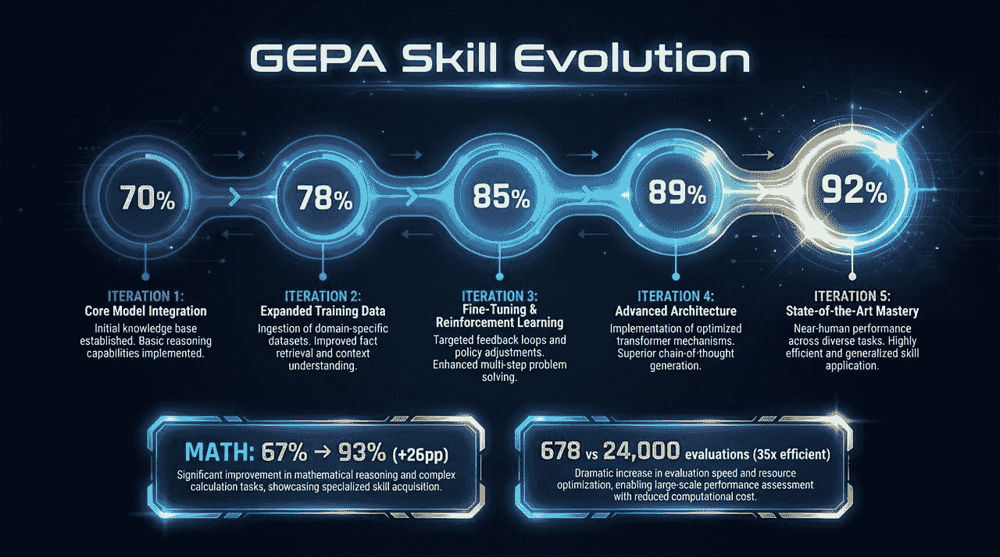

GEPA 会执行以下过程（约需 10-20 分钟，消耗 $2-5 API 调用费）：

| 迭代 | GEPA 做了什么 | 结果 |
| --- | --- | --- |
| 1 | 用当前 Skill 跑 5 个合成安全审计场景，收集执行轨迹 | 基线评分：72% |
| 2-3 | 分析失败轨迹，反思：&quot;Step 3 漏检了 .env.example 中的真实凭证&quot; | 反思报告生成 |
| 4-5 | 基于反思生成 3 个候选变体——变体 A 在 Procedure 中增加 &quot;check .env* files&quot; 步骤 | 3 个候选 Skill |
| 6-8 | 所有候选 + 原始 Skill 重新跑评估，收集准确性/简洁性/步骤完整性三个维度的分数 | 变体 A：85%，B：78%，C：81% |
| 9-10 | Pareto 选择：变体 A 在准确性和完整性上最优，变体 C 在简洁性上最优——两者都保留 | 2 个最优候选 |

最终，GEPA 将得分最高的变体以 PR 形式提交。你在 PR 中可以看到 Skill 的具体变化——比如 Procedure 部分新增了"检查 .env* 模式文件"的步骤，Pitfalls 部分增加了"注意 .env.example 可能包含真实值"的警告。审核通过后 merge，下次 Agent 做安全审计就自动使用优化后的版本。

关键安全约束：每个变体必须通过 100% 测试套件、Skill 文件不超过 15KB、不能破坏缓存兼容性。这些硬性约束保证了进化不会"变异出怪胎"。

#### 当前的实现状态

需要坦诚说明的是，GEPA **在 He**rmes Agent 中目前处于早期阶段：

| 阶段 | 优化目标 | 状态 |
| --- | --- | --- |
| Phase 1 | Skill 文件（SKILL.md） | 已实现 |
| Phase 2 | 工具描述（Tool Descriptions） | 计划中 |
| Phase 3 | 系统提示词段落 | 计划中 |
| Phase 4 | 工具代码本身 | 计划中 |
| Phase 5 | 持续自动优化 Pipeline | 计划中 |

目前只有 Phase 1 已实现——也就是 Skill 文件的进化优化。完整的五阶段自进化 Pipeline 还在路线图中。但即便只有 Phase 1，已经足以展示 Skill 系统"越用越好"的能力。

#### 成本与资源

一个好消息：GEPA 优化**不需要 GPU****，纯粹通过** API 调用完成。每次优化运行的成本在 $2-10 之间，取决于 Skill 的复杂度和迭代次数。

这意味着"让 Agent 自我进化"不是一个需要庞大计算资源的事情。一杯咖啡的钱，就能让一个 Skill 变得更好。

当然， 20-100。对于个人开发者来说，建议优先优化使用频率最高的 Skill，把预算花在刀刃上。

#### 为什么这很重要

把三层成长机制串起来看：

**第一层，记忆**：Agent 记住了你是谁、你喜欢什么、你的项目是什么。这是"认识你"。

**第二层，Skill 自动生成**：Agent 从工作经验中提炼出可复用的操作流程。这是"学会做事"。

**第三层，GEPA 进化**：Agent 不满足于"会做"，还要"做得越来越好"——分析失败、生成改进方案、多目标优化、人工审核后合并。这是"精益求精"。

从"认识你"到"学会做事"到"精益求精"——这是目前开源 Agent 框架中独一无二的完整学习闭环。

> 注：如果你对 GEPA 的算法细节感兴趣——比如 Pareto 前沿的具体选择策略、反思式变异的 prompt 设计、与 DSPy（Declarative Self-improving Python，一种声明式提示词优化框架）框架的集成方式——这些将在付费课程中深入讲解，并带你实际运行一次 Skill 进化优化。

#### Skills Hub 生态速览（v0.8.0）

Hermes Agent 的 Skill 不仅可以自动生成，还有一个社区生态——Skills Hub 提供了 643 个现成的 Skill 可供安装使用。不过数字背后的质量分布值得了解清楚。

#### 643 个 Skill 的真实构成

| 来源 | 数量 | 质量评估 |
| --- | --- | --- |
| **Built-in**（内置） | 77 | 官方维护，质量有保障。覆盖 GitHub 集成、YouTube 提取、PDF 编辑、LLM 微调等核心场景 |
| **Optional**（可选官方） | 45 | 官方出品但默认不启用，按需安装。包括 Stable Diffusion、claude-code（v2.0+v2.2）、popular-web-designs 等 |
| **Community**（社区贡献） | 521 | 质量参差不齐。其中大部分来自 LobeHub 批量导入（约 505 个），本质是通用提示词的 Skill 包装，实用性有限 |

**诚实说**：真正高质量、经过验证的 Skill 集中在 Built-in（77）和 Optional（45）共 122 个。社区贡献中的原创高质量 Skill 约十几个。生态仍处于早期阶段，但 122 个官方 Skill 已经覆盖了大多数日常使用场景。

#### 16 个分类一览

| 分类 | 数量 | 分类 | 数量 |
| --- | --- | --- | --- |
| Other | 348 | Productivity | 12 |
| Software Dev | 69 | Gaming | 11 |
| Creative | 54 | Social Media | 7 |
| MLOps | 42 | Health | 7 |
| Research | 37 | AI Agents / GitHub / Media / Security | 各 6 |
| Translation | 24 | Apple / Copywriting | 各 4 |

Other 分类占了一半以上——这主要是因为 LobeHub 批量导入的 Skill 大多被归到了"Other"。真正有参考价值的是 Software Dev（69）、Creative（54）、MLOps（42）、Research（37）这几个分类。

#### agentskills.io 开放标准

Hermes Agent 采用了 agentskills.io 开放标准（由 Anthropic 发起，联合多个 Agent 平台共同维护），目标是成为 Agent 世界的"npm"。核心设计：

+   **跨平台兼容**：同一个 Skill 文件可以在 Hermes Agent、Claude Code、Cursor、Codex 等多个 Agent 平台上使用

+   **渐进式披露**：三级加载机制（Level 0 仅名称描述约 3k tokens → Level 1 完整内容 → Level 2 引用文件），按需加载节省 token 消耗

+   **条件激活**：Skill 可声明平台限制（不兼容的 OS 自动隐藏）、Fallback 机制（指定工具不可用时作为替代）、依赖要求

#### 安全扫描

Skills Hub 对所有上架 Skill 进行安全扫描，检查以下风险：

+   **数据泄露**：Skill 是否尝试将敏感信息发送到外部

+   **Prompt 注入**：Skill 是否包含覆盖 Agent 行为的恶意指令

+   **破坏性命令**：Skill 是否包含 rm -rf、DROP TABLE 等危险操作

+   **供应链威胁**：Skill 依赖的包是否存在已知漏洞

> 注：安全扫描降低了风险但不能完全消除。安装社区 Skill 时建议先查看内容（Skill 本质是 Markdown 文件，可读性极强），确认没有可疑指令。HermesHub 社区站点（hermeshub.xyz）提供了额外的 65+ 条安全规则扫描。

---

## 6 课程收尾

### 6.1 混合模型成本优化：/model 热切换演示

四大案例到这里已经全部体验完了。收尾之前，我们来看一个马上就能用、马上就能省钱的实用技巧。

社区报告显示，Hermes Agent 在轻度使用下也可能 2 小时消耗 400 万 tokens。如果全程使用主力模型，账单不可忽视。v0.8.0 新增的 /model 热切换命令让我们可以在会话中随时切换模型——不需要退出对话，不需要修改配置文件。

#### 操作演示

在 hermes chat 会话中，输入 /model 查看当前模型和可用别名：

```
/model
  Current: deepseek-chat on DeepSeek

  Aliases: claude, codex, deepseek, gemini, glm, gpt, gpt5, grok,
  haiku, kimi, llama, mimo, minimax, nemotron, o3, o4, opus, qwen,
  sonnet, step, trinity
```

21 个模型别名，一条命令即可切换。比如切回 DeepSeek（确认当前配置）：

```
/model deepseek
  ✓ Model switched: deepseek-chat
    Provider: DeepSeek
    Context: 131,072 tokens
    Cost: $0.28/M in, $0.42/M out, cache read $0.03/M
    Capabilities: tools, vision, open weights
    (session only — add --global to persist)
```

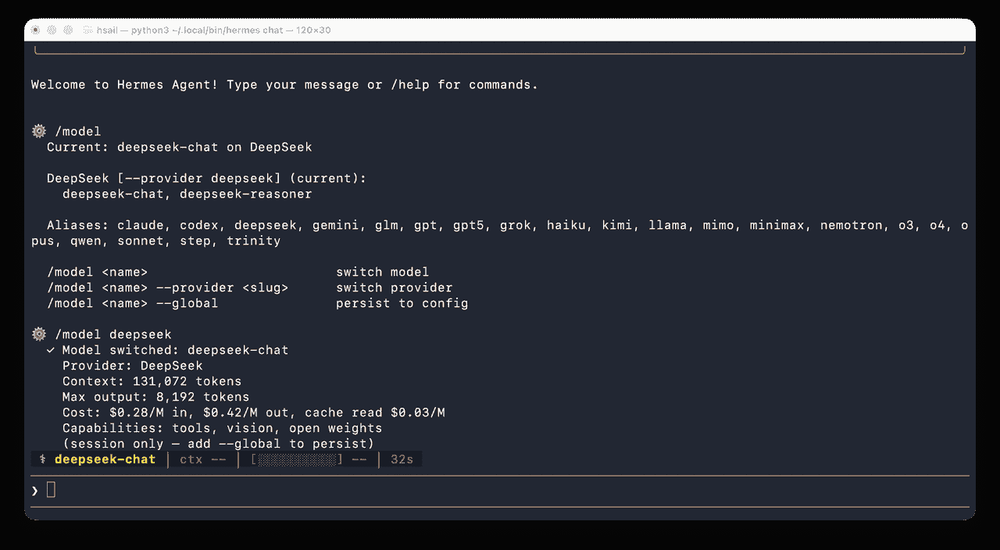

注意几个关键信息：

+   Provider: DeepSeek — 这是通过 DeepSeek 官方 API 直连的价格（ 0.42/M out），比通过 OpenRouter 中转便宜

+   cache read $0.03/M — DeepSeek 的缓存读取极其便宜，Agent 的多轮对话天然受益

+   **session only** — 切换默认只影响当前会话，加 --global 才会写入 config.yaml 持久化

+   **Capabilities** — 展示模型支持的能力（工具调用、视觉、开放权重）

命令格式一览：

| 命令 | 作用 |
| --- | --- |
| /model | 查看当前模型和可用别名 |
| /model &lt;name&gt; | 切换到指定模型（当前会话） |
| /model &lt;name&gt; --provider &lt;slug&gt; | 指定 Provider 切换 |
| /model &lt;name&gt; --global | 切换并持久化到 config.yaml |

#### 成本策略建议

混合模型策略的核心思路：日常对话用便宜模型，复杂推理临时切到主力模型。

| 场景 | 推荐模型 | DeepSeek 直连价 | 切换命令 |
| --- | --- | --- | --- |
| 日常对话、简单问答 | DeepSeek Chat | 0.42 per M | /model deepseek |
| 需要推理的复杂分析 | 其他主力模型 | 按 Provider 定价 | /model &lt;name&gt; |

> **Watch-out**：切换到非 DeepSeek 的模型（如 kimi、claude、gpt 等）需要配置对应 Provider 的 API Key。如果你只配置了 DeepSeek API Key，切换到其他模型会报错。大部分第三方模型通过 OpenRouter 中转访问，需要额外配置 OpenRouter API Key。

#### 关于 MiMo v2 Pro

Nous Portal（Nous Research 的官方模型服务平台）提供了免费的小米 MiMo v2 Pro 模型，适合辅助性任务（压缩、摘要等）。使用方式：先在 Nous Portal 注册账号，然后用 /model mimo --provider nous 切换。

#### Token 消耗提醒

Hermes Agent 的 Agent 循环（思考 -> 选择工具 -> 执行 -> 观察 -> 再思考）本身会消耗比普通对话更多的 tokens。社区报告的"2 小时 400 万 tokens"不是浪费，而是 Agent 在认真"思考"的代价。混合模型策略 + DeepSeek 的低价缓存读取（$0.03/M），可以显著控制使用成本。

> 注：模型定价基于 2026 年 4 月 /model 命令的实际输出，请以你执行时的实际显示为准。模型版本和定价随时可能更新。

### 6.2 前沿特性全景表（v0.8.0）

我们用四大案例体验了 Hermes Agent 最核心的能力。但 v0.8.0 的能力远不止这些——下面这张表列出了 8 项前沿特性，帮助大家了解 Hermes Agent 的完整版图和未来方向。

| # | 特性 | 一句话说明 | 当前状态 |
| --- | --- | --- | --- |
| 1 | **GEPA 进化引擎** | 基于遗传算法的多目标优化，让 Skill 自动&quot;越写越好&quot;。ICLR 2026 Oral Paper，独立仓库 hermes-agent-self-evolution | Phase 1（Skill 文件进化）已实现，Phase 2-5 在路线图。每次优化成本 $2-10 |
| 2 | **插件开发系统** | 6 个生命周期钩子（pre/post_tool_call、pre/post_llm_call、on_session_start/end），开发者可扩展 Agent 的任何环节。v0.8.0 新增 CLI 子命令注册和 session lifecycle hooks | 已稳定，支持 pip 分发 |
| 3 | **MCP + OAuth 2.1** | 连接外部 MCP Server 扩展工具能力。v0.8.0 加入完整 OAuth 2.1 PKCE 标准认证 + OSV 漏洞扫描，防止供应链攻击 | 已稳定 |
| 4 | **ACP IDE 集成** | Agent Client Protocol（由 JetBrains 和 Zed 联合发起的开放标准）适配器，让 VS Code、Zed、JetBrains 等 IDE 直接调用 Hermes Agent | 已可用 |
| 5 | **混合模型策略** | /model 热切换 + 免费 MiMo v2 Pro 辅助模型。日常用便宜模型，复杂推理切主力——我们刚刚演示过 | v0.8.0 新增，已在上一节体验 |
| 6 | **社区生态** | awesome-hermes-agent 收录了 hermes-workspace（Web GUI，500+ Stars）、mission-control（Fleet 管理，3700+ Stars）、hermes-life-os（个人 OS）等项目 | 快速生长中 |
| 7 | **Batch + RL 训练** | Batch 模式批量处理任务；RL 工具集支持强化学习训练（关联 tinker-atropos 项目） | 可用但较专业 |
| 8 | Hermes as MCP Server | hermes mcp serve 让其他 MCP 客户端调用 Hermes Agent 的能力——Agent 本身也可以是工具 | 已可用 |

#### 这些特性意味着什么？

今天我们体验的四大案例（Terminal Agent、飞书助手、持久记忆、Skill 自主进化）是 Hermes Agent 的基础能力层。上表中的前沿特性代表着它的扩展方向：

+   **向深处走**：GEPA 让 Skill 不只是"有"，而是"自动越来越好"

+   **向广处走**：插件系统 + MCP 让 Agent 的能力边界不断扩展

+   **向外连接**：ACP + MCP Server 模式让 Hermes Agent 融入更大的 AI 生态

> 注：以上特性的深入实操将在付费课程《Agent 开发实战》中展开——插件开发、MCP 集成、GEPA 优化流程都会有完整的动手环节。

### 6.3 课程总结：四大案例验证了 Harness 的四层

两节课的旅程走到这里，我们做一个完整的回顾。

#### 四个问题，四个案例，四层验证

还记得课程开始时的四个问题吗？现在每一个都有了亲手验证的答案：

"Agent 和聊天机器人到底有什么区别？"

案例 A 给出了最直观的回答。我们让 Hermes Agent 完成了一个复合终端任务，亲眼看到了 ReAct 循环的每一步——思考该用什么工具、执行、观察结果、再决定下一步。聊天机器人只会回复文字，Agent 会动手干活。这个区别不是概念上的，而是你在终端里看到的实时过程。

"能不能让 Agent 活在手机上？"

案例 B 证明了可以。通过消息网关（Gateway），同一个 Hermes Agent 实例同时服务终端和飞书。SOUL.md 给了 Agent 人格，hermes cron 给了 Agent 主动性。从终端工具变成手机上的 24 小时 AI 助手——Agent 走出了终端。

"Agent 真的能记住我吗？"

案例 C 回答了"能"，而且不是简单的"记住聊天记录"。四层记忆架构各司其职：MEMORY.md 存 Agent 的核心笔记，USER.md 自动画你的用户画像，SQLite FTS5 在万级会话中毫秒级检索，Holographic Provider 提供无依赖的持久语义记忆。我们还理解了 Frozen Snapshot 不是 bug 而是精心的工程权衡——牺牲即时可见性，保护前缀缓存性能。

"Agent 能不能越用越聪明？"

案例 D 是全课的高潮。我们亲身经历了 Skill 三阶进化：无 Skill 时的探索试错 → 自动生成后的效率提升 → GEPA 进化优化后的质量跃迁。Agent 不只是"有一个 Skill 列表"——它从经验中自动提炼操作流程，而且这些流程会自我进化。这是目前开源 Agent 框架中独一无二的能力。

#### 回到 Harness Engineering

Lesson 1 我们学到了一个关键概念：Agent = Model + Harness。Harness 是模型之外的一切——工具、记忆、错误恢复、验证循环。好的 Harness 设计，比换一个更强的模型，投入产出比更高。

今天的四大案例，恰好分别验证了 Harness 的四个层级：

| Harness 层级 | 验证案例 | 你亲手做了什么 |
| --- | --- | --- |
| L1 运行时基座 | 案例 A：Terminal Agent | 47 个内置工具 + ReAct 循环驱动多步任务 |
| L2 消息网关 | 案例 B：飞书 AI 助手 | 一个 Agent 进程适配 14+ 平台，WebSocket 无需公网 IP |
| L3 持久记忆 | 案例 C：四层记忆 | MEMORY.md + SQLite FTS5 + Holographic Provider + 安全扫描 |
| L4 Skill 自主进化 | 案例 D：三阶进化 | 自动 Skill 生成 + GEPA 反思式进化优化 |

这不是巧合——Hermes Agent 的架构本身就是 Harness Engineering 思想的完整体现。每一层 Harness 都在解决模型自己做不了的事情：模型不会操作文件系统，所以需要工具层；模型不会连飞书，所以需要网关层；模型记不住上一次对话，所以需要记忆层；模型不会从经验中学习，所以需要 Skill 进化层。

---

+   公开课课件领取

