# 企业私有化NL2SQL模型微调实战

> 来源：[https://kq4b3vgg5b.feishu.cn/docx/La5Ad9ENyoxbjbxlPMEc1yepnge](https://kq4b3vgg5b.feishu.cn/docx/La5Ad9ENyoxbjbxlPMEc1yepnge)

## 课程说明：

+   体验课内容节选自《2025大模型Agent智能体开发实战》(11月班)完整版付费课程

体验课时间有限，若想深度学习大模型技术，欢迎大家报名由我主讲的《2025大模型Agent智能体开发实战》(11月班)

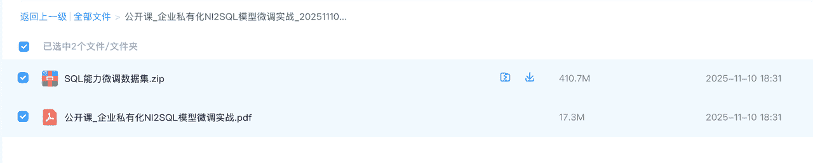


NL2SQl 微调数据链接➡️链接: https://pan.baidu.com/s/1Fsl53jyPk0i0fSDJaDEurQ  密码: pbvt ，更多大模型学习内容详情可扫码添加助教老师咨询详情

---

# 《大模型Agent开发实战》（体验课）

## 企业私有化NL2SQL模型微调实战

### 让你的模型更懂数据

# 1 什么是NL2SQL

**NL2SQL，全称是 Natural Langua**ge to SQL（自然语言转 SQL）。

简单说，它是一种让电脑**“听懂人话”并自动生成数据库查询语句**的技术。

## 为什么会产生 NL2SQL 技术？

在数据时代，企业每天都**在积累大量结构化数据：

销售报表、客**户信息、财务数据、订单记录……

这些数据都保存在数据库中，而要访问这些数据，

人们必须使用一种叫做 SQL（结构化查询语言，Structured Query Language） 的语言。

但问题是：

+   SQL 是给程序员用的。

+   普通业务人员不会写 SQL。

+   他们常常要依赖技术人员帮忙查询数据。

举个例子：

一个市场人员想知道：

> “上个月哪种商品卖得最好？”

他必须请工程师写出类似这样的 SQL 语句：

```
SELECT product, SUM(sales)
FROM sales_table
WHERE month = &#x27;2025-10&#x27;
GROUP BY product
ORDER BY SUM(sales) DESC
LIMIT 1;
```

这对于非技术人员来说是“天书”。

而企业内部每天都在产生大量类似的需求：

几十个业务人员都要问各种各样的“查数据”问题。

这导致：

+   工程师重复劳动；

+   业务决策延迟；

+   数据使用门槛高。

于是，一个新的想法出现了：

能不能让计算机直接理解自然语言的问题，自动生成 SQL？

这就是 **NL2SQL 技术诞生的起点。**

## NL2SQL 是什么？

它的目标非常明确：

> 让不会写 SQL 的人，也能用普通话或英文直接向数据库提问。

例如：

用户输入：

> “查询2024年每个省份的平均销售额。”

系统自动生成：

```
SELECT province, AVG(sales)
FROM sales_table
WHERE year = 2024
GROUP BY province;
```

输出结果后，还可以用表格或图表展示。

这样，一个不懂编程的普通人，也能像和人说话一样查询数据。

## 技术的起源与发展历程

**NL2SQL 的研究起**源可以追溯到 2016–2017 年。

当时，深度学习快速发展，机器翻译技术已经能做到“英语翻译成中文”。

于是研究者提出：

> “既然模型能把一种人类语言翻译成另一种语言，

> 那能不能把人类语言翻译成计算机语言（SQL）？”

于是出现了第一批“自然语言转SQL”论文与系统。

**发展阶段如下：**

1.  规则与模板阶段（2015年前后）
最早的系统是人工写模板。
例如，“总销售额”匹配 SUM(sales)，
“上个月”匹配 WHERE month = '上个月'。
优点：快。缺点：只能处理固定问题。

1.  深度学习阶段（2017–2020）
代表模型：

+   Seq2SQL（Salesforce 2017）

+   SQLNet（2018）

+   SyntaxSQLNet（2019）
它们使用类似机器翻译的结构：输入一句自然语言 → 输出 SQL。
并首次引入大规模训练集（如 WikiSQL 数据集）。

1.  **大模型阶段（2023年至今）**
随着 ChatGPT、通义千**问、DeepS**eek、Qwen 等大语言模型兴起，
NL2SQL 被视为最实用的“企业级落地任务”之一。
现在人们通常在这些大模型上做 LoRA 微调，
让模型专门理解自家数据库的结构，实现“AI 数据助手”。

## 技术的核心原理

**从技术上讲，NL2SQL **是一种 语义理解 + 语法生成任务。

工作过程分为三步：

1.  **理解阶段（理解人话）**
模型分析自然语言问题，提取关键要素。
例如：

1.  “查一下去年每个部门的平均工资。”
模型要识别出：

+   时间字段：去年 → year = 2024

+   分组字段：部门 → department

+   聚合指标：平均工资 → AVG(salary)

1.  **生成阶段（生成SQL语句）**
模型在理解语义后，根据数据库的表结构（schema），
组合出符合语法的 SQL 查询：

```
SELECT department, AVG(salary)
FROM employee
WHERE year = 2024
GROUP BY department;
```

1.  **验证阶段（检查并执行）**
系统验证字段是否存在、语法是否正确，
执行查询并返回结果。
高级系统还能把结果转成图表或文字描述。

整个流程就是：

自然语言 → 模型理解 → 生成 SQL → 数据库执行 → 输出结果。

## 典型实现方式

目前的主流实现有三种：

1.  **规则式方法（早期）**
通过关键词匹配和模板生成 SQL。
优点：实现简单。
缺点：灵活性差，无法泛化。

1.  神经网络方法（2017–2020）
使用编码器-解码器（Encoder–Decoder）结构。
输入一句自然语言，模型自动输出SQL文本。
类似“机器翻译”的方式。

1.  **大模型驱动（当前主流）**
基于 LLM（如 Qwen2.5、DeepSeek-Coder、Llama3）微调，
在特定数据库 schema 上训练问答对数据（instruction → SQL）。
训练方式通常是 LoRA 或 QLoRA，
可以在一张 24G 显卡上完成。

## 训练数据与任务格式

训练数据由“自然语言问题 + SQL语句”构成。

常见格式如下：

```
{
  &quot;instruction&quot;: &quot;查询2024年每个城市的销售额总和&quot;,
  &quot;output&quot;: &quot;SELECT city, SUM(sales) FROM sales_table WHERE year=2024 GROUP BY city;&quot;
}
```

典型公开数据集包括：

+   **WikiSQL**：早期英文数据集（63,000对问答）

+   **Spider**：学术界权威复杂SQL数据集（耶鲁大学）

+   **CSpider**：中文版本（清华大学发布）

+   BIRD / KaggleSQL：企业级复杂场景数据集

## 总结

NL2SQL 的产生，是为了让人与数据库之间的交互更自然、更高效。

它的诞生并非偶然，而是由以下三点推动的必然结果：

1.  数据查询需求极大，但 SQL 门槛高。

1.  自然语言处理和深度学习技术的成熟。

1.  企业希望AI真正“落地”到数据分析业务中。

> NL2SQL 是一种让计算机“听懂人话、查数据库”的人工智能技术，

> 也是大语言模型在企业中最容易实现价值的应用方向之一。

# 2 为什么需要 Nl2sql

## 数据越来越多，但能读懂数据的人越来越少

现代企业的每个业务系统（销售、库存、客服、财务）都有自己的数据库。

这些数据库里保存着海量的结构化数据：

+   客户记录

+   订单信息

+   营销活动结果

+   财务流水

**但这些数据并不是直接可读的。**

它们存在于数据库表格中，只能通过 SQL 查询语句访问。

例如，一个最简单的问题：

> “上个月的总销售额是多少？”

在数据库中要写成：

```
SELECT SUM(sales) 
FROM sales_table 
WHERE month = &#x27;2025-10&#x27;;
```

**对于没有编程经验的人来说，**这是一个难题。

这意味着——

虽然企业拥有大量数据，但大多数员工无法直接获取这些数据的价值。

他们只能找懂 SQL 的工程师帮忙查询，这就导致效率低下。

## 传统数据查询方式效率极低

以企业日常工作为例：

| 角色 | 传统做法 | 问题 |
| --- | --- | --- |
| 业务人员 | 提需求：“帮我查一下每个地区的销售排名” | 不会SQL，依赖别人 |
| 数据分析师 | 手动写SQL、调试、生成报表 | 工作量大、重复性高 |
| 管理者 | 等报告结果出来再决策 | 延迟决策，影响效率 |

数据分析从“提问”到“得到答案”，往往要经过：

+   需求沟通

+   SQL编写

+   数据验证

+   图表制作

+   报告发送

整个流程可能要几小时甚至几天。

而 NL2SQL 的目标是：

> “让这整个过程变成一句话就能完成。”

你只需说：

> “给我看一下上个月销售额最高的城市。”

> 系统就会立刻返回结果。

## 3. 技术与业务之间存在语言鸿沟

企业里，技术人员和业务人员“说的不是同一种语言”：

| 问题 | 技术角度 | 业务角度 |
| --- | --- | --- |
| 想查销售额 | 想知道哪个SQL字段是sales | 想知道哪个地区卖得好 |
| 想查利润 | 需要看profit_rate公式 | 只关心“赚了多少钱” |

这种“语言鸿沟”导致沟**通困难、理解成本高。

N**L2SQL 的出现，就是在这两者之间架起桥梁。

它让机器学会理解业务语言，再自动转换成数据库能懂的SQL语言。

简单说，它是：

> “业务语言 → 数据库语言”的翻译器。

## 数据分析的“民主化”趋势

过去，数据分析是技术团队的专属工作。

但今天，企业希望：

+   每个部门都能自己看数据；

+   每个人都能做数据决策；

+   不再依赖工程师。

这就是所谓的 数据分析民主化（Data Democratization）。

要实现这一点，必须降低数据查询门槛。

NL2SQL 就是最直接的解决方案：

> 不懂SQL，也能查数据。

> 说人话，机器帮你写SQL。

它让“人人都能用数据”成为可能。

## 5. 企业AI落地的关键入口

对很多企业来说，大语言模型（如ChatGPT、通义、Qwen）要落地最困难的一步是：

> “怎么让模型真的帮到业务？”

而 NL2SQL 是目前公认的最容易落地、最有价值的AI场景之一，因为：

+   企业数据都在数据库中；

+   NL2SQL 直接让模型访问这些数据；

+   可以快速集成进现有的BI或报表系统。

例如：

> 用户对企业AI助手说：“告诉我过去三个月客户流失率的变化趋势。”

> AI助手 → 生成SQL → 调数据库 → 输出图表。

这种自动问答能力，是企业真正用得上的“AI智能分析”。

## NL2SQL 能解决哪些具体问题？

我们从三个角度来看：**人、流程、价值**。

## 1. 对“人”的问题：

让不会SQL的人，也能用数据工作。

+   产品经理可以自己查用户活跃数据

+   销售经理可以自己看各地区业绩

+   老板可以自己问AI：“我们本季度利润是多少？”

→ 数据不再被技术垄断。

## 2. 对“流程”的问题：

**让数据查询流程自动化、实时化。**

| 传统方式 | NL2SQL方式 |
| --- | --- |
| 写SQL + 等报表 | 自然语言提问 |
| 工程师支持 | AI自动生成SQL |
| 几小时/几天出结果 | 几秒钟响应 |

→ 决策速度更快，反馈更及时。

## 3. 对“企业价值”的问题：

**让数据真正“流动”起来。**

过去企业的数据系统像一个封闭仓库：

数据很多，但难以访问。

NL2SQL 就像加了一个智能接口，

让每个人都能自由查询、实时分析，

从而推动：

+   精准决策

+   效率提升

+   成本降低

## 从更高层看：NL2SQL 的战略意义

1.  **是企业数据智能化的第一步**
它让数据库变成“可对话的系统”，
是从“数据存储”到“数据理解”的关键跨越。

1.  **是构建企业私有大模型的重要场景**
企业可以在自己的数据上微调 NL2SQL 模型，
实现内部知识的自动查询。

1.  **是“人机协作”的典型体现**
人负责提出问题，AI负责生成SQL与分析结果，
这种协作模式极大提高了生产力。

## 总结

> NL2SQL 技术的核心价值在于：

> 它解决了人和数据之间的沟通障碍，

> 让任何人都能用自然语言访问数据库。

> 它让数据从“专业工具”变成“人人可用的智能资源”，

> 让企业从“数据驱动”真正走向“智能驱动”。

# 3 企业中Nl2sql作用

## 先想象一个真实的公司场景

假设你在一家卖化妆品的公司上班，公司每天都会产生很多数据：

| 数据类型 | 存放位置 |
| --- | --- |
| 销售数据（商品、地区、时间） | 销售数据库 |
| 客户信息（年龄、地区、购买记录） | CRM系统 |
| 进货与库存数据 | ERP系统 |
| 投放广告的数据 | 营销数据库 |

**这些数据都**在数据库里，而想查这些数据只能用 SQL语句。

## 传统的做法：靠人写 SQL

比如市场部经理想知道：

> “上个月哪个城市的口红销量最高？”

他得找数据分析师或程序员，程序员写：

```
SELECT city, SUM(sales)
FROM product_sales
WHERE month = &#x27;2025-10&#x27; AND category = &#x27;口红&#x27;
GROUP BY city
ORDER BY SUM(sales) DESC
LIMIT 1;
```

然后把结果**导成表格发给经**理。

整个过程要几小时甚至几天。

一个部门几十个人天天这样问数据问题，

工程师要被问疯。

## 引入 NL2SQL 技术后会发生什么？

现在公司部署了一个 **“智能数据问答系统”**，

它背后用的就是 NL2SQL 技术。

经理登录系统，只需要输入一句自然语言：

> “帮我查一下上个月口红销量最高的城市。”

系统自动做三件事：

1.  **理解问题意思**（NL理解部分）
→ 知道“上个月”是时间，“口红”是商品类别，“城市”是分组维度。

1.  **生成SQL语句**（NL2SQL模型）
→ 模型自动生成正确的SQL：

```
SELECT city, SUM(sales)
FROM product_sales
WHERE month = &#x27;2025-10&#x27; AND category = &#x27;口红&#x27;
GROUP BY city
ORDER BY SUM(sales) DESC
LIMIT 1;
```

1.  **连接数据库执行并返回结果**
系统直接显示结果，比如：

1.  “2025年10月口红销量最高的城市是广州，销量1320万元。”

这就是企业内部使用 NL2SQL 的核心流程。

## 在企业中它具体是怎么“落地”的？

### 情况一：嵌入到现有的报表系统中

公司本来就用 BI 工具（例如 Power BI、FineBI、永洪BI、Tableau）。

现在加了一个输入框，用户直接输入自然语言问题。

BI系统内部调用 NL2SQL 模型，把问题转成SQL再查数据库。

**就像你在百**度搜索栏里问问题一样，只不过它查的是公司数据库。

### 情况二：做成一个“AI数据助手”

公司内部搭建一个聊天机器人，

放在钉钉、飞书或企业🛰️上。

你在群里对它说：

> “帮我看下今天的订单量。”

> “上周哪个城市退货最多？”

机器人直接在后台生成SQL，查数据库，然后回复你结果。

这就是典型的 **NL2SQL + 企业IM集成** 模式。

很多公司已经在这样用，比如字节、阿里、京东的内部系统。

### 情况三：做成“数据中台”的一部分

大公司会有自己的 **数据中台**（Data Platform）。

它有大量数据库、数据仓库（Hive、ClickHouse、MySQL等）。

NL2SQL 模型会作为“中台服务”，

提供一个统一的接口给所有部门的系统调用。

例如：

+   营销系统调用它来自动生成报表；

+   财务系统调用它做利润分析；

+   人力系统调用它查人效数据。

**这时 NL2**SQL 已经不是一个工具，而是一种企业底层能力。

## 谁在使用 NL2SQL？

| 使用人群 | 使用方式 | 场景举例 |
| --- | --- | --- |
| 业务经理 | 输入自然语言问题 | “这周销售额同比增长多少？” |
| 数据分析师 | 半自动生成SQL后再调整 | 节省写SQL时间 |
| 高层管理 | 语音提问、查看可视化图表 | “过去三个月利润趋势” |
| 客服人员 | 查询客户订单信息 | “查一下客户张三的订单状态” |

→ 所有这些人都不需要再去写SQL，只需“问问题”即可。

## 公司部署时的组成部分

NL2SQL系统不是一个单独的文件，而是由几部分组成的：

1.  **前端界面**：业务人员用来输入问题（Web界面/聊天窗口）。

1.  **NL2SQL模型**：把自然语言转换成SQL。

1.  **数据库接口层**：负责安全地执行SQL。

1.  **结果展示层**：把查询结果变成表格或图表返回给用户。

可以想象为这样一个流程：

自然语言问题

↓

→ NL2SQL 模型生成 SQL

↓

→ 查询数据库

↓

→ 把结果转成图表或文字返回

## 企业这样用NL2SQL能带来什么好处？

1.  **效率提升**
业务人员不再等分析师出报表，
问一句话几秒钟就能拿到数据。

1.  **成本降低**
减少重复性SQL工作，分析师能做更复杂的分析。

1.  **决策更快**
管理层能实时看到关键指标变化。

1.  **人人能用数据**
数据真正“流动起来”，实现企业“数据民主化”。


# 4 Nl2sql的技术价值在哪？

**一句话：**

> NL2SQL 的技术价值在于——

> 它打通了“自然语言世界”和“结构化数据世界”的边界，

> 让 AI 能直接理解人类的问题并操作数据库。

换句话说，它是 **人类语言 → 机器数据语言** 的桥梁。

这种桥梁，不仅让人可以直接问数据库，还让所有大模型真正具备了“理解企业数据”的能力。

## 从技术角度看：NL2SQL 的核心突破点

1.  把语义理解能力落地到了数据库层面
传统的 NLP 模型能理解文字、回答问题，但不能直接操作数据库。
NL2SQL 把自然语言理解（NLU）和数据库语法生成结合起来，
让模型能“理解业务问题”并用 SQL 表达出来。
这是 NLP 与结构化数据结合的关键技术突破。

1.  结构化输出（Structur**ed Generation）**能力
普通语言生成模型输出的内容是不确定的，而 SQL 有严格语法。
NL2SQL 模型必须生成 结构化、可执行、可验证的代码。
这类任务训练了模型的“程序化思维”和“约束生成能力”。
→ 它是 AI 从“语言理解”迈向“逻辑生成”的代表性任务。

1.  语义对齐（Semantic Alignment）技术的典型应用
模型要把自然语言里的“意思”对齐到数据库字段上。
例如：

1.  “客户” → customer_name
“上个月” → date BETWEEN 2025-10-01 AND 2025-10-31
这种语义映射能力，是当前多模态和企业知识问答系统的核心基础。

1.  **为企业数据智能化提供接口标准**
数据库是企业信息的核心，而 SQL 是访问它的唯一标准语言。
NL2SQL 就像一个“通用接口”，让任何语言模型都能用自然语言与数据库交互。
它让大模型不仅“能聊天”，还能“理解并操作真实数据”。

## 从业务角度看：它让 AI 真正能落地

1.  AI 不再停留在聊天层，而能操作真实业务数据
传统的 ChatGPT 聊天模型只能回答文字问题，不能访问数据库。
有了 NL2SQL，AI 就能：

+   查公司销售额、客户数据、库存情况；

+   帮你生成报表、发现问题；

+   实时支持业务决策。

1.  → 这是“AI聊天”到“AI办公/AI决策”的跨越。

1.  **让业务人员直接与数据对话**
业务人员不用再找技术人员帮忙查数据，
直接用自然语言就能得到结果。
这意味着：数据的使用权从“技术部门”走向“全员共享”，
实现企业数据的“民主化”。

1.  **让数据真正被用起来**
很多企业的数据躺在数据库里没人动，
NL2SQL 的出现让数据变得可访问、可理解、可利用。
数据分析从“IT行为”变成“日常行为”。

## 从效率角度看：它大幅降低“数据查询成本”

| 项目 | 传统方式 | NL2SQL方式 |
| --- | --- | --- |
| 查询门槛 | 必须懂SQL | 用自然语言提问 |
| 响应速度 | 几小时到几天 | 几秒 |
| 技术依赖 | 依赖数据分析师 | 业务人员直接使用 |
| 成本 | 高（人力+沟通） | 低（AI自动生成） |

结果：

+   公司内的每个人都能即时获取数据，

+   决策周期从“天”级变成“分钟”级。

## 从智能化角度看：NL2SQL 是 AI 走向“数据智能”的第一步

在 AI 应用的体系中，智能程度可以分为三个阶段：

| 阶段 | 特征 | 举例 |
| --- | --- | --- |
| 智能理解 | 能听懂你说什么 | 聊天问答（ChatGPT） |
| 智能操作 | 能把语言变成具体动作 | NL2SQL（执行SQL查询） |
| 智能决策 | 能基于数据做推理与建议 | 数据智能体、BI决策助手 |

→ NL2SQL 正好是第二步：

它让 AI 从“理解你”发展到“为你做事”。

当模型能自动生成 SQL、执行查询、总结结果时，

它就具备了“自主完成分析任务”的能力。

## 从产业链角度看：NL2SQL 是 AI + 数据的连接器

企业的数据大多存在数据库里（MySQL、ClickHouse、Hive等），

而大语言模型理解的是文本。

NL2SQL 技术的出现，让两者第一次连通：

```
自然语言（人类输入）
   ↓
NL2SQL 模型（语义理解+SQL生成）
   ↓
结构化数据库（企业数据）
```

这条链的打通，使得大模型能**访问、理解并分析真实企业数据**，

是所有企业级AI应用（智能BI、RAG增强问答、数据Agent）的底层支撑。

## 从长期价值看：它推动了“数据智能化”的转型

1.  让企业从“报表驱动”变成“问题驱动”
过去：要报表才能看数据。
现在：只需提问题，系统自动生成报表。

1.  让数据分析变成交互式、实时的体验
不再依赖静态报表，每次问都能得到最新结果。

1.  **让AI深入企业决策流程**
当管理层能实时问AI“我们的利润下降的主要原因是什么？”
AI 就能生成 SQL → 查数据 → 汇总分析 → 自动生成结论。
这就是企业智能决策的雏形。

## 八、总结：NL2SQL 的技术价值

| 维度 | 价值 |
| --- | --- |
| 技术价值 | 打通自然语言与结构化数据之间的鸿沟，提升AI的结构化生成与语义对齐能力。 |
| 应用价值 | 让AI能理解并访问企业数据库，实现自然语言问数据。 |
| 效率价值 | 降低数据使用门槛，大幅提升分析与决策效率。 |
| 战略价值 | 成为企业数据智能化、AI化的重要基础模块。 |

一句话总结：

> NL2SQL 是让大模型真正“动手干活”的第一步。

> 它让AI不只是会聊天，而是能直接访问数据库、理解业务、辅助决策。

# 5 Nl2sql为什么要微调？

## 模型已经“会写 SQL”，那为什么还要微调？

如今的大语言模型（**比如 Qwen、D**eepSeek、ChatGPT）天生就能生成 SQL，

但它们的知识来源是通用公开数据库语料，不是你公司的真实数据结构。

所以在企业场景里，它常常写出这种 SQL：

```
SELECT region, SUM(amount)
FROM sales
WHERE month = &#x27;2025-10&#x27;;
```

问题是——

你公司真实的数据库长这样：

```
sales_data(
  area_name,   -- 地区
  total_sales, -- 销售额
  sale_date    -- 日期
)
```

结果是：模型生成的 SQL 根本跑不通。

因为字段名全错，语义对不上。

这就是NL2SQL“通用模型”与企业数据之间的鸿沟。

而“微调（Fine-tuning）”的目的，就是让模型学会你公司特有的数据库语言与业务逻辑。

## 什么是NL2SQL 微调？

> 把模型从“会写 SQL”训练成“会写你公司能用的 SQL”。

你会准备一批这样的样本来教它：

| 自然语言问题 | 正确 SQL |
| --- | --- |
| 查上个月销售额最高的地区 | SELECT area_name, SUM(total_sales)... |
| 查退单最多的商品 | SELECT product, COUNT(*) FROM orders WHERE refund=1... |
| 看看华东地区上周平均利润 | SELECT region, AVG(profit) FROM ... WHERE week=last_week AND region=&#x27;华东&#x27;; |

训练完后，模型就能自动理解你公司的说法，比如：

+   “销售额”= total_sales

+   “上个月”= 根据 sale_date 动态计算

+   “退单”= refund=1

## 为什么要微调（核心价值）

### 1. 解决“字段不匹配”的问题

每家公司数据库字段名都不一样。

不微调的模型不知道你的表结构，会生成错误字段。

微调后，它能根据你的数据结构生成正确SQL。

### 2. 解决“语义不一致”的问题

不同公司对同一词汇的定义不一样，比如：

+   “销售额”是含税还是不含税？

+   “利润”是否减去市场费用？

+   “老客”定义是几次购买？
这些都得教给模型，否则它会乱猜。

### 3. 解决“语法差异”的问题

不同数据库方言不一样：

+   MySQL、ClickHouse、Presto、BigQuery 函数名不同；

+   有的要用 date_format()，有的要用 toDate()；

+   有的支持 LIMIT，有的必须用 TOP。

微调能让模型学习你环境下的SQL写法。

### 4. 解决“业务语言太口语化”的问题

业务人员不会用精确词汇，他们问的都是：

> “上个月哪个城市卖得最好？”

> “最近退单是不是多了？”

> “看看北方市场趋势呗？”

> 模型要懂得这些模糊表达，需要经过微调适配。

### 5. 解决“稳定性与落地性”问题

+   企业使用时，AI不能乱写SQL；

+   微调后的模型可以更可控、更安全；

+   能减少人类审核与报错率，提高生产级可靠性。

## 举个真实企业应用例子

假设一家连锁零售公司每天有大量数据：

| 数据类型 | 存放位置 |
| --- | --- |
| 销售记录 | MySQL 数据库 |
| 库存信息 | ERP 系统 |
| 客户信息 | CRM 系统 |

业务人员每天都在问：

> “上个月哪个地区销售额最高？”

> “哪个店铺库存压力最大？”

> “最近复购率是不是下降了？”

过去要找数据分析师写SQL，比如：

```
SELECT store, SUM(sales)
FROM sales_table
WHERE month=&#x27;2025-10&#x27;
GROUP BY store
ORDER BY SUM(sales) DESC
LIMIT 1;
```

分析师要人工写、调、改，几小时才能出报表。

现在公司部署了一个 NL2SQL 模型：

+   前端是一个聊天框或BI系统；

+   用户输入自然语言问题；

+   模型自动生成SQL；

+   系统执行并可视化输出。

但是——

未经微调的模型一开始根本跑不通。

它不知道：

+   哪张表放销售额？

+   “门店”字段叫什么？

+   “上个月”在公司系统里怎么算？

+   “复购率”是怎么算出来的？

微调之后，它学会了这些规律，就能真正理解公司内部的语义：

> “上个月卖得最好的门店”

> → 自动生成正确的SQL → 查数据库 → 输出图表。

这时，AI 才从“演示级”变成“生产级”。

## 五、什么时候需要微调？

| 场景 | 是否需要微调 | 原因 |
| --- | --- | --- |
| 单表、字段简单 | 不一定 | 通用模型能应付 |
| 数据结构固定、问题可模板化 | 不一定 | 用 few-shot 示例就行 |
| 字段多、表多、JOIN多 | 需要 | 通用模型难处理复杂逻辑 |
| 有特定业务口径（利润、GMV、老客） | 需要 | 每家定义不同 |
| 用在生产环境、多人访问 | 必须 | 要求高准确率与稳定性 |
| 给业务/运营人员直接使用 | 必须 | 需要能理解口语化问题 |

一句话总结：

> 要长期上线、要高准确率、要懂你业务，就得微调。

## 什么时候可以不微调？

1.  数据简单、字段清晰

1.  只是内部测试、Demo、概念验证（PoC）

1.  业务问题固定（可以写死模板）

1.  用户技术背景强（能读懂字段）

1.  有清晰表结构提示（prompt里注入 schema）

这种情况下，只要通过：

+   在提示里加上表结构

+   给几条示例

+   限制 SQL 生成格式
模型就能跑通，不必微调。

## 七、微调之后的效果变化（对比）

| 对比项 | 未微调模型 | 微调后模型 |
| --- | --- | --- |
| 字段匹配率 | 40–60% | 90%以上 |
| SQL 可执行率 | 50%左右 | 95%以上 |
| 业务语义理解 | 偶尔对 | 基本稳定 |
| 响应速度 | 快但错 | 稍慢但准 |
| 可落地性 | 演示级 | 生产级 |

## 总结

> NL2SQL 微调的核心价值在于：

> 让模型从“会写SQL” → “会写你能用的SQL”。

> 不微调，它只懂理论上的数据库；

> 微调之后，它懂你的表、懂你的业务、懂你的说法。

> 对演示场景，可以不微调；

> 对企业落地、要给业务人员用的场景，微调是必要的。

# 6 微调Nl2sql需要什么？

## 理解目标：微调前必须明确“模型要学什么”

**在微调之**前，最重要的不是代码，而是明确目标：

> 我希望模型学会怎样的“语言到SQL映射规律”？

换句话说，你要让模型掌握三个核心能力：

| 能力 | 含义 | 示例 |
| --- | --- | --- |
| **语义理解** | 听懂人类的问题 | “查一下上个月卖得最好的商品” |
| **结构映射** | 知道这些问题该对应哪张表、哪些字段 | 表：sales_data，字段：product, sales_amount |
| **语法生成** | 按数据库规则生成能执行的 SQL | SELECT product, SUM(sales_amount) FROM sales_data ... |

👉 因此，微调的目标并不是“写SQL”，而是让模型在你公司的数据结构语境下完成“自然语言 → SQL”的语义对齐。

理论上，这是一种结构化生成任务（Structured Text Generation），

它的训练输入输出关系是明确的：

> 输入 = 自然语言问题 + （数据库上下文）

> 输出 = SQL 语句

## 理论准备①：数据基础——让模型有“学”的内容

微调之前，**数据是最根本的前提**。

在理论上，微调的本质是“统计语言模式的迁移”。

模型通过大量“自然语言 ↔ SQL”配对样本学习到：

+   用户常见提问方式

+   数据库字段与语义对应关系

+   SQL的组织方式

所以你必须先准备好三层级的“训练语料”：

### 1. **语义层：自然语言问题**

告诉模型业务人员的真实说法是什么。

要覆盖各种问法、模糊表达、同义句等。

例如：

+   “上个月卖得最好的产品是什么？”

+   “哪个城市销售额最高？”

+   “查看近七天的订单增长趋势。”

### 2. **结构层：数据库 Schema**

告诉模型它能使用哪些表、哪些字段。

理论上这是模型的“知识边界”。

Schema 的作用相当于“语言词典”，没有它模型就无法映射语义。

示例：

```
表名：sales_data
字段：
  area_name (地区)
  total_sales (销售额)
  sale_date (日期)
```

### 3. **输出层：SQL 语句**

告诉模型在该语义下、该Schema环境中，SQL应如何正确书写。

例如：

```
SELECT area_name, SUM(total_sales)
FROM sales_data
WHERE sale_date BETWEEN &#x27;2025-10-01&#x27; AND &#x27;2025-10-31&#x27;
GROUP BY area_name
ORDER BY SUM(total_sales) DESC
LIMIT 1;
```

理论要求：

+   每个问句要有唯一确定的正确SQL；

+   SQL 必须能在目标数据库中**实际执行成功**。

## 理论准备②：**数据特性与抽象层次**

**在学术上，NL2SQ**L 数据具有三层抽象语义对齐关系：

| 层级 | 名称 | 模型学习的内容 |
| --- | --- | --- |
| ① 词汇层（Lexical） | “销售额” ↔ total_sales | 词与字段的映射 |
| ② 语法层（Syntactic） | WHERE、GROUP BY、ORDER BY 的组合 | SQL结构模板 |
| ③ 语义层（Semantic） | 用户意图与指标逻辑的对应 | “上个月”= 时间筛选逻辑 |

微调前要做的就是确保**你的训练数据覆盖这三个层面**。

否则模型只会记得表面结构，无法真正理解语义。

## 理论准备③：**知识基础——你要具备哪些理解**

在微调 NL2SQL 之前，你（或者团队）需要具备以下知识：

| 知识领域 | 理论意义 | 学习目标 |
| --- | --- | --- |
| **SQL语言结构** | 理解模型要生成什么类型的输出 | 会看懂 SELECT / WHERE / GROUP BY / ORDER BY |
| **数据库Schema设计** | 理解数据是如何组织的 | 能读懂表结构和外键关系 |
| **自然语言处理基础** | 理解“指令→文本生成”模式 | 理解 token、prompt、instruction 的关系 |
| **微调原理（SFT/LoRA）** | 理解模型是如何被更新的 | 知道模型参数是通过最小化Loss调整的 |
| **语料清洗与标注** | 确保数据高质量 | 会检测无效SQL、重复样本、语法错误 |
| **任务评估指标** | 知道如何判断微调后模型是否成功 | 可执行率、语义一致率、字段匹配率 |

**这部分理论知识不是**编程难点，而是你要理解每个步骤为什么存在。

## 理论准备④：技术环境——让模型有“学”的地方

从理论角度看，微调过程本质是一次优化计算过程：

模型会在已有参数的基础上，调整部分权重，使得输出更接近训练目标。

因此你需要三样“训练环境条件”：

| 要素 | 理论作用 | 示例配置 |
| --- | --- | --- |
| 基础模型（Base Model） | 作为“语言理解与SQL生成”的预训练基础 | Qwen2.5、DeepSeek-Coder、Llama3 等 |
| **计算资源（GPU）** | 执行梯度更新 | 单卡 ≥ 24GB 显存；LoRA 可轻量微调 |
| **训练框架（SFT系统）** | 负责管理样本加载、loss计算、参数更新 | HuggingFace Transformers + PEFT / LlamaFactory |

> 理论上，SFT（Supervised Fine-Tuning）是一种监督学习过程，

> 它最关键的环节是 “Loss = 模型输出与目标SQL的差距”。

> 微调的全部意义，就是让这个Loss在你的领域内收敛到更小。

## 理论准备⑤：**任务定义与评估体系**

微调不是一次“盲目优化”，而是一个有明确评价目标的学习过程。

你要在理论上定义：什么叫“学会了”？

| 指标 | 定义 | 意义 |
| --- | --- | --- |
| 可执行率（Execution Accuracy） | 模型生成的SQL能否在数据库中执行成功 | 衡量语法正确率 |
| 语义执行正确率（Execution Match Accuracy） | 执行结果是否与真实结果一致 | 衡量语义理解能力 |
| 字段匹配率（Schema Consistency） | 使用的表/字段是否存在 | 衡量结构对齐能力 |

在理论上，NL2SQL 的训练目标就是让模型在上述三类指标上尽可能接近 100%。

## 理论准备⑥：**数据组织与输入格式设计**

要在理论上保证模型能有效学习，需要遵守两个条件：

1.  **输入输出必须有明确结构**
例如采用 Alpaca 格式：

```
{
  &quot;instruction&quot;: &quot;请根据以下表结构生成SQL：表sales_data(字段:area_name, total_sales, sale_date)。查询上个月销售额最高的地区。&quot;,
  &quot;output&quot;: &quot;SELECT area_name, SUM(total_sales)...&quot;
}
```

1.  **Schema 信息必须稳定输入**
因为大模型的上下文是临时的，Schema不在权重里。
所以在训练中要把Schema直接拼接进Prompt中。
理论上这叫 schema grounding（架构绑定）。

## 理论准备⑦：**语料抽象与泛化策略**

在理论层面，好的 NL2SQL 微调不是让模型死记硬背，而是让它“泛化”。

所以你要准备：

+   多样的语义表达（不同问法）

+   多样的结构模式（多表、多条件）

+   多样的语境提示（不同时间、地域、字段组合）

理论依据：

> 模型通过多样性训练样本学习到“语言表达与数据库逻辑之间的统计共性”，

> 从而在新问题上泛化生成正确SQL。

## 理论准备⑧：**安全与边界意识**

在理论上，NL2SQL 属于“代码生成类任务”，因此：

+   必须限定模型只生成 SELECT 查询；

+   禁止危险语句（DELETE、DROP、UPDATE）；

+   需要静态验证（SQL Parser 检查语法合法性）；

+   微调时要过滤有风险的数据样本。

这部分理论基础属于 模型安全性约束（Safety Alignment）。

## 理论总结：你要具备的“五大准备体系”

| 准备层面 | 目标 | 理论意义 |
| --- | --- | --- |
| **1. 数据准备** | 准备自然语言 ↔ SQL 配对数据 + Schema 信息 | 让模型“有东西可学” |
| **2. 知识准备** | 理解SQL、Schema、微调原理、语料清洗 | 让你“知道在教什么” |
| **3. 环境准备** | 模型、显卡、微调框架 | 让模型“有地方学习” |
| **4. 任务定义** | 明确输入输出结构、评估指标 | 让训练有目标 |
| **5. 安全与泛化** | 控制生成范围、提升通用性 | 让模型“安全又稳定” |

## 总结：

> 微调 NL2SQL 的理论前提是“五个明确”：

1.  明确要教什么（语义→SQL的映射目标）

1.  明确怎么教（样本结构与Schema输入）

1.  明确模型在哪学（技术环境与框架）

1.  明确如何评估（执行正确率与语义一致性）

1.  明确安全边界（禁止危险语句与偏差）

当你在理论上完成这五个准备，微调才是“有目标、有依据、有保障”的。

# 7 微调Nl2sql的技术方案

## NL2SQL 微调的两大主流路线

所有 NL2SQL 微调方案都可以归为两大类：

| 类别 | 核心思想 | 代表做法 |
| --- | --- | --- |
| **模型参数微调类** | 改“模型本身”，让它学会语义到SQL的映射 | SFT、LoRA、QLoRA、Adapter、Prefix Tuning |
| **上下文增强类（非参数）** | 不改模型，用Prompt、Schema注入、RAG等方式增强理解 | Few-shot Prompt、Schema Linking、Toolformer、ReAct 机制 |

在企业中，常常是两者结合使用：

> 用 **LoRA 微调** 建立稳定能力，用 **Prompt/RAG** 做动态增强。

## 第一类：参数微调（Fine-tuning Based Approaches）

这是“真正意义上的微调”，即通过训练让模型参数更新。

主要有四种技术方案：

### 1. **SFT（Supervised Fin**e-Tuning）——全量或部分参数微调

#### 理论原理

直接用人工标注的“自然语言→SQL”样本，

最小化模型输出与目标SQL之间的差距（交叉熵Loss）。

```
输入：instruction（自然语言问题 + 表结构）
输出：正确的SQL语句
模型：调整全部或部分参数
```

#### 特点

+   学习最彻底，语义对齐最充分；

+   但计算成本高，需要更多GPU资源；

+   不适合频繁更新（因为一次训练就要几小时甚至几天）。

#### 适用场景

+   数据量大（>1万样本）；

+   需要在公司内部构建高精度模型；

+   对性能要求高、算力充足。

#### 代表方案

WikiSQL / Spider 等学术模型多数用 SFT 训练。

### 2. **LoRA / QLoRA（Low-Rank Adapter **Fine-tuning）——主流工程方案

#### 理论原理

不去改动大模型的全部参数，而是在权重矩阵旁边插入两个小矩阵（A、B），

只训练这部分权重，从而学习“你的任务特征”。

> 也就是说：

> 原模型负责“懂语言”，LoRA 层负责“学会你公司的SQL风格”。

#### 技术优势

| 优点 | 说明 |
| --- | --- |
| 显存占用低 | 单卡24G可训7B模型 |
| 速度快 | 通常几小时就能出结果 |
| 可反复更新 | 多次微调叠加效果 |
| 不破坏原模型能力 | 通用知识仍保留 |

#### 适用场景

+   企业内部NL2SQL；

+   样本量中等（几千条）；

+   希望持续更新（按月优化）。

#### 工具框架

+   HuggingFace + PEFT

+   LlamaFactory（最推荐）

+   FastChat + PEFT

#### 举例

Qwen2.5-1.5B + LoRA 微调

👉 成本低、精度高、能在生产中运行。

### 3. Adapter / Prefix Tuning / P-Tuning

这类属于“轻量可插拔”方案，类似LoRA但更早期。

| 方案 | 原理 | 适用场景 |
| --- | --- | --- |
| Adapter | 在Transformer层间插入额外层 | 适合多任务共享同一模型 |
| Prefix Tuning | 在输入前加可训练前缀向量 | 少量样本下快速适配 |
| P-Tuning v2 | 在每层都加前缀token | 小样本效果优于LoRA |

这些方法对显存要求也低，但现在工业界普遍转向LoRA/QLoRA。

### 4. 多阶段训练：SFT + RLHF 或 DPO

有些高要求系统会采用“两阶段微调”：

1.  **SFT** 先教模型“怎么写SQL”；

1.  **RLHF / DPO** 再教模型“写得更好、更符合规则”。

例如：

+   用奖励模型判断SQL执行成功与否；

+   再用 DPO（直接偏好优化）调整模型输出偏好。

这种方式多用于学术或大型企业项目（如金融、政务），一般中小公司很少采用。

## 第二类：上下文增强（Non-Fine-tuning Based Approaches）

这类方法**不改模型参数**，而是用 Prompt、Schema、外部知识增强模型理解力。

有时也称为 软微调（Soft Tuning）。

### 1. Schema Linking（结构注入）

在Prompt中加入数据库表结构，让模型理解上下文。

这是所有NL2SQL系统的基础。

```
表结构：
sales(area_name, total_sales, sale_date)
问题：
查询上个月销售额最高的地区
```

模型输出：

```
SELECT area_name, SUM(total_sales) FROM sales ...
```

优点：

+   无需训练，通用性强。
缺点：

+   模型不知道字段真正含义（只能靠字段名猜）。

### Few-shot Prompting（少样本提示）

在Prompt中直接给出几组例子，帮助模型模仿。

```
示例：
Q: 上个月销售额最高的城市？
A: SELECT city, SUM(sales) ...
Q: 最近退货率最高的商品？
A: SELECT product, ...
当前问题：上季度利润最高的省份？
```

优点：快速试验；

缺点：上下文受限（太多例子会超出模型上下文长度）。

### RAG + NL2SQL（检索增强）

在生成SQL之前，模型先查询一个知识库或字段解释文档。

例如：

+   “利润率” → 查找定义 → (total_profit / total_sales)

+   “活跃用户” → 查找口径文档 → active_user_count

再把这些定义动态注入Prompt中生成SQL。

理论上，这相当于在“微调之前”先做动态增强。

这种方案非常适合企业场景（数据口径多、更新频繁）。

### 工具调用（Toolformer / ReAct Agent）

让模型不直接生成SQL，而是通过“函数调用”生成结构化参数，再由系统拼SQL。

例如：

```
User: 显示华东地区10月销售额排名前五
→ 模型输出函数调用：
query_sales(region=&quot;华东&quot;, month=&quot;2025-10&quot;, limit=5)
```

再由后端将参数翻译成SQL语句执行。

这种方案可以减少模型生成错误SQL的风险。

## 第三类：混合式方案（Hybrid Approaches）

目前工业界最推荐的路线是 **混合式NL2SQL方案**：

> 用“LoRA 微调 + Prompt Schema 注入 + SQL 验证”组合。

具体流程如下：

1.  **用LoRA微调模型**（提升基础准确率）

1.  **在推理时注入Schema信息**（增强字段理解）

1.  生成SQL后做语法验证 / 自动修正

1.  执行SQL → 若失败则让模型重生成

这样做的优点是：

+   准确率高；

+   成本低；

+   可落地到生产；

+   还能通过在线数据持续优化。

## NL2SQL 微调技术方案全景图

| 方案类型 | 核心思想 | 优点 | 缺点 | 适用场景 |
| --- | --- | --- | --- | --- |
| **SFT 全量微调** | 全参数更新 | 精度最高 | 成本大 | 学术/高算力 |
| **LoRA / QLoRA** | 低秩适配层训练 | 高性价比、工业标准 | 精度略低 | 企业NL2SQL主流方案 |
| Adapter / Prefix Tuning | 插入可训练层 | 轻量 | 兼容性略差 | 小样本实验 |
| **RLHF / DPO** | 奖励学习优化偏好 | 精度极高 | 实现复杂 | 高风险行业 |
| Schema Prompting | 注入结构信息 | 无需训练 | 泛化有限 | 轻量应用 |
| Few-shot Prompting | 提供示例模仿 | 快速试验 | 稳定性低 | Demo/教学 |
| **RAG增强** | 检索字段解释或定义 | 动态知识、可扩展 | 架构复杂 | 动态口径场景 |
| **混合式方案** | LoRA + Prompt + 验证 | 平衡准确率与成本 | 需工程整合 | 企业最常用 |

## 总结

> NL2SQL 的微调方案不是单一的，而是一条“能力叠加链”：

+   Prompt 让模型“看得懂”表结构；

+   LoRA 让模型“记得住”你家的字段；

+   验证与RAG 让模型“用得稳”。

在理论层面，它经历了从 **模板规则 → 深度学习 → 大模型LoRA** → Schema感知 → 动态检索增强 的技术演化；

在工程层面，今天主流的最佳实践是：

> **LoRA/QLoRA 微调 + Sch**ema注入 + SQL验证/RAG增强。

# 8 数据介绍

1、国外[hugging face](https://huggingface.co/datasets)

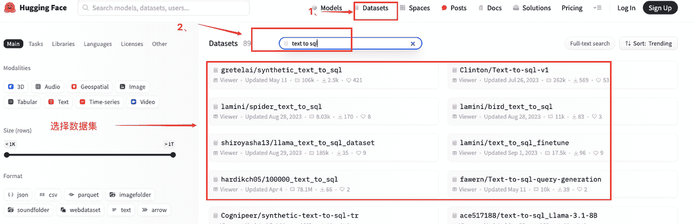

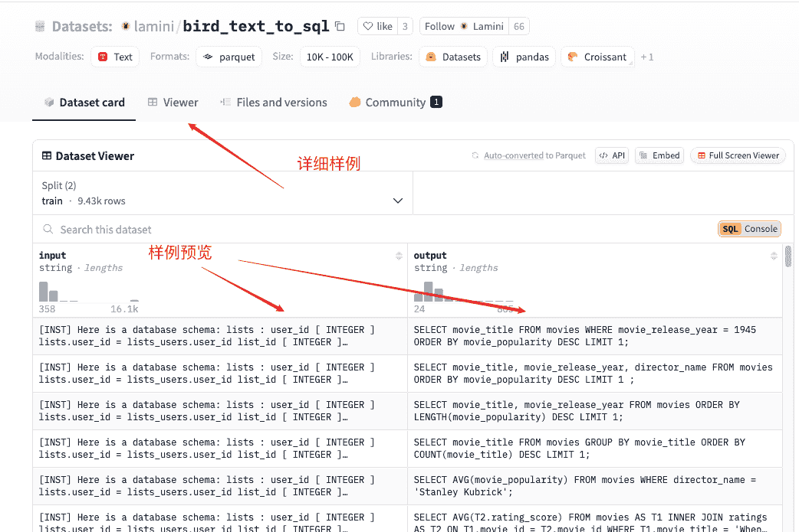

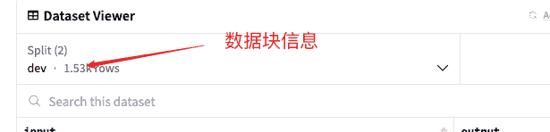

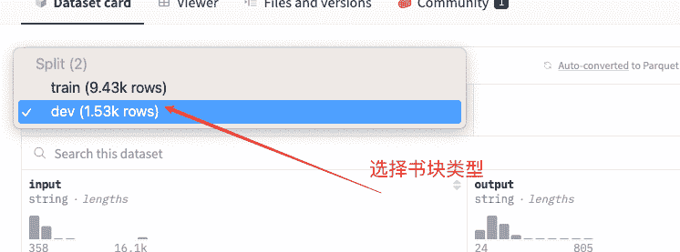

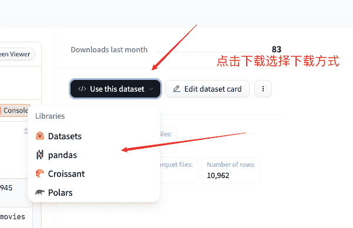

国内考虑[modelscope](https://www.modelscope.cn/datasets)

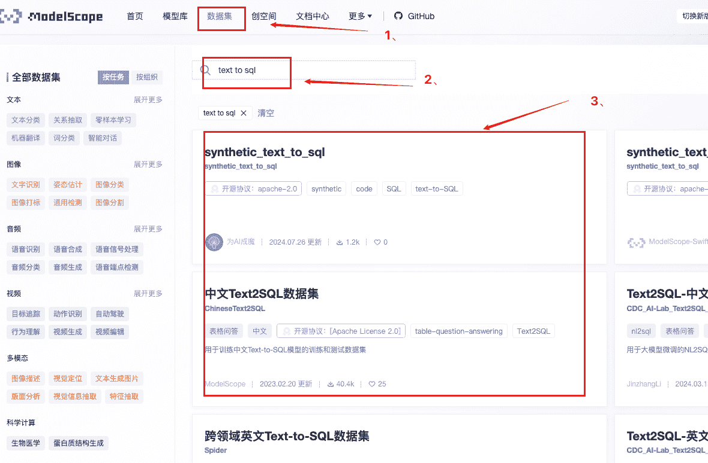

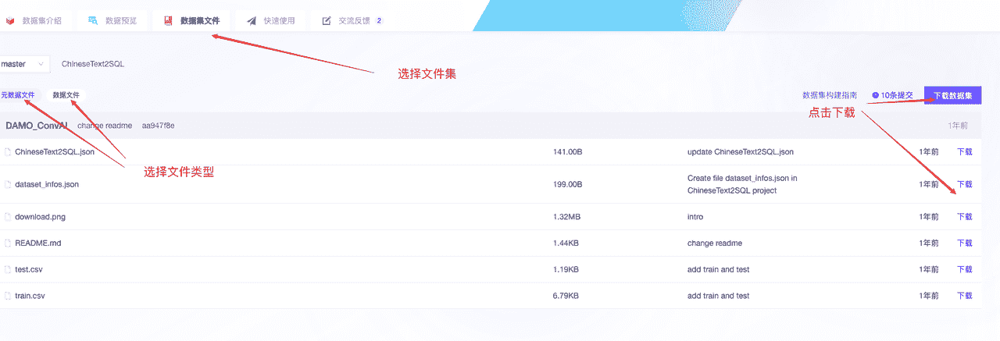

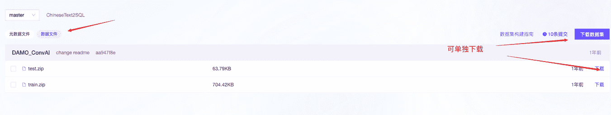

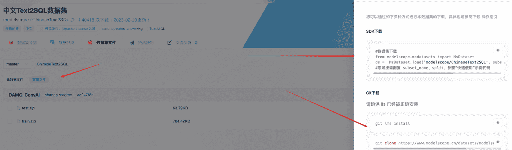

其他大学与企业合作：

英文：

```
wikiSQL: https://github.com/salesforce/WikiSQL
    属于单领域，包含了80654个自然语言问题，77840个SQL语句，SQL语句形式比较简单，不包含排序、分组、子查询等复杂操作。
```

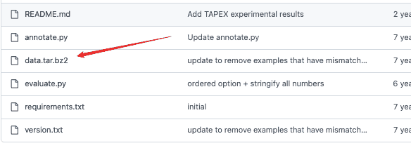

数据集解压后文件


dev.json文件

```
{
   &quot;phase&quot;:1,
   &quot;question&quot;&quot;:who is the manufacturer for the order year 1998?&quot;,
   &quot;sql&quot;:{
      &quot;conds&quot;:[
         [
            0,
            0,
            &quot;1998&quot;
         ]
      ],
      &quot;sel&quot;:1,
      &quot;agg&quot;:0
   },
   &quot;table_id&quot;&quot;:1-10026563-1&quot;
}
phase：数据集收集的阶段。我们分两个阶段收集 WikiSQL。
question：工人写的自然语言问题。
sql：与问题对应的 SQL 查询。它包含以下子字段：
   conds：三元组列表(column_index, operator_index, condition)，其中：
         column_index：正在使用的条件列的数字索引。您可以从表中找到实际的列。
         operator_index：正在使用的条件运算符的数字索引。您可以从中找到实际的运算Query.cond_ops符lib/query.py。
         condition：条件的比较值，为string或float类型。
   sel：所选列的数字索引。您可以从表中找到实际的列。
   agg：正在使用的聚合运算符的数字索引。您可以从中找到实际的运算Query.agg_ops符lib/query.py。
table_id：该问题对应的表格的ID。
```

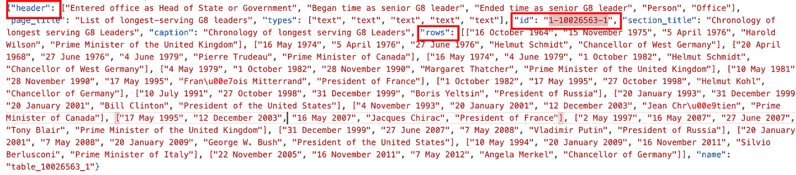

对应dev.tables.jsonl文件

```
    id：表ID。
    header：表中列名的列表。
    rows：行列表。每行都是行条目的列表。
    表格也包含在相应的*.db文件中。这是一个具有相同信息的 SQL 数据库。
```

db文件就是查询后的文件，用来验证sql结果

```
Spider: https://yale-lily.github.io/spider
    耶鲁大学提出的多数据库、多表、单轮查询的Text-to-SQL数据集，也是业界公认难度最大的大规模跨领域评测榜单，包含了10181个自然语言问题，5693个SQL语句，涉及138个不同领域的200多个数据库，难易程度分为：简单、中等、困难、特别困难。
```

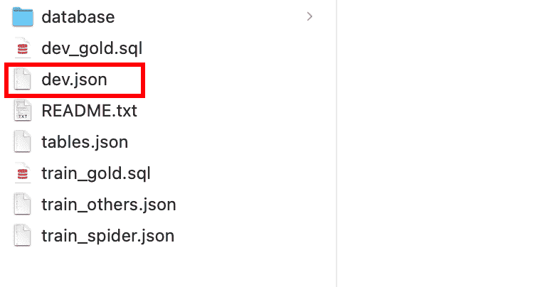

```
{
        &quot;db_id&quot;: &quot;concert_singer&quot;,
        &quot;query&quot;: &quot;SELECT count(*) FROM singer&quot;,
        &quot;query_toks&quot;: [
            &quot;SELECT&quot;,
            &quot;count&quot;,
            &quot;(&quot;,
            &quot;*&quot;,
            &quot;)&quot;,
            &quot;FROM&quot;,
            &quot;singer&quot;
        ],
        &quot;query_toks_no_value&quot;: [
            &quot;select&quot;,
            &quot;count&quot;,
            &quot;(&quot;,
            &quot;*&quot;,
            &quot;)&quot;,
            &quot;from&quot;,
            &quot;singer&quot;
        ],
        &quot;question&quot;: &quot;How many singers do we have?&quot;,
        &quot;question_toks&quot;: [
            &quot;How&quot;,
            &quot;many&quot;,
            &quot;singers&quot;,
            &quot;do&quot;,
            &quot;we&quot;,
            &quot;have&quot;,
            &quot;?&quot;
        ],
        &quot;sql&quot;: {
            &quot;from&quot;: {
                &quot;table_units&quot;: [
                    [
                        &quot;table_unit&quot;,
                        1
                    ]
                ],
                &quot;conds&quot;: []
            },
            &quot;select&quot;: [
                false,
                [
                    [
                        3,
                        [
                            0,
                            [
                                0,
                                0,
                                false
                            ],
                            null
                        ]
                    ]
                ]
            ],
            &quot;where&quot;: [],
            &quot;groupBy&quot;: [],
            &quot;having&quot;: [],
            &quot;orderBy&quot;: [],
            &quot;limit&quot;: null,
            &quot;intersect&quot;: null,
            &quot;union&quot;: null,
            &quot;except&quot;: null
        }
    }

query_toks 和 question_toks 都是经过分词和编码处理后的文本表示，主要用于将自然语言输入转换为模型可以处理的格式。可以做一下大模型预训练，分词训练等。
query_toks_no_value 更适合用于模型训练和解析，帮助模型理解查询的逻辑而不被具体值干扰，减少掉数值的概念。
from：表示SQL查询的FROM子句，即从哪些表中获取数据。
table_units：一个数组，包含了一个或多个表单元（table_unit）。
[&quot;table_unit&quot;, 1]：表示从表1中获取数据。对应.sql文件中就是表singer
conds：一个数组，表示FROM子句中的条件。在这个例子中，conds数组为空，表示没有额外的条件


select：表示SQL查询的SELECT子句，即要选择哪些列或表达式。
false：表示是否选择所有列（*）。false表示不是选择所有列。
[[3, [0, [0, 0, false], null]]]：一个嵌套数组，表示选择的具体列或表达式。
    3：表示选择的列或表达式的类型。具体类型需要根据上下文确定，常见的类型有：
    0：列名
    1：聚合函数（如COUNT, SUM等）
    2：子查询
    3：列的别名
    [0, [0, 0, false], null]：表示具体的列或表达式。
        0：表示列的类型，0通常表示列名。
        [0, 0, false]：表示列的具体信息，具体含义需要根据上下文确定。
null：表示没有别名。
```

concert_singer对应的数据库信息

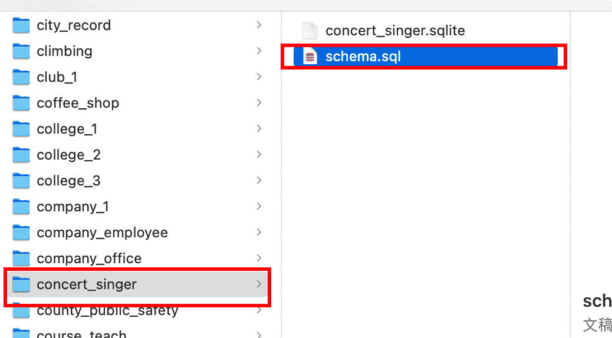

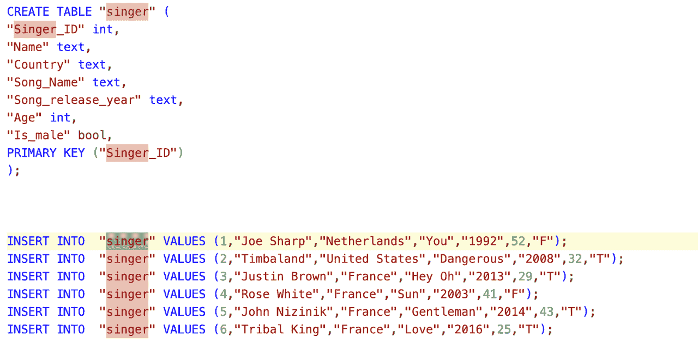

```
SParC : https://drive.google.com/uc?export=download&amp;id=1Uu7NMHTR1tdQw1t7bAuM7OPU4LElVKfg
    SParC，用于复杂、跨域、上下文相关（多轮）语义解析和Text-to-SQL任务，该数据集由4298个连贯的问题序列组成（有12k+个自然语言问题到SQL标注的Question-SQL对，由14名耶鲁大学学生标注），通过用户与138个领域的200个复杂数据库的交互获得。

CoSQL :https://yale-lily.github.io/cosql
    跨域数据库CoSQL，它由30k+轮次和10k+带注释的SQL查询组成。

KaggleDBQA：https://github.com/Chia-Hsuan-Lee/KaggleDBQA/tree/main?tab=readme-ov-file#Data-Format
    华盛顿大学与微软联合创建，是一个真是数据集它包括跨 8 个数据库的 272 个示例，每个数据库平均有 2.25 个表。 该数据集以其真实世界的数据源、自然的问题创作环境以及具有丰富领域知识的数据库文档而闻名。 主要统计数据：8.7% WHERE 子句、73.5% VAL、24.6% SELECT 和 6.8% NON-SELECT。
    
```

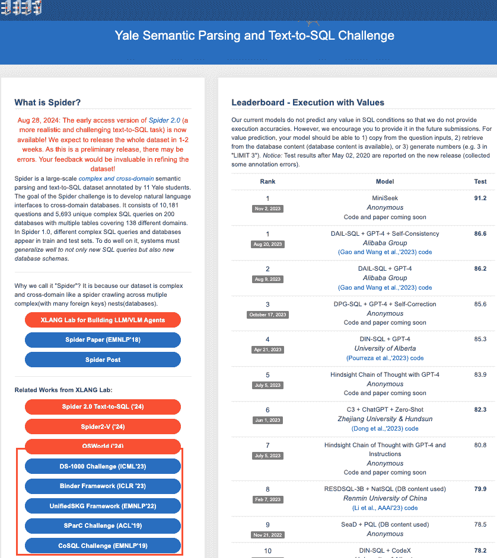

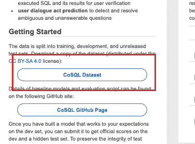

中文：

```
CHASE: https://github.com/xjtu-intsoft/chase/tree/page/data
    西安交通大学和微软等提出了首个跨领域、多轮Text-to-SQL中文数据集，包含了5459个多轮问题组成的列表，17940个&lt;query, SQL&gt;二元组。
```

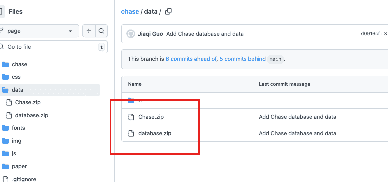

清洗数据代码：

```
import json
import argparse

def convert_cspider_to_alpaca(input_file, output_file, num_samples=None):
    &quot;&quot;&quot;将CSpider格式转换为Alpaca格式&quot;&quot;&quot;
    with open(input_file, &#x27;r&#x27;, encoding=&#x27;utf-8&#x27;) as f:
        cspider_data = json.load(f)
    
    # 限制条数
    if num_samples:
        cspider_data = cspider_data[:num_samples]
    
    alpaca_data = [
        {
            &quot;instruction&quot;: &quot;将下面的自然语言问题转换为SQL查询语句。&quot;,
            &quot;input&quot;: item[&quot;question&quot;],
            &quot;output&quot;: item[&quot;query&quot;]
        }
        for item in cspider_data
    ]
    
    with open(output_file, &#x27;w&#x27;, encoding=&#x27;utf-8&#x27;) as f:
        json.dump(alpaca_data, f, ensure_ascii=False, indent=2)
    
    print(f&quot;转换完成：{len(alpaca_data)} 条数据 -&gt; {output_file}&quot;)

def main():
    parser = argparse.ArgumentParser(description=&#x27;CSpider转Alpaca格式&#x27;)
    parser.add_argument(&#x27;-i&#x27;, &#x27;--input&#x27;, required=True, help=&#x27;输入文件路径&#x27;)
    parser.add_argument(&#x27;-o&#x27;, &#x27;--output&#x27;, required=True, help=&#x27;输出文件路径&#x27;)
    parser.add_argument(&#x27;-n&#x27;, &#x27;--num&#x27;, type=int, default=None, help=&#x27;转换条数限制（默认全部）&#x27;)
    
    args = parser.parse_args()
    convert_cspider_to_alpaca(args.input, args.output, args.num)

if __name__ == &quot;__main__&quot;:
    main()
```

# 9 技术路线选择

## 先明确：你要的不是“模型最强”，而是“能听懂你公司数据的人”

NL2SQL 是一个非常**应用型任务**，关键不是参数量，而是：

+   能理解你的自然语言（语义解析）；

+   能正确生成 SQL（结构化输出）；

+   能识别你公司内部表、字段、业务口径。

换句话说，NL2SQL 模型需要两类能力：

| 能力 | 来源 | 对应模型类型 |
| --- | --- | --- |
| 自然语言理解与指令跟随 | 由 Instruct 模型学得 | Instruct 系列 |
| 程序语法与结构化生成 | 由 Code/Coder 模型学得 | Coder 系列 |

## 两类模型的区别与特征

| 对比项 | **Instruct 模型**（通用对话） | **Coder 模型**（代码/SQL专长） |
| --- | --- | --- |
| 训练目标 | 听懂指令、生成自然语言 | 理解语法结构、生成代码类文本 |
| 优势 | 对自然语言问题理解好，泛化能力强 | SQL、Python、JSON结构生成精准 |
| 弱点 | SQL 语法可能不严谨，字段拼写错误多 | 对口语化自然语言理解较弱 |
| 适用场景 | 业务语言复杂、多语义提问 | SQL逻辑复杂、要求语法严格 |
| 示例 | Qwen2.5-7B-Instruct、Llama3-Instruct | DeepSeek-Coder-6.7B、StarCoder2、CodeQwen |

一句话总结：

+   Instruct 模型更“懂人话”，但写SQL会错字段；

+   **Coder 模型更“懂代码”**，但听不太懂口语问题。

## 两阶段微调

先在公开NL2SQL上基础微调，再用公司数据精调

### 理论逻辑：两阶段微调是“迁移学习（Transfer Learning）”

1.  **第一阶段**：用公开领**域的 NL2SQL 数**据（如 Spider、CSpider、WikiSQL）
让模型学会通用SQL结构生成规律。

1.  **第二阶段**：用公司内部数据
让模型学会你公司的表结构、字段命名、业务口径。

### 两阶段微调的优势

| 优势 | 说明 |
| --- | --- |
| **学习基础语法** | 第一阶段让模型熟悉 SQL语法树、聚合函数、JOIN模式。 |
| **降低数据量要求** | 第二阶段只需几千条企业样本即可达到较高精度。 |
| **增强泛化能力** | 模型能同时理解通用查询和企业特定查询。 |
| **迁移更稳健** | 避免直接用公司数据“从零开始”导致欠拟合。 |

### 两阶段微调的潜在问题

| 问题 | 说明 |
| --- | --- |
| **时间与算力成本高** | 要做两次训练。 |
| **可能“遗忘”原始知识** | 如果第二阶段样本分布很窄，可能过拟合公司内部表达。 |
| **数据清洗要求更高** | 两阶段间语料结构要保持统一，否则模型混乱。 |

### 适用场景

+   大型公司（数据库复杂、行业术语多）

+   想做“长周期”NL2SQL能力建设

+   拥有少量高质量企业内部语料

## 直接单阶段微调（公司数据直训）

### 做法

直接用企业内部自然语言 ↔ SQL 数据对进行 LoRA 微调。

### 优点

+   成本低（一次训练）

+   训练目标聚焦（模型只记你的Schema）

+   快速上线验证（迭代周期短）

### 缺点

+   模型对复杂SQL结构的泛化差；

+   若内部数据覆盖面小，模型容易“偏科”；

+   不具备通用SQL生成能力（换一张表就不行）。

### 适用场景

+   中小公司，数据库表结构较简单；

+   只需在固定系统中做问答；

+   没有算力和时间做两阶段训练。

## 结合模型类型来选路线（Instruct vs Coder）

| 场景 | 推荐模型类型 | 推荐微调路线 |
| --- | --- | --- |
| 想让业务人员自然提问、模型理解口语好 | Instruct 模型（如 Qwen2.5-Instruct） | 先公开NL2SQL基础训练，再用公司数据精调（两阶段） |
| SQL语法复杂、字段关联多、执行容错低 | Coder 模型（如 DeepSeek-Coder / CodeQwen） | 直接公司数据微调（单阶段LoRA） |
| 数据量少、时间有限 | Coder模型 + Few-shot Prompt | 不微调，直接提示结构化生成 |
| 想要兼顾两者 | 混合策略（Instruct模型 + LoRA训练时混入SQL任务） | LoRA阶段强化SQL任务 |

## 两种技术方案概述

| 技术方案 | 简要流程 | 目标 |
| --- | --- | --- |
| 方案 A：Instruct 模型 + 两阶段微调 | ① 先用公开NL2SQL数据集进行基础微调（Spider、CSpider）  ② 再用公司内部数据进行第二轮定向精调 | 让模型同时具备通用SQL能力和企业语义理解能力 |
| 方案 B：Coder 模型 + 单阶段微调 | 直接使用Coder模型，用公司内部数据做一次LoRA/QLoRA微调 | 快速适配企业数据库结构，实现稳定SQL生成 |

## 方案 A：Instruct 模型 + 两阶段微调

### 训练逻辑

1.  **阶段一：通用NL2SQL微调**

+   使用公开数据集（Spider、WikiSQL、CSpider）

+   教模型掌握SQL语法与通用结构。

1.  **阶段二：企业内部数据精调**

+   使用公司自己的自然语言 ↔ SQL 数据集

+   让模型学会你公司的字段命名、口径规则、表结构。

### 优势

+   **自然语言理解强**：能处理模糊、上下文依赖的问题。

+   **泛化能力好**：能适应新问题或新增表结构。

+   **迁移学习稳定**：先通用、后专精，结构清晰。

+   **更贴近人机交互需求**：适合业务人员直接问问题。

### 缺点

+   训练周期长，需要两次微调。

+   成本高（显存与算力消耗大）。

+   数据准备工作量大。

+   参数设置需谨慎，否则第二阶段容易遗忘第一阶段的通用能力。

### 适用场景

+   企业数据复杂、多业务表、多指标口径。

+   需要支持自然语言查询（非技术用户使用）。

+   有算力、有长期AI建设规划的公司。

## 方案 B：Coder 模型 + 单阶段微调

### 训练逻辑

+   直接选用代码类模型（如 DeepSeek-Coder、CodeQwen）。

+   准备公司内部的自然语言 ↔ SQL 样本。

+   使用 LoRA 或 QLoRA 方法进行一轮微调。

### 优势

+   **SQL生成精度高**：天生适合结构化输出。

+   **训练速度快**：几个小时即可完成。

+   **显存要求低**：单卡24GB即可运行。

+   **落地速度快**：适合快速上线和验证。

+   **维护成本低**：只需公司数据即可持续增量微调。

### 缺点

+   **语义理解弱**：无法准确理解模糊提问。

+   **泛化能力差**：表结构或字段变化后需重训。

+   **依赖数据覆盖度**：内部样本少时容易过拟合。

+   **无法适应复杂自然语言表达**。

### 适用场景

+   企业数据库结构固定、字段稳定。

+   主要用户是技术或数据分析人员。

+   对SQL准确率要求高、对语义理解要求低。

+   项目希望快速验证和上线。

## 两种方案的核心对比

| 维度 | 方案 A：Instruct + 双阶段 | 方案 B：Coder + 单阶段 |
| --- | --- | --- |
| 模型特性 | 语言理解型 | 结构生成型 |
| 微调次数 | 两次（通用+企业） | 一次（企业） |
| 语义理解能力 | 强，适合口语查询 | 弱，依赖精确描述 |
| SQL生成能力 | 稳定性中上 | 精确度高 |
| 泛化能力 | 强，可跨表与扩展 | 弱，结构固定 |
| 数据量需求 | 多（公开+内部） | 少（内部即可） |
| 训练成本 | 高 | 低 |
| 适用人群 | 非技术用户、管理人员 | 数据分析师、技术人员 |
| 维护成本 | 中（需周期精调） | 低（小规模增量） |
| 最终表现 | 全能但代价高 | 实用但局限性强 |

## 选择建议

1.  **如果你追求长期建设和通用性**

+   选 方案A（Instruct双阶段）

+   适合大中型企业、数据复杂的组织

+   优势：语义理解强、可维护、可扩展

1.  **如果你追求落地速度和成本可控**

+   选 **方案B（Coder单阶段）**

+   适合中小公司或内部BI场景

+   优势：训练快、成本低、效果稳定

1.  **如果你打算从零开始探索**

+   可以先用方案B快速跑通，再过渡到方案A。

+   这是当前企业最常见的“渐进式路径”：
先实现可用 → 再迭代成可扩展。

**一句话总结：**

> **Instruct 双阶段路线****：先学通用规律，再学你**家业务——泛化强、理解力高，但贵。

> Coder 单阶段路线：直接学你公司SQL——生成准、落地快，但适应性差。

# 10 一键生成私有数据集

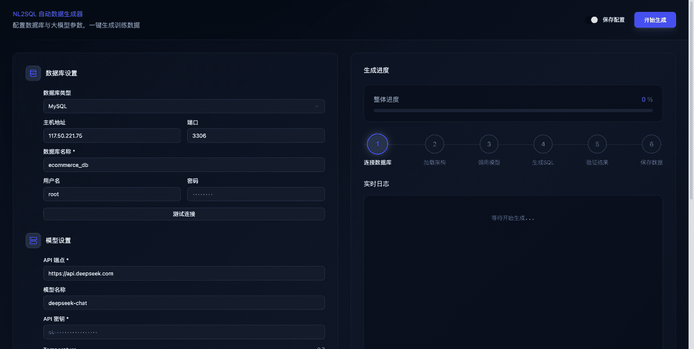

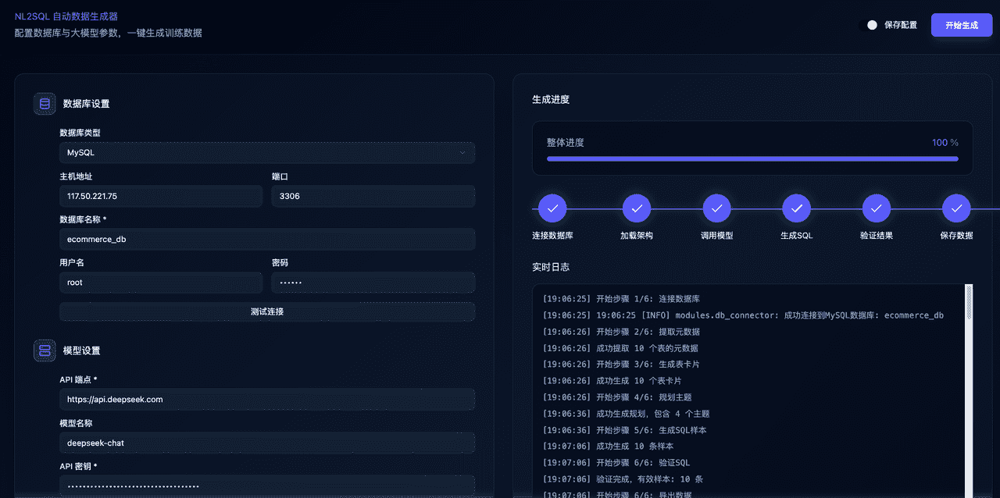

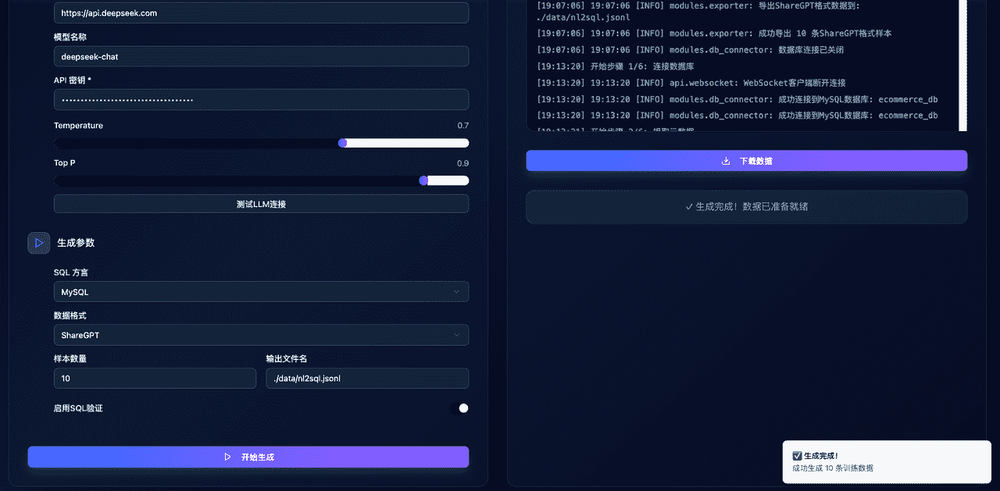

```
from IPython.display import Video
```

```
Video(&quot;https://typora-photo1220.oss-cn-beijing.aliyuncs.com/DataAnalysis/muyan/%E6%95%B0%E6%8D%AE%E7%94%9F%E6%88%90%E8%BF%87%E7%A8%8B%E7%A4%BA%E4%BE%8B.mp4&quot;, width=800, height=400)
```

Your browser does not support the video element.


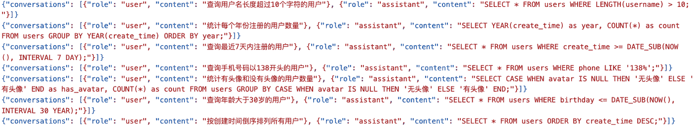

ecommerce.sql

```
-- ====================================
-- 电商业务数据库创建脚本
-- ====================================

-- 创建数据库
DROP DATABASE IF EXISTS ecommerce_db;
CREATE DATABASE ecommerce_db DEFAULT CHARACTER SET utf8mb4 COLLATE utf8mb4_unicode_ci;
USE ecommerce_db;

-- ====================================
-- 1. 用户表
-- ====================================
CREATE TABLE `users` (
  `user_id` BIGINT NOT NULL AUTO_INCREMENT COMMENT &#x27;用户ID，主键&#x27;,
  `username` VARCHAR(50) NOT NULL COMMENT &#x27;用户名&#x27;,
  `password` VARCHAR(255) NOT NULL COMMENT &#x27;密码（加密存储）&#x27;,
  `email` VARCHAR(100) NOT NULL COMMENT &#x27;邮箱地址&#x27;,
  `phone` VARCHAR(20) NOT NULL COMMENT &#x27;手机号码&#x27;,
  `nickname` VARCHAR(50) DEFAULT NULL COMMENT &#x27;昵称&#x27;,
  `avatar` VARCHAR(255) DEFAULT NULL COMMENT &#x27;头像URL&#x27;,
  `gender` TINYINT DEFAULT 0 COMMENT &#x27;性别：0-未知，1-男，2-女&#x27;,
  `birthday` DATE DEFAULT NULL COMMENT &#x27;生日&#x27;,
  `status` TINYINT DEFAULT 1 COMMENT &#x27;状态：0-禁用，1-正常&#x27;,
  `create_time` DATETIME NOT NULL DEFAULT CURRENT_TIMESTAMP COMMENT &#x27;创建时间&#x27;,
  `update_time` DATETIME NOT NULL DEFAULT CURRENT_TIMESTAMP ON UPDATE CURRENT_TIMESTAMP COMMENT &#x27;更新时间&#x27;,
  PRIMARY KEY (`user_id`),
  UNIQUE KEY `uk_username` (`username`),
  UNIQUE KEY `uk_email` (`email`),
  UNIQUE KEY `uk_phone` (`phone`),
  KEY `idx_status` (`status`)
) ENGINE=InnoDB DEFAULT CHARSET=utf8mb4 COMMENT=&#x27;用户表&#x27;;

-- ====================================
-- 2. 商品分类表
-- ====================================
CREATE TABLE `categories` (
  `category_id` BIGINT NOT NULL AUTO_INCREMENT COMMENT &#x27;分类ID，主键&#x27;,
  `parent_id` BIGINT DEFAULT 0 COMMENT &#x27;父分类ID，0表示顶级分类&#x27;,
  `category_name` VARCHAR(50) NOT NULL COMMENT &#x27;分类名称&#x27;,
  `category_level` TINYINT NOT NULL DEFAULT 1 COMMENT &#x27;分类层级：1-一级，2-二级，3-三级&#x27;,
  `sort_order` INT DEFAULT 0 COMMENT &#x27;排序号&#x27;,
  `icon` VARCHAR(255) DEFAULT NULL COMMENT &#x27;分类图标URL&#x27;,
  `status` TINYINT DEFAULT 1 COMMENT &#x27;状态：0-禁用，1-正常&#x27;,
  `create_time` DATETIME NOT NULL DEFAULT CURRENT_TIMESTAMP COMMENT &#x27;创建时间&#x27;,
  `update_time` DATETIME NOT NULL DEFAULT CURRENT_TIMESTAMP ON UPDATE CURRENT_TIMESTAMP COMMENT &#x27;更新时间&#x27;,
  PRIMARY KEY (`category_id`),
  KEY `idx_parent_id` (`parent_id`),
  KEY `idx_status` (`status`)
) ENGINE=InnoDB DEFAULT CHARSET=utf8mb4 COMMENT=&#x27;商品分类表&#x27;;

-- ====================================
-- 3. 商品表
-- ====================================
CREATE TABLE `products` (
  `product_id` BIGINT NOT NULL AUTO_INCREMENT COMMENT &#x27;商品ID，主键&#x27;,
  `category_id` BIGINT NOT NULL COMMENT &#x27;分类ID&#x27;,
  `product_name` VARCHAR(200) NOT NULL COMMENT &#x27;商品名称&#x27;,
  `product_sn` VARCHAR(50) NOT NULL COMMENT &#x27;商品编号&#x27;,
  `brand` VARCHAR(100) DEFAULT NULL COMMENT &#x27;品牌&#x27;,
  `price` DECIMAL(10,2) NOT NULL COMMENT &#x27;商品价格&#x27;,
  `original_price` DECIMAL(10,2) DEFAULT NULL COMMENT &#x27;原价&#x27;,
  `stock` INT NOT NULL DEFAULT 0 COMMENT &#x27;库存数量&#x27;,
  `sales` INT DEFAULT 0 COMMENT &#x27;销量&#x27;,
  `main_image` VARCHAR(255) DEFAULT NULL COMMENT &#x27;主图URL&#x27;,
  `images` TEXT DEFAULT NULL COMMENT &#x27;商品图片，多个用逗号分隔&#x27;,
  `description` TEXT DEFAULT NULL COMMENT &#x27;商品详细描述&#x27;,
  `status` TINYINT DEFAULT 1 COMMENT &#x27;状态：0-下架，1-上架&#x27;,
  `create_time` DATETIME NOT NULL DEFAULT CURRENT_TIMESTAMP COMMENT &#x27;创建时间&#x27;,
  `update_time` DATETIME NOT NULL DEFAULT CURRENT_TIMESTAMP ON UPDATE CURRENT_TIMESTAMP COMMENT &#x27;更新时间&#x27;,
  PRIMARY KEY (`product_id`),
  UNIQUE KEY `uk_product_sn` (`product_sn`),
  KEY `idx_category_id` (`category_id`),
  KEY `idx_status` (`status`),
  KEY `idx_price` (`price`)
) ENGINE=InnoDB DEFAULT CHARSET=utf8mb4 COMMENT=&#x27;商品表&#x27;;

-- ====================================
-- 4. 购物车表
-- ====================================
CREATE TABLE `carts` (
  `cart_id` BIGINT NOT NULL AUTO_INCREMENT COMMENT &#x27;购物车ID，主键&#x27;,
  `user_id` BIGINT NOT NULL COMMENT &#x27;用户ID&#x27;,
  `product_id` BIGINT NOT NULL COMMENT &#x27;商品ID&#x27;,
  `quantity` INT NOT NULL DEFAULT 1 COMMENT &#x27;商品数量&#x27;,
  `selected` TINYINT DEFAULT 1 COMMENT &#x27;是否选中：0-未选中，1-已选中&#x27;,
  `create_time` DATETIME NOT NULL DEFAULT CURRENT_TIMESTAMP COMMENT &#x27;创建时间&#x27;,
  `update_time` DATETIME NOT NULL DEFAULT CURRENT_TIMESTAMP ON UPDATE CURRENT_TIMESTAMP COMMENT &#x27;更新时间&#x27;,
  PRIMARY KEY (`cart_id`),
  KEY `idx_user_id` (`user_id`),
  KEY `idx_product_id` (`product_id`)
) ENGINE=InnoDB DEFAULT CHARSET=utf8mb4 COMMENT=&#x27;购物车表&#x27;;

-- ====================================
-- 5. 收货地址表
-- ====================================
CREATE TABLE `addresses` (
  `address_id` BIGINT NOT NULL AUTO_INCREMENT COMMENT &#x27;地址ID，主键&#x27;,
  `user_id` BIGINT NOT NULL COMMENT &#x27;用户ID&#x27;,
  `receiver_name` VARCHAR(50) NOT NULL COMMENT &#x27;收货人姓名&#x27;,
  `receiver_phone` VARCHAR(20) NOT NULL COMMENT &#x27;收货人电话&#x27;,
  `province` VARCHAR(50) NOT NULL COMMENT &#x27;省份&#x27;,
  `city` VARCHAR(50) NOT NULL COMMENT &#x27;城市&#x27;,
  `district` VARCHAR(50) NOT NULL COMMENT &#x27;区/县&#x27;,
  `detail_address` VARCHAR(255) NOT NULL COMMENT &#x27;详细地址&#x27;,
  `postal_code` VARCHAR(10) DEFAULT NULL COMMENT &#x27;邮政编码&#x27;,
  `is_default` TINYINT DEFAULT 0 COMMENT &#x27;是否默认地址：0-否，1-是&#x27;,
  `create_time` DATETIME NOT NULL DEFAULT CURRENT_TIMESTAMP COMMENT &#x27;创建时间&#x27;,
  `update_time` DATETIME NOT NULL DEFAULT CURRENT_TIMESTAMP ON UPDATE CURRENT_TIMESTAMP COMMENT &#x27;更新时间&#x27;,
  PRIMARY KEY (`address_id`),
  KEY `idx_user_id` (`user_id`)
) ENGINE=InnoDB DEFAULT CHARSET=utf8mb4 COMMENT=&#x27;收货地址表&#x27;;

-- ====================================
-- 6. 订单表
-- ====================================
CREATE TABLE `orders` (
  `order_id` BIGINT NOT NULL AUTO_INCREMENT COMMENT &#x27;订单ID，主键&#x27;,
  `order_no` VARCHAR(50) NOT NULL COMMENT &#x27;订单编号&#x27;,
  `user_id` BIGINT NOT NULL COMMENT &#x27;用户ID&#x27;,
  `total_amount` DECIMAL(10,2) NOT NULL COMMENT &#x27;订单总金额&#x27;,
  `pay_amount` DECIMAL(10,2) NOT NULL COMMENT &#x27;实付金额&#x27;,
  `freight` DECIMAL(10,2) DEFAULT 0.00 COMMENT &#x27;运费&#x27;,
  `order_status` TINYINT NOT NULL DEFAULT 1 COMMENT &#x27;订单状态：1-待付款，2-待发货，3-待收货，4-待评价，5-已完成，6-已取消&#x27;,
  `receiver_name` VARCHAR(50) NOT NULL COMMENT &#x27;收货人姓名&#x27;,
  `receiver_phone` VARCHAR(20) NOT NULL COMMENT &#x27;收货人电话&#x27;,
  `receiver_province` VARCHAR(50) NOT NULL COMMENT &#x27;收货省份&#x27;,
  `receiver_city` VARCHAR(50) NOT NULL COMMENT &#x27;收货城市&#x27;,
  `receiver_district` VARCHAR(50) NOT NULL COMMENT &#x27;收货区/县&#x27;,
  `receiver_address` VARCHAR(255) NOT NULL COMMENT &#x27;收货详细地址&#x27;,
  `remark` VARCHAR(500) DEFAULT NULL COMMENT &#x27;订单备注&#x27;,
  `create_time` DATETIME NOT NULL DEFAULT CURRENT_TIMESTAMP COMMENT &#x27;创建时间&#x27;,
  `pay_time` DATETIME DEFAULT NULL COMMENT &#x27;支付时间&#x27;,
  `ship_time` DATETIME DEFAULT NULL COMMENT &#x27;发货时间&#x27;,
  `finish_time` DATETIME DEFAULT NULL COMMENT &#x27;完成时间&#x27;,
  `cancel_time` DATETIME DEFAULT NULL COMMENT &#x27;取消时间&#x27;,
  `update_time` DATETIME NOT NULL DEFAULT CURRENT_TIMESTAMP ON UPDATE CURRENT_TIMESTAMP COMMENT &#x27;更新时间&#x27;,
  PRIMARY KEY (`order_id`),
  UNIQUE KEY `uk_order_no` (`order_no`),
  KEY `idx_user_id` (`user_id`),
  KEY `idx_order_status` (`order_status`),
  KEY `idx_create_time` (`create_time`)
) ENGINE=InnoDB DEFAULT CHARSET=utf8mb4 COMMENT=&#x27;订单表&#x27;;

-- ====================================
-- 7. 订单明细表
-- ====================================
CREATE TABLE `order_items` (
  `item_id` BIGINT NOT NULL AUTO_INCREMENT COMMENT &#x27;订单明细ID，主键&#x27;,
  `order_id` BIGINT NOT NULL COMMENT &#x27;订单ID&#x27;,
  `product_id` BIGINT NOT NULL COMMENT &#x27;商品ID&#x27;,
  `product_name` VARCHAR(200) NOT NULL COMMENT &#x27;商品名称&#x27;,
  `product_image` VARCHAR(255) DEFAULT NULL COMMENT &#x27;商品图片&#x27;,
  `product_sn` VARCHAR(50) NOT NULL COMMENT &#x27;商品编号&#x27;,
  `price` DECIMAL(10,2) NOT NULL COMMENT &#x27;商品单价&#x27;,
  `quantity` INT NOT NULL COMMENT &#x27;购买数量&#x27;,
  `total_amount` DECIMAL(10,2) NOT NULL COMMENT &#x27;小计金额&#x27;,
  `create_time` DATETIME NOT NULL DEFAULT CURRENT_TIMESTAMP COMMENT &#x27;创建时间&#x27;,
  PRIMARY KEY (`item_id`),
  KEY `idx_order_id` (`order_id`),
  KEY `idx_product_id` (`product_id`)
) ENGINE=InnoDB DEFAULT CHARSET=utf8mb4 COMMENT=&#x27;订单明细表&#x27;;

-- ====================================
-- 8. 支付记录表
-- ====================================
CREATE TABLE `payments` (
  `payment_id` BIGINT NOT NULL AUTO_INCREMENT COMMENT &#x27;支付ID，主键&#x27;,
  `payment_no` VARCHAR(50) NOT NULL COMMENT &#x27;支付流水号&#x27;,
  `order_id` BIGINT NOT NULL COMMENT &#x27;订单ID&#x27;,
  `order_no` VARCHAR(50) NOT NULL COMMENT &#x27;订单编号&#x27;,
  `user_id` BIGINT NOT NULL COMMENT &#x27;用户ID&#x27;,
  `pay_amount` DECIMAL(10,2) NOT NULL COMMENT &#x27;支付金额&#x27;,
  `pay_type` TINYINT NOT NULL COMMENT &#x27;支付方式：1-支付宝，2-微信，3-银联&#x27;,
  `pay_status` TINYINT DEFAULT 1 COMMENT &#x27;支付状态：1-待支付，2-支付中，3-支付成功，4-支付失败&#x27;,
  `transaction_id` VARCHAR(100) DEFAULT NULL COMMENT &#x27;第三方支付交易号&#x27;,
  `pay_time` DATETIME DEFAULT NULL COMMENT &#x27;支付完成时间&#x27;,
  `create_time` DATETIME NOT NULL DEFAULT CURRENT_TIMESTAMP COMMENT &#x27;创建时间&#x27;,
  `update_time` DATETIME NOT NULL DEFAULT CURRENT_TIMESTAMP ON UPDATE CURRENT_TIMESTAMP COMMENT &#x27;更新时间&#x27;,
  PRIMARY KEY (`payment_id`),
  UNIQUE KEY `uk_payment_no` (`payment_no`),
  KEY `idx_order_id` (`order_id`),
  KEY `idx_user_id` (`user_id`),
  KEY `idx_pay_status` (`pay_status`)
) ENGINE=InnoDB DEFAULT CHARSET=utf8mb4 COMMENT=&#x27;支付记录表&#x27;;

-- ====================================
-- 9. 商品评价表
-- ====================================
CREATE TABLE `reviews` (
  `review_id` BIGINT NOT NULL AUTO_INCREMENT COMMENT &#x27;评价ID，主键&#x27;,
  `order_id` BIGINT NOT NULL COMMENT &#x27;订单ID&#x27;,
  `product_id` BIGINT NOT NULL COMMENT &#x27;商品ID&#x27;,
  `user_id` BIGINT NOT NULL COMMENT &#x27;用户ID&#x27;,
  `rating` TINYINT NOT NULL COMMENT &#x27;评分：1-5星&#x27;,
  `content` TEXT DEFAULT NULL COMMENT &#x27;评价内容&#x27;,
  `images` TEXT DEFAULT NULL COMMENT &#x27;评价图片，多个用逗号分隔&#x27;,
  `is_anonymous` TINYINT DEFAULT 0 COMMENT &#x27;是否匿名：0-否，1-是&#x27;,
  `status` TINYINT DEFAULT 1 COMMENT &#x27;状态：0-隐藏，1-显示&#x27;,
  `create_time` DATETIME NOT NULL DEFAULT CURRENT_TIMESTAMP COMMENT &#x27;创建时间&#x27;,
  `update_time` DATETIME NOT NULL DEFAULT CURRENT_TIMESTAMP ON UPDATE CURRENT_TIMESTAMP COMMENT &#x27;更新时间&#x27;,
  PRIMARY KEY (`review_id`),
  KEY `idx_order_id` (`order_id`),
  KEY `idx_product_id` (`product_id`),
  KEY `idx_user_id` (`user_id`)
) ENGINE=InnoDB DEFAULT CHARSET=utf8mb4 COMMENT=&#x27;商品评价表&#x27;;

-- ====================================
-- 10. 物流信息表
-- ====================================
CREATE TABLE `logistics` (
  `logistics_id` BIGINT NOT NULL AUTO_INCREMENT COMMENT &#x27;物流ID，主键&#x27;,
  `order_id` BIGINT NOT NULL COMMENT &#x27;订单ID&#x27;,
  `order_no` VARCHAR(50) NOT NULL COMMENT &#x27;订单编号&#x27;,
  `logistics_company` VARCHAR(50) NOT NULL COMMENT &#x27;物流公司&#x27;,
  `logistics_no` VARCHAR(50) NOT NULL COMMENT &#x27;物流单号&#x27;,
  `logistics_status` TINYINT DEFAULT 1 COMMENT &#x27;物流状态：1-已发货，2-运输中，3-派送中，4-已签收&#x27;,
  `current_location` VARCHAR(255) DEFAULT NULL COMMENT &#x27;当前位置&#x27;,
  `logistics_info` TEXT DEFAULT NULL COMMENT &#x27;物流跟踪信息（JSON格式）&#x27;,
  `ship_time` DATETIME DEFAULT NULL COMMENT &#x27;发货时间&#x27;,
  `receive_time` DATETIME DEFAULT NULL COMMENT &#x27;签收时间&#x27;,
  `create_time` DATETIME NOT NULL DEFAULT CURRENT_TIMESTAMP COMMENT &#x27;创建时间&#x27;,
  `update_time` DATETIME NOT NULL DEFAULT CURRENT_TIMESTAMP ON UPDATE CURRENT_TIMESTAMP COMMENT &#x27;更新时间&#x27;,
  PRIMARY KEY (`logistics_id`),
  UNIQUE KEY `uk_order_id` (`order_id`),
  KEY `idx_logistics_no` (`logistics_no`),
  KEY `idx_logistics_status` (`logistics_status`)
) ENGINE=InnoDB DEFAULT CHARSET=utf8mb4 COMMENT=&#x27;物流信息表&#x27;;

-- ====================================
-- 插入示例数据
-- ====================================

-- 1. 用户数据
INSERT INTO `users` (`username`, `password`, `email`, `phone`, `nickname`, `gender`, `birthday`, `status`) VALUES
(&#x27;zhangsan&#x27;, &#x27;e10adc3949ba59abbe56e057f20f883e&#x27;, &#x27;zhangsan@example.com&#x27;, &#x27;13800138001&#x27;, &#x27;张三&#x27;, 1, &#x27;1990-05-15&#x27;, 1),
(&#x27;lisi&#x27;, &#x27;e10adc3949ba59abbe56e057f20f883e&#x27;, &#x27;lisi@example.com&#x27;, &#x27;13800138002&#x27;, &#x27;李四&#x27;, 2, &#x27;1992-08-20&#x27;, 1),
(&#x27;wangwu&#x27;, &#x27;e10adc3949ba59abbe56e057f20f883e&#x27;, &#x27;wangwu@example.com&#x27;, &#x27;13800138003&#x27;, &#x27;王五&#x27;, 1, &#x27;1988-12-10&#x27;, 1),
(&#x27;zhaoliu&#x27;, &#x27;e10adc3949ba59abbe56e057f20f883e&#x27;, &#x27;zhaoliu@example.com&#x27;, &#x27;13800138004&#x27;, &#x27;赵六&#x27;, 2, &#x27;1995-03-25&#x27;, 1);

-- 2. 商品分类数据
INSERT INTO `categories` (`category_id`, `parent_id`, `category_name`, `category_level`, `sort_order`) VALUES
(1, 0, &#x27;数码电器&#x27;, 1, 1),
(2, 0, &#x27;服装鞋包&#x27;, 1, 2),
(3, 0, &#x27;食品生鲜&#x27;, 1, 3),
(4, 1, &#x27;手机通讯&#x27;, 2, 1),
(5, 1, &#x27;电脑办公&#x27;, 2, 2),
(6, 2, &#x27;男装&#x27;, 2, 1),
(7, 2, &#x27;女装&#x27;, 2, 2),
(8, 3, &#x27;休闲零食&#x27;, 2, 1);

-- 3. 商品数据
INSERT INTO `products` (`category_id`, `product_name`, `product_sn`, `brand`, `price`, `original_price`, `stock`, `sales`, `main_image`, `status`) VALUES
(4, &#x27;iPhone 15 Pro Max 256GB 黑色&#x27;, &#x27;PHONE001&#x27;, &#x27;Apple&#x27;, 9999.00, 10999.00, 100, 58, &#x27;/images/iphone15.jpg&#x27;, 1),
(4, &#x27;华为Mate 60 Pro 512GB 白色&#x27;, &#x27;PHONE002&#x27;, &#x27;华为&#x27;, 6999.00, 7999.00, 80, 125, &#x27;/images/mate60.jpg&#x27;, 1),
(5, &#x27;联想小新Pro14笔记本电脑&#x27;, &#x27;PC001&#x27;, &#x27;联想&#x27;, 5499.00, 6299.00, 50, 89, &#x27;/images/lenovo.jpg&#x27;, 1),
(5, &#x27;戴尔灵越15游戏本&#x27;, &#x27;PC002&#x27;, &#x27;Dell&#x27;, 7999.00, 8999.00, 30, 45, &#x27;/images/dell.jpg&#x27;, 1),
(6, &#x27;男士商务休闲衬衫&#x27;, &#x27;CLOTH001&#x27;, &#x27;雅鹿&#x27;, 299.00, 399.00, 200, 342, &#x27;/images/shirt.jpg&#x27;, 1),
(7, &#x27;女士连衣裙春夏新款&#x27;, &#x27;CLOTH002&#x27;, &#x27;韩都衣舍&#x27;, 199.00, 299.00, 150, 567, &#x27;/images/dress.jpg&#x27;, 1),
(8, &#x27;三只松鼠坚果礼盒1588g&#x27;, &#x27;FOOD001&#x27;, &#x27;三只松鼠&#x27;, 89.90, 129.00, 500, 1234, &#x27;/images/nuts.jpg&#x27;, 1),
(8, &#x27;良品铺子零食大礼包&#x27;, &#x27;FOOD002&#x27;, &#x27;良品铺子&#x27;, 99.90, 149.00, 300, 890, &#x27;/images/snacks.jpg&#x27;, 1);

-- 4. 收货地址数据
INSERT INTO `addresses` (`user_id`, `receiver_name`, `receiver_phone`, `province`, `city`, `district`, `detail_address`, `is_default`) VALUES
(1, &#x27;张三&#x27;, &#x27;13800138001&#x27;, &#x27;北京市&#x27;, &#x27;北京市&#x27;, &#x27;朝阳区&#x27;, &#x27;建国路88号SOHO现代城A座1001室&#x27;, 1),
(1, &#x27;张三&#x27;, &#x27;13800138001&#x27;, &#x27;上海市&#x27;, &#x27;上海市&#x27;, &#x27;浦东新区&#x27;, &#x27;世纪大道1号国金中心2栋2001室&#x27;, 0),
(2, &#x27;李四&#x27;, &#x27;13800138002&#x27;, &#x27;广东省&#x27;, &#x27;深圳市&#x27;, &#x27;南山区&#x27;, &#x27;科技园南区深南大道9988号&#x27;, 1),
(3, &#x27;王五&#x27;, &#x27;13800138003&#x27;, &#x27;浙江省&#x27;, &#x27;杭州市&#x27;, &#x27;西湖区&#x27;, &#x27;文一西路98号数娱大厦5楼&#x27;, 1);

-- 5. 订单数据
INSERT INTO `orders` (`order_no`, `user_id`, `total_amount`, `pay_amount`, `freight`, `order_status`, `receiver_name`, `receiver_phone`, `receiver_province`, `receiver_city`, `receiver_district`, `receiver_address`, `create_time`, `pay_time`) VALUES
(&#x27;ORD20231101001&#x27;, 1, 10088.90, 10088.90, 0.00, 3, &#x27;张三&#x27;, &#x27;13800138001&#x27;, &#x27;北京市&#x27;, &#x27;北京市&#x27;, &#x27;朝阳区&#x27;, &#x27;建国路88号SOHO现代城A座1001室&#x27;, &#x27;2023-11-01 10:30:00&#x27;, &#x27;2023-11-01 10:35:00&#x27;),
(&#x27;ORD20231102001&#x27;, 2, 5498.00, 5498.00, 0.00, 4, &#x27;李四&#x27;, &#x27;13800138002&#x27;, &#x27;广东省&#x27;, &#x27;深圳市&#x27;, &#x27;南山区&#x27;, &#x27;科技园南区深南大道9988号&#x27;, &#x27;2023-11-02 14:20:00&#x27;, &#x27;2023-11-02 14:25:00&#x27;),
(&#x27;ORD20231103001&#x27;, 3, 498.00, 498.00, 10.00, 5, &#x27;王五&#x27;, &#x27;13800138003&#x27;, &#x27;浙江省&#x27;, &#x27;杭州市&#x27;, &#x27;西湖区&#x27;, &#x27;文一西路98号数娱大厦5楼&#x27;, &#x27;2023-11-03 16:15:00&#x27;, &#x27;2023-11-03 16:18:00&#x27;);

-- 6. 订单明细数据
INSERT INTO `order_items` (`order_id`, `product_id`, `product_name`, `product_image`, `product_sn`, `price`, `quantity`, `total_amount`) VALUES
(1, 1, &#x27;iPhone 15 Pro Max 256GB 黑色&#x27;, &#x27;/images/iphone15.jpg&#x27;, &#x27;PHONE001&#x27;, 9999.00, 1, 9999.00),
(1, 7, &#x27;三只松鼠坚果礼盒1588g&#x27;, &#x27;/images/nuts.jpg&#x27;, &#x27;FOOD001&#x27;, 89.90, 1, 89.90),
(2, 3, &#x27;联想小新Pro14笔记本电脑&#x27;, &#x27;/images/lenovo.jpg&#x27;, &#x27;PC001&#x27;, 5499.00, 1, 5499.00),
(3, 5, &#x27;男士商务休闲衬衫&#x27;, &#x27;/images/shirt.jpg&#x27;, &#x27;CLOTH001&#x27;, 299.00, 1, 299.00),
(3, 6, &#x27;女士连衣裙春夏新款&#x27;, &#x27;/images/dress.jpg&#x27;, &#x27;CLOTH002&#x27;, 199.00, 1, 199.00);

-- 7. 支付记录数据
INSERT INTO `payments` (`payment_no`, `order_id`, `order_no`, `user_id`, `pay_amount`, `pay_type`, `pay_status`, `transaction_id`, `pay_time`) VALUES
(&#x27;PAY20231101001&#x27;, 1, &#x27;ORD20231101001&#x27;, 1, 10088.90, 2, 3, &#x27;WX20231101103500123456&#x27;, &#x27;2023-11-01 10:35:00&#x27;),
(&#x27;PAY20231102001&#x27;, 2, &#x27;ORD20231102001&#x27;, 2, 5498.00, 1, 3, &#x27;ALI20231102142500654321&#x27;, &#x27;2023-11-02 14:25:00&#x27;),
(&#x27;PAY20231103001&#x27;, 3, &#x27;ORD20231103001&#x27;, 3, 498.00, 2, 3, &#x27;WX20231103161800789012&#x27;, &#x27;2023-11-03 16:18:00&#x27;);

-- 8. 购物车数据
INSERT INTO `carts` (`user_id`, `product_id`, `quantity`, `selected`) VALUES
(1, 2, 1, 1),
(1, 4, 1, 0),
(2, 8, 2, 1),
(4, 1, 1, 1),
(4, 7, 3, 1);

-- 9. 商品评价数据
INSERT INTO `reviews` (`order_id`, `product_id`, `user_id`, `rating`, `content`, `is_anonymous`, `status`) VALUES
(3, 5, 3, 5, &#x27;衣服质量很好，面料舒适，版型也不错，非常满意！&#x27;, 0, 1),
(3, 6, 3, 5, &#x27;裙子很漂亮，穿上很显瘦，颜色也正，好评！&#x27;, 0, 1),
(2, 3, 2, 4, &#x27;笔记本性能不错，运行流畅，就是散热稍微有点热，总体满意。&#x27;, 0, 1);

-- 10. 物流信息数据
INSERT INTO `logistics` (`order_id`, `order_no`, `logistics_company`, `logistics_no`, `logistics_status`, `current_location`, `ship_time`) VALUES
(1, &#x27;ORD20231101001&#x27;, &#x27;顺丰速运&#x27;, &#x27;SF1234567890&#x27;, 2, &#x27;北京朝阳分拨中心&#x27;, &#x27;2023-11-01 18:00:00&#x27;),
(2, &#x27;ORD20231102001&#x27;, &#x27;中通快递&#x27;, &#x27;ZT9876543210&#x27;, 3, &#x27;深圳南山派送站&#x27;, &#x27;2023-11-02 20:00:00&#x27;),
(3, &#x27;ORD20231103001&#x27;, &#x27;圆通速递&#x27;, &#x27;YT5555666677&#x27;, 4, &#x27;已签收&#x27;, &#x27;2023-11-03 22:00:00&#x27;);

-- ====================================
-- 完成
-- ====================================
SELECT &#x27;数据库创建完成！&#x27; AS message;
```

mysql -h 127.0.0.1 -u root -p数据库密码 < ecommerce.sql

## 一、项目概述

### 1.1 项目定位

这是一个企业级的 NL2SQL 训练数据自动生成工具，用于从现有数据库自动生成"自然语言→SQL"的配对训练数据，可直接用于大模型微调（如 LLaMA-Factory）。

### 1.2 核心价值

+   **自动化**：无需人工编写 SQL 训练数据

+   **智能化**：使用两阶段 LLM 生成架构，确保数据质量

+   **可视化**：现代化 Web 界面，实时监控生成进度

+   **企业级**：支持多数据库、多模型、并发控制、实时日志

## 二、技术架构

### 2.1 整体架构图

```
┌─────────────────────────────────────────────────────────────┐
│                    前端层 (React + TypeScript)               │
│  ┌──────────────┐  ┌──────────────┐  ┌──────────────┐      │
│  │ 配置面板     │  │ 进度面板     │  │ 步骤指示器   │      │
│  │ (输入配置)   │  │ (实时展示)   │  │ (流程可视化) │      │
│  └──────────────┘  └──────────────┘  └──────────────┘      │
│         │                  ▲                  ▲              │
│         │ HTTP API         │ WebSocket        │              │
└─────────┼──────────────────┼──────────────────┼──────────────┘
          │                  │                  │
          ▼                  │                  │
┌─────────────────────────────────────────────────────────────┐
│                    API 层 (FastAPI)                          │
│  ┌────────────┐  ┌────────────┐  ┌────────────┐            │
│  │ REST API   │  │ WebSocket  │  │ Task       │            │
│  │ (routes)   │  │ (ws)       │  │ Manager    │            │
│  └────────────┘  └────────────┘  └────────────┘            │
│         │                                 │                  │
│         ▼                                 ▼                  │
│  ┌──────────────────────────────────────────────┐          │
│  │          Log Handler (实时日志推送)           │          │
│  └──────────────────────────────────────────────┘          │
└─────────┬───────────────────────────────────────────────────┘
          │
          ▼
┌─────────────────────────────────────────────────────────────┐
│                    核心业务层 (Modules)                      │
│  ┌─────────────┐  ┌─────────────┐  ┌─────────────┐         │
│  │ 1. 元数据   │→ │ 2. 表卡片   │→ │ 3. 主题规划 │         │
│  │ 提取器      │  │ 生成器      │  │ (LLM阶段A)  │         │
│  └─────────────┘  └─────────────┘  └─────────────┘         │
│                                            │                 │
│                                            ▼                 │
│  ┌─────────────┐  ┌─────────────┐  ┌─────────────┐         │
│  │ 6. 数据     │← │ 5. SQL      │← │ 4. 样本生成 │         │
│  │ 导出器      │  │ 验证器      │  │ (LLM阶段B)  │         │
│  └─────────────┘  └─────────────┘  └─────────────┘         │
└─────────┬───────────────────────────────────────────────────┘
          │
          ▼
┌─────────────────────────────────────────────────────────────┐
│              外部依赖层                                       │
│  ┌──────────────┐           ┌──────────────┐               │
│  │ 数据库        │           │ LLM API      │               │
│  │ (MySQL等)    │           │ (OpenAI兼容) │               │
│  └──────────────┘           └──────────────┘               │
└─────────────────────────────────────────────────────────────┘
```

### 2.2 技术栈

**前端技术栈：**

+   **框架**: React 18 + TypeScript

+   **构建工具**: Vite

+   **UI 组件**: Shadcn/ui (基于 Radix UI)

+   **样式**: Tailwind CSS

+   **状态管理**: React Hooks (useState, useEffect, useRef)

+   **通信**:

+   HTTP: fetch API (REST API 调用)

+   WebSocket: 原生 WebSocket (实时通信)

**后端技术栈：**

+   **框架**: FastAPI (异步 Python Web 框架)

+   **服务器**: Uvicorn (ASGI 服务器)

+   **数据库连接**: PyMySQL, psycopg2-binary

+   **LLM 客户端**: OpenAI Python SDK (兼容多种模型)

+   **SQL 解析**: SQLGlot

+   **异步处理**: asyncio + threading

+   **日志**: Python logging

## 三、核心数据流程

### 3.1 六阶段生成流程

```
[用户输入配置] 
    ↓
[步骤1: 连接数据库] → 验证数据库可达性
    ↓
[步骤2: 提取元数据] → 获取所有表的结构信息
    ↓                   (列、类型、主键、外键、注释)
[步骤3: 生成表卡片] → 简化表信息为 LLM 可理解的摘要
    ↓
[步骤4: 主题规划(LLM A)] → 调用 LLM 规划业务主题
    ↓                        (如：用户分析、订单统计等)
[步骤5: 样本生成(LLM B)] → 根据主题批量生成 NL+SQL
    ↓
[步骤6: SQL 验证与导出] → 验证 SQL 语法，导出训练数据
    ↓
[生成完成] → data/nl2sql.jsonl
```

### 3.2 详细流程说明

#### **步骤 1: 连接数据库**

**文件**: modules/db_connector.py

```
# 支持多种数据库类型
  - MySQL: PyMySQL
  - PostgreSQL: psycopg2
  - SQL Server: pyodbc
  
# 功能
- 建立数据库连接
- 执行查询语句
- 获取表列表
```

#### **步骤 2: 提取元数据**

**文件**: modules/metadata_extractor.py

```
# 查询内容
- 所有表的列信息 (名称、类型、是否可空、注释)
- 主键约束
- 外键关系 (重要：用于主题规划时判断表关联性)
```

#### **步骤 3: 生成表卡片**

+   简化元数据，减少 Token 消耗

+   保留关键信息：表名、列名、类型、外键

+   生成表摘要，便于 LLM 理解表的业务含义

#### 步骤 4: 主题规划 (LLM 阶段 A)

**关键设计思想**：

+   **先规划后生成**: 避免盲目生成，确保数据覆盖度

+   **主题分组**: 每个主题使用一组相关联的表，生成的 SQL 更有业务意义

+   **样本分配**: 根据主题重要性分配样本数量

#### 步骤 5: 样本生成 (LLM 阶段 B)

**文件**: modules/generator.py

```
  输入:
    - 主题规划
    - 完整的表 DDL
    - SQL 方言
    
  流程:
    for 每个主题:
      1. 提取该主题涉及表的 DDL
      2. 构建生成 Prompt
      3. 调用 LLM 生成 NL+SQL 对
      4. 解析响应，提取样本
      5. 如果样本不足，补充生成
```

#### **步骤 6: SQL 验证与导出**

## 四、前端架构详解

### 4.1 组件结构

```
src/
├── App.tsx                 # 主应用组件
├── components/
│   ├── ConfigurationPanel.tsx   # 配置面板 (左侧)
│   ├── ProgressPanel.tsx        # 进度面板 (右侧)
│   ├── StepProgress.tsx         # 步骤指示器
│   └── ui/                      # 基础 UI 组件库
├── services/
│   ├── api.ts                   # API 调用服务
│   └── storage.ts               # 本地存储服务
└── styles/
    └── globals.css              # 全局样式
```

### 4.2 状态管理

### 4.3 配置面板 (ConfigurationPanel.tsx)

**功能**：

1.  **数据库配置**: 类型、主机、端口、用户名、密码、数据库名

1.  **LLM 配置**: API 端点、密钥、模型名、温度、Top-P

1.  **生成参数**: SQL 方言、数据格式、样本数量、输出路径

1.  **连接测试**:

+   测试数据库连接 → 调用 /api/test-db-connection

+   测试 LLM 连接 → 调用 /api/test-llm-connection

1.  **配置保存**: 使用 LocalStorage 保存配置 (不保存密码和密钥)

### 4.4 进度面板 (ProgressPanel.tsx)

**功能**：

1.  **步骤指示器**: 6个步骤的可视化进度

1.  **进度条**: 实时更新的百分比进度条

1.  **日志区域**: 滚动显示实时日志

1.  **下载按钮**: 生成完成后下载结果文件

**日志自动滚动**：

### 4.5 WebSocket 通信

### 4.6 配置本地存储

## 五、后端架构详解

### 5.1 FastAPI 应用结构

### 5.2 API 路由 (api/routes.py)

### 5.3 任务管理器 (api/task_manager.py)

### 5.4 WebSocket 处理器 (api/websocket.py)

### 5.5 日志处理器 (api/log_handler.py)

### 5.6 后台任务执行 (api/routes.py)

## 6 并发处理机制

### 6.1 LLM 并发控制

**问题**：在生成样本阶段，可能需要调用 LLM 数百次，如果并发太高会导致：

+   API 限流 (Rate Limit)

+   请求超时

+   服务器压力过大

**工作流程**：

```
线程1: [获取信号量] → 调用 LLM → [释放信号量]
线程2: [获取信号量] → 调用 LLM → [释放信号量]
线程3: [获取信号量] → 调用 LLM → [释放信号量]
线程4: [等待...] → [获取信号量] → 调用 LLM → [释放信号量]
       ↑ 前三个未完成前，第四个会被阻塞
```

### 6.2 重试策略

指数退避 (Exponential Backoff)：

```
第1次失败 → 等待 2 秒后重试
第2次失败 → 等待 4 秒后重试
第3次失败 → 等待 8 秒后重试

超时错误 (更严重)：
第1次失败 → 等待 3 秒后重试
第2次失败 → 等待 9 秒后重试
第3次失败 → 等待 27 秒后重试
```

## 七、实时通信机制

### 7.1 消息类型

### 7.2 日志流转路径

### 7.3 状态同步

## 八、关键技术细节

### 8.1 前端防抖与状态管理

### 8.2 配置安全性

### 8.3 错误处理

### 8.4 SQL 解析与验证

## 九、部署架构

### 9.1 开发模式

### 9.2 生产模式

## 十、性能优化

### 10.1 前端优化

1.  **按需渲染**：日志列表虚拟滚动 (如果日志超过 1000 条)

1.  **防抖节流**：连接测试按钮 3 秒冷却

1.  **缓存配置**：LocalStorage 保存配置，减少重复输入

### 10.2 后端优化

1.  **并发控制**：Semaphore 限制 LLM 请求数

1.  **线程池执行**：asyncio.to_thread 避免阻塞事件循环

1.  **连接池**：数据库连接复用

1.  **日志限制**：最多保留 1000 条日志

### 10.3 LLM 优化

1.  **增加超时时间**：从 60 秒增加到 120 秒

1.  **指数退避**：智能重试策略

1.  **Prompt 优化**：精简表卡片，减少 Token 消耗

## 十一、总结

### 11.1 技术亮点

1.  **两阶段生成架构**：先规划后生成，确保数据质量

1.  **实时通信**：WebSocket + Python logging 桥接，前端实时显示

1.  **异步非阻塞**：asyncio.to_thread 确保长时间任务不阻塞

1.  **并发控制**：Semaphore 限制 API 调用，避免限流

1.  **配置持久化**：LocalStorage 保存配置，提升用户体验

1.  **多数据库支持**：统一抽象，易于扩展

1.  **企业级设计**：完整的错误处理、日志、状态管理

### 11.2 数据流总览

```
用户输入 → 前端验证 → API请求 → 后端验证 → 启动任务
    ↓
数据库连接 → 提取元数据 → 生成表卡片
    ↓
LLM规划主题 (阶段A) → 分配样本数量
    ↓
LLM生成样本 (阶段B) → 批量生成 NL+SQL
    ↓
SQL验证 → 语法检查 → Schema检查
    ↓
导出数据 → Alpaca/ShareGPT格式 → JSONL文件
    ↓
前端下载 → 用于模型微调
```

### 11.3 适用场景

+   **企业内部**：基于内部数据库生成定制化训练数据

+   **数据增强**：为现有 NL2SQL 数据集补充新样本

+   **多租户SaaS**：为不同客户生成专属训练数据

+   **模型微调**：快速生成大量高质量训练数据


# 11 微调设置

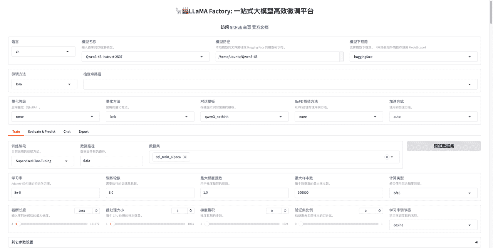

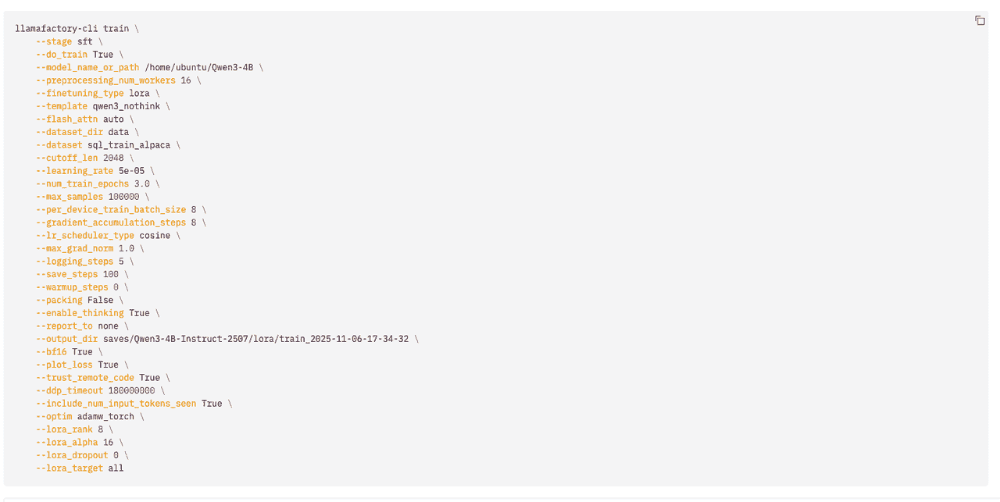

```
llamafactory-cli train \
    --stage sft \
    --do_train True \
    --model_name_or_path /home/ubuntu/Qwen3-4B \
    --preprocessing_num_workers 16 \
    --finetuning_type lora \
    --template qwen3_nothink \
    --flash_attn auto \
    --dataset_dir data \
    --dataset sql_train_alpaca \
    --cutoff_len 2048 \
    --learning_rate 5e-05 \
    --num_train_epochs 3.0 \
    --max_samples 100000 \
    --per_device_train_batch_size 8 \
    --gradient_accumulation_steps 8 \
    --lr_scheduler_type cosine \
    --max_grad_norm 1.0 \
    --logging_steps 5 \
    --save_steps 100 \
    --warmup_steps 0 \
    --packing False \
    --enable_thinking True \
    --report_to none \
    --output_dir saves/Qwen3-4B-Instruct-2507/lora/train_2025-11-06-17-34-32 \
    --bf16 True \
    --plot_loss True \
    --trust_remote_code True \
    --ddp_timeout 180000000 \
    --include_num_input_tokens_seen True \
    --optim adamw_torch \
    --lora_rank 8 \
    --lora_alpha 16 \
    --lora_dropout 0 \
    --lora_target all
```

参数详解：

## 基础配置参数

**--stage sft**

+   训练阶段设置为 SFT（Supervised Fine-Tuning，监督微调）

+   用于在预训练模型基础上进行有监督的任务特定训练

**--do_train True**

+   启用训练模式

+   设置为 True 表示执行训练过程

**--model_name_or_path /**home/ubuntu/Qwen3-4B

+   指定基础模型的路径

+   这里使用的是本地的 Qwen3-4B 模型

## 数据处理参数

--preprocessing_num_workers 16

+   数据预处理使用的并行工作进程数

+   16 个进程可以加速数据加载和预处理

--dataset_dir data

+   数据集所在的目录路径

+   数据集文件将从 data 目录中读取

--dataset sql_train_alpaca

+   指定使用的数据集名称

+   这里使用的是 SQL 训练数据集（Alpaca 格式）

--cutoff_len 2048

+   输入序列的最大长度（token 数）

+   超过 2048 个 token 的序列会被截断

--max_samples 100000

+   训练时使用的最大样本数量

+   如果数据集超过 10 万条，只使用前 10 万条

**--packing False**

+   是否启用序列打包（将多个短序列打包到一起）

+   False 表示不打包，每个样本独立处理

## LoRA 微调参数

--finetuning_type lora

+   微调方法选择 LoRA（Low-Rank Adaptation）

+   LoRA 是一种参数高效的微调方法，只训练少量参数

**--lora_rank 8**

+   LoRA 的秩（rank）参数

+   控制 LoRA 低秩矩阵的维度，越大表示可训练参数越多

**--lora_alpha 16**

+   LoRA 的缩放参数

+   用于控制 LoRA 权重的缩放比例，通常设置为 rank 的 2 倍

--lora_dropout 0

+   LoRA 层的 dropout 率

+   0 表示不使用 dropout

--lora_target all

+   LoRA 应用的目标层

+   all 表示对所有可用的线性层应用 LoRA

**--adapter_name_or_path saves/Qwen3-4B-Inst**ruct-2507/lora/train_2025-11-05-19-21-02

+   加载已有的 LoRA 适配器继续训练

+   这是一个继续训练的场景，从之前保存的检查点恢复

## 训练超参数

--learning_rate 5e-05

+   学习率设置为 0.00005

+   这是一个相对较小的学习率，适合微调

--num_train_epochs 3.0

+   训练 3 个完整的轮次（epoch）

+   模型将遍历整个训练集 3 次

--per_device_train_batch_size 8

+   每个 GPU/设备上的批次大小为 8

+   实际处理 8 个样本后更新一次模型（配合梯度累积）

--gradient_accumulation_steps 8

+   梯度累积步数为 8

+   实际的有效批次大小 = 8 × 8 = 64

--lr_scheduler_type cosine

+   学习率调度器类型为余弦退火

+   学习率会按照余弦曲线逐渐降低

--max_grad_norm 1.0

+   梯度裁剪的最大范数

+   防止梯度爆炸，梯度范数超过 1.0 会被裁剪

--warmup_steps 0

+   学习率预热步数为 0

+   不使用预热，训练开始就使用完整学习率

--optim adamw_torch

+   优化器选择 PyTorch 实现的 AdamW

+   AdamW 是一种改进的 Adam 优化器，带有权重衰减

## 日志和保存参数

--logging_steps 5

+   每 5 步记录一次训练日志

+   包括损失值、学习率等信息

--save_steps 100

+   每 100 步保存一次模型检查点

+   用于恢复训练或选择最佳模型

--report_to none

+   不向任何平台报告训练指标

+   如果设置为 wandb/tensorboard 等，会同步训练数据

**--output_dir saves/Qwen3-4B-Inst**ruct-2507/lora/train_2025-11-06-17-34-32

+   训练输出目录

+   保存模型检查点、日志和其他训练产物

--plot_loss True

+   生成训练损失曲线图

+   训练结束后会保存损失变化的可视化图表

**--include_num_in**put_tokens_seen True

+   在训练日志中包含已处理的输入 token 数量统计

+   用于更精确地追踪训练进度

## 模型和系统参数

--template qwen3_nothink

+   使用的对话模板

+   qwen3_nothink 是专门为 Qwen3 模型设计的模板（不使用思考模式）

--enable_thinking True

+   启用思考模式

+   注意：这与 template 中的 nothink 似乎有冲突，可能需要确认

--flash_attn auto

+   Flash Attention 自动配置

+   如果环境支持，会自动启用 Flash Attention 以加速训练

**--bf16 True**

+   使用 bfloat16 混合精度训练

+   可以加速训练并减少显存占用，同时保持较好的数值稳定性

--trust_remote_code True

+   信任并执行模型配置中的远程代码

+   某些模型需要自定义代码才能正常加载

--ddp_timeout 180000000

+   分布式数据并行（DDP）的超时时间

+   设置为 180000000 秒（约 5.7 年），实际上相当于禁用超时

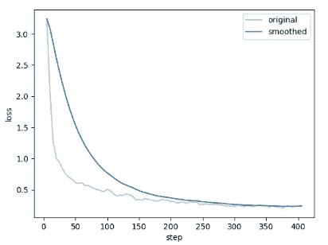

## 图表基本信息

**坐标轴说明：**

+   **X轴**：训练步数（steps），范围从 0 到约 400 步

+   **Y轴**：损失值（loss），范围从 0 到 3.0

+   **两条曲线**：

+   **original（蓝色深线）**：原始记录的损失值，有波动

+   **smoothed（浅蓝色）**：平滑后的损失值，便于观察整体趋势

## 训练过程分析

### 1️⃣ **初始阶段（0-50步）**

+   **起始损失**：约 3.0-3.2

+   **特征**：损失快速陡降

+   **说明**：

+   模型刚开始训练时对 SQL 任务还不熟悉

+   这个阶段模型学习速度最快

+   由于从已有的 LoRA 检查点继续训练，起始损失相对合理（如果从零开始可能更高）

### 2️⃣ **快速下降阶段（50-150步）**

+   **损失范围**：从约 2.0 下降到 0.5

+   **特征**：

+   下降速度开始放缓但仍然明显

+   曲线保持平滑的下降趋势

+   **说明**：

+   模型正在快速学习数据集的主要模式

+   这是最有效的训练阶段

### 3️⃣ **收敛阶段（150-400步）**

+   **损失范围**：从约 0.5 下降到 0.3

+   **特征**：

+   曲线趋于平缓

+   下降速度明显变慢

+   有轻微波动但整体稳定

+   **说明**：

+   模型已经学习到主要特征

+   正在进行细节优化

+   接近收敛状态

## 训练质量评估

### **积极信号：**

1.  **损失下降明显**：从 3.0 降到 0.3，下降了约 90%

1.  **曲线平滑**：没有剧烈震荡，说明学习率设置合理（5e-5）

1.  **收敛稳定**：后期趋于平稳，没有过拟合迹象

1.  **无异常波动**：没有出现损失突然上升的情况

### **结合训练参数分析：**

**为什么曲线如此平滑？**

+   gradient_accumulation_steps 8：大的有效批次（64）使梯度更新更稳定

+   lr_scheduler_type cosine：余弦学习率调度使下降更平滑

+   max_grad_norm 1.0：梯度裁剪防止了异常波动

+   lora_dropout 0：不使用 dropout，训练过程更稳定

**为什么起始损失不是很高？**

+   使用了 adapter_name_or_path，从已有的 LoRA 检查点继续训练

+   模型已经具备一定的 SQL 理解能力

这是一个**非常健康的训练曲线**，显示出良好的收敛特性和稳定的训练过程！

# 12 模型验证

## 模型导出

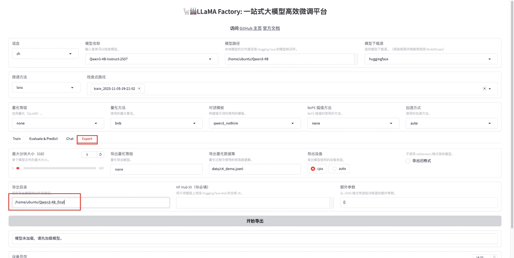

## 模型验证

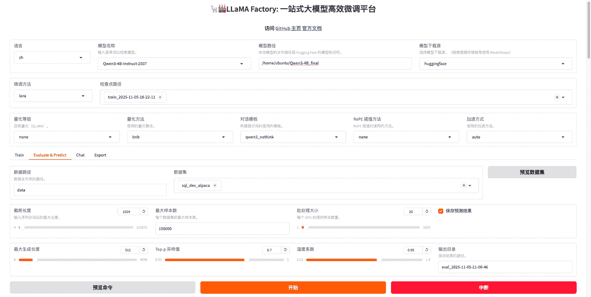

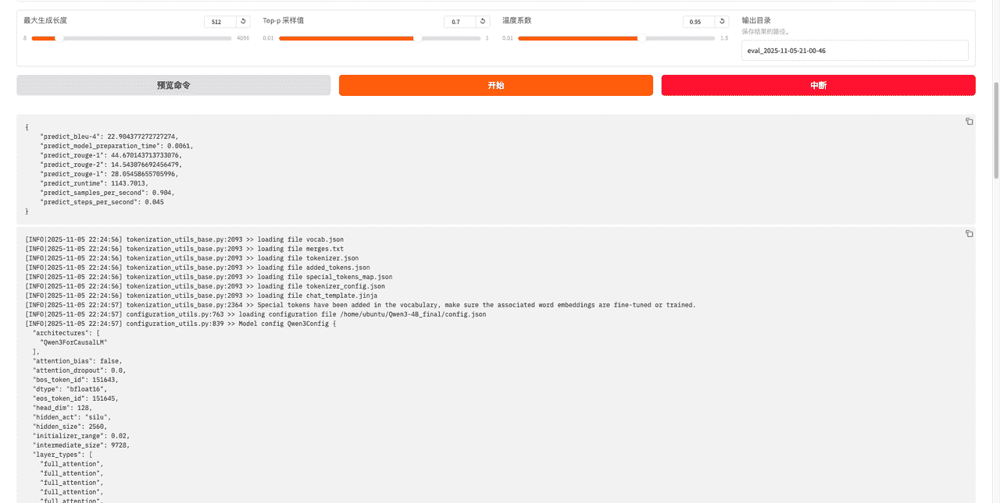

## 模型验证命令

```
llamafactory-cli train \
    --stage sft \
    --model_name_or_path /home/ubuntu/Qwen3-4B \
    --preprocessing_num_workers 16 \
    --finetuning_type lora \
    --quantization_method bnb \
    --template qwen3_nothink \
    --flash_attn auto \
    --dataset_dir data \
    --eval_dataset sql_dev_alpaca \
    --cutoff_len 1024 \
    --max_samples 100000 \
    --per_device_eval_batch_size 2 \
    --predict_with_generate True \
    --report_to none \
    --max_new_tokens 512 \
    --top_p 0.7 \
    --temperature 0.95 \
    --output_dir saves/Qwen3-4B-Instruct-2507/lora/eval_2025-11-06-17-34-32 \
    --trust_remote_code True \
    --ddp_timeout 180000000 \
    --do_predict True \
    --adapter_name_or_path saves/Qwen3-4B-Instruct-2507/lora/train_2025-11-05-19-21-02
```

### **核心执行模式**

llamafactory-cli train

+   LLaMA Factory 的命令行工具

+   虽然叫 train，但通过参数可以执行评估

**--stage sft**

+   阶段标识为 SFT（监督微调）

--do_predict True

+   **最关键的参数**：设置为预测/评估模式

+   **不进行训练**，只做推理和评估

+   如果这里是 --do_train True 就是训练模式

### **模型加载相关**

**--model_name_or_path /**home/ubuntu/Qwen3-4B

+   基础模型的路径

+   加载 Qwen3-4B 作为底座模型

**--adapter_name_or_path saves/Qwen3-4B-Inst**ruct-2507/lora/train_2025-11-05-19-21-02

+   加载之前训练好的 LoRA 适配器权重

+   这个适配器是在 SQL 任务上微调过的

+   会和基础模型合并使用

--finetuning_type lora

+   表明使用的微调方法是 LoRA

+   系统会正确加载 LoRA 适配器

--template qwen3_nothink

+   使用 Qwen3 专用的对话模板

+   nothink 表示不使用思考链格式

+   确保输入输出格式正确

--trust_remote_code True

+   允许执行模型配置中的自定义代码

+   Qwen 模型需要这个才能正常加载

### **性能优化相关**

--quantization_method bnb

+   使用 bitsandbytes 进行模型量化

+   可以是 8-bit 或 4-bit 量化

+   **作用**：显著降低显存占用（可节省 50-75% 显存）

+   **代价**：略微降低精度，但通常影响很小

--flash_attn auto

+   自动启用 Flash Attention（如果硬件支持）

+   **作用**：加速注意力计算，降低显存使用

--ddp_timeout 180000000

+   分布式训练的超时时间（秒）

+   设置得非常大，实际上相当于不超时

### **数据处理相关**

--dataset_dir data

+   数据集文件所在的目录

--eval_dataset sql_dev_alpaca

+   **指定评估数据集**：sql_dev_alpaca

+   这是验证集/测试集，用于评估模型性能

+   通常包含问题和标准答案 SQL

--preprocessing_num_workers 16

+   使用 16 个进程并行处理数据

+   加速数据加载和预处理

--cutoff_len 1024

+   输入序列的最大长度为 1024 个 token

+   超过这个长度会被截断

--max_samples 100000

+   最多评估 10 万个样本

+   如果数据集小于这个数，就全部评估

### **生成策略相关**

--predict_with_generate True

+   **核心参数**：使用生成模式进行预测

+   模型会自回归地生成完整的 SQL 语句

+   而不是简单的分类或填空

--max_new_tokens 512

+   每次预测最多生成 512 个新 token

+   控制生成的 SQL 语句最大长度

+   对于 SQL 查询来说，512 通常够用

**--top_p 0.7**

+   **核采样**（Nucleus Sampling）参数

+   只从累积概率前 70% 的候选 token 中采样

+   **效果**：0.7 是较保守的值，生成更加稳定和确定

+   值越小越保守，越大越随机

--temperature 0.95

+   采样温度

+   **效果**：0.95 略低于 1.0，使概率分布更集中

+   温度越低（如 0.5）生成越确定，越高（如 1.5）越随机

+   0.95 是一个平衡值

> top_p 和 temperature 共同作用：

+   temperature 先调整概率分布

+   top_p 再筛选候选词

+   **这个组合（0.7, 0.95**）倾向于生成较稳定但不失灵活性的 SQL

### **批处理相关**

--per_device_eval_batch_size 2

+   每个 GPU 上同时处理 2 个样本

+   比训练时小（训练时通常更大）

+   因为生成模式需要更多显存（要存储生成历史）

### **输出和日志相关**

**-**-output_dir saves/Qwen3-4B-Instruct-2507/lora/eval_日期路径

+   评估结果的保存目录

+   会生成以下文件：

+   all_results.json：评估指标汇总

+   generated_predictions.jsonl：所有预测结果

+   可能还有日志文件

--report_to none

+   不向任何外部平台报告指标

+   如果设置为 wandb 或 tensorboard 会同步到这些平台

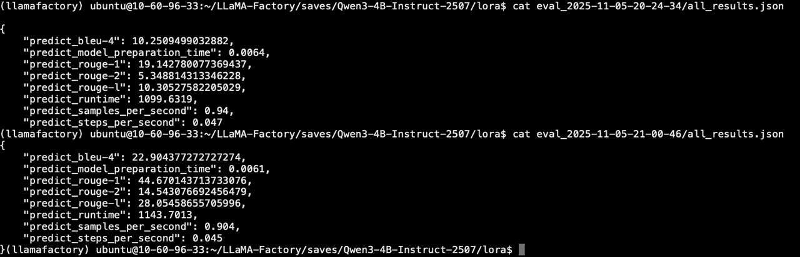

### **1. BLEU-4 (Bilingual Ev**aluation Understudy)

**predict_bleu-4**

**含义**：

+   BLEU-4 衡量生成文本与参考文本之间的 4-gram（四元组）精确匹配度

+   评分范围：0-100，分数越高越好

+   计算方式：统计生成的 SQL 中有多少个连续 4 个词的组合与标准答案匹配

**为什么重要**：

+   对于 SQL 这种结构化语言，**词序和语法结构非常重要**

+   SELECT * FROM users 和 FROM users SELECT * 意义完全不同

+   BLEU-4 能有效捕捉这种结构性匹配

**分数参考**：

+   **< 10**：质量很差，基本不可用

+   **10-20**：有一定匹配，但质量不够

+   **20-30**：较好的匹配度，可用

+   **> 30**：高质量匹配

### **2**. ROUGE-1/2/L (Recall-Oriented Understudy for Gisting Evaluation)

**predict_rouge-1**（单元组匹配）

+   **统计生成 SQ**L 和标准答案之间单个词的重合度

+   例如：生成 SELECT name FROM users vs 标准答案 SELECT age FROM users

+   重合词：SELECT, FROM, users（3/4 = 75%）

**predict_rouge-2**（二元组匹配）

+   统计**连续两个词**的重合度

+   更严格，能捕捉局部结构

+   例如：SELECT name 和 FROM users 是否匹配

**predict_rouge-l**（最长公共子序列）

+   找生成文本和参考文本的**最长公共子序列**（不要求连续）

+   能捕捉整体结构相似度

+   对于 SQL 特别有用，因为子句顺序可能不同但意义相同

**评分范围**：0-100，越高越好

**三者关系**：

+   ROUGE-1 最宽松（单词级别）

+   ROUGE-2 更严格（词对级别）

+   ROUGE-L 关注整体结构

### **3. 性能指标**

predict_model_preparation_time（模型准备时间）

+   模型加载和初始化的时间（秒）

+   两次都约 0.006 秒，非常快

**predict_runtime**（总运行时间）

+   完成所有预测的总时间（秒）

+   第一次：1099.6 秒 ≈ 18.3 分钟

+   第二次：1143.7 秒 ≈ 19.1 分钟

predict_samples_per_second（每秒样本数）

+   推理吞吐量

+   第一次：0.94 样本/秒

+   第二次：0.904 样本/秒

+   **估算数据集大小****：0.904 ×** 1143.7 ≈ 1034 个样本

predict_steps_per_second（每秒步数）

+   每秒完成的推理步数

+   与 batch_size 相关（batch_size=2，所以约为 samples_per_second 的一半）

## 两次评估结果对比

### **第一次评估（微调前）**

```
BLEU-4:    10.25
ROUGE-1:   19.14
ROUGE-2:    5.35
ROUGE-L:   10.31
推理速度:   0.94 样本/秒
```

### **第二次评估（微调后）**

```
BLEU-4:    22.90  ⬆️ 
ROUGE-1:   44.67  ⬆️
ROUGE-2:   14.54  ⬆️
ROUGE-L:   28.05  ⬆️
推理速度:   0.904 样本/秒
```

### **性能提升统计**

| 指标 | 第一次 | 第二次 | 绝对提升 | 相对提升 | 评级变化 |
| --- | --- | --- | --- | --- | --- |
| **BLEU-4** | 10.25 | 22.90 | +12.65 | **+123%** | 不可用 → 可用 |
| **ROUGE-1** | 19.14 | 44.67 | +25.53 | **+133%** | 差 → 良好 |
| **ROUGE-2** | 5.35 | 14.54 | +9.19 | **+172%** | 很差 → 中等 |
| **ROUGE-L** | 10.31 | 28.05 | +17.74 | **+172%** | 差 → 良好 |
| **推理速度** | 0.94 | 0.904 | -0.036 | -3.8% | 基本持平 |

## 提升分析

### 1. 质的飞跃（从不可用到可用）

BLEU-4: 10.25 → 22.90

+   **第一次****：10.25 分说明生成的** SQL 语法结构和标准答案差异很大

+   可能关键字顺序错误

+   可能缺少重要子句

+   大部分 SQL 无法正确执行

+   **第二次**：22.90 分达到了**可用门槛**

+   SQL 结构基本正确

+   关键字顺序合理

+   大部分 SQL 可以执行并返回正确结果

**实际意义**：

```
第一次可能生成：
FROM users WHERE SELECT name age &gt; 18  ❌ 语法错误

第二次可能生成：
SELECT name FROM users WHERE age &gt; 18  ✅ 可以执行
```

### **2. 词汇覆盖度大幅提升**

ROUGE-1: 19.14 → 44.67 (+133%)

+   **第一次**：只有 19% 的词汇匹配

+   可能使用了错误的表名、字段名

+   缺少关键的 SQL 关键字

+   **第二次**：44.67% 的词汇匹配

+   表名、字段名基本正确

+   SQL 关键字使用准确

**实际意义**：

```
标准答案：SELECT name, age FROM users WHERE city = &#x27;Beijing&#x27;

第一次可能生成：
SELECT * FROM user WHERE location = &#x27;北京&#x27;  
匹配词：SELECT, FROM, WHERE (3/8 = 37.5%)

第二次可能生成：
SELECT name, age FROM users WHERE city = &#x27;Beijing&#x27;
匹配词：SELECT, name, age, FROM, users, WHERE, city, Beijing (8/8 = 100%)
```

### **3. 结构相似度显著改善**

ROUGE-L: 10.31 → 28.05 (+172%)

+   **第一次**：整体结构与标准答案差异很大

+   子句顺序可能错误

+   逻辑结构不完整

+   **第二次**：结构相似度接近 30%

+   SQL 子句顺序基本正确

+   逻辑表达更接近标准答案

### **4. 推理速度保持稳定**

0.94 → 0.904 (-3.8%)

+   性能提升**没有牺牲推理速度**

+   这非常重要！说明模型优化是在不增加计算成本的情况下实现的

+   适合实际生产部署

## 总结

第二次模型相比第一次的提升是巨大的：

+   ✅ **从不可用提升到基本可用**

+   ✅ 所有评估指标提升 100-170%

+   ✅ **推理速度没有下降**

+   ✅ **具备了实际应用的潜力**

