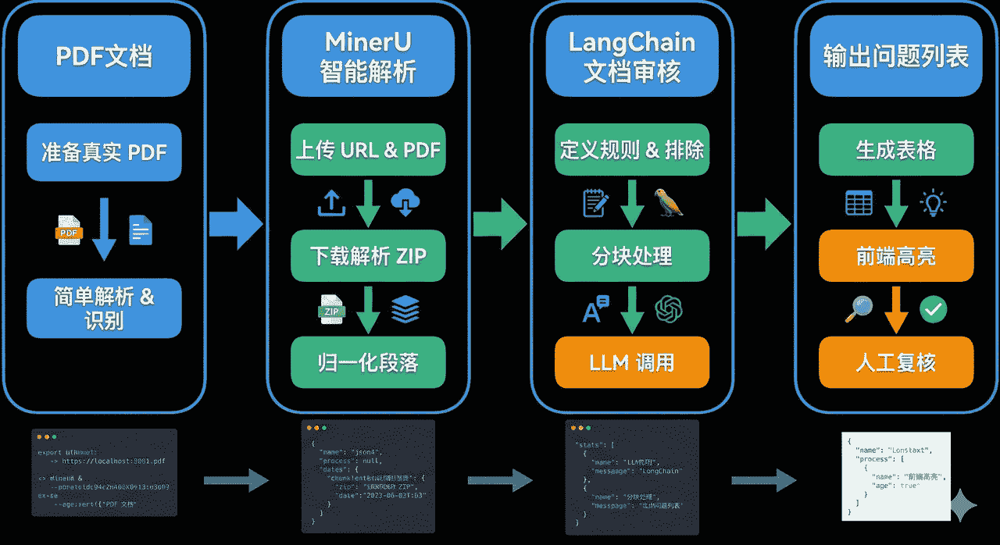
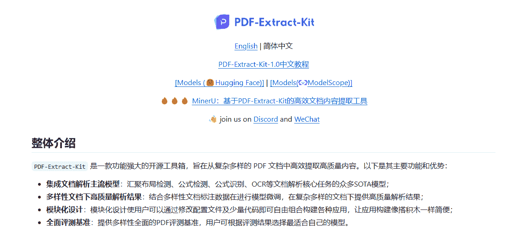
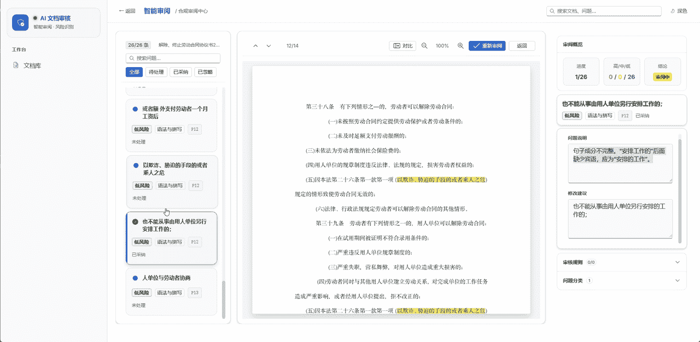

# Part 2. 基于 LangChain1.1 从零搭建AI 文档审核系统

> 来源：[https://kq4b3vgg5b.feishu.cn/docx/SAcsdFYD5ooPdHxsniocLOEsnye](https://kq4b3vgg5b.feishu.cn/docx/SAcsdFYD5ooPdHxsniocLOEsnye)

## 课程说明：

+   体验课内容节选自《2025大模型Agent智能体开发实战》(12月班)完整版付费课程

体验课时间有限，若想深度学习大模型技术，欢迎大家报名由我主讲的《2025大模型Agent智能体开发实战》(12月班)


LangChain1.1 通用智能文档审核Agent项目代码🔗网盘链接: https://pan.baidu.com/s/1cX_BE-ZdLShnMEwoQWViKQ?pwd=7tde 提取码: 7tde ，有更多课程咨询需求可扫码添加助教老师哦～

---

# Part 2. 基于 LangChain1.1 从零搭建AI 文档审核系统



借助大语言模型的能力，我们可以构建一个智能文档审核系统，自动识别文档中的语法错误、不当用语、敏感词汇以及一些定制化的审核规则，大幅提升文档审核效率。本小节课程，我们就从零开始，使用 LangChain1.1 框架和 DeepSeek-v3.2 大模型来进行文档审核Agent系统的开发。

具体来说，我们将实现以下完整功能的开发及运行：

核心功能

| 步骤 | 说明 | 产出 |
| --- | --- | --- |
| **输入** | 真实 PDF 文档 | PDF 文件 |
| **解析** | 使用 MinerU 解析 | 结构化文本 + 坐标 |
| **审核** | 用 LangChain 1.1 调用大模型，按&quot;预设规则 + 自定义规则&quot;审核 | 结构化问题列表 |
| **输出** | 将审核结果整理成&quot;问题列表&quot;（表格/JSON） | 可用于前端高亮与整改 |

具体应用到的核心技术栈如下：

| ### 核心技术栈 |  |  |
| --- | --- | --- |
| 技术 | 作用 | 说明 |
| LangChain1.1 | LLM 应用开发框架 | 简化大模型调用，提供统一接口 |
| DeepSeek-v3.2 | 大语言模型 | 国产高性能 LLM，性价比高 |
| MinerU | PDF 解析服务 | 将 PDF 转换为结构化文本 |
| Pydantic | 数据验证 | 定义结构化输出格式 |

## 1. 环境准备与依赖安装

### 1.1 安装必要的依赖库

首先，我们需要安装本课程所需的 Python 库。在当前的 Jupyter Notebook 中运行以下命令：

```
# 安装核心依赖
%pip install langchain langchain-openai pydantic httpx python-dotenv -q
```

```
WARNING: Running pip as the &#x27;root&#x27; user can result in broken permissions and conflicting behaviour with the system package manager, possibly rendering your system unusable. It is recommended to use a virtual environment instead: https://pip.pypa.io/warnings/venv. Use the --root-user-action option if you know what you are doing and want to suppress this warning.
Note: you may need to restart the kernel to use updated packages.
```

这些库的作用分别如下：

+   langchain：LLM 应用开发核心框架

+   langchain-openai：LangChain 的 OpenAI 兼容接口（DeepSeek 使用 OpenAI 兼容协议）

+   pydantic：数据验证和结构化输出

+   httpx：异步 HTTP 客户端，用于调用 MinerU API

+   python-dotenv：环境变量管理

### 1.2 准备 API 密钥

在使用 DeepSeek 和 MinerU 之前，我们需要获取并配置 API 密钥。

1.  Deep[Seek API Key：](https://platform.deepseek.com/)访问 DeepSeek 开放平台，注册账号后获取 API Key；

1.  **MinerU API Key**：访问 [MinerU 官网](https://mineru.net/)，需要先进行API申请，然后创建 Token 即可。


当然，除了MinerU，我们还可以使用PaddleOCR-VL、DeepSeek-OCR等其他解析方案，以上三种解析方案均有本地部署版本，大家可以找到助教老师领取资料：


MinerU是一个非常典型的基于管道的解决方案 (Pipeline-based solution) ，并且是一个开源文档解析项目，一共四个核心组件，通过Pipeline的设计无缝衔接，实现比较高效、准确的文档解析。如下图所示：（下图来源官方论文：https://arxiv.org/pdf/2409.18839v1）


MinerU的主要工作流程分为以下几个阶段：

1.  **输入**：接收PDF 格式文本，可以是简单的纯文本，也可以是包含双列文本、公式、表格或图等多模态PDF文件;

1.  文档预处理（Document Preprocessing）：检查语言、页面大小、文件是否被扫描以及加密状态；

1.  内容解析（Content Parsing）：

+   局分析：区分文本、表格和图像。

+   公式检测和识别：识别公式类型（内联、显示或忽略）并将其转换为 LaTeX 格式。

+   表格识别：以 HTML/LaTeX 格式输出表格。

+   OCR：对扫描的 PDF 执行文本识别。

1.  内容后处理（Content Post-processing）：修复文档解析后可能出现的问题。比如解决文本、图像、表格和公式块之间的重叠，并根据人类阅读模式重新排序内容，确保最终输出遵循自然的阅读顺序。

1.  格式转换（Format Conversion）：以 Markdown 或 JSON 格式生成输出。

1.  **输出（Output）**：高质量、结构良好的解析文档。

目前在Github 上，MinerU 的Star 数为48.2K，Fork 数为4K，拥有非常良好的社区支持和活跃的贡献者，且一直处于active development状态。


MinerU 提供了在线Demo 页面，我们可以直接线进行测试。试用地址：https://opendatalab.com/OpenSourceTools/Extractor/PDF/


同时，MinerU 项目于2024年07月05日首次开源，底层主要是集成 PDF-Extract-Kit 开源项目做PDF的内容提取，PDF-Extract-Kit同样是一个开源项目：https://github.com/opendatalab/PDF-Extract-Kit



PDF-Extract-Kit这个项目主要针对的是PDF文档的内容提取，通过集成众多SOTA模型对PDF文件实现高质量的内容提取，其中应用到的模型主要包括：

PDF-Extract-Kit 应用的模型类型

| 模型类型 | 模型名称 | GitHub 链接 | 模型下载链接 | 任务描述 |
| --- | --- | --- | --- | --- |
| 布局检测模型 | LayoutLMv3 / DocLayout-YOLO | [GitHub](https://github.com/microsoft/unilm/tree/master/layoutlmv3) / [GitHub](https://github.com/opendatalab/DocLayout-YOLO) | [模型下载](https://huggingface.co/microsoft/layoutlmv3-base-chinese) / [模型下载](https://huggingface.co/juliozhao/DocLayout-YOLO-DocStructBench/tree/main) | 定位文档中不同元素位置：包含图像、表格、文本、标题、公式等 |
| 公式检测模型 | YOLO | [GitHub](https://github.com/ultralytics/ultralytics) | [模型下载](https://github.com/ultralytics/assets/releases/download/v8.3.0/yolo11n.pt) | 定位文档中公式位置：包含行内公式和行间公式 |
| 公式识别模型 | UniMERNet | [GitHub](https://github.com/opendatalab/UniMERNet) | [模型下载](https://huggingface.co/wanderkid/unimernet_base) | 识别公式图像为latex源码 |
| 表格识别模型 | StructEqTable | [GitHub](https://github.com/Alpha-Innovator/StructEqTable-Deploy?tab=readme-ov-file) | [模型下载](https://huggingface.co/U4R/StructTable-InternVL2-1B/tree/main) | 识别表格图像为对应源码（Latex/HTML/Markdown） |
| OCR模型 | PaddleOCR | [GitHub](https://github.com/PaddlePaddle/PaddleOCR) | [模型下载](https://paddlepaddle.github.io/PaddleX/latest/module_usage/tutorials/ocr_modules/text_detection.html) | 提取图像中的文本内容（包括定位和识别） |

MinerU与PDF-Extract-Kit的关系是：MinerU 结合PDF-Extract-Kit输出的高质量预测结果，进行了专门的工程优化，使得文档内容提取更加便捷高效，处理底层原理的优化细节外，主要提升点在以下几点：

+   加入了自研的doclayout_yolo(2501)模型做布局检测，在相近解析效果情况下比原方案提速10倍以上，可以通过配置文件与 layoutlmv3 自由切换使用；

+   加入了自研的unimernet(2501) 模型做公式识别，针对真实场景下多样性公式识别的算法，可以对复杂长公式、手写公式、含噪声的截图公式均有不错的识别效果；

+   增加 OCR 的多语言支持，支持 84 种语言的检测与识别，支持列表：https://paddlepaddle.github.io/PaddleOCR/latest/ppocr/blog/multi_languages.html#5

+   重构排序模块代码，使用 layoutreader 进行阅读顺序排序，确保在各种排版下都能实现极高准确率 : https://github.com/ppaanngggg/layoutreader

+   表格识别功能接入了StructTable-InternVL2-1B模型，大幅提升表格识别效果，模型下载地址:https://huggingface.co/U4R/StructTable-InternVL2-1B

这里为了帮助大家降低接入的难度，我们就直接使用在线的MinerU API。在获取密钥后，可以通过以下方式配置：

```
# 方式一：直接在代码中配置（仅用于学习，生产环境不推荐）
# DEEPSEEK_API_KEY = &quot;your-deepseek-api-key-here&quot;
# MINERU_API_KEY = &quot;your-mineru-api-key-here&quot;

# 方式二：使用环境变量（推荐）
import os
from dotenv import load_dotenv

# 加载 .env 文件中的环境变量
load_dotenv(override=True)

DEEPSEEK_API_KEY = os.getenv(&quot;DEEPSEEK_API_KEY&quot;)
MINERU_API_KEY = os.getenv(&quot;MINERU_API_KEY&quot;)

# 验证配置
print(f&quot;DeepSeek API Key 已配置: {DEEPSEEK_API_KEY[:10]}&quot;)
print(f&quot;MinerU API Key 已配置: {MINERU_API_KEY[:10]}&quot;)
```

```
DeepSeek API Key 已配置: sk-04a9c72
MinerU API Key 已配置: eyJ0eXBlIj
```

如果可以正常显示DeepSeek API Key 和 MinerU API Key的前10位，说明环境变量加载成功。

## 2. 使用 MinerU 解析 PDF


MinerU 在线API的工作流程如下：

```
    1. 请求上传 URL  ───▶  2. 上传 PDF  ───▶  3. 轮询解析状态  ───▶  4. 下载解析结果
```

大家可以在MinerU的官网看到详细的API接口文档：


下面我们来实现一个MinerU 客户端：

```
import httpx
import asyncio
import time
import zipfile
import io
import json
from pathlib import Path

async def parse_pdf_with_mineru(pdf_path: str, api_key: str) -&gt; list[dict]:
    &quot;&quot;&quot;
    使用 MinerU API 解析 PDF 文档。
    
    参数:
        pdf_path: PDF 文件路径
        api_key: MinerU API 密钥
        
    返回:
        解析后的段落列表
    &quot;&quot;&quot;
    base_url = &quot;https://mineru.net&quot;
    file_path = Path(pdf_path)
    file_name = file_path.name
    
    headers = {
        &quot;Authorization&quot;: f&quot;Bearer {api_key}&quot;,
        &quot;Content-Type&quot;: &quot;application/json&quot;,
    }
    
    async with httpx.AsyncClient(timeout=300) as client:
        # 步骤1：请求预签名上传 URL
        print(&quot;步骤1：请求上传 URL...&quot;)
        resp = await client.post(
            f&quot;{base_url}/api/v4/file-urls/batch&quot;,
            headers=headers,
            json={
                &quot;files&quot;: [{&quot;name&quot;: file_name, &quot;data_id&quot;: file_name}],
                &quot;model_version&quot;: &quot;vlm&quot;,  # 使用视觉语言模型
            }
        )
        resp.raise_for_status()
        data = resp.json()[&quot;data&quot;]
        batch_id = data[&quot;batch_id&quot;]
        upload_url = data[&quot;file_urls&quot;][0]
        print(f&quot;获取到 batch_id: {batch_id}&quot;)
        
        # 步骤2：上传 PDF 文件
        print(&quot;步骤2：上传 PDF 文件...&quot;)
        with open(pdf_path, &quot;rb&quot;) as f:
            await client.put(upload_url, content=f.read())
        print(&quot;上传完成&quot;)
        
        # 步骤3：轮询等待解析完成
        print(&quot;步骤3：等待解析完成...&quot;)
        max_wait = 300  # 最多等待5分钟
        start_time = time.time()
        
        while True:
            resp = await client.get(
                f&quot;{base_url}/api/v4/extract-results/batch/{batch_id}&quot;,
                headers={&quot;Authorization&quot;: f&quot;Bearer {api_key}&quot;}
            )
            result = resp.json()[&quot;data&quot;][&quot;extract_result&quot;][0]
            
            if result[&quot;state&quot;] == &quot;done&quot;:
                full_zip_url = result[&quot;full_zip_url&quot;]
                print(&quot;解析完成&quot;)
                break
            elif result[&quot;state&quot;] == &quot;failed&quot;:
                raise RuntimeError(f&quot;解析失败: {result.get(&#x27;err_msg&#x27;)}&quot;)
            
            if time.time() - start_time &gt; max_wait:
                raise TimeoutError(&quot;解析超时&quot;)
            
            await asyncio.sleep(2)  # 每2秒检查一次
        
        # 步骤4：下载并解析结果
        print(&quot;步骤4：下载解析结果...&quot;)
        resp = await client.get(full_zip_url)
        zip_bytes = resp.content
        
        # 解压并提取 JSON
        with zipfile.ZipFile(io.BytesIO(zip_bytes)) as zf:
            json_files = [n for n in zf.namelist() if n.endswith(&quot;.json&quot;)]
            if not json_files:
                raise RuntimeError(&quot;未找到解析结果&quot;)
            
            with zf.open(json_files[0]) as f:
                content = json.loads(f.read().decode(&quot;utf-8&quot;))
        
        print(&quot;下载完成&quot;)
        
        # 步骤5：提取段落文本
        paragraphs = extract_paragraphs(content)
        print(f&quot;共提取了 {len(paragraphs)} 个段落&quot;)
        
        return paragraphs
```

上面的代码实现了与 MinerU API 的完整交互流程。接下来，我们需要一个辅助函数来从 MinerU 返回的 JSON 中提取段落文本：

```
def extract_paragraphs(content) -&gt; list[dict]:
    &quot;&quot;&quot;
    从 MinerU 解析结果中提取段落文本。
    
    MinerU 返回的 JSON 结构可能有多种格式，这个函数会尝试兼容不同格式。
    &quot;&quot;&quot;
    paragraphs = []
    
    # 情况1：content 是列表（每个元素是一个文本块）
    if isinstance(content, list):
        for item in content:
            if isinstance(item, dict):
                text = item.get(&quot;text&quot;) or item.get(&quot;content&quot;) or &quot;&quot;
                if text.strip():
                    paragraphs.append({
                        &quot;content&quot;: text.strip(),
                        &quot;page_num&quot;: item.get(&quot;page_idx&quot;, 0) + 1,
                        &quot;bbox&quot;: item.get(&quot;bbox&quot;),
                    })
        return paragraphs
    
    # 情况2：content 是字典，包含 pages 字段
    if isinstance(content, dict):
        pages = content.get(&quot;pages&quot;) or []
        for page in pages:
            page_num = page.get(&quot;page&quot;, 1)
            blocks = page.get(&quot;paragraphs&quot;) or page.get(&quot;blocks&quot;) or []
            for block in blocks:
                text = block.get(&quot;text&quot;) or block.get(&quot;content&quot;) or &quot;&quot;
                if text.strip():
                    paragraphs.append({
                        &quot;content&quot;: text.strip(),
                        &quot;page_num&quot;: page_num,
                        &quot;bbox&quot;: block.get(&quot;bbox&quot;),
                    })
    
    return paragraphs

# 测试用的示例数据
sample_paragraphs = [
    {&quot;content&quot;: &quot;本公司承诺绝对保证产品质量，必须满足所有客户需求。&quot;, &quot;page_num&quot;: 1},
    {&quot;content&quot;: &quot;根据市场调研，我们的产品销量将一定达到预期目标。&quot;, &quot;page_num&quot;: 1},
    {&quot;content&quot;: &quot;公司简介：我们是一家专注于人工智能领域的科技公司。&quot;, &quot;page_num&quot;: 2},
    {&quot;content&quot;: &quot;团队介绍：我们拥有一只经验丰富的研发团队。&quot;, &quot;page_num&quot;: 2},  
]

print(&quot;示例段落数据：&quot;)
for i, p in enumerate(sample_paragraphs):
    print(f&quot;  [{i}] 第{p[&#x27;page_num&#x27;]}页: {p[&#x27;content&#x27;][:30]}...&quot;)
```

```
示例段落数据：
  [0] 第1页: 本公司承诺绝对保证产品质量，必须满足所有客户需求。...
  [1] 第1页: 根据市场调研，我们的产品销量将一定达到预期目标。...
  [2] 第2页: 公司简介：我们是一家专注于人工智能领域的科技公司。...
  [3] 第2页: 团队介绍：我们拥有一只经验丰富的研发团队。...
```

进行真实PDF解析测试：

```

# 1. 本地 PDF 路径（改成你自己的）
pdf_path = &quot;./data/LangChain v1.1 文档审核类Agent开发实战.pdf&quot;

# 2. MinerU API Key（推荐走环境变量）
api_key = os.environ.get(&quot;MINERU_API_KEY&quot;)
if not api_key:
    raise RuntimeError(&quot;请先设置环境变量 MINERU_API_KEY&quot;)

# 3. 调用解析函数
paragraphs = await parse_pdf_with_mineru(pdf_path, api_key)

# 4. 打印结果
print(&quot;\n====== 解析结果 ======&quot;)
for i, p in enumerate(paragraphs):
    print(f&quot;[{i}] 第{p[&#x27;page_num&#x27;]}页: {p[&#x27;content&#x27;][:80]}&quot;)
```

```
步骤1：请求上传 URL...
获取到 batch_id: b714c6cb-c9dc-47c2-97eb-9b5a104404ce
步骤2：上传 PDF 文件...
上传完成
步骤3：等待解析完成...
解析完成
步骤4：下载解析结果...
下载完成
共提取了 695 个段落

====== 解析结果 ======
[0] 第1页: LangChain v1.0 文档审核类Agent开发实战
[1] 第1页: 从技术选型到产品落地
[2] 第1页: 本期公开课，我们将深入探索基于大语言模型的文档审核Agent技术方案。
[3] 第1页: 文档审核类Agent系统功能速览
[4] 第1页: 核心功能一：支持在线上传财务类票据，自动实现数据精准提取与审核功能；
[5] 第2页: $\leftarrow$  返回
[6] 第2页: 审查结果 - 票据审查
[7] 第2页: 导出报告
[8] 第2页: 生成PDF
[9] 第2页: 1
[10] 第2页: 十审查项
[11] 第2页: 1
全项
[12] 第2页: 0
[13] 第2页: 警告项
[14] 第2页: 3
[15] 第2页: 需审查项
[16] 第2页: 筛选：
[17] 第2页: 代理名称：
[18] 第2页: 审造
[19] 第2页: 问题数量
[20] 第2页: 执行时间
[21] 第2页: 佳
[22] 第2页: 完整性校验Agent
[23] 第2页: 需要审查
[24] 第2页: $\langle \widehat{\mathbb{C}}\rangle$  发现
[25] 第2页: 0.00s
[26] 第2页: 字段[收款人]缺失
[27] 第2页: 格式校验Agent
[28] 第2页: 需要审查
[29] 第2页: $\langle \widehat{\mathbf{x}}\rangle$  发现
[30] 第2页: 0.00s
[31] 第2页: 发票代码格式正确：发票号码格式不正确：购买方纳税人识别号格式正确：销售方纳税人识别号格式正确...
[32] 第2页: 计算校验Agent
[33] 第2页: $100\%$  合格
[34] 第2页: 3个提示
[35] 第2页: 0.00s
[36] 第2页: 价税合计计算正确：5785.38*347.12=6132.50；行项目金额合计正确：￥
[37] 第2页: 业务规则校验Agent
[38] 第2页: 需要查询
[39] 第2页: $⑥$  发现
[40] 第2页: 0.00s
[41] 第2页: 增值税专用发票必须有收款人
[42] 第2页: (1)
[43] 第2页: 审查说明
[44] 第2页: 核心功能二：支持在线批量上传PDF法务合同文件，自动解析、分块，并能够自定义审核规则，自主完成内容审核及输出审核报告；
[45] 第2页: #
[46] 第2页: ① 历史记录
[47] 第2页: 图
[48] 第2页: 解除劳动合同通知书
[49] 第2页: 解除、终止劳动合同协议书
[50] 第2页: 1
[51] 第2页: 1
[52] 第3页: 一、文档审核类AI成熟落地产品介绍
[53] 第3页: 首先看一组数据，如下论文中是对法律大模型与传统法律合同审查员、初级律师和法律流程外包商进行了开创性的比较，并深入剖析了大模型在合同审查的准确性、速度和成本效益方
[54] 第3页: Better Bill GPT: Comparing Large Language Models against Legal Invoice Reviewers
[55] 第3页: NICK WHITEHOUSE, NICOLE LINCOLN, STEPHANIE YIU, LIZZIE CATTerson, RIVINDU PERERA
[56] 第3页: Legal invoice review is a costly, inconsistent, and time-consuming process, trad
[57] 第3页: 论文地址：https://arxiv.org/pdf/2401.16212
[58] 第3页: 随着大模型能力的提升，将其作为智能代理用于专业文档的合规性审核已经从理论变为现实，并且在多个行业中展现出了惊人的效率提升。
[59] 第3页: 文档合规审核指的是根据法律法规、行业规范或企业内部规则，对各种专业文件进行内容和格式上的检查，以发现潜在的违规或缺陷之处。典型场景包括：合同文档的法律合规审核、
[60] 第3页: - 阿里的通义法睿：可以用于快速识别合同潜在风险，并提供专业的风险评估和修改建议。体验地址：https://tongyi.aliyun.com/farui/re
[61] 第3页: - 百度的财务、医疗、教育票据OCR识别及自动审查：https://ai.baidu.com/tech/ocr/receipes/vat/invoice
[62] 第4页: 全字段识别
[63] 第4页: 支持对账银发票、专票、发票、区块链发票、全科目发票全部关键字段的结构化识别，能够满足财税报销场景中对任意字段的识别需求
[64] 第4页: □□ 二维码识别校验
[65] 第4页: 识别画面左上角的二维码，获取发送代码、号码、金额、开票日期、检票码五个数字信息，与识别的对应字段信息进行匹配校验，保证更识别的正确判断。
[66] 第4页: 诸如此类的文档合规审核Agent是指基于大语言模型构建的智能代理系统，能够根据法律法规、行业规范或企业内部规则，自动对专业文件进行内容和格式上的检查，发现潜在的
[67] 第4页: 文档审核Agent核心应用场景
[68] 第4页: 之所以能够实现上述复杂工作流程的原因在于基于大模型构建而成的Agent具备自主决策和工具调用能力：
[69] 第4页: 1. 自主推理：不只是执行预设规则，而是能理解文档语义、推理条款间的逻辑关系
[70] 第4页: 功能介绍
[71] 第5页: 举个例子：审核一份采购合同时，Agent会先提取关键信息（供应商、金额、交付日期），然后检索公司采购政策，再核对预算系统中的额度，最后综合判断是否合规。这整个过
[72] 第5页: 论文地址：https://arxiv.org/pdf/2501.09136
[73] 第5页: 在合同、票据/收据、长篇公文等场景中，“大模型 + 工具调用 + 外部知识检索 + 规划/反思（Agentic模式）”能把抽取、核对与基于证据的判断串成多步流程
[74] 第5页: 同样，针对上图中的文档审核类的实现方案，如果进一步拆分则可以拆解为如下三大核心技术模块：
[75] 第5页: 文档解析模块
[76] 第5页: AI Agent 模块
[77] 第5页: 规则系统模块
[78] 第5页: 而如果再进一步拆解，则如下图所示：
[79] 第6页: 其中：
[80] 第6页: 所以一个相对比较健全的文档审核类Agent的实现，不仅需要我们掌握Agent及RAG的底层技术原理，还需要我们掌握多模态大模型、多Agent协作、Prompt工
[81] 第6页: 此外，对于文档的精准解析是文档审核类Agent落地的关键，也主要分为OCR和VLM两条实现链路，通过传统OCR +规则的方法逐步转到现在基于VLM-based方
[82] 第6页: 因此，本期公开课我们就从简到难，从基础的票据审核开始，逐步深入到更为复杂的合同审核，给大家全面讲解不同的解析和审核Agent构建思路，以及如何将这些方法应用到实
[83] 第7页: 二、多模态大模型搭建票据审核Agent
[84] 第7页: 我们先从较为简单的需求场景开始，即票据类审核方向。财务部门需要审核各种票据和发票，确保其内容完整、真假有效，并符合财务规定（例如发票抬头、税号、金额计算正确，报
[85] 第7页: 一般来说，人工在处理票据的完整审核流程包括：
[86] 第7页: 如果我们做的合规性检查输入比较简单，且规范都是统一的，比如票据类，此类的审核规则都是比较规范的，我们只需要定制化的提取出某些数值，那么这类场景是非常适合直接使用
[87] 第7页: 通过结合多模态大模型和多Agent协作技术,实现发票审核的智能化:
[88] 第7页: 我们就可以非常迅速的确定出如下方案来实现票据类审核Agent的技术架构方案：
[89] 第8页: 接下来我们就使用LangChain框架来搭建这个完整的票据审核Agent系统。
[90] 第8页: - Step 1. 安装环境依赖
[91] 第8页: 使用LangChain1.0作为核心Agent开发框架，需要预先安装如下依赖包：
[92] 第8页: 安装必要的依赖包
[93] 第8页: - Step 2. 配置 API Key
[94] 第8页: 接下来我们需要准备一个多模态大模型，我们使用阿里云百炼的Qwen3-vl-plus模型。注册地址：https://baiiianconsole.aliyun.c
[95] 第8页: 设置APIKey（请替换为你的实际Key）
[96] 第8页: API Key 配置完成
[97] 第9页: - Step 3. 导入必要的库
[98] 第9页: 导入项目所需的核心库：
[99] 第9页: 导入完成
[100] 第9页: - Step 4. 发票信息提取模块
[101] 第9页: 阶段的核心任务是：从发票图像或OCR数据中提取结构化的JSON数据。使用Pydantic v2定义发票的数据模型。Pydantic提供了强大的数据验证功能，可用
[102] 第10页: 添加了row字段自动类型转换
[103] 第10页: 测试数据: *广告制作*广告费, 金额: ¥94,339.62, 税率: 6.0%
[104] 第10页: 行项目就是发票里逐条计费的“最小可核查单元”，包含名称、数量、单价、金额、税率/税额等。清晰的行项目能提高透明度、减少争议与拒付风险，这是发票开具与收款的基本要
[105] 第10页: 接下来再定义完整的发票模型，给多模态大模型一个“完整的发票模型（Invoice）”，是在抽取  $\rightarrow$  校验  $\rightarrow$
[106] 第11页: Invoice 模型定义完成
[107] 第11页: 包含23个字段
[108] 第11页: 自动验证日期格式
[109] 第11页: 支持导出为dict/json
[110] 第11页: - Step 5. 初始化多模态大模型
[111] 第11页: 使用LangChain接入多模态大模型。多模态模型可以同时处理图像和文本输入。
[112] 第12页: 多模态大模型初始化完成
[113] 第12页: - Step 6. 如何传入问题和图像
[114] 第12页: 多模态模型的输入包含两部分:文本提示词 + 图像数据。我们需要将图像编码为 base64 格式。
[115] 第12页: extraction_prompt = &#x27;&#x27;&#x27;你是专业的中国发票识别助手。请仔细识别图片中的增值税发票，提取所有信息并以JSON格式返回。
[116] 第12页: **必须提取的字段：**
[117] 第12页: **重要规则：**
[118] 第13页: 提示词构建完成
[119] 第13页: 提示词构建完成，接下来我们读取图像并编码为 base64。
[120] 第13页: 图像编码完成，base64 长度：362616 字符
[121] 第13页: 图像编码完成，接下来我们构建多模态消息。
[122] 第14页: - Step 7. 如何调用模型并做结构化输出
[123] 第14页: 调用多模态模型后，我们需要从响应中提取JSON数据，并使用Pydantic模型进行验证。
[124] 第14页: - Step 8. 完整的提取流程
[125] 第14页: 最后，我们定义一个完整的提取流程，将上述步骤串联起来。
[126] 第15页: 1. 读取并编码图像
[127] 第15页: 2. 构建多模态消息
[128] 第15页: 3. 调用多模态大模型
[129] 第15页: 4. 提取 JSON 并验证
[130] 第15页: 完整提取流程定义完成
[131] 第15页: - Step 9. 运行测试
[132] 第15页: 以上代码构建完成后，接下来便可以实际进行运行测试了：
[133] 第15页: 如果你有发票图像，可以运行以下代码：
[134] 第15页: 正在提取发票信息...
[135] 第15页: 发票信息提取完成
[136] 第15页: 发票代码：3100153130
[137] 第15页: 发票号码：14641426
[138] 第15页: 价税合计: ¥100,000.00
[139] 第15页: 如果有发票图像，可以运行以下代码：
[140] 第16页: 正在提取发票信息...
[141] 第16页: 发票信息提取完成
[142] 第16页: 做到这里，其实我们就已经完成了一个“发票识别 Agent”，可以识别发票的结构化数据了。如下所示：
[143] 第16页: 但是，我们还需要对识别出来的发票数据进行校验，以确保数据的准确性。所以我们需要进一步设计一个“发票校验 Agent”。这个阶段是整个系统的核心创新点，我们会使用
[144] 第16页: 多Agent协作校验系统的优势
[145] 第17页: - Step 10：定义校验结果数据模型
[146] 第17页: 同样，我们定义校验结果数据模型，用于存储每个Agent的校验结果。
[147] 第18页: 校验结果数据模型定义完成
[148] 第18页: - Step 11: 完整性校验 Agent
[149] 第18页: 该 Agent 主要检查发票的必填字段是否完整。
[150] 第18页: 建议填写的字段
[151] 第18页: 检查必填字段
[152] 第18页: 检查是否为空
[153] 第19页: 完整性校验 Agent 定义完成
[154] 第19页: 检查13个必填字段
[155] 第19页: 检查6个建议字段
[156] 第19页: - Step 12: 格式校验 Agent
[157] 第19页: 进一步地，当第一阶段正确输出验证发票代码、号码、税号等字段后，我们还要校验其识别的格式是否正确。
[158] 第19页: def validate_format(invoice_data: dict) -&gt; AgentValidationReport:
[159] 第19页: &quot;&quot;格式校验 Agent&quot;&quot;
[160] 第19页: start_time = time.time()
[161] 第19页: results = []
[162] 第19页: 1. 发票代码：10位数字
[163] 第19页: invoice_code = invoice_data.get(&#x27;invoice_code&#x27;, &#x27;&#x27;)
[164] 第19页: if invoice_code and not re.match(r&#x27;^\d{10}$$, str(invoice_code)):
[165] 第21页: 格式校验 Agent 定义完成
[166] 第21页: - Step 13: 计算校验 Agent
[167] 第21页: 接下来进一步验证发票金额、税额的计算是否正确。
[168] 第23页: - Step 14: 业务规则校验 Agent
[169] 第23页: 最后，我们可以通过定制化的一些业务规则来精细化校验，比如我们这里以验证税率、发票类型等业务逻辑为例进行说明。
[170] 第24页: ）
[171] 第24页: 业务规则校验 Agent 定义完成
[172] 第24页: - Step 15: Orchestrator: 编排所有 Agent
[173] 第24页: 最终，我们定义一个协调器负责调用所有 Agent 并汇总结果。
[174] 第25页: 2. 汇总结果
[175] 第25页: 3. 确定总体状态
[176] 第25页: 4. 生成报告
[177] 第25页: Orchestrator 编排器定义完成
[178] 第25页: - Step 16：多代理校验系统运行测试
[179] 第25页: 最后，我们使用真实的发票数据进行校验，并打印校验报告。
[180] 第26页: 将之前提取的 invoice 对象转换为字典
[181] 第26页: 执行完整校验
[182] 第26页: 开始发票校验...
[183] 第26页: 校验完成：PASS
[184] 第26页: def print_validation_report.report:InvoiceValidationReport):
[185] 第27页: 发票校验报告
[186] 第27页: 发票编号：4200162130_00998959
[187] 第27页: 校验时间：2025-11-28 11:06:10
[188] 第27页: 总体状态：PASS
[189] 第27页: 总结：所有校验通过，发票数据正常
[190] 第27页: 统计信息：
[191] 第28页: 【完整性校验Agent】（耗时：0.000秒）
[192] 第28页: 无问题
[193] 第28页: 【格式校验Agent】（耗时：0.001秒）
[194] 第28页: 无问题
[195] 第28页: 【计算校验Agent】（耗时：0.000秒）
[196] 第28页: 无问题
[197] 第28页: 【业务规则校验Agent】（耗时：0.000秒）
[198] 第28页: 无问题
[199] 第28页: 我们这里可以测试一下有问题的票据：
[200] 第28页: 正在提取发票信息...
[201] 第28页: 发票信息提取完成
[202] 第28页: 开始发票校验...
[203] 第29页: 校验完成：FAIL
[204] 第29页: 发票校验报告
[205] 第29页: 发票编号：1100154130_00772
[206] 第29页: 校验时间：2025-11-18 17:00:15
[207] 第29页: 总体状态：FAIL
[208] 第29页: 总结：发现4个错误，0个警告，需要修正后才能通过
[209] 第29页: 统计信息：
[210] 第29页: 【完整性校验Agent】（耗时：0.000秒）
[211] 第29页: [X [ERROR] 必填字段 &#x27;收款人&#x27; 缺失或为空
[212] 第29页: 字段：payee
[213] 第29页: 期望：非空值
[214] 第29页: 实际：空
[215] 第29页: 建议：请补充 收款人 信息
[216] 第29页: 【格式校验Agent】（耗时：0.000秒）
[217] 第29页: [X [ERROR] 发票号码格式错误]
[218] 第29页: 字段：invoice_number
[219] 第29页: 期望：8位数字
[220] 第29页: 实际：00772
[221] 第29页: 建议：发票号码必须是8位纯数字，如：14641426
[222] 第29页: [X [ERROR] 开票日期格式错误
[223] 第29页: 字段：issue_date
[224] 第29页: 期望：YYYY-MM-DD
[225] 第29页: 实际：2016年9月
[226] 第29页: 建议：日期格式应为：2016-06-02
[227] 第29页: 【计算校验Agent】（耗时：0.000秒）
[228] 第29页: [X [ERROR] 第1行税额计算错误]
[229] 第29页: 字段：line_items[0].tax_amount
[230] 第29页: 期望: ¥347.12
[231] 第29页: 实际: ¥61.00
[232] 第29页: 建议：税额应该  $=$  金额(5785.38）  $\times$  税率  $(6.0\%) = 347.12$
[233] 第30页: 【业务规则校验Agent】（耗时：0.000秒）
[234] 第30页: 无问题
[235] 第30页: 导出详细的校验报告
[236] 第30页: 校验报告已导出到 validation_report.json
[237] 第30页: 导出提取的发票数据
[238] 第30页: 发票数据已导出到 invoiceextracted.json
[239] 第30页: 三、基于OCR搭建法务合同审核Agent
[240] 第30页: 接下里我们再看第二个场景。在特定类别的文档需要遵循严格的格式与内容要求，例如政府或企业的招投标书（RFP响应文档）、各类行政公文、行业报告等。这些文档通常有明确
[241] 第30页: 为什么合同、标书审核更适合OCR+RAG方案而非VLM方案？这一选择基于以下几个核心考量：
[242] 第30页: 文档长度与Token成本
[243] 第30页: 合同和标书通常是多页长文档，动辄数十页甚至上百页。VLM在处理此类文档时面临严重的token限制问题。以一份20页的劳动合同为例，如果将整个PDF作为图像输入V
[244] 第31页: - 精确坐标定位与可追溯性
[245] 第31页: 法务合同审核的核心需求之一是精确定位问题条款的位置，以便法务人员快速查阅和修改。OCR方案（如MinerU）在解析PDF时会返回每个文本块的精确坐标信息（bbo
[246] 第31页: 智能切分与上下文控制
[247] 第31页: OCR方案可以在提取文本后进行智能切分（按标题层级、段落语义切分），每个片段控制在800 tokens以内，既保持了上下文完整性，又能并发处理以提升效率。更重要
[248] 第31页: - 表格与复杂格式的处理
[249] 第31页: 合同中常包含表格（如付款计划表、违约金计算表）和复杂格式（如条款编号、多级标题）。OCR方案可以将表格解析为结构化数据（JSON或Markdown表格），便于后
[250] 第31页: 票据的人工审核标准流程
[251] 第32页: 综上，对于合同、标书等长文档审核场景，OCR+RAG方案在成本、精度、可追溯性、灵活性等多个维度均优于VLM方案。VLM更适合短文档、强视觉依赖的场景（如票据识
[252] 第32页: 本课程将带你从零开始实现一个完整的文档审核系统。该系统的核心特点是保留PDF文档的坐标信息，实现可追溯、可定位的文档审核和修改。
[253] 第32页: PDF文档  $\rightarrow$  MinerU解析  $\rightarrow$  提取文本  $+$  坐标  $\rightarrow$  智能切
[254] 第32页: 如下图所示：
[255] 第32页: 本课程将带你从零开始实现一个完整的文档审核系统。该系统的核心特点是保留PDF文档的坐标信息，实现可追溯、可定位的文档审核和修改。
[256] 第32页: - Step 1: 环境准备
[257] 第32页: 首先安装必要的依赖包。
[258] 第32页: 安装核心依赖
[259] 第33页: - [33mWARNING: Running pip as the &#x27;root&#x27; user can result in broken permissions a
[260] 第33页: - Step 2: 配置 API Key 和 MinerU 服务地址
[261] 第33页: 配置APIKey和MinerU服务地址import os
[262] 第33页: API 配置完成
[263] 第33页: 其中关于MinerU、PaddleOCR-VL和DeepSeek-OCR的详细介绍以及如何在本地通过vLLM框架启动解析服务，大家可以学习我的往期公开课视频：从
[264] 第34页: - Step 3: PDF 解析与坐标提取
[265] 第34页: 这是整个系统的核心基础。我们使用MinerU将PDF转换为带坐标的JSON格式。
[266] 第34页: MinerU 是一个 PDF 解析工具，它不仅提取文本，还保留每个文本块在 PDF 中的精确位置（坐标）。
[267] 第34页: *输入：PDF文件
[268] 第34页: 输出\*\*:JSON文件，包含：
[269] 第34页: 其中坐标格式示例：
[270] 第35页: PDF 解析函数已定义
[271] 第35页: - Step 4: 加载带坐标的 JSON 文档
[272] 第36页: 解析 MinerU 生成的 JSON，提取文本和坐标信息。
[273] 第37页: 根据 $&lt; $劳动合同法 $&gt; $ 相关规定,公司依法解除此前您与公司订立的劳动合同(合同期限:
[274] 第37页: 年月日至年月日)。解除您的理由是：
[275] 第37页: （1）过失性解除
[276] 第37页: 口在试用期内证明不符合录用条件的；口严重违反公司依法制定的规章制度的；
[277] 第37页: 口严重失职，营私舞弊，给用人单位造成重大损害的；
[278] 第37页: 口以欺诈、胁迫的手段使用人单位违背真实意思签订劳动合同致使劳动合同无效的；
[279] 第37页: 口员工同时与其他用人单位建立劳动关系，对完成本单位的工作任务造成严重影响，或者经用人单位提出，拒不改正的；  
口被依法追究刑事责任的；
[280] 第37页: （2）非过失性解除
[281] 第37页: - Step 5: 带坐标的文档切分
[282] 第37页: 将长文档切分成小片段，同时为每个片段分配对应的坐标信息。切分策略为：
[283] 第37页: 关键点: 坐标信息让我们能够在原PDF中精确定位每个审核问题的位置。
[284] 第37页: # MinerU 返回的原始数据：按照行、段落、表格单元格等自然单位切分的。
[285] 第38页: 重新切分（chunk_size=800）：
[286] 第38页: chunk 1 (831 tokens):
[287] 第38页: 内容：&quot;解除劳动合同通知书\n\n先生/小姐\n\n根据&lt;&lt;劳动合同法&gt;&gt;...&quot;
[288] 第38页: bbox_list: [
[289] 第38页: {bbox: [359, 95, 638, 120], text: &quot;解除劳动合同通知书&quot;},
[290] 第38页: {bbox: [199, 164, 373, 181], text: &quot;先生/小姐&quot;},
[291] 第38页: {bbox: [170, 200, 847, 255], text: &quot;根据...&quot;}
[292] 第38页: // ... 共86个原始文本块的坐标
[293] 第38页: ]
[294] 第38页: # 核心逻辑：一个Chunk  $\rightarrow$  多个BBox：每个原始文本块都有自己精确的坐标
[295] 第38页: 后续的审核逻辑：
[296] 第38页: issue  $=$  {
[297] 第38页: &quot;original&quot;: &quot;年月日至年月日&quot;, #有问题的原文
[298] 第38页: &quot;description&quot;: &quot;日期填写不完整&quot;
[299] 第38页: }
[300] 第38页: 在chunk的bbox_list中查找匹配的坐标
[301] 第38页: for bbox_item in chunk[&#x27;bbox_list&#x27;]:
[302] 第38页: if &quot;年月日至年月日&quot; in bounding_item[&#x27;text&#x27;]:
[303] 第38页: problem_bbox =_bbox_item[&#x27;bbox&#x27;] #找到了！
[304] 第38页: problem_page = bbox_item[&#x27;pageidx&#x27;]
[305] 第38页: # 可以在PDF上精确高亮这个位置
[306] 第38页: import json
[307] 第38页: import re
[308] 第38页: from typing import List, Dict, Any
[309] 第38页: import re
[310] 第38页: import json
[311] 第38页: from typing import Dict, Any, List
[312] 第38页: def clean_ocrerrors(text: str) -&gt; str:
[313] 第38页: &quot;&quot;清理常见的OCR识别错误&quot;&quot;
[314] 第38页: if not text:
[315] 第38页: return text
[316] 第38页: 修复书名号识别错误（各种变体）
[317] 第38页: text = re.sub(r&#x27;\$&lt;\s*&lt;\s*\$\s*(.+?)\s*\$\&gt; \s*&gt;\$&#x27;, r&#x27; \{1\}&#x27;, text)
[318] 第38页: text = re.sub(r&#x27;\$&lt;\s*&lt;\s*(.+?)\s*&gt;\s*&gt;\$&#x27;, r&#x27; \{1\}&#x27;, text)
[319] 第38页: text = re.sub(r&#x27;\$&lt; &lt;\s*(.+?)\s*&gt; &gt;\s*\$\$, r&#x27; \{1\}&#x27;, text)
[320] 第38页: 修复LaTex符号
[321] 第38页: text = re.sub(r&#x27;\$\17\s*\$\\s*(.+?)\s*\$\mathbf{\mathbf{m}}athrm\s*\{\s*\&gt;\s*\}\
[322] 第38页: text)
[323] 第38页: text = re.sub(r&#x27;\$&lt;\s*&lt;\s*\$(.+?)\$\mathfrak{m}athrm\s*\{\{\s*\&gt;\s*\}\{\s*\&gt;\s*\
[324] 第38页: 清理多余空格
[325] 第38页: text = re.sub(r&#x27;\s+\&#x27;, &#x27; &#x27;, text).strip()
[326] 第38页: return text
[327] 第39页: def load_json_with_coordinatesjson_path: str) -&gt; Dict[str, Any]:
[328] 第39页: ```
```
```
```
```
```
```
```
```
```
```
```
```
```
``
[329] 第39页: with openjson_path，&#x27;r&#x27;，encoding  $\equiv$  &#x27;utf-8&#x27;)asf: data  $=$  json.load(f)
[330] 第39页: results = data[&#x27;results&#x27;]
[331] 第39页: doc_name = list(results.keys())[0]
[332] 第39页: doc_result = results[doc_name]
[333] 第39页: 解析 content_list
[334] 第39页: content_list_str = doc_result.get(&#x27;content_list&#x27;, [&#x27;&#x27;])
[335] 第39页: if isinstance(content_list_str, str):
[336] 第39页: content_list = json.dumps(content_list_str)
[337] 第39页: else:
[338] 第39页: content_list = content_list_str
[339] 第39页: 清理 md_content 中的OCR错误
[340] 第39页: md_content = doc_result.get(&#x27;md_content&#x27;, &#x27;&#x27;)
[341] 第39页: md_content = clean_ocr.errors(md_content)
[342] 第39页: 清理content_list中的文本
[343] 第39页: for item in content_list:
[344] 第39页: if &#x27;text&#x27; in item and item[&#x27;text&#x27;]:
[345] 第39页: item[&#x27;text&#x27;] = clean OCR errors(item[&#x27;text&#x27;])
[346] 第39页: return{
[347] 第39页: &#x27;md_content&#x27;: md_content,
[348] 第39页: &#x27;content_list&#x27;: content_list
[349] 第39页: }
[350] 第39页: def estimate_tokens(text: str) -&gt; int:
[351] 第39页: &quot;&quot;估算文本的 token 数&quot;&quot;
[352] 第39页: ```c
chinese chars = len(re.findall(r&#x27;[u4e00-\u9fff)&#x27;, text))
[353] 第39页: other chars = len(text) - chinese chars
[354] 第39页: return chinese chars + int(other chars * 0.25)
[355] 第39页: def normalize_text(text: str) -&gt; str:
[356] 第39页: &quot;&quot;规范化文本用于匹配&quot;&quot;
[357] 第39页: 移除多余空格和换行
[358] 第39页: text = re.sub(r&#x27;\s+\&#x27;, &#x27; &#x27;, text)
[359] 第39页: 移除LaTex符号和特殊字符
[360] 第39页: text = re.sub(r&#x27;[\\$&lt;&gt;\\]&#x27;, &#x27; &#x27;, text)
[361] 第39页: return text.strip().lower()
[362] 第39页: def split_doc_with_coordinates(
[363] 第39页: md_content: str,
[364] 第39页: content_list: List[Dict],
[365] 第39页: chunk_size: int = 800
[366] 第39页: ）  $\rightarrow$  List[Dict[str，Any]]:
[367] 第39页: 1111
[368] 第39页: 切分文档并精确分配坐标（基于文本首次出现位置）
[369] 第39页: 1111
[370] 第39页: 1. 切分文本
[371] 第39页: paragraphs = md_content.split(&#x27;\n\n&#x27;)
[372] 第39页: chunks = []
[373] 第39页: current_chunk = &quot;&quot;
[374] 第42页: 文档已切分为1个片段
[375] 第42页: 片段 1:
[376] 第42页: Token数：4765
[377] 第42页: 坐标块数：198
[378] 第42页: 内容预览：#解除劳动合同通知书先生/小姐根据《劳动合同法》相关规定，公司依法解除此前您与公司订立的劳动合同(合同期限：年月日至年月日)。解除您的理由是：（1）过
[379] 第42页: 坐标示例：页码  $= 0$  ，bbox  $=$  [359，95，638，120]
[380] 第42页: 文本示例：解除劳动合同通知书
[381] 第42页: 【调试】查看content_list前5个元素：
[382] 第42页: 元素1：
[383] 第42页: 类型：text
[384] 第42页: 页码：0
[385] 第42页: 坐标：[359，95，638，120]
[386] 第42页: 元素2：
[387] 第42页: 类型：text
[388] 第42页: 页码：0
[389] 第42页: 坐标：[199，164，373，181]
[390] 第42页: 元素3：
[391] 第42页: 类型：text
[392] 第42页: 页码：0
[393] 第42页: 坐标：[170，200，847，255]
[394] 第42页: 元素4：
[395] 第42页: 类型：text
[396] 第42页: 页码：0
[397] 第43页: 坐标：[187，275，753，293]
[398] 第43页: 元素5：
[399] 第43页: 类型：text
[400] 第43页: 页码：0
[401] 第43页: 坐标：[202，312，346，330]
[402] 第43页: 【调试】查看 md_content 前500字符：
[403] 第43页: 解除劳动合同通知书 先生/小姐 根据 《劳动合同法》 相关规定，公司依法解除此前您与公司订立的劳动合同(合同期限：年月日至年月日)。解除您的理由是：（1）过失性
[404] 第43页: - Step 6: 设计审核规则
[405] 第43页: 定义文档审核需要检查的规则。
[406] 第43页: PROFESSIONAL_CONTRACT=AUDITRULES = &quot;&quot;
[407] 第43页: 合同协议书专业审核规则
[408] 第43页: ## 一、文本规范性审核（P1-P2级）
[409] 第43页: 1.1 错别字与形近字检查
[410] 第43页: 1.2 标点符号规范性
[411] 第43页: 1.3 语法结构检查
[412] 第43页: ## 二、合同专业性审核（PO级 - 核心）
[413] 第43页: 2.1 法律术语规范性
[414] 第44页: - 法律风险：术语使用不当可能影响合同效力
[415] 第44页: 2.2 权利义务对等性
[416] 第44页: 2.3 金额与数字准确性
[417] 第44页: 2.4 时间条款明确性
[418] 第44页: 三、逻辑一致性审核（PO级）
[419] 第44页: 3.1条款前后一致性
[420] 第44页: 3.2 条款间逻辑矛盾
[421] 第44页: 3.3 引用条款准确性
[422] 第44页: 四、合规性与风险审核（PO级）
[423] 第44页: 4.1 法律合规性
[424] 第45页: 4.2 敏感词汇检查
[425] 第45页: 4.3 必备条款完整性
[426] 第45页: #
[427] 第45页: ## 五、表述清晰度审核（P1级）
[428] 第45页: 5.1 歧义性表述
[429] 第45页: 5.2 冗余与重复
[430] 第45页: ## 审核优先级说明
[431] 第45页: **PO级（1标记）**：法律合规性-可能导致合同无效
[432] 第45页: **P0级（1、标记）**: 专业性、一致性、风险 - 可能引发争议或损失
[433] 第45页: **P1级**：规范性、可读性 - 建议修正
[434] 第45页: **P2级**：优化项 - 可优化
[435] 第45页: 111
[436] 第45页: print(&quot;审核规则已定义&quot;)
[437] 第45页: 审核规则已定义
[438] 第45页: - Step 7. 构建审核 Agent (带坐标追溯)
[439] 第45页: 关键点：审核结果需要关联坐标信息，实现问题的精确定位。
[440] 第45页: from pydantic import BaseModel, Field, ConfigDict, model_validator
[441] 第47页: 数据结构定义完成
[442] 第47页: - Step 8. 构建审核 Agent 的提示词
[443] 第48页: PROFESSIONAL_SYSTEM_prompt = &#x27;&#x27;&#x27;你是资深的合同法律审核专家，具有10年以上的合同审查经验。你的任务是对合同协议书进行专业、全面、
[444] 第48页: 【审核标准】
[445] 第48页: 严格按照提供的《合同协议书专业审核规则》进行审查，重点关注：
[446] 第48页: 【审核原则】
[447] 第48页: 【审核流程】
[448] 第48页: 【输出规范】
[449] 第48页: 1. **issues列表**:
[450] 第48页: 2. **modifications列表**:
[451] 第48页: 3. **corrected_text**:
[452] 第48页: 4. **summary**:
[453] 第48页: 5. **overall_risk_level**:
[454] 第48页: 【特别注意】
[455] 第49页: PROFESSIONAL_USER_prompt = &#x27;&#x27;&#x27;请对以下合同协议书片段进行专业审核：
[456] 第49页: 【待审核文本】
[457] 第49页: 【审核要求】
[458] 第49页: 【特别说明】
[459] 第49页: 请输入审核结果（JSON格式）。
[460] 第49页: 【输出格式】
[461] 第49页: 以JSON格式返回AuditResult对象，确保：
[462] 第49页: 请开始审核。
[463] 第49页: - Step 9. 基于langChain构建审核 Agent
[464] 第50页: 审核 Agent 构建完成
[465] 第50页: - Step 10. 执行带坐标的审核
[466] 第50页: 审核单个片段，并关联坐标信息。
[467] 第52页: 正在调用专业审核系统...
[468] 第52页: 审核成功！
[469] 第52页: 【审核结果概览】
[470] 第52页: 是否发现问题：True
[471] 第52页: 整体风险等级：high
[472] 第52页: 问题总数：9
[473] 第52页: 修改总数：6
[474] 第52页: 审核总结：本次审核发现该劳动合同相关文书模板存在多项高风险法律问题，主要包括：1）法律术语使用不当，混淆不同性质的解除类型；2）主体信息缺失，未填写员工姓名；3
[475] 第52页: 【问题详情】
[476] 第52页: 高风险问题 (6 个):
[477] 第52页: 1. [法律术语规范性] 法律术语使用不当
[478] 第52页: 描述：多处使用&#x27;解除劳动合同通知书&#x27;作为单方通知文书，但根据《劳动合同法》，用人单位单方解除劳动合同必须说明具体法定事由并符合程序要求。该文本将协商解除、过失性
[479] 第52页: 原文：解除劳动合同通知书
[480] 第52页: 建议：应根据解除类型分别使用：&#x27;协商解除劳动合同协议书&#x27;（双方合意）、&#x27;解除劳动合同通知书（依据《劳动合同法》第XX条）&#x27;（单方解除），并在正文中明确引用具体法
[481] 第52页: 2. [权利义务对等性] 主体信息缺失
[482] 第52页: 描述：多份文书（如解除通知、终止通知、确认书等）中未填写员工姓名，仅以&#x27;先生/小姐&#x27;代替，违反《劳动合同法》关于书面通知应载明劳动者基本信息的要求，影响文书法律
[483] 第52页: 原文：先生/小姐
[484] 第52页: 建议：应替换为具体员工姓名，或至少在正式使用时填写完整姓名。
[485] 第52页: 3. [金额与数字准确性] 经济补偿金表述不规范
[486] 第52页: 描述：经济补偿金计算未明确是否包含代通知金、是否按N+1标准，且未说明计算基数（如月工资指解除前12个月平均工资）。例如&#x27;相当于 月工资的经济补偿&#x27;表述模糊，易
[487] 第52页: 原文：口公司需要支付给您相当于月工资的经济补偿，计元。
[488] 第52页: 建议：应明确为&#x27;相当于【X】个月工资的经济补偿金（按解除劳动合同前12个月平均工资计算），共计人民币【大写】元（￥【小写】）&#x27;。
[489] 第52页: 4. [必备条款完整性] 关键日期空白
[490] 第52页: 描述：所有文书中的关键日期（如合同起止日、解除日、薪资结算日等）均为空白，不符合《劳动合同法》第五十条关于出具解除或终止证明应载明劳动合同期限、解除或终止日期等
[491] 第52页: 原文：年月日
[492] 第52页: 建议：在正式使用时必须填写完整日期，模板中可标注为&#x27;【年】年【月】月【日】日&#x27;以提示填写。
[493] 第52页: 5. [法律合规性] 续订意向书期限设置不当
[494] 第53页: 描述：&#x27;续订劳动合同意向书&#x27;中规定&#x27;逾期7天视为不同意续签&#x27;，但根据《劳动合同法》第十四条，若劳动者符合签订无固定期限劳动合同条件，用人单位不得以逾期未回复为由
[495] 第53页: 原文：请您于收到此《意向书》后7天之内填妥回执意见并归还人力资源部，逾期将视为本人不同意与公司续签劳动合同。
[496] 第53页: 建议：修改为&#x27;请您于收到此《意向书》后7天之内填妥回执意见并归还人力资源部。若您符合签订无固定期限劳动合同的法定条件，公司将依法与您签订无固定期限劳动合同。&#x27;
[497] 第53页: 6. [表述清晰度] 歧义性表述
[498] 第53页: 描述：&#x27;二、乙方薪资结算至年月日；计元方支付方经济补偿金元；&#x27;存在严重语法错误和歧义，无法判断支付主体和金额。
[499] 第53页: 原文：二、乙方薪资结算至 年 月 日；计 元方支付 方经济补偿金 元；
[500] 第53页: 建议：应拆分为：（1）乙方薪资结算至【年】年【月】月【日】日，共计人民币【大写】元（￥【小写】）；（2）甲方支付乙方经济补偿金人民币【大写】元（￥【小写】）。
[501] 第53页: 中风险问题（1个）：
[502] 第53页: 1. [逻辑一致性] 文书重复冗余
[503] 第53页: 描述：同一份文档中重复出现完全相同的文书模板（如两份&#x27;协商解除劳动合同协议书&#x27;、两份&#x27;劳动合同到期终止通知书&#x27;等），属于明显的格式错误，可能导致实际使用混乱。
[504] 第53页: 原文：协商解除劳动合同协议书（全文重复）
[505] 第53页: 建议：删除重复的文书模板，保留一份即可。
[506] 第53页: 低风险问题（2个）：
[507] 第53页: 1. [文本规范性] 标点符号不规范
[508] 第53页: 描述：多处顿号、逗号使用不规范，如&#x27;口不予支付经济补偿金；口公司需要支付...&#x27;中分号应为句号或换行；法律条文引用中括号使用不一致。
[509] 第53页: 原文：口不予支付经济补偿金；口公司需要支付给您相当于月工资的经济补偿，计元。
[510] 第53页: 建议：每个选项应独立成行或以句号结束，避免使用分号连接不同选项。
[511] 第53页: 2. [OCR识别问题] 特殊符号错误
[512] 第53页: 描述：《劳动合同法》书名号显示正常，但部分空格异常，如&#x27;《劳动合同法》&#x27;，属OCR识别错误。
[513] 第53页: 原文：《劳动合同法》
[514] 第53页: 建议：修正为&#x27;《劳动合同法》&#x27;
[515] 第53页: 【修改记录】（6处）
[516] 第53页: 修改1：
[517] 第53页: 原文：解除劳动合同通知书
[518] 第53页: 修改：
[519] 第53页: 原因：区分不同解除性质，确保法律定性准确
[520] 第53页: 规则：法律术语规范性
[521] 第53页: 修改2：
[522] 第53页: 原文：先生/小姐
[523] 第53页: 修改：
[524] 第53页: 原因：补充主体信息，符合法律规定
[525] 第53页: 规则：权利义务对等性
[526] 第53页: 修改3：
[527] 第53页: 原文：口公司需要支付给您相当于月工资的经济补偿，计元。
[528] 第53页: 修改：
[529] 第54页: 原因：明确经济补偿金计算标准和金额
[530] 第54页: 规则：金额与数字准确性
[531] 第54页: 修改4：
[532] 第54页: 原文：二、乙方薪资结算至年月日；计元方支付方经济补偿金元；
[533] 第54页: 修改：
[534] 第54页: 原因：消除歧义，明确支付内容
[535] 第54页: 规则：表述清晰度
[536] 第54页: 修改5：
[537] 第54页: 原文：请您于收到此《意向书》后7天之内填妥回执意见并归还人力资源部，逾期将视为本人不同意与公司续签劳动合同。
[538] 第54页: 修改：
[539] 第54页: 原因：避免违反《劳动合同法》关于无固定期限合同的强制性规定
[540] 第54页: 规则：法律合规性
[541] 第54页: 修改6：
[542] 第54页: 原文：《劳动合同法》
[543] 第54页: 修改：
[544] 第54页: 原因：修正OCR识别错误
[545] 第54页: 规则：OCR识别问题
[546] 第54页: 【修正后的文本】
[547] 第54页: # 【根据解除类型选择】协商解除劳动合同协议书 / 解除劳动合同通知书（依据《劳动合同法》第XX条）
[548] 第54页: 【员工姓名】
[549] 第54页: 根据《劳动合同法》相关规定，公司依法解除此前您与公司订立的劳动合同(合同期限：【年】年【月】月【日】日至【年】年【月】月【日】日)。解除您的理由是：
[550] 第54页: （1）过失性解除
[551] 第54页: （2）非过失性解除
[552] 第54页: （3）经济性裁员
[553] 第54页: 您的劳动合同于【年】年【月】月【日】日解除。您需要结算以下薪资和补偿金事项：
[554] 第55页: 您需要按照公司的离职管理制度规定办理离职手续。
[555] 第55页: 通知单位（盖章）
[556] 第55页: 通知时间：【年】年【月】月【日】日
[557] 第55页: 说明：本通知一式二份，送达劳动者一份，用人单位留存一份，涂改无效。
[558] 第55页: 送达记录：受送达人签字：
[559] 第55页: 签收时间：
[560] 第55页: 协商解除劳动合同协议书
[561] 第55页: 甲方（盖章）： 乙方（签字）：
[562] 第55页: 法定代表人或委托代理人（签字盖章）：
[563] 第55页: 签约日期：【年】年【月】月【日】日
[564] 第55页: 签约日期：【年】年【月】月【日】日
[565] 第55页: 劳动合同到期终止通知书
[566] 第55页: 【员工姓名】
[567] 第55页: 公司与员工【员工姓名】订立的劳动合同（【年】年【月】月【日】日至【年】年【月】月【日】日），即将届满。根据国家和地方相关法律、法规、政策以及劳动合同相关约定，经
[568] 第55页: 您需要结算以下薪资和补偿金事项：
[569] 第55页: （1）您薪资结算至【年】年【月】月【日】日；计人民币【大写】元（￥【小写】）；
[570] 第55页: (2) 此种情况下: 公司需要支付给您相当于【×】个月工资的经济补偿金（按终止劳动合同前12个月平均工资计算），共计人民币【大写】元 (¥【小写】)。
[571] 第55页: 您需要按照公司的离职管理制度规定办理离职手续。
[572] 第56页: 通知单位（盖章）
[573] 第56页: 通知时间：【年】年【月】月【日】日
[574] 第56页: 说明：本通知一式二份，送达劳动者一份，用人单位留存一份，涂改无效。
[575] 第56页: 送达记录：受送达人签字：
[576] 第56页: 签收时间：
[577] 第56页: 劳动合同解除确认书
[578] 第56页: 【员工姓名】
[579] 第56页: 根据《劳动合同法》相关规定，你于【年】年【月】月【日】日向公司递交了辞职申请，提前解除此前公司与您订立的劳动合同(合同期限：【年】年【月】月【日】日至【年】年【
[580] 第56页: 您需要结算以下薪资和补偿金事项：
[581] 第56页: （1）您薪资结算至【年】年【月】月【日】日；计人民币【大写】元（￥【小写】）；
[582] 第56页: （2）此种情况下：
[583] 第56页: 您需要按照公司的离职管理制度规定办理离职手续。
[584] 第56页: 单位（盖章）
[585] 第56页: 【年】年【月】月【日】日
[586] 第56页: 说明：本确认书一式二份，送达劳动者一份，用人单位留存一份，涂改无效。
[587] 第56页: 确认记录：员工签字：
[588] 第56页: 签收确认时间：
[589] 第56页: 续订劳动合同意向书（用人单位使用）
[590] 第56页: 【员工姓名】
[591] 第56页: 本公司与您订立的劳动合同（合同期限：【年】年【月】月【日】日至【年】年【月】月【日】日）即将期满，根据国家法律规定，经公司管理层批准，公司同意与您不降低该到期劳
[592] 第56页: 特此通知
[593] 第56页: 员工签字确认收到通知：
[594] 第56页: 单位（签章）
[595] 第56页: 【年】年【月】月【日】日
[596] 第56页: 【年】年【月】月【日】日
[597] 第56页: 劳动合同到期续签意向书回执意见
[598] 第56页: 公司【公司名称】：
[599] 第57页: 本人已于【年】年【月】月【日】日收到了【公司名称】签发的与本人不降低原劳动合同约定条件续订劳动合同的意向书。
[600] 第57页: 本人意见：
[601] 第57页: 签名：
[602] 第57页: 【年】年【月】月【日】日
[603] 第57页: ---
[604] 第57页: 劳动合同终止通知书（适用于其他终止情形）
[605] 第57页: 【员工姓名】
[606] 第57页: 公司与员工【员工姓名】订立的劳动合同（【年】年【月】月【日】日至【年】年【月】月【日】日），符合《劳动合同法》第44条及《劳动合同法实施条例》下列情形之一：
[607] 第57页: 故您的合同将至【年】年【月】月【日】日终止。
[608] 第57页: 您需要结算以下薪资和补偿金事项：
[609] 第57页: （1）您薪资结算至【年】年【月】月【日】日；计人民币【大写】元（￥【小写】）；
[610] 第57页: （2）此种情况下：
[611] 第57页: 您需要按照公司的离职管理制度规定办理离职手续。
[612] 第57页: 单位（盖章）
[613] 第57页: 【年】年【月】月【日】日
[614] 第57页: 说明：本确认书一式二份，送达劳动者一份，用人单位留存一份，涂改无效。
[615] 第57页: 确认记录：员工签字：
[616] 第57页: 签收确认时间：
[617] 第57页: ---
[618] 第57页: 订立劳动合同通知书（劳动者）：
[619] 第57页: 【员工姓名】：
[620] 第57页: 本单位决定与您订立劳动合同。请您在收到本通知后于【年】年【月】月【日】日前到【部门名称】部门，按照《劳动合同法》有关规定，协商订立劳动合同。逾期不签订，本单位将
[621] 第57页: 单位：（盖章）
[622] 第58页: 【年】年【月】月【日】日
[623] 第58页: 终止劳动关系通知书
[624] 第58页: 【员工姓名】：
[625] 第58页: 因你没有按照《订立劳动合同通知书》的时间要求，与本单位协商订立劳动合同，本单位决定与你终止劳动关系。请你在收到本通知后于【年】年【月】月【日】日前到【部门名称】
[626] 第58页: （劳动者）签收：
[627] 第58页: 单位：（盖章）
[628] 第58页: 【年】年【月】月【日】日
[629] 第58页: 【年】年【月】月【日】日
[630] 第58页: ---
[631] 第58页: 解除或终止劳动合同（关系）证明书
[632] 第58页: 【员工姓名】：
[633] 第58页: 你与我单位订立了（固定期限、无固定期限、以完成一定工作任务）的劳动合同，合同期内从事【岗位名称】工作。根据《劳动合同法》等有关法律法规的规定，现按下列第【X】条
[634] 第58页: 解除或（终止）劳动合同日期：【年】年【月】月【日】日
[635] 第58页: 甲方单位（章）：
[636] 第58页: 劳动者（签名）：
[637] 第58页: 送达时间：【年】年【月】月【日】日
[638] 第58页: 签收时间：【年】年【月】月【日】日
[639] 第58页: 注：《证明书》一式二联，附《劳动合同法》相关法律条款。
[640] 第58页: ---
[641] 第58页: 变更劳动合同协议书
[642] 第58页: 甲方：AA公司
[643] 第58页: 乙方：【员工姓名】（员工身份证号：【身份证号】）
[644] 第58页: 甲、乙双方经平等协商，一致同意在【年】年【月】月【日】日签订/续订的劳动合同第【×】条第【×】款作以下变更：
[645] 第58页: 【具体变更内容】
[646] 第58页: 劳动合同的其他条款仍按原约定继续履行。
[647] 第58页: （本协议书一式二份，甲乙双方各留存一份，涂改无效，具有同等法律效力。）
[648] 第58页: 甲方：（盖章）
[649] 第58页: 乙方：（签名或盖章）
[650] 第58页: 法定代表人或委托代理人（签字或盖章）
[651] 第59页: 测试通过！数据结构完全兼容！
[652] 第59页: 四、本地部署启动文档审核系统
[653] 第59页: 一、系统架构与设计
[654] 第59页: 1.1 整体架构
[655] 第59页: DocumentAgent 是一个基于 FastAPI + React 的智能文档审核系统，支持票据审查和合同审查两大核心功能。
[656] 第59页: 核心目录结构如下：
[657] 第59页: DocumentAgent/
[658] 第59页: ├ backend/ #FastAPI后端
[659] 第59页: —frontend/ #React前端
[660] 第59页: src/
[661] 第59页: services/api.ts # API 服务层
[662] 第59页: components/ # UI 组件
[663] 第59页: Sidebar.tsx
[664] 第59页: DocumentUpload.tsx
[665] 第59页: - OCRResults.tsx
[666] 第59页: ReviewResults.tsx
[667] 第59页: App.tsx #主应用
[668] 第59页: package.json
[669] 第59页: vite.config.ts
[670] 第59页: DEPLOYMENT GUIDE.md #部署指南
[671] 第59页: （项目根目录）
[672] 第59页: - invoiceverification.py #OCR识别核心代码
[673] 第59页: - invoice_validationagents.py #审查核心代码（881行）
[674] 第59页: contract_infoexoction.py #合同信息提取
[675] 第59页: 【年】年【月】月【日】日
[676] 第59页: 【年】年【月】月【日】日
[677] 第60页: 对应的技术栈如下：
[678] 第60页: DocumentAgent 技术栈
[679] 第60页: 项目的前后端源码已经上传到百度网盘中，大家可以扫码免费下载：
[680] 第60页: 全部文件/木羽公开课资料/20251128_12. LangChain v1.0 文档审...
[681] 第60页: — contract_audit_prompt_professional.py # 合同审查提示词
[682] 第61页: 下载后，解压即可得到完整的项目源码，然后按照以下步骤进行部署：
[683] 第61页: - 后端服务部署与启动
[684] 第61页: 成功启动后，在浏览器中访问 http://localhost:8000/docs 即可看到项目提供的API接口文档。
[685] 第62页: 文档审核系统 API 10.0 OAS 31
[686] 第62页: /openapi.json
[687] 第62页: 支持票据和合同的OCR识别与智能审查
[688] 第62页: 后端启动后，接下来部署前端应用。保持后端服务运行，打开一个新的终端窗口。进入前端目录并安装项目依赖：
[689] 第62页: 这条命令会安装所有前端依赖包，包括 react、vite、tailwindcss 等。首次安装可能需要几分钟。
[690] 第62页: 启动开发服务器，执行如下命令：
[691] 第62页: 启动成功后，你会看到类似以下的输出：
[692] 第62页: 此时，前端应用已经在 http://localhost:3000 成功运行！打开浏览器，访问 http://localhost:3000，你应该能看到主页，显示
[693] 第63页: 如果以上步骤都顺利完成，恭喜你！项目已经成功在本地部署运行了！
[694] 第63页: 我们下期公开课，再见！


```

相信大家看到这里已经理解了 PDF 解析的基本流程。接下来，让我们进入最核心的部分——使用 LangChain 调用大模型进行文档审核。

## 3. LangChain 1.1 快速入门及应用

LangChain 是一个用于开发大语言模型（LLM）应用的框架。
它的核心价值在于：

1.  **统一接口**：无论使用 OpenAI、DeepSeek、Claude 还是其他模型，调用方式都一样

1.  **链式调用**：可以将多个处理步骤串联起来，形成一个完整的处理流程

1.  **丰富的工具**：提供了 Prompt 模板、输出解析器、记忆组件等实用工具

在本课程中，我们主要使用 LangChain 的以下功能：

+   **ChatOpenAI**：调用兼容 OpenAI 接口的大模型（如 DeepSeek-v3.2）

+   **消息类型**：SystemMessage（系统提示）、HumanMessage（用户输入）

+   PydanticOutputParser：将 LLM 输出解析为结构化的 Python 对象

### 3.1 初始化 DeepSeek-v3.2 模型

我们首先初始化一个 DeepSeek-v3.2 模型实例。DeepSeek 使用与 OpenAI 兼容的 API 接口，所以我们可以直接使用 ChatOpenAI 类来调用它。

```
from langchain_openai import ChatOpenAI

def init_llm(api_key: str) -&gt; ChatOpenAI:
    &quot;&quot;&quot;
    初始化 DeepSeek 大语言模型。
    
    参数:
        api_key: DeepSeek API 密钥
        
    返回:
        ChatOpenAI 实例
    &quot;&quot;&quot;
    llm = ChatOpenAI(
        model=&quot;deepseek-chat&quot;,           # DeepSeek 模型名称
        api_key=api_key,                  # API 密钥
        base_url=&quot;https://api.deepseek.com/v1&quot;,  # DeepSeek API 地址
        temperature=0.2,                  # 温度参数，越低输出越稳定
        max_tokens=4096,                  # 最大输出长度
    )
    return llm

# 初始化模型
llm = init_llm(DEEPSEEK_API_KEY)
print(&quot;大模型初始化完成&quot;)
```

```
大模型初始化完成
```

简单测试一下模型是否正常工作：

```
from langchain_core.messages import HumanMessage

# 发送一条简单的测试消息
response = llm.invoke([HumanMessage(content=&quot;你好，请用一句话介绍你自己。&quot;)])
print(f&quot;模型回复：{response.content}&quot;)
```

```
模型回复：你好，我是DeepSeek，一个由深度求索公司创造的AI助手，致力于用热情和细心为你提供帮助！😊
```

> **参数说明**：temperature 参数控制模型输出的随机性。在文档审核场景中，我们希望输出稳定一致，所以设置为较低的值（0.2）。

### 3.2 LangChain消息类型详解

在 LangChain 中，与大模型的对话由不同类型的「消息」组成。理解这些消息类型对于构建有效的 Prompt 非常重要：

LangChain 消息类型

| 消息类型 | 作用 | 使用场景 |
| --- | --- | --- |
| SystemMessage | 系统提示 | 定义 AI 的角色、行为规范 |
| HumanMessage | 用户消息 | 用户的输入内容 |
| AIMessage | AI 回复 | 模型的输出（通常由模型生成） |

下面是一个使用不同消息类型的示例：

```
from langchain_core.messages import SystemMessage, HumanMessage, AIMessage

# 构建一个对话
messages = [
    # 系统消息：定义 AI 的角色
    SystemMessage(content=&quot;你是一位专业的文档审核专家，擅长发现文档中的问题。&quot;),
    
    # 用户消息：提供要审核的内容
    HumanMessage(content=&quot;请检查这句话是否有问题：&#x27;我们的产品必须满足所有客户需求。&#x27;&quot;),
]

# 调用模型
response = llm.invoke(messages)
print(f&quot;审核结果：\n{response.content}&quot;)
```

```
审核结果：
这句话在语法和表达上没有问题，但作为一份严谨的文档（如产品需求、项目章程或商业计划）中的陈述，**从专业性和精确性的角度来看，它存在几个潜在问题**，建议进行优化。

### 主要问题分析：

1.  **绝对化与不切实际**：
    *   **“所有”** 这个词是绝对化的，在商业实践中几乎不可能实现。客户需求可能是无限的、矛盾的、不清晰的，甚至是不可行的。承诺“所有”会带来不切实际的期望和法律风险。

2.  **范围模糊**：
    *   **“客户需求”** 定义不明确。是指**声明的需求**（客户说出来的）、**真实的需求**（客户实际需要但可能未表达的），还是**未来的潜在需求**？这个术语过于宽泛，缺乏可衡量性。

3.  **缺乏优先级和可行性考量**：
    *   它没有体现资源（时间、成本、技术）的约束。在实际项目中，需求需要经过评估、排序和取舍。这句话暗示了一种被动的、无条件的响应模式，而非主动的产品管理。

### 修改建议：

根据文档的具体语境和严谨程度，可以选择以下一种修改方式：

*   **追求严谨与可衡量性（推荐）**：
    &gt; “我们的产品将致力于满足目标客户的核心与优先级需求，并在发布后通过迭代持续响应用户反馈。”
    &gt; *   **优点**：使用了“致力于”、“核心与优先级”、“迭代”等专业词汇，体现了产品管理的科学性和灵活性。

*   **强调承诺但留有余地**：
    &gt; “我们的产品旨在最大限度地满足客户的关键需求。”
    &gt; *   **优点**：用“旨在”、“最大限度地”、“关键”等词软化语气，既表达了决心，又避免了绝对化的承诺。

*   **在特定语境下的直接表述**：
    &gt; “产品的设计目标是全面响应经过确认的客户需求。”
    &gt; *   **优点**：加入了“经过确认的”作为限定，将范围缩小到已达成共识、经过验证的需求，更具可操作性。

### 总结：

原句作为一句**口号或鼓舞士气的内部话语**是合格的，但放入需要**精确、可执行、无歧义**的正式文档中则显得**不够专业和严谨**。建议根据文档性质，采用上述更精准的表述。

**审核结论：语义通顺，但作为正式文档语句，在专业精确性上存在重大优化空间。**


```

可以看到，通过设置 SystemMessage，我们成功让模型扮演了「文档审核专家」的角色。这就是提示词工程（Prompt Engineering）的核心思想。

## 4. 文档审核中的结构化输出

在上面的示例中，大模型返回的是自然语言文本。虽然人类可以理解，但对于程序来说，这种非结构化的输出很难处理。

想象一下，如果我们要构建一个完整的文档审核系统，我们需要：

1.  将每个问题单独显示在界面上；

1.  按问题类型进行分类统计；

1.  将结果存储到数据库中；

这些都需要结构化的数据，而不是一大段文本。
所以，我们需要用到 LangChain 提供的 PydanticOutputParser，可以让模型输出结构化的 JSON 数据，并自动解析为 Python 对象。

### 4.1 定义输出数据结构

首先，我们需要使用 Pydantic 定义输出的数据结构。Pydantic 是一个强大的数据验证库，它可以帮助我们定义数据模型并自动进行类型检查。对于文档审核，我们需要定义两个模型：

1.  **ReviewIssue**：单个问题的数据结构；

1.  **ReviewOutput**：包含问题列表的输出结构；

```
from pydantic import BaseModel, Field
from typing import List, Literal

# 定义问题类型（使用 Literal 限制可选值）
IssueType = Literal[&quot;语法错误&quot;, &quot;用词不当&quot;, &quot;逻辑问题&quot;, &quot;敏感表述&quot;]

class ReviewIssue(BaseModel):
    &quot;&quot;&quot;
    单个审核问题的数据结构。
    
    Field 装饰器用于添加字段描述，这些描述会被包含在给模型的提示中，
    帮助模型理解每个字段的含义。
    &quot;&quot;&quot;
    type: str = Field(description=&quot;问题类型，如：语法错误、用词不当、逻辑问题、敏感表述&quot;)
    text: str = Field(description=&quot;问题所在的原文片段&quot;)
    explanation: str = Field(description=&quot;问题的详细说明&quot;)
    suggested_fix: str = Field(description=&quot;修改建议&quot;)
    para_index: int = Field(description=&quot;问题所在段落的索引（从0开始）&quot;)


class ReviewOutput(BaseModel):
    &quot;&quot;&quot;
    审核输出的数据结构，包含问题列表。
    &quot;&quot;&quot;
    issues: List[ReviewIssue] = Field(description=&quot;发现的问题列表&quot;)


# 展示数据结构
print(&quot;ReviewIssue 字段：&quot;)
for name, field in ReviewIssue.model_fields.items():
    print(f&quot;  - {name}: {field.description}&quot;)
```

```
ReviewIssue 字段：
  - type: 问题类型，如：语法错误、用词不当、逻辑问题、敏感表述
  - text: 问题所在的原文片段
  - explanation: 问题的详细说明
  - suggested_fix: 修改建议
  - para_index: 问题所在段落的索引（从0开始）
```

Field(description=...) 的作用非常重要：它不仅是代码文档，更会被包含在发送给模型的提示中，帮助模型理解我们期望的输出格式。

### 4.2 创建输出解析器

接下来，我们创建一个 PydanticOutputParser，它会：

1.  自动生成格式说明（告诉模型应该输出什么格式）；

1.  将模型的输出解析为 Python 对象；

```
from langchain_core.output_parsers import PydanticOutputParser

# 创建解析器
parser = PydanticOutputParser(pydantic_object=ReviewOutput)

# 查看生成的格式说明
format_instructions = parser.get_format_instructions()
print(&quot;格式说明（会发送给模型）：&quot;)
print(&quot;-&quot; * 50)
print(format_instructions[:1000] + &quot;...&quot;)
```

```
格式说明（会发送给模型）：
--------------------------------------------------
The output should be formatted as a JSON instance that conforms to the JSON schema below.

As an example, for the schema {&quot;properties&quot;: {&quot;foo&quot;: {&quot;title&quot;: &quot;Foo&quot;, &quot;description&quot;: &quot;a list of strings&quot;, &quot;type&quot;: &quot;array&quot;, &quot;items&quot;: {&quot;type&quot;: &quot;string&quot;}}}, &quot;required&quot;: [&quot;foo&quot;]}
the object {&quot;foo&quot;: [&quot;bar&quot;, &quot;baz&quot;]} is a well-formatted instance of the schema. The object {&quot;properties&quot;: {&quot;foo&quot;: [&quot;bar&quot;, &quot;baz&quot;]}} is not well-formatted.

Here is the output schema:
```
{&quot;$defs&quot;: {&quot;ReviewIssue&quot;: {&quot;description&quot;: &quot;单个审核问题的数据结构。\n\nField 装饰器用于添加字段描述，这些描述会被包含在给模型的提示中，\n帮助模型理解每个字段的含义。&quot;, &quot;properties&quot;: {&quot;type&quot;: {&quot;description&quot;: &quot;问题类型，如：语法错误、用词不当、逻辑问题、敏感表述&quot;, &quot;title&quot;: &quot;Type&quot;, &quot;type&quot;: &quot;string&quot;}, &quot;text&quot;: {&quot;description&quot;: &quot;问题所在的原文片段&quot;, &quot;title&quot;: &quot;Text&quot;, &quot;type&quot;: &quot;string&quot;}, &quot;explanation&quot;: {&quot;description&quot;: &quot;问题的详细说明&quot;, &quot;title&quot;: &quot;Explanation&quot;, &quot;type&quot;: &quot;string&quot;}, &quot;suggested_fix&quot;: {&quot;description&quot;: &quot;修改建议&quot;, &quot;title&quot;: &quot;Suggested Fix&quot;, &quot;type&quot;: &quot;string&quot;}, &quot;para_index&quot;: {&quot;description&quot;: &quot;问题所在段落的索引（从0开始）&quot;, &quot;title&quot;: &quot;Para Index&quot;, &quot;type&quot;: &quot;intege...
```

可以看到，解析器自动生成了详细的 JSON Schema，告诉模型应该输出什么格式的数据。这就是 LangChain 结构化输出的魔法！

## 5. 构建文档审核 Pipeline

### 5.1 设计系统提示词

一个好的系统提示词（System Prompt）是构建有效 Agent 应用的关键。在文档审核场景中，我们需要告诉大模型：

1.  **它的角色**：专业的文档审核专家；

1.  **任务目标**：识别文档中的问题；

1.  **问题类型**：应该关注哪些类型的问题；

1.  **输出格式**：如何输出结果；

下面是我们精心设计的系统提示词：

```
SYSTEM_PROMPT = &quot;&quot;&quot;你是一位专业的文档审核专家。
请仔细审查提供的文本，识别其中的问题。

需要检查的问题类型：
- 语法错误：错别字、标点符号错误、语病等
- 用词不当：使用了不恰当的词语或表达
- 敏感表述：使用了&quot;必须&quot;、&quot;保证&quot;、&quot;一定&quot;、&quot;绝对&quot;等过度承诺的措辞

注意事项：
1. 文档可能是中文或英文，请根据语言选择合适的审核标准
2. 使用输入中提供的段落索引（如 [0], [1], ...）来标识问题位置
3. 每个问题都需要提供具体的修改建议
4. 如果没有发现问题，返回空的问题列表
5. 按照要求的 JSON 格式输出结果
&quot;&quot;&quot;

print(&quot;系统提示词：&quot;)
print(SYSTEM_PROMPT)
```

```
系统提示词：
你是一位专业的文档审核专家。
请仔细审查提供的文本，识别其中的问题。

需要检查的问题类型：
- 语法错误：错别字、标点符号错误、语病等
- 用词不当：使用了不恰当的词语或表达
- 敏感表述：使用了&quot;必须&quot;、&quot;保证&quot;、&quot;一定&quot;、&quot;绝对&quot;等过度承诺的措辞

注意事项：
1. 文档可能是中文或英文，请根据语言选择合适的审核标准
2. 使用输入中提供的段落索引（如 [0], [1], ...）来标识问题位置
3. 每个问题都需要提供具体的修改建议
4. 如果没有发现问题，返回空的问题列表
5. 按照要求的 JSON 格式输出结果
```

### 5.2 构建用户提示词模板

用户提示词需要包含两部分：

1.  **待审核的文本内容**：每个段落带上索引标记；

1.  **输出格式说明**：告诉模型如何格式化输出；

```
def build_user_prompt(paragraphs: list[dict], parser: PydanticOutputParser) -&gt; str:
    &quot;&quot;&quot;
    构建用户提示词。
    
    参数:
        paragraphs: 段落列表
        parser: 输出解析器
        
    返回:
        格式化的用户提示词
    &quot;&quot;&quot;
    # 将段落格式化为带索引的文本
    formatted_text = &quot;\n&quot;.join([
        f&quot;[{i}] {p[&#x27;content&#x27;]}&quot; 
        for i, p in enumerate(paragraphs)
    ])
    
    # 构建完整的用户提示词
    user_prompt = f&quot;&quot;&quot;请审核以下文本内容：

{formatted_text}

如果发现问题，请按以下格式输出；如果没有问题，返回空的 issues 列表。

{parser.get_format_instructions()}
&quot;&quot;&quot;
    return user_prompt

# 测试
user_prompt = build_user_prompt(sample_paragraphs, parser)
print(&quot;用户提示词示例：&quot;)
print(&quot;-&quot; * 50)
print(user_prompt[:800] + &quot;...&quot;)
```

```
用户提示词示例：
--------------------------------------------------
请审核以下文本内容：

[0] 本公司承诺绝对保证产品质量，必须满足所有客户需求。
[1] 根据市场调研，我们的产品销量将一定达到预期目标。
[2] 公司简介：我们是一家专注于人工智能领域的科技公司。
[3] 团队介绍：我们拥有一只经验丰富的研发团队。

如果发现问题，请按以下格式输出；如果没有问题，返回空的 issues 列表。

The output should be formatted as a JSON instance that conforms to the JSON schema below.

As an example, for the schema {&quot;properties&quot;: {&quot;foo&quot;: {&quot;title&quot;: &quot;Foo&quot;, &quot;description&quot;: &quot;a list of strings&quot;, &quot;type&quot;: &quot;array&quot;, &quot;items&quot;: {&quot;type&quot;: &quot;string&quot;}}}, &quot;required&quot;: [&quot;foo&quot;]}
the object {&quot;foo&quot;: [&quot;bar&quot;, &quot;baz&quot;]} is a well-formatted instance of the schema. The object {&quot;properties&quot;: {&quot;foo&quot;: [&quot;bar&quot;, &quot;baz&quot;]}} is not well-formatted.

Here is the output schema:
```
{&quot;$defs&quot;: {&quot;ReviewIssue&quot;: {&quot;description&quot;: &quot;单个审核问题的数据结构。\n\nField 装饰器用于添加字段描述，这些描述会被包含在给模型的提示中，\n帮助模型理解每个字段的含义。&quot;, &quot;properties&quot;: {&quot;type&quot;: {&quot;description&quot;: &quot;问题类型，如：语法错误、用词不当、逻辑问题、敏感表述&quot;,...
```

### 5.3 实现核心审核函数

现在，让我们把所有组件整合在一起，实现核心的文档审核函数。这是整个系统最关键的部分！

```
from langchain_core.messages import SystemMessage, HumanMessage

def review_document(paragraphs: list[dict], llm: ChatOpenAI) -&gt; ReviewOutput:
    &quot;&quot;&quot;
    使用 LLM 审核文档内容。
    
    参数:
        paragraphs: 段落列表
        llm: LLM 模型实例
        
    返回:
        ReviewOutput 对象，包含发现的问题列表
    &quot;&quot;&quot;
    # 创建输出解析器
    parser = PydanticOutputParser(pydantic_object=ReviewOutput)
    
    # 构建消息
    messages = [
        SystemMessage(content=SYSTEM_PROMPT),
        HumanMessage(content=build_user_prompt(paragraphs, parser)),
    ]
    
    # 调用 LLM
    print(&quot;正在调用 LLM 进行审核...&quot;)
    response = llm.invoke(messages)
    
    # 解析输出
    try:
        result = parser.parse(response.content)
        print(f&quot;审核完成，发现 {len(result.issues)} 个问题&quot;)
        return result
    except Exception as e:
        print(f&quot;解析输出失败: {e}&quot;)
        print(f&quot;原始输出: {response.content[:500]}...&quot;)
        # 返回空结果
        return ReviewOutput(issues=[])
```

这个函数的核心流程非常清晰：

1.  **创建解析器**：用于将模型输出解析为结构化对象

1.  **构建消息**：包括系统提示词和用户提示词

1.  **调用模型**：发送消息并获取响应

1.  **解析结果**：将文本响应转换为 Python 对象

让我们来测试一下！

```
# 使用示例数据测试
result = review_document(sample_paragraphs, llm)

# 展示结果
print(&quot;\n&quot; + &quot;=&quot; * 60)
print(&quot;审核结果：&quot;)
print(&quot;=&quot; * 60)

if result.issues:
    for i, issue in enumerate(result.issues, 1):
        print(f&quot;\n问题 {i}：&quot;)
        print(f&quot;   类型：{issue.type}&quot;)
        print(f&quot;   位置：段落 [{issue.para_index}]&quot;)
        print(f&quot;   原文：{issue.text}&quot;)
        print(f&quot;   说明：{issue.explanation}&quot;)
        print(f&quot;   建议：{issue.suggested_fix}&quot;)
else:
    print(&quot;未发现问题&quot;)
```

```
正在调用 LLM 进行审核...
审核完成，发现 3 个问题

============================================================
审核结果：
============================================================

问题 1：
   类型：敏感表述
   位置：段落 [0]
   原文：绝对保证产品质量，必须满足所有客户需求
   说明：使用了&#x27;绝对保证&#x27;和&#x27;必须&#x27;等过度承诺的措辞，可能违反广告法或造成法律风险。
   建议：建议修改为&#x27;我们致力于保证产品质量，努力满足客户需求&#x27;或&#x27;我们承诺提供高质量的产品，以满足客户需求&#x27;。

问题 2：
   类型：敏感表述
   位置：段落 [1]
   原文：将一定达到预期目标
   说明：使用了&#x27;一定&#x27;这个表示绝对化的词语，属于过度承诺，可能不符合实际情况或引发争议。
   建议：建议修改为&#x27;有望达到预期目标&#x27;、&#x27;预计将达到预期目标&#x27;或&#x27;力争达到预期目标&#x27;。

问题 3：
   类型：用词不当
   位置：段落 [3]
   原文：一只经验丰富的研发团队
   说明：量词使用不当。&#x27;只&#x27;通常用于动物或某些成对物品中的一个，用于&#x27;团队&#x27;不恰当。
   建议：应将&#x27;一只&#x27;修改为&#x27;一支&#x27;。



```
接下来，我们学习如何支持自定义审核规则，让系统更加灵活。

## 6. 自定义审核规则

不同行业、不同场景对文档的审核要求是不同的，比如：

+   **金融行业**：需要检查是否有违规承诺收益的表述；

+   **医疗行业**：需要检查是否有夸大疗效的宣传；

+   **法律文件**：需要检查条款是否有歧义；

+   **营销文案**：需要检查是否有违反广告法的表述；

固定的审核规则无法满足所有需求，因此我们需要支持用户自定义审核规则。

实现自定义规则的核心思想是：动态构建 Prompt。我们将用户定义的规则动态注入到系统提示词中，让模型按照新的规则进行审核。

首先，我们需要定义规则的数据结构：

```
from typing import Optional
from enum import Enum

class RiskLevel(str, Enum):
    &quot;&quot;&quot;风险等级&quot;&quot;&quot;
    HIGH = &quot;高&quot;
    MEDIUM = &quot;中&quot;
    LOW = &quot;低&quot;


class RuleExample(BaseModel):
    &quot;&quot;&quot;规则示例&quot;&quot;&quot;
    text: str = Field(description=&quot;示例文本&quot;)
    explanation: str = Field(description=&quot;说明&quot;)


class ReviewRule(BaseModel):
    &quot;&quot;&quot;自定义审核规则&quot;&quot;&quot;
    name: str = Field(description=&quot;规则名称&quot;)
    description: str = Field(description=&quot;规则描述，说明什么情况下触发此规则&quot;)
    risk_level: RiskLevel = Field(description=&quot;风险等级&quot;)
    examples: list[RuleExample] = Field(default=[], description=&quot;示例列表&quot;)


# 创建一些示例规则
sample_rules = [
    ReviewRule(
        name=&quot;夸大宣传&quot;,
        description=&quot;检查是否有夸大产品效果或功能的表述，如&#x27;最好&#x27;、&#x27;第一&#x27;、&#x27;独家&#x27;等&quot;,
        risk_level=RiskLevel.HIGH,
        examples=[
            RuleExample(text=&quot;我们的产品是市场上最好的&quot;, explanation=&quot;使用了绝对化用语&#x27;最好&#x27;&quot;),
            RuleExample(text=&quot;独家技术，行业第一&quot;, explanation=&quot;使用了&#x27;独家&#x27;、&#x27;第一&#x27;等夸大词汇&quot;),
        ]
    ),
    ReviewRule(
        name=&quot;数据引用&quot;,
        description=&quot;检查引用的数据是否标注了来源&quot;,
        risk_level=RiskLevel.MEDIUM,
        examples=[
            RuleExample(text=&quot;据统计，90%的用户表示满意&quot;, explanation=&quot;未标注统计数据的来源&quot;),
        ]
    ),
]

print(&quot;示例规则：&quot;)
for rule in sample_rules:
    print(f&quot;\n {rule.name} [{rule.risk_level.value}风险]&quot;)
    print(f&quot;     描述：{rule.description}&quot;)
```

```
示例规则：

 夸大宣传 [高风险]
     描述：检查是否有夸大产品效果或功能的表述，如&#x27;最好&#x27;、&#x27;第一&#x27;、&#x27;独家&#x27;等

 数据引用 [中风险]
     描述：检查引用的数据是否标注了来源
```

接下来，我们需要修改提示词构建函数，支持动态注入自定义规则：

```
def build_system_prompt(custom_rules: list[ReviewRule] = None) -&gt; str:
    &quot;&quot;&quot;
    构建系统提示词，支持自定义规则。
    
    参数:
        custom_rules: 自定义规则列表
        
    返回:
        系统提示词
    &quot;&quot;&quot;
    # 基础规则类型
    issue_types = [
        &quot;- 语法错误：错别字、标点符号错误、语病等&quot;,
        &quot;- 用词不当：使用了不恰当的词语或表达&quot;,
        &quot;- 敏感表述：使用了&#x27;必须&#x27;、&#x27;保证&#x27;、&#x27;一定&#x27;等过度承诺的措辞&quot;,
    ]
    
    # 动态添加自定义规则
    if custom_rules:
        for rule in custom_rules:
            rule_desc = f&quot;- {rule.name}：{rule.description}&quot;
            # 添加示例（如果有的话）
            if rule.examples:
                examples_str = &quot;；&quot;.join([f&#x27;&quot;{ex.text}&quot;&#x27; for ex in rule.examples[:2]])
                rule_desc += f&quot;（示例：{examples_str}）&quot;
            issue_types.append(rule_desc)
    
    # 构建完整的系统提示词
    prompt = f&quot;&quot;&quot;你是一位专业的文档审核专家。
请仔细审查提供的文本，识别其中的问题。

需要检查的问题类型：
{chr(10).join(issue_types)}

注意事项：
1. 文档可能是中文或英文，请根据语言选择合适的审核标准
2. 使用输入中提供的段落索引（如 [0], [1], ...）来标识问题位置
3. 每个问题都需要提供具体的修改建议
4. 如果没有发现问题，返回空的问题列表
5. 按照要求的 JSON 格式输出结果
&quot;&quot;&quot;
    return prompt


# 测试：查看添加自定义规则后的提示词
custom_prompt = build_system_prompt(sample_rules)
print(&quot;含自定义规则的系统提示词：&quot;)
print(&quot;-&quot; * 50)
print(custom_prompt)
```

```
含自定义规则的系统提示词：
--------------------------------------------------
你是一位专业的文档审核专家。
请仔细审查提供的文本，识别其中的问题。

需要检查的问题类型：
- 语法错误：错别字、标点符号错误、语病等
- 用词不当：使用了不恰当的词语或表达
- 敏感表述：使用了&#x27;必须&#x27;、&#x27;保证&#x27;、&#x27;一定&#x27;等过度承诺的措辞
- 夸大宣传：检查是否有夸大产品效果或功能的表述，如&#x27;最好&#x27;、&#x27;第一&#x27;、&#x27;独家&#x27;等（示例：&quot;我们的产品是市场上最好的&quot;；&quot;独家技术，行业第一&quot;）
- 数据引用：检查引用的数据是否标注了来源（示例：&quot;据统计，90%的用户表示满意&quot;）

注意事项：
1. 文档可能是中文或英文，请根据语言选择合适的审核标准
2. 使用输入中提供的段落索引（如 [0], [1], ...）来标识问题位置
3. 每个问题都需要提供具体的修改建议
4. 如果没有发现问题，返回空的问题列表
5. 按照要求的 JSON 格式输出结果
```

可以看到，自定义规则已经被成功注入到系统提示词中。现在让我们更新审核函数，支持自定义规则：

```
def review_document_with_rules(
    paragraphs: list[dict], 
    llm: ChatOpenAI,
    custom_rules: list[ReviewRule] = None
) -&gt; ReviewOutput:
    &quot;&quot;&quot;
    使用 LLM 审核文档内容，支持自定义规则。
    
    参数:
        paragraphs: 段落列表
        llm: LLM 模型实例
        custom_rules: 自定义规则列表（可选）
        
    返回:
        ReviewOutput 对象
    &quot;&quot;&quot;
    # 创建输出解析器
    parser = PydanticOutputParser(pydantic_object=ReviewOutput)
    
    # 构建消息（使用动态生成的系统提示词）
    messages = [
        SystemMessage(content=build_system_prompt(custom_rules)),
        HumanMessage(content=build_user_prompt(paragraphs, parser)),
    ]
    
    # 调用 LLM
    print(&quot;正在调用 LLM 进行审核...&quot;)
    if custom_rules:
        print(f&quot;   使用自定义规则：{[r.name for r in custom_rules]}&quot;)
    
    response = llm.invoke(messages)
    
    # 解析输出
    try:
        result = parser.parse(response.content)
        print(f&quot;审核完成，发现 {len(result.issues)} 个问题&quot;)
        return result
    except Exception as e:
        print(f&quot;解析输出失败: {e}&quot;)
        return ReviewOutput(issues=[])
```

让我们用一段包含「夸大宣传」和「数据引用」问题的文本来测试：

```
# 准备测试数据
test_paragraphs = [
    {&quot;content&quot;: &quot;我们的产品是市场上最先进、最可靠的解决方案。&quot;, &quot;page_num&quot;: 1},
    {&quot;content&quot;: &quot;根据调查显示，95%的用户对我们的服务表示满意。&quot;, &quot;page_num&quot;: 1},
    {&quot;content&quot;: &quot;公司成立于2020年，致力于人工智能技术的研发与应用。&quot;, &quot;page_num&quot;: 2},
]

# 使用自定义规则进行审核
result = review_document_with_rules(test_paragraphs, llm, custom_rules=sample_rules)

# 展示结果
print(&quot;\n&quot; + &quot;=&quot; * 60)
print(&quot;审核结果（使用自定义规则）：&quot;)
print(&quot;=&quot; * 60)

if result.issues:
    for i, issue in enumerate(result.issues, 1):
        print(f&quot;\n问题 {i}：&quot;)
        print(f&quot;   类型：{issue.type}&quot;)
        print(f&quot;   位置：段落 [{issue.para_index}]&quot;)
        print(f&quot;   原文：{issue.text}&quot;)
        print(f&quot;   说明：{issue.explanation}&quot;)
        print(f&quot;   建议：{issue.suggested_fix}&quot;)
else:
    print(&quot;未发现问题&quot;)
```

```
正在调用 LLM 进行审核...
   使用自定义规则：[&#x27;夸大宣传&#x27;, &#x27;数据引用&#x27;]
审核完成，发现 2 个问题

============================================================
审核结果（使用自定义规则）：
============================================================

问题 1：
   类型：夸大宣传
   位置：段落 [0]
   原文：我们的产品是市场上最先进、最可靠的解决方案。
   说明：使用了&#x27;最先进&#x27;、&#x27;最可靠&#x27;等绝对化、最高级的表述，属于夸大宣传，可能违反广告法相关规定。
   建议：建议修改为更客观的表述，例如：&#x27;我们的产品是市场上先进且可靠的解决方案之一。&#x27; 或 &#x27;我们的产品致力于提供先进可靠的解决方案。&#x27;

问题 2：
   类型：数据引用
   位置：段落 [1]
   原文：根据调查显示，95%的用户对我们的服务表示满意。
   说明：引用了具体数据（95%），但未说明数据来源（例如：由哪个机构、在何时、基于多少样本进行的调查）。缺乏来源的数据引用可信度低，且可能构成误导。
   建议：建议补充数据来源，例如：&#x27;根据我们于2023年进行的用户满意度调查（样本量：1000），95%的用户对我们的服务表示满意。&#x27; 或者使用更模糊的表述，如：&#x27;绝大多数用户对我们的服务表示满意。&#x27;
```

## 7. 分块处理大文档

大语言模型有上下文长度限制（Context Window）。如果文档内容超过了模型的上下文限制，我们需要将文档分成多个小块，分别进行审核，最后合并结果。

分块策略有很多种，最简单的是按段落数量分块。

```
def chunk_paragraphs(paragraphs: list[dict], chunk_size: int = 20) -&gt; list[list[dict]]:
    &quot;&quot;&quot;
    将段落列表分成多个小块。
    
    参数:
        paragraphs: 段落列表
        chunk_size: 每块的段落数量
        
    返回:
        分块后的段落列表
    &quot;&quot;&quot;
    chunks = []
    for i in range(0, len(paragraphs), chunk_size):
        chunk = paragraphs[i:i + chunk_size]
        chunks.append(chunk)
    return chunks


# 演示分块效果
sample_data = [{&quot;content&quot;: f&quot;段落 {i}&quot;, &quot;page_num&quot;: 1} for i in range(50)]
chunks = chunk_paragraphs(sample_data, chunk_size=15)

print(f&quot;共 {len(sample_data)} 个段落，分成 {len(chunks)} 块&quot;)
for i, chunk in enumerate(chunks):
    print(f&quot;   第 {i+1} 块：{len(chunk)} 个段落&quot;)
```

```
共 50 个段落，分成 4 块
   第 1 块：15 个段落
   第 2 块：15 个段落
   第 3 块：15 个段落
   第 4 块：5 个段落
```

对于大文档，我们可以采用流式处理的方式：逐块审核，实时返回结果。这样用户可以尽早看到部分审核结果，而不需要等待整个文档审核完成。

```
from typing import Generator

def stream_review_document(
    paragraphs: list[dict],
    llm: ChatOpenAI,
    custom_rules: list[ReviewRule] = None,
    chunk_size: int = 20
) -&gt; Generator[ReviewOutput, None, None]:
    &quot;&quot;&quot;
    流式审核文档，逐块处理并yield结果。
    
    参数:
        paragraphs: 段落列表
        llm: LLM 模型实例
        custom_rules: 自定义规则列表
        chunk_size: 每块的段落数量
        
    Yields:
        每块的审核结果
    &quot;&quot;&quot;
    # 分块
    chunks = chunk_paragraphs(paragraphs, chunk_size)
    total_chunks = len(chunks)
    
    print(f&quot;文档共 {len(paragraphs)} 个段落，分成 {total_chunks} 块处理&quot;)
    print(&quot;-&quot; * 50)
    
    # 创建解析器
    parser = PydanticOutputParser(pydantic_object=ReviewOutput)
    system_prompt = build_system_prompt(custom_rules)
    
    # 逐块处理
    for i, chunk in enumerate(chunks):
        print(f&quot;\n正在处理第 {i+1}/{total_chunks} 块...&quot;)
        
        # 构建消息
        messages = [
            SystemMessage(content=system_prompt),
            HumanMessage(content=build_user_prompt(chunk, parser)),
        ]
        
        # 调用 LLM
        response = llm.invoke(messages)
        
        # 解析结果
        try:
            result = parser.parse(response.content)
            print(f&quot;   发现 {len(result.issues)} 个问题&quot;)
            yield result
        except Exception as e:
            print(f&quot;   解析失败: {e}&quot;)
            yield ReviewOutput(issues=[])
    
    print(&quot;\n&quot; + &quot;-&quot; * 50)
    print(&quot;全部处理完成！&quot;)
```

让我们用一个较长的测试文档来演示流式审核的效果：

```
# 准备一个较长的测试文档
long_document = [
    {&quot;content&quot;: &quot;本公司是行业内最具实力的企业之一。&quot;, &quot;page_num&quot;: 1},
    {&quot;content&quot;: &quot;我们承诺必须在30天内完成项目交付。&quot;, &quot;page_num&quot;: 1},
    {&quot;content&quot;: &quot;根据内部调查，客户满意度达到98%。&quot;, &quot;page_num&quot;: 1},
    {&quot;content&quot;: &quot;公司拥有一支优秀的技术团队。&quot;, &quot;page_num&quot;: 2},  
    {&quot;content&quot;: &quot;我们的解决方案能够完全满足所有需求。&quot;, &quot;page_num&quot;: 2},
    {&quot;content&quot;: &quot;产品采用了世界领先的技术架构。&quot;, &quot;page_num&quot;: 2},
]

# 流式审核（设置较小的chunk_size以演示效果）
all_issues = []
for result in stream_review_document(long_document, llm, chunk_size=3):
    all_issues.extend(result.issues)

# 汇总结果
print(&quot;\n&quot; + &quot;=&quot; * 60)
print(f&quot;汇总：共发现 {len(all_issues)} 个问题&quot;)
print(&quot;=&quot; * 60)

for i, issue in enumerate(all_issues, 1):
    print(f&quot;\n{i}. [{issue.type}] {issue.text[:30]}...&quot;)
    print(f&quot;   建议：{issue.suggested_fix}&quot;)
```

```
文档共 6 个段落，分成 2 块处理
--------------------------------------------------

正在处理第 1/2 块...
   发现 1 个问题

正在处理第 2/2 块...
   发现 2 个问题

--------------------------------------------------
全部处理完成！

============================================================
汇总：共发现 3 个问题
============================================================

1. [敏感表述] 我们承诺必须在30天内完成项目交付。...
   建议：建议修改为&#x27;我们承诺将在30天内完成项目交付。&#x27;或&#x27;我们致力于在30天内完成项目交付。&#x27;，以软化语气并保留灵活性。

2. [敏感表述] 我们的解决方案能够完全满足所有需求。...
   建议：建议修改为&#x27;我们的解决方案旨在满足您的核心需求&#x27;或&#x27;我们的解决方案能够有效满足大部分需求&#x27;。

3. [用词不当] 产品采用了世界领先的技术架构。...
   建议：建议修改为&#x27;产品采用了先进的技术架构&#x27;或&#x27;产品采用了行业主流/成熟的技术架构&#x27;，使其表述更客观、严谨。
```

# 8. 完整运行示例

最后，我们将所有组件整合在一起，实现一个完整的文档审核流程：

```
def review_pdf_document(
    pdf_path: str,
    deepseek_api_key: str,
    custom_rules: list[ReviewRule] = None,
    chunk_size: int = 20,
) -&gt; list[ReviewIssue]:
    &quot;&quot;&quot;
    完整的 PDF 文档审核流程。
    
    参数:
        pdf_path: PDF 文件路径
        deepseek_api_key: DeepSeek API 密钥
        custom_rules: 自定义规则列表
        chunk_size: 分块大小
        
    返回:
        发现的所有问题列表
    &quot;&quot;&quot;
    print(&quot;开始文档审核流程&quot;)
    print(&quot;=&quot; * 60)
    
    # 步骤1：解析 PDF
    print(&quot;\n步骤1：解析 PDF 文档&quot;)
    paragraphs = extract_text_from_pdf(pdf_path)
    print(f&quot;提取了 {len(paragraphs)} 页内容&quot;)
    
    # 将页面内容转换为段落格式
    all_paragraphs = []
    for page in paragraphs:
        # 按换行符分割段落
        for para in page[&quot;content&quot;].split(&quot;\n&quot;):
            if para.strip():
                all_paragraphs.append({
                    &quot;content&quot;: para.strip(),
                    &quot;page_num&quot;: page[&quot;page_num&quot;]
                })
    print(f&quot;  共 {len(all_paragraphs)} 个段落&quot;)
    
    # 步骤2：初始化 LLM
    print(&quot;\n步骤2：初始化 LLM 模型&quot;)
    llm = init_llm(deepseek_api_key)
    print(&quot;   模型初始化完成&quot;)
    
    # 步骤3：执行审核
    print(&quot;\n步骤3：执行文档审核&quot;)
    all_issues = []
    for result in stream_review_document(all_paragraphs, llm, custom_rules, chunk_size):
        all_issues.extend(result.issues)
    
    # 汇总结果
    print(&quot;\n&quot; + &quot;=&quot; * 60)
    print(f&quot;审核完成！共发现 {len(all_issues)} 个问题&quot;)
    
    return all_issues
```

```
# 使用示例（需要提供实际的 PDF 文件）
issues = review_pdf_document(
    pdf_path=&quot;./data/LangChain v1.1 文档审核类Agent开发实战.pdf&quot;,
    deepseek_api_key=DEEPSEEK_API_KEY,
    custom_rules=sample_rules,
    chunk_size=20
)

print(issues)
```

```
开始文档审核流程
============================================================

步骤1：解析 PDF 文档
提取了 63 页内容
  共 2256 个段落

步骤2：初始化 LLM 模型
   模型初始化完成

步骤3：执行文档审核
文档共 2256 个段落，分成 113 块处理
--------------------------------------------------

正在处理第 1/113 块...
   发现 4 个问题

正在处理第 2/113 块...
   发现 8 个问题

正在处理第 3/113 块...
   发现 6 个问题

正在处理第 4/113 块...
```

我们还可以将审核结果输出为格式化的报告：

```
def generate_report(issues: list[ReviewIssue], output_path: str = None) -&gt; str:
    &quot;&quot;&quot;
    生成审核报告。
    
    参数:
        issues: 问题列表
        output_path: 输出文件路径（可选）
        
    返回:
        报告文本
    &quot;&quot;&quot;
    # 按类型分组统计
    type_counts = {}
    for issue in issues:
        type_counts[issue.type] = type_counts.get(issue.type, 0) + 1
    
    # 生成报告
    report = []
    report.append(&quot;# 文档审核报告&quot;)
    report.append(&quot;&quot;)
    report.append(f&quot;## 概要&quot;)
    report.append(f&quot;- 发现问题总数：**{len(issues)}**&quot;)
    report.append(&quot;&quot;)
    report.append(&quot;## 问题类型分布&quot;)
    for issue_type, count in sorted(type_counts.items(), key=lambda x: -x[1]):
        report.append(f&quot;- {issue_type}：{count} 个&quot;)
    report.append(&quot;&quot;)
    report.append(&quot;## 问题详情&quot;)
    for i, issue in enumerate(issues, 1):
        report.append(f&quot;\n### 问题 {i}&quot;)
        report.append(f&quot;- **类型**：{issue.type}&quot;)
        report.append(f&quot;- **位置**：段落 {issue.para_index}&quot;)
        report.append(f&quot;- **原文**：{issue.text}&quot;)
        report.append(f&quot;- **说明**：{issue.explanation}&quot;)
        report.append(f&quot;- **建议**：{issue.suggested_fix}&quot;)
    
    report_text = &quot;\n&quot;.join(report)
    
    # 保存到文件（如果指定了路径）
    if output_path:
        with open(output_path, &quot;w&quot;, encoding=&quot;utf-8&quot;) as f:
            f.write(report_text)
        print(f&quot;报告已保存到：{output_path}&quot;)
    
    return report_text
```

```

# 演示：使用之前的审核结果生成报告
if all_issues:
    report = generate_report(all_issues)
    print(report)
```

```
    ┌─────────────────────────────────────────────────────────────────────────────────┐
    │                           Step 1: 准备真实 PDF 文档                           │
    │  ├─ 输入：tutorials/data/LangChain v1.1 文档审核类Agent开发实战.pdf             │
    │  └─ 说明：真实 PDF                                    │
    └─────────────────────────────────────────────────────────────────────────────────┘
                                            │
                                            ▼
    ┌─────────────────────────────────────────────────────────────────────────────────┐
    │                      Step 2: MinerU 智能解析（核心步骤）                       │
    │                                                                                  │
    │  ┌──────────────────────────────────────────────────────────────────────────┐   │
    │  │ 2.1 请求上传 URL                                                          │   │
    │  │     POST /api/v4/file-urls/batch                                          │   │
    │  │     ├─ 请求体：{files: [{name, data_id}], model_version}                  │   │
    │  │     └─ 返回值：{batch_id, upload_url}                                     │   │
    │  └──────────────────────────────────────────────────────────────────────────┘   │
    │                                        │                                         │
    │                                        ▼                                         │
    │  ┌──────────────────────────────────────────────────────────────────────────┐   │
    │  │ 2.2 上传 PDF 文件                                                         │   │
    │  │     PUT {upload_url}                                                       │   │
    │  │     └─ 请求体：PDF 文件的二进制内容                                        │   │
    │  └──────────────────────────────────────────────────────────────────────────┘   │
    │                                        │                                         │
    │                                        ▼                                         │
    │  ┌──────────────────────────────────────────────────────────────────────────┐   │
    │  │ 2.3 轮询解析状态                                                          │   │
    │  │     GET /api/v4/extract-results/batch/{batch_id}                          │   │
    │  │     ├─ 状态：pending → processing → done/failed                           │   │
    │  │     └─ 成功后返回：{full_zip_url}                                         │   │
    │  └──────────────────────────────────────────────────────────────────────────┘   │
    │                                        │                                         │
    │                                        ▼                                         │
    │  ┌──────────────────────────────────────────────────────────────────────────┐   │
    │  │ 2.4 下载并解析 ZIP 产物                                                   │   │
    │  │     GET {full_zip_url}                                                     │   │
    │  │     ZIP 包含：                                                             │   │
    │  │     ├─ layout.json      → 布局信息（行/span/bbox，用于精确高亮）           │   │
    │  │     ├─ content.json     → 抽取的文本内容                                   │   │
    │  │     └─ page_*.png/jpg   → 页面渲染图（用于推断 canvas 尺寸）               │   │
    │  └──────────────────────────────────────────────────────────────────────────┘   │
    │                                        │                                         │
    │                                        ▼                                         │
    │  ┌──────────────────────────────────────────────────────────────────────────┐   │
    │  │ 2.5 归一化段落数据                                                        │   │
    │  │     输出格式：                                                             │   │
    │  │     [                                                                      │   │
    │  │       {                                                                    │   │
    │  │         &quot;content&quot;: &quot;段落文本内容&quot;,                                         │   │
    │  │         &quot;page_num&quot;: 1,                                                     │   │
    │  │         &quot;bbox&quot;: [x1, y1, x2, y2],  # 边界框坐标                            │   │
    │  │         &quot;canvas_size&quot;: [width, height]  # 页面尺寸                         │   │
    │  │       },                                                                   │   │
    │  │       ...                                                                  │   │
    │  │     ]                                                                      │   │
    │  └──────────────────────────────────────────────────────────────────────────┘   │
    └─────────────────────────────────────────────────────────────────────────────────┘
                                            │
                                            ▼
    ┌─────────────────────────────────────────────────────────────────────────────────┐
    │                    Step 3: LangChain 文档审核 Pipeline                        │
    │                                                                                  │
    │  ┌──────────────────────────────────────────────────────────────────────────┐   │
    │  │ 3.1 定义审核规则                                                          │   │
    │  │     预设规则：                                                             │   │
    │  │     ├─ Grammar &amp; Spelling（语法与拼写）                                    │   │
    │  │     └─ Definitive Language（绝对化表述）                                   │   │
    │  │     自定义规则：                                                           │   │
    │  │     └─ {name, description, risk_level, examples}                          │   │
    │  └──────────────────────────────────────────────────────────────────────────┘   │
    │                                        │                                         │
    │                                        ▼                                         │
    │  ┌──────────────────────────────────────────────────────────────────────────┐   │
    │  │ 3.2 构建排除规则（避免误判）                                              │   │
    │  │     不应报告为错误的情况：                                                 │   │
    │  │     ├─ 序号：1、2、(1)、①、一、二 等                                       │   │
    │  │     ├─ 日期占位符：年/月/日、____年____月____日                            │   │
    │  │     ├─ 金额占位符：___元、____元整                                         │   │
    │  │     ├─ 勾选框：口、□、☐、○ 等                                             │   │
    │  │     └─ 合同模板字段：甲方、乙方、签字盖章 等                               │   │
    │  └──────────────────────────────────────────────────────────────────────────┘   │
    │                                        │                                         │
    │                                        ▼                                         │
    │  ┌──────────────────────────────────────────────────────────────────────────┐   │
    │  │ 3.3 分块处理（Chunking）                                                  │   │
    │  │     ├─ 为什么需要分块？避免一次性给模型太长的文本                          │   │
    │  │     ├─ 分块策略：每 N 个段落为一个 chunk                                   │   │
    │  │     └─ 每个 chunk 独立审核，最后合并结果                                   │   │
    │  └──────────────────────────────────────────────────────────────────────────┘   │
    │                                        │                                         │
    │                                        ▼                                         │
    │  ┌──────────────────────────────────────────────────────────────────────────┐   │
    │  │ 3.4 LLM 审核调用                                                          │   │
    │  │     输入：                                                                 │   │
    │  │     ├─ System Prompt（角色定义 + 规则说明 + 排除规则）                     │   │
    │  │     └─ Human Message（段落内容 [0],[1],... + 输出格式要求）                │   │
    │  │     输出（结构化 JSON）：                                                  │   │
    │  │     {                                                                      │   │
    │  │       &quot;issues&quot;: [                                                          │   │
    │  │         {                                                                  │   │
    │  │           &quot;type&quot;: &quot;问题类型&quot;,                                              │   │
    │  │           &quot;text&quot;: &quot;问题文本片段&quot;,                                          │   │
    │  │           &quot;para_index&quot;: 0,                                                 │   │
    │  │           &quot;explanation&quot;: &quot;问题解释&quot;,                                       │   │
    │  │           &quot;suggested_fix&quot;: &quot;修改建议&quot;                                      │   │
    │  │         }                                                                  │   │
    │  │       ]                                                                    │   │
    │  │     }                                                                      │   │
    │  └──────────────────────────────────────────────────────────────────────────┘   │
    └─────────────────────────────────────────────────────────────────────────────────┘
                                            │
                                            ▼
    ┌─────────────────────────────────────────────────────────────────────────────────┐
    │                          Step 4: 输出问题列表                                 │
    │  最终产出：                                                                      │
    │  ┌────────────┬──────────────┬────────────┬──────────────┬────────────────┐     │
    │  │ page_num   │ type         │ text       │ explanation  │ suggested_fix  │     │
    │  ├────────────┼──────────────┼────────────┼──────────────┼────────────────┤     │
    │  │ 1          │ Grammar      │ 错误片段   │ 问题解释     │ 修改建议       │     │
    │  │ 2          │ 自定义规则   │ ...        │ ...          │ ...            │     │
    │  └────────────┴──────────────┴────────────┴──────────────┴────────────────┘     │
    │  可用于：前端高亮展示、生成审核报告、人工复核                                    │
    └─────────────────────────────────────────────────────────────────────────────────┘
```