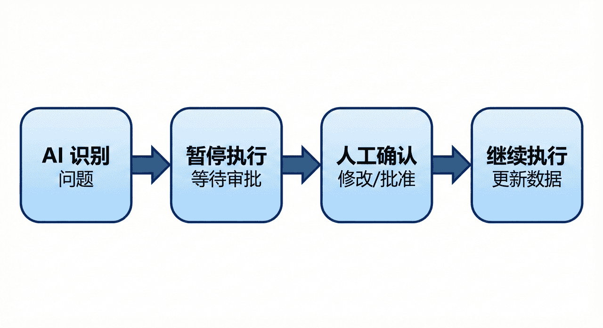

# Part 3. 基于 LangChain1.1 实现人机交互审核（HITL）

> 来源：[https://kq4b3vgg5b.feishu.cn/docx/Py2Ad8WCdodXbcxxUD9c1RSznvb](https://kq4b3vgg5b.feishu.cn/docx/Py2Ad8WCdodXbcxxUD9c1RSznvb)

## 课程说明：

+   体验课内容节选自《2025大模型Agent智能体开发实战》(12月班)完整版付费课程

体验课时间有限，若想深度学习大模型技术，欢迎大家报名由我主讲的《2025大模型Agent智能体开发实战》(12月班)

---

# Part 3. 基于 LangChain1.1 实现人机交互审核（HITL）

### 让 AI 审核结果可控可干预的关键技术


在上一课中，我们实现了一个基于 LangChain1.1 的文档审核系统。AI 可以自动识别文档中的问题，并给出修改建议。但是，在实际应用中，我们会面临一个关键问题：

AI 的判断不一定100%正确，我们如何让人类来把关？

这就引出了本课的核心概念：人机交互（Human-in-the-Loop，简称 HITL）。

**HITL 的核心思想** 如下图所示：



简单来说，HITL 就是在 AI 执行关键操作之前，插入一个「人工确认」的环节，让人类可以审查、修改或拒绝 AI 的决策。

HITL 在很多 AI 应用中都非常重要：

| ## **HITL 应用场景** |  |  |
| --- | --- | --- |
| 场景 | AI 的角色 | 人工干预点 |
| 文档审核 | 识别问题、建议修改 | 确认问题是否有效、修改建议是否合理 |
| 内容审核 | 识别违规内容 | 确认是否真的违规、决定处理方式 |
| 代码审查 | 发现潜在 Bug | 确认是否需要修复、如何修复 |
| 客服系统 | 生成回复建议 | 确认回复是否合适、是否需要人工接管 |
| 数据标注 | 自动标注数据 | 审核标注结果、纠正错误 |

所以本节课，我们就详细学习LangChain 1.1 版本的 HITL 实现，主要包括：

+   使用 HumanInTheLoopMiddleware 中间件

+   使用 create_agent() 创建支持中断的 Agent

+   使用 InMemorySaver 进行状态持久化

## 1. 基础环境准备

在正式开始之前，我们需要确保环境配置正确。本节课会用到以下依赖：

应用技术栈

| 依赖库 | 用途 | 说明 |
| --- | --- | --- |
| langchain | LLM 应用框架 | 提供 Agent 和中间件 API |
| langgraph | 图执行引擎 | 提供 HITL 的底层支持（Checkpointer, Command） |
| langchain-openai | OpenAI 兼容接口 | 用于调用 DeepSeek 等兼容 API |
| pydantic | 数据验证 | 定义数据结构 |

```
%pip install langchain==1.1.3 langgraph langchain-openai pydantic python-dotenv -q
```

```
WARNING: Running pip as the &#x27;root&#x27; user can result in broken permissions and conflicting behaviour with the system package manager, possibly rendering your system unusable. It is recommended to use a virtual environment instead: https://pip.pypa.io/warnings/venv. Use the --root-user-action option if you know what you are doing and want to suppress this warning.
Note: you may need to restart the kernel to use updated packages.
```

```
# 方式一：直接在代码中配置（仅用于学习，生产环境不推荐）
# DEEPSEEK_API_KEY = &quot;your-deepseek-api-key-here&quot;
# MINERU_API_KEY = &quot;your-mineru-api-key-here&quot;

# 方式二：使用环境变量（推荐）
import os
from dotenv import load_dotenv

# 加载 .env 文件中的环境变量
load_dotenv(override=True)

DEEPSEEK_API_KEY = os.getenv(&quot;DEEPSEEK_API_KEY&quot;)
MINERU_API_KEY = os.getenv(&quot;MINERU_API_KEY&quot;)

# 验证配置
print(f&quot;DeepSeek API Key 已配置: {DEEPSEEK_API_KEY[:10]}&quot;)
print(f&quot;MinerU API Key 已配置: {MINERU_API_KEY[:10]}&quot;)
```

```
DeepSeek API Key 已配置: sk-04a9c72
MinerU API Key 已配置: eyJ0eXBlIj
```

## 2. HITL 核心概念详解

在开始Agent的开发之前，我们需要深入理解 HITL 的几个核心概念。这些概念是理解后续代码的基础。在LangChain中，当 AI 触发中断等待人工决策时，人类可以做出以下三种决策：

三种决策类型

| 决策类型 | 英文名 | 数据结构 | 后续动作 |
| --- | --- | --- | --- |
| **批准** | approve | {&quot;type&quot;: &quot;approve&quot;} | 按 AI 原计划执行 |
| **修改** | edit | {&quot;type&quot;: &quot;edit&quot;, &quot;edited_action&quot;: {...}} | 按修改后的参数执行 |
| **拒绝** | reject | {&quot;type&quot;: &quot;reject&quot;, &quot;message&quot;: &quot;...&quot;} | 取消操作，不执行 |

**  HITL 的一个关键**技术挑战是：如何在中断期间保存状态？ 比如这个场景：

1.  用户上午 9:00 提交审核请求

1.  AI 分析后触发中断，等待人工确认

1.  审核员下午 2:00 才来处理

在这 5 个小时内，系统需要「记住」之前的状态。这就需要 Checkpointer（检查点） 机制：

```
                Checkpointer 状态保存机制
┌────────────────────────────────────────────────────────┐
│                                                        │
│   thread_id: &quot;issue:abc123:xyz789&quot;                    │
│                                                        │
│   ┌─────────┐     ┌─────────┐     ┌─────────┐         │
│   │ State 0 │ ──▶ │ State 1 │ ──▶ │ State 2 │ ──▶ ... │
│   │ (开始)   │     │ (中断)   │     │ (恢复)   │         │
│   └─────────┘     └─────────┘     └─────────┘         │
│                                                        │
│   保存内容：                                           │
│   - 当前执行位置                                       │
│   - AI 提议的操作                                     │
│   - 相关上下文信息                                    │
│                                                        │
└────────────────────────────────────────────────────────┘
```

本课我们使用 InMemorySaver（内存检查点），实际生产环境可以使用数据库存储。

对于上述流程，LangChain 1.1 提供了 HumanInTheLoopMiddleware 中间件来实现 HITL，伪代码如下：

```
    from langchain.agents import create_agent
    from langchain.agents.middleware import HumanInTheLoopMiddleware
    from langgraph.checkpoint.memory import InMemorySaver

    agent = create_agent(
        model=llm,
        tools=[my_tool],
        middleware=[
            HumanInTheLoopMiddleware(
                interrupt_on={&quot;my_tool&quot;: True},  # 在调用 my_tool 前中断
            ),
        ],
        checkpointer=InMemorySaver(),
    )
```

这种方式的优点是：

+   **声明式配置**：只需指定哪些工具需要人工确认

+   **自动状态管理**：中间件自动处理状态保存和恢复

+   **标准化决策格式**：approve/edit/reject 三种标准决策

## 3. LangChain 1.1 实现 HITL

** 现在我们开始从**零构建一个支持 HITL 的 Agent。为了便于理解，我们先用一个简单的场景来演示，即文档问题审核系统 ：

1.  AI 发现文档中的一个问题

1.  用户想要「采纳」或「不采纳」这个问题

1.  但在实际更新数据库之前，需要人工确认

### 3.1 定义数据结构

首先，我们定义问题（Issue）的数据结构，这是我们要操作的核心对象：

```
# 我们使用 Pydantic 定义问题（Issue）的数据结构

from pydantic import BaseModel, Field
from typing import Dict, Any, Optional, List
from enum import Enum
from datetime import datetime
import uuid

# 问题状态枚举
class IssueStatus(str, Enum):
    not_reviewed = &quot;not_reviewed&quot;  # 未审核
    accepted = &quot;accepted&quot;          # 已采纳
    dismissed = &quot;dismissed&quot;        # 已忽略

# 问题数据结构
class Issue(BaseModel):
    id: str = Field(default_factory=lambda: str(uuid.uuid4()))
    doc_id: str                           # 文档 ID
    text: str                             # 问题文本
    type: str                             # 问题类型
    status: IssueStatus = IssueStatus.not_reviewed
    explanation: str = &quot;&quot;                 # 问题解释
    suggested_fix: str = &quot;&quot;               # 修改建议
    resolved_by: Optional[str] = None     # 处理人
    resolved_at: Optional[str] = None     # 处理时间
```

接下来创建一个测试用例：

```
# 创建一个示例问题（模拟 AI 发现的问题）
sample_issue = Issue(
    doc_id=&quot;doc_001&quot;,
    text=&quot;我们保证100%的投资回报率&quot;,
    type=&quot;Definitive Language&quot;,
    explanation=&quot;使用了绝对化表述&#x27;保证100%&#x27;，可能造成法律风险&quot;,
    suggested_fix=&quot;建议修改为&#x27;预期投资回报率可达&#x27;&quot;,
)

print(&quot;=&quot;*60)
print(&quot;示例问题&quot;)
print(&quot;=&quot;*60)
print(f&quot;ID: {sample_issue.id}&quot;)
print(f&quot;文档: {sample_issue.doc_id}&quot;)
print(f&quot;问题文本: {sample_issue.text}&quot;)
print(f&quot;问题类型: {sample_issue.type}&quot;)
print(f&quot;当前状态: {sample_issue.status.value}&quot;)
print(f&quot;解释: {sample_issue.explanation}&quot;)
print(f&quot;建议: {sample_issue.suggested_fix}&quot;)
print(&quot;=&quot;*60)
```

```
============================================================
示例问题
============================================================
ID: 205508d5-346d-459b-824c-52a93d9b47dd
文档: doc_001
问题文本: 我们保证100%的投资回报率
问题类型: Definitive Language
当前状态: not_reviewed
解释: 使用了绝对化表述&#x27;保证100%&#x27;，可能造成法律风险
建议: 建议修改为&#x27;预期投资回报率可达&#x27;
============================================================
```

### 3.2 创建模拟数据库

在实际项目中，问题数据会存储在数据库中。为了简化演示，我们创建一个内存中的模拟数据库：

```
# 这是一个简单的内存数据库，用于存储和更新问题

class IssuesDatabase:
    &quot;&quot;&quot;
    模拟的问题数据库
    在实际项目中，这会是 SQLite/PostgreSQL 等真实数据库
    &quot;&quot;&quot;
    
    def __init__(self):
        self._issues: Dict[str, Issue] = {}
    
    def add_issue(self, issue: Issue) -&gt; None:
        &quot;&quot;&quot;添加问题&quot;&quot;&quot;
        self._issues[issue.id] = issue
        print(f&quot;问题已添加到数据库: {issue.id}&quot;)
    
    def get_issue(self, issue_id: str) -&gt; Optional[Issue]:
        &quot;&quot;&quot;获取问题&quot;&quot;&quot;
        return self._issues.get(issue_id)
    
    def update_issue(self, issue_id: str, update_fields: Dict[str, Any]) -&gt; Issue:
        &quot;&quot;&quot;
        更新问题
        这是 HITL 要保护的关键操作
        &quot;&quot;&quot;
        issue = self._issues.get(issue_id)
        if not issue:
            raise ValueError(f&quot;问题不存在: {issue_id}&quot;)
        
        # 更新字段
        issue_dict = issue.model_dump()
        issue_dict.update(update_fields)
        
        # 创建更新后的 Issue
        updated_issue = Issue(**issue_dict)
        self._issues[issue_id] = updated_issue
        
        print(f&quot;问题已更新: {issue_id}&quot;)
        print(f&quot;   更新的字段: {list(update_fields.keys())}&quot;)
        
        return updated_issue
    
    def list_issues(self) -&gt; List[Issue]:
        &quot;&quot;&quot;列出所有问题&quot;&quot;&quot;
        return list(self._issues.values())

# 创建数据库实例并添加示例问题
db = IssuesDatabase()
db.add_issue(sample_issue)

# 保存问题 ID 供后续使用
ISSUE_ID = sample_issue.id

print(f&quot;\n数据库中共有 {len(db.list_issues())} 个问题&quot;)
```

```
问题已添加到数据库: 205508d5-346d-459b-824c-52a93d9b47dd

数据库中共有 1 个问题
```

### 3.3 初始化 LLM

接下来，我们初始化用于驱动 Agent 的 LLM。这里使用 DeepSeek-v3.2：

```
from langchain_openai import ChatOpenAI

# 检查 API Key
if not DEEPSEEK_API_KEY:
    raise ValueError(&quot;DEEPSEEK_API_KEY 未配置，请先设置环境变量&quot;)

# 初始化 DeepSeek LLM
llm = ChatOpenAI(
    api_key=DEEPSEEK_API_KEY,
    base_url=&quot;https://api.deepseek.com&quot;,
    model=&quot;deepseek-chat&quot;,
    temperature=0.2,
)

print(&quot;LLM 初始化完成&quot;)
```

```
LLM 初始化完成
```

### 2.5 创建 HITL Agent（核心代码）

现在是本课最核心的部分——创建支持 HITL 的 Agent。

我们需要：

1.  **定义工具函数**：update_issue - 更新问题的工具;

1.  **配置中间件**：HumanInTheLoopMiddleware - 在工具执行前触发中断;

1.  **配置检查点**：InMemorySaver - 保存执行状态;

1.  **创建 Agent**：使用 create_agent() 组装所有组件;

```
import json
from langchain.agents import create_agent
from langchain.agents.middleware import HumanInTheLoopMiddleware
from langchain_core.messages import HumanMessage
from langgraph.checkpoint.memory import InMemorySaver
from langgraph.types import Command

# -----------------------------
# Step 1: 定义工具函数
# -----------------------------
# 这个函数会被 HITL 中间件拦截
# 在执行前会触发中断，等待人工确认

def update_issue(issue_id: str, update_fields: Dict[str, Any]) -&gt; str:
    &quot;&quot;&quot;
    更新问题（需要人工确认）
    
    Args:
        issue_id: 要更新的问题 ID
        update_fields: 要更新的字段字典
    
    Returns:
        &quot;ok&quot; 表示更新成功
    &quot;&quot;&quot;
    # 实际执行数据库更新
    db.update_issue(issue_id, update_fields)
    return &quot;ok&quot;

# -----------------------------
# Step 2: 创建 HITL Agent
# -----------------------------

# System Prompt：告诉 AI 它的角色和任务
SYSTEM_PROMPT = &quot;&quot;&quot;你是一个审阅工作流执行器。
你会收到 issue_id 和 update_fields。
你必须且只能调用一次 `update_issue` 工具，并严格使用提供的参数。
不要自行猜测、不要新增字段、不要修改字段含义。
&quot;&quot;&quot;

# 创建支持 HITL 的 Agent
hitl_agent = create_agent(
    model=llm,
    tools=[update_issue],  # 注册工具
    system_prompt=SYSTEM_PROMPT,
    middleware=[
        # 配置 HITL 中间件
        HumanInTheLoopMiddleware(
            interrupt_on={
                &quot;update_issue&quot;: True,  # 在调用 update_issue 前触发中断
            },
            description_prefix=&quot;需要人工确认的操作&quot;,
        ),
    ],
    checkpointer=InMemorySaver(),  # 使用内存检查点保存状态
)

print(&quot;=&quot;*60)
print(&quot;HITL Agent 创建完成&quot;)
print(&quot;=&quot;*60)
print(&quot;配置说明:&quot;)
print(&quot;   - 工具: update_issue (更新问题)&quot;)
print(&quot;   - 中间件: HumanInTheLoopMiddleware&quot;)
print(&quot;   - 触发中断: 调用 update_issue 前&quot;)
print(&quot;   - 状态保存: InMemorySaver (内存检查点)&quot;)
print(&quot;=&quot;*60)
```

```
============================================================
HITL Agent 创建完成
============================================================
配置说明:
   - 工具: update_issue (更新问题)
   - 中间件: HumanInTheLoopMiddleware
   - 触发中断: 调用 update_issue 前
   - 状态保存: InMemorySaver (内存检查点)
============================================================
```

## 4. HITL 运行测试

现在我们来演示完整的 HITL 流程。我们模拟用户想要「采纳」一个问题的场景：首先，我们封装两个核心函数：

+   start_hitl(): 启动 HITL 流程，触发中断；

+   resume_hitl(): 根据人工决策恢复执行；

```
async def start_hitl(
    thread_id: str,
    issue_id: str,
    update_fields: Dict[str, Any]
) -&gt; Dict[str, Any]:
    &quot;&quot;&quot;
    启动 HITL 流程
    
    Args:
        thread_id: 唯一标识本次 HITL 流程
        issue_id: 要更新的问题 ID
        update_fields: 要更新的字段
    
    Returns:
        中断信息（包含 interrupt_id 和提议的操作）
    &quot;&quot;&quot;
    # 配置（thread_id 用于检索检查点）
    config = {&quot;configurable&quot;: {&quot;thread_id&quot;: thread_id}}
    
    # 构建提示词，告诉 Agent 要执行什么操作
    prompt = (
        &quot;请按照提供的参数更新 issue。\n&quot;
        f&quot;issue_id: {issue_id}\n&quot;
        f&quot;update_fields(JSON): {json.dumps(update_fields, ensure_ascii=False)}\n&quot;
        &quot;你必须调用 update_issue。\n&quot;
    )
    
    # 运行 Agent，直到遇到中断
    async for step in hitl_agent.astream(
        {&quot;messages&quot;: [HumanMessage(content=prompt)]},
        config,
        stream_mode=&quot;values&quot;
    ):
        # 检查是否有中断
        if &quot;__interrupt__&quot; in step:
            interrupt = step[&quot;__interrupt__&quot;][0]
            try:
                return {
                    &quot;id&quot;: interrupt.id,
                    &quot;value&quot;: interrupt.value,
                    &quot;thread_id&quot;: thread_id,
                }
            except AttributeError:
                return {
                    &quot;value&quot;: interrupt,
                    &quot;thread_id&quot;: thread_id,
                }
    
    # 如果没有中断（不应该发生），返回 None
    return None


async def resume_hitl(
    thread_id: str,
    decision: Dict[str, Any],
    interrupt_id: str = None
) -&gt; None:
    &quot;&quot;&quot;
    根据人工决策恢复 HITL 流程
    
    Args:
        thread_id: HITL 流程的 thread_id
        decision: 人工决策，格式：
            - 批准: {&quot;type&quot;: &quot;approve&quot;}
            - 修改: {&quot;type&quot;: &quot;edit&quot;, &quot;edited_action&quot;: {...}}
            - 拒绝: {&quot;type&quot;: &quot;reject&quot;, &quot;message&quot;: &quot;...&quot;}
        interrupt_id: 中断 ID（可选）
    &quot;&quot;&quot;
    config = {&quot;configurable&quot;: {&quot;thread_id&quot;: thread_id}}
    
    # 使用 Command 恢复执行
    cmd = Command(resume={&quot;decisions&quot;: [decision]})
    
    # 继续执行直到完成
    async for step in hitl_agent.astream(cmd, config, stream_mode=&quot;values&quot;):
        # 检查是否有新的中断（不应该发生）
        if &quot;__interrupt__&quot; in step:
            raise RuntimeError(&quot;HITL 恢复后产生了新的中断（异常情况）&quot;)
    
    print(&quot;HITL 流程已完成&quot;)


print(&quot;=&quot;*60)
print(&quot;HITL 操作函数已定义&quot;)
print(&quot;=&quot;*60)
print(&quot;start_hitl(thread_id, issue_id, update_fields)&quot;)
print(&quot;   - 启动 HITL 流程，触发中断&quot;)
print(&quot;   - 返回中断信息（包含 thread_id 用于后续恢复）&quot;)
print(&quot;&quot;)
print(&quot;resume_hitl(thread_id, decision, interrupt_id)&quot;)
print(&quot;   - 根据人工决策恢复执行&quot;)
print(&quot;   - decision: approve/edit/reject&quot;)
print(&quot;=&quot;*60)
```

```
============================================================
HITL 操作函数已定义
============================================================
start_hitl(thread_id, issue_id, update_fields)
   - 启动 HITL 流程，触发中断
   - 返回中断信息（包含 thread_id 用于后续恢复）

resume_hitl(thread_id, decision, interrupt_id)
   - 根据人工决策恢复执行
   - decision: approve/edit/reject
============================================================
```

### 4.1 人机交互场景 1：批准（Approve）

最常见的场景：人工审核后同意 AI 的提议，批准执行。

```
# 用户想要「采纳」一个问题，将其状态改为 accepted

from datetime import datetime, timezone

# 查看问题当前状态
print(&quot;=&quot;*60)
print(&quot;Step 1: 查看问题当前状态&quot;)
print(&quot;=&quot;*60)
current_issue = db.get_issue(ISSUE_ID)
print(f&quot;问题 ID: {current_issue.id}&quot;)
print(f&quot;当前状态: {current_issue.status.value}&quot;)
print(f&quot;处理人: {current_issue.resolved_by or &#x27;(无)&#x27;}&quot;)

# 准备更新字段
update_fields = {
    &quot;status&quot;: IssueStatus.accepted.value,
    &quot;resolved_by&quot;: &quot;user_001&quot;,
    &quot;resolved_at&quot;: datetime.now(timezone.utc).isoformat(),
}

print(f&quot;\n准备更新的字段:&quot;)
for key, value in update_fields.items():
    print(f&quot;   {key}: {value}&quot;)
```

```
============================================================
Step 1: 查看问题当前状态
============================================================
问题 ID: 205508d5-346d-459b-824c-52a93d9b47dd
当前状态: not_reviewed
处理人: (无)

准备更新的字段:
   status: accepted
   resolved_by: user_001
   resolved_at: 2025-12-17T11:00:13.381728+00:00
```

```
# ============================================================
# Step 2: 启动 HITL 流程（触发中断）
# ============================================================

# 生成唯一的 thread_id
thread_id = f&quot;issue:{ISSUE_ID}:{uuid.uuid4()}&quot;

print(&quot;=&quot;*60)
print(&quot;Step 2: 启动 HITL 流程&quot;)
print(&quot;=&quot;*60)
print(f&quot;thread_id: {thread_id}&quot;)
print(&quot;正在启动 Agent...&quot;)

# 启动 HITL（这会触发中断）
interrupt_info = await start_hitl(
    thread_id=thread_id,
    issue_id=ISSUE_ID,
    update_fields=update_fields,
)

if interrupt_info:
    print(&quot;\n⏸中断已触发！等待人工决策...&quot;)
    print(f&quot;\n中断信息:&quot;)
    print(f&quot;   thread_id: {interrupt_info.get(&#x27;thread_id&#x27;)}&quot;)
    print(f&quot;   interrupt_id: {interrupt_info.get(&#x27;id&#x27;, &#x27;(无)&#x27;)}&quot;)
    print(f&quot;\nAI 提议的操作:&quot;)
    print(f&quot;   工具: update_issue&quot;)
    print(f&quot;   参数: issue_id={ISSUE_ID}&quot;)
    print(f&quot;   更新字段: {update_fields}&quot;)
else:
    print(&quot;未触发中断（异常情况）&quot;)

print(&quot;=&quot;*60)
```

```
============================================================
Step 2: 启动 HITL 流程
============================================================
thread_id: issue:205508d5-346d-459b-824c-52a93d9b47dd:e4366a97-814a-4825-8e1c-39327fe1ed0a
正在启动 Agent...

⏸中断已触发！等待人工决策...

中断信息:
   thread_id: issue:205508d5-346d-459b-824c-52a93d9b47dd:e4366a97-814a-4825-8e1c-39327fe1ed0a
   interrupt_id: 603e551ad1b9d24f5ea0fbc87429118d

AI 提议的操作:
   工具: update_issue
   参数: issue_id=205508d5-346d-459b-824c-52a93d9b47dd
   更新字段: {&#x27;status&#x27;: &#x27;accepted&#x27;, &#x27;resolved_by&#x27;: &#x27;user_001&#x27;, &#x27;resolved_at&#x27;: &#x27;2025-12-17T11:00:13.381728+00:00&#x27;}
============================================================
```

```
# ============================================================
# Step 3: 人工决策 - 批准（Approve）
# ============================================================
# 模拟审核员查看 AI 提议后，选择「批准」

print(&quot;=&quot;*60)
print(&quot;Step 3: 人工决策 - 批准&quot;)
print(&quot;=&quot;*60)
print(&quot;审核员查看了 AI 的提议：&quot;)
print(f&quot;   - 操作: 将问题状态改为 &#x27;accepted&#x27;&quot;)
print(f&quot;   - 处理人: user_001&quot;)
print(&quot;&quot;)
print(&quot;审核员决定: 批准&quot;)

# 构建批准决策
approve_decision = {&quot;type&quot;: &quot;approve&quot;}
print(f&quot;\n决策数据: {approve_decision}&quot;)

# 恢复执行
print(&quot;\n恢复执行中...&quot;)
await resume_hitl(
    thread_id=thread_id,
    decision=approve_decision,
    interrupt_id=interrupt_info.get(&quot;id&quot;) if interrupt_info else None,
)

# 检查更新结果
print(&quot;\n&quot; + &quot;=&quot;*60)
print(&quot;Step 4: 检查更新结果&quot;)
print(&quot;=&quot;*60)
updated_issue = db.get_issue(ISSUE_ID)
print(f&quot;问题 ID: {updated_issue.id}&quot;)
print(f&quot;状态: {updated_issue.status.value} {&#x27;&#x27; if updated_issue.status == IssueStatus.accepted else &#x27;&#x27;}&quot;)
print(f&quot;处理人: {updated_issue.resolved_by}&quot;)
print(f&quot;处理时间: {updated_issue.resolved_at}&quot;)
print(&quot;=&quot;*60)
print(&quot;\nHITL 批准流程演示完成！&quot;)
```

```
============================================================
Step 3: 人工决策 - 批准
============================================================
审核员查看了 AI 的提议：
   - 操作: 将问题状态改为 &#x27;accepted&#x27;
   - 处理人: user_001

审核员决定: 批准

决策数据: {&#x27;type&#x27;: &#x27;approve&#x27;}

恢复执行中...
问题已更新: 205508d5-346d-459b-824c-52a93d9b47dd
   更新的字段: [&#x27;status&#x27;, &#x27;resolved_by&#x27;, &#x27;resolved_at&#x27;]
HITL 流程已完成

============================================================
Step 4: 检查更新结果
============================================================
问题 ID: 205508d5-346d-459b-824c-52a93d9b47dd
状态: accepted 
处理人: user_001
处理时间: 2025-12-17T11:00:13.381728+00:00
============================================================

HITL 批准流程演示完成！
```

### 4.2 人机交互场景 2：修改（Edit）

有时审核员可能想要修改 AI 提议的参数。例如，修改处理人或添加额外的备注。

```
# ============================================================
# 演示场景 2：修改（Edit）
# ============================================================
# 添加一个新问题用于演示修改场景

# 创建新问题
sample_issue_2 = Issue(
    doc_id=&quot;doc_002&quot;,
    text=&quot;本产品绝对安全可靠&quot;,
    type=&quot;Definitive Language&quot;,
    explanation=&quot;使用了绝对化表述&#x27;绝对&#x27;&quot;,
    suggested_fix=&quot;建议修改为&#x27;本产品经过严格测试&#x27;&quot;,
)

db.add_issue(sample_issue_2)
ISSUE_ID_2 = sample_issue_2.id

# 准备原始更新字段
original_update = {
    &quot;status&quot;: IssueStatus.dismissed.value,  # 原本要忽略
    &quot;resolved_by&quot;: &quot;user_002&quot;,
    &quot;resolved_at&quot;: datetime.now(timezone.utc).isoformat(),
}

# 启动 HITL
thread_id_2 = f&quot;issue:{ISSUE_ID_2}:{uuid.uuid4()}&quot;

print(&quot;=&quot;*60)
print(&quot;演示场景 2：修改（Edit）&quot;)
print(&quot;=&quot;*60)
print(f&quot;原始提议: 将问题状态改为 &#x27;{IssueStatus.dismissed.value}&#x27;&quot;)

# 启动 HITL
interrupt_info_2 = await start_hitl(
    thread_id=thread_id_2,
    issue_id=ISSUE_ID_2,
    update_fields=original_update,
)

print(&quot;\n中断已触发...&quot;)
print(&quot;\n审核员查看后决定: 修改&quot;)
print(&quot;   - 原始操作: 忽略问题 (dismissed)&quot;)
print(&quot;   - 修改后: 采纳问题 (accepted)&quot;)

# 构建修改决策
edit_decision = {
    &quot;type&quot;: &quot;edit&quot;,
    &quot;edited_action&quot;: {
        &quot;name&quot;: &quot;update_issue&quot;,
        &quot;args&quot;: {
            &quot;issue_id&quot;: ISSUE_ID_2,
            &quot;update_fields&quot;: {
                &quot;status&quot;: IssueStatus.accepted.value,  # 改为采纳
                &quot;resolved_by&quot;: &quot;supervisor_001&quot;,       # 修改处理人
                &quot;resolved_at&quot;: datetime.now(timezone.utc).isoformat(),
            }
        }
    }
}

print(f&quot;\n修改后的决策:&quot;)
print(f&quot;   状态: {IssueStatus.dismissed.value} → {IssueStatus.accepted.value}&quot;)
print(f&quot;   处理人: user_002 → supervisor_001&quot;)

# 恢复执行
print(&quot;\n恢复执行中...&quot;)
await resume_hitl(
    thread_id=thread_id_2,
    decision=edit_decision,
)

# 检查结果
updated_issue_2 = db.get_issue(ISSUE_ID_2)
print(f&quot;\n最终结果:&quot;)
print(f&quot;   状态: {updated_issue_2.status.value}&quot;)
print(f&quot;   处理人: {updated_issue_2.resolved_by}&quot;)
print(&quot;=&quot;*60)
```

```
问题已添加到数据库: 1d1e858c-ff57-4d7d-9ffd-3f475ff5d276
============================================================
演示场景 2：修改（Edit）
============================================================
原始提议: 将问题状态改为 &#x27;dismissed&#x27;

中断已触发...

审核员查看后决定: 修改
   - 原始操作: 忽略问题 (dismissed)
   - 修改后: 采纳问题 (accepted)

修改后的决策:
   状态: dismissed → accepted
   处理人: user_002 → supervisor_001

恢复执行中...
问题已更新: 1d1e858c-ff57-4d7d-9ffd-3f475ff5d276
   更新的字段: [&#x27;status&#x27;, &#x27;resolved_by&#x27;, &#x27;resolved_at&#x27;]
HITL 流程已完成

最终结果:
   状态: accepted
   处理人: supervisor_001
============================================================
```

### 4.3 人机交互场景 3：拒绝（Reject）

有时审核员可能完全不同意 AI 的判断，选择拒绝操作。这种情况下，系统不会执行任何更新。

```
# ============================================================
# 演示场景 3：拒绝（Reject）
# ============================================================
# 审核员完全不同意操作，选择拒绝

# 创建新问题
sample_issue_3 = Issue(
    doc_id=&quot;doc_003&quot;,
    text=&quot;请按时提交报告&quot;,
    type=&quot;Grammar &amp; Spelling&quot;,
    explanation=&quot;疑似语法问题&quot;,
    suggested_fix=&quot;无需修改&quot;,
)
db.add_issue(sample_issue_3)
ISSUE_ID_3 = sample_issue_3.id

# 记录原始状态
original_status = sample_issue_3.status.value

# 准备更新字段
reject_update = {
    &quot;status&quot;: IssueStatus.accepted.value,
    &quot;resolved_by&quot;: &quot;user_003&quot;,
    &quot;resolved_at&quot;: datetime.now(timezone.utc).isoformat(),
}

# 启动 HITL
thread_id_3 = f&quot;issue:{ISSUE_ID_3}:{uuid.uuid4()}&quot;

print(&quot;=&quot;*60)
print(&quot;演示场景 3：拒绝（Reject）&quot;)
print(&quot;=&quot;*60)
print(f&quot;原始提议: 将问题状态改为 &#x27;{IssueStatus.accepted.value}&#x27;&quot;)
print(f&quot;问题原始状态: &#x27;{original_status}&#x27;&quot;)

# 启动 HITL
interrupt_info_3 = await start_hitl(
    thread_id=thread_id_3,
    issue_id=ISSUE_ID_3,
    update_fields=reject_update,
)

print(&quot;\n中断已触发...&quot;)
print(&quot;\n审核员查看后决定: 拒绝&quot;)
print(&quot;   原因: 这不是真正的语法问题，AI 判断有误&quot;)

# 构建拒绝决策
reject_decision = {
    &quot;type&quot;: &quot;reject&quot;,
    &quot;message&quot;: &quot;这不是真正的语法问题，AI 判断有误，无需采纳&quot;
}

print(f&quot;\n拒绝决策: {reject_decision}&quot;)

# 恢复执行（拒绝时不会执行工具）
print(&quot;\n恢复执行中...&quot;)
await resume_hitl(
    thread_id=thread_id_3,
    decision=reject_decision,
)

# 检查结果 - 状态应该保持不变
final_issue_3 = db.get_issue(ISSUE_ID_3)
print(f&quot;\n最终结果:&quot;)
print(f&quot;   状态: {final_issue_3.status.value}&quot;)
print(f&quot;   处理人: {final_issue_3.resolved_by or &#x27;(无)&#x27;}&quot;)

if final_issue_3.status.value == original_status:
    print(&quot;\n拒绝成功！问题状态保持不变。&quot;)
else:
    print(&quot;\n状态发生了变化（可能是实现差异）&quot;)

print(&quot;=&quot;*60)
```

```
问题已添加到数据库: 1ab1ec30-f275-45de-adc7-cf5a258df31c
============================================================
演示场景 3：拒绝（Reject）
============================================================
原始提议: 将问题状态改为 &#x27;accepted&#x27;
问题原始状态: &#x27;not_reviewed&#x27;

中断已触发...

审核员查看后决定: 拒绝
   原因: 这不是真正的语法问题，AI 判断有误

拒绝决策: {&#x27;type&#x27;: &#x27;reject&#x27;, &#x27;message&#x27;: &#x27;这不是真正的语法问题，AI 判断有误，无需采纳&#x27;}

恢复执行中...
HITL 流程已完成

最终结果:
   状态: not_reviewed
   处理人: (无)

拒绝成功！问题状态保持不变。
============================================================
```

一张**完整的 HITL 流程架构图**如下所示：

```
┌─────────────────────────────────────────────────────────────────────────────────┐
│                            HITL 完整工作流程                                   │
└─────────────────────────────────────────────────────────────────────────────────┘

┌─────────────────────────────────────────────────────────────────────────────────┐
│                         Phase 1: 启动阶段 (Start)                               │
│                                                                                  │
│   用户请求                                                                       │
│      │                                                                          │
│      ▼                                                                          │
│   ┌──────────────────────────────────────────────────────────────────────┐     │
│   │  1. 接收更新请求                                                      │     │
│   │     - issue_id: 要更新的问题 ID                                       │     │
│   │     - update_fields: 要更新的字段（如 status, explanation 等）        │     │
│   │     - thread_id: 唯一标识本次 HITL 流程                               │     │
│   └──────────────────────────────────────────────────────────────────────┘     │
│      │                                                                          │
│      ▼                                                                          │
│   ┌──────────────────────────────────────────────────────────────────────┐     │
│   │  2. AI Agent 准备执行                                                 │     │
│   │     - Agent 接收到工具调用请求                                        │     │
│   │     - 工具: update_issue(issue_id, update_fields)                     │     │
│   │     - 但由于配置了 HumanInTheLoopMiddleware，会触发中断               │     │
│   └─────────────────────────────────────────────────────────────────────┘     │
│      │                                                                          │
│      ▼                                                                          │
│   ┌──────────────────────────────────────────────────────────────────────┐     │
│   │  3. 触发中断 (Interrupt)                                              │     │
│   │     - 保存当前状态到 Checkpointer                                     │     │
│   │     - 返回 interrupt 对象，包含:                                      │     │
│   │       • interrupt_id: 中断标识符                                      │     │
│   │       • proposed_action: AI 提议的操作                                │     │
│   │       • thread_id: 用于后续恢复的线程标识                             │     │
│   └──────────────────────────────────────────────────────────────────────┘     │
└─────────────────────────────────────────────────────────────────────────────────┘
                                        │
                    ⏸系统暂停，等待人工决策
                                        │
                                        ▼
┌─────────────────────────────────────────────────────────────────────────────────┐
│                         Phase 2: 人工决策阶段                                    │
│                                                                                  │
│   审核员查看 AI 提议的操作，做出以下三种决策之一：                                │
│                                                                                  │
│   ┌───────────────────┬───────────────────┬───────────────────┐                 │
│   │    ✅ 批准         │    ✏️ 修改         │    ❌ 拒绝         │                 │
│   │    (approve)      │    (edit)         │    (reject)       │                 │
│   ├───────────────────┼───────────────────┼───────────────────┤                 │
│   │ 同意 AI 的提议    │ 修改 AI 的提议    │ 拒绝 AI 的提议    │                 │
│   │ 按原计划执行      │ 按修改后的执行    │ 取消操作          │                 │
│   └───────────────────┴───────────────────┴───────────────────┘                 │
│                                                                                  │
│   决策数据结构:                                                                   │
│   • approve: {&quot;type&quot;: &quot;approve&quot;}                                                │
│   • edit:    {&quot;type&quot;: &quot;edit&quot;, &quot;edited_action&quot;: {...}}                           │
│   • reject:  {&quot;type&quot;: &quot;reject&quot;, &quot;message&quot;: &quot;拒绝原因&quot;}                          │
│                                                                                  │
└─────────────────────────────────────────────────────────────────────────────────┘
                                        │
                                        ▼
┌─────────────────────────────────────────────────────────────────────────────────┐
│                         Phase 3: 恢复阶段 (Resume)                              │
│                                                                                  │
│   ┌──────────────────────────────────────────────────────────────────────┐     │
│   │  1. 恢复执行                                                          │     │
│   │     - 使用 thread_id 从 Checkpointer 加载之前保存的状态               │     │
│   │     - 使用 Command(resume={&quot;decisions&quot;: [decision]}) 恢复执行         │     │
│   └──────────────────────────────────────────────────────────────────────┘     │
│      │                                                                          │
│      ▼                                                                          │
│   ┌──────────────────────────────────────────────────────────────────────┐     │
│   │  2. 根据决策类型处理                                                  │     │
│   │                                                                       │     │
│   │     ┌─ approve → 执行原始工具调用 → 更新数据库                        │     │
│   │     │                                                                 │     │
│   │     ├─ edit    → 执行修改后的工具调用 → 更新数据库                    │     │
│   │     │                                                                 │     │
│   │     └─ reject  → 跳过工具调用 → 不做任何更改                          │     │
│   └──────────────────────────────────────────────────────────────────────┘     │
│      │                                                                          │
│      ▼                                                                          │
│   ┌──────────────────────────────────────────────────────────────────────┐     │
│   │  3. 返回最终结果                                                      │     │
│   │     - 返回更新后的 Issue 对象                                         │     │
│   │     - 或返回拒绝消息（如果是 reject）                                 │     │
│   └──────────────────────────────────────────────────────────────────────┘     │
└─────────────────────────────────────────────────────────────────────────────────┘
```