# 【教程】CherryStudio+高德MCP打造个人出行规划助理

> 来源：[https://kq4b3vgg5b.feishu.cn/docx/Huo1d29AroRJOhx3KU1cbSH3nFc](https://kq4b3vgg5b.feishu.cn/docx/Huo1d29AroRJOhx3KU1cbSH3nFc)

哈喽伙伴们好呀，这里是菊安酱~MCP技术可以说是现在技术圈的热门技术了，那什么是MCP呢？简单来说就是Model Context Protocol模型上下**文协议，它是由Claude母公司An**thropic提出的专门用来提高大模型Agent开发效率的技术协议，有了这个协议，AI工具的开发效率那可是蹭蹭的变高了！那本期视频手把手教大家借助最新版CherryStudio和高德地图MCP打造一个专属的AI出行助手。听起来是不是有点不明觉厉？实际上只需要四步，零基础小白也能跟得上。

## 第一步：先下载安装一个CherryStudio

这个是我个人最推荐的小白入门大模型首选的客户端，相比OpenWebUI、AnythingLLM，CherryStudio安装部署简单、页面简洁美观、各种功能齐全，并且还是最先支持MCP的客户端，可以说是小白搭建专属智能体的不二之选了。

CherryStudio官网链接：https://docs.cherry-ai.com/

打开CherryStudio官网链接，点击左侧的"客户端下载"进入客户端下载页面，CherryStudio适用于Windows、macOS以及Linux三种操作环境，你可以根据自己的环境选择合适的安装包。我的演示环境是M1芯片的Mac电脑，我就选择对应安装包，下载安装就可以了。


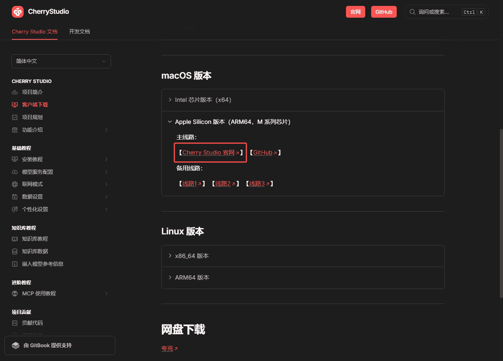

## 第二步：获取大模型API-Key

CherryStudio可以接入各种不同类型的大模型，包括国外的OpenAI、Gemini、Anthropic等公司的大模型，国内的智谱、深度求索（也就是DeepSeek的母公司）等公司的大模型，同时兼容通过 Ollama 和 LM Studio 部署的本地大模型。功能很强大！

这里我们选择DeepSeek模型来进行演示。

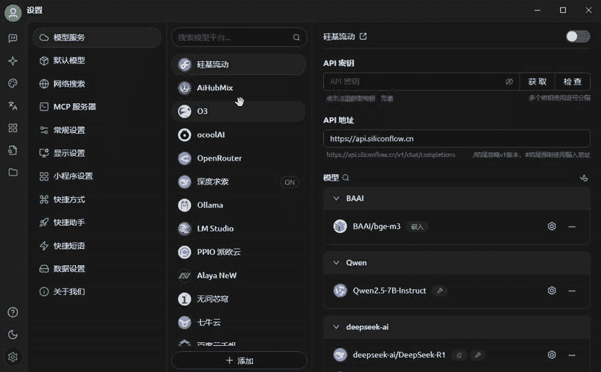

[20250424205122_rec_.mp4](https://internal-api-drive-stream.feishu.cn/space/api/box/stream/download/all/RkSzbDYsqoHo64x4AOpcXk13n7g)

打开DeepSeek官网：https://www.deepseek.com/，点击右上角的`API 开放平台`进入到开发者平台

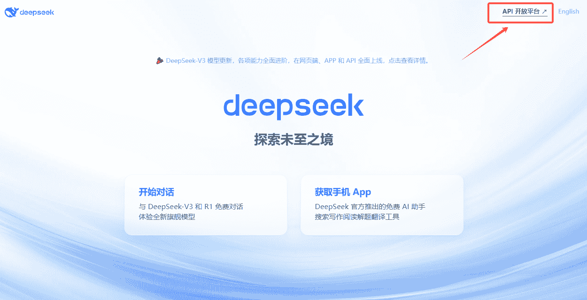

点击左侧“API keys”，然后点击“创建API key”

> 需要提醒的是，首先得确保你自己的账户中有余额，如果是首次使用DeepSeek的API，先去充值页面充点余额，一般充10块钱就够用很久很久了~

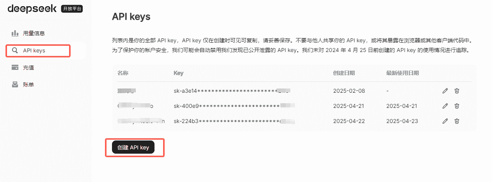

在弹出来的窗口中输入APIkey的名字，点击创建：

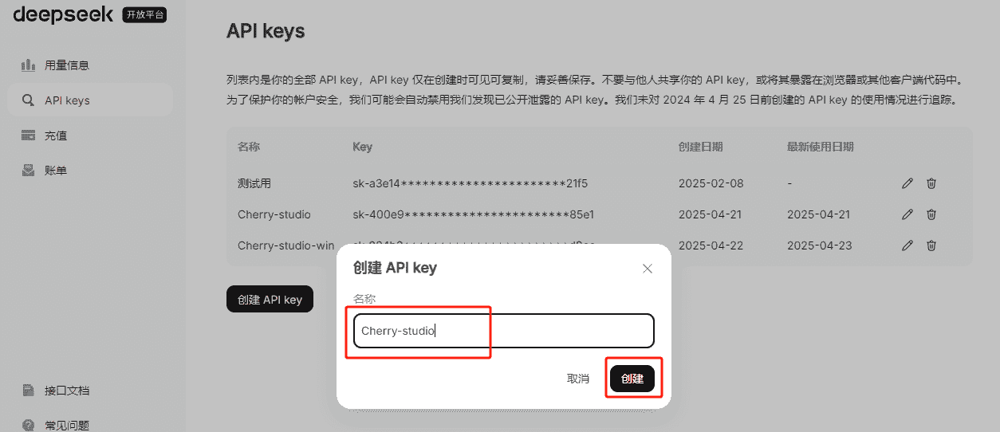

点击“复制”，将生成的API-Key保存下来（最好保存到某个笔记本文件中，方便后续调用），关闭窗口后，API-Key就无法显示了。

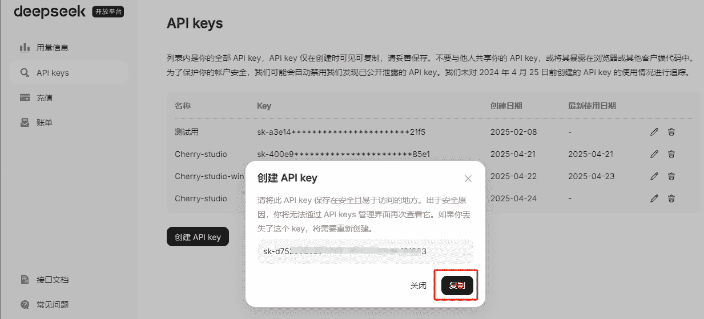

回到CheryStudio的客户端设置页面，点击“深度求索”进入DeepSeek模型API设置页面，将刚刚获取的DeepSeek模型的API-key，输入到API密钥中，然后点击“检查”，如果出现对号√，则表示可以顺利调用DeepSeek模型。最后记得将右上角的开关打开。


点击对话页面，选择 DeepSeek 模型，即可开启对话：

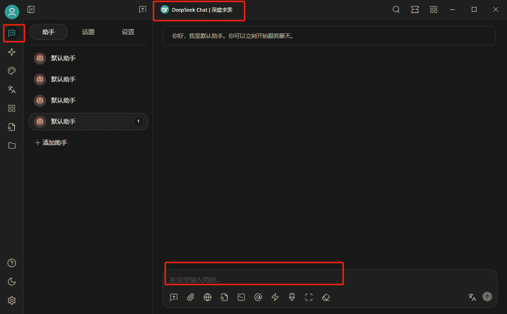

但是此时，DeepSeek 只是一个聊天机器人，接下来我们进一步接入高德 MCP，把它升级为 AI 出行助手。

## 第三步：配置MCP服务器

**高德地图 MCP 工具**是高德地图基于 MCP 协议构建的服务器，整合了高德开放平台的地图服务与智能算法，为企业及开发者提供全场景的地图服务解决方案。 其 12 项核心功能涵盖了地图服务的方方面面，满足企业开发的多样化需求。

**主要功能：**

+   **POI 智能提取**：能够从文字中精准提取 POI（兴趣点）信息，涵盖位置、详情、打卡点、价格等多维度内容。

+   **路径规划**：提供驾车、步行、骑行等多种出行方式的路径规划服务，帮助用户选择最优路线。

+   **实时路况查询**：实时查询特定道路或区域的拥堵状况及趋势，为出行提供及时参考。

+   **天气查询**：通过经纬度信息，获取实时天气情况及未来天气预报，为用户出行计划提供支持。

通过高德地图 MCP 工具，AI 智能体可以直接调用高德地图的各项服务，实现如位置查询、路线规划、实时路况查询等功能，提升用户体验和服务效率。

高德 MCP 的配置流程是这样的：

### Step1：注册高德开放平台

进入高德开放平台：https://console.amap.com/dev/id/select，填入手机号注册成为开发者

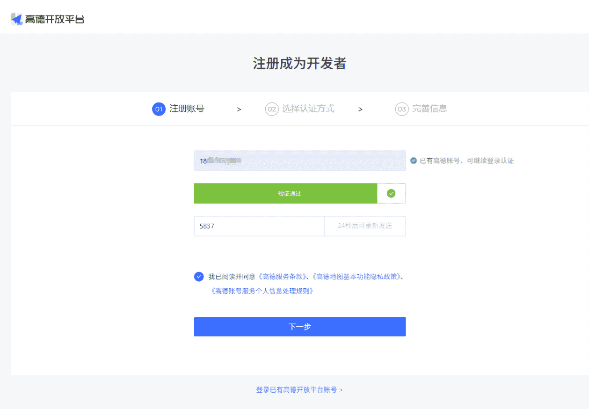

如果是个人使用就选择“个人认证开发者”，如果是公司使用就选择“企业认证开发者”

这**里我们以“个人认证开**发者”来进行演示，选择“ 个人支付宝扫码认证”

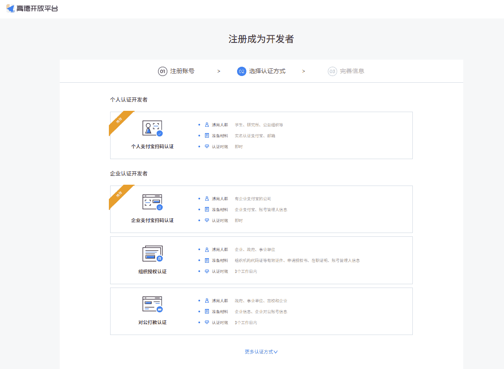

支付宝扫码授权，等待认证通过。


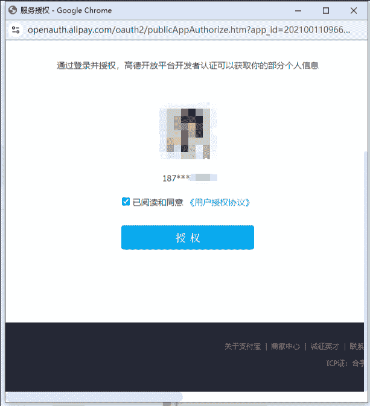

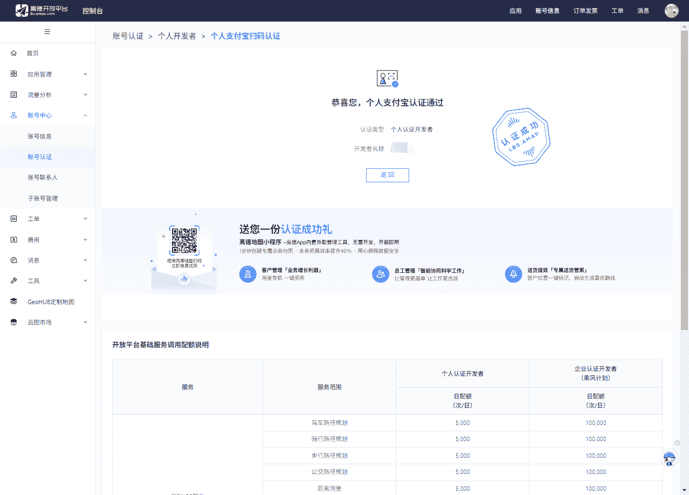

### Step2：获取高德地图MCP key

高德开放平台注册完成后，点击左侧“应用管理”>“我的应用”，然后点击右上角的“创建新应用”

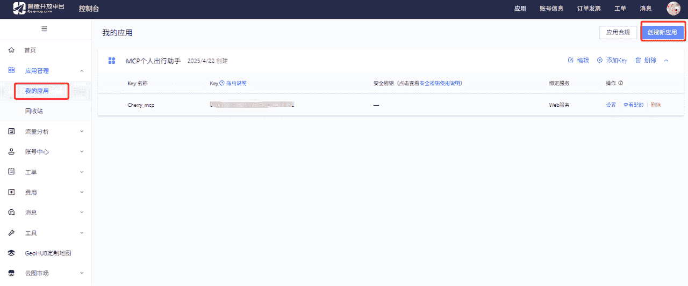

填写应用名称，并选择合适的应用类型（这里选择“旅游”），点击“新建”

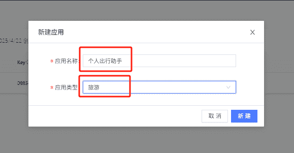

在刚刚创建的应用下，点击“添加Key”:

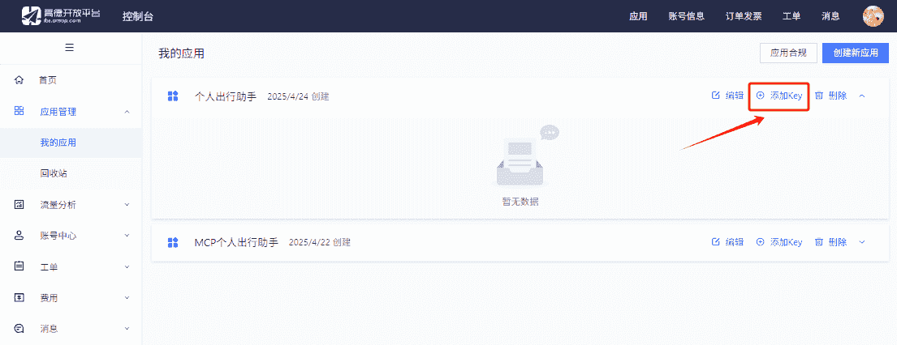

在弹出的窗口中，填写key名称，选择“web服务”，点击“阅读并同意”高德地图的服务协议和隐私条款，最后点击“提交”。

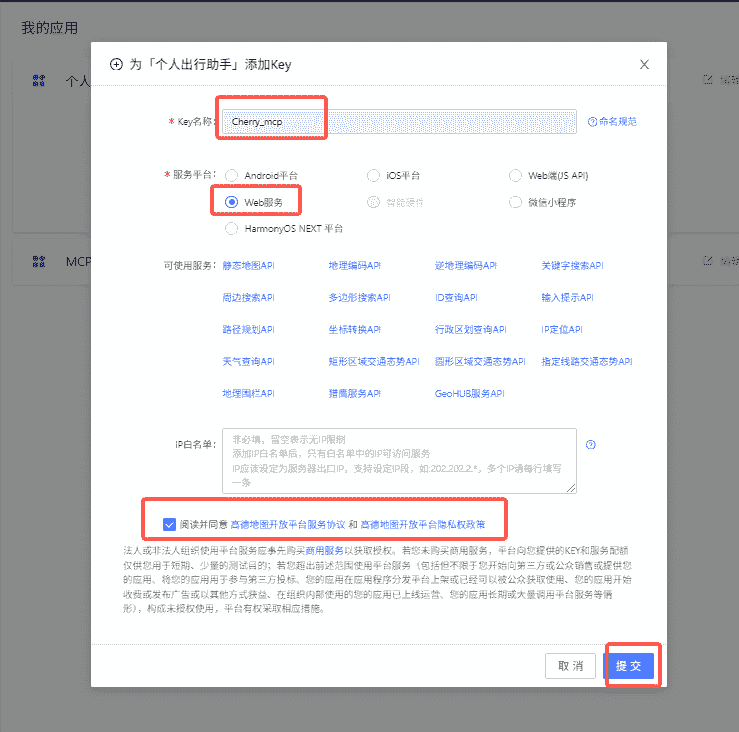

复制并保存，刚刚生成的key

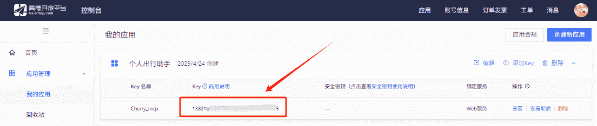

### Step3：设置CherryStudio MCP服务器

打开CherryStudio客户端，点击左下角“设置”按钮，点击“MCP服务器”，进入到MCP服务器编辑页面，为了能顺利调用MCP工具，我们还需要安装uv和bun文件，直接点击后面的安装即可

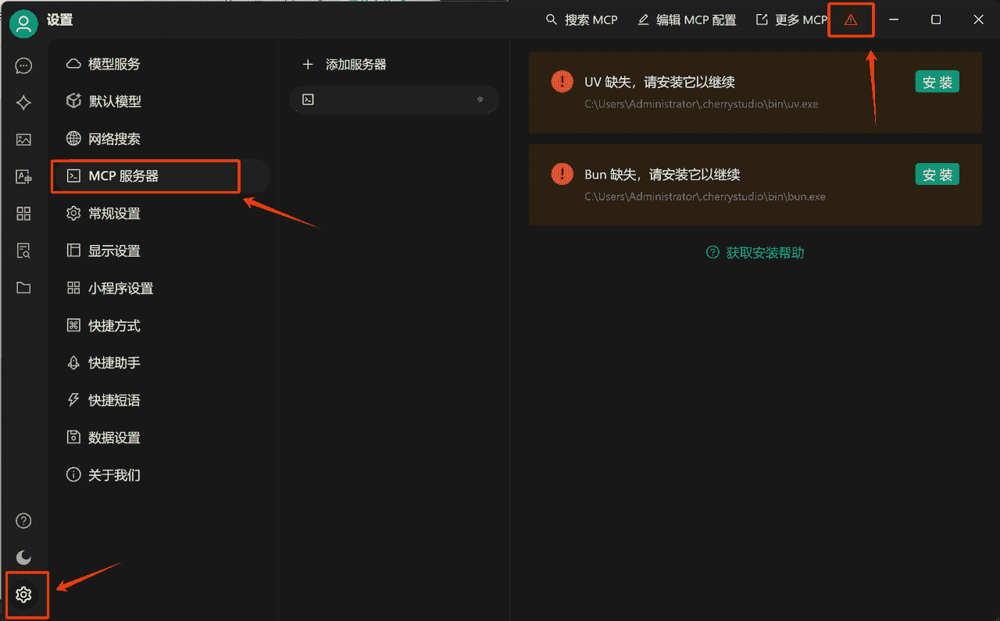

之后，点击“编辑MCP服务器”


之后，点击“编辑MCP服务器”，把这段咒语贴到窗口中

> 以下代码就是高德地图的MCP Server

```
{
  &quot;mcpServers&quot;: {
    &quot;amap-maps&quot;: {
      &quot;isActive&quot;: true,
      &quot;command&quot;: &quot;npx&quot;,
      &quot;args&quot;: [
        &quot;-y&quot;,
        &quot;@amap/amap-maps-mcp-server&quot;
      ],
      &quot;env&quot;: {
        &quot;AMAP_MAPS_API_KEY&quot;: &quot;你在高德官网上申请的key&quot;
      },
      &quot;name&quot;: &quot;amap-maps&quot;
       }
      }
    }
```


> 高德MCP Server官方文档：https://lbs.amap.com/api/mcp-server/summary#s6

在MCP服务栏可以看到你添加的所有MCP Server，点击刚刚添加好的高德MCP，名字为“amap-maps”。点击它，即可看到右边的MCP Server详情。打开右上角的开关，如果顺利打开则表示配置成功。（保持开启状态）


## 第四步：调用高德MCP为你规划行程

MCP 配置完成后，在CherryStudio的对话栏中，选择DeepSeek模型，打开mcp服务器，选择高德MCP（即“amap-maps”)即可启动你的 AI 出行助手：

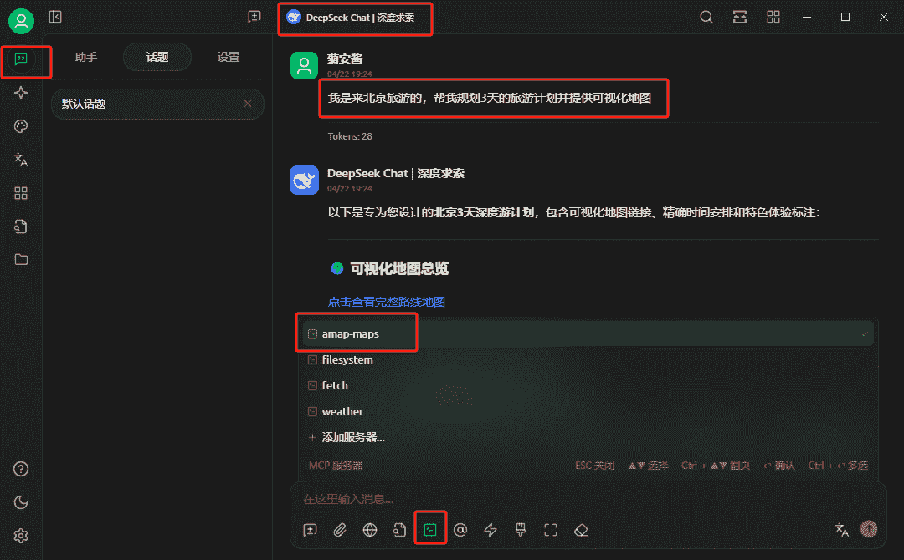

经过这么步骤的操作，接下来就是见证成果的时刻！

## 演示成果：

（我是来北京旅游的，帮我规划3天的旅游计划并提供可视化地图）


[20250423185519_rec_.mp4](https://internal-api-drive-stream.feishu.cn/space/api/box/stream/download/all/Ej8nbFNoSoxchrx1tLicItmRnNe)

（五一小长假，我计划去成都做一个两天的city walk，希望能够给到我一个出行计划，最重要的是给到我步行计划当中的里程，需要评估我是否能够完成这个两天的city walk。）

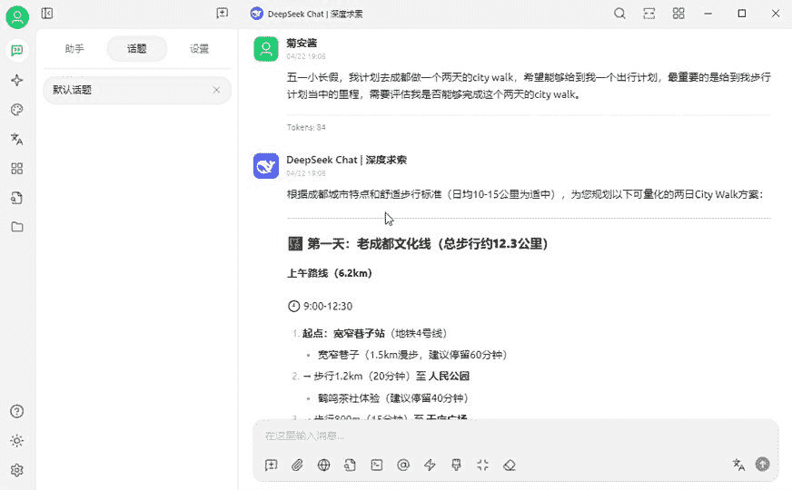

[20250423185201_rec_.mp4](https://internal-api-drive-stream.feishu.cn/space/api/box/stream/download/all/W8CbbDN5PogWdYxJEDfcH0T6nbf)

### MCP服务器Server合集

实际上，除了高德 MCP ，现在市面上还有很多 MCP 工具，我在文档中给大家贴了现在主流的MCP工具网站，大家可以根据自己的需求，选择合适的MCP工具接入 CherryStudio。利用这些 MCP 工具，你可以快速创建数据分析报告、自动操作浏览器、一键下单购物、甚至帮你自动编写📕图文，还可以自动发布！

+   MCP官方服务器合集：[https://github.com/modelcon](https://github.com/modelcontextprotocol/servers)textprotocol/servers


+   MCP Github热门导航：[https://github.com/punkpeye](https://github.com/punkpeye/awesome-mcp-servers)/awesome-mcp-servers


+   Smithery：https://smithery.ai/

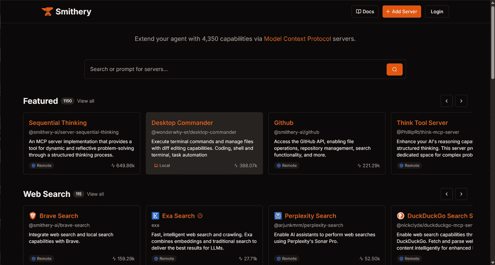

+   MCP导航：[https://mcp.so/](https://mcp.so/)


+   阿里云百炼：[https://bailian.console](https://bailian.console.aliyun.com/?tab=mcp).aliyun.com/?tab=mcp

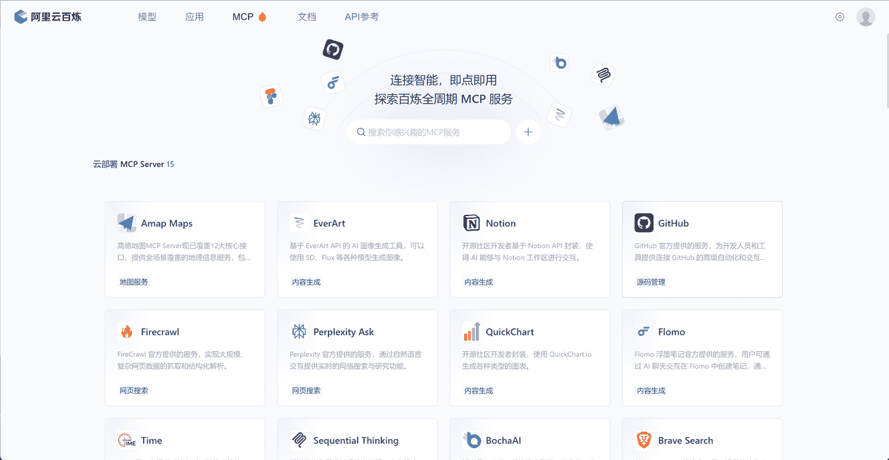

## 拿来即用的MCP代码

```
{
  &quot;mcpServers&quot;: {
    &quot;filesystem&quot;: {
      &quot;isActive&quot;: true,
      &quot;command&quot;: &quot;npx&quot;,
      &quot;args&quot;: [
        &quot;-y&quot;,
        &quot;@modelcontextprotocol/server-filesystem&quot;,
        &quot;C:/Users/60142/Desktop/菊安酱&quot;
      ],
      &quot;name&quot;: &quot;filesystem&quot;
    },
    &quot;amap-maps&quot;: {
      &quot;isActive&quot;: true,
      &quot;command&quot;: &quot;npx&quot;,
      &quot;args&quot;: [
        &quot;-y&quot;,
        &quot;@amap/amap-maps-mcp-server&quot;
      ],
      &quot;env&quot;: {
        &quot;AMAP_MAPS_API_KEY&quot;: &quot;你在高德官网上申请的key&quot;
      },
      &quot;name&quot;: &quot;amap-maps&quot;
    },
    &quot;fetch&quot;: {
      &quot;isActive&quot;: true,
      &quot;command&quot;: &quot;uvx&quot;,
      &quot;args&quot;: [
        &quot;mcp-server-fetch&quot;
      ],
      &quot;name&quot;: &quot;fetch&quot;
    },
    &quot;weather&quot;: {
      &quot;isActive&quot;: true,
      &quot;name&quot;: &quot;weather&quot;,
      &quot;type&quot;: &quot;stdio&quot;,
      &quot;registryUrl&quot;: &quot;&quot;,
      &quot;command&quot;: &quot;uvx&quot;,
      &quot;args&quot;: [
        &quot;mcp-get-weather&quot;,
        &quot;--api_key&quot;,
        &quot;你的天气API-key&quot;
      ]
    }
  }
}
```

## 借助 GPT-4o生成行程图

将AI出行助手生成的行程（文字版），在加上下面这段提示语↓，放到ChatGPT4o中，即可生成行程图

> 把以上的三天旅游规划生成三张现代风格的手帐插画图提示词，我希望插画偏可爱风格，每张插画是要包含景点、交通和天气的全部信息，插画是以人物旅行为主视角（比如一个女生旅行），手写文字。


