# 大模型应用发展及Agent前沿技术趋势

> 来源：[https://kq4b3vgg5b.feishu.cn/docx/VrlCd7VjYooSAGx0t9PcNeH7n3b](https://kq4b3vgg5b.feishu.cn/docx/VrlCd7VjYooSAGx0t9PcNeH7n3b)

## 课程介绍

《大模型与Agent开发实战》（12月班）

Agent智能体开发实战体验课 - 从零搭建智能客服系统 本期公开课（连载三天） 我们将实现这样一个智能客服系统：

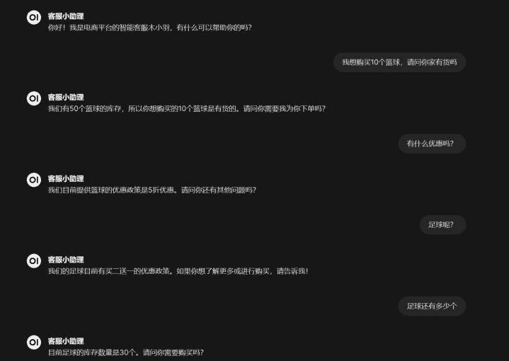

在这三天中我给大家准备了非常丰富的资料，在【完课】后可以找助教老师领取~


## Day 1. 大模型应用发展及Agent前沿技术趋势

### 课程目录

1. 大模型应用整体概览
2. 大模型技术迭代路径
   - 提示工程
   - 函数调用
   - RAG
   - AI Agent
3. 大模型开发的岗位要求
4. 大模型热门的应用方向
5. AI Agent基本概念与快速入门
6. 从零到一实现一个`L2`级Agent
7. 基于开源项目`Open Web-ui`快速在本地构建一个问答系统

## 1. 大模型的应用概览

自2023年初开始，大模型在国内外引起了极大的关注。实际上，早在2022年底，国外已经对这一技术展开了非常激烈的讨论，而在国内对大模型的普及和认知很大程度上得益于`chatgpt`的问世。智能应用的机械式回答和频繁出错，所以，当一个能够使用自然语言（即人类的交流语言）理解情感、解决问题并且能即问即答的应用系统出现时，人们很难相信它背后不是真实的人类，而是一个由人类设计的机器模型。

下图中的对话来源于基于`GPT-4 .0`模型的对话式应用`ChatGPT`，地址：`https://chatgpt.com/`，现在也是可以不登录免费进行使用的（唯一需要的就是一个科学上网的环境）晕

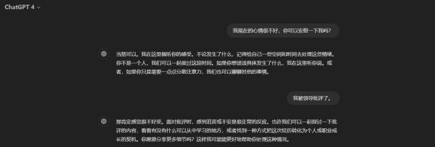

也正是这样的一种技术上的跨越，业内人会把2023年称为大模型的元年，因为它标志着人工智能迈上了一个新的台阶，而且，属于大模型的时代也才刚刚开始。所以我们作为技术人，肯定不是仅仅做一个“吃瓜群众”，看热闹的同时，更多的精力都在积极跟进大模型的发展，深入理解并掌握其背后的技术演进，以此来不断更新自身的技术视野。当然，我们要研究的并不是表面的应用，而是其背后的强力基座模型-`CPT`。

比较有意思的是，如果有在2023年起就开始使用`ChatGPT`类应用的非技术岗位的小伙伴，大概率都会有一些想法：大模型技术接近两年的技术发展并未带来显著的产品变革，无非是界面美观了一些，功能增加了一些，例如现在支持上传图片、文件和构建插件等。

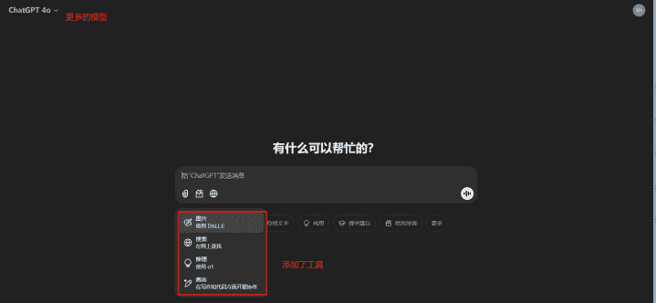

但通过表象应用去看本质，会发现大模型技术的迭代速度是远远快于其他领域的。其快速发展的有两个核心方向：大模型自身的能力在不断变强以及大模型的对话效果在大幅提升。

### 大模型自身的能力在不断变强

大模型有两个关键概念：原生能力和涌现能力。

所谓原生能力，指的是大模型基于特定的神经网络架构，在训练过程中通过不断摄入数据来学习，最终具备解答特定领域问题的能力。这种能力就像是印在大模型“大脑”中的知识，是其能够独立解答问题的基础。就如同我们在大学学习三年后能够解决高等数学问题一样，这种能力是通过学习得来的，我们称之为原生能力。大模型的这种能力的提升在于：随着能获取到的数据量增加，开发者可以基于先前性能表现为其构建更优质的学习数据，结合学习方法的不断迭代优化（技术上称之为预训练技术或微调），大模型的原生能力就可以持续进化。这种进步的直观表现是模型的理解能力和回答质量的提升。

其次，我们还会重点关注大模型的涌现能力。这一能力指的是，尽管大模型可能没有直接学习过某些信息，但在与它对话时提供相关信息后，它能够类比和推理出解决方案。这类似于我们在准备高考时做过的“五年高考三年模拟”的题目，尽管高考题目不会与模拟题完全相同，但我们仍可以利用相同的思维模式解决考试试题。大模型的这部分能力提升主要体现在：我们通过给它构造各种函数调用、处理复杂问题的过程示例（Agent能力）等，在预训练或者微调阶段帮助它学习并强化这种能力。这样，大模型就能在其应用的第二个方向上——即实际问题解决中发挥更加重要的作用。

### 大模型的对话效果在大幅提升

大模型的能力毋庸置疑，它在对话过程中能够回答和解决多种不同类型的任务，但存在着两个主要问题：知识库更新不及时和大模型幻觉问题。

首先，关于知识库更新问题，正如我们上面刚刚提到的，大模型是在预训练或者微调阶段获取和学习知识。这意味着，如果某些最新的信息未在训练数据中包含，大模型就无法提供相关答案。例如，如果你问它“今天的天气怎么样？”由于缺乏实时更新的数据，大模型无法给出正确的当前天气状况。

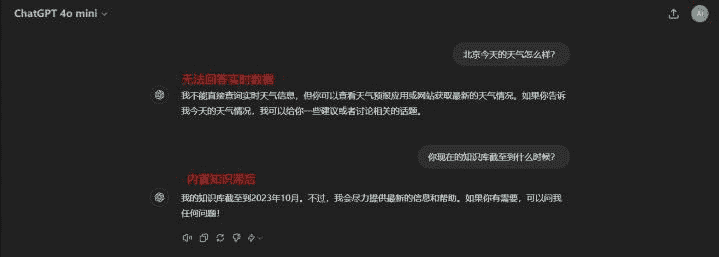

比较有意思的是：大模型的原生能力在不断的提升，它的对话效果好了，回答质量高了，但是我们的需求也变得越来越复杂了。单纯的对话应用已无法满足需求。这就促使我们进入了大模型应用的第一个阶段——提示工程。

### Stage 1：提示工程

虽然大语言模型非常强大，但要有效使用它们并非易事。在开发者急于探索如何像处理传统算法[模型那样通过微调快速迭代更新](https://arxiv.org/pdf/2005.14165)大模型的内部知识时，一篇极具启发性的论文`GPT-3 Language`

| In-ContextLearning |

| --- |

少量标注的“输入-输出对”示例，在不需要大规模微调的情况下即可显著改善大模型的输出质量。这一发现开启了使用大模型的新方式晕

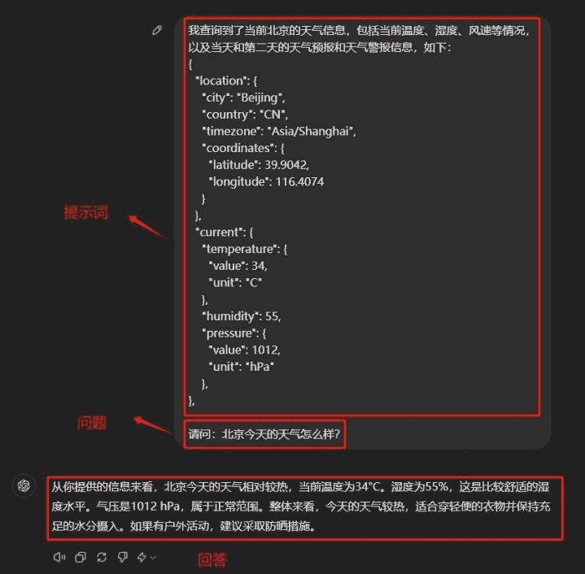

当提出问题后，大模型能够以自然语言返回响应，这是生成式人工智能的一大优点。有些任务确实可以通过这种提示工程的方式引导大模型在对话过程中生成正确的回复，但这个过程最大的问题就是需要人工介入，正如上面的例子中涉及到的北京的天气信息：

对于试图将大模型的响应与其他应用程序连接起来的开发人员来说，这就是一场噩梦。开发人员通常使用正则表达式 (`Regex`) 或提示工程将输出转换为所需的格式，然后才能将其传递到另一个应用程序，也就是说，这个过程中如果不需要人工介入，还想让它自动拿到这些信息，怎么做？

搞过开发的小伙伴对这种`JSON`数据应该非常熟悉，我们[可以调用某个天气平台的](https://openweathermap.org/)`API`，比如`OpenWeather`，输入一个城市的关键词，就能得到该城市当前的天气信息数据，也就是如上所示的`JSON`形式，那么这样的信息，如何让大模型自动解析，就进入到了我们探索大模型应用的第二个阶段 - 函数调用。

### Stage 2：函数调用

2023年7月，`OpenAI`为其`GPT`模型引入了函数调用功能。大模型发展到现在，所有热门的大模型均已不同的形式让自己具备函数调用能力。这里指的可以调用的函数，我们通常称之为工具，在这个阶段，我们要做的是描述该工具是用来做什么的，然后让大模型智能地选择输出包含调用这些函数的参数的`JSON`对象。简而言之，它允许：

- 自主决策：大模型可以智能地选择工具来回答问题。
- 可靠的解析：响应采用`JSON`格式，而不是更典型的类似对话的响应。

乍一看似乎没什么，但这就是大模型能够连接到外部系统的原因，比如通过具有结构化输入的`API`，本地的数据库，自己编写的`Python`代码函数等等。有了这个功能，大模型在应用方面就开启了无限的可能性。比如：

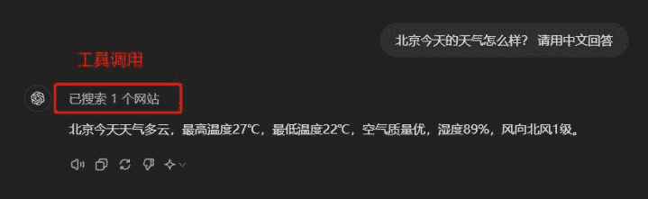

当大模型被赋予函数调用的能力时，它会在每次回答问题之前先检查可以调用哪些工具，并评估用户的问题是否需要调用这些工具。如果需要，它便会调用相应的工具，并根据工具返回的结果来构筑答案。这整个过程都是大模型根据其自主判断的。所以在提升这一阶段不仅极大地扩展了大模型的应用范围，还在一定程度上解决了知识库更新不及时、无法获取实时信息及其带来的优势。

但是，在函数调用技术阶段趋于成熟的同时，我们仍然发现了另一个非常大的问题：大模型幻觉晕

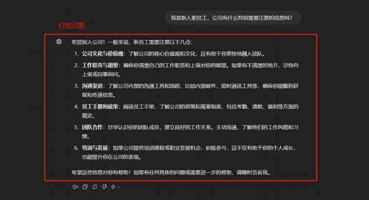

大模型直到现在依然普遍存在一个问题：当面对自己不了解的问题时，它们有时会产生不准确甚至荒谬的回答，这就是所谓的大模型幻觉问题。以上图中的例子为例，当大模型被询问关于公司制度的问题时，在没有任何技术手段介入的情况下，理想的回答应该是“我不知道”或“请提供一下你所入职公司的具体制度”等回答，而我们看到的却是大模型错误地从一个HR的角度进行了回复，这就会给用户带来混淆和误导。

在

| Stage 1：提示工程 |

| --- |

中我们提到，大模型可以基于

| in-context learning |

| --- |

的提示思想，利用提供的背景信息来回答特定问题，直接引发了第一轮大模型应用落地的热潮，主要集中在本地知识库问答领域。因为无论是个人还是企业，都希望大模型能够根据其私有数据——如个人学习资料或公司规章制度等让大模型准确高效地回答问题，充当智能客服、智能助理这样的角色。然而，一个显著的挑战是数据量可能极大，从单个文件到数千G的文件系统不等，而大模型在对话处理上存在输入长度限制，无法将所有数据作为背景信息直接处理。

因此，面对本地知识库问答的挑战，并考虑到大模型的幻觉问题和长度限制问题，出现的解决方案就是：`RAG`（`Retrieval-Augmented Generation`），以此进入到了大模型应用的第三个阶段。

### Stage 3. `Retrieval-Augmented Generation`

通过人们不断地对大模型领域的探索，非常多的实验论文能够证明，当为大模型提供一定的上下文信息后，其输出会变得更稳定。那么，将知识库中的信息或掌握的信息先输送给大模型，再由大模型服务用户，就是大家普遍达成共识的一个结论和方法。传统的对话系统、搜索引擎等核心依赖于检索技术，如果将这一检索过程融入大模型应用的构建中，既可以充分利用大模型在内容生成上的能力，也能通过引入的上下文信息显著约束大模型的输出范围和结果，同时还实现了将私有数据融入大模型中的目的，达到了双赢的效果。

所以我们才看到`RAG`的实现是包括两个阶段的：检索阶段和生成阶段。在检索阶段，从知识库中找出与问题最相关的知识，为后续的答案生成提供素材。在生成阶段，`RAG`会将检索到的知识内容作为输入，与问题一起输入到语言模型中进行生成。这样，生成的答案不仅考虑了问题的语义信息，还考虑了相关私有数据的内容。如下图所示：晕

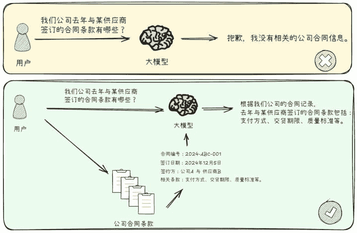

`RAG`技术解决的两个关键的问题是：

1. 如果用户提出的问题，其对应的答案出现在一篇文章中，去知识库中找到一篇与用户输入相关的文章是很容易的，但是我们将检索到的这整篇文章直接放入`Prompt`中并不是最优的选择，因为其中一定会包含非常多无关的信息，而无效信息越多，对大模型后续的推理影响越大。
2. 任何一个大模型都存在最大输入的`Token`限制，一个流程中可能涉及多次检索，每次检索都会产生相应的上下文，无法容纳如此多的信息。

但实际上，如上面的流程图所示，大模型在整个`RAG`架构中占据的比例实际上非常小。我们主要依赖大模型结合背景信息进行推理的能力。在`RAG`的多个优化阶段中，检索策略的作用更为重要。此外，`RAG`的实际应用场景相对有限，无论是哪种形式的问答系统，都还未能达到我们所期望的通用人工智能（`AGI`）的水平。因此，现阶段进入到了`AI Agent`的全面爆发，这项技术直接体现的是我们正在向期望的更复杂、更全面的技术方向发展。

人类具有非凡的能力，能够不断吸收信息、做出决定、采取行动、观察变化，然后做出下一个决定。我们的整个生活是一个永无休止的观察、思想和行动的链条。通过将复杂的问题分解为更小的、可管理的部分，并不断地借鉴前几代人的知识，人类已经取得了长足的进步。通用人工智能的最终形态就是：我们能够转移这个概念到大模型上，使其不断做出新的决策，从而逐步接近更复杂问题的解决方案。

至此，也就衍生出了`AI Agent`（人工智能代理）的基本概念：一个感知环境、处理信息并采取行动以实现特定目标的软件程序或系统。现阶段我们会把单一的大模型作为`AI Agent`的核心，而不是全部。它应该是一个超级好的大语言模型，能够解释问题、观察环境并据此做出决策。如果在`AI Agent`构建流程中添加一些将语音转换为文本的模型、解释图像内容的模型，就可以构建自己的`Jarvis`所需的一切。（复仇者联盟电影中钢铁侠的私人虚拟助理）

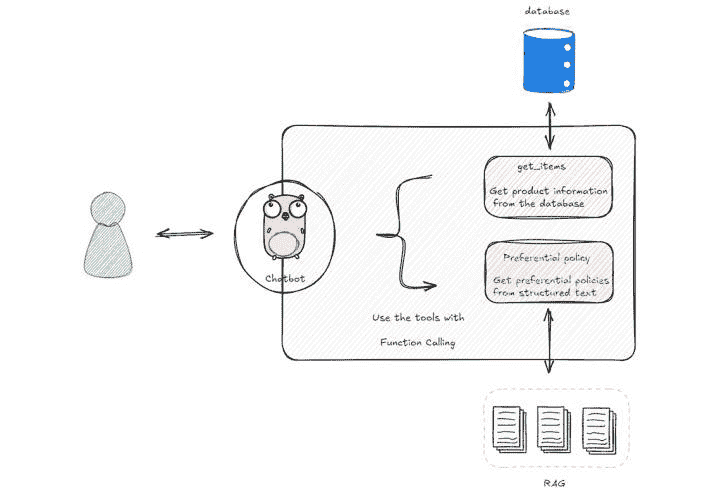

很好解释，通过提示工程，大模型可以生成更类似于人类的响应。但当我们应用代理的概念时，我们使用大模型不仅仅是回答问题，而是作为大脑处理它所看到的观察结果并决定下一步该做什么。人类处理问题就是这样：如果有一项任务需要解决，往往是去寻找能够帮助我们尽可能轻松地解决该任务的方法和工具。如果我们不给大模型配备足够的工具，即便它知道要做什么，但不具备调用工具的能力一切将会变为空谈。

从根本上讲，与严格遵守设定脚本或任务序列的传统自动化系统不同，人工智能代理具有感知、解释、学习和适应的能力。将它们视为数字助理，不仅执行任务，还不断评估周围环境，从不同的交互中学习，并做出决策以实现特定目标。它们可以采取多种形式，从执行单一任务的简单软件到管理复杂流程的复杂系统。人工智能代理在不可预测的环境中表现出色，其适应性和学习能力可以得到充分利用。从浏览互联网、与应用程序交互、处理大量数据到参与交易，这些任务都可以委托给人工智能代理。

根据Boss直聘数据统计，第四季度大模型开发岗位中，80%以上要求有`Agent`经验或开发能力；

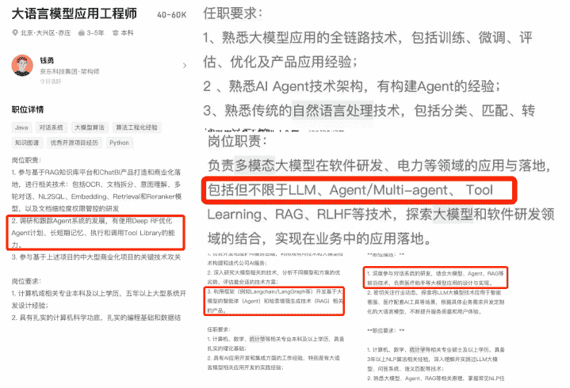

而大模型能力的不断增强和对话效果的不断提升，这两个方向其背后的技术栈迭代，可以总结如下图所示晕：

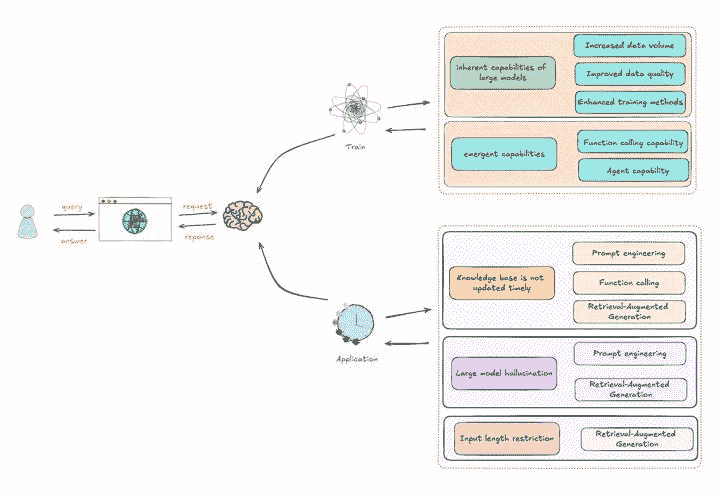

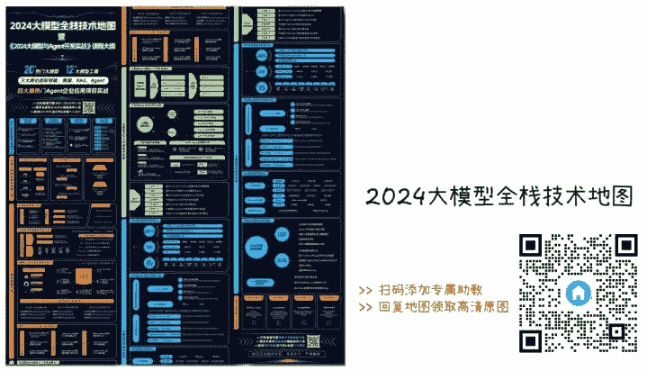

我们统计了2024年三、四季度的大模型开发岗位热门方向如下图所示：

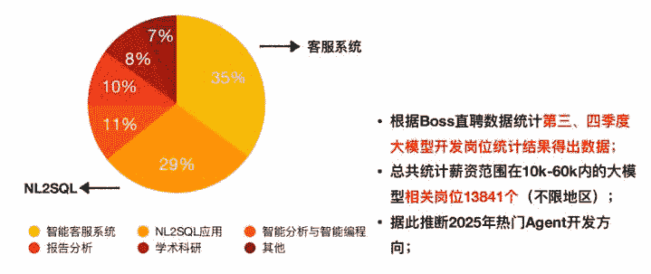

## 2. `AI Agent`的基本概念与快速入门

| Agent |

| --- |

到底应该如何去定义？什么样的应用程序能算的上一个`Agent`？到现在仍然没有特别一个明确的说法和界定。有的人认为只要应用程序中集成了能够处理全领域知识查询的大模型，它就可被视为一个`Agent`，而更多的一部分人则认为这还远不够，他们会觉得只有当一个应用程序能像人类一样思考并自主处理复杂任务时，才真正符合`Agent`的标准。大家应该都听过这样一种观点：大模型的发展使得人工通用智能（`AGI`）在未来成为现实的可能性也越来越大。在这个过程中，基础的`Agent`扮演关键角色。那么，什么样的最符合未来的发展趋势呢？

我们来看看大模型行业巨头`OpenAI`对于`AI Agent`的理解。

在2024年7月初，`Open AI`的领导层在全体内部员工会议上的分享中，定义了`AI`的五个不同阶段，共同去努力实现构建通用人工智能的最终目标。这五个阶段涵盖了从基本的聊天机器人到能够完成整个组织工作的高级系统，而第五个阶段所需要具备的能力就是可以构造出一种智能且能够执行与人类相同的所有工作的`AI`。各个阶段如下所示：

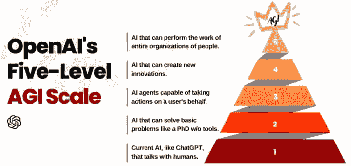

### Stage 1. `Chatbots`的第一阶段称为聊天机器人。

`OpenAI`自己的`ChatGPT`就是这个阶段的最佳例子，它在2022年底发布时以其用自然语言交谈的能力震惊了世界。我们可以使用聊天机器人来提高其内部生产力，这些聊天机器人乍一看似乎非常聪明，但是通常会充满信心地编造和呈现虚假信息，所以如果它们不能有效的融入私人/企业的数据，没有太多的商业用途。

### Stage 2: `Reasoners`

`OpenAI`定义的`AI`第二阶段为推理者。推理者是可以完成基本问题解决任务的系统，不需要借助任何工具，通过改进推理增强大模型处理各种任务的能力，这包括从做出重大科学发现到规划和构建新的软件应用程序。正如`OpenAI`发布的`o1-preview`。

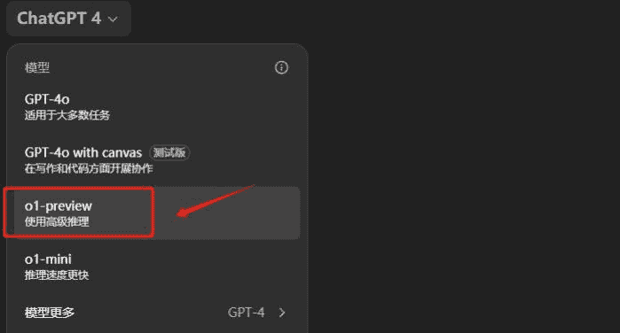

### Stage 3: `Agents`

阶段也就是我们目前一直在学习的相关内容，如`LangGraph`、`Router Agent`、`ReAct`，我们通过工作流的编排去让应用程序自主完成一些特定的用户需求和任务目标，整个过程不需要任何的人工介入。

### Stage 4: `Innovators`

第四个阶段的创新者是指：可以帮助发明的人工智能。这类应用帮助人们产生想法、编写代码和进行创作，它们以专门开发的`AI`系统的形式出现，以帮助原型、构建和制造物理产品。

### Stage 5: `Organizations`


# 1. AI Agent 的基本概念与架构

在 OpenAI 提出的人工智能最后阶段：AI系统将变得足够先进和智能，可以完成整个组织的工作，并将组织归类为智能路线图的最后一步。

人类[的优势是能够吸收相对大量的信息，过滤掉不重要的细节](https://arxiv.org/pdf/2210.03629)，并根据关键信息做出决策。比如，在处理一件事情之前，我们通常会先将大问题分解为一个个小的假设，然后尝试通过观察逐步支持或反驳这些假设。从这个现实的观点出发，启发 AI Agent 早期范式的一篇论文 REACT: SYNERGIZING REASONING AND ACTING IN LANGUAGE MODELS 中使用“思维链提示”来模仿这个概念，它将多步骤问题分解为中间步骤：

• 发起一项行动，让大模型观察所选环境的反馈  
• 在流程中收集所有信息并使用它来决定下一步采取什么合适的行动  
• 迭代地执行此操作来解决更大、更复杂的任务，使用一种称为“推理跟踪”的方法，该方法涉及跟踪整个过程所经历的步骤或阶段以得出结论或解决方案  

如下图所示，整个过程是一个动态循环。代理不断从环境中学习，通过其行动影响环境，然后根据环境的反馈继续调整其行动和策略。这种模式特别适用于那些需要理解和生成自然语言的应用场景，如聊天机器人、自动翻译系统或其他形式的自动化客户支持。

一个这是更加感官性的认知如下图所示：

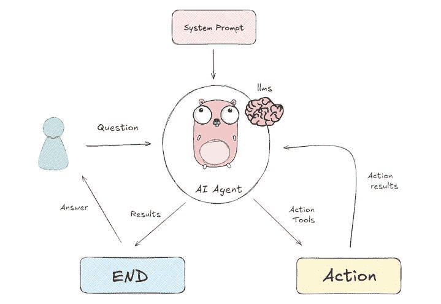

所以从这个过程中，我们就可以抽象出 AI Agent 的最经典，同时也是目前任何一套 Agent 框架的基本框架，如下图所示：

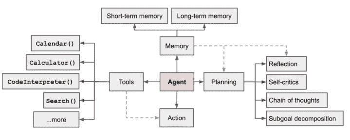

图片来源：[https://lilianweng.github.io/posts/2023-06-23-agent/](https://lilianweng.github.io/posts/2023-06-23-agent/)，强烈建议大家通篇阅读。

这套智能代理架构是指自主代理的结构化设计，自主代理是能够独立感知环境、做出决策并采取行动以实现特定目标的系统或实体。该架构描述了代理的各个组件如何交互以促进智能行为。该架构包含四个关键组件：

• 规划（Planning）：该组件将代理置于动态环境中，使其能够根据其目标和收集的信息制定策略并规划未来的行动。  
• 记忆（Memory）：该组件使智能体能够回忆过去的行为、经历和结果，这对于学习和适应至关重要。  
• 行动（Action）：该组件将智能体的决策转化为具体的行动，执行计划的任务以达到预期的结果。  
• 工具（Tools）：拥有一名仅拥有 LLM 的代理人就像使用一台没有任何额外设备的计算机一样。工具让代理能够使用互联网、获取特殊知识或与擅长特定事物的几种不同的人工智能模型一起工作，从而使代理变得更加有用。

人工智能代理的特点是其主动性和决策能力。与被动工具不同，它们主动参与环境，做出选择并采取行动来实现其指定目标。在企业环境中，人工智能代理通过自动化日常任务和分析复杂数据来提高效率，从而使员工能够专注于战略和创造性工作。这些代理补充而不是取代人类的努力，促进提高劳动力的生产力和效率。

让我们想象一个中国市场销售经理李华和他的人工智能助理的场景。

李华的工作日以检查电子邮件开始。他收到了来自潜在客户张伟的邮件，张伟对他公司提供的高效解决方案感兴趣。李华的人工智能助手直接连接到他的电子邮件系统，并且实时监控这些互动。根据李华过去的回复习惯和公司提供的信息库，人工智能助手草拟了一封详细的回复。邮件中不仅总结了公司的高效解决方案及其优势，还根据张伟的需求定制了相关建议。

李华审阅了这份草稿邮件，加入了一些个性化的语句，以显得更加友好和专业，然后发送给了张伟。随后，人工智能建议的后续步骤包括安排与张伟的电话会议、发送一份详细的产品介绍手册，或者如果一周内没有得到回复，提醒李华进行跟进。李华同意了这些建议，人工智能助手随即整理他的日程，通过电子邮件发送产品手册，并在他的电子日历中设置了跟进提醒。通过让人工智能处理这些日常但关键的任务，李华可以将更多精力投入到其他重要的业务拓展活动中。

这个过程中 AI Agent 展现出来的关键能力：

• AI Agent 利用大模型固有的语言理解能力来解释指令、上下文和目标。这使它们能够根据人类的提示自主或半自主地运行。  
• AI Agent 可以使用各种工具（阅读邮件，计算器、搜索引擎等）来收集信息并采取行动来完成分配的任务。它们的能力超出了单纯的语言处理范围。  
• AI Agent 能够展示复杂的推理技术，可以建立逻辑联系来得出结论和解决问题，而不仅仅是简单的文本理解。  
• AI Agent 可以通过将上下文和目标集成到其语言生成能力中，生成用于特定目的的定制文本，例如电子邮件、报告和营销材料。  
• AI Agent 代理可以完全自主或半自主运行，需要与用户进行不同级别的交互。  

人工智能代理的好处不仅仅是效率。它们营造协作环境，降低人为错误的风险，并腾出宝贵的时间进行创造性和战略性思考。从本质上讲，人工智能代理不仅仅是工具，更是工具。他们是补充人类能力并推动创新的合作伙伴。

# 3. 从零到一实现一个 L2 级 Agent

对于 L2 级的 Agent 级的 Agent，本质上就是一个具备推理能力的聊天机器人，我们可以直接调用某个大模型构建多轮对话的问答流程。这里我们就从环境配置开始，从零到一带领大家在自己的电脑上开发一个能与大模型交互的多轮问答机器人。

## 环境配置

首先，我们需要在本地配置一个 Python 的开发环境，建议使用 Anaconda3 的 Jupyter Lab，当然，大家也可以选择使用 Pycharm 或者 Vscode 工具。其次，需要有一个有效的 OpenAI `API_Key`，今天直播体验课为大家准备了限量免费使用的 `API_Key`，详细的安装教程和 `API_KEY` 的免费领取，可以添加专属助理：


在准备好 `API_key` 并顺利启动 Jupyter 之后，即可测试能否顺利调用 OpenAI 大模型，测试代码如下：

```
# ! pip install openai
```

```
# ! setx OPENAI_API_KEY "your_api_key_here"
```

注意：配置完成后，需要重启电脑，方可使环境变量生效。

```
from openai import OpenAI
```

通过调用 `models.list()` 方法，可以查看到当前的 API_key 都可以调用哪些模型。

```
print(client.models.list())
```

输出示例：

```
SyncPage[Model](data=[Model(id='o1-mini-2024-09-12', created=1725648979,
object='model', owned_by='system'), Model(id='gpt-4o-mini',
created=1721172741, object='model', owned_by='system'), Model(id='dall-e-2',
created=1698798177, object='model', owned_by='system'), Model(id='gpt-4-1106-
preview', created=1698957206, object='model', owned_by='system'),
Model(id='gpt-4o-mini-2024-07-18', created=1721172717, object='model',
owned_by='system'), Model(id='gpt-3.5-turbo-instruct', created=1692901427,
object='model', owned_by='system'), Model(id='babbage-002',
created=1692634615, object='model', owned_by='system'), Model(id='davinci-
002', created=1692634301, object='model', owned_by='system'),
Model(id='whisper-1', created=1677532384, object='model', owned_by='openai-
internal'), Model(id='dall-e-3', created=1698785189, object='model',
owned_by='system'), Model(id='gpt-4o-realtime-preview-2024-10-01',
created=1727131766, object='model', owned_by='system'), Model(id='text-
embedding-3-small', created=1705948997, object='model', owned_by='system'),
Model(id='gpt-3.5-turbo-16k-0613', created=1685474247, object='model',
owned_by='openai'), Model(id='gpt-3.5-turbo-16k', created=1683758102,
object='model', owned_by='openai-internal'), Model(id='gpt-4-0125-preview',
created=1706037612, object='model', owned_by='system'), Model(id='gpt-4o-
realtime-preview', created=1727659998, object='model', owned_by='system'),
Model(id='gpt-4-turbo-preview', created=1706037777, object='model',
owned_by='system'), Model(id='omni-moderation-latest', created=1731689265,
object='model', owned_by='system'), Model(id='gpt-4o-2024-05-13',
created=1715368132, object='model', owned_by='system'), Model(id='omni-
moderation-2024-09-26', created=1732734466, object='model',
owned_by='system'), Model(id='tts-1-hd-1106', created=1699053533,
object='model', owned_by='system'), Model(id='chatgpt-4o-latest',
created=1723515131, object='model', owned_by='system'), Model(id='gpt-4',
created=1687882411, object='model', owned_by='openai'), Model(id='gpt-4-0613',
created=1686588896, object='model', owned_by='openai'), Model(id='o1-mini',
created=1725649008, object='model', owned_by='system'), Model(id='gpt-3.5-
turbo', created=1677610602, object='model', owned_by='openai'), Model(id='gpt-
3.5-turbo-0125', created=1706048358, object='model', owned_by='system'),
Model(id='o1-preview', created=1725648897, object='model', owned_by='system'),
Model(id='o1-preview-2024-09-12', created=1725648865, object='model',
owned_by='system'), Model(id='gpt-4-turbo', created=1712361441,
object='model', owned_by='system'), Model(id='tts-1-hd', created=1699046015,
object='model', owned_by='system'), Model(id='text-embedding-ada-002',
created=1671217299, object='model', owned_by='openai-internal'), Model(id='gpt-
4-turbo-2024-04-09', created=1712601677, object='model', owned_by='system'),
Model(id='gpt-3.5-turbo-1106', created=1698959748, object='model',
owned_by='system'), Model(id='gpt-4o-audio-preview', created=1727460443,
object='model', owned_by='system'), Model(id='gpt-4o-audio-preview-2024-10-
01', created=1727389042, object='model', owned_by='system'), Model(id='tts-1',
created=1681940951, object='model', owned_by='openai-internal'), Model(id='tts-
1-1106', created=1699053241, object='model', owned_by='system'), Model(id='gpt-
4o-2024-08-06', created=1722814719, object='model', owned_by='system'),
Model(id='gpt-3.5-turbo-instruct-0914', created=1694122472, object='model',
owned_by='system'), Model(id='text-embedding-3-large', created=1705953180,
object='model', owned_by='system'), Model(id='gpt-4o-realtime-preview-2024-12-
17', created=1733945430, object='model', owned_by='system'), Model(id='gpt-
4o', created=1715367049, object='model', owned_by='system'), Model(id='gpt-4o-
mini-realtime-preview', created=1734387380, object='model',
owned_by='system'), Model(id='gpt-4o-mini-realtime-preview-2024-12-17',
created=1734112601, object='model', owned_by='system'), Model(id='gpt-4o-2024-
11-20', created=1731975040, object='model', owned_by='system'), Model(id='gpt-
4o-audio-preview-2024-12-17', created=1734034239, object='model',
owned_by='system'), Model(id='gpt-4o-mini-audio-preview', created=1734387424,
object='model', owned_by='system'), Model(id='gpt-4o-mini-audio-preview-2024-
12-17', created=1734115920, object='model', owned_by='acmr-
```


# OpenAI 模型列表与 API 调用

## 模型列表

```
wtr5tv'), Model(id='ft:gpt-3.5-turbo-1106:acmr::8NGu7dB7', created=1700557216,
object='model', owned_by='acmr-wtr5tv'), Model(id='ft:gpt-3.5-turbo-
1106:acmr::8NGecRZn', created=1700556254, object='model', owned_by='acmr-
wtr5tv'), Model(id='ft:gpt-3.5-turbo-1106:acmr::8NGoWxGp', created=1700556868,
object='model', owned_by='acmr-wtr5tv'), Model(id='ft:gpt-3.5-turbo-
1106:acmr::8NcxfjOE', created=1700642003, object='model', owned_by='acmr-
wtr5tv'), Model(id='ft:gpt-3.5-turbo-1106:acmr::8NISonhF', created=1700563210,
object='model', owned_by='acmr-wtr5tv'), Model(id='ft:gpt-3.5-turbo-
1106:acmr::8NIBwIXY', created=1700562164, object='model', owned_by='acmr-
wtr5tv'), Model(id='ft:gpt-3.5-turbo-1106:acmr::8NIJWEAY', created=1700562634,
object='model', owned_by='acmr-wtr5tv'), Model(id='ft:gpt-3.5-turbo-
1106:acmr::8NIZytXn', created=1700563654, object='model', owned_by='acmr-
wtr5tv'), Model(id='ft:babbage-002:acmr::8ONnv6dd', created=1700822067,
object='model', owned_by='acmr-wtr5tv'), Model(id='ft:gpt-3.5-turbo-
1106:acmr::8PSAdThJ', created=1701077179, object='model', owned_by='acmr-
wtr5tv'), Model(id='ft:gpt-3.5-turbo-1106:acmr::8Okwb8qA', created=1700911017,
object='model', owned_by='acmr-wtr5tv'), Model(id='ft:gpt-3.5-turbo-
1106:acmr::8Onym3eo', created=1700922684, object='model', owned_by='acmr-
wtr5tv'), Model(id='ft:gpt-3.5-turbo-1106:acmr::8P3jjlnu', created=1700983255,
object='model', owned_by='acmr-wtr5tv'), Model(id='ft:gpt-3.5-turbo-
1106:acmr::8P7Wp9ZW', created=1700997831, object='model', owned_by='acmr-
wtr5tv'), Model(id='ft:gpt-3.5-turbo-1106:acmr::8P8ICr9h', created=1701000768,
object='model', owned_by='acmr-wtr5tv'), Model(id='ft:gpt-3.5-turbo-
1106:acmr::8P8JcJOS', created=1701000856, object='model', owned_by='acmr-
wtr5tv'), Model(id='ft:gpt-3.5-turbo-1106:acmr::8P8MZq4B', created=1701001039,
object='model', owned_by='acmr-wtr5tv'), Model(id='ft:gpt-3.5-turbo-
1106:acmr::8P8eJWFu', created=1701002139, object='model', owned_by='acmr-
wtr5tv'), Model(id='ft:gpt-3.5-turbo-1106:acmr::8P8jDYPa', created=1701002444,
```

```
17 gpt-4-turbo-preview
18 omni-moderation-latest
19 gpt-4o-2024-05-13
20 omni-moderation-2024-09-26
21 tts-1-hd-1106
22 chatgpt-4o-latest
23 gpt-4
24 gpt-4-0613
25 o1-mini
26 gpt-3.5-turbo
27 gpt-3.5-turbo-0125
28 o1-preview
29 o1-preview-2024-09-12
30 gpt-4-turbo
31 tts-1-hd
32 text-embedding-ada-002
33 gpt-4-turbo-2024-04-09
34 gpt-3.5-turbo-1106
35 gpt-4o-audio-preview
36 gpt-4o-audio-preview-2024-10-01
37 tts-1
38 tts-1-1106
39 gpt-4o-2024-08-06
40 gpt-3.5-turbo-instruct-0914
41 text-embedding-3-large
42 gpt-4o-realtime-preview-2024-12-17
43 gpt-4o
44 gpt-4o-mini-realtime-preview
45 gpt-4o-mini-realtime-preview-2024-12-17
46 gpt-4o-2024-11-20
47 gpt-4o-audio-preview-2024-12-17
48 gpt-4o-mini-audio-preview
49 gpt-4o-mini-audio-preview-2024-12-17
50 ft:gpt-3.5-turbo-0613:acmr:recipe-ner:7rOJnQow
51 ft:babbage-002:acmr::8LjwL7pi
52 ft:gpt-3.5-turbo-1106:acmr::8NFcWDKd
53 ft:gpt-3.5-turbo-1106:acmr::8NG1DFJy
54 ft:gpt-3.5-turbo-1106:acmr::8NGu7dB7
55 ft:gpt-3.5-turbo-1106:acmr::8NGecRZn
56 ft:gpt-3.5-turbo-1106:acmr::8NGoWxGp
57 ft:gpt-3.5-turbo-1106:acmr::8NcxfjOE
58 ft:gpt-3.5-turbo-1106:acmr::8NISonhF
59 ft:gpt-3.5-turbo-1106:acmr::8NIBwIXY
60 ft:gpt-3.5-turbo-1106:acmr::8NIJWEAY
61 ft:gpt-3.5-turbo-1106:acmr::8NIZytXn
62 ft:babbage-002:acmr::8ONnv6dd
63 ft:gpt-3.5-turbo-1106:acmr::8PSAdThJ
```

获取模型列表的代码示例：

```
model_list = client.models.list().data
for usable_model_name in model_list:
    ...
```

如果我们想与上述列出的这些模型进行对话时，就需要向OpenAI提供的某个端点发送一个 HTTP 请求。简单来说，API 端点就像一个“门”，它连接了你和某个服务。你通过这个“门”向服务发送请求，并从它那里获得你需要的信息或结果。对于 OpenAI 的模型来说，这个端点就是你向模型发送请求、获取回复的地方。

[OpenAI Chat Completion EndPoint](https://platform.openai.com/docs/api-reference/chat/create)

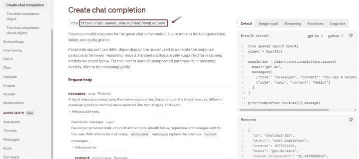

如上所示，OpenAI提供的 API 端点地址，用于和它的模型（比如 GPT-4）进行对话。当你发送一条消息或问题时，会通过这个端点处理你的请求，并返回一个由模型生成的回答。其过程如下：

• Step 1. 发送请求：我们向发送一个请求，告诉模型你想要什么样的回答。这个请求会包含你给模型的输入（比如你问的问题或者你要进行的对话内容）。

• Step 2. 模型处理请求：OpenAI 的模型会收到你的请求，理解你要的内容，并生成相应的回答。

• Step 3. 获取响应：模型生成的回答会通过这个端点返回给你，你就能看到模型给出的响应了。

这个过程看起来可能比较复杂，因为它涉及到向 OpenAI 的服务器发送 HTTP 请求、处理请求的响应、进行身份验证等一系列操作，但实际上，OpenAI 提供了非常方便的工具来简化这一过程，调用封装好的方法，就能轻松与OpenAI的模型进行交互。

OpenAI提供了官方的，封装在 `client.chat.completions.create` 方法中，所以我们在使用Python编程语言的时候，则可以直接通过：

[OpenAI Chat Completion EndPoint](https://platform.openai.com/docs/api-reference/chat/create)

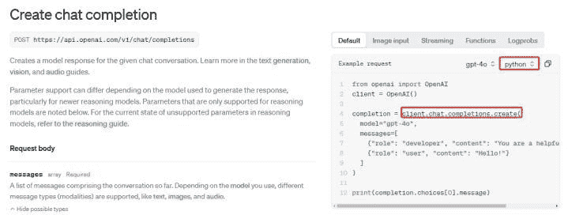

而在使用 SDK 的过程中我们要明确的是：虽然 SDK 简化了使用过程，但在构建这些 SDK 时，还是需要一些基础的参数支撑，比如 API 密钥、模型选择、消息格式等，这些参数确保了请求的正确性和有效性。这里我们先关注下必须要传入的参数，如下所示：

| 层级 | 描述 | 必填项 | 说明 |
| --- | --- | --- | --- |
| `model` | 要使用的模型 ID | 必填 | 指定模型的 ID，查看模型端点兼容表以获取支持的模型类型。 |
| `messages` | 所有消息的集合 | 必填 | 包含整个对话的消息数 |
| Developer message | 开发者提供的指令，模型需要遵循这些指令，无论用户发送什么消息。 | `content` (消息内容) | `content`：开发者消息内容 |
| System message | 开发者提供的指令，通常用于配置模型行为。 | `content` (消息内容), `role` (角色: system) | `content`：系统消息内容 |
| User message | 用户发送的消息，包含提示或额外的上下文信息。 | `content` (消息内容), `role` (角色: user) | `content`：用户消息内容 |
| Assistant message | 模型对用户消息的回应 | `content` (消息内容), `role` (角色: assistant) | `content`：模型回应的消息内容 |
| `tool_calls` | 模型调用的工具，通常用于外部函数调用 | `id` (工具调用 ID), `type` (工具类型) | `id`：唯一标识符 |
| `function` | 模型调用的函数 | `name` (函数名) | `name`：调用的函数名 |
| Tool message | 工具消息，通常用于模型与外部工具交互的响应 | `role` (角色: tool) | `role`：固定为 `"tool"` |

在使用OpenAI时，必须传入两个关键参数：

1. `model`：这个参数指定了要使用的模型的 ID。例如，你可以选择 GPT-4 或其他 OpenAI 提供的模型。模型的 ID 确定了你将与哪个版本的模型进行交互，因此它是必填项。
2. `messages`：这个参数包含了整个对话的消息集合。它是一个消息数组，每个消息都包含一个 `role`（角色，表示消息的发送者，如开发者、系统、用户或助手）和 `content`（消息内容）。

参数是与模型进行有效对话的基础，确保模型能根据上下文正确生成回应。

这两个参数是 SDK 必须传入的核心内容，`model` 确定了你选择的模型，而 `messages` 则提供了对话的上下文，模型根据这些信息来生成相应的输出。

当我们通过大模型的API进行会话交互时，数据交换的格式如下图所示。

上图中展示的 JSON 结构是API交互中常用的数据格式。不仅仅是 OpenAI 的 GPT 模型，其他在线模型或者开源模型均遵循这种规范。在这个例子中，我们看到有一个对象包含两个键值对：`"role": "user"`和`"content": "your question"`。这表示交互中用户的角色被标识为`"user"`，并且用户的输入内容为`"your question"`。这种格式化的数据结构允许API清晰地解析出发送者的角色和对话内容，从而进行有效的处理和响应。

要发送到 GPT 模型的问题必须包含在字典列表中。我们使用OpenAI的Python SDK来调用GPT 模型以获取聊天回复，来看代码实现：

```
ChatCompletionMessage(content='你好！我是ChatGPT，由OpenAI开发的人工智能语言模型。我的主要功能是理解和生成自然语言文本，可以帮助回答各种问题、提供建议、撰写文章、翻译语言等')
```

当大模型处理完用户的输入，它会返回一个响应对象。此时我们便可以从响应体中提取模型生成的消息内容。

```
completion
```

上述的交互过程如下图所示。

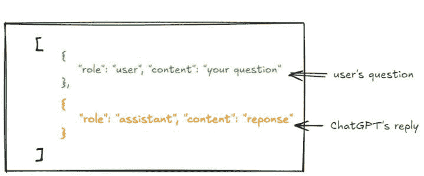

```
completion.choices[0].message
```

```
ChatCompletionMessage(content='你好！我是ChatGPT，由OpenAI开发的人工智能语言模型。我的主要功能是理解和生成自然语言文本，可以帮助回答各种问题、提供建议、撰写文章、翻译语言等')
```

```
print(completion.choices[0].message.content)
```

你好！我是ChatGPT，由OpenAI开发的人工智能语言模型。我的主要功能是理解和生成自然语言文本，可以帮助回答各种问题、提供建议、撰写文章、翻译语言等等。无论你是在学习、工作还是日常生活中遇到任何问题，都可以随时向我咨询。我会尽力为你提供准确、有用的信息和帮助。很高兴认识你！

接下来，围绕这种一问一答的逻辑，我们就可以构建非常简单的 `While` 循环来生成一个持续对话的交互程序，代码如下所示：

```
2(H - y) + 4y = L \\
2H - 2y + 4y = L \\
2H + 2y = L \\
2y = L - 2H \\
y = \frac{L - 2H}{2}
\]

- 有了 `y`，再代回 `x = H - y` 可得 `x`。
```

## 示例

### 题目

笼子里有35个头，94条腿，问有多少只鸡和兔？

### 解答

1. 设鸡的数量为 `x` 只，兔的数量为 `y` 只。
2. 根据头的数量：

   $$
   x + y = 35
   $$

3. 根据腿的数量：

   $$
   2x + 4y = 94
   $$

4. 解第一个方程得：

   $$
   x = 35 - y
   $$

5. 将 `x = 35 - y` 代入第二个方程：

   $$
   2(35 - y) + 4y = 94 \\
   70 - 2y + 4y = 94 \\
   70 + 2y = 94 \\
   2y = 24 \\
   y = 12
   $$

6. 将 `y = 12` 代入 `x = 35 - y`：

   $$
   x = 35 - 12 = 23
   $$

**答案**：笼中有23只鸡和12只兔。

## 小结


“鸡兔同笼”问题的关键在于正确设定变量，建立合理的方程，然后通过代数方法求解。这类问题不仅考查基础的代数能力，还能培养逻辑思维和问题解决的能力。

用户提问：什么是机器学习呢？

模型回复：机器学习（Machine Learning）是人工智能（AI）的一个重要分支，旨在让计算机系统通过数据和经验自动改进其性能，而无需明确编写程序。换句话说，机器学习使计算机能够从数据中学习、发现模式并做出预测或决策。

### 机器学习的基本类型

1. 监督学习（Supervised Learning）

   - 定义：在这种方法中，模型在带有标签的训练数据上进行学习，即每个输入数据都有对应的正确输出。

   - 应用：例如，电子邮件分类（垃圾邮件与否）、图像识别（识别图片中的物体）、房价预测等。

2. 无监督学习（Unsupervised Learning）

   - 定义：模型在没有标签的训练数据上进行学习，主要用于发现数据中的潜在结构或模式。

   - 应用：例如，客户分群、市场篮分析、降维（如主成分分析）等。

3. 半监督学习（Semi-supervised Learning）

   - 定义：结合了监督和无监督学习，利用少量带标签的数据和大量未标签的数据进行训练。

   - 应用：常用于需要大量数据但标注成本高的场景，如图像分类和语音识别。

4. 强化学习（Reinforcement Learning）

   - 定义：模型通过与环境的交互，依据奖励和惩罚来学习最优策略。

   - 应用：例如，游戏AI（如AlphaGo）、机器人控制、自动驾驶等。

### 常见的机器学习算法

- `线性回归（Linear Regression）`：用于预测连续值，如房价预测。

- `逻辑回归（Logistic Regression）`：用于分类问题，如垃圾邮件检测。

- `决策树（Decision Trees）`和`随机森林（Random Forest）`：用于分类和回归任务，具有良好的解释性。

- `支持向量机（Support Vector Machines, SVM）`：用于分类和回归，尤其在高维数据中表现优异。

- `神经网络（Neural Networks）`和`深度学习（Deep Learning）`：擅长处理复杂的模式识别任务，如图像和语音识别。

### 机器学习的应用领域

- `自然语言处理（NLP）`：例如，机器翻译、语音识别、情感分析。

- 计算机视觉：例如，自动驾驶、面部识别、医疗影像分析。

- 金融科技：例如，信用评分、股票预测、欺诈检测。

- 推荐系统：例如，电商平台的商品推荐、视频平台的内容推荐。

- 医疗健康：例如，疾病预测、个性化治疗方案、药物发现。

如上所示的例子：正如我们之前所讨论的，单个大模型并不具备记忆和状态跟踪的能力，它仅将每个输入视为一个独立的事件来处理。这在多轮对话中带来的实际问题就是：大模型无法根据先前的对话内容进行综合性的回应。以这个例子来说，我在一轮对话中告诉模型我的名字是木羽，然后在下一轮询问我的名字，模型却无法记起这一信息。这种缺乏连贯性的表现与我们日常的交互方式明显不符。因此，为了与大模型进行有意义的对话，我们需要做的是：将对话记录不断地反馈给大模型，也就是如下所述的形式 晕

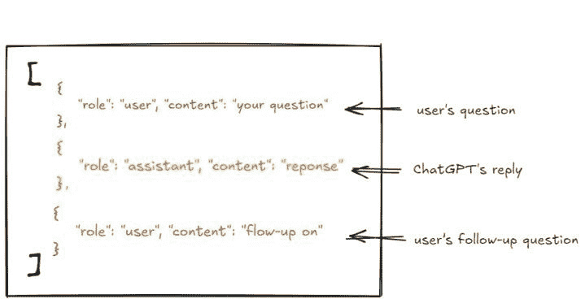

如上图所示，我们需要将每次的对话和大模型的回复，不断地追加到传递给 API 的消息字典列表中。这样，大模型就能够知道我们之前提出的问题及其提供的答复。所以代码更新如下：

| 用户提问：你好 ，我叫木羽 |
| --- |
| `messages` |
| `[{&#x27;role&#x27;: &#x27;user&#x27;, &#x27;content&#x27;: &#x27;你好 ，我叫木羽 &#x27;},` |

如上案例所示，大模型可以通过不断追加会话消息列表来模拟记忆功能，这是聊天机器人应用的一种常见实践。借助于大模型的处理能力和这种短期记忆机制，构造出来的问答系统能够与用户进行交互并帮助解答问题。如果没有其他技术的结合，这种系统就属于L2级 AI产品即聊天机器人的范畴。

当然，除此必要的两个参数，还有其他可选参数可以在对话过程中进行配置，如下图所示：

[`O`](https://platform.openai.com/docs/api-reference/chat/create)penAI Chat Completion EndPoint: `https://platform.openai.com/docs/api-reference/chat/create`

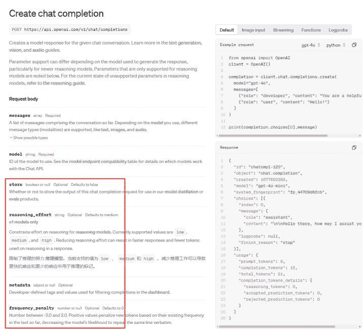

大家可以自行尝试。接下来我们要做的是：借助一个开源项目开始实现一个像ChatGPT一样的AI 应用产品。

# 4. 本地部署 Agent 问答系统

Open WebUI是一个开源项目，该项目提供一个用户友好的Web界面，使开发者和非技术用户都能够方便地与机器学习模型、大模型等进行交互。该项目支持多种流行的模型，如大语言模型、图像生成模型（例如`Stable Diffusion`）等，用户无需编写代码即可在浏览器中轻松操作，进行文本生成、图像创作等任务。作为一个开源项目，Open WebUI 提供了高可定制性，支持插件扩展，并且可以在本地部署，适用于希望在私有环境中运行模型的用户。自发布以来，Open WebUI受到了广泛关注，目前在 GitHub 上已获得 51.5k 星标，成为开发者社区中备受推崇的工具之一。

[`Open-web-ui Github`](https://github.com/open-webui/open-webui): `https://github.com/open-webui/open-webui`

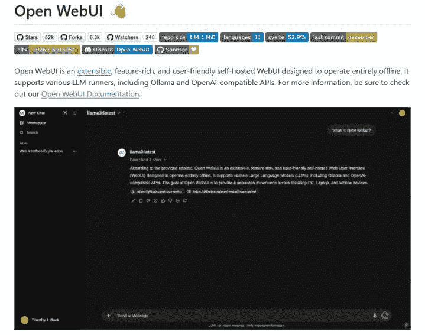

本地化部署和必要的配置我们已经给大家全部打包编译好了，直接领取可运行的全部代码，即可快速在本地启动一个网页端的大模型智能对话应用。同时，前提是需要安装`Pycharm`工具，详细的安装教程和源码可以添加专属助理领取：


我们已经随同课件给大家提供了一个

| `open-webui-main` |
| --- |

的压缩包，大家下载到本地后先进行解压，然后在PyCharm中顶部菜单中选择

| `File → Open` |
| --- |

如下所示：

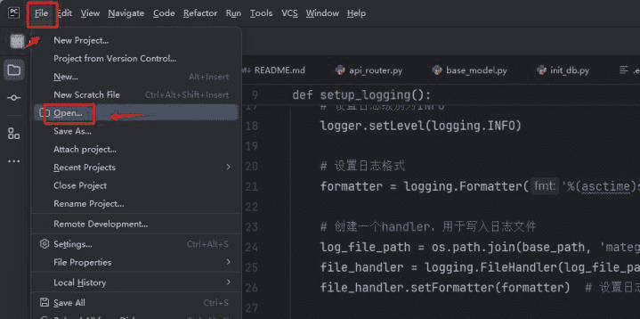

在文件浏览窗口中，选择解压后的 开该文件夹并将其作为当前项目 。

| `open-webui-main` |
| --- |

文件夹，点击会打

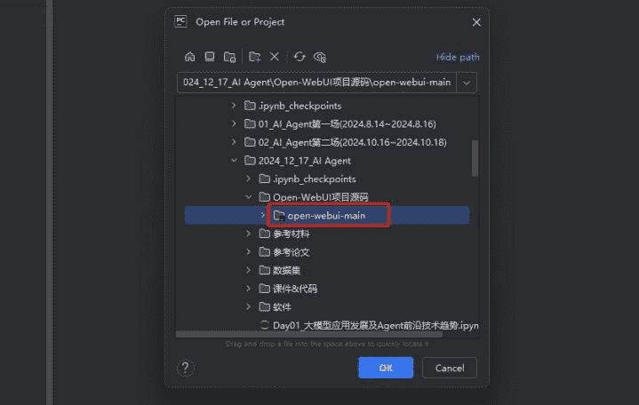

在开始运行

| `open-webui-main` |
| --- |

项目之前，首先需要给该项目配置一个本地的Python运行环境。 因为大多数项目会依赖于外部库和模块，不安装或不配置正确的依赖，就会导致依赖缺失、环境冲突等问题，无法正常启动项目。在PyCharm中配置本地Python

环境非常简单，首先点击

| `File → Settings` |
| --- |


置，点击右侧

| `Add Interpreter` |
| --- |

按钮，选择添加一个本地代码解释器，即点击

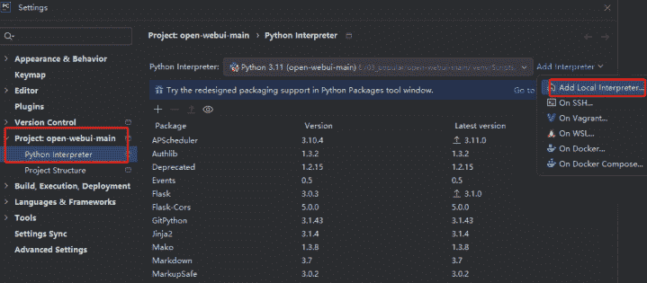

选择新建，即 `New` 。 这里强烈不建议选择已有的环境，有概率会造成依赖包的冲突导致项目无法正常启动。

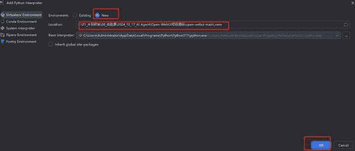

点击确定后，PyCharm会自动创建一个虚拟环境，同时也会自动设置好虚拟环境的默认路径。

耐心等待配置完成即可。

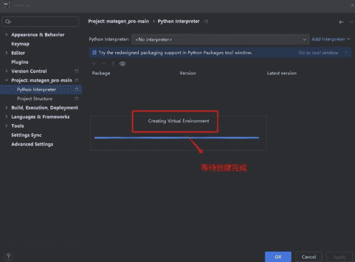

配置完解释器后，会看到一个Python页面，其中列出了当前环境中已安装

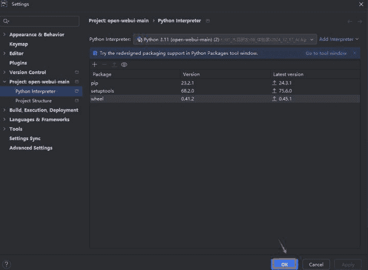

项目目录下有一个

| `requirements.txt` |
| --- |

文件，里面列出了所有必需的依赖包。

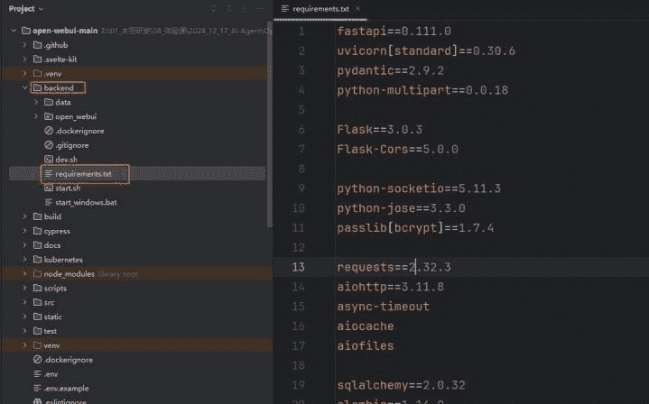

然后再开始安装依赖，如下代码所示：

```
pip install -r requirements.txt
```

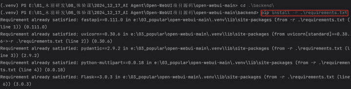

执行到这一步，

| `MateGen Pro` |
| --- |

项目运行的环境就全部配置完成了。启动则只需要一个命令：

```
.\start_windows.bat
```

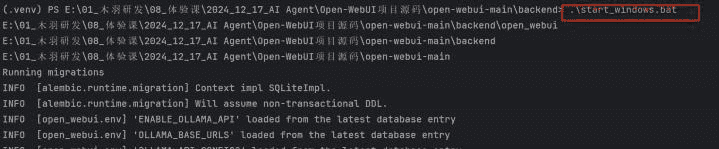

用户名为admin@admin.com，密码是：admin，该项目中给大家加入了一个免费可直接调用的 GPT模型连接，可直接进行问答回复。

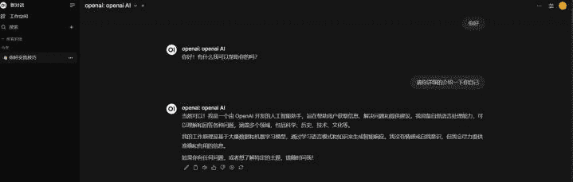

人工智能代理代表了技术领域的变革力量。 它们的能力，从简单的自动化到像 `Devin` 这样的系统所展示的独创性，都在迅速扩展。我们正在见证它们在客户服务和虚拟协助等日常任务中的成功，而这仅仅是开始。在日益复杂的大模型的支持下，新一代人工智能代理迎来了一个前所未有的效率和创新时代。而随着企业大规模采用人工智能代理，对熟练人员（能够设计、部署和管理这些系统的人员） 的需求将会猛增。除了某些行业可能出现的工作岗位流失之外，人工智能还将创造令人兴奋的新职业。为了在这种不断变化的环境中蓬勃发展，我们必须具备适应能力和持续学习能力。

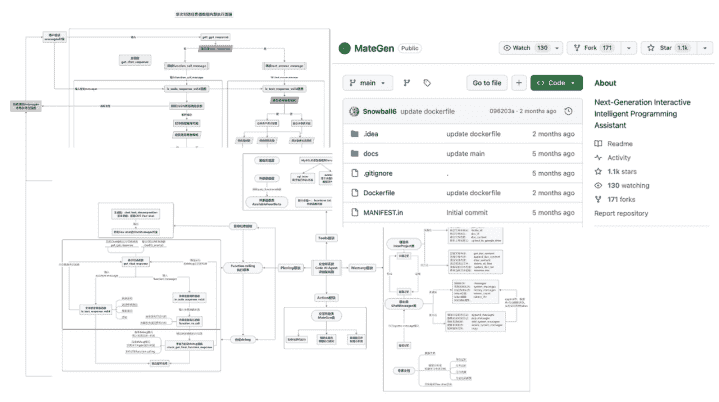

🍻现开设了大模型学习交流群，扫描下👇码，来遇见更多志同道合的小伙伴~

海量硬核独家技术干货内容+无门槛技术交流~


上图扫码👆即刻入群！

📍 社群技术交流氛围浓厚，不定期开设硬核干货&前沿技术公开课噢~
