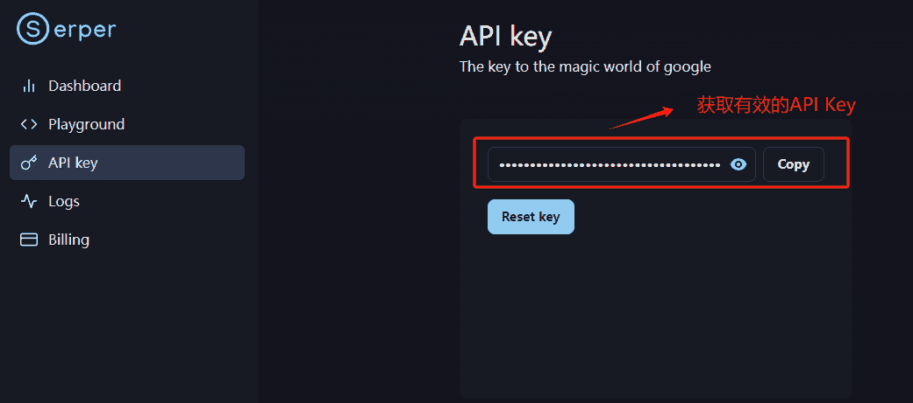

# Serper API应用方法

> 来源：[https://kq4b3vgg5b.feishu.cn/docx/Q9W8dcFZFoD0wWxJq6nc6pABnyb](https://kq4b3vgg5b.feishu.cn/docx/Q9W8dcFZFoD0wWxJq6nc6pABnyb)

# 使用SerperAPI做实时联网检索

这里我们推荐Serper，该服务是一个高性能的 Google 搜索 API，提供快速且成本效益高的方式访问 Google 搜索结果。在目前的应用落地产品中广泛被用于增强聊天机器人、进行搜索引擎优化（SEO）分析和简化金融科技项目等多种场景。该API具备：

+   执行实时搜索

+   自定义查询位置

+   快速访问 Google 的搜索引擎结果——通常在1-2秒内

以上特性使其特别适用于需要立即检索最新网络数据的应用。

# 1. 注册Serper账户

SerperAPI官方地址：https://serper.dev/ 。进入后先进行注册：


登入账户后，在如下位置获取有效的API Key：



新用户注册会免费赠送2500条免费请求，即可通过该API Key 查询2500次 Google Search 服务。


获取到API Key后，我们可以使用 Python 的 requests 库来调用 Serper API 进行连通性测试，如下是示例代码：

```
# ! pip install requests
```

```
# requests 库用于发起网络请求
import requests
import json

params = {
    &#x27;api_key&#x27;: &#x27;6ab09a423cc53af9b84ca61c093d2aea5096617f&#x27;,  # 验证请求的 API 密钥, 请替换成自己的
    &#x27;q&#x27;: &#x27;2024巴黎奥运会中国队获得了多少枚奖牌&#x27;,    # 查询参数，表示要搜索的问题。
    &#x27;num&#x27;: 3          # 这个参数指定了返回结果的数量，这里设置为3，意味着 API 将返回三个相关的搜索结果。         
}


# 使用 requests.get() 方法发起一个 GET 请求到 Serper API 的 endpoint。这个请求包含了上述设置的参数。
api_result = requests.get(&#x27;https://google.serper.dev/search&#x27;, params)

search_data = api_result.json()

print(search_data)
```

```
{&#x27;searchParameters&#x27;: {&#x27;q&#x27;: &#x27;2024巴黎奥运会中国队获得了多少枚奖牌&#x27;, &#x27;type&#x27;: &#x27;search&#x27;, &#x27;num&#x27;: 3, &#x27;engine&#x27;: &#x27;google&#x27;}, &#x27;organic&#x27;: [{&#x27;title&#x27;: &#x27;2024年巴黎奥运会：中国代表团奖牌得主一览&#x27;, &#x27;link&#x27;: &#x27;https://olympics.com/zh/news/paris-2024-team-china-medalists-overview&#x27;, &#x27;snippet&#x27;: &#x27;截止至2024年8月11日，中国代表团在2024年巴黎奥运会上已经斩获了40金27银24铜合计91枚奖牌。 最后更新日期：2024年8月11日北京时间20:30.&#x27;, &#x27;date&#x27;: &#x27;5 days ago&#x27;, &#x27;position&#x27;: 1}, {&#x27;title&#x27;: &#x27;牌面：中国代表团奖牌得主汇总 - Paris 2024 Olympics&#x27;, &#x27;link&#x27;: &#x27;https://olympics.com/zh/paris-2024/live-updates/e46460b4-9eab-4428-b7ee-34e0a283aab9&#x27;, &#x27;snippet&#x27;: &#x27;本届巴黎奥运会中国体育代表团以40金27银24铜的成绩完美收官，在金牌数上实现了境外最好成绩，中国代表团旗帜由李发彬、欧紫霞携带入场。 中国代表团旗手 ...&#x27;, &#x27;date&#x27;: &#x27;4 days ago&#x27;, &#x27;position&#x27;: 2}, {&#x27;title&#x27;: &#x27;巴黎大结局：中美最后逆转俄罗斯金牌归谁了 - 体育- 新浪&#x27;, &#x27;link&#x27;: &#x27;https://sports.sina.cn/2024-08-12/detail-incikerh2563918.d.html?vt=4&#x27;, &#x27;snippet&#x27;: &#x27;巴黎奥运会闭幕，最终奖牌榜上，中国代表团获得40金27银24铜，共计91枚奖牌。 这个金牌数打破了2012伦敦奥运的中国军团海外最佳战绩（39金31银22铜92 ...&#x27;, &#x27;date&#x27;: &#x27;4 days ago&#x27;, &#x27;position&#x27;: 3}], &#x27;relatedSearches&#x27;: [{&#x27;query&#x27;: &#x27;中国奥运金牌得主2024&#x27;}, {&#x27;query&#x27;: &#x27;中国奥运金牌榜2024&#x27;}, {&#x27;query&#x27;: &#x27;中国奥运金牌2024&#x27;}, {&#x27;query&#x27;: &#x27;中国奥运会2024&#x27;}, {&#x27;query&#x27;: &#x27;中国2024年奥运会&#x27;}, {&#x27;query&#x27;: &#x27;巴黎奥运会中国金牌&#x27;}, {&#x27;query&#x27;: &#x27;巴黎奥运会奖牌榜&#x27;}, {&#x27;query&#x27;: &#x27;美国奥运金牌得主2024&#x27;}]}
```

如果能够正常接收到Serper API 返回的数据，则说明调用成功，可以继续进行接下来的代码实践。

这里我们可以借助pprint 格式化输出。pprint 是 Python 的一个库，它的全称是 "Pretty Printer"。这个库提供了一个函数 pprint()，可以将 Python 对象以一种格式化和易于阅读的方式打印出来。使用 pprint 打印数据结构，尤其是在处理嵌套结构或包含多个字段的大型数据时，可以极大地提高可读性。

```
# 导入pprint函数
from pprint import pprint  

# 设置缩进为2，宽度为100字符
pprint(search_data, indent=2, width=100)  
```

```
{ &#x27;organic&#x27;: [ { &#x27;date&#x27;: &#x27;5 days ago&#x27;,
                 &#x27;link&#x27;: &#x27;https://olympics.com/zh/news/paris-2024-team-china-medalists-overview&#x27;,
                 &#x27;position&#x27;: 1,
                 &#x27;snippet&#x27;: &#x27;截止至2024年8月11日，中国代表团在2024年巴黎奥运会上已经斩获了40金27银24铜合计91枚奖牌。 &#x27;
                            &#x27;最后更新日期：2024年8月11日北京时间20:30.&#x27;,
                 &#x27;title&#x27;: &#x27;2024年巴黎奥运会：中国代表团奖牌得主一览&#x27;},
               { &#x27;date&#x27;: &#x27;4 days ago&#x27;,
                 &#x27;link&#x27;: &#x27;https://olympics.com/zh/paris-2024/live-updates/e46460b4-9eab-4428-b7ee-34e0a283aab9&#x27;,
                 &#x27;position&#x27;: 2,
                 &#x27;snippet&#x27;: &#x27;本届巴黎奥运会中国体育代表团以40金27银24铜的成绩完美收官，在金牌数上实现了境外最好成绩，中国代表团旗帜由李发彬、欧紫霞携带入场。 &#x27;
                            &#x27;中国代表团旗手 ...&#x27;,
                 &#x27;title&#x27;: &#x27;牌面：中国代表团奖牌得主汇总 - Paris 2024 Olympics&#x27;},
               { &#x27;date&#x27;: &#x27;4 days ago&#x27;,
                 &#x27;link&#x27;: &#x27;https://sports.sina.cn/2024-08-12/detail-incikerh2563918.d.html?vt=4&#x27;,
                 &#x27;position&#x27;: 3,
                 &#x27;snippet&#x27;: &#x27;巴黎奥运会闭幕，最终奖牌榜上，中国代表团获得40金27银24铜，共计91枚奖牌。 &#x27;
                            &#x27;这个金牌数打破了2012伦敦奥运的中国军团海外最佳战绩（39金31银22铜92 ...&#x27;,
                 &#x27;title&#x27;: &#x27;巴黎大结局：中美最后逆转俄罗斯金牌归谁了 - 体育- 新浪&#x27;}],
  &#x27;relatedSearches&#x27;: [ {&#x27;query&#x27;: &#x27;中国奥运金牌得主2024&#x27;},
                       {&#x27;query&#x27;: &#x27;中国奥运金牌榜2024&#x27;},
                       {&#x27;query&#x27;: &#x27;中国奥运金牌2024&#x27;},
                       {&#x27;query&#x27;: &#x27;中国奥运会2024&#x27;},
                       {&#x27;query&#x27;: &#x27;中国2024年奥运会&#x27;},
                       {&#x27;query&#x27;: &#x27;巴黎奥运会中国金牌&#x27;},
                       {&#x27;query&#x27;: &#x27;巴黎奥运会奖牌榜&#x27;},
                       {&#x27;query&#x27;: &#x27;美国奥运金牌得主2024&#x27;}],
  &#x27;searchParameters&#x27;: {&#x27;engine&#x27;: &#x27;google&#x27;, &#x27;num&#x27;: 3, &#x27;q&#x27;: &#x27;2024巴黎奥运会中国队获得了多少枚奖牌&#x27;, &#x27;type&#x27;: &#x27;search&#x27;}}
```

我们要从上述返回的JSON 数据中提取 "organic" 键对应的值，其内容代表了搜索引擎返回的自然（非广告）搜索结果。

```
items = search_data.get(&quot;organic&quot;, [])
```

```
items
```

```
[{&#x27;title&#x27;: &#x27;2024年巴黎奥运会：中国代表团奖牌得主一览&#x27;,
  &#x27;link&#x27;: &#x27;https://olympics.com/zh/news/paris-2024-team-china-medalists-overview&#x27;,
  &#x27;snippet&#x27;: &#x27;截止至2024年8月11日，中国代表团在2024年巴黎奥运会上已经斩获了40金27银24铜合计91枚奖牌。 最后更新日期：2024年8月11日北京时间20:30.&#x27;,
  &#x27;date&#x27;: &#x27;5 days ago&#x27;,
  &#x27;position&#x27;: 1},
 {&#x27;title&#x27;: &#x27;牌面：中国代表团奖牌得主汇总 - Paris 2024 Olympics&#x27;,
  &#x27;link&#x27;: &#x27;https://olympics.com/zh/paris-2024/live-updates/e46460b4-9eab-4428-b7ee-34e0a283aab9&#x27;,
  &#x27;snippet&#x27;: &#x27;本届巴黎奥运会中国体育代表团以40金27银24铜的成绩完美收官，在金牌数上实现了境外最好成绩，中国代表团旗帜由李发彬、欧紫霞携带入场。 中国代表团旗手 ...&#x27;,
  &#x27;date&#x27;: &#x27;4 days ago&#x27;,
  &#x27;position&#x27;: 2},
 {&#x27;title&#x27;: &#x27;巴黎大结局：中美最后逆转俄罗斯金牌归谁了 - 体育- 新浪&#x27;,
  &#x27;link&#x27;: &#x27;https://sports.sina.cn/2024-08-12/detail-incikerh2563918.d.html?vt=4&#x27;,
  &#x27;snippet&#x27;: &#x27;巴黎奥运会闭幕，最终奖牌榜上，中国代表团获得40金27银24铜，共计91枚奖牌。 这个金牌数打破了2012伦敦奥运的中国军团海外最佳战绩（39金31银22铜92 ...&#x27;,
  &#x27;date&#x27;: &#x27;4 days ago&#x27;,
  &#x27;position&#x27;: 3}]
```

🍻现开设了大**模型学习交流群，**扫描下👇码，来遇见更多志同道合的小伙伴~


海量硬核独家技术**干货内容**+无门槛**技术交流****+不定期开设****硬核干货&前沿技术公开课****，****扫码**👆即刻入群！