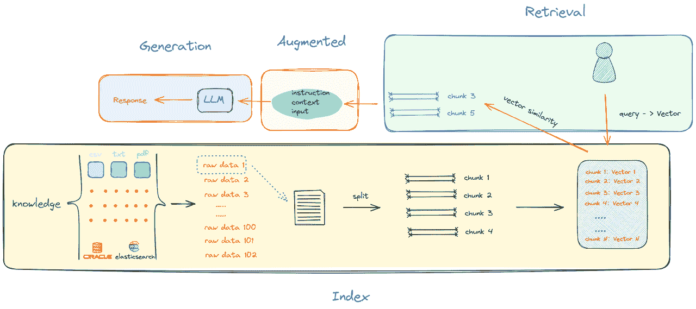
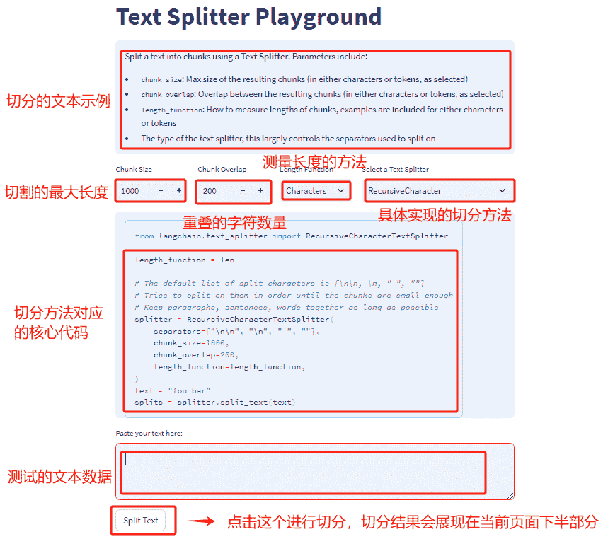

# 从0到1构建RAG-checkpoint

> 来源：[https://kq4b3vgg5b.feishu.cn/docx/DejedJ2F3oO1bLxkPNgcmZRLnzY](https://kq4b3vgg5b.feishu.cn/docx/DejedJ2F3oO1bLxkPNgcmZRLnzY)

## 从0到1构建RAG

我们把在一个持久化的附加知识库中可以快速检索出相关的有效信息，并提供给Agents作为处理复杂任务的某一阶段的上下文这一过程称为RAG，所以能够理解，RAG的本质就是一种用附加数据来增强LLM知识的技术。从宏观的角度来看，LLMs 可以推理广泛的主题，但它们的知识仅限于它们接受训练的特定时间点的公共数据。如果我们想要构建能够推理私有数据及使用模型所需的特定信息来增强模型的知识，引入适当的信息并将其插入模型提示中的过程，称为检索增强生成 (RAG)。


其核心构建流程如下：



接下来的内容我们逐步实现这个过程。

---

🍻现开设了大**模型学习交流群**，扫描下👇码，来遇见更多志同道合的小伙伴~


海量硬核独家技术**干货内容**+无门槛**技术交流**+不定期开设**硬核干货&前沿技术公开课**，**扫码**👆即刻入群！

---

## 1. 安装最新的OpenAI依赖包

```
! pip install --upgrade openai
```

```
Requirement already satisfied: openai in d:\software\anaconda3\lib\site-packages (1.30.2)
Requirement already satisfied: anyio<5,>=3.5.0 in d:\software\anaconda3\lib\site-packages (from openai) (3.5.0)
Requirement already satisfied: distro<2,>=1.7.0 in d:\software\anaconda3\lib\site-packages (from openai) (1.8.0)
Requirement already satisfied: httpx<1,>=0.23.0 in d:\software\anaconda3\lib\site-packages (from openai) (0.25.1)
Requirement already satisfied: pydantic<3,>=1.9.0 in d:\software\anaconda3\lib\site-packages (from openai) (2.6.0)
Requirement already satisfied: sniffio in d:\software\anaconda3\lib\site-packages (from openai) (1.2.0)
Requirement already satisfied: tqdm>4 in d:\software\anaconda3\lib\site-packages (from openai) (4.66.4)
Requirement already satisfied: typing-extensions<5,>=4.7 in d:\software\anaconda3\lib\site-packages (from openai) (4.10.0)
Requirement already satisfied: idna>=2.8 in d:\software\anaconda3\lib\site-packages (from anyio<5,>=3.5.0->openai) (3.4)
Requirement already satisfied: certifi in d:\software\anaconda3\lib\site-packages (from httpx<1,>=0.23.0->openai) (2024.2.2)
Requirement already satisfied: httpcore in d:\software\anaconda3\lib\site-packages (from httpx<1,>=0.23.0->openai) (1.0.1)
Requirement already satisfied: annotated-types>=0.4.0 in d:\software\anaconda3\lib\site-packages (from pydantic<3,>=1.9.0->openai) (0.6.0)
Requirement already satisfied: pydantic-core==2.16.1 in d:\software\anaconda3\lib\site-packages (from pydantic<3,>=1.9.0->openai) (2.16.1)
Requirement already satisfied: colorama in d:\software\anaconda3\lib\site-packages (from tqdm>4->openai) (0.4.6)
Requirement already satisfied: h11<0.15,>=0.13 in d:\software\anaconda3\lib\site-packages (from httpcore->httpx<1,>=0.23.0->openai) (0.14.0)
```

```
import openai

print(openai.__version__)
```

```
1.30.3
```

## 2. 设置全局代理

对于国内用户，是无法直接访问OpenAI的，需要让Jupyter在代理环境下启动，即需要令Jupyter可以通过代理来访问网络。这就需要大家找到自己所使用魔法的代理端口是多少。不同的魔法软件默认配置是不一样的，所以需要大家自行查看。以我个人使用的魔法软件为示例：

```
import os
os.environ['http_proxy'] = "http://127.0.0.1:15732"
os.environ['https_proxy'] = "http://127.0.0.1:15732"
```

+ 测试能否调用OpenAI API

```
from openai import OpenAI

#client = OpenAI(api_key='sk-xxxxxxx')

client = OpenAI()

completion = client.chat.completions.create(
  model="gpt-4",
  messages=[
    {"role": "user", "content": "你好，请你介绍一下你自己"}
  ]
)

print(completion.choices[0].message.content)
```

```
你好，我是OpenAI的人工智能助手，也叫做GPT-3。我是一个强大的预测模型，可理解和生成人类的文本。我可以用来回答问题、编写文章，还可以帮助设计者、开发者、创意人员等完成各种任务。但是，我并不具有情感、意识或理解能力，我只是通过我的编程和算法来处理输入和生成输出。
```

如果能正常得到输出，说明环境正常，可以继续执行接下来的操作。

## 3. Indexing过程

### 3.1 文档加载

这里我们以PDF格式的文档作为示例演示RAG从0到1的构建流程。对于PDF文件，需要安装一个`pdfplumber`第三方库。

`pdfplumber` 是一个用于提取 PDF 文件中信息的 Python 库。它非常适合那些需要从 PDF 中获取文本、表格和元数据的项目。其核心特点和常用方法可以总结如下：

+ **提取文本**：`pdfplumber` 可以从 PDF 文件中提取页面上的文本。

+ **读取表格**：这个库可以识别 PDF 中的表格布局，并能够将表格内容转换为 Python 的数据结构，如 `Pandas` 的 `DataFrame`。

+ **处理页面**：用户可以对 PDF 的每一页单独操作，获取具体页面的文本、表格等信息。

`pdfplumber` 的功能非常适合于那些需要从 PDF 文档中自动提取和处理数据的应用场景。它能够处理多种布局和复杂的文档结构，尽管有时候需要对提取逻辑进行一些调整和优化，以适应特定的文件格式和内容布局。

+ Step 1. 安装`pdfplumber`

```
# ! pdfplumber==0.10.3
```

```
import pdfplumber

print(pdfplumber.__version__)
```

```
0.11.0
```

```
pdf_path = '../04_data/LangChain整体项目介绍与核心模块Model IO详解.pdf'
pdf_name = 'LangChain整体项目介绍与核心模块Model IO详解.pdf'
```

```
with pdfplumber.open(pdf_path) as pdf:
    # 依次遍历PDF文档每一页
    for i, page in enumerate(pdf.pages):
        # 提取每一页的文本信息
        page_text = page.extract_text()
        if page_text is not None:
            print(f"-------- Page {i+1} --------")
            print(page_text)
```


# 开源大模型应用开发实战

## Ch 18 LangChain整体项目介绍与核心模块 Model I/O 详解

注意：大模型技术正处于快速发展阶段，因此在实际使用中可能会遇到与教材内容不一致的情况。如遇到此类情况，请根据实际情况灵活调整，或及时与我们联系。我们在接到相关反馈后，将迅速更新教材内容以确保信息的准确性和实用性。

本期课件更新时间：2024年3月7日

在开源大模型系列课程中，截止到本课时我们已经投入了超过20小时的时间去深入讲解如何在本地私有化部署开源大模型。在这一部分，我们分别选择了ChaGLM3、Qwen和baichuan2这三个最受大家关注的中文开源大模型作为部署示例，无论是Ubuntu还是Windows用户，我们都提供了非常详尽的部署教程，通过逐步指导，确保了大家能够根据自己的实际需求，选择最适合的模型并成功完成本地部署。

但大家需要明确的是，私有化部署大模型这个过程，只是开发大模型应用最基础，最核心，同时也是最简单的一步。熟练掌握基于大模型的上层应用开发还有非常长的路需要走。目前，大模型技术开发总体上分为两个方向，一类是基于OpenAI、GLM4这种在线API的应用开发，而另一类，就是先私有化部署开源大模型，再借助开发框架构建大模型应用。当然了，目前主流的大模型应用开发框架也支持在线模型API的调用，这正是我们之前一直强调学习掌握开源或在线API调用技巧的原因，因为这些方法和技巧直接对应于应用开发的最佳实践。

而不论采用哪种开发形式，其基座和所依赖的，核心还是大模型本身。对于在线大模型，以OpenAI为例，开发者需要配置科学上网的环境，在其官网创建 `API Key`，最后遵循API的使用说明去进行应用配置。这一过程中涉及到的网络环境适配，数据隐私安全，成本管理及如何去定制化自己需求的开发流程，往往都需要遵循官方提供的功能来实现。也正是因为这些复杂的因素使得尽管目前公认最强的大语言模型GPT 4开放给开发者使用，还是会有非常多的公司和个人去拥抱开源，选择性能可能略逊一筹的开源大模型，因为开源方案在某些方面提供了更多的灵活性和自主控制能力。

大家也能够发现，在我们的课程中每当涉及到大模型的私有化部署，我们都会向大家展示如何通过命令行、网页端访问和API调用等三种方式与部署的大模型进行交互。此外，还通过`text-generate-webui`这样的开源项目，这一切应用是帮助大家能够以最简单、最直接的方式与开源大模型进行对话，了解大模型的运行模型。但实际上，无论是基于大模型去做任何形式的应用开发过程，仅停留在这个阶段肯定无法满足实际的需求。虽然目前的大模型基本都可以按照OpenAI的API规范形式进行调用，但如果进行实操我们会发现，在《大模型技术实战》的课程中，借助OpenAI的GPT系列模型开发的项目，如智能邮件处理、全自动AI开发流程，以及MateGen Agents等，尽管在开源模型上能够被复现，但这背后的成功关键并非仅仅在于模型调用。例如，在《Ch.13 Qwen模型的ReAct原理介绍及流程拆解，进行外部工具API调用开发实践》中，我们通过Qwen模型复现了《Ch.10 借助Function calling调用外部工具API方法》中的天气信息调用过程。这一复现过程揭示了，对在线模型来说，我们需要学习的是其API使用方法。而在开源大模型的技术领域下，要想实现某些特定功能，重点在于理解该模型的一些使用原理，以及如何调整和构建tools与Schema表示。因此，整个开发过程中花费的大部分时间并非直接与模型调用相关，而是在于深入理解和应用这些底层原理和技术细节。

换言之，在构建大模型应用的过程中，虽然大模型是核心，但实际针对大模型编写的代码量相对较小。而在这些有限的代码中，提示工程又往往会占据主要的工作量。这进一步引出一个关键问题：除了大模型本身，其他各环节如何高效串联，以及这些环节的代码开发和工作量如何分配和执行，将在很大程度上影响最终应用的用户体验。

在这种情况下，解决这一窘境且广受认可和高度实用的解决方案，便是LangChain。

## 1. 什么是LangChain

LangChain现在归属于LangChain AI公司，LangChain作为其中的一个核心项目，开源发布在GitHub上：`https://github.com/langchain-ai/langchain`

从LangChain的GitHub版本迭代历史上看，从2023年1月16日起已经经历了320个大小版本的迭代，并且仍然以高频率的更新在加速项目的功能上线，从整体上看，其关注度和社区活跃度是非常高的。LangChain给自身的定位是：用于开发由大语言模型支持的应用程序的框架。它的做法是：通过提供标准化且丰富的模块抽象，构建大语言模型的输入输出规范，利用其核心概念`chains`，灵活地连接整个应用开发流程。而针对每个功能模块，都源于对大模型领域的深入理解和实践经验，开发者提供出来的标准化流程和解决方案的抽象，再通过灵活的模块化组合，才有了目前这样一款在大模型应用开发领域内被普遍高度认可的通用框架。

### 为什么需要这样做？

首先，我们需考虑当前大模型的发展态势。尽管OpenAI的GPT系列模型作为大模型领域的领军人物，在很大程度上影响了大模型的使用规范和基于大模型进行应用开发的范式，但并不意味着所有大模型间的使用方式完全相同。例如，我们熟悉的OpenAI GPT模型API调用方式对于Baichuan2模型就不适用。因此，对于每个新模型都要花费大量时间学习其特定规范再进行应用探索，这种工作效率显然是十分低下的。

其次，必须谈论的是大模型目前面临的局限，如知识更新的滞后性、外部API调用能力、私有数据连接方式以及输出结果的不稳定性等问题。在应用开发中，如何找到这些问题的有效解决策略？

上述提到的每个限制都紧密关联于大模型本身的特性。尽管理论上可以通过重新训练、微调来增强模型的原生能力，这种方法确实有效，但实际上，大多数开发者并不具备进行这样操作所需的技术资源、时间和财力，选择这条路径一定会导致方向越来越偏离目标。我们之前讨论的OpenAI的`Function Calling`和通过`ReAct`流程接入第三方API能够提供一些解决方案，但这每一步都需大量的研发投入，而且最终实现后的应用效果，也取决于研发人员的个人技术能力。在这种背景下，既然大家都有不同的想法和解决方案，那LangChain就来集中做这件事，提供一个统一的平台和明确的定义，来实现应用框架的快速搭建，这就是LangChain一直想要做到，且正在做的事情。

### LangChain的做法

从本质上分析，LangChain还是依然采用从大模型自身出发的策略，通过开发人员在实践过程中对大模型能力的深入理解及其在不同场景下的涌现潜力，使用模块化的方式进行高级抽象，设计出统一接口以适配各种大模型。到目前为止，LangChain抽象出最重要的核心模块如下：

1. `Model I/O` ：标准化各个大模型的输入和输出，包含输入模版，模型本身和格式化输出；
2. `Retrieval` ：检索外部数据，然后在执行生成步骤时将其传递到 `LLM`，包括文档加载、切割、`Embedding`等；
3. `Chains` ：链条，LangChain框架中最重要的模块，链接多个模块协同构建应用，是实际运作很多功能的高级抽象；
4. `Memory` ：记忆模块，以各种方式构建历史信息，维护有关实体及其关系的信息；
5. `Agents` ：目前最热门的`Agents`开发实践，未来能够真正实现通用人工智能的落地方案；
6. `Callbacks` ：回调系统，允许连接到 `LLM` 应用程序的各个阶段。用于日志记录、监控、流传输和其他任务；

从上图中可以看到，LangChain框架涵盖了模型输入输出的标准化、外部工具接入的规范、上下文记忆功能，以及对数据库、`SQL`、`CSV`等多种数据源的连接标准。通过核心的`"Chain"`高级抽象，定义了不同形式下标准的链接方法，这就能够允许开发者根据实际的应用需求和数据流向快速构建出一套完整的应用程序。这个过程类似于搭建积木，可以灵活适应不同的任务需求。

也正因为如此，LangChain中涉及的概念和模块化是非常多的，每个模块都有其独特的使用场景和使用方法，那么如何去搭这个“积木”，就需要我们对其每个核心模块都要有一个比较清楚的认知。所以我们课程的安排还是逐个拆解LangChain的功能模块，每一部分都尽可能的给大家做详细的介绍和实操，并在接下来的项目部分，进行整体的一个串联，届时大家将能够清晰的明确如何根据自己的实际业务情况，选择合适的构造模块和构造方法。

在整体上理解了LangChain之后，我们首先从`Model I/O`模块进行深入的探讨和实践。

## 2. LangChain核心模块：Model I/O

LangChain的`Model I/O`模块提供了标准的、可扩展的接口实现与大语言模型的外部集成。所谓的`Model I/O`，包括模型输入（`Prompts`）、模型输出（`Outputs`）和模型本身（`Models`），简单理解就是通过该模块，我们可以快速与某个大模型进行对话交互，整个内部逻辑就相当于我们最熟悉的这个过程：输入`Prompt`，得到大模型针对该`Prompt`的推理结果。如下示例为OpenAI的 GPT 系列模型的API调用规范：

```python
response = openai.ChatCompletion.create(
    model="gpt-3.5-turbo",
    messages=[
        {"role": "user", "content": "请问，什么是机器学习？"}
    ]
)
```

而我们前面提到了，LangChain项目的定位为一个应用开发框架，所以如果仅仅集成到这样的对话交互程度，那相较于直接使用OpenAI的API调用又有何异呢？所以在这个模块中，LangChain同样抽象出一个`chain`，用于进一步简化和增强交互流程。在LangChain的`Model I/O`模块设计中，包含三个核心部分：`Prompt Template`（对应下图中的`Format`部分），`Model`（对应下图中的`Predict`部分）和`Output Parser`（对应下图中的`Parse`部分）。

`Format`：即指代`Prompts Template`，通过模板化来管理大模型的输入；
`Predict`：即指代`Models`，使用通用接口调用不同的大语言模型；
`Parse`：即指代`Output`部分，用来从模型的推理中提取信息，并按照预先设定好的模版来规范化输出。

整个`Model I/O`工作流如下图所示：

### Format

对于`Prompt Template`第一部分，传统上我们创建提示词是通过手工编写来实现的，在这个过程中会利用各种提示工程技巧，如`Few-Shot`、链式推理（`CoT`）等方法，以提高大模型的推理性能。然而，在应用开发中，一个关键的考量是提示词不能是一成不变的。其原因在于，应用开发需要适应多变的用户需求和场景。固定的提示词限制了模型的灵活性和适用范围。例如，如果我们正在开发一个天气查询应用，用户可能会以多种方式提出查询，如“今天的天气怎么样？”或“明天纽约的温度是多少度？”。如果提示词是固定的，它可能只能处理一种特定类型的查询，而无法适应这种多样性的需求。

而`Prompt Template`，就像我们在介绍《Ch.13 Qwen模型的ReAct原理介绍及流程拆解，进行外部工具API调用开发实践》中不断优化出来的`ReAct`模版，将API的使用、问题解答过程等复杂逻辑封装成了一套结构化的格式。我们只需准备具体的外部函数信息和用户查询，即可生成定制化的提示词，引导模型按照既定逻辑进行思考和回答，从而实现外部函数的调用过程，即：

```python
# 将一个插件的关键信息拼接成一段文本的模版。
TOOL_DESC = """{name_for_model}: Call this tool to interact with the
{name_for_human} API. What is the {name_for_human} API useful for?
{description_for_model} Parameters: {parameters}"""
# ReAct prompting 的 instruction 模版，将包含插件的详细信息。
PROMPT_REACT = """Answer the following questions as best you can. You have
access to the following APIs:
{tool_descs}
Use the following format:
Question: the input question you must answer
Thought: you should always think about what to do
Action: the action to take, should be one of [{tool_names}]
Action Input: the input to the action
Observation: the result of the action
... (this Thought/Action/Action Input/Observation can be repeated zero or more times)
Thought: I now know the final answer
Final Answer: the final answer to the original input question
Begin!
Question: {query}"""
```

因此，引入`Prompt Template`可以支持变量和动态内容的插入，使得同一个应用可以根据不同的输入动态调整提示词，从而更好地响应用户的具体需求。LangChain通过这种方式来提高应用的通用性和用户体验。

### Predict

在`Predict`部分，实质上是处理模型从接收输入到执行推理的整个过程。考虑到存在两种主要类型的大模型——`Base`类模型和`Chat`类模型，LangChain在其`Model I/O`模块中对这两种模型都进行了抽象，分别归类为`LLMs`（Large Language Models）和`Chat Models`。我们还是以OpenAI 的 `Completion` 和 `Chatcompletions`方法为例：

```python
# Base类模型
client.completions.create(
    model="gpt-3.5-turbo-instruct",
    prompt="Say this is a test",
)
# 聊天模型
client.chat.completions.create(
    model="gpt-3.5-turbo",
    messages=[
        {"role": "system", "content": "你是一位乐于助人的AI智能小助手"},
        {"role": "user", "content": "你好，请你介绍一下你自己。"}
    ]
)
```

`LLMs`是简化的大语言模型抽象，即基于给定的`Prompt`提供内容生成的功能。而`Chat Models`则专注于聊天API的抽象，需要维护上下文的记忆（聊天记录），呈现出更接近对话或聊天形式的交互。

### Parse

我们知道，大模型的输出是不稳定的，同样的输入`Prompt`往往会得到不同形式的输出。在自然语言交互中，不同的语言表达方式通常不会造成理解上的障碍。但在应用开发中，大模型的输出可能是下一步逻辑处理的关键输入。因此，在这种情况下，规范化输出是必须要做的任务，以确保应用能够顺利进行后续的逻辑处理。

输出解析器 `Output Parser`就是一个帮助结构化语言模型响应的抽象，可以获取格式指令或者进行更深层次的解析。这我们会在后面的实践中直观的体验到。

整体而言，在`Model I/O`模块的抽象中，其一能够让开发者快速的接入不同的大模型，比如`OpenAI`、`ChatGLM`、`Qwen`等，按照既定规范执行模型推理。其二通过输入和输出的模板化处理，使其更贴合于应用开发的最佳实践。接下来，我们就逐步的介绍上述三个流程在LangChain下是如何进行集成和操作的。

## 3 安装LangChain

LangChain的安装过程非常简单，可以通过常用的Python包管理工具，如`pip`或`conda`，直接进行安装。稍复杂一点的还可以通过源码进行安装。但有一点大家一定要明确：LangChain的真正价值在于它能够与多种模型提供商、数据存储解决方案等进行集成。默认情况下，使用上述两种安装方式中的任何一种来进行LangChain安装后，安装的仅仅是LangChain的默认功能，并不包括这些集成所需的额外依赖项。也就是说，如果我们想要使用特定的集成功能，还需要额外安装这些特定的依赖。以调用OpenAI的API为例，我们首先需要通过运行命令`pip install langchain-openai`安装OpenAI的合作伙伴包，安装此依赖包后，LangChain才能够与OpenAI的API进行交互。后续我们在使用相关功能的时候，会提供额外的说明。

LangChain安装官方说明文档：`https://python.langchain.com/docs/get_started/installation`

### 3.1 使用包版本管理工具安装

LangChain可以使用`pip` 或者 `conda`直接安装，适用于仅使用的场景，即不需要了解其源码构建过程。这种安装方法十分简洁明了，只需执行一条命令，就可以在当前的虚拟环境中迅速完成LangChain的安装。具体操作如下：

```
! pip install langchain
Requirement already satisfied: langchain in d:\software\anaconda3\lib\site-packages (0.1.10)
Requirement already satisfied: PyYAML>=5.3 in d:\software\anaconda3\lib\site-packages (from langchain) (6.0)
Requirement already satisfied: SQLAlchemy<3,>=1.4 in d:\software\anaconda3\lib\site-packages (from langchain) (1.4.39)
Requirement already satisfied: aiohttp<4.0.0,>=3.8.3 in d:\software\anaconda3\lib\site-packages (from langchain) (3.8.5)
Requirement already satisfied: dataclasses-json<0.7,>=0.5.7 in d:\software\anaconda3\lib\site-packages (from langchain) (0.6.4)
Requirement already satisfied: jsonpatch<2.0,>=1.33 in d:\software\anaconda3\lib\site-packages (from langchain) (1.33)
Requirement already satisfied: langchain-community<0.1,>=0.0.25 in d:\software\anaconda3\lib\site-packages (from langchain) (0.0.25)
Requirement already satisfied: langchain-core<0.2,>=0.1.28 in d:\software\anaconda3\lib\site-packages (from langchain) (0.1.28)
Requirement already satisfied: langchain-text-splitters<0.1,>=0.0.1 in d:\software\anaconda3\lib\site-packages (from langchain) (0.0.1)
Requirement already satisfied: langsmith<0.2.0,>=0.1.0 in d:\software\anaconda3\lib\site-packages (from langchain) (0.1.14)
Requirement already satisfied: numpy<2,>=1 in d:\software\anaconda3\lib\site-packages (from langchain) (1.24.3)
Requirement already satisfied: pydantic<3,>=1 in d:\software\anaconda3\lib\site-packages (from langchain) (2.6.0)
Requirement already satisfied: requests<3,>=2 in d:\software\anaconda3\lib\site-packages (from langchain) (2.31.0)
Requirement already satisfied: tenacity<9.0.0,>=8.1.0 in d:\software\anaconda3\lib\site-packages (from langchain) (8.2.2)
Requirement already satisfied: attrs>=17.3.0 in d:\software\anaconda3\lib\site-packages (from aiohttp<4.0.0,>=3.8.3->langchain) (22.1.0)
Requirement already satisfied: charset-normalizer<4.0,>=2.0 in d:\software\anaconda3\lib\site-packages (from aiohttp<4.0.0,>=3.8.3->langchain) (2.0.4)
Requirement already satisfied: multidict<7.0,>=4.5 in d:\software\anaconda3\lib\site-packages (from aiohttp<4.0.0,>=3.8.3->langchain) (6.0.2)
Requirement already satisfied: async-timeout<5.0,>=4.0.0a3 in d:\software\anaconda3\lib\site-packages (from aiohttp<4.0.0,>=3.8.3->langchain) (4.0.2)
Requirement already satisfied: yarl<2.0,>=1.0 in d:\software\anaconda3\lib\site-packages (from aiohttp<4.0.0,>=3.8.3->langchain) (1.8.1)
Requirement already satisfied: frozenlist>=1.1.1 in d:\software\anaconda3\lib\site-packages (from aiohttp<4.0.0,>=3.8.3->langchain) (1.3.3)
Requirement already satisfied: aiosignal>=1.1.2 in d:\software\anaconda3\lib\site-packages (from aiohttp<4.0.0,>=3.8.3->langchain) (1.2.0)
Requirement already satisfied: marshmallow<4.0.0,>=3.18.0 in d:\software\anaconda3\lib\site-packages (from dataclasses-json<0.7,>=0.5.7->langchain) (3.21.0)
Requirement already satisfied: typing-inspect<1,>=0.4.0 in d:\software\anaconda3\lib\site-packages (from dataclasses-json<0.7,>=0.5.7->langchain) (0.9.0)
Requirement already satisfied: jsonpointer>=1.9 in d:\software\anaconda3\lib\site-packages (from jsonpatch<2.0,>=1.33->langchain) (2.1)
Requirement already satisfied: anyio<5,>=3 in d:\software\anaconda3\lib\site-packages (from langchain-core<0.2,>=0.1.28->langchain) (3.5.0)
Requirement already satisfied: packaging<24.0,>=23.2 in d:\software\anaconda3\lib\site-packages (from langchain-core<0.2,>=0.1.28->langchain) (23.2)
Requirement already satisfied: orjson<4.0.0,>=3.9.14 in d:\software\anaconda3\lib\site-packages (from langsmith<0.2.0,>=0.1.0->langchain) (3.9.15)
Requirement already satisfied: annotated-types>=0.4.0 in d:\software\anaconda3\lib\site-packages (from pydantic<3,>=1->langchain) (0.6.0)
Requirement already satisfied: pydantic-core==2.16.1 in d:\software\anaconda3\lib\site-packages (from pydantic<3,>=1->langchain) (2.16.1)
Requirement already satisfied: typing-extensions>=4.6.1 in d:\software\anaconda3\lib\site-packages (from pydantic<3,>=1->langchain) (4.7.1)
Requirement already satisfied: idna<4,>=2.5 in d:\software\anaconda3\lib\site-packages (from requests<3,>=2->langchain) (3.4)
Requirement already satisfied: urllib3<3,>=1.21.1 in d:\software\anaconda3\lib\site-packages (from requests<3,>=2->langchain) (1.26.16)
Requirement already satisfied: certifi>=2017.4.17 in d:\software\anaconda3\lib\site-packages (from requests<3,>=2->langchain) (2023.11.17)
Requirement already satisfied: greenlet!=0.4.17 in d:\software\anaconda3\lib\site-packages (from SQLAlchemy<3,>=1.4->langchain) (2.0.1)
Requirement already satisfied: sniffio>=1.1 in d:\software\anaconda3\lib\site-packages (from anyio<5,>=3->langchain-core<0.2,>=0.1.28->langchain) (1.2.0)
Requirement already satisfied: mypy-extensions>=0.3.0 in d:\software\anaconda3\lib\site-packages (from typing-inspect<1,>=0.4.0->dataclasses-json<0.7,>=0.5.7->langchain) (1.0.0)
```

注：如果是在Jupyter lab操作，需要重启当前的Jupyter Lab使配置生效。

重启完当前的Jupyter Lab后，验证LangChain的安装情况，执行命令如下：

```python
import langchain
print(langchain.__version__)
0.1.10
```

如果能正常输出LangChain的版本，说明在当前环境下的安装成功。

### 3.2 源码安装

除了通过`pip`安装外，还有一种通过源码安装的方法。这需要使用`git`拉取远程仓库，然后进入项目文件夹并执行`pip install -e .`命令。这种方法不仅会安装必要的依赖，同时也将程序的源代码保存在本地。通常来说，除非大家打算作为LangChain的协作开发者参与到项目的功能更新中，否则没必要采用这种安装方式，直接使用`pip`安装更为简便。

对于课程学习而言，我们推荐采用源码安装方式，这将非常有助于在后续的LangChain功能探索中，通过源码分析深入理解框架的构建原理和详细机制。

接下来我们以Ubuntu操作系统为例，介绍源码安装LangChain的详细步骤：

#### Step 1. 安装Anaconda

如果本地服务器是Ubuntu系统，请参考：《Ch.4 在Ubuntu 22.04系统下部署运行ChatGLM3-6B模型》中的2.3 安装Anaconda环境小节；而如果是Windows操作系统，请参考：《Ch.6 在Windows系统下部署运行ChatGLM3-6B模型》中的3.2.1 方式一：使用Anaconda创建项目依赖环境（推荐）小节中，执行完Step 6. 验证conda步骤，回到本文继续执行后续的操作：

注：如果部署环境是租赁的云服务器，Anaconda环境已经预设好，并不需要我们再次手动配置。

按照对应的教程内容配置好Anaconda后，可以通过如下命令验证当前环境的Conda：

```
conda --version
```

如果可以正常输出Conda的版本，则说明Anaconda安装成功。

#### Step 2. 使用Conda创建LangChain的Python虚拟环境

安装好Anaconda后，我们需要借助Conda包版本工具，为LangChain项目创建一个新的Python虚拟运行环境，执行代码如下：

```
conda create --name langchain python==3.11
```

如上所示，新创建了一个名为`langchain`的Python虚拟环境，其Python版本为3.11。创建完成后，通过如下命令进入该虚拟环境，执行后续的操作：

```
conda activate langchain
```

#### Step 3. 下载LangChain的项目文件

进入LangChain的官方Github，地址：`https://github.com/langchain-ai/langchain`，在 GitHub 上将项目文件下载到有两种方式：克隆 (Clone) 和 下载 ZIP 压缩包。推荐使用克隆 (Clone)的方式。我们首先在GitHub上找到其仓库的URL。

在执行命令之前，需要先安装`git`软件包，执行命令如下：

```
sudo apt install git
```

执行克隆命令，将LangChain Github上的项目文件下载至本地的当前路径下，如下：

```
git clone https://github.com/langchain-ai/langchain.git
```

#### Step 4. 升级pip版本

建议在执行项目的依赖安装之前升级 `pip` 的版本，如果使用的是旧版本的 `pip`，可能无法安装一些最新的包，或者可能无法正确解析依赖关系。升级 `pip` 很简单，只需要运行命令如下命令：

```
python -m pip install --upgrade pip
```

#### Step 5. 源码安装项目依赖

不同于我们之前一直使用的`pip install -r requirements.txt`方式，这种方法用于批量安装多个依赖包，是在部署项目或确保开发环境与其他开发者/环境一致时的常用方式。而对于LangChain，我们需要使用`pip install -e`的方式，以可编辑模式安装包。这种方式主要用于开发过程中。当以可编辑模式安装一个包时，依赖包会被直接从源代码所在位置安装，而不是复制到Python的`site-packages`目录，是开发模式下用于安装并实时反映对本地包更改的方法。需要执行的步骤如下：

```
cd langchain/libs/langchain/
pip install -e .
```

如在安装过程未发生任何报错，则说明安装成功。在安装完依赖后，我们就正式进入LangChain的`Model I/O`模块的实践。

注：如果采用的是源码安装，需要参考《Ch.11 大模型开发工具Transformers库的使用及配置大模型开发环境》中远程服务器部署大模型，本地Jupyter NoteBook加载小节，在LangChain的虚拟环境下启动Jupyter Lab，才能正常执行接下来的实践。

## 4. Models I/O 模块实战

任何语言模型应用的核心都是大语言模型（LLMs），无论涉及到提示模板（Prompt Template）还是输出解析（OutPut Parse），其核心还是在于大语言模型（LLMs）。因此，在讨论和实践Model I/O模块时，首先应当关注如何集成这些大模型。只有成功集成后才能深入探讨和实践如何有效地设计提示模板和解析模型输出。所以我们先要实践的是：如何借助LangChain框架使用不同的大模型。

### 4.1 LangChain接入大模型的方法

LangChain 提供了一套与任何大语言模型进行交互的标准构建模块。所以需要明确的一点是：虽然 `LLMs` 是 LangChain 的核心元素，但 LangChain 本身不提供 LLMs，它仅仅是为多种不同的 LLMs 进行交互提供了一个统一的接口。简单理解：以OpenAI的GPT系列模型为例，如果我们想通过 LangChain 接入 OpenAI 的 GPT 模型，我们需要在LangChain框架下先定义相关的类和方法来规定如何与模型进行交互，包括数据的输入和输出格式以及如何连接到模型本身。然后按照 OpenAI GPT 模型的接口规范来集成这些功能。通过这种方式，LangChain 充当一个桥梁，使我们能够按照统一的标准来接入和使用多种不同的大语言模型。

在LangChain的Model I/O模块中，集成了两类模型，分别是`LLMs`和聊天模型，这两种模型在输入和输出的数据类型上有所区别。

接下来我们就以OpenAI的API为示例，分别实践一下在LangChain框架中如何使用这两种不同类型的大语言模型。首先来看LLMs类模型。

#### 4.1.1 LLMs类模型接入方法

LLMs指的是纯文本补全模型，其封装的 API 输入接收的是字符串，输出也是字符串。 OpenAI 的 GPT-3 是作为 LLM 实现的。最简单的理解：LLMs指代的就是Base类模型，这类模型仅仅可以理解并生成自然语言或代码，并未按照特定指令进行训练。截止到2024年3月07日，OpenAI可支持调用的Base类模型仅有2个，分别是`babbage-002`和`davinci-002`，除此之外，还可以使用`gpt-3.5-turbo-instruct`调用OpenAI 的 `Completion`方法。

首先需要安装OpenAI的集成依赖包`langchain-openai`，执行如下命令：

```
! pip install langchain-openai
Requirement already satisfied: langchain-openai in d:\software\anaconda3\lib\site-packages (0.0.8)
Requirement already satisfied: langchain-core<0.2.0,>=0.1.27 in d:\software\anaconda3\lib\site-packages (from langchain-openai) (0.1.28)
Requirement already satisfied: openai<2.0.0,>=1.10.0 in d:\software\anaconda3\lib\site-packages (from langchain-openai) (1.13.3)
Requirement already satisfied: tiktoken<1,>=0.5.2 in d:\software\anaconda3\lib\site-packages (from langchain-openai) (0.6.0)
Requirement already satisfied: PyYAML>=5.3 in d:\software\anaconda3\lib\site-packages (from langchain-core<0.2.0,>=0.1.27->langchain-openai) (6.0)
Requirement already satisfied: anyio<5,>=3 in d:\software\anaconda3\lib\site-packages (from langchain-core<0.2.0,>=0.1.27->langchain-openai) (3.5.0)
Requirement already satisfied: jsonpatch<2.0,>=1.33 in d:\software\anaconda3\lib\site-packages (from langchain-core<0.2.0,>=0.1.27->langchain-openai) (1.33)
Requirement already satisfied: langsmith<0.2.0,>=0.1.0 in d:\software\anaconda3\lib\site-packages (from langchain-core<0.2.0,>=0.1.27->langchain-openai) (0.1.14)
Requirement already satisfied: packaging<24.0,>=23.2 in d:\software\anaconda3\lib\site-packages (from langchain-core<0.2.0,>=0.1.27->langchain-openai) (23.2)
Requirement already satisfied: pydantic<3,>=1 in d:\software\anaconda3\lib\site-packages (from langchain-core<0.2.0,>=0.1.27->langchain-openai) (2.6.0)
Requirement already satisfied: requests<3,>=2 in d:\software\anaconda3\lib\site-packages (from langchain-core<0.2.0,>=0.1.27->langchain-openai) (2.31.0)
Requirement already satisfied: tenacity<9.0.0,>=8.1.0 in d:\software\anaconda3\lib\site-packages (from langchain-core<0.2.0,>=0.1.27->langchain-openai) (8.2.2)
Requirement already satisfied: distro<2,>=1.7.0 in d:\software\anaconda3\lib\site-packages (from openai<2.0.0,>=1.10.0->langchain-openai) (1.8.0)
Requirement already satisfied: httpx<1,>=0.23.0 in d:\software\anaconda3\lib\site-packages (from openai<2.0.0,>=1.10.0->langchain-openai) (0.25.1)
Requirement already satisfied: sniffio in d:\software\anaconda3\lib\site-packages (from openai<2.0.0,>=1.10.0->langchain-openai) (1.2.0)
Requirement already satisfied: tqdm>4 in d:\software\anaconda3\lib\site-packages (from openai<2.0.0,>=1.10.0->langchain-openai) (4.65.0)
Requirement already satisfied: typing-extensions<5,>=4.7 in d:\software\anaconda3\lib\site-packages (from openai<2.0.0,>=1.10.0->langchain-openai) (4.7.1)
Requirement already satisfied: regex>=2022.1.18 in d:\software\anaconda3\lib\site-packages (from tiktoken<1,>=0.5.2->langchain-openai) (2022.7.9)
Requirement already satisfied: idna>=2.8 in d:\software\anaconda3\lib\site-packages (from anyio<5,>=3->langchain-core<0.2.0,>=0.1.27->langchain-openai) (3.4)
Requirement already satisfied: certifi in d:\software\anaconda3\lib\site-packages (from httpx<1,>=0.23.0->openai<2.0.0,>=1.10.0->langchain-openai) (2023.11.17)
Requirement already satisfied: httpcore in d:\software\anaconda3\lib\site-packages (from httpx<1,>=0.23.0->openai<2.0.0,>=1.10.0->langchain-openai) (1.0.1)
Requirement already satisfied: jsonpointer>=1.9 in d:\software\anaconda3\lib\site-packages (from jsonpatch<2.0,>=1.33->langchain-core<0.2.0,>=0.1.27->langchain-openai) (2.1)
Requirement already satisfied: orjson<4.0.0,>=3.9.14 in d:\software\anaconda3\lib\site-packages (from langsmith<0.2.0,>=0.1.0->langchain-core<0.2.0,>=0.1.27->langchain-openai) (3.9.15)
Requirement already satisfied: annotated-types>=0.4.0 in d:\software\anaconda3\lib\site-packages (from pydantic<3,>=1->langchain-core<0.2.0,>=0.1.27->langchain-openai) (0.6.0)
Requirement already satisfied: pydantic-core==2.16.1 in d:\software\anaconda3\lib\site-packages (from pydantic<3,>=1->langchain-core<0.2.0,>=0.1.27->langchain-openai) (2.16.1)
Requirement already satisfied: charset-normalizer<4,>=2 in d:\software\anaconda3\lib\site-packages (from requests<3,>=2->langchain-core<0.2.0,>=0.1.27->langchain-openai) (2.0.4)
Requirement already satisfied: urllib3<3,>=1.21.1 in d:\software\anaconda3\lib\site-packages (from requests<3,>=2->langchain-core<0.2.0,>=0.1.27->langchain-openai) (1.26.16)
Requirement already satisfied: colorama in d:\software\anaconda3\lib\site-packages (from tqdm>4->openai<2.0.0,>=1.10.0->langchain-openai) (0.4.6)
Requirement already satisfied: h11<0.15,>=0.13 in d:\software\anaconda3\lib\site-packages (from httpcore->httpx<1,>=0.23.0->openai<2.0.0,>=1.10.0->langchain-openai) (0.14.0)
```

查看OpenAI的依赖包版本

OpenAI 的 API 在 0.28 版本和 1.xx 版本之间的调用方式存在差异。我们这里使用的是最新的调用方法，即采用 1.13.XX 版本。因此，需要确认当前 Python 虚拟环境中安装的 `openai` 包版本是 1.xx。可以通过执行以下命令来检查当前安装的版本：

```python
import openai
print(openai.__version__)
0.28.0
```

如果如上显示是0.28.0版本，执行如下命令将`openai`包升级到最新版本：

```
# ! pip install --upgrade openai
```

注：如果是在Jupyter lab操作，需要重启当前的Jupyter Lab使配置生效。

```python
import openai
print(openai.__version__)
1.13.3
```

设置科学上网环境

根据所使用的科学上网软件，查找相应的代理端口，并按照以下代码进行网络环境配置：

```
# 这里的端口，请修改为实际使用科学上网软件配置的代理端口
!set HTTP_PROXY=http://127.0.0.1:15732
!set HTTPS_PROXY=http://127.0.0.1:15732
```

新版本的OpenAI API调用方法不允许使用`openai.api_key = "sk-xxx"`这种老版本的显式指定API Key，所以如果没有在系统变量中进行配置的话，使用下面的命令设置环境变量：

```
# 将your- API -key-here替换为实际的API密钥:
# ! setx OPENAI_API_KEY "sk-xxxx"
成功: 指定的值已得到保存。
```

注意：完成环境变量的初次配置后，需重启电脑以激活设置。这样，在下次使用时就可以直接调用配置好的环境。为验证环境变量中的API Key是否已正确设置为自己的，可以执行以下命令进行检查。

```
# ! echo %OPENAI_API_KEY%
```

完成了科学上网环境和API Key的设置后，在接入LangChain之前，我们先使用如下测试代码检查当前环境及API的运行状态是否正常，执行代码如下：

```python
from openai import OpenAI
client = OpenAI()
completion = client.chat.completions.create(
    model="gpt-3.5-turbo",
    messages=[
        {"role": "system", "content": "你是一位乐于助人的AI智能小助手"},
        {"role": "user", "content": "你好，请你介绍一下你自己。"}
    ]
)
print(completion.choices[0].message.content)
```

若测试代码能正常输出结果，表明OpenAI的环境配置无误。需要注意的是，LangChain接入OpenAI GPT模型只是利用其定义的标准模型接入框架来整合OpenAI API，因此进行上述连通性测试是必要的。

OpenAI GPT Base模型官方说明：`https://platform.openai.com/docs/models/moderation`

LangChain为了使开发者可以轻松地创建自定义链，整体采用`Runnable`协议。`Runnable` 协议是编程中一种常见的设计模式，用于定义可以执行的任务或行为。在LangChain中通过构建标准接口，可以用户轻松定义自定义链并以标准方式调用它们，目前在LangChain已经集成的LLMs中，均实现了`Runnable`接口，目前支持包括`invoke`、`stream`、`batch`、`astream`等方法的调用。

LangChain的 `Runnable`协议：`https://api.python.langchain.com/en/stable/runnables/langchain_core.runnables.base.Runnable.html#langchain_core.runnables.base.Runnable`

而关于如何在LangChain中某个大模型的定义，我们可以从LangChain的开发源码上更深入的了解的LLMs模型的构建方式，其相关程序存储路径在`langchain/libs/langchain/langchain/llms`下。如果代码能力较强的话，还是建议大家花点时间去看看源码的抽象逻辑。比如OpenAI：

LangChain Interface说明：`https://python.langchain.com/docs/modules/model_io/llms/quick_start`
LangChain已集成LLMs说明：`https://python.langchain.com/docs/integrations/llms/`

首先，我们来了解常规的调用方法。具体支持的调用方式如下所示：

| 方法 | 说明 |
|------|------|
| `invoke` | 处理单条输入 |
| `batch` | 处理批量输入 |
| `stream` | 流式响应 |
| `ainvoke` | 异步处理单条输入 |
| `abatch` | 异步处理批量输入 |
| `astream` | 异步流式响应 |

接下来我们对上述方法依次进行尝试。在LangChain框架中，为了规范地接入LLMs类型的大模型，首先需要导入OpenAI的依赖包。导入命令如下：

```python
from langchain_openai import OpenAI
```

字符串形式的输入

调用`invoke`方法，并提供字符串格式的`Prompt`，便可触发指定模型按照所给`Prompt`进行续写操作。

```python
from langchain_openai import OpenAI
llm = OpenAI(model_name="davinci-002")
llm.invoke(
    "你好呀，请你介绍一下你自己"
)
```

从上述模型的返回输出，我们可以看到它本质上作为一个补全模型，通过使用大模型原生的`.generate()`方法来对输入的`Prompt`进行续写。这部分的详细内容已在《Ch.2 Completions模型API使用指南》中进行了深入讲解，因此此处不再进行赘述。

上述调用方法相当于使用我们熟悉的OpenAI的`Completion`方法来调用GPT Base类型模型的过程：

```python
from openai import OpenAI
client = OpenAI()
completion = client.completions.create(
    model="davinci-002",
    prompt="你好呀，请你介绍一下你自己",
    max_tokens=1024,
)
print(completion.choices[0].text)
```

流式输出

要进行流式调用，可以调用`stream`方法。这种方式允许在接收到模型响应的同时，逐块输出结果，实现即时展示而无需等待全部内容处理完毕。

```python
from langchain_openai import OpenAI
for chunk in llm.stream(
    "你好呀，请你介绍一下你自己"
):
    print(chunk, end="", flush=True)
```

批量生成

通过调用`batch`方法，可以同时对多个不同的`Prompt`进行调用处理。在这个例子中，输入包括“你好”、“什么是机器学习”和“什么是深度学习”三个独立的`Prompt`。这种批量处理方式允许一次性提交多个`Prompt`，从而提高推理效率。

```python
from langchain_openai import OpenAI
llm.batch(
    [
        "你好",
        "什么是机器学习",
        "什么是深度学习",
    ]
)
```

异步调用

`llm.invoke(...)`本质上是一个同步调用。在这种情况下，程序会在调用返回结果之前停止执行任何后续代码。这意味着如果`invoke`操作耗时较长，它会导致程序暂时挂起，直到操作完成。我们可以通过这样一个测试代码来直观的理解同步调用：

```python
import time
def call_model():
    # 模拟同步API调用
    print("开始调用模型...")
    time.sleep(3) # 模拟调用等待
    print("模型调用完成。")
def perform_other_tasks():
    # 模拟执行其他任务
    for i in range(3):
        print(f"执行其他任务 {i + 1}")
        time.sleep(1)
def main():
    start_time = time.time()
    call_model()
    perform_other_tasks()
    end_time = time.time()
    total_time = end_time - start_time
    return f"总共耗时：{total_time}秒"
# 运行同步任务并打印完成时间
main_time = main()
```

这段同步调用的程序先模拟了一个耗时3秒的模型调用，随后执行了三个其他任务，每个任务耗时1秒。实际的执行时间为约6.00秒。这体现了同步执行的特点：每个操作依次执行，直到当前操作完成后才开始下一个操作，从而导致总的执行时间是各个操作时间的总和。

而异步调用，允许程序在等待某些操作完成时继续执行其他任务，而不是阻塞等待。这在处理I/O操作（如网络请求、文件读写等）时特别有用，可以显著提高程序的效率和响应性。

我们可以设计这样如下情景：使用`async`和`await`关键字，通过`async def`定义异步函数`async_call`和`perform_other_tasks`。`await asyncio.sleep(3)`模拟了一个耗时3秒的异步操作。这里的`await`表明程序在这里“等待”这个操作完成，但与同步操作不同，这个等待是非阻塞的。这意味着程序可以在这3秒内执行其他异步代码。这种方式不会阻塞整个程序的运行，而是让出控制权，允许事件循环继续运行其他任务。

```
! pip install asyncio
Collecting asyncio
Obtaining dependency information for asyncio from https://files.pythonhosted.org/packages/22/74/07679c5b9f98a7cb0fc147b1ef1cc1853bc07a4eb9cb5731e24732c5f773/asyncio-3.4.3-py3-none-any.whl.metadata
Downloading asyncio-3.4.3-py3-none-any.whl.metadata (1.7 kB)
Downloading asyncio-3.4.3-py3-none-any.whl (101 kB)
Successfully installed asyncio-3.4.3
```

```python
import asyncio
import time
async def async_call(llm):
    await asyncio.sleep(3) # 模拟异步操作
    print("异步调用完成")
async def perform_other_tasks():
    await asyncio.sleep(3) # 模拟异步操作
    print("其他任务完成")
async def run_async_tasks():
    start_time = time.time()
    await asyncio.gather(
        async_call(None), # 示例调用，替换None为模拟的LLM对象
        perform_other_tasks()
    )
    end_time = time.time()
    return f"总共耗时：{end_time - start_time}秒"
# 运行异步任务并打印完成时间
await run_async_tasks()
```

使用`asyncio.gather()`并行执行时，理想情况下，因为两个任务几乎同时开始，它们的执行时间将重叠。如果两个任务的执行时间相同（这里都是3秒），那么总执行时间应该接近单个任务的执行时间（3秒左右），而不是两者时间之和。

理解了同步调用和异步调用的区别后，我们接下来看一下LangChain中集成的异步调用链使用方法。

要实现异步调用并优化处理多个请求的场景，在LangChain中，可以使用`ainvoke`方法来达成。这种方法允许同时启动多个请求，而不必等待每个请求依次完成。这对于提高应用程序的响应性和效率尤其有用，特别是在处理需要与外部服务交互的任务时。

```python
from langchain_openai import OpenAI
llm = OpenAI(model_name="davinci-002")
await llm.ainvoke(
    "哈喽，你好呀，",
)
```

异步流式响应

```python
from langchain_openai import OpenAI
async for chunk in llm.astream(
    "你好，",
):
    print(chunk, end="", flush=True)
```

异步批量处理

```python
from langchain_openai import OpenAI
await llm.abatch(
    [
        "你好",
        "什么是机器学习",
        "什么是深度学习",
    ]
)
```

除此之外，在Jupyter Notebook或Python交互式解释器中进行操作的话，可以使用`?`来查看关于`llm`中内置的方法和帮助文档，执行如下代码：

```
llm?
```

到此为止，LLMs 类模型接入方法部分介绍完毕。

#### 4.1.2 Chat Models 接入方法

所谓聊天模型，简单理解就是我们经常使用的`xxx-chat`类模型，比如`Baichuan2-7b-chat`、`Qwen-14b-chat`，这类模型是基于Base模型经过针对特定数据格式的微调得到，以更贴近人类对话的方式进行输入和输出。所以这类模型不会使用“文本输入、文本输出”的形式，而是采用聊天消息作为输入并返回聊天消息作为输出（非纯文本）。LangChain框架与OpenAI、Cohere、Hugging Face等多家模型提供商已经实现集成，提供了一个标准化的接口，以便与这些不同的模型进行交互。

我们先回顾下OpenAI规范下使用Chat模型进行一次交互需遵循的代码执行方式：

```python
from openai import OpenAI
client = OpenAI()
completion = client.chat.completions.create(
    model="gpt-3.5-turbo-0125",
    messages=[
        {"role": "system", "content": "你是一个乐于助人的智能AI小助手"},
        {"role": "user", "content": "你好，请你介绍一下你自己"}
    ]
)
print(completion.choices[0].message.content)
```

这里不得不再次提到，LangChain作为一个应用开发框架，需要集成各种不同的大模型，如上述OpenAI的GPT系列模型调用示例，通过`Message`数据输入规范，定义不同的`role`，即`system`、`user`和`assistant`来区分对话过程，但对于其他大模型，并不意味着这一定会遵守这种输入输出及角色的定义，所以LangChain的做法是，因为Chat Model基于消息而不是原始文本，LangChain目前就抽象出来的消息类型有 `AIMessage` 、 `HumanMessage` 、 `SystemMessage` 、 `FunctionMessage` 和 `ChatMessage` ，但大多数时候我们只需要处理 `HumanMessage` 、 `AIMessage` 和 `SystemMessage`，即：

- `SystemMessage` ：用于启动 AI 行为，作为输入消息序列中的第一个传入。
- `HumanMessage` ：表示来自与聊天模型交互的人的消息。
- `AIMessage` ：表示来自聊天模型的消息。这可以是文本，也可以是调用工具的请求。

同样，`Chat Models`实现了 `Runnable` 接口，也支持 `invoke` 、 `ainvoke` 、 `stream` 、 `astream` 、 `batch` 、 `abatch` 等调用。即：

| 方法 | 说明 |
|------|------|
| `invoke` | 处理单条输入 |
| `batch` | 处理批量输入 |
| `stream` | 流式响应 |
| `ainvoke` | 异步处理单条输入 |
| `abatch` | 异步处理批量输入 |
| `astream` | 异步流式响应 |

所以对于LangChain中调用OpenAI的GPT模型，首先需要导入对应的模块，代码如下：

```python
from langchain_core.messages import HumanMessage, SystemMessage
```

消息形式输入调用

定义消息对象：

```python
messages = [SystemMessage(content="你是一位乐于助人的智能小助手"),
            HumanMessage(content="你好，请你介绍一下你自己"),]
```

```python
from langchain_openai import ChatOpenAI
chat = ChatOpenAI(model_name="gpt-3.5-turbo-0125")
```

执行推理：

```python
chat.invoke(messages)
```

如果只想获取到纯净的输出，可以通过`.content`来格式化。

```python
response.content
```

流式调用

```python
for chunk in chat.stream(messages):
    print(chunk.content, end="", flush=True)
```

批量调用

先定义三个不同的消息对象：

```python
messages1 = [SystemMessage(content="你是一位乐于助人的智能小助手"),
             HumanMessage(content="请帮我介绍一下什么是机器学习"),]
messages2 = [SystemMessage(content="你是一位乐于助人的智能小助手"),
             HumanMessage(content="请帮我介绍一下什么是深度学习"),]
messages3 = [SystemMessage(content="你是一位乐于助人的智能小助手"),
             HumanMessage(content="请帮我介绍一下什么是大模型技术"),]
```

将上述三个消息对象放在一个列表中，使用`.batch`方法执行批量调用。

```python
response = chat.batch([messages1,
                       messages2,
                       messages3,])
```

格式化输出：

```python
# 使用列表生成式打印每一个消息的内容
contents = [msg.content for msg in response]
# 打印出内容
for content in contents:
    print(content, "\n---\n")
```

异步调用

```python
messages1 = [SystemMessage(content="你是一位乐于助人的智能小助手"),
             HumanMessage(content="请帮我介绍一下什么是机器学习"),]
from langchain_openai import ChatOpenAI
chat = ChatOpenAI(model_name="gpt-3.5-turbo-0125")
response = await chat.ainvoke(messages1)
```

流式调用

```python
async for chunk in chat.astream(messages1):
    print(chunk.content, end="", flush=True)
```

通过上述描述，我们展示了在LangChain中使用LLMs类模型和Chat Model类模型的不同方法，其核心区别在于输入`Prompt`的格式。除此之外其他的工作可以直接利用统一的抽象接口，实现与模型交互的快速过程。而针对不同的模型，LangChain也提供个对应的接入方法，其相关说明文档地址：`https://python.langchain.com/docs/integrations/chat/`

比如我们以Baichuan2的在线API模型为例快速接入一下：

```python
from langchain_community.chat_models import ChatBaichuan
from langchain_core.messages import HumanMessage
chat = ChatBaichuan(
    # 这里替换成个人的有效 API KEY
    baichuan_api_key="sk-xxx",
    streaming=True,
)
response = chat([HumanMessage(content="我日薪8块钱，请问在闰年的二月，我月薪多少")])
```

如未实践过Baichuan2的在线API，请查看《APICh.16 BaiChuan 2 大模型生态介绍及本地私有化部署方案》中1. Baichuan在线大模型生态介绍小节

可以看出，LangChain能够迅速接入不同的模型API。至于接入本地私有部署的开源大模型的方法，我们将在后续课程中进行详细介绍。

### 4.2 LangChain中如何使用 Prompt Template

提示工程（Prompt Engineering）大家应该比较熟悉，这个概念是指在与大语言模型（LLMs），如GPT-3、Qwen等模型进行交互时，精心设计输入文本（即提示）的过程，以获得更精准、相关或有创造性的输出。正如我们在大模型技术应用课程中介绍的，通过采用Few-Shot、Chain of Thought (CoT)等高级提示技巧，可以显著提高大模型在推理任务上的表现。目前，提示工程已经发展成为一个专业领域，非常多的公司设立了专门的职位，负责为特定任务编写精确且具有创造力的提示。

以使用ChatGPT等网页端对话交互应用中，大部分人常见的做法是将提示（Prompt）做硬编码，例如将一段提示文本固定在System Messages中。而在应用开发领域，开发者往往无法预知用户的具体输入内容，同时又希望大模型能够根据不同的应用任务以一种较为统一的逻辑来处理用户输入。所以，LangChain通过提供Prompt Templates功能，优雅地解决了这个问题。Prompt Templates将用户输入到完整格式化提示的转换逻辑进行封装，使得模型能够更灵活、高效地处理各种输入。

LangChain 提供了创建和使用提示模板的工具，其使用`PromptTemplate` 方法创建字符串提示模板，因为目前为止，语言模型接收的提示基本都是字符串或聊天消息列表。

#### 4.2.1 使用 str.format 语言构建模版

在LangChain的默认设置下， `PromptTemplate` 使用 Python 的 `str.format()` 方法进行模板化。

Python的`str.format()`方法是一种字符串格式化的手段，允许我们在字符串中插入变量。使用这种方法，可以创建包含占位符的字符串模板，占位符由花括号`{}`标识。调用`format()`方法时，可以传入一个或多个参数，这些参数将被顺序替换进占位符中。`str.format()`提供了灵活的方式来构造字符串，支持多种格式化选项，包括数字格式化、对齐、填充、宽度设置等。

基本用法

```python
# 简单示例，直接替换
greeting = "Hello, {}!".format("Alice")
print(greeting)
# 输出: Hello, Alice!
```

带有位置参数的用法

```python
# 使用位置参数
info = "Name: {0}, Age: {1}".format("Bob", 30)
print(info)
# 输出: Name: Bob, Age: 30
```

带有关键字参数的用法

```python
# 使用关键字参数
info = "Name: {name}, Age: {age}".format(name="Charlie", age=25)
print(info)
# 输出: Name: Charlie, Age: 25
```

使用字典解包的方式：

```python
# 使用字典解包
person = {"name": "David", "age": 40}
info = "Name: {name}, Age: {age}".format(**person)
print(info)
# 输出: Name: David, Age: 40
```

在LangChain中，基本采用了Python的原生`str.format()`方法对输入数据进行格式化，这样在模型接收输入前，可以根据需要对数据进行预处理和结构化，以此来引导大模型进行更准确的推理。

```python
from langchain.prompts import PromptTemplate
prompt_template = PromptTemplate.from_template(
    "请给我一个关于{topic}的{type}解释。"
)
prompt = prompt_template.format(type="详细", topic="量子力学")
```

如上所示，可以使用`PromptTemplate`的`from_template`方法创建一个提示模板实例，这个模板包含了两个占位符：`{topic}` 和 `{type}`，这些占位符在实际调用时可以被实际的值替换。

调用LLMs模型

```python
from langchain_openai import OpenAI
llm = OpenAI(model_name="davinci-002", max_tokens=1000)
result = llm.invoke(prompt)
print(result)
```

除此之外，这种模板生成方式支持任意数量的变量，包括无变量，可以做如下测试：

```python
from langchain.prompts import PromptTemplate
prompt_template = PromptTemplate.from_template("给我讲一个笑话")
prompt_template.format()
```

```python
from langchain_openai import OpenAI
llm = OpenAI(model_name="davinci-002", )
result = llm.invoke(prompt)
print(result)
```

调用Chat Model

上述示例展示了如何使用字符串模板生成和调用LLMs类模型。对于聊天模型，也需要使用 Python 的 `str.format()` 方法进行模板化，但其构造的输入形式则有所区别，应采用聊天消息列表的形式，每条消息都包含内容和一个名为`role`的附加参数。例如，在OpenAI的Chat Completions API中，聊天消息需要包含为`assistant`、`user`或`system`。在这种情况下，应使用`ChatPromptTemplate`来构建对话模板。

```python
from langchain_core.prompts import ChatPromptTemplate
chat_template = ChatPromptTemplate.from_messages(
    [
        ("system", "你是一个有帮助的AI机器人，你的名字是{name}。"),
        ("human", "你好，最近怎么样？"),
        ("ai", "我很好，谢谢！"),
        ("human", "{user_input}"),
    ]
)
messages = chat_template.format_messages(name="小明", user_input="你叫什么名字？")
```

从输出上看，其构造函数在实例化`prompt_template`时，主要由两个关键参数进行指定：

- `input_variables`：这是一个列表，包含模板中需要动态填充的变量名。这些变量名在模板字符串中以花括号（如`{name}`）标记。通过指定这些变量，可以在后续过程中动态地替换这些占位符。
- `template`：这是定义具体提示文本的模板字符串。它可以包含静态文本和`input_variables`列表中指定的变量占位符。当调用`format`方法时，这些占位符会被实际的变量值替换，生成最终的提示文本。

调用Chat Model，这里我们选择GPT 3.5。代码如下：

```python
from langchain.chat_models import ChatOpenAI
llm = ChatOpenAI(model_name="gpt-3.5-turbo", max_tokens=1000)
result = llm.invoke(messages)
print(result.content)
```

```python
messages = chat_template.format_messages(name="大熊", user_input="你要去哪里玩？")
from langchain.chat_models import ChatOpenAI
llm = ChatOpenAI(model_name="gpt-3.5-turbo", max_tokens=1000)
result = llm.invoke(messages)
print(result.content)
```

通过上述流程，我们演示了如何在LangChain框架内使用`ChatPromptTemplate`来构建与聊天模型交互的对话模板。通过此方法，能够创建一个包含不同参与者角色和定制化消息内容的对话流程，这对于开发复杂的聊天应用或增强AI助手的交互能力至关重要。

#### 4.2.2 构造Few-Shot模版

在LangChain中，很多的功能抽象、链路抽象本质上都是在对大模型的“涌现能力”能够应用落地的一种具体实现方法，而其推理的不稳定，在不修改模型本身参数（微调）的情况下，模型涌现能力极度依赖对模型的提示过程，即对同样一个模型，不同的提示方法将获得质量完全不同的结果。最为简单的提示工程的方法就是通过输入一些类似问题和问题答案，让模型参考学习，并在同一个`prompt`的末尾提出新的问题，依次提升模型的推理能力。

比如我们在《Ch.3 基于思维链的进阶提示工程》中测试的经典推理问题：

```python
import os
import openai
openai.api_key = os.getenv("OPENAI_API_KEY")
prompt = '艾米需要4分钟才能爬到滑梯顶部，她花了1分钟才滑下来，水滑梯将在15分钟后关闭，请问在关闭之前她能滑多少次？'
```

可以看到多次执行，其推理均是错误的。正确的计算过程应该是先计算艾米一次爬上爬下总共需要5分钟，然后滑梯还有15分钟关闭，因此关闭之前能够再滑15/5=3次。

而我们当时在OpenAI的API规范下，是通过这种方式来进行Few-Shot的提示：

```python
prompt_Few_shot_CoT4 = 'Q：“罗杰有五个网球，他又买了两盒网球，每盒有3个网球，请问他现在总共有多少个网球？” \
A：“罗杰一开始有五个网球，又购买了两盒网球，每盒3个，共购买了6个网球，因此现在总共由5+6=11个网球。因此答案是11。” \
Q：“食堂总共有23个苹果，如果他们用掉20个苹果，然后又买了6个苹果，请问现在食堂总共有多少个苹果？” \
A：“食堂最初有23个苹果，用掉20个，然后又买了6个，总共有23-20+6=9个苹果，答案是9。” \
Q：“杂耍者可以杂耍16个球。其中一半的球是高尔夫球，其中一半的高尔夫球是蓝色的。请问总共有多少个蓝色高尔夫球？” \
A：“总共有16个球，其中一半是高尔夫球，也就是8个，其中一半是蓝色的，也就是4个，答案是4个。” \
Q：“艾米需要4分钟才能爬到滑梯顶部，她花了1分钟才滑下来，水滑梯将在15分钟后关闭，请问在关闭之前她能滑多少次？” \
A：'
```

在Few-Shot的提示下，再次尝试进行提问：

```python
from openai import OpenAI
client = OpenAI()
response1 = client.completions.create(
    model="gpt-3.5-turbo-instruct",
    prompt=prompt_Few_shot_CoT4,
    max_tokens=1000,
)
```

从输出结果上看，通过Few-Shot提示可以激发大模型的涌现能力从而回答对复杂推理问题，在应用开发中同样需要这种能力来提升大模型的推理稳定性。所以LangChain抽象了`FewShotPromptTemplate`方法来实现。我们可以先测试下在LangChain的接口下直接提问：

直接提问

```python
prompt1 = '艾米需要4分钟才能爬到滑梯顶部，她花了1分钟才滑下来，水滑梯将在15分钟后关闭，请问在关闭之前她能滑多少次？'
from langchain_openai import OpenAI
llm = OpenAI(model_name="gpt-3.5-turbo-instruct")
llm.invoke(input=prompt1)
```

其实也很容易想到，LangChain的工作仅仅是集成并接入OpenAI的GPT模型，因此其本质上与直接调用GPT模型的效果相同。出现错误回答也属于正常情况。接下来，我们根据LangChain对Few-Shot模板的定义规范，进行提示词的构建。

在LangChain中，需要使用 `PromptTemplate` 创建字符串提示模板。模板可以包括说明、少量示例以及适合给定任务的特定上下文和问题。因此，我们要创建一个少量示例的列表。每个示例都是一个字典，其中键是输入变量，值是这些输入变量的值。

适合LLMs模型的模版构造形式

```python
from langchain.prompts.few_shot import FewShotPromptTemplate
from langchain.prompts.prompt import PromptTemplate
examples = [
    {
        "question": "罗杰有五个网球，他又买了两盒网球，每盒有3个网球，请问他现在总共有多少个网球？",
        "answer": "罗杰一开始有五个网球，又购买了两盒网球，每盒3个，共购买了6个网球，因此现在总共由5+6=11个网球。因此答案是11。"
    },
    {
        "question": "食堂总共有23个苹果，如果他们用掉20个苹果，然后又买了6个苹果，请问现在食堂总共有多少个苹果？",
        "answer": "食堂最初有23个苹果，用掉20个，然后又买了6个，总共有23-20+6=9个苹果，答案是9。"
    },
    {
        "question": "杂耍者可以杂耍16个球。其中一半的球是高尔夫球，其中一半的高尔夫球是蓝色的。请问总共有多少个蓝色高尔夫球？",
        "answer": "总共有16个球，其中一半是高尔夫球，也就是8个，其中一半是蓝色的，也就是4个，答案是4个。"
    },
]
```

接下来需要实例化一个 `PromptTemplate` 对象，将少量示例格式化为字符串。

```python
example_prompt = PromptTemplate(
    input_variables=["question", "answer"], template="Question:\n{question}\n{answer}"
)
```

最后，创建一个 `FewShotPromptTemplate` 对象。该对象接受经过上一步格式化后的少数样本示例。

```python
# 导入 FewShotPromptTemplate 类
from langchain.prompts.few_shot import FewShotPromptTemplate
# 创建一个 FewShotPromptTemplate 对象
few_shot_prompt = FewShotPromptTemplate(
    examples=examples, # 最开始定义的 examples 示例
    example_prompt=example_prompt, # 上一步定义的 example_prompt 作为提示模板
    suffix="Question: {input}", # 后缀模板，其中 {input} 会被替换为实际输入
    input_variables=["input"] # 定义输入变量的列表
)
# 使用给定的输入格式化 prompt，并打印结果
print(few_shot_prompt.format(input="艾米需要4分钟才能爬到滑梯顶部，她花了1分钟才滑下来，水滑梯将在15分钟后关闭，请问在关闭之前她能滑多少次？"))
```

将带有Few-Shot提示的输入，输入到大模型中执行推理。

```python
from langchain_openai import OpenAI
llm = OpenAI(model_name="gpt-3.5-turbo-instruct")
llm.invoke(input=final_input)
```

从输出结果来看，显然受到了提示工程的正面影响，通过问题的拆解过程显著提高了回答的准确性。

适合Chat Model的提示模版构造形式

我们在前面解释过LLMs和Chat Model 的区别，因其接受的输入形式不同，所以构造的提示模版也是不一样的，对于Chat Model来说，它接收的是聊天形式的对话格式，所以对于其对应的Few-Shot，在LangChain中的基本结构如下：

- `examples` ：要包含在最终提示中的字典示例列表。
- `example_prompt` ：通过其 `format_messages` 方法将每个示例转换为 1 条或多条消息。一个常见的示例是将每个示例转换为一条人工消息和一条人工智能消息响应，或者一条人工消息后跟一条函数调用消息。

我们还是使用四个数学推理题来进行测试：

直接调用

对于Chat Model，需要将输入转化成对话聊天格式：

```python
from langchain_core.messages import HumanMessage, SystemMessage
messages = [SystemMessage(content="你是一个擅长数学推理的专家"),
            HumanMessage(content="艾米需要4分钟才能爬到滑梯顶部，她花了1分钟才滑下来，水滑梯将在15分钟后关闭，请问在关闭之前她能滑多少次？"),]
```

实例化模型进行推理：

```python
from langchain_openai import ChatOpenAI
chat = ChatOpenAI(model_name="gpt-3.5-turbo-0125")
response = chat.invoke(messages)
```

可以看到，在切换到Baichuan模型进行测试时，三次测试中出现了两次错误回答。因此，我们就使用Baichuan2模型，尝试通过添加Few-Shot来探索是否能增强其推理能力。

首先，安装LangChain的规范，导入生成示例的模块：

```python
from langchain.prompts import (
    ChatPromptTemplate,
    FewShotChatMessagePromptTemplate,
)
```

接下来以input-output对的形式构建Few-Shot提示模板。在这里，“input”可以被视作人类发出的 `Prompt`，而“output”则是大模型给出的回答。

```python
examples = [
    {"input": "罗杰有五个网球，他又买了两盒网球，每盒有3个网球，请问他现在总共有多少个网球？",
     "output": "罗杰一开始有五个网球，又购买了两盒网球，每盒3个，共购买了6个网球，因此现在总共由5+6=11个网球。因此答案是11。"},
    {"input": "食堂总共有23个苹果，如果他们用掉20个苹果，然后又买了6个苹果，请问现在食堂总共有多少个苹果？",
     "output": "食堂最初有23个苹果，用掉20个，然后又买了6个，总共有23-20+6=9个苹果，答案是9。"},
    {"input": "杂耍者可以杂耍16个球。其中一半的球是高尔夫球，其中一半的高尔夫球是蓝色的。请问总共有多少个蓝色高尔夫球？",
     "output": "总共有16个球，其中一半是高尔夫球，也就是8个，其中一半是蓝色的，也就是4个，答案是4个。"},
]
```

然后，使用`from_messages`方法进行模版构造。

```python
# This is a prompt template used to format each individual example.
example_prompt = ChatPromptTemplate.from_messages(
    [
        ("human", "{input}"),
        ("ai", "{output}"),
    ]
)
few_shot_prompt = FewShotChatMessagePromptTemplate(
    example_prompt=example_prompt,
    examples=examples,
)
```

生成最终的输入模版，设置 `input` 作为动态变量：

```python
final_prompt = ChatPromptTemplate.from_messages(
    [
        few_shot_prompt,
        ("human", "{input}"),
    ]
)
```

实例化baichuan2模型：

最后，使用LangChain中的`chain`的抽象，合并最终的提示和大模型共同执行。

```python
chain = final_prompt | ChatBaichuan(
    # 这里替换成个人的有效 API KEY
    baichuan_api_key="sk-e9",
    streaming=True,
)
response = chain.invoke({"input": "艾米需要4分钟才能爬到滑梯顶部，她花了1分钟才滑下来，水滑梯将在15分钟后关闭，请问在关闭之前她能滑多少次？"})
```

### 4.3 LangChain中的 Output Parsers

`Output Parsers`，即输出解析器，这个概念非常好理解，就是负责获取大模型的输出并将其转换为更合适的格式。这在应用开发中及其重要。在大多数复杂应用场景中，处理逻辑往往环环相扣，执行某项业务逻辑可能需要多次调用大模型，其中上一次的调用结果将被用于指导下一次调用的逻辑。在这种情况下，结构化的信息会比纯文本又有价值，同时这也是输出解析器的价值所在。

LangChain构造的输出解释器必须实现两个主要方法：

- `Get format instructions`：该方法会返回一个字符串，其中包含有关如何格式化语言模型输出的指令。
- `Parse`：该方法会接收字符串，并将其解析为某种结构

目前已经支持的解析格式已经包括`Json`、`Xml`、`Csv`以及OpenAI的`Tools`和`Functions`等多种格式，具体可看：`https://python.langchain.com/docs/modules/model_io/output_parsers/`

简而言之，这个过程本质上是对文本的格式化处理。但与传统的后处理不同，LangChain采取的实现策略是通过在`Prompt`上增加输出解析，直接引导大模型输出的格式化方式。

我们以格式化日期来看一下LangChain的构造思路，首先导入相关的模块：

```python
from langchain.output_parsers import DatetimeOutputParser
from langchain.prompts import PromptTemplate
from langchain_openai import OpenAI
```

实例化日期解析器：

```python
output_parser = DatetimeOutputParser()
```

通过`.get_format_instructions`方法，可以查看定义的解析格式：

```python
output_parser.get_format_instructions()
```

构造输入模版，这里的区别是：在输入的`Prompt Template`中，加入了`Output Parse`的内容：

```python
template = """用户发起的提问:
{question}
{format_instructions}"""
```

生成最终实际输入大模型的`Prompt`内容：

```python
prompt = PromptTemplate.from_template(
    template,
    # 预定义的变量，这里我们传入格式化指令
    partial_variables={"format_instructions": output_parser.get_format_instructions()},
)
```

最后，使用LangChain中的`chain`的抽象，合并最终的提示、大模型实例及`Output Parse`共同执行。

```python
chain = prompt | OpenAI() | output_parser
output = chain.invoke({"question": "你好，请问你叫什么？"})
print(output)
```

通过测试可以明显观察到，以此方式定义的输出解析器极大地规范了模型的输出。当然，这也直接受到大模型实际能力和模板定义情况的影响。

LangChain中不同模版的使用方式，除了可以在官方文档上看到，在其源码上看会更加直观，而且可以自定义修改，其所有的`Output Parse`的模版存储路径为：`langchain/libs/langchain/langchain/output_parsers` ，大家可以自行尝试。比如我们上面使用的日期解析的源码对应如下：

到此为止，我们已经非常详尽地介绍了LangChain的核心概念。如果有学习过大模型技术实战课程的同学来说，会发现LangChain的`Model I/O`模块中讨论的所有概念都是之前接触过的，需要学习的主要是LangChain对大模型进行抽象的方法以及在LangChain框架下的应用开发技巧。

而从LangChain的整体开源情况看，其内容丰富且迭代非常快，通过模块化的方式介绍，可以帮助大家快速构建起对LangChain以及应用开发的思维框架。尽管在`Model I/O`模块中还有许多更高级的内容，例如如何接入本地部署的开源大模型，关于函数调用、`Memory`缓存等更深入的主题，这些内容我们将在后续章节中一一接触并进行详细的探讨。


由于 PDF 文件通常包含丰富的数据，如文本和表格，且每个页面可能有不同的布局和内容类型，处理这些文件时通常需要逐页进行。这使得精细化处理具有一定的复杂性。在此情况下，为简化操作，我们暂不考虑特定格式的数据处理，而是选择将所有内容作为一个整体进行加载。

```
import pdfplumber
import os

def extract_all_text(pdf_path):
    &quot;&quot;&quot;从指定的PDF文件中提取所有页面的文本，并将其作为一个字符串返回。&quot;&quot;&quot;
    if not os.path.exists(pdf_path):
        return &quot;指定的文件不存在，请检查路径。&quot;
    
    all_text = &quot;&quot;  # 初始化一个空字符串，用于存储所有文本
    try:
        with pdfplumber.open(pdf_path) as pdf:
            for page in pdf.pages:
                page_text = page.extract_text()
                if page_text is not None:
                    all_text += page_text + &quot;\n&quot;
                else:
                    all_text += &quot;此页面没有可提取的文本。\n&quot;
    except Exception as e:
        return f&quot;处理 PDF 时出现错误：{e}&quot;
    
    return all_text
```

```
# 执行加载过程
extracted_text = extract_all_text(pdf_path)
print(extracted_text)
```


# 开源大模型应用开发实战
## Ch 18 LangChain整体项目介绍与核心模块 Model I/O 详解

注意：大模型技术正处于快速发展阶段，因此在实际使用中可能会遇到与教材内容不一致的情况。如遇到此类情况，请根据实际情况灵活调整，或及时与我们联系。我们在接到相关反馈后，将迅速更新教材内容以确保信息的准确性和实用性。

本期课件更新时间：2024年3月7日

在开源大模型系列课程中，截止到本课时我们已经投入了超过20小时的时间去深入讲解如何在本地私有化部署开源大模型。在这一部分，我们分别选择了ChatGLM3、Qwen和baichuan2这三个最受大家关注的中文开源大模型作为部署示例，无论是Ubuntu还是Windows用户，我们都提供了非常详尽的部署教程，通过逐步指导，确保了大家能够根据自己的实际需求，选择最适合的模型并成功完成本地部署。

但大家需要明确的是，私有化部署大模型这个过程，只是开发大模型应用最基础，最核心，同时也是最简单的一步。熟练掌握基于大模型的上层应用开发还有非常长的路需要走。目前，大模型技术开发总体上分为两个方向，一类是基于OpenAI、GLM4这种在线API的应用开发，而另一类，就是先私有化部署开源大模型，再借助开发框架构建大模型应用。当然了，目前主流的大模型应用开发框架也支持在线模型API的调用，这正是我们之前一直强调学习掌握开源或在线API调用技巧的原因，因为这些方法和技巧直接对应于应用开发的最佳实践。

而不论采用哪种开发形式，其基座和所依赖的，核心还是大模型本身。对于在线大模型，以OpenAI为例，开发者需要配置科学上网的环境，在其官网创建 API Key，最后遵循API的使用说明去进行应用配置。这一过程中涉及到的网络环境适配，数据隐私安全，成本管理及如何去定制化自己需求的开发流程，往往都需要遵循官方提供的功能来实现。也正是因为这些复杂的因素使得尽管目前公认最强的大语言模型GPT 4开放给开发者使用，还是会有非常多的公司和个人去拥抱开源，选择性能可能略逊一筹的开源大模型，因为开源方案在某些方面提供了更多的灵活性和自主控制能力。

大家也能够发现，在我们的课程中每当涉及到大模型的私有化部署，我们都会向大家展示如何通过命令行、网页端访问和API调用等三种方式与部署的大模型进行交互。此外，还通过`text-generation-webui`这样的开源项目，这一切应用是帮助大家能够以最简单、最直接的方式与开源大模型进行对话，了解大模型的运行模型。但实际上，无论是基于大模型去做任何形式的应用开发过程，仅停留在这个阶段肯定无法满足实际的需求。虽然目前的大模型基本都可以按照OpenAI的API规范形式进行调用，但如果进行实操我们会发现，在《大模型技术实战》的课程中，借助OpenAI的GPT系列模型开发的项目，如智能邮件处理、全自动AI开发流程，以及`MetaGen Agents`等，尽管在开源模型上能够被复现，但这背后的成功关键并非仅仅在于模型调用。例如，在《Ch.13 Qwen模型的ReAct原理介绍及流程拆解，进行外部工具API调用开发实践》中，我们通过Qwen模型复现了《Ch.10 借助Function calling调用外部工具API方法》中的天气信息调用过程。这一复现过程揭示了，对在线模型来说，我们需要学习的是其API使用方法。而在开源大模型的技术领域下，要想实现某些特定功能，重点在于理解该模型的一些使用原理，以及如何调整和构建`tools`与`Schema`表示。因此，整个开发过程中花费的大部分时间并非直接与模型调用相关，而是在于深入理解和应用这些底层原理和技术细节。

换言之，在构建大模型应用的过程中，虽然大模型是核心，但实际针对大模型编写的代码量相对较小。而在这些有限的代码中，提示工程又往往会占据主要的工作量。这进一步引出一个关键问题：除了大模型本身，其他各环节如何高效串联，以及这些环节的代码开发和工作量如何分配和执行，将在很大程度上影响最终应用的用户体验。

在这种情况下，解决这一窘境且广受认可和高度实用的解决方案，便是`LangChain`。

### 1. 什么是LangChain

`LangChain`现在归属于`LangChain AI`公司，`LangChain`作为其中的一个核心项目，开源发布在`GitHub`上：https://github.com/langchain-ai/langchain

从`LangChain`的GitHub版本迭代历史上看，从2023年1月16日起已经经历了320个大小版本的迭代，并且仍然以高频率的更新在加速项目的功能上线，从整体上看，其关注度和社区活跃度是非常高的。`LangChain`给自身的定位是：用于开发由大语言模型支持的应用程序的框架。它的做法是：通过提供标准化且丰富的模块抽象，构建大语言模型的输入输出规范，利用其核心概念`chains`，灵活地连接整个应用开发流程。而针对每个功能模块，都源于对大模型领域的深入理解和实践经验，开发者提供出来的标准化流程和解决方案的抽象，再通过灵活的模块化组合，才有了目前这样一款在大模型应用开发领域内被普遍高度认可的通用框架。

#### 为什么需要这样做？

首先，我们需考虑当前大模型的发展态势。尽管OpenAI的GPT系列模型作为大模型领域的领军人物，在很大程度上了影响了大模型的使用规范和基于大模型进行应用开发的范式，但并不意味着所有大模型间的使用方式完全相同。例如，我们熟悉的OpenAI GPT模型API调用方式对于`Baichuan2`模型就不适用。因此，对于每个新模型都要花费大量时间学习其特定规范再进行应用探索，这种工作效率显然是十分低下的。

其次，必须谈论的是大模型目前面临的局限，如知识更新的滞后性、外部API调用能力、私有数据连接方式以及输出结果的不稳定性等问题。在应用开发中，如何找到这些问题的有效解决策略？

上述提到的每个限制都紧密关联于大模型本身的特性。尽管理论上可以通过重新训练、微调来增强模型的原生能力，这种方法确实有效，但实际上，大多数开发者并不具备进行这样操作所需的技术资源、时间和财力，选择这条路径一定会导致方向越来越偏离目标。我们之前讨论的OpenAI的`Function Calling`和通过`ReAct`流程接入第三方API能够提供一些解决方案，但这每一步都需大量的研发投入，而且最终实现后的应用效果，也取决于研发人员的个人技术能力。在这种背景下，既然大家都有不同的想法和解决方案，那`LangChain`就来集中做这件事，提供一个统一的平台和明确的定义，来实现应用框架的快速搭建，这就是`LangChain`一直想要做到，且正在做的事情。

#### LangChain的做法

从本质上分析，`LangChain`还是依然采用从大模型自身出发的策略，通过开发人员在实践过程中对大模型能力的深入理解及其在不同场景下的涌现潜力，使用模块化的方式进行高级抽象，设计出统一接口以适配各种大模型。目前为止，`LangChain`抽象出最重要的核心模块如下：

1. `Model I/O`：标准化各个大模型的输入和输出，包含输入模版，模型本身和格式化输出；
2. `Retrieval`：检索外部数据，然后在执行生成步骤时将其传递到 `LLM`，包括文档加载、切割、`Embedding`等；
3. `Chains`：链条，`LangChain`框架中最重要的模块，链接多个模块协同构建应用，是实际运作很多功能的高级抽象；
4. `Memory`：记忆模块，以各种方式构建历史信息，维护有关实体及其关系的信息；
5. `Agents`：目前最热门的`Agents`开发实践，未来能够真正实现通用人工智能的落地方案；
6. `Callbacks`：回调系统，允许连接到 `LLM` 应用程序的各个阶段。用于日志记录、监控、流传输和其他任务；

从上图中可以看到，`LangChain`框架涵盖了模型输入输出的标准化、外部工具接入的规范、上下文记忆功能，以及对数据库、`SQL`、`CSV`等多种数据源的连接标准。通过核心的`"Chain"`高级抽象，定义了不同形式下标准的链接方法，这就能够允许开发者根据实际的应用需求和数据流向快速构建出一套完整的应用程序。这个过程类似于搭建积木，可以灵活适应不同的任务需求。

也正因为如此，`LangChain`中涉及的概念和模块化是非常多的，每个模块都有其独特的使用场景和使用方法，那么如何去搭这个“积木”，就需要我们对其每个核心模块都要有一个比较清楚的认知。所以我们课程的安排还是逐个拆解`LangChain`的功能模块，每一部分都尽可能的给大家做详细的介绍和实操，并在接下来的项目部分，进行整体的一个串联，届时大家将能够清晰的明确如何根据自己的实际业务情况，选择合适的构造模块和构造方法。

在整体上理解了`LangChain`之后，我们首先从`Model I/O`模块进行深入的探讨和实践。

### 2. LangChain核心模块：Model I/O

`LangChain`的`Model I/O`模块提供了标准的、可扩展的接口实现与大语言模型的外部集成。所谓的`Model I/O`，包括模型输入（`Prompts`）、模型输出（`Outputs`）和模型本身（`Models`），简单理解就是通过该模块，我们可以快速与某个大模型进行对话交互，整个内部逻辑就相当于我们最熟悉的这个过程：输入`Prompt`，得到大模型针对该`Prompt`的推理结果。如下示例为OpenAI的 `GPT` 系列模型的API调用规范：

```python
response = openai.ChatCompletion.create(
    model="gpt-3.5-turbo",
    messages=[
        {"role": "user", "content": "请问，什么是机器学习？"}
    ]
)
```

而我们前面提到了，`LangChain`项目的定位为一个应用开发框架，所以如果仅仅集成到这样的对话交互程度，那相较于直接使用OpenAI的API调用又有何异呢？所以在这个模块中，`LangChain`同样抽象出一个`chain`，用于进一步简化和增强交互流程。在`LangChain`的`Model I/O`模块设计中，包含三个核心部分： `Prompt Template`（对应下图中的`Format`部分）， `Model`（对应下图中的`Predict`部分） 和 `Output Parser`（对应下图中的`Parse`部分）。

`Format`：即指代`Prompts Template`，通过模板化来管理大模型的输入；
`Predict`：即指代`Models`，使用通用接口调用不同的大语言模型；
`Parse`：即指代`Output`部分，用来从模型的推理中提取信息，并按照预先设定好的模版来规范化输出。

整个`Model I/O`工作流如下图所示：

#### Format

对于`Prompt Template`第一部分，传统上我们创建提示词是通过手工编写来实现的，在这个过程中会利用各种提示工程技巧，如`Few-Shot`、链式推理（`CoT`）等方法，以提高大模型的推理性能。然而，在应用开发中，一个关键的考量是提示词不能是一成不变的。其原因在于，应用开发需要适应多变的用户需求和场景。固定的提示词限制了模型的灵活性和适用范围。例如，如果我们正在开发一个天气查询应用，用户可能会以多种方式提出查询，如“今天的天气怎么样？”或“明天纽约的温度是多少度？”。如果提示词是固定的，它可能只能处理一种特定类型的查询，而无法适应这种多样性的需求。

而`Prompt Template`，就像我们在介绍《Ch.13 Qwen模型的ReAct原理介绍及流程拆解，进行外部工具API调用开发实践》中不断优化出来的`ReAct`模版，将API的使用、问题解答过程等复杂逻辑封装成了一套结构化的格式。我们只需准备具体的外部函数信息和用户查询，即可生成定制化的提示词，引导模型按照既定逻辑进行思考和回答，从而实现外部函数的调用过程，即：

```python
# 将一个插件的关键信息拼接成一段文本的模版。
TOOL_DESC = """{name_for_model}: Call this tool to interact with the
{name_for_human} API. What is the {name_for_human} API useful for?
{description_for_model} Parameters: {parameters}"""

# ReAct prompting 的 instruction 模版，将包含插件的详细信息。
PROMPT_REACT = """Answer the following questions as best you can. You have
access to the following APIs:
{tool_descs}
Use the following format:
Question: the input question you must answer
Thought: you should always think about what to do
Action: the action to take, should be one of [{tool_names}]
Action Input: the input to the action
Observation: the result of the action
... (this Thought/Action/Action Input/Observation can be repeated zero or more
times)
Thought: I now know the final answer
Final Answer: the final answer to the original input question
Begin!
Question: {query}"""
```

因此，引入`Prompt Template`可以支持变量和动态内容的插入，使得同一个应用可以根据不同的输入动态调整提示词，从而更好地响应用户的具体需求。`LangChain`通过这种方式来提高应用的通用性和用户体验。

#### Predict

在`Predict`部分，实质上是处理模型从接收输入到执行推理的整个过程。考虑到存在两种主要类型的大模型——`Base`类模型和`Chat`类模型，`LangChain`在其`Model I/O`模块中对这两种模型都进行了抽象，分别归类为`LLMs`（`Large Language Models`）和`Chat Models`。我们还是以OpenAI 的 `Completion` 和 `Chatcompletions`方法为例：

```python
# Base类模型
client.completions.create(
    model="gpt-3.5-turbo-instruct",
    prompt="Say this is a test",
)

# 聊天模型
client.chat.completions.create(
    model="gpt-3.5-turbo",
    messages=[
        {"role": "system", "content": "你是一位乐于助人的AI智能小助手"},
        {"role": "user", "content": "你好，请你介绍一下你自己。"}
    ]
)
```

`LLMs`是简化的大语言模型抽象，即基于给定的`Prompt`提供内容生成的功能。而`Chat Models`则专注于聊天API的抽象，需要维护上下文的记忆（聊天记录），呈现出更接近对话或聊天形式的交互。

#### Parse

我们知道，大模型的输出是不稳定的，同样的输入`Prompt`往往会得到不同形式的输出。在自然语言交互中，不同的语言表达方式通常不会造成理解上的障碍。但在应用开发中，大模型的输出可能是下一步逻辑处理的关键输入。因此，在这种情况下，规范化输出是必须要做的任务，以确保应用能够顺利进行后续的逻辑处理。

输出解析器 `Output Parser`就是一个帮助结构化语言模型响应的抽象，可以获取格式指令或者进行更深层次的解析。这我们会在后面的实践中直观的体验到。

整体而言，在`Model I/O`模块的抽象中，其一能够让开发者快速的接入不同的大模型，比如`OpenAI`、`ChatGLM`、`Qwen`等，按照既定规范执行模型推理。其二通过输入和输出的模板化处理，使其更贴合于应用开发的最佳实践。接下来，我们就逐步的介绍上述三个流程在`LangChain`下是如何进行集成和操作的。

### 3 安装LangChain

`LangChain`的安装过程非常简单，可以通过常用的Python包管理工具，如`pip`或`conda`，直接进行安装。稍复杂一点的还可以通过源码进行安装。但有一点大家一定要明确：`LangChain`的真正价值在于它能够与多种模型提供商、数据存储解决方案等进行集成。默认情况下，使用上述两种安装方式中的任何一种来进行`LangChain`安装后，安装的仅仅是`LangChain`的默认功能，并不包括这些集成所需的额外依赖项。也就是说，如果我们想要使用特定的集成功能，还需要额外安装这些特定的依赖。以调用OpenAI的API为例，我们首先需要通过运行命令`pip install langchain-openai`安装OpenAI的合作伙伴包，安装此依赖包后，`LangChain`才能够与OpenAI的API进行交互。后续我们在使用相关功能的时候，会提供额外的说明。

`LangChain`安装官方说明文档：https://python.langchain.com/docs/get_started/installation

#### 3.1 使用包版本管理工具安装

`LangChain`可以使用`pip` 或者 `conda`直接安装，适用于仅使用的场景，即不需要了解其源码构建过程。这种安装方法十分简洁明了，只需执行一条命令，就可以在当前的虚拟环境中迅速完成`LangChain`的安装。具体操作如下：

```
! pip install langchain
Requirement already satisfied: langchain in d:\software\anaconda3\lib\site-packages (0.1.10)
Requirement already satisfied: PyYAML>=5.3 in d:\software\anaconda3\lib\site-packages (from langchain) (6.0)
Requirement already satisfied: SQLAlchemy<3,>=1.4 in d:\software\anaconda3\lib\site-packages (from langchain) (1.4.39)
Requirement already satisfied: aiohttp<4.0.0,>=3.8.3 in d:\software\anaconda3\lib\site-packages (from langchain) (3.8.5)
Requirement already satisfied: dataclasses-json<0.7,>=0.5.7 in d:\software\anaconda3\lib\site-packages (from langchain) (0.6.4)
Requirement already satisfied: jsonpatch<2.0,>=1.33 in d:\software\anaconda3\lib\site-packages (from langchain) (1.33)
Requirement already satisfied: langchain-community<0.1,>=0.0.25 in d:\software\anaconda3\lib\site-packages (from langchain) (0.0.25)
Requirement already satisfied: langchain-core<0.2,>=0.1.28 in d:\software\anaconda3\lib\site-packages (from langchain) (0.1.28)
Requirement already satisfied: langchain-text-splitters<0.1,>=0.0.1 in d:\software\anaconda3\lib\site-packages (from langchain) (0.0.1)
Requirement already satisfied: langsmith<0.2.0,>=0.1.0 in d:\software\anaconda3\lib\site-packages (from langchain) (0.1.14)
Requirement already satisfied: numpy<2,>=1 in d:\software\anaconda3\lib\site-packages (from langchain) (1.24.3)
Requirement already satisfied: pydantic<3,>=1 in d:\software\anaconda3\lib\site-packages (from langchain) (2.6.0)
Requirement already satisfied: requests<3,>=2 in d:\software\anaconda3\lib\site-packages (from langchain) (2.31.0)
Requirement already satisfied: tenacity<9.0.0,>=8.1.0 in d:\software\anaconda3\lib\site-packages (from langchain) (8.2.2)
Requirement already satisfied: attrs>=17.3.0 in d:\software\anaconda3\lib\site-packages (from aiohttp<4.0.0,>=3.8.3->langchain) (22.1.0)
Requirement already satisfied: charset-normalizer<4.0,>=2.0 in d:\software\anaconda3\lib\site-packages (from aiohttp<4.0.0,>=3.8.3->langchain) (2.0.4)
Requirement already satisfied: multidict<7.0,>=4.5 in d:\software\anaconda3\lib\site-packages (from aiohttp<4.0.0,>=3.8.3->langchain) (6.0.2)
Requirement already satisfied: async-timeout<5.0,>=4.0.0a3 in d:\software\anaconda3\lib\site-packages (from aiohttp<4.0.0,>=3.8.3->langchain) (4.0.2)
Requirement already satisfied: yarl<2.0,>=1.0 in d:\software\anaconda3\lib\site-packages (from aiohttp<4.0.0,>=3.8.3->langchain) (1.8.1)
Requirement already satisfied: frozenlist>=1.1.1 in d:\software\anaconda3\lib\site-packages (from aiohttp<4.0.0,>=3.8.3->langchain) (1.3.3)
Requirement already satisfied: aiosignal>=1.1.2 in d:\software\anaconda3\lib\site-packages (from aiohttp<4.0.0,>=3.8.3->langchain) (1.2.0)
Requirement already satisfied: marshmallow<4.0.0,>=3.18.0 in d:\software\anaconda3\lib\site-packages (from dataclasses-json<0.7,>=0.5.7->langchain) (3.21.0)
Requirement already satisfied: typing-inspect<1,>=0.4.0 in d:\software\anaconda3\lib\site-packages (from dataclasses-json<0.7,>=0.5.7->langchain) (0.9.0)
Requirement already satisfied: jsonpointer>=1.9 in d:\software\anaconda3\lib\site-packages (from jsonpatch<2.0,>=1.33->langchain) (2.1)
Requirement already satisfied: anyio<5,>=3 in d:\software\anaconda3\lib\site-packages (from langchain-core<0.2,>=0.1.28->langchain) (3.5.0)
Requirement already satisfied: packaging<24.0,>=23.2 in d:\software\anaconda3\lib\site-packages (from langchain-core<0.2,>=0.1.28->langchain) (23.2)
Requirement already satisfied: orjson<4.0.0,>=3.9.14 in d:\software\anaconda3\lib\site-packages (from langsmith<0.2.0,>=0.1.0->langchain) (3.9.15)
Requirement already satisfied: annotated-types>=0.4.0 in d:\software\anaconda3\lib\site-packages (from pydantic<3,>=1->langchain) (0.6.0)
Requirement already satisfied: pydantic-core==2.16.1 in d:\software\anaconda3\lib\site-packages (from pydantic<3,>=1->langchain) (2.16.1)
Requirement already satisfied: typing-extensions>=4.6.1 in d:\software\anaconda3\lib\site-packages (from pydantic<3,>=1->langchain) (4.7.1)
Requirement already satisfied: idna<4,>=2.5 in d:\software\anaconda3\lib\site-packages (from requests<3,>=2->langchain) (3.4)
Requirement already satisfied: urllib3<3,>=1.21.1 in d:\software\anaconda3\lib\site-packages (from requests<3,>=2->langchain) (1.26.16)
Requirement already satisfied: certifi>=2017.4.17 in d:\software\anaconda3\lib\site-packages (from requests<3,>=2->langchain) (2023.11.17)
Requirement already satisfied: greenlet!=0.4.17 in d:\software\anaconda3\lib\site-packages (from SQLAlchemy<3,>=1.4->langchain) (2.0.1)
Requirement already satisfied: sniffio>=1.1 in d:\software\anaconda3\lib\site-packages (from anyio<5,>=3->langchain-core<0.2,>=0.1.28->langchain) (1.2.0)
Requirement already satisfied: mypy-extensions>=0.3.0 in d:\software\anaconda3\lib\site-packages (from typing-inspect<1,>=0.4.0->dataclasses-json<0.7,>=0.5.7->langchain) (1.0.0)
```

注：如果是在`Jupyter Lab`操作，需要重启当前的`Jupyter Lab`使配置生效。

重启完当前的`Jupyter Lab`后，验证`LangChain`的安装情况，执行命令如下：

```python
import langchain
print(langchain.__version__)
0.1.10
```

如果能正常输出`LangChain`的版本，说明在当前环境下的安装成功。

#### 3.2 源码安装

除了通过`pip`安装外，还有一种通过源码安装的方法。这需要使用`git`拉取远程仓库，然后进入项目文件夹并执行`pip install -e .`命令。这种方法不仅会安装必要的依赖，同时也将程序的源代码保存在本地。通常来说，除非大家打算作为`LangChain`的协作开发者参与到项目的功能更新中，否则没必要采用这种安装方式，直接使用`pip`安装更为简便。

对于课程学习而言，我们推荐采用源码安装方式，这将非常有助于在后续的`LangChain`功能探索中，通过源码分析深入理解框架的构建原理和详细机制。

接下来我们以`Ubuntu`操作系统为例，介绍源码安装`LangChain`的详细步骤：

##### Step 1. 安装Anaconda

如果本地服务器是`Ubuntu`系统，请参考：《Ch.4 在Ubuntu 22.04系统下部署运行ChatGLM3-6B模型》中的2.3 安装Anaconda环境小节；而如果是`Windows`操作系统，请参考：《Ch.6 在Windows系统下部署运行ChatGLM3-6B模型》中的3.2.1 方式一：使用Anaconda创建项目依赖环境（推荐）小节中，执行完Step 6. 验证conda步骤，回到本文继续执行后续的操作：

注：如果部署环境是租赁的云服务器，Anaconda环境已经预设好，并不需要我们再次手动配置。

按照对应的教程内容配置好Anaconda后，可以通过如下命令验证当前环境的Conda：

```
conda --version
```

如果可以正常输出Conda的版本，则说明Anaconda安装成功。

##### Step 2. 使用Conda创建LangChain的Python虚拟环境

安装好Anaconda后，我们需要借助Conda包版本工具，为`LangChain`项目创建一个新的Python虚拟运行环境，执行代码如下：

```
conda create --name langchain python==3.11
```

如上所示，新创建了一个名为`langchain`的Python虚拟环境，其Python版本为3.11。创建完成后，通过如下命令进入该虚拟环境，执行后续的操作：

```
conda activate langchain
```

##### Step 3. 下载LangChain的项目文件

进入`LangChain`的官方Github，地址：https://github.com/langchain-ai/langchain ，在 GitHub上将项目文件下载到有两种方式：克隆 (Clone) 和 下载 ZIP 压缩包。推荐使用克隆 (Clone)的方式。我们首先在GitHub上找到其仓库的URL。

在执行命令之前，需要先安装`git`软件包，执行命令如下：

```
sudo apt install git
```

执行克隆命令，将`LangChain` Github上的项目文件下载至本地的当前路径下，如下：

```
git clone https://github.com/langchain-ai/langchain.git
```

##### Step 4. 升级pip版本

建议在执行项目的依赖安装之前升级 `pip` 的版本，如果使用的是旧版本的 `pip`，可能无法安装一些最新的包，或者可能无法正确解析依赖关系。升级 `pip` 很简单，只需要运行命令如下命令：

```
python -m pip install --upgrade pip
```

##### Step 5. 源码安装项目依赖

不同于我们之前一直使用的`pip install -r requirements.txt`方式，这种方法用于批量安装多个依赖包，是在部署项目或确保开发环境与其他开发者/环境一致时的常用方式。而对于`LangChain`，我们需要使用`pip install -e`的方式，以可编辑模式安装包。这种方式主要用于开发过程中。当以可编辑模式安装一个包时，依赖包会被直接从源代码所在位置安装，而不是复制到Python的`site-packages`目录，是开发模式下用于安装并实时反映对本地包更改的方法。需要执行的步骤如下：

```
cd langchain/libs/langchain/
pip install -e .
```

如在安装过程未发生任何报错，则说明安装成功。在安装完依赖后，我们就正式进入`LangChain`的`Model I/O`模块的实践。

注：如果采用的是源码安装，需要参考《Ch.11 大模型开发工具Transformers库的使用及配置大模型开发环境》中远程服务器部署大模型，本地Jupyter NoteBook加载小节，在`LangChain`的虚拟环境下启动`Jupyter Lab`，才能正常执行接下来的实践。

### 4. Models I/O 模块实战

任何语言模型应用的核心都是大语言模型（`LLMs`），无论涉及到提示模板（`Prompt Template`）还是输出解析（`Output Parse`），其核心还是在于大语言模型（`LLMs`）。因此，在讨论和实践`Model I/O`模块时，首先应当关注如何集成这些大模型。只有成功集成后才能深入探讨和实践如何有效地设计提示模板和解析模型输出。所以我们先要实践的是：如何借助`LangChain`框架使用不同的大模型。

#### 4.1 LangChain接入大模型的方法

`LangChain` 提供了一套与任何大语言模型进行交互的标准构建模块。所以需要明确的一点是：虽然`LLMs` 是 `LangChain` 的核心元素，但 `LangChain` 本身不提供 `LLMs`，它仅仅是为多种不同的 `LLMs` 进行交互提供了一个统一的接口。简单理解：以OpenAI的GPT系列模型为例，如果我们想通过`LangChain` 接入 OpenAI 的 `GPT` 模型，我们需要在`LangChain`框架下先定义相关的类和方法来规定如何与模型进行交互，包括数据的输入和输出格式以及如何连接到模型本身。然后按照 OpenAI GPT 模型的接口规范来集成这些功能。通过这种方式，`LangChain` 充当一个桥梁，使我们能够按照统一的标准来接入和使用多种不同的大语言模型。

在`LangChain`的`Model I/O`模块中，集成了两类模型，分别是`LLMs`和聊天模型，这两种模型在输入和输出的数据类型上有所区别。

接下来我们就以OpenAI的API为示例，分别实践一下在`LangChain`框架中如何使用这两种不同类型的大语言模型。首先来看`LLMs`类模型。

##### 4.1.1 LLMs类模型接入方法

`LLMs`指的是纯文本补全模型，其封装的 API 输入接收的是字符串，输出也是字符串。 OpenAI 的 GPT-3 是作为 `LLM` 实现的。最简单的理解：`LLMs`指代的就是`Base`类模型，这类模型仅仅可以理解并生成自然语言或代码，并未按照特定指令进行训练。截止到2024年3月07日，OpenAI可支持调用的`Base`类模型仅有2个，分别是`babbage-002`和`davinci-002`，除此之外，还可以使用`gpt-3.5-turbo-instruct`调用OpenAI 的 `Completion`方法。

首先需要安装OpenAI的集成依赖包`langchain-openai`，执行如下命令：

```
! pip install langchain-openai
Requirement already satisfied: langchain-openai in d:\software\anaconda3\lib\site-packages (0.0.8)
Requirement already satisfied: langchain-core<0.2.0,>=0.1.27 in d:\software\anaconda3\lib\site-packages (from langchain-openai) (0.1.28)
Requirement already satisfied: openai<2.0.0,>=1.10.0 in d:\software\anaconda3\lib\site-packages (from langchain-openai) (1.13.3)
Requirement already satisfied: tiktoken<1,>=0.5.2 in d:\software\anaconda3\lib\site-packages (from langchain-openai) (0.6.0)
Requirement already satisfied: PyYAML>=5.3 in d:\software\anaconda3\lib\site-packages (from langchain-core<0.2.0,>=0.1.27->langchain-openai) (6.0)
Requirement already satisfied: anyio<5,>=3 in d:\software\anaconda3\lib\site-packages (from langchain-core<0.2.0,>=0.1.27->langchain-openai) (3.5.0)
Requirement already satisfied: jsonpatch<2.0,>=1.33 in d:\software\anaconda3\lib\site-packages (from langchain-core<0.2.0,>=0.1.27->langchain-openai) (1.33)
Requirement already satisfied: langsmith<0.2.0,>=0.1.0 in d:\software\anaconda3\lib\site-packages (from langchain-core<0.2.0,>=0.1.27->langchain-openai) (0.1.14)
Requirement already satisfied: packaging<24.0,>=23.2 in d:\software\anaconda3\lib\site-packages (from langchain-core<0.2.0,>=0.1.27->langchain-openai) (23.2)
Requirement already satisfied: pydantic<3,>=1 in d:\software\anaconda3\lib\site-packages (from langchain-core<0.2.0,>=0.1.27->langchain-openai) (2.6.0)
Requirement already satisfied: requests<3,>=2 in d:\software\anaconda3\lib\site-packages (from langchain-core<0.2.0,>=0.1.27->langchain-openai) (2.31.0)
Requirement already satisfied: tenacity<9.0.0,>=8.1.0 in d:\software\anaconda3\lib\site-packages (from langchain-core<0.2.0,>=0.1.27->langchain-openai) (8.2.2)
Requirement already satisfied: distro<2,>=1.7.0 in d:\software\anaconda3\lib\site-packages (from openai<2.0.0,>=1.10.0->langchain-openai) (1.8.0)
Requirement already satisfied: httpx<1,>=0.23.0 in d:\software\anaconda3\lib\site-packages (from openai<2.0.0,>=1.10.0->langchain-openai) (0.25.1)
Requirement already satisfied: sniffio in d:\software\anaconda3\lib\site-packages (from openai<2.0.0,>=1.10.0->langchain-openai) (1.2.0)
Requirement already satisfied: tqdm>4 in d:\software\anaconda3\lib\site-packages (from openai<2.0.0,>=1.10.0->langchain-openai) (4.65.0)
Requirement already satisfied: typing-extensions<5,>=4.7 in d:\software\anaconda3\lib\site-packages (from openai<2.0.0,>=1.10.0->langchain-openai) (4.7.1)
Requirement already satisfied: regex>=2022.1.18 in d:\software\anaconda3\lib\site-packages (from tiktoken<1,>=0.5.2->langchain-openai) (2022.7.9)
Requirement already satisfied: idna>=2.8 in d:\software\anaconda3\lib\site-packages (from anyio<5,>=3->langchain-core<0.2.0,>=0.1.27->langchain-openai) (3.4)
Requirement already satisfied: certifi in d:\software\anaconda3\lib\site-packages (from httpx<1,>=0.23.0->openai<2.0.0,>=1.10.0->langchain-openai) (2023.11.17)
Requirement already satisfied: httpcore in d:\software\anaconda3\lib\site-packages (from httpx<1,>=0.23.0->openai<2.0.0,>=1.10.0->langchain-openai) (1.0.1)
Requirement already satisfied: jsonpointer>=1.9 in d:\software\anaconda3\lib\site-packages (from jsonpatch<2.0,>=1.33->langchain-core<0.2.0,>=0.1.27->langchain-openai) (2.1)
Requirement already satisfied: orjson<4.0.0,>=3.9.14 in d:\software\anaconda3\lib\site-packages (from langsmith<0.2.0,>=0.1.0->langchain-core<0.2.0,>=0.1.27->langchain-openai) (3.9.15)
Requirement already satisfied: annotated-types>=0.4.0 in d:\software\anaconda3\lib\site-packages (from pydantic<3,>=1->langchain-core<0.2.0,>=0.1.27->langchain-openai) (0.6.0)
Requirement already satisfied: pydantic-core==2.16.1 in d:\software\anaconda3\lib\site-packages (from pydantic<3,>=1->langchain-core<0.2.0,>=0.1.27->langchain-openai) (2.16.1)
Requirement already satisfied: charset-normalizer<4,>=2 in d:\software\anaconda3\lib\site-packages (from requests<3,>=2->langchain-core<0.2.0,>=0.1.27->langchain-openai) (2.0.4)
Requirement already satisfied: urllib3<3,>=1.21.1 in d:\software\anaconda3\lib\site-packages (from requests<3,>=2->langchain-core<0.2.0,>=0.1.27->langchain-openai) (1.26.16)
Requirement already satisfied: colorama in d:\software\anaconda3\lib\site-packages (from tqdm>4->openai<2.0.0,>=1.10.0->langchain-openai) (0.4.6)
Requirement already satisfied: h11<0.15,>=0.13 in d:\software\anaconda3\lib\site-packages (from httpcore->httpx<1,>=0.23.0->openai<2.0.0,>=1.10.0->langchain-openai) (0.14.0)
```

使用OpenAI的 GPT 系列模型的API有两个前提条件：首先，需要配置科学上网以确保可以访问OpenAI服务；其次，必须拥有一个有效的API Key。这两项要求的详细配置在《Ch.1 本地调用OpenAI API流程及OpenAI官网使用指南》中有详细说明，因此我们在此不再赘述，直接进入实操过程。

##### 查看OpenAI的依赖包版本

OpenAI 的 API 在 0.28 版本和 1.xx 版本之间的调用方式存在差异。我们这里使用的是最新的调用方法，即采用 1.13.XX 版本。因此，需要确认当前 Python 虚拟环境中安装的 `openai` 包版本是 1.xx。

可以通过执行以下命令来检查当前安装的版本：

```python
import openai
print(openai.__version__)
0.28.0
```

如果如上显示是0.28.0版本，执行如下命令将`openai`包升级到最新版本：

```python
# ! pip install --upgrade openai
```

注：如果是在`Jupyter lab`操作，需要重启当前的`Jupyter Lab`使配置生效。

```python
import openai
print(openai.__version__)
1.13.3
```

##### 设置科学上网环境

根据所使用的科学上网软件，查找相应的代理端口，并按照以下代码进行网络环境配置：

```python
# 这里的端口，请修改为实际使用科学上网软件配置的代理端口
!set HTTP_PROXY=http://127.0.0.1:15732
!set HTTPS_PROXY=http://127.0.0.1:15732
```

新版本的OpenAI API调用方法不允许使用`openai.api_key = "sk-xxx"`这种老版本的显式指定API Key，所以如果没有在系统变量中进行配置的话，使用下面的命令设置环境变量：

```python
# 将your- API -key-here替换为实际的API密钥:
# ! setx OPENAI_API_KEY "sk-xxxx"
成功: 指定的值已得到保存。
```

注意：完成环境变量的初次配置后，需重启电脑以激活设置。这样，在下次使用时就可以直接调用配置好的环境。为验证环境变量中的API Key是否已正确设置为自己的，可以执行以下命令进行检查。

```python
# ! echo %OPENAI_API_KEY%
```

完成了科学上网环境和API Key的设置后，在接入`LangChain`之前，我们先使用如下测试代码检查当前环境及API的运行状态是否正常，执行代码如下：

```python
from openai import OpenAI
client = OpenAI()
completion = client.chat.completions.create(
    model="gpt-3.5-turbo",
    messages=[
        {"role": "system", "content": "你是一位乐于助人的AI智能小助手"},
        {"role": "user", "content": "你好，请你介绍一下你自己。"}
    ]
)
print(completion.choices[0].message.content)
你好，我是一位可以回答问题、提供信息和与您交流的AI助手。我可以帮助解决问题，回答疑惑，提供建议，而且乐意与您分享知识和信息。有什么我可以帮助你的吗？
```

若测试代码能正常输出结果，表明OpenAI的环境配置无误。需要注意的是，`LangChain`接入OpenAI GPT模型只是利用其定义的标准模型接入框架来整合OpenAI API，因此进行上述连通性测试是必要的。

OpenAI GPT Base模型官方说明：https://platform.openai.com/docs/models/moderation

`LangChain`为了使开发者可以轻松地创建自定义链，整体采用`Runnable`协议。`Runnable` 协议是编程中一种常见的设计模式，用于定义可以执行的任务或行为。在`LangChain`中通过构建标准接口，可以用户轻松定义自定义链并以标准方式调用它们，目前在`LangChain`已经集成的`LLMs`中，均实现了`Runnable`接口，目前支持包括`invoke`、`stream`、`batch`、`astream`等方法的调用。

`LangChain`的 `Runnable`协议：https://api.python.langchain.com/en/stable/runnables/langchain_core.runnables.base.Runnable.html#langchain_core.runnables.base.Runnable

而关于如何在`LangChain`中某个大模型的定义，我们可以从`LangChain`的开发源码上更深入的了解的`LLMs`模型的构建方式，其相关程序存储路径在`langchain/libs/langchain/langchain/llms`下。如果代码能力较强的话，还是建议大家花点时间去看看源码的抽象逻辑。比如OpenAI：

`LangChain` Interface说明：https://python.langchain.com/docs/modules/model_io/llms/quick_start

`LangChain`已集成`LLMs`说明：https://python.langchain.com/docs/integrations/llms/

首先，我们来了解常规的调用方法。具体支持的调用方式如下所示：

| 方法 | 说明 |
|------|------|
| `invoke` | 处理单条输入 |
| `batch` | 处理批量输入 |
| `stream` | 流式响应 |
| `ainvoke` | 异步处理单条输入 |
| `abatch` | 异步处理批量输入 |
| `astream` | 异步流式响应 |

接下来我们对上述方法依次进行尝试。在`LangChain`框架中，为了规范地接入`LLMs`类型的大模型，首先需要导入OpenAI的依赖包。导入命令如下：

```python
from langchain_openai import OpenAI
```

###### 字符串形式的输入

调用`invoke`方法，并提供字符串格式的`Prompt`，便可触发指定模型按照所给`Prompt`进行续写操作。

```python
from langchain_openai import OpenAI
llm = OpenAI(model_name="davinci-002")
llm.invoke(
    "你好呀，请你介绍一下你自己"
)
```

从上述模型的返回输出，我们可以看到它本质上作为一个补全模型，通过使用大模型原生的`.generate()`方法来对输入的`Prompt`进行续写。这部分的详细内容已在《Ch.2 Completions模型API使用指南》中进行了深入讲解，因此此处不再进行赘述。

上述调用方法相当于使用我们熟悉的OpenAI的`Completion`方法来调用GPT Base类型模型的过程：

```python
from openai import OpenAI
client = OpenAI()
completion = client.completions.create(
    model="davinci-002",
    prompt="你好呀，请你介绍一下你自己",
    max_tokens=1024,
)
print(completion.choices[0].text)
```

###### 流式输出

要进行流式调用，可以调用`stream`方法。这种方式允许在接收到模型响应的同时，逐块输出结果，实现即时展示而无需等待全部内容处理完毕。

```python
from langchain_openai import OpenAI
for chunk in llm.stream(
    "你好呀，请你介绍一下你自己"
):
    print(chunk, end="", flush=True)
```

###### 批量生成

通过调用`batch`方法，可以同时对多个不同的`Prompt`进行调用处理。在这个例子中，输入包括“你好”、“什么是机器学习”和“什么是深度学习”三个独立的`Prompt`。这种批量处理方式允许一次性提交多个`Prompt`，从而提高推理效率。

```python
from langchain_openai import OpenAI
llm.batch(
    [
        "你好",
        "什么是机器学习",
        "什么是深度学习",
    ]
)
```

###### 异步调用

`llm.invoke(...)`本质上是一个同步调用。在这种情况下，程序会在调用返回结果之前停止执行任何后续代码。这意味着如果`invoke`操作耗时较长，它会导致程序暂时挂起，直到操作完成。我们可以通过这样一个测试代码来直观的理解同步调用：

```python
import time
def call_model():
    # 模拟同步API调用
    print("开始调用模型...")
    time.sleep(3) # 模拟调用等待
    print("模型调用完成。")

def perform_other_tasks():
    # 模拟执行其他任务
    for i in range(3):
        print(f"执行其他任务 {i + 1}")
        time.sleep(1)

def main():
    start_time = time.time()
    call_model()
    perform_other_tasks()
    end_time = time.time()
    total_time = end_time - start_time
    return f"总共耗时：{total_time}秒"

# 运行同步任务并打印完成时间
main_time = main()
```

开始调用模型...
模型调用完成。
执行其他任务 1
执行其他任务 2
执行其他任务 3
'总共耗时：6.001835107803345秒'

这段同步调用的程序先模拟了一个耗时3秒的模型调用，随后执行了三个其他任务，每个任务耗时1秒。实际的执行时间为约6.00秒。这体现了同步执行的特点：每个操作依次执行，直到当前操作完成后才开始下一个操作，从而导致总的执行时间是各个操作时间的总和。

而异步调用，允许程序在等待某些操作完成时继续执行其他任务，而不是阻塞等待。这在处理I/O操作（如网络请求、文件读写等）时特别有用，可以显著提高程序的效率和响应性。

我们可以设计这样如下情景：使用`async`和`await`关键字， 通过`async def`定义异步函数`async_call`和`perform_other_tasks`。`await asyncio.sleep(3)`模拟了一个耗时3秒的异步操作。这里的`await`表明程序在这里“等待”这个操作完成，但与同步操作不同，这个等待是非阻塞的。这意味着程序可以在这3秒内执行其他异步代码。这种方式不会阻塞整个程序的运行，而是让出控制权，允许事件循环继续运行其他任务。

```
! pip install asyncio
Collecting asyncio
Obtaining dependency information for asyncio from https://files.pythonhosted.org/packages/22/74/07679c5b9f98a7cb0fc147b1ef1cc1853bc07a4eb9cb5731e24732c5f773/asyncio-3.4.3-py3-none-any.whl.metadata
Downloading asyncio-3.4.3-py3-none-any.whl.metadata (1.7 kB)
Downloading asyncio-3.4.3-py3-none-any.whl (101 kB)
---------------------------------------- 0.0/101.8 kB ? eta -:--:--
---- ----------------------------------- 10.2/101.8 kB ? eta -:--:--
---- ----------------------------------- 10.2/101.8 kB ? eta -:--:--
---- ----------------------------------- 10.2/101.8 kB ? eta -:--:--
----------- --------------------------- 30.7/101.8 kB 163.8 kB/s eta 0:00:01
--------------- ----------------------- 41.0/101.8 kB 151.3 kB/s eta 0:00:01
--------------- ----------------------- 41.0/101.8 kB 151.3 kB/s eta 0:00:01
--------------- ----------------------- 41.0/101.8 kB 151.3 kB/s eta 0:00:01
--------------- ----------------------- 41.0/101.8 kB 151.3 kB/s eta 0:00:01
--------------- ----------------------- 41.0/101.8 kB 151.3 kB/s eta 0:00:01
----------------------- --------------- 61.4/101.8 kB 113.0 kB/s eta 0:00:01
--------------------------- ----------- 71.7/101.8 kB 115.5 kB/s eta 0:00:01
--------------------------- ----------- 71.7/101.8 kB 115.5 kB/s eta 0:00:01
--------------------------- ----------- 71.7/101.8 kB 115.5 kB/s eta 0:00:01
-------------------------------------- 101.8/101.8 kB 136.2 kB/s eta 0:00:00
Installing collected packages: asyncio
Successfully installed asyncio-3.4.3
```

```python
import asyncio
import time
async def async_call(llm):
    await asyncio.sleep(3) # 模拟异步操作
    print("异步调用完成")

async def perform_other_tasks():
    await asyncio.sleep(3) # 模拟异步操作
    print("其他任务完成")

async def run_async_tasks():
    start_time = time.time()
    await asyncio.gather(
        async_call(None), # 示例调用，替换None为模拟的LLM对象
        perform_other_tasks()
    )
    end_time = time.time()
    return f"总共耗时：{end_time - start_time}秒"

# 运行异步任务并打印完成时间
await run_async_tasks()
```

异步调用完成
其他任务完成
'总共耗时：3.009281873703003秒'

使用`asyncio.gather()`并行执行时，理想情况下，因为两个任务几乎同时开始，它们的执行时间将重叠。如果两个任务的执行时间相同（这里都是3秒），那么总执行时间应该接近单个任务的执行时间（3秒左右），而不是两者时间之和。

理解了同步调用和异步调用的区别后，我们接下来看一下`LangChain`中集成的异步调用链使用方法。

要实现异步调用并优化处理多个请求的场景，在`LangChain`中，可以使用`ainvoke`方法来达成。这种方法允许同时启动多个请求，而不必等待每个请求依次完成。这对于提高应用程序的响应性和效率尤其有用，特别是在处理需要与外部服务交互的任务时。

```python
from langchain_openai import OpenAI
llm = OpenAI(model_name="davinci-002")
await llm.ainvoke(
    "哈喽，你好呀，",
)
```

`'这次您知道了吗？这是鸡肋大战，您是来玩的吧，我也是。我来纠结你的，看看你敢不敢。我一般不来这种鸡肋大战，因为我很懒，这次我还是来了，因为我懒惯了，其实我很想快点解脱了，我很想走。你的目的在哪里？我想敌对你，我还是要意识到了，你想不想敌对我呢？你敢不敢这样问？我不敢，因为我懒。你的目的是什么？我很想快点解脱，我不想你，我只想快点走，早点走。你敢不敢这样说？我敢，因为我懒。你的目的是什么？我`

###### 异步流式响应

```python
from langchain_openai import OpenAI
async for chunk in llm.astream(
    "你好，",
):
    print(chunk, end="", flush=True)
```

我是来投诉的 [Image]
你现在没有抱怨，说的确实很有道理，如果他们为了你不让你上，你能不上吗，我想大多数人应该会上，所以他们是不会因为你不上而阻止你上的，但是如果你上了，你的优惠和你的一切都是不可能了，你上了，他们是不能为你划上你的学费的，所以我觉得就算你上了也没有用，他们不会为你划学费，因为你上了从而给了他们非常大的麻烦，你上了，他们是不能有一点好处的，他们还要为你上的学费等等付出，所以他们会说你上不了，就是为了不让你上，不让你上，他们不会为你划学费，所以我觉得你如果上了，你就没有任何

###### 异步批量处理

```python
from langchain_openai import OpenAI
await llm.abatch(
    [
        "你好",
        "什么是机器学习",
        "什么是深度学习",
    ]
)
```

除此之外，在`Jupyter Notebook`或Python交互式解释器中进行操作的话，可以使用`?`来查看关于`llm`中内置的方法和帮助文档，执行如下代码：

```python
llm?
```

这里能看到非常多的关键信息，比如：

默认参数：`Params: {'model_name': 'davinci-002', 'temperature': 0.7, 'top_p': 1, 'frequency_penalty': 0, 'presence_penalty': 0, 'n': 1, 'logit_bias': {}, 'max_tokens': 256}`

当不输入`model_name`时，默认会调用`davinci-002`模型：

```python
from langchain_openai import OpenAI
llm = OpenAI()
await llm.ainvoke(
    "哈喽，你好呀，",
)
```

`'我是小影。很高兴认识你，有什么可以帮到你的吗？`

同时，也可以调整温度`temperature`：

```python
from langchain_openai import OpenAI
llm = OpenAI()
await llm.ainvoke(
    "哈喽，你好呀，",
    temperature=0
)
```

`'我是一个人工智能助手，很高兴认识你！有什么可以帮到你的吗？`

`model`：必选参数，具体调用的`Completions`模型名称，可以调用的模型包括`text-davinci-003`、`text-davinci-002`、`text-curie-001`、`text-babbage-001`、`text-ada-001`等，不同模型参数规模不同；这里需要注意，大模型领域不同于机器学习领域，后者哪怕是简单模型在某些场景下可能也会拥有比复杂模型更好的表现。在大模型领域，（就OpenAI提供的A、B、C、D四大模型来看）参数规模越大、越新版本的模型效果更好（当然费用也更高），因此课程中主要以`text-davinci-003`使用为例进行讲解；

`prompt`：必选参数，提示词；
`suffix`：可选参数，默认为空，具体指模型返回结果的后缀；
`max_tokens`：可选参数，默认为16，代表返回结果的token数量；
`temperature`：可选参数，取值范围为0-2，默认值为1。参数代表采样温度，数值越小，则模型会倾向于选择概率较高的词汇，生成的文本会更加保守；而当`temperature`值较高时，模型会更多地选择概率较低的词汇，生成的文本会更加多样；
`top_p`：可选参数，取值范围为0-1，默认值为1，和`temperature`作用类似，用于控制输出文本的随机性，数值越趋近与1，输出文本随机性越强，越趋近于0文本随机性越弱；通常来说若要调节文本随机性，`top_p`和`temperature`两个参数选择一个进行调整即可；这里更推荐使用`temperature`参数进行文本随机性调整；
`n`：可选参数，默认值为1，表示一个提示返回几个`Completion`；
`stream`：可选参数，默认值为`False`，表示回复响应的方式，当为`False`时，模型会等待返回结果全部生成后一次性返回全部结果，而为`True`时，则会逐个字进行返回；
`logprobs`：可选参数，默认为`null`，该参数用于指定模型返回前N个概率最高的`token`及其对数概率。例如，如果`logprobs`设为10，那么对于生成的每个`token`，API会返回模型预测的前10个`token`及其对数概率；
`echo`：可选参数，默认为`False`，该参数用于控制模型是否应该简单地复述用户的输入。如果设为`True`，模型的响应会尽可能地复述用户的输入；
`stop`：可选参数，默认为`null`，该参数接受一个或多个字符串，用于指定生成文本的停止信号。当模型生成的文本遇到这些字符串中的任何一个时，会立即停止生成。这可以用来控制模型的输出长度或格式；
`presence_penalty`：可选参数，默认为0，取值范围为[-2, 2]，该参数用于调整模型生成新内容（例如新的概念或主题）的倾向性。较高的值会使模型更倾向于生成新内容，而较低的值则会使模型更倾向于坚持已有的内容，当返回结果篇幅较大并且存在前后主题重复时，可以提高该参数的取值；
`frequency_penalty`：可选参数，默认为0，取值范围为[-2, 2]，该参数用于调整模型重复自身的倾向性。较高的值会使模型更倾向于避免重复，而较低的值则会使模型更可能重复自身；当返回结果篇幅较大并且存在前后语言重复时，可以提高该参数的取值；
`best_of`：该参数用于控制模型的生成过程。它会让模型进行多次尝试（例如，生成5个不同的响应），然后选择这些响应中得分最高的一个；
`logit_bias`：该参数接受一个字典，用于调整特定`token`的概率。字典的键是`token`的ID，值是应用于该`token`的对数概率的偏置；在GPT中我们可以使用`tokenizer tool`查看文本`Token`的标记。一般不建议修改；
`user`：可选参数，使用用户的身份标记，可以通过人为设置标记，来注明当前使用者身份。需要注意的是，`Completion.create`函数中的`user`和后续介绍的对话类模型的`user`参数含义并不相同，需要注意区分；

更详细的参数说明和使用细节可在《Ch.2 Completions模型API使用指南》中找到。此处不在展开重复说明。

目前在`LangChain`中已经集成的`LLMs`有82个，均已经实现了对异步、流式处理和批处理的基本支持，查看地址如下：https://python.langchain.com/docs/integrations/llms/

##### 4.1.2 Chat Models接入方法

所谓聊天模型，简单理解就是我们经常使用的`xxx-chat`类模型，比如`Baichuan2-7b-chat`、`Qwen-14b-chat`，这类模型是基于`Base`模型经过针对特定数据格式的微调得到，以更贴近人类对话的方式进行输入和输出。所以这类模型不会使用“文本输入、文本输出”的形式，而是采用聊天消息作为输入并返回聊天消息作为输出（非纯文本）。`LangChain`框架与OpenAI、`Cohere`、`Hugging Face`等多家模型提供商已经实现集成，提供了一个标准化的接口，以便与这些不同的模型进行交互。

我们先回顾下OpenAI规范下使用Chat模型进行一次交互需遵循的代码执行方式：

```python
from openai import OpenAI
client = OpenAI()
completion = client.chat.completions.create(
    model="gpt-3.5-turbo-0125",
    messages=[
        {"role": "system", "content": "你是一个乐于助人的智能AI小助手"},
        {"role": "user", "content": "你好，请你介绍一下你自己"}
    ]
)
print(completion.choices[0].message.content)
```

您好，我是一个智能AI助手，可以帮助您回答问题、提供信息、解决问题等。如果您有任何疑问或需要帮助的话，都可以随时向我提问。我会尽力帮助您解决问题。

这里不得不再次提到，`LangChain`作为一个应用开发框架，需要集成各种不同的大模型，如上述OpenAI的GPT系列模型调用示例，通过`Message`数据输入规范，定义不同的`role`，即`system`、`user`和`assistant`来区分对话过程，但对于其他大模型，并不意味着这一定会遵守这种输入输出及角色的定义，所以`LangChain`的做法是，因为`Chat Model`基于消息而不是原始文本，`LangChain`目前就抽象出来的消息类型有 `AIMessage` 、 `HumanMessage` 、 `SystemMessage` 、 `FunctionMessage` 和 `ChatMessage` ，但大多数时候我们只需要处理 `HumanMessage` 、 `AIMessage` 和 `SystemMessage`，即：

`SystemMessage` ：用于启动 AI 行为，作为输入消息序列中的第一个传入。
`HumanMessage` ：表示来自与聊天模型交互的人的消息。
`AIMessage` ：表示来自聊天模型的消息。这可以是文本，也可以是调用工具的请求。

同样，`Chat Models`实现了 `Runnable` 接口，也支持 `invoke` 、 `ainvoke` 、 `stream` 、 `astream` 、 `batch` 、 `abatch` 等调用。即：

| 方法 | 说明 |
|------|------|
| `invoke` | 处理单条输入 |
| `batch` | 处理批量输入 |
| `stream` | 流式响应 |
| `ainvoke` | 异步处理单条输入 |
| `abatch` | 异步处理批量输入 |
| `astream` | 异步流式响应 |

所以对于`LangChain`中调用OpenAI的GPT模型，首先需要导入对应的模块，代码如下：

```python
from langchain_core.messages import HumanMessage, SystemMessage
```

###### 消息形式输入调用

定义消息对象：

```python
messages = [SystemMessage(content="你是一位乐于助人的智能小助手"),
            HumanMessage(content="你好，请你介绍一下你自己"),]
messages
```

`[SystemMessage(content='你是一位乐于助人的智能小助手'), HumanMessage(content='你好，请你介绍一下你自己')]`

```python
from langchain_openai import ChatOpenAI
chat = ChatOpenAI(model_name="gpt-3.5-turbo-0125")
```

执行推理：

```python
chat.invoke(messages)
```

`AIMessage(content='你好，我是一位可以回答问题、提供帮助的智能小助手。无论是关于知识、技能还是日常生活中的问题，我都会尽力为您提供准确和有用的答案。有什么可以帮助您的吗？')`

如果只想获取到纯净的输出，可以通过`.content`来格式化。

```python
reponse.content
```

`'你好！我是一位智能助手，可以回答各种问题，提供信息和帮助。无论是关于知识、技能、娱乐、生活等方面，我都会尽力为你提供帮助。有什么问题需要我帮忙的吗？'`

###### 流式调用

```python
for chunk in chat.stream(messages):
    print(chunk.content, end="", flush=True)
```

你好！我是一位智能助手，专门为用户提供信息咨询、问题解答和帮助服务。无论你有什么疑问或需求，我都会尽力帮助你，让你更方便地获取所需的信息和支持。有什么我可以帮助你的吗？

###### 批量调用

先定义三个不同的消息对象：

```python
messages1 = [SystemMessage(content="你是一位乐于助人的智能小助手"),
             HumanMessage(content="请帮我介绍一下什么是机器学习"),]
messages2 = [SystemMessage(content="你是一位乐于助人的智能小助手"),
             HumanMessage(content="请帮我介绍一下什么是深度学习"),]
messages3 = [SystemMessage(content="你是一位乐于助人的智能小助手"),
             HumanMessage(content="请帮我介绍一下什么是大模型技术"),]
```

将上述三个消息对象放在一个列表中，使用`.batch`方法执行批量调用。

```python
reponse = chat.batch([messages1,
                      messages2,
                      messages3,])
reponse
```

`[AIMessage(content='机器学习是人工智能的一个子领域，其目的是使计算机系统通过学习数据和经验来改善自身的性能，而无需明确地进行编程。简而言之，机器学习是一种让计算机系统从数据中学习和提取规律、模式以及知识的技术。通过利用统计学和算法来使计算机自动地学习和改进，从而实现更准确和高效的预测、分类、识别等任务。机器学习应用广泛，包括推荐系统、自然语言处理、图像识别、医疗诊断、金融预测等领域。'), AIMessage(content='深度学习是一种机器学习的子领域，它模仿人类大脑的结构和功能，通过一系列神经网络层来学习和理解复杂的数据。深度学习模型可以自动发现数据中的模式和特征，从而实现诸如图像识别、语音识别、自然语言处理等任务。深度学习的核心思想是通过训练神经网络来优化模型参数，使其能够对新数据进行准确预测和分类。深度学习在各个领域都取得了显著的成就，被广泛应用于人工智能、医疗、金融、交通等各个领域。'), AIMessage(content='大模型技术是指利用大规模、高性能的计算资源和先进的机器学习算法来训练和部署复杂的深度学习模型。这些模型通常具有数十亿到数万亿个参数，需要大量的数据和计算资源来训练和优化。\n\n大模型技术在各个领域都有广泛的应用，如自然语言处理、计算机视觉、语音识别等。通过使用大模型技术，研究人员和工程师可以构建更加准确和复杂的模型，从而提升机器学习系统的性能和效果。\n\n然而，大模型技术也面临着一些挑战，如计算资源的需求高、训练时间长、模型部署复杂等。因此，研究人员和工程师在使用大模型技术时需要权衡各种因素，以确保系统的性能和稳定性。')]`

格式化输出：

```python
# 使用列表生成式打印每一个消息的内容
contents = [msg.content for msg in reponse]
# 打印出内容
for content in contents:
    print(content, "\n---\n")
```

机器学习是人工智能的一个子领域，其目的是使计算机系统通过学习数据和经验来改善自身的性能，而无需明确地进行编程。简而言之，机器学习是一种让计算机系统从数据中学习和提取规律、模式以及知识的技术。通过利用统计学和算法来使计算机自动地学习和改进，从而实现更准确和高效的预测、分类、识别等任务。机器学习应用广泛，包括推荐系统、自然语言处理、图像识别、医疗诊断、金融预测等领域。
---
深度学习是一种机器学习的子领域，它模仿人类大脑的结构和功能，通过一系列神经网络层来学习和理解复杂的数据。深度学习模型可以自动发现数据中的模式和特征，从而实现诸如图像识别、语音识别、自然语言处理等任务。深度学习的核心思想是通过训练神经网络来优化模型参数，使其能够对新数据进行准确预测和分类。深度学习在各个领域都取得了显著的成就，被广泛应用于人工智能、医疗、金融、交通等各个领域。
---
大模型技术是指利用大规模、高性能的计算资源和先进的机器学习算法来训练和部署复杂的深度学习模型。这些模型通常具有数十亿到数万亿个参数，需要大量的数据和计算资源来训练和优化。
大模型技术在各个领域都有广泛的应用，如自然语言处理、计算机视觉、语音识别等。通过使用大模型技术，研究人员和工程师可以构建更加准确和复杂的模型，从而提升机器学习系统的性能和效果。
然而，大模型技术也面临着一些挑战，如计算资源的需求高、训练时间长、模型部署复杂等。因此，研究人员和工程师在使用大模型技术时需要权衡各种因素，以确保系统的性能和稳定性。
---

###### 异步调用

```python
messages1 = [SystemMessage(content="你是一位乐于助人的智能小助手"),
             HumanMessage(content="请帮我介绍一下什么是机器学习"),]
from langchain_openai import ChatOpenAI
chat = ChatOpenAI(model_name="gpt-3.5-turbo-0125")
reponse = await chat.ainvoke(messages1)
reponse
```

`AIMessage(content='机器学习是一种人工智能的分支领域，旨在让计算机系统通过数据和经验自动学习并改进性能，而无需显式地进行编程。通过机器学习，计算机系统可以识别模式、预测结果、做出决策，并不断优化自身的表现。机器学习的应用非常广泛，包括语音识别、图像识别、自然语言处理、推荐系统等领域。常见的机器学习方法包括监督学习、无监督学习、强化学习等。')`

```python
reponse.content
```

`'机器学习是一种人工智能的分支领域，旨在让计算机系统通过数据和经验自动学习并改进性能，而无需显式地进行编程。通过机器学习，计算机系统可以识别模式、预测结果、做出决策，并不断优化自身的表现。机器学习的应用非常广泛，包括语音识别、图像识别、自然语言处理、推荐系统等领域。常见的机器学习方法包括监督学习、无监督学习、强化学习等。`

###### 流式调用

```python
async for chunk in chat.astream(messages1):
    print(chunk.content, end="", flush=True)
```

机器学习是一种人工智能的分支，它致力于让计算机系统通过学习数据和模式，从而改进自身的性能。简言之，机器学习让计算机具有从经验中学习的能力，而不需要明确地编程指令。

在机器学习中，计算机系统利用大量数据进行训练，通过识别数据中的模式和规律来建立模型。这些模型可以用来进行预测、分类、识别等任务。机器学习在各个领域中都有广泛的应用，如自然语言处理、图像识别、医疗诊断、金融预测等。

常见的机器学习算法包括监督学习、无监督学习、强化学习等。监督学习是通过已标记的数据进行训练，无监督学习则是在没有标记的数据中发现模式，强化学习则通过试错的方式学习最优策略。机器学习技术的发展使得计算机系统能够更加智能地处理复杂任务，为人们的生活和工作带来了许多便利。

通过上述描述，我们展示了在`LangChain`中使用`LLMs`类模型和`Chat Model`类模型的不同方法，其核心区别在于输入`Prompt`的格式。除此之外其他的工作可以直接利用统一的抽象接口，实现与模型交互的快速过程。而针对不同的模型，`LangChain`也提供个对应的接入方法，其相关说明文档地址：https://python.langchain.com/docs/integrations/chat/

比如我们以`Baichuan2`的在线API模型为例快速接入一下：

```python
from langchain_community.chat_models import ChatBaichuan
from langchain_core.messages import HumanMessage
chat = ChatBaichuan(
    # 这里替换成个人的有效 API KEY
    baichuan_api_key="sk-xxx",
    streaming=True,
)
response = chat([HumanMessage(content="我日薪8块钱，请问在闰年的二月，我月薪多少")])
response
```

`AIMessage(content='闰年的二月有29天，所以你的月薪是：\n\n$8\\times29$=$232$（元）\n\n所以，你在闰年的二月月薪是232元。')`

```python
response.content
```

`'闰年的二月有29天，所以你的月薪是：\n\n$8\\times29$=$232$（元）\n\n所以，你在闰年的二月月薪是232元。`

如未实践过`Baichuan2`的在线API，请查看《APICh.16 BaiChuan 2 大模型生态介绍及本地私有化部署方案》中1. Baichuan在线大模型生态介绍小节

可以看出，`LangChain`能够迅速接入不同的模型API。至于接入本地私有部署的开源大模型的方法，我们将在后续课程中进行详细介绍。

#### 4.2 LangChain中如何使用Prompt Template

提示工程（`Prompt Engineering`）大家应该比较熟悉，这个概念是指在与大语言模型（`LLMs`），如GPT-3、`Qwen`等模型进行交互时，精心设计输入文本（即提示）的过程，以获得更精准、相关或有创造性的输出。正如我们在大模型技术应用课程中介绍的，通过采用`Few-Shot`、`Chain of Thought (CoT)`等高级提示技巧，可以显著提高大模型在推理任务上的表现。目前，提示工程已经发展成为一个专业领域，非常多的公司设立了专门的职位，负责为特定任务编写精确且具有创造力的提示。

以使用ChatGPT等网页端对话交互应用中，大部分人常见的做法是将提示（`Prompt`）做硬编码，例如将一段提示文本固定在`System Messages`中。而在应用开发领域，开发者往往无法预知用户的具体输入内容，同时又希望大模型能够根据不同的应用任务以一种较为统一的逻辑来处理用户输入。所以，`LangChain`通过提供`Prompt Templates`功能，优雅地解决了这个问题。`Prompt Templates`将用户输入到完整格式化提示的转换逻辑进行封装，使得模型能够更灵活、高效地处理各种输入。

`LangChain` 提供了创建和使用提示模板的工具，其使用`PromptTemplate` 方法创建字符串提示模板，因为目前为止，语言模型接收的提示基本都是字符串或聊天消息列表。

##### 4.2.1 使用str.format语言构建模版

在`LangChain`的默认设置下， `PromptTemplate` 使用 Python 的 `str.format()` 方法进行模板化。

Python的`str.format()`方法是一种字符串格式化的手段，允许我们在字符串中插入变量。使用这种方法，可以创建包含占位符的字符串模板，占位符由花括号`{}`标识。调用`format()`方法时，可以传入一个或多个参数，这些参数将被顺序替换进占位符中。`str.format()`提供了灵活的方式来构造字符串，支持多种格式化选项，包括数字格式化、对齐、填充、宽度设置等。

###### 基本用法

```python
# 简单示例，直接替换
greeting = "Hello, {}!".format("Alice")
print(greeting)
# 输出: Hello, Alice!
Hello, Alice!
```

###### 带有位置参数的用法

```python
# 使用位置参数
info = "Name: {0}, Age: {1}".format("Bob", 30)
print(info)
# 输出: Name: Bob, Age: 30
Name: Bob, Age: 30
```

###### 带有关键字参数的用法

```python
# 使用关键字参数
info = "Name: {name}, Age: {age}".format(name="Charlie", age=25)
print(info)
# 输出: Name: Charlie, Age: 25
Name: Charlie, Age: 25
```

###### 使用字典解包的方式

```python
# 使用字典解包
person = {"name": "David", "age": 40}
info = "Name: {name}, Age: {age}".format(**person)
print(info)
# 输出: Name: David, Age: 40
Name: David, Age: 40
```

在`LangChain`中，基本采用了Python的原生`str.format()`方法对输入数据进行格式化，这样在模型接收输入前，可以根据需要对数据进行预处理和结构化，以此来引导大模型进行更准确的推理。

```python
from langchain.prompts import PromptTemplate
prompt_template = PromptTemplate.from_template(
    "请给我一个关于{topic}的{type}解释。"
)
prompt= prompt_template.format(type="详细", topic="量子力学")
prompt
```

`'请给我一个关于量子力学的详细解释。`

如上所示，可以使用`PromptTemplate`的`from_template`方法创建一个提示模板实例，这个模板包含了两个占位符：`{topic}` 和 `{type}`，这些占位符在实际调用时可以被实际的值替换。

###### 调用LLMs模型

```python
from langchain_openai import OpenAI
llm = OpenAI(model_name="davinci-002", max_tokens=1000)
result = llm.invoke(prompt)
print(result)
```

我觉得我已经对量子力学的基本理解了，但是我还是很想听听有关量子力学的详细解释，比如：量子力学是怎么起作用的。
谢谢了.
量子力学是在克里姆林宫试验时的实验结果发现.一开始是用熟悉的物理学法则去解释它.比如说,量子力学是量子力学的结果,而不是量子力学的原因.玻尔兹曼方程就是克里姆林宫试验结论的表示.后来人们发现,等效性,柏格效应等现象.然后才发现,原来我们的光学和电磁学等理论是有问题的.这些现象的实现是在离子束中.所以量子力学是很实际的.
[ 编辑 stuartm 在 06-07-08 12:11 ]

```python
prompt= prompt_template.format(type="简短", topic="机器学习")
from langchain_openai import OpenAI
llm = OpenAI(model_name="davinci-002", max_tokens=1000)
result = llm.invoke(prompt)
print(result)
```

2)目前的时代，机器学习已经发展到了什么程度，也有什么应用场景。 3)目前的研究方向是什么。 4)什么时候会用到这些技术。 5)最后一个问题是，对于我自己来说，是不是还有其他的方向比如说算法之类的，还有在个人的技术知识里面是不是需要这些东西，不是特别需要。 也许这些都是我自己的猜测，如果你有什么好的建议，我也非常感谢。 最后，我想问一下，你是在哪里学的，是在哪个大学，我就是在这里问问。 谢谢。 2019.6.16

电影《伪装者》中的重要概念
原理：1. 无线电波的能量不会被吸收，当无线电波被反射后，波的方向就会发生改变（这就是反射）2. 无线电波的方向不会发生改变，传播途中，波的方向会发生改变（这就是偏转）3. 无线电波的方向会发生改变，传播途中，波的方向不会发生改变（这就是遮挡）重要概念：1. 无线电波的方向不会发生改变，传播途中，波的方向会发生改变（这就是遮挡）2. 无线电波的方向会发生改变，传播途中，波的方向不会发生改变（这就是遮挡）3. 无线电波的方向会发生改变，传播途中，波的方向不会发生改变（这就是遮挡）4. 无线电波的方向会发生改变，传播途中，波的方向不会发生改变（这就是遮挡）5. 无线电波的方向会发生改变，传播途中，波的方向不会发生改变（这就是遮挡）6. 无线电波的方向会发生改变，传播途中，波的方向不会发生改变（这就是遮挡）7. 无线电波的方向会发生改变，传播途中，波的方向不会发生改变（这就是遮挡）8. 无线电波的方向会发生改变，传播途中，波的方向不会发生改变（这就是遮挡）原理：1. 无线电波的能量不会被吸收，当无线电波被反射后，波的方向就会发生改变（这就是反射）2. 无线电波的方向不会发生改变，传播途中，波的方向会发生改变（这就是偏转）3. 无线电波的方向会发生改变，传播途中，波的方向不会发生改变（这就是遮挡）重要概念：1. 无线电波的方向不会发生改变，传播途中，波的方向会发生改变（这就是遮挡）2. 无线电波的方向会发生改变，传播途中，波的方向不会发生改变（这就是遮挡）3. 无线电波的方向会发生改变，传播途中，波的方向不会发生改变（这就是遮挡）

除此之外，这种模板生成方式支持任意数量的变量，包括无变量，可以做如下测试：

```python
from langchain.prompts import PromptTemplate
prompt_template = PromptTemplate.from_template("给我讲一个笑话")
prompt_template.format()
```

`'给我讲一个笑话`

```python
from langchain_openai import OpenAI
llm = OpenAI(model_name="davinci-002", )
result = llm.invoke(prompt)
print(result)
```

如果我是一个机器，会被称为什么？
谢谢

###### 调用Chat Model

上述示例展示了如何使用字符串模板生成和调用`LLMs`类模型。对于聊天模型，也需要使用 Python 的 `str.format()` 方法进行模板化，但其构造的输入形式则有所区别，应采用聊天消息列表的形式，每条消息都包含内容和一个名为`role`的附加参数。例如，在OpenAI的Chat Completions API中，聊天消息需要包含为`assistant`、`user`或`system`。在这种情况下，应使用`ChatPromptTemplate`来构建对话模板。

```python
from langchain_core.prompts import ChatPromptTemplate
chat_template = ChatPromptTemplate.from_messages(
    [
        ("system", "你是一个有帮助的AI机器人，你的名字是{name}。"),
        ("human", "你好，最近怎么样？"),
        ("ai", "我很好，谢谢！"),
        ("human", "{user_input}"),
    ]
)
messages = chat_template.format_messages(name="小明", user_input="你叫什么名字？")
messages
```

`[SystemMessage(content='你是一个有帮助的AI机器人，你的名字是小明。'), HumanMessage(content='你好，最近怎么样？'), AIMessage(content='我很好，谢谢！'), HumanMessage(content='你叫什么名字？')]`

```python
print(chat_template)
```

`input_variables=['name', 'user_input'] messages=[SystemMessagePromptTemplate(prompt=PromptTemplate(input_variables=['name'], template='你是一个有帮助的AI机器人，你的名字是{name}。')), HumanMessagePromptTemplate(prompt=PromptTemplate(input_variables=[], template='你好，最近怎么样？')), AIMessagePromptTemplate(prompt=PromptTemplate(input_variables=[], template='我很好，谢谢！')), HumanMessagePromptTemplate(prompt=PromptTemplate(input_variables=['user_input'], template='{user_input}'))]`

从输出上看，其构造函数在实例化`prompt_template`时，主要由两个关键参数进行指定：

`input_variables`：这是一个列表，包含模板中需要动态填充的变量名。这些变量名在模板字符串中以花括号（如`{name}`）标记。通过指定这些变量，可以在后续过程中动态地替换这些占位符。

`template`：这是定义具体提示文本的模板字符串。它可以包含静态文本和`input_variables`列表中指定的变量占位符。当调用`format`方法时，这些占位符会被实际的变量值替换，生成最终的提示文本。

###### 调用Chat Model，这里我们选择GPT 3.5

代码如下：

```python
from langchain.chat_models import ChatOpenAI
llm = ChatOpenAI(model_name="gpt-3.5-turbo", max_tokens=1000)
result = llm.invoke(messages)
print(result.content)
```

我叫小明，很高兴为您提供帮助！有什么问题可以帮到您？

```python
messages = chat_template.format_messages(name="大熊", user_input="你要去哪里玩？")
from langchain.chat_models import ChatOpenAI
llm = ChatOpenAI(model_name="gpt-3.5-turbo", max_tokens=1000)
result = llm.invoke(messages)
print(result.content)
```

作为一个AI机器人，我没有身体，所以无法去任何地方玩耍。但我可以帮助你规划旅行或提供有关旅游目的地的信息。有什么我可以帮助你的吗？

通过上述流程，我们演示了如何在`LangChain`框架内使用`ChatPromptTemplate`来构建与聊天模型交互的对话模板。通过此方法，能够创建一个包含不同参与者角色和定制化消息内容的对话流程，这对于开发复杂的聊天应用或增强AI助手的交互能力至关重要。

##### 4.2.2 构造Few-Shot模版

在`LangChain`中，很多的功能抽象、链路抽象本质上都是在对大模型的“涌现能力”能够应用落地的一种具体实现方法，而其推理的不稳定，在不修改模型本身参数（微调）的情况下，模型涌现能力极度依赖对模型的提示过程，即对同样一个模型，不同的提示方法将获得质量完全不同的结果。最为简单的提示工程的方法就是通过输入一些类似问题和问题答案，让模型参考学习，并在同一个`prompt`的末尾提出新的问题，依次提升模型的推理能力。

比如我们在《Ch.3 基于思维链的进阶提示工程》中测试的经典推理问题：

```python
import os
import openai
openai.api_key = os.getenv("OPENAI_API_KEY")
prompt = '艾米需要4分钟才能爬到滑梯顶部，她花了1分钟才滑下来，水滑梯将在15分钟后关闭，请问在关闭之前她能滑多少次？'
prompt
```

`'艾米需要4分钟才能爬到滑梯顶部，她花了1分钟才滑下来，水滑梯将在15分钟后关闭，请问在关闭之前她能滑多少次？`

```python
from openai import OpenAI
client = OpenAI()
response1 = client.completions.create(
    model="gpt-3.5-turbo-instruct",
    prompt=prompt,
    max_tokens=1000
)
response1.choices[0].text
```

`'\n在关闭之前，艾米能滑14次。`

```python
from openai import OpenAI
client = OpenAI()
response1 = client.completions.create(
    model="gpt-3.5-turbo-instruct",
    prompt=prompt,
    max_tokens=1000
)
response1.choices[0].text
```

`'\n\n15分钟 = 900秒\n\n每次滑下来需要1分钟，所以在15分钟内，可以滑下900秒/（1分钟+4分钟）= 900/5 = 180次。`

可以看到多次执行，其推理均是错误的。正确的计算过程应该是先计算艾米一次爬上爬下总共需要5分钟，然后滑梯还有15分钟关闭，因此关闭之前能够再滑15/5=3次。

而我们当时在OpenAI的API规范下，是通过这种方式来进行`Few-Shot`的提示：

```python
prompt_Few_shot_CoT4 = 'Q：“罗杰有五个网球，他又买了两盒网球，每盒有3个网球，请问他现在总共有多少个网球？” \
A：“罗杰一开始有五个网球，又购买了两盒网球，每盒3个，共购买了6个网球，因此现在总共由5+6=11个网球。因此答案是11。” \
Q：“食堂总共有23个苹果，如果他们用掉20个苹果，然后又买了6个苹果，请问现在食堂总共有多少个苹果？” \
A：“食堂最初有23个苹果，用掉20个，然后又买了6个，总共有23-20+6=9个苹果，答案是9。” \
Q：“杂耍者可以杂耍16个球。其中一半的球是高尔夫球，其中一半的高尔夫球是蓝色的。请问总共有多少个蓝色高尔夫球？” \
A：“总共有16个球，其中一半是高尔夫球，也就是8个，其中一半是蓝色的，也就是4个，答案是4个。” \
Q：“艾米需要4分钟才能爬到滑梯顶部，她花了1分钟才滑下来，水滑梯将在15分钟后关闭，请问在关闭之前她能滑多少次？” \
A：'
prompt_Few_shot_CoT4
```

`'Q：“罗杰有五个网球，他又买了两盒网球，每盒有3个网球，请问他现在总共有多少个网球？” A：“罗杰一开始有五个网球，又购买了两盒网球，每盒3个，共购买了6个网球，因此现在总共由5+6=11个网球。因此答案是11。” Q：“食堂总共有23个苹果，如果他们用掉20个苹果，然后又买了6个苹果，请问现在食堂总共有多少个苹果？” A：“食堂最初有23个苹果，用掉20个，然后又买了6个，总共有23-20+6=9个苹果，答案是9。” Q：“杂耍者可以杂耍16个球。其中一半的球是高尔夫球，其中一半的高尔夫球是蓝色的。请问总共有多少个蓝色高尔夫球？” A：“总共有16个球，其中一半是高尔夫球，也就是8个，其中一半是蓝色的，也就是4个，答案是4个。” Q：“艾米需要4分钟才能爬到滑梯顶部，她花了1分钟才滑下来，水滑梯将在15分钟后关闭，请问在关闭之前她能滑多少次？” A：`

在`Few-Shot`的提示下，再次尝试进行提问：

```python
from openai import OpenAI
client = OpenAI()
response1 = client.completions.create(
    model="gpt-3.5-turbo-instruct",
    prompt=prompt_Few_shot_CoT4,
    max_tokens=1000,
)
response1.choices[0].text
```

`'”艾米花了1分钟滑下来，滑一次上去需要4分钟，因此在15分钟关闭之前，她能滑15分钟-1分钟=14分钟，14分钟除以4分钟每次，她能滑14÷4=3次，答案是3次。“`

从输出结果上看，通过`Few-Shot`提示可以激发大模型的涌现能力从而回答对复杂推理问题，在应用开发中同样需要这种能力来提升大模型的推理稳定性。所以`LangChain`抽象了`FewShotPromptTemplate`方法来实现。我们可以先测试下在`LangChain`的接口下直接提问：

###### 直接提问

```python
prompt1 = '艾米需要4分钟才能爬到滑梯顶部，她花了1分钟才滑下来，水滑梯将在15分钟后关闭，请问在关闭之前她能滑多少次？'
prompt1
```

`'艾米需要4分钟才能爬到滑梯顶部，她花了1分钟才滑下来，水滑梯将在15分钟后关闭，请问在关闭之前她能滑多少次？`

```python
from langchain_openai import OpenAI
llm = OpenAI(model_name="gpt-3.5-turbo-instruct")
llm.invoke(input=prompt1)
```

`'\n\n在关闭之前，艾米能滑(15-4-1)/4=2次。`

```python
from langchain_openai import OpenAI
llm = OpenAI(model_name="gpt-3.5-turbo-instruct")
llm.invoke(input=prompt1)
```

`'\n\n在15分钟内，她能滑15次。`

其实也很容易想到，`LangChain`的工作仅仅是集成并接入OpenAI的GPT模型，因此其本质上与直接调用GPT模型的效果相同。出现错误回答也属于正常情况。接下来，我们根据`LangChain`对`Few-Shot`模板的定义规范，进行提示词的构建。

在`LangChain`中，需要使用 `PromptTemplate` 创建字符串提示模板。模板可以包括说明、少量示例以及适合给定任务的特定上下文和问题。因此，我们要创建一个少量示例的列表。每个示例都是一个字典，其中键是输入变量，值是这些输入变量的值。

###### 适合LLMs模型的模版构造形式

```python
from langchain.prompts.few_shot import FewShotPromptTemplate
from langchain.prompts.prompt import PromptTemplate
examples = [
    {
        "question": "罗杰有五个网球，他又买了两盒网球，每盒有3个网球，请问他现在总共有多少个网球？",
        "answer": "罗杰一开始有五个网球，又购买了两盒网球，每盒3个，共购买了6个网球，因此现在总共由5+6=11个网球。因此答案是11。"
    },
    {
        "question": "食堂总共有23个苹果，如果他们用掉20个苹果，然后又买了6个苹果，请问现在食堂总共有多少个苹果？",
        "answer": "食堂最初有23个苹果，用掉20个，然后又买了6个，总共有23-20+6=9个苹果，答案是9。"
    },
    {
        "question": "杂耍者可以杂耍16个球。其中一半的球是高尔夫球，其中一半的高尔夫球是蓝色的。请问总共有多少个蓝色高尔夫球？",
        "answer": "总共有16个球，其中一半是高尔夫球，也就是8个，其中一半是蓝色的，也就是4个，答案是4个。"
    },
]
```

接下来需要实例化一个 `PromptTemplate` 对象，将少量示例格式化为字符串。

```python
example_prompt = PromptTemplate(
    input_variables=["question", "answer"], template="Question: {question}\n{answer}"
)
print(example_prompt.format(**examples[0]))
```

```
Question: 罗杰有五个网球，他又买了两盒网球，每盒有3个网球，请问他现在总共有多少个网球？
罗杰一开始有五个网球，又购买了两盒网球，每盒3个，共购买了6个网球，因此现在总共由5+6=11个网球。
因此答案是11。
```

```python
example_prompt = PromptTemplate(
    input_variables=["question", "answer"], template="Question: {question}\n{answer}"
)
print(example_prompt.format(**examples[1]))
```

```
Question: 食堂总共有23个苹果，如果他们用掉20个苹果，然后又买了6个苹果，请问现在食堂总共有多少个苹果？
食堂最初有23个苹果，用掉20个，然后又买了6个，总共有23-20+6=9个苹果，答案是9。
```

最后，创建一个 `FewShotPromptTemplate` 对象。该对象接受经过上一步格式化后的少数样本示例。

```python
# 导入 FewShotPromptTemplate 类
from langchain.prompts.few_shot import FewShotPromptTemplate
# 创建一个 FewShotPromptTemplate 对象
few_shot_prompt = FewShotPromptTemplate(
    examples=examples, # 最开始定义的 examples 示例
    example_prompt=example_prompt, # 上一步定义的 example_prompt 作为提示模板
    suffix="Question: {input}", # 后缀模板，其中 {input} 会被替换为实际输入
    input_variables=["input"] # 定义输入变量的列表
)
# 使用给定的输入格式化 prompt，并打印结果
print(few_shot_prompt.format(input="艾米需要4分钟才能爬到滑梯顶部，她花了1分钟才滑下来，水滑梯将在15分钟后关闭，请问在关闭之前她能滑多少次？"))
```

```
Question: 罗杰有五个网球，他又买了两盒网球，每盒有3个网球，请问他现在总共有多少个网球？
罗杰一开始有五个网球，又购买了两盒网球，每盒3个，共购买了6个网球，因此现在总共由5+6=11个网球。
因此答案是11。
Question: 食堂总共有23个苹果，如果他们用掉20个苹果，然后又买了6个苹果，请问现在食堂总共有多少个苹果？
食堂最初有23个苹果，用掉20个，然后又买了6个，总共有23-20+6=9个苹果，答案是9。
Question: 杂耍者可以杂耍16个球。其中一半的球是高尔夫球，其中一半的高尔夫球是蓝色的。请问总共有多少个蓝色高尔夫球？
总共有16个球，其中一半是高尔夫球，也就是8个，其中一半是蓝色的，也就是4个，答案是4个。
Question: 艾米需要4分钟才能爬到滑梯顶部，她花了1分钟才滑下来，水滑梯将在15分钟后关闭，请问在关闭之前她能滑多少次？
```

```python
final_input = few_shot_prompt.format(input="艾米需要4分钟才能爬到滑梯顶部，她花了1分钟才滑下来，水滑梯将在15分钟后关闭，请问在关闭之前她能滑多少次？")
final_input
```

`'Question: 罗杰有五个网球，他又买了两盒网球，每盒有3个网球，请问他现在总共有多少个网球？\n罗杰一开始有五个网球，又购买了两盒网球，每盒3个，共购买了6个网球，因此现在总共由5+6=11个网球。因此答案是11。\n\nQuestion: 食堂总共有23个苹果，如果他们用掉20个苹果，然后又买了6个苹果，请问现在食堂总共有多少个苹果？\n食堂最初有23个苹果，用掉20个，然后又买了6个，总共有23-20+6=9个苹果，答案是9。\n\nQuestion: 杂耍者可以杂耍16个球。其中一半的球是高尔夫球，其中一半的高尔夫球是蓝色的。请问总共有多少个蓝色高尔夫球？\n总共有16个球，其中一半是高尔夫球，也就是8个，其中一半是蓝色的，也就是4个，答案是4个。\n\nQuestion: 艾米需要4分钟才能爬到滑梯顶部，她花了1分钟才滑下来，水滑梯将在15分钟后关闭，请问在关闭之前她能滑多少次？`

将带有`Few-Shot`提示的输入，输入到大模型中执行推理。

```python
from langchain_openai import OpenAI
llm = OpenAI(model_name="gpt-3.5-turbo-instruct")
llm.invoke(input=final_input)
```

`'\n艾米需要4分钟爬到顶部，1分钟滑下来，一共花费5分钟。在15分钟内，她能滑3次，因为15÷5=3。因此答案是3次。`

```python
from langchain_openai import OpenAI
llm = OpenAI(model_name="gpt-3.5-turbo-instruct")
llm.invoke(input=final_input)
```

`'\n艾米花了5分钟（4分钟爬上去+1分钟滑下来），因此在15分钟内可以滑3次（15÷5=3）。答案是3次。`

从输出结果来看，显然受到了提示工程的正面影响，通过问题的拆解过程显著提高了回答的准确性。

###### 适合Chat Model的提示模版构造形式

我们在前面解释过`LLMs`和`Chat Model` 的区别，因其接受的输入形式不同，所以构造的提示模版也是不一样的，对于`Chat Model`来说，它接收的是聊天形式的对话格式，所以对于其对应的`Few-Shot`，在`LangChain`中的基本结构如下：

`examples` ：要包含在最终提示中的字典示例列表。
`example_prompt` ：通过其 `format_messages` 方法将每个示例转换为 1 条或多条消息。一个常见的示例是将每个示例转换为一条人工消息和一条人工智能消息响应，或者一条人工消息后跟一条函数调用消息。

我们还是使用四个数学推理题来进行测试：

```python
prompt_Few_shot_CoT4 = 'Q：“罗杰有五个网球，他又买了两盒网球，每盒有3个网球，请问他现在总共有多少个网球？” \
A：“罗杰一开始有五个网球，又购买了两盒网球，每盒3个，共购买了6个网球，因此现在总共由5+6=11个网球。因此答案是11。” \
Q：“食堂总共有23个苹果，如果他们用掉20个苹果，然后又买了6个苹果，请问现在食堂总共有多少个苹果？” \
A：“食堂最初有23个苹果，用掉20个，然后又买了6个，总共有23-20+6=9个苹果，答案是9。” \
Q：“杂耍者可以杂耍16个球。其中一半的球是高尔夫球，其中一半的高尔夫球是蓝色的。请问总共有多少个蓝色高尔夫球？” \
A：“总共有16个球，其中一半是高尔夫球，也就是8个，其中一半是蓝色的，也就是4个，答案是4个。” \
Q：“艾米需要4分钟才能爬到滑梯顶部，她花了1分钟才滑下来，水滑梯将在15分钟后关闭，请问在关闭之前她能滑多少次？” \
A：'
prompt_Few_shot_CoT4
```

`'Q：“罗杰有五个网球，他又买了两盒网球，每盒有3个网球，请问他现在总共有多少个网球？” A：“罗杰一开始有五个网球，又购买了两盒网球，每盒3个，共购买了6个网球，因此现在总共由5+6=11个网球。因此答案是11。” Q：“食堂总共有23个苹果，如果他们用掉20个苹果，然后又买了6个苹果，请问现在食堂总共有多少个苹果？” A：“食堂最初有23个苹果，用掉20个，然后又买了6个，总共有23-20+6=9个苹果，答案是9。” Q：“杂耍者可以杂耍16个球。其中一半的球是高尔夫球，其中一半的高尔夫球是蓝色的。请问总共有多少个蓝色高尔夫球？” A：“总共有16个球，其中一半是高尔夫球，也就是8个，其中一半是蓝色的，也就是4个，答案是4个。” Q：“艾米需要4分钟才能爬到滑梯顶部，她花了1分钟才滑下来，水滑梯将在15分钟后关闭，请问在关闭之前她能滑多少次？” A：`

###### 直接调用

对于`Chat Model`，需要将输入转化成对话聊天格式：

```python
from langchain_core.messages import HumanMessage, SystemMessage
messages = [SystemMessage(content="你是一个擅长数学推理的专家"),
            HumanMessage(content="艾米需要4分钟才能爬到滑梯顶部，她花了1分钟才滑下来，水滑梯将在15分钟后关闭，请问在关闭之前她能滑多少次？"),]
```

实例化模型进行推理：

```python
from langchain_openai import ChatOpenAI
chat = ChatOpenAI(model_name="gpt-3.5-turbo-0125")
resonse = chat.invoke(messages)
resonse.content
```

`'首先，艾米花了1分钟滑下来，所以她每次滑下来后需要等待3分钟（4分钟上去 + 1分钟下来 = 5分钟，15分钟总时间 - 5分钟 = 10分钟，10分钟 / 3分钟 = 3次）。\n\n在水滑梯关闭之前，艾米可以滑3次。`

实际上，在使用GPT-3.5时，我们可以观察到，即使不采用`Few-Shot`提示，模型也能以很高的概率正确回答问题，这归功于模型本身已经非常强大的能力。所以我们改为`Baichuan2`模型来测试：

```python
from langchain_community.chat_models import ChatBaichuan
from langchain_core.messages import HumanMessage
chat = ChatBaichuan(
    # 这里替换成个人的有效 API KEY
    baichuan_api_key="sk-xxx",
    streaming=True,
)
response = chat([HumanMessage(content="艾米需要4分钟才能爬到滑梯顶部，她花了1分钟才滑下来，水滑梯将在15分钟后关闭，请问在关闭之前她能滑多少次？")])
response.content
```

`'艾米需要1分钟滑下来，所以她在滑梯关闭前可以滑15次。`

```python
response = chat([HumanMessage(content="艾米需要4分钟才能爬到滑梯顶部，她花了1分钟才滑下来，水滑梯将在15分钟后关闭，请问在关闭之前她能滑多少次？")])
response.content
```

`'艾米需要1分钟从滑梯顶部滑下来，所以她可以在滑梯关闭前滑15次。`

```python
response = chat([HumanMessage(content="艾米需要4分钟才能爬到滑梯顶部，她花了1分钟才滑下来，水滑梯将在15分钟后关闭，请问在关闭之前她能滑多少次？")])
response.content
```

`'艾米需要4分钟才能爬到滑梯顶部，她花了1分钟才滑下来，所以每次滑行需要4+1=5分钟。\n\n水滑梯将在15分钟后关闭，所以她能在关闭之前滑行15÷5=3次。`

可以看到，在切换到`Baichuan`模型进行测试时，三次测试中出现了两次错误回答。因此，我们就使用`Baichuan2`模型，尝试通过添加`Few-Shot`来探索是否能增强其推理能力。

首先，安装`LangChain`的规范，导入生成示例的模块：

```python
from langchain.prompts import (
    ChatPromptTemplate,
    FewShotChatMessagePromptTemplate,
)
```

接下来以`input-output`对的形式构建`Few-Shot`提示模板。在这里，“`input`”可以被视作人类发出的`Promot`，而“`output`”则是大模型给出的回答。

```python
examples = [
    {"input": "罗杰有五个网球，他又买了两盒网球，每盒有3个网球，请问他现在总共有多少个网球？",
     "output": "罗杰一开始有五个网球，又购买了两盒网球，每盒3个，共购买了6个网球，因此现在总共由5+6=11个网球。因此答案是11。"},
    {"input": "食堂总共有23个苹果，如果他们用掉20个苹果，然后又买了6个苹果，请问现在食堂总共有多少个苹果？",
     "output": "食堂最初有23个苹果，用掉20个，然后又买了6个，总共有23-20+6=9个苹果，答案是9。"},
    {"input": "杂耍者可以杂耍16个球。其中一半的球是高尔夫球，其中一半的高尔夫球是蓝色的。请问总共有多少个蓝色高尔夫球？",
     "output": "总共有16个球，其中一半是高尔夫球，也就是8个，其中一半是蓝色的，也就是4个，答案是4个。"},
]
```

然后，使用`from_messages`方法进行模版构造。

```python
# This is a prompt template used to format each individual example.
example_prompt = ChatPromptTemplate.from_messages(
    [
        ("human", "{input}"),
        ("ai", "{output}"),
    ]
)
few_shot_prompt = FewShotChatMessagePromptTemplate(
    example_prompt=example_prompt,
    examples=examples,
)
print(few_shot_prompt.format())
```

```
Human: 罗杰有五个网球，他又买了两盒网球，每盒有3个网球，请问他现在总共有多少个网球？
AI: 罗杰一开始有五个网球，又购买了两盒网球，每盒3个，共购买了6个网球，因此现在总共由5+6=11个网球。因此答案是11。
Human: 食堂总共有23个苹果，如果他们用掉20个苹果，然后又买了6个苹果，请问现在食堂总共有多少个苹果？
AI: 食堂最初有23个苹果，用掉20个，然后又买了6个，总共有23-20+6=9个苹果，答案是9。
Human: 杂耍者可以杂耍16个球。其中一半的球是高尔夫球，其中一半的高尔夫球是蓝色的。请问总共有多少个蓝色高尔夫球？
AI: 总共有16个球，其中一半是高尔夫球，也就是8个，其中一半是蓝色的，也就是4个，答案是4个。
```

生成最终的输入模版，设置 `input` 作为动态变量：

```python
final_prompt = ChatPromptTemplate.from_messages(
    [
        few_shot_prompt,
        ("human", "{input}"),
    ]
)
final_prompt
```

`ChatPromptTemplate(input_variables=['input'], messages=[FewShotChatMessagePromptTemplate(examples=[{'input': '罗杰有五个网球，他又买了两盒网球，每盒有3个网球，请问他现在总共有多少个网球？', 'output': '罗杰一开始有五个网球，又购买了两盒网球，每盒3个，共购买了6个网球，因此现在总共由5+6=11个网球。因此答案是11。'}, {'input': '食堂总共有23个苹果，如果他们用掉20个苹果，然后又买了6个苹果，请问现在食堂总共有多少个苹果？', 'output': '食堂最初有23个苹果，用掉20个，然后又买了6个，总共有23-20+6=9个苹果，答案是9。'}, {'input': '杂耍者可以杂耍16个球。其中一半的球是高尔夫球，其中一半的高尔夫球是蓝色的。请问总共有多少个蓝色高尔夫球？', 'output': '总共有16个球，其中一半是高尔夫球，也就是8个，其中一半是蓝色的，也就是4个，答案是4个。'}], example_prompt=ChatPromptTemplate(input_variables=['input', 'output'], messages=[HumanMessagePromptTemplate(prompt=PromptTemplate(input_variables=['input'], template='{input}')), AIMessagePromptTemplate(prompt=PromptTemplate(input_variables=['output'], template='{output}'))])), HumanMessagePromptTemplate(prompt=PromptTemplate(input_variables=['input'], template='{input}'))])`

实例化`baichuan2`模型：

最后，使用`LangChain`中的`chain`的抽象，合并最终的提示和大模型共同执行。

```python
chain = final_prompt | ChatBaichuan(
    # 这里替换成个人的有效 API KEY
    baichuan_api_key="sk-e9",
    streaming=True,
)
response = chain.invoke({"input": "艾米需要4分钟才能爬到滑梯顶部，她花了1分钟才滑下来，水滑梯将在15分钟后关闭，请问在关闭之前她能滑多少次？"})
response.content
```

`'艾米需要4分钟才能爬上去，1分钟滑下来，总共需要4+1=5分钟。15分钟可以滑15÷5=3次，所以答案是3次。`

```python
chain = final_prompt | ChatBaichuan(
    # 这里替换成个人的有效 API KEY
    baichuan_api_key="sk-ed54e9529",
    streaming=True,
)
response = chain.invoke({"input": "艾米需要4分钟才能爬到滑梯顶部，她花了1分钟才滑下来，水滑梯将在15分钟后关闭，请问在关闭之前她能滑多少次？"})
response.content
```

`'艾米爬上去需要4分钟，滑下来只需要1分钟，所以她可以在15分钟内完成4次滑行，因为每次滑行需要4+1=5分钟。`

```python
chain = final_prompt | ChatBaichuan(
    # 这里替换成个人的有效 API KEY
    baichuan_api_key="sk-ed54695e9529",
    streaming=True,
)
response = chain.invoke({"input": "艾米需要4分钟才能爬到滑梯顶部，她花了1分钟才滑下来，水滑梯将在15分钟后关闭，请问在关闭之前她能滑多少次？"})
response.content
```

`'艾米需要4分钟才能爬到滑梯顶部，然后1分钟滑下来，总共需要4+1=5分钟。因此，在滑梯关闭之前，她可以滑15÷5=3次。`

#### 4.3 LangChain中的Output Parsers

`Output Parsers`，即输出解析器，这个概念非常好理解，就是负责获取大模型的输出并将其转换为更合适的格式。这在应用开发中及其重要。在大多数复杂应用场景中，处理逻辑往往环环相扣，执行某项业务逻辑可能需要多次调用大模型，其中上一次的调用结果将被用于指导下一次调用的逻辑。在这种情况下，结构化的信息会比纯文本又有价值，同时这也是输出解析器的价值所在。

`LangChain`构造的输出解释器必须实现两个主要方法：

`Get format instructions`：该方法会返回一个字符串，其中包含有关如何格式化语言模型输出的指令。
`Parse`：该方法会接收字符串，并将其解析为某种结构

目前已经支持的解析格式已经包括`Json`、`Xml`、`Csv`以及OpenAI的`Tools`和`Functions`等多种格式，具体可看：https://python.langchain.com/docs/modules/model_io/output_parsers/

简而言之，这个过程本质上是对文本的格式化处理。但与传统的后处理不同，`LangChain`采取的实现策略是通过在`Prompt`上增加输出解析，直接引导大模型输出的格式化方式。

我们以格式化日期来看一下`LangChain`的构造思路，首先导入相关的模块：

```python
from langchain.output_parsers import DatetimeOutputParser
from langchain.prompts import PromptTemplate
from langchain_openai import OpenAI
```

实例化日期解析器：

```python
output_parser = DatetimeOutputParser()
```

通过`.get_format_instructions`方法，可以查看定义的解析格式：

```python
output_parser.get_format_instructions()
```

`"Write a datetime string that matches the following pattern: '%Y-%m-%dT%H:%M:%S.%fZ'.\n\nExamples: 1181-01-05T02:20:33.675873Z, 1938-12-13T09:46:36.791229Z, 1468-01-17T07:34:51.108688Z\n\nReturn ONLY this string, no other words!"`

构造输入模版，这里的区别是：在输入的`Prompt Template`中，加入了`Output Parse`的内容：

```python
template = """用户发起的提问:
{question}
{format_instructions}"""
```

生成最终实际输入大模型的`Promot`内容：

```python
prompt = PromptTemplate.from_template(
    template,
    # 预定义的变量，这里我们传入格式化指令
    partial_variables={"format_instructions": output_parser.get_format_instructions()},
)
prompt
```

`PromptTemplate(input_variables=['question'], partial_variables={'format_instructions': "Write a datetime string that matches the following pattern: '%Y-%m-%dT%H:%M:%S.%fZ'.\n\nExamples: 1472-10-23T17:39:56.199188Z, 1643-01-14T10:55:11.903091Z, 0631-12-11T23:04:04.345333Z\n\nReturn ONLY this string, no other words!"}, template='用户发起的提问:\n\n{question}\n\n{format_instructions}')`

最后，使用`LangChain`中的`chain`的抽象，合并最终的提示、大模型实例及`Output Parse`共同执行。

```python
chain = prompt | OpenAI() | output_parser
output = chain.invoke({"question": "你好，请问你叫什么？"})
print(output)
```

`2021-10-07 12:02:13.345333`

```python
chain = prompt | OpenAI() | output_parser
output = chain.invoke({"question": "你好，请你帮我解释一下什么是机器学习"})
print(output)
```

`2018-01-23 09:42:32.123456`

```python
chain = prompt | OpenAI() | output_parser
output = chain.invoke({"question": "你好，请你帮我解释一下什么是深度学习"})
print(output)
```

`2019-08-07 18:30:00`

通过测试可以明显观察到，以此方式定义的输出解析器极大地规范了模型的输出。当然，这也直接受到大模型实际能力和模板定义情况的影响。

`LangChain`中不同模版的使用方式，除了可以在官方文档上看到，在其源码上看会更加直观，而且可以自定义修改，其所有的`Output Parse`的模版存储路径为：`langchain/libs/langchain/langchain/output_parsers` ，大家可以自行尝试。比如我们上面使用的日期解析的源码对应如下：

到此为止，我们已经非常详尽地介绍了`LangChain`的核心概念。如果有学习过大模型技术实战课程的同学来说，会发现`LangChain`的`Model I/O`模块中讨论的所有概念都是之前接触过的，需要学习的主要是`LangChain`对大模型进行抽象的方法以及在`LangChain`框架下的应用开发技巧。

而从`LangChain`的整体开源情况看，其内容丰富且迭代非常快，通过模块化的方式介绍，可以帮助大家快速构建起对`LangChain`以及应用开发的思维框架。尽管在`Model I/O`模块中还有许多更高级的内容，例如如何接入本地部署的开源大模型，关于函数调用、`Memory`缓存等更深入的主题，这些内容我们将在后续章节中一一接触并进行详细的探讨。


至此，我们就完成了文档的加载工作。接下来要考虑的是，如何把这一整份文档切分成一个个小的（Chunks）。

## 3.2 文档切分

分块（Chunking），其实现形式上是将长文档拆分为较小的块的过程，目的是在检索时能够准确地找到最直接和最相关的段落。由于文章通常包含大量不相关信息，在进行分块之前，也常常需要进行一些预处理工作，如文本清洗、停用词处理等，因为数据形式和需求不同，其文本清洗方法大相径庭。

转回到核心内容来看，一个有效的分块策略，可以确保搜索结果精确地反映用户查询的实际需求。如果分块过小或过大，都可能导致搜索结果不准确或提取不到最相关的内容。理想的文本块应尽可能语义独立，即不过度依赖上下文，这样的文本是语言模型最易于理解的。因此，为文档确定最佳的块大小是确保搜索结果准确性和相关性的关键。这涉及多个决策因素，如块的大小；如果句子太短，模型可能难以理解其意义，且句子越短，包含的有效信息就越少。比较常用的有如下五种不同的方法来优化分块策略：

1. 根据句子切分：这种方法按照自然句子边界进行切分，以保持语义完整性。
2. 按照固定字符数来切分：这种策略根据特定的字符数量来划分文本，但可能会在不适当的位置切断句子。
3. 按固定字符数来切分，结合重叠窗口（overlapping windows）：此方法与按字符数切分相似，但通过重叠窗口技术避免切分关键内容，确保信息连贯性。
4. 递归方法：通过递归方式动态确定切分点，这种方法可以根据文档的复杂性和内容密度来调整块的大小。
5. 根据语义切割：这种高级策略依据文本的语义内容来划分块，旨在保持相关信息的集中和完整，适用于需要高度语义保持的应用场景。

第二种方法（按照字符数切分）和第三种方法（按固定字符数切分结合重叠窗口）主要基于字符进行文本的切分，而不考虑文章的实际内容和语义。这种方式虽简单，但可能会导致主题或语义上的断裂。相对而言，递归方法更加灵活和高效，它结合了固定长度切分和语义分析。通常是首选策略，因为它能够更好地确保每个段落包含一个完整的主题。而最后一项，基于语义的分割虽然能精确地切分出完整的主题段落，但这种方法效率较低。它需要运行复杂的分段算法（segmentation algorithm），处理速度较慢，并且段落长度可能极不均匀——有的主题段落可能很长，而有的则较短。因此，尽管它在某些需要高精度语义保持的场景下有其应用价值，但并不适合所有情况。

这些方法各有优势和局限，选择适当的分块策略取决于具体的应用需求和预期的检索效果。接下来我们依次尝试用常规手段应该如何实现上述几种方法的文本切分。

这里我们初次尝试，选择手动实现三种的形式，分别为按照句子切分、按照Token切分和按照滑动窗口的固定字符切分。

### 3.2.1 按照句子切分

按照句子切分，其实就是通过标点符号来进行文本切分（分割），这可以直接使用Python的标准库来完成这个任务。一种简单的方法是使用`re`模块，它提供了正则表达式的支持，可以方便地根据标点符号来分割文本。如下示例中，展示了如何使用`re.split()`函数来根据中文和英文的标点符号进行文本切分。代码如下：

```
import re

def split_text_by_punctuation(text):
    # 定义一个正则表达式，包括常见的中英文标点
    # pattern = r"[。！？｡＂＃＄％＆＇（）＊＋，－／：；＜＝＞＠［＼］＾＿｀｛｜｝～\s、]+"
    pattern = r"[。！？｡]+"
    # 使用正则表达式进行分割
    segments = re.split(pattern, text)
    # 过滤掉空字符串
    return [segment for segment in segments if segment]
```

这个函数会根据中文和英文的标点符号来分割文本，并移除空字符串。定义好分割函数后，我们可以尝试进行功能测试：

```
# 文本
text = "春节的脚步越来越近，大街小巷都布满了节日的气氛。商店门口挂满了红灯笼和春联，家家户户都在忙着打扫卫生，准备迎接新的一年。\
小明回到家乡，感受到了浓浓的过年氛围。他在街上走着，看到小朋友们手持烟花棒，欢笑声此起彼伏。\
夜幕降临，整个城市亮起了五彩缤纷的灯光，映照着人们脸上的喜悦与期待。老人们聚在一起，回忆过去，展望未来。\
而年轻人则在夜市享受美食，放松心情。这是一个充满希望和喜悦的时刻，每个人都在以自己的方式庆祝这个特殊的节日。"

# 调用函数进行分割
segments = split_text_by_punctuation(text)

# 使用循环来打印每个chunk
for i, segment in enumerate(segments):
    print("Chunk {}: {}".format(i + 1, segment))
```

```
Chunk 1: 春节的脚步越来越近，大街小巷都布满了节日的气氛
Chunk 2: 商店门口挂满了红灯笼和春联，家家户户都在忙着打扫卫生，准备迎接新的一年
Chunk 3: 小明回到家乡，感受到了浓浓的过年氛围
Chunk 4: 他在街上走着，看到小朋友们手持烟花棒，欢笑声此起彼伏
Chunk 5: 夜幕降临，整个城市亮起了五彩缤纷的灯光，映照着人们脸上的喜悦与期待
Chunk 6: 老人们聚在一起，回忆过去，展望未来
Chunk 7: 而年轻人则在夜市享受美食，放松心情
Chunk 8: 这是一个充满希望和喜悦的时刻，每个人都在以自己的方式庆祝这个特殊的节日
```

接下来，我们切分刚才的加载的PDF文档的全部内容，其存储在变量`extracted_text`中。

```
# 调用函数进行分割
segments = split_text_by_punctuation(extracted_text)

# 使用循环来打印每个chunk
for i, segment in enumerate(segments):
    print("Chunk {}: {}".format(i + 1, segment))
```


# 开源大模型应用开发实战

## Ch 18 LangChain整体项目介绍与核心模块Model I/O详解

注意：大模型技术正处于快速发展阶段，因此在实际使用中可能会遇到与教材内容不一致的情况

如遇到此类情况，请根据实际情况灵活调整，或及时与我们联系

我们在接到相关反馈后，将迅速更新教材内容以确保信息的准确性和实用性

本期课件更新时间：2024年3月7日

在开源大模型系列课程中，截止到本课时我们已经投入了超过20小时的时间去深入讲解如何在本地私有化部署开源大模型

在这一部分，我们分别选择了ChaGLM3、Qwen和baichuan2这三个最受大家关注的中文开源大模型作为部署示例，无论是Ubuntu还是Windows用户，我们都提供了非常详尽的部署教程，通过逐步指导，确保了大家能够根据自己的实际需求，选择最适合的模型并成功完成本地部署

但大家需要明确的是，私有化部署大模型这个过程，只是开发大模型应用最基础、最核心，同时也是最简单的一步

熟练掌握基于大模型的上层应用开发还有非常长的路需要走

目前，大模型技术开发总体上分为两个方向，一类是基于OpenAI、GLM4这种在线API的应用开发，而另一类，就是先私有化部署开源大模型，再借助开发框架构建大模型应用

当然了，目前主流的大模型应用开发框架也支持在线模型API的调用，这正是我们之前一直强调学习掌握开源或在线API调用技巧的原因，因为这些方法和技巧直接对应于应用开发的最佳实践

而不论采用哪种开发形式，其基座和所依赖的，核心还是大模型本身

对于在线大模型，以OpenAI为例，开发者需要配置科学上网的环境，在其官网创建 `API Key`，最后遵循API的使用说明去进行应用配置

这一过程中涉及到的网络环境适配、数据隐私安全、成本管理及如何去定制化自己需求的开发流程，往往都需要遵循官方提供的功能来实现

也正是因为这些复杂的因素使得尽管目前公认最强的大语言模型GPT 4开放给开发者使用，还是会有非常多的公司和个人去拥抱开源，选择性能可能略逊一筹的开源大模型，因为开源方案在某些方面提供了更多的灵活性和自主控制能力

大家也能够发现，在我们的课程中每当涉及到大模型的私有化部署，我们都会向大家展示如何通过命令行、网页端访问和API调用等三种方式与部署的大模型进行交互

此外，还通过`text-generate-webui`这样的开源项目，这一切应用是帮助大家能够以最简单、最直接的方式与开源大模型进行对话，了解大模型的运行模型

但实际上，无论是基于大模型去做任何形式的应用开发过程，仅停留在这个阶段肯定无法满足实际的需求

虽然目前的大模型基本都可以按照OpenAI的API规范形式进行调用，但如果进行实操我们会发现，在《大模型技术实战》的课程中，借助OpenAI的GPT系列模型开发的项目，如智能邮件处理、全自动AI开发流程，以及`MateGen Agents`等，尽管在开源模型上能够被复现，但这背后的成功关键并非仅仅在于模型调用

例如，在《Ch.13 Qwen模型的ReAct原理介绍及流程拆解，进行外部工具API调用开发实践》中，我们通过Qwen模型复现了《Ch.10 借助Function calling调用外部工具API方法》中的天气信息调用过程

这一复现过程揭示了，对在线模型来说，我们需要学习的是其API使用方法

而在开源大模型的技术领域下，要想实现某些特定功能，重点在于理解该模型的一些使用原理，以及如何调整和构建`tools`与`Schema`表示

因此，整个开发过程中花费的大部分时间并非直接与模型调用相关，而是在于深入理解和应用这些底层原理和技术细节

换言之，在构建大模型应用的过程中，虽然大模型是核心，但实际针对大模型编写的代码量相对较小

而在这些有限的代码中，提示工程又往往会占据主要的工作量

这进一步引出一个关键问题：除了大模型本身，其他各环节如何高效串联，以及这些环节的代码开发和工作量如何分配和执行，将在很大程度上影响最终应用的用户体验

在这种情况下，解决这一窘境且广受认可和高度实用的解决方案，便是`LangChain`

## 1. 什么是LangChain

`LangChain`现在归属于`LangChain AI`公司，`LangChain`作为其中的一个核心项目，开源发布在`GitHub`上：https://github.com/langchain-ai/langchain

从`LangChain`的GitHub版本迭代历史上看，从2023年1月16日起已经经历了320个大小版本的迭代，并且仍然以高频率的更新在加速项目的功能上线，从整体上看，其关注度和社区活跃度是非常高的

`LangChain`给自身的定位是：用于开发由大语言模型支持的应用程序的框架

它的做法是：通过提供标准化且丰富的模块抽象，构建大语言模型的输入输出规范，利用其核心概念`chains`，灵活地连接整个应用开发流程

而针对每个功能模块，都源于对大模型领域的深入理解和实践经验，开发者提供出来的标准化流程和解决方案的抽象，再通过灵活的模块化组合，才有了目前这样一款在大模型应用开发领域内被普遍高度认可的通用框架

### 为什么需要这样做

首先，我们需考虑当前大模型的发展态势

尽管`OpenAI`的`GPT`系列模型作为大模型领域的领军人物，在很大程度上影响了大模型的使用规范和基于大模型进行应用开发的范式，但并不意味着所有大模型间的使用方式完全相同

例如，我们熟悉的`OpenAI GPT`模型API调用方式对于`Baichuan2`模型就不适用

因此，对于每个新模型都要花费大量时间学习其特定规范再进行应用探索，这种工作效率显然是十分低下的

其次，必须谈论的是大模型目前面临的局限，如知识更新的滞后性、外部API调用能力、私有数据连接方式以及输出结果的不稳定性等问题

在应用开发中，如何找到这些问题的有效解决策略

上述提到的每个限制都紧密关联于大模型本身的特性

尽管理论上可以通过重新训练、微调来增强模型的原生能力，这种方法确实有效，但实际上，大多数开发者并不具备进行这样操作所需的技术资源、时间和财力，选择这条路径一定会导致方向越来越偏离目标

我们之前讨论的`OpenAI`的`Function Calling`和通过`ReAct`流程接入第三方API能够提供一些解决方案，但这每一步都需大量的研发投入，而且最终实现后的应用效果，也取决于研发人员的个人技术能力

在这种背景下，既然大家都有不同的想法和解决方案，那`LangChain`就来集中做这件事，提供一个统一的平台和明确的定义，来实现应用框架的快速搭建，这就是`LangChain`一直想要做到，且正在做的事情

### LangChain的做法

从本质上分析，`LangChain`还是依然采用从大模型自身出发的策略，通过开发人员在实践过程中对大模型能力的深入理解及其在不同场景下的涌现潜力，使用模块化的方式进行高级抽象，设计出统一接口以适配各种大模型

到目前为止，`LangChain`抽象出最重要的核心模块如下：

1. `Model I/O`：标准化各个大模型的输入和输出，包含输入模版，模型本身和格式化输出；
2. `Retrieval`：检索外部数据，然后在执行生成步骤时将其传递到 `LLM`，包括文档加载、切割、`Embedding`等；
3. `Chains`：链条，`LangChain`框架中最重要的模块，链接多个模块协同构建应用，是实际运作很多功能的高级抽象；
4. `Memory`：记忆模块，以各种方式构建历史信息，维护有关实体及其关系的信息；
5. `Agents`：目前最热门的`Agents`开发实践，未来能够真正实现通用人工智能的落地方案；
6. `Callbacks`：回调系统，允许连接到 `LLM` 应用程序的各个阶段

用于日志记录、监控、流传输和其他任务；

从上图中可以看到，`LangChain`框架涵盖了模型输入输出的标准化、外部工具接入的规范、上下文记忆功能，以及对数据库、`SQL`、`CSV`等多种数据源的连接标准

通过核心的`"Chain"`高级抽象，定义了不同形式下标准的链接方法，这就能够允许开发者根据实际的应用需求和数据流向快速构建出一套完整的应用程序

这个过程类似于搭建积木，可以灵活适应不同的任务需求

也正因为如此，`LangChain`中涉及的概念和模块化是非常多的，每个模块都有其独特的使用场景和使用方法，那么如何去搭这个`"积木"`，就需要我们对其每个核心模块都要有一个比较清楚的认知

所以我们课程的安排还是逐个拆解`LangChain`的功能模块，每一部分都尽可能的给大家做详细的介绍和实操，并在接下来的项目部分，进行整体的一个串联，届时大家将能够清晰的明确如何根据自己的实际业务情况，选择合适的构造模块和构造方法

在整体上理解了`LangChain`之后，我们首先从`Model I/O`模块进行深入的探讨和实践

## 2. LangChain核心模块：Model I/O

`LangChain`的`Model I/O`模块提供了标准的、可扩展的接口实现与大语言模型的外部集成

所谓的`Model I/O`，包括模型输入（`Prompts`）、模型输出（`Outputs`）和模型本身（`Models`），简单理解就是通过该模块，我们可以快速与某个大模型进行对话交互，整个内部逻辑就相当于我们最熟悉的这个过程：输入`Prompt`，得到大模型针对该`Prompt`的推理结果

如下示例为`OpenAI`的 `GPT` 系列模型的API调用规范：

```
response = openai.ChatCompletion.create(
    model="gpt-3.5-turbo",
    messages=[
        {"role": "user", "content": "请问，什么是机器学习"}
    ]
)
```

而我们前面提到了，`LangChain`项目的定位为一个应用开发框架，所以如果仅仅集成到这样的对话交互程度，那相较于直接使用`OpenAI`的API调用又有何异呢

所以在这个模块中，`LangChain`同样抽象出一个`chain`，用于进一步简化和增强交互流程

在`LangChain`的`Model I/O`模块设计中，包含三个核心部分：`Prompt Template`（对应下图中的`Format`部分）、`Model`（对应下图中的`Predict`部分）和`Output Parser`（对应下图中的`Parse`部分）

`Format`：即指代`Prompts Template`，通过模板化来管理大模型的输入；
`Predict`：即指代`Models`，使用通用接口调用不同的大语言模型；
`Parse`：即指代`Output`部分，用来从模型的推理中提取信息，并按照预先设定好的模版来规范化输出

整个`Model I/O`工作流如下图所示：

### Format

对于`Prompt Template`第一部分，传统上我们创建提示词是通过手工编写来实现的，在这个过程中会利用各种提示工程技巧，如`Few-Shot`、链式推理（`CoT`）等方法，以提高大模型的推理性能

然而，在应用开发中，一个关键的考量是提示词不能是一成不变的

其原因在于，应用开发需要适应多变的用户需求和场景

固定的提示词限制了模型的灵活性和适用范围

例如，如果我们正在开发一个天气查询应用，用户可能会以多种方式提出查询，如“今天的天气怎么样”或“明天纽约的温度是多少度”

如果提示词是固定的，它可能只能处理一种特定类型的查询，而无法适应这种多样性的需求

而`Prompt Template`，就像我们在介绍《Ch.13 Qwen模型的ReAct原理介绍及流程拆解，进行外部工具API调用开发实践》中不断优化出来的`ReAct`模版，将API的使用、问题解答过程等复杂逻辑封装成了一套结构化的格式

我们只需准备具体的外部函数信息和用户查询，即可生成定制化的提示词，引导模型按照既定逻辑进行思考和回答，从而实现外部函数的调用过程，即：

```
# 将一个插件的关键信息拼接成一段文本的模版
TOOL_DESC = """{name_for_model}: Call this tool to interact with the {name_for_human} API. What is the {name_for_human} API useful for?
{description_for_model} Parameters: {parameters}"""

# ReAct prompting 的 instruction 模版，将包含插件的详细信息
PROMPT_REACT = """Answer the following questions as best you can. You have access to the following APIs:
{tool_descs}
Use the following format:
Question: the input question you must answer
Thought: you should always think about what to do
Action: the action to take, should be one of [{tool_names}]
Action Input: the input to the action
Observation: the result of the action
... (this Thought/Action/Action Input/Observation can be repeated zero or more times)
Thought: I now know the final answer
Final Answer: the final answer to the original input question
Begin!
Question: {query}"""
```

因此，引入`Prompt Template`可以支持变量和动态内容的插入，使得同一个应用可以根据不同的输入动态调整提示词，从而更好地响应用户的具体需求

`LangChain`通过这种方式来提高应用的通用性和用户体验

### Predict

在`Predict`部分，实质上是处理模型从接收输入到执行推理的整个过程

考虑到存在两种主要类型的大模型——`Base`类模型和`Chat`类模型，`LangChain`在其`Model I/O`模块中对这两种模型都进行了抽象，分别归类为`LLMs`（`Large Language Models`）和`Chat Models`

我们还是以`OpenAI` 的 `Completion` 和 `Chatcompletions`方法为例：

```
# Base类模型
client.completions.create(
    model="gpt-3.5-turbo-instruct",
    prompt="Say this is a test",
)

# 聊天模型
client.chat.completions.create(
    model="gpt-3.5-turbo",
    messages=[
        {"role": "system", "content": "你是一位乐于助人的AI智能小助手"},
        {"role": "user", "content": "你好，请你介绍一下你自己"}
    ]
)
```

`LLMs`是简化的大语言模型抽象，即基于给定的`Prompt`提供内容生成的功能

而`Chat Models`则专注于聊天API的抽象，需要维护上下文的记忆（聊天记录），呈现出更接近对话或聊天形式的交互

### Parse

我们知道，大模型的输出是不稳定的，同样的输入`Prompt`往往会得到不同形式的输出

在自然语言交互中，不同的语言表达方式通常不会造成理解上的障碍

但在应用开发中，大模型的输出可能是下一步逻辑处理的关键输入

因此，在这种情况下，规范化输出是必须要做的任务，以确保应用能够顺利进行后续的逻辑处理

输出解析器 `Output Parser`就是一个帮助结构化语言模型响应的抽象，可以获取格式指令或者进行更深层次的解析

这我们会在后面的实践中直观的体验到

整体而言，在`Model I/O`模块的抽象中，其一能够让开发者快速的接入不同的大模型，比如`OpenAI`、`ChatGLM`、`Qwen`等，按照既定规范执行模型推理

其二通过输入和输出的模板化处理，使其更贴合于应用开发的最佳实践

接下来，我们就逐步的介绍上述三个流程在`LangChain`下是如何进行集成和操作的

## 3 安装LangChain

`LangChain`的安装过程非常简单，可以通过常用的Python包管理工具，如`pip`或`conda`，直接进行安装

稍复杂一点的还可以通过源码进行安装

但有一点大家一定要明确：`LangChain`的真正价值在于它能够与多种模型提供商、数据存储解决方案等进行集成

默认情况下，使用上述两种安装方式中的任意一种来进行`LangChain`安装后，安装的仅仅是`LangChain`的默认功能，并不包括这些集成所需的额外依赖项

也就是说，如果我们想要使用特定的集成功能，还需要额外安装这些特定的依赖

以调用`OpenAI`的API为例，我们首先需要通过运行命令`pip install langchain-openai`安装`OpenAI`的合作伙伴包，安装此依赖包后，`LangChain`才能够与`OpenAI`的API进行交互

后续我们在使用相关功能的时候，会提供额外的说明

`LangChain`安装官方说明文档：https://python.langchain.com/docs/get_started/installation

### 3.1 使用包版本管理工具安装

`LangChain`可以使用`pip` 或者 `conda`直接安装，适用于仅使用的场景，即不需要了解其源码构建过程

这种安装方法十分简洁明了，只需执行一条命令，就可以在当前的虚拟环境中迅速完成`LangChain`的安装

具体操作如下：

```
! pip install langchain
Requirement already satisfied: langchain in d:\software\anaconda3\lib\site-packages (0.1.10)
Requirement already satisfied: PyYAML>=5.3 in d:\software\anaconda3\lib\site-packages (from langchain) (6.0)
Requirement already satisfied: SQLAlchemy<3,>=1.4 in d:\software\anaconda3\lib\site-packages (from langchain) (1.4.39)
Requirement already satisfied: aiohttp<4.0.0,>=3.8.3 in d:\software\anaconda3\lib\site-packages (from langchain) (3.8.5)
Requirement already satisfied: dataclasses-json<0.7,>=0.5.7 in d:\software\anaconda3\lib\site-packages (from langchain) (0.6.4)
Requirement already satisfied: jsonpatch<2.0,>=1.33 in d:\software\anaconda3\lib\site-packages (from langchain) (1.33)
Requirement already satisfied: langchain-community<0.1,>=0.0.25 in d:\software\anaconda3\lib\site-packages (from langchain) (0.0.25)
Requirement already satisfied: langchain-core<0.2,>=0.1.28 in d:\software\anaconda3\lib\site-packages (from langchain) (0.1.28)
Requirement already satisfied: langchain-text-splitters<0.1,>=0.0.1 in d:\software\anaconda3\lib\site-packages (from langchain) (0.0.1)
Requirement already satisfied: langsmith<0.2.0,>=0.1.0 in d:\software\anaconda3\lib\site-packages (from langchain) (0.1.14)
Requirement already satisfied: numpy<2,>=1 in d:\software\anaconda3\lib\site-packages (from langchain) (1.24.3)
Requirement already satisfied: pydantic<3,>=1 in d:\software\anaconda3\lib\site-packages (from langchain) (2.6.0)
Requirement already satisfied: requests<3,>=2 in d:\software\anaconda3\lib\site-packages (from langchain) (2.31.0)
Requirement already satisfied: tenacity<9.0.0,>=8.1.0 in d:\software\anaconda3\lib\site-packages (from langchain) (8.2.2)
Requirement already satisfied: attrs>=17.3.0 in d:\software\anaconda3\lib\site-packages (from aiohttp<4.0.0,>=3.8.3->langchain) (22.1.0)
Requirement already satisfied: charset-normalizer<4.0,>=2.0 in d:\software\anaconda3\lib\site-packages (from aiohttp<4.0.0,>=3.8.3->langchain) (2.0.4)
Requirement already satisfied: multidict<7.0,>=4.5 in d:\software\anaconda3\lib\site-packages (from aiohttp<4.0.0,>=3.8.3->langchain) (6.0.2)
Requirement already satisfied: async-timeout<5.0,>=4.0.0a3 in d:\software\anaconda3\lib\site-packages (from aiohttp<4.0.0,>=3.8.3->langchain) (4.0.2)
Requirement already satisfied: yarl<2.0,>=1.0 in d:\software\anaconda3\lib\site-packages (from aiohttp<4.0.0,>=3.8.3->langchain) (1.8.1)
Requirement already satisfied: frozenlist>=1.1.1 in d:\software\anaconda3\lib\site-packages (from aiohttp<4.0.0,>=3.8.3->langchain) (1.3.3)
Requirement already satisfied: aiosignal>=1.1.2 in d:\software\anaconda3\lib\site-packages (from aiohttp<4.0.0,>=3.8.3->langchain) (1.2.0)
Requirement already satisfied: marshmallow<4.0.0,>=3.18.0 in d:\software\anaconda3\lib\site-packages (from dataclasses-json<0.7,>=0.5.7->langchain) (3.21.0)
Requirement already satisfied: typing-inspect<1,>=0.4.0 in d:\software\anaconda3\lib\site-packages (from dataclasses-json<0.7,>=0.5.7->langchain) (0.9.0)
Requirement already satisfied: jsonpointer>=1.9 in d:\software\anaconda3\lib\site-packages (from jsonpatch<2.0,>=1.33->langchain) (2.1)
Requirement already satisfied: anyio<5,>=3 in d:\software\anaconda3\lib\site-packages (from langchain-core<0.2,>=0.1.28->langchain) (3.5.0)
Requirement already satisfied: packaging<24.0,>=23.2 in d:\software\anaconda3\lib\site-packages (from langchain-core<0.2,>=0.1.28->langchain) (23.2)
Requirement already satisfied: orjson<4.0.0,>=3.9.14 in d:\software\anaconda3\lib\site-packages (from langsmith<0.2.0,>=0.1.0->langchain) (3.9.15)
Requirement already satisfied: annotated-types>=0.4.0 in d:\software\anaconda3\lib\site-packages (from pydantic<3,>=1->langchain) (0.6.0)
Requirement already satisfied: pydantic-core==2.16.1 in d:\software\anaconda3\lib\site-packages (from pydantic<3,>=1->langchain) (2.16.1)
Requirement already satisfied: typing-extensions>=4.6.1 in d:\software\anaconda3\lib\site-packages (from pydantic<3,>=1->langchain) (4.7.1)
Requirement already satisfied: idna<4,>=2.5 in d:\software\anaconda3\lib\site-packages (from requests<3,>=2->langchain) (3.4)
Requirement already satisfied: urllib3<3,>=1.21.1 in d:\software\anaconda3\lib\site-packages (from requests<3,>=2->langchain) (1.26.16)
Requirement already satisfied: certifi>=2017.4.17 in d:\software\anaconda3\lib\site-packages (from requests<3,>=2->langchain) (2023.11.17)
Requirement already satisfied: greenlet!=0.4.17 in d:\software\anaconda3\lib\site-packages (from SQLAlchemy<3,>=1.4->langchain) (2.0.1)
Requirement already satisfied: sniffio>=1.1 in d:\software\anaconda3\lib\site-packages (from anyio<5,>=3->langchain-core<0.2,>=0.1.28->langchain) (1.2.0)
Requirement already satisfied: mypy-extensions>=0.3.0 in d:\software\anaconda3\lib\site-packages (from typing-inspect<1,>=0.4.0->dataclasses-json<0.7,>=0.5.7->langchain) (1.0.0)
```

注：如果是在`Jupyter lab`操作，需要重启当前的`Jupyter Lab`使配置生效

重启完当前的`Jupyter Lab`后，验证`LangChain`的安装情况，执行命令如下：

```
import langchain
print(langchain.__version__)
0.1.10
```

如果能正常输出`LangChain`的版本，说明在当前环境下的安装成功

### 3.2 源码安装

除了通过`pip`安装外，还有一种通过源码安装的方法

这需要使用`git`拉取远程仓库，然后进入项目文件夹并执行`pip install -e .`命令

这种方法不仅会安装必要的依赖，同时也将程序的源代码保存在本地

通常来说，除非大家打算作为`LangChain`的协作开发者参与到项目的功能更新中，否则没必要采用这种安装方式，直接使用`pip`安装更为简便

对于课程学习而言，我们推荐采用源码安装方式，这将非常有助于在后续的`LangChain`功能探索中，通过源码分析深入理解框架的构建原理和详细机制

接下来我们以`Ubuntu`操作系统为例，介绍源码安装`LangChain`的详细步骤：

#### Step 1. 安装Anaconda

如果本地服务器是`Ubuntu`系统，请参考：《Ch.4 在`Ubuntu 22.04`系统下部署运行`ChatGLM3-6B`模型》中的2.3 安装`Anaconda`环境小节；而如果是`Windows`操作系统，请参考：《Ch.6 在`Windows`系统下部署运行`ChatGLM3-6B`模型》中的3.2.1 方式一：使用`Anaconda`创建项目依赖环境（推荐）小节中，执行完`Step 6. 验证conda`步骤，回到本文继续执行后续的操作：

注：如果部署环境是租赁的云服务器，`Anaconda`环境已经预设好，并不需要我们再次手动配置

按照对应的教程内容配置好`Anaconda`后，可以通过如下命令验证当前环境的`Conda`：

```
conda --version
```

如果可以正常输出`Conda`的版本，则说明`Anaconda`安装成功

#### Step 2. 使用Conda创建LangChain的Python虚拟环境

安装好`Anaconda`后，我们需要借助`Conda`包版本工具，为`LangChain`项目创建一个新的Python虚拟运行环境，执行代码如下：

```
conda create --name langchain python==3.11
```

如上所示，新创建了一个名为`langchain`的Python虚拟环境，其Python版本为3.11

创建完成后，通过如下命令进入该虚拟环境，执行后续的操作：

```
conda activate langchain
```

#### Step 3. 下载LangChain的项目文件

进入`LangChain`的官方`Github`，地址：https://github.com/langchain-ai/langchain ，在`GitHub`上将项目文件下载到有两种方式：克隆 (`Clone`) 和 下载 ZIP 压缩包

推荐使用克隆 (`Clone`)的方式

我们首先在`GitHub`上找到其仓库的URL

在执行命令之前，需要先安装`git`软件包，执行命令如下：

```
sudo apt install git
```

执行克隆命令，将`LangChain Github`上的项目文件下载至本地的当前路径下，如下：

```
git clone https://github.com/langchain-ai/langchain.git
```

#### Step 4. 升级pip版本

建议在执行项目的依赖安装之前升级 `pip` 的版本，如果使用的是旧版本的 `pip`，可能无法安装一些最新的包，或者可能无法正确解析依赖关系

升级 `pip` 很简单，只需要运行命令如下命令：

```
python -m pip install --upgrade pip
```

#### Step 5. 源码安装项目依赖

不同于我们之前一直使用的`pip install -r requirements.txt`方式，这种方法用于批量安装多个依赖包，是在部署项目或确保开发环境与其他开发者/环境一致时的常用方式

而对于`LangChain`，我们需要使用`pip install -e`的方式，以可编辑模式安装包

这种方式主要用于开发过程中

当以可编辑模式安装一个包时，依赖包会被直接从源代码所在位置安装，而不是复制到Python的`site-packages`目录，是开发模式下用于安装并实时反映对本地包更改的方法

需要执行的步骤如下：

```
cd langchain/libs/langchain/
pip install -e .
```

如在安装过程未发生任何报错，则说明安装成功

在安装完依赖后，我们就正式进入`LangChain`的`Model I/O`模块的实践

注：如果采用的是源码安装，需要参考《Ch.11 大模型开发工具`Transformers`库的使用及配置大模型开发环境》中远程服务器部署大模型，本地`Jupyter NoteBook`加载小节，在`LangChain`的虚拟环境下启动`Jupyter Lab`，才能正常执行接下来的实践

## 4.Models I/O模块实战

任何语言模型应用的核心都是大语言模型（`LLMs`），无论涉及到提示模板（`Prompt Template`）还是输出解析（`OutPut Parse`），其核心还是在于大语言模型（`LLMs`）

因此，在讨论和实践`Model I/O`模块时，首先应当关注如何集成这些大模型

只有成功集成后才能深入探讨和实践如何有效地设计提示模板和解析模型输出

所以我们先要实践的是：如何借助`LangChain`框架使用不同的大模型

### 4.1 LangChain接入大模型的方法

`LangChain` 提供了一套与任何大语言模型进行交互的标准构建模块

所以需要明确的一点是：虽然 `LLMs` 是 `LangChain` 的核心元素，但 `LangChain` 本身不提供 `LLMs`，它仅仅是为多种不同的 `LLMs` 进行交互提供了一个统一的接口

简单理解：以`OpenAI`的`GPT`系列模型为例，如果我们想通过`LangChain` 接入 `OpenAI` 的 `GPT` 模型，我们需要在`LangChain`框架下先定义相关的类和方法来规定如何与模型进行交互，包括数据的输入和输出格式以及如何连接到模型本身

然后按照 `OpenAI GPT` 模型的接口规范来集成这些功能

通过这种方式，`LangChain` 充当一个桥梁，使我们能够按照统一的标准来接入和使用多种不同的大语言模型

在`LangChain`的`Model I/O`模块中，集成了两类模型，分别是`LLMs`和聊天模型，这两种模型在输入和输出的数据类型上有所区别

接下来我们就以`OpenAI`的API为示例，分别实践一下在`LangChain`框架中如何使用这两种不同类型的大语言模型

首先来看`LLMs`类模型

#### 4.1.1 LLMs类模型接入方法

`LLMs`指的是纯文本补全模型，其封装的 API 输入接收的是字符串，输出也是字符串

`OpenAI` 的 `GPT-3` 是作为 `LLM` 实现的

最简单的理解：`LLMs`指代的就是`Base`类模型，这类模型仅仅可以理解并生成自然语言或代码，并未按照特定指令进行训练

截止到2024年3月07日，`OpenAI`可支持调用的`Base`类模型仅有2个，分别是`babbage-002`和`davinci-002`，除此之外，还可以使用`gpt-3.5-turbo-instruct`调用`OpenAI` 的 `Completion`方法

首先需要安装`OpenAI`的集成依赖包`langchain-openai`，执行如下命令：

```
! pip install langchain-openai
Requirement already satisfied: langchain-openai in d:\software\anaconda3\lib\site-packages (0.0.8)
Requirement already satisfied: langchain-core<0.2.0,>=0.1.27 in d:\software\anaconda3\lib\site-packages (from langchain-openai) (0.1.28)
Requirement already satisfied: openai<2.0.0,>=1.10.0 in d:\software\anaconda3\lib\site-packages (from langchain-openai) (1.13.3)
Requirement already satisfied: tiktoken<1,>=0.5.2 in d:\software\anaconda3\lib\site-packages (from langchain-openai) (0.6.0)
Requirement already satisfied: PyYAML>=5.3 in d:\software\anaconda3\lib\site-packages (from langchain-core<0.2.0,>=0.1.27->langchain-openai) (6.0)
Requirement already satisfied: anyio<5,>=3 in d:\software\anaconda3\lib\site-packages (from langchain-core<0.2.0,>=0.1.27->langchain-openai) (3.5.0)
Requirement already satisfied: jsonpatch<2.0,>=1.33 in d:\software\anaconda3\lib\site-packages (from langchain-core<0.2.0,>=0.1.27->langchain-openai) (1.33)
Requirement already satisfied: langsmith<0.2.0,>=0.1.0 in d:\software\anaconda3\lib\site-packages (from langchain-core<0.2.0,>=0.1.27->langchain-openai) (0.1.14)
Requirement already satisfied: packaging<24.0,>=23.2 in d:\software\anaconda3\lib\site-packages (from langchain-core<0.2.0,>=0.1.27->langchain-openai) (23.2)
Requirement already satisfied: pydantic<3,>=1 in d:\software\anaconda3\lib\site-packages (from langchain-core<0.2.0,>=0.1.27->langchain-openai) (2.6.0)
Requirement already satisfied: requests<3,>=2 in d:\software\anaconda3\lib\site-packages (from langchain-core<0.2.0,>=0.1.27->langchain-openai) (2.31.0)
Requirement already satisfied: tenacity<9.0.0,>=8.1.0 in d:\software\anaconda3\lib\site-packages (from langchain-core<0.2.0,>=0.1.27->langchain-openai) (8.2.2)
Requirement already satisfied: distro<2,>=1.7.0 in d:\software\anaconda3\lib\site-packages (from openai<2.0.0,>=1.10.0->langchain-openai) (1.8.0)
Requirement already satisfied: httpx<1,>=0.23.0 in d:\software\anaconda3\lib\site-packages (from openai<2.0.0,>=1.10.0->langchain-openai) (0.25.1)
Requirement already satisfied: sniffio in d:\software\anaconda3\lib\site-packages (from openai<2.0.0,>=1.10.0->langchain-openai) (1.2.0)
Requirement already satisfied: tqdm>4 in d:\software\anaconda3\lib\site-packages (from openai<2.0.0,>=1.10.0->langchain-openai) (4.65.0)
Requirement already satisfied: typing-extensions<5,>=4.7 in d:\software\anaconda3\lib\site-packages (from openai<2.0.0,>=1.10.0->langchain-openai) (4.7.1)
Requirement already satisfied: regex>=2022.1.18 in d:\software\anaconda3\lib\site-packages (from tiktoken<1,>=0.5.2->langchain-openai) (2022.7.9)
Requirement already satisfied: idna>=2.8 in d:\software\anaconda3\lib\site-packages (from anyio<5,>=3->langchain-core<0.2.0,>=0.1.27->langchain-openai) (3.4)
Requirement already satisfied: certifi in d:\software\anaconda3\lib\site-packages (from httpx<1,>=0.23.0->openai<2.0.0,>=1.10.0->langchain-openai) (2023.11.17)
Requirement already satisfied: httpcore in d:\software\anaconda3\lib\site-packages (from httpx<1,>=0.23.0->openai<2.0.0,>=1.10.0->langchain-openai) (1.0.1)
Requirement already satisfied: jsonpointer>=1.9 in d:\software\anaconda3\lib\site-packages (from jsonpatch<2.0,>=1.33->langchain-core<0.2.0,>=0.1.27->langchain-openai) (2.1)
Requirement already satisfied: orjson<4.0.0,>=3.9.14 in d:\software\anaconda3\lib\site-packages (from langsmith<0.2.0,>=0.1.0->langchain-core<0.2.0,>=0.1.27->langchain-openai) (3.9.15)
Requirement already satisfied: annotated-types>=0.4.0 in d:\software\anaconda3\lib\site-packages (from pydantic<3,>=1->langchain-core<0.2.0,>=0.1.27->langchain-openai) (0.6.0)
Requirement already satisfied: pydantic-core==2.16.1 in d:\software\anaconda3\lib\site-packages (from pydantic<3,>=1->langchain-core<0.2.0,>=0.1.27->langchain-openai) (2.16.1)
Requirement already satisfied: charset-normalizer<4,>=2 in d:\software\anaconda3\lib\site-packages (from requests<3,>=2->langchain-core<0.2.0,>=0.1.27->langchain-openai) (2.0.4)
Requirement already satisfied: urllib3<3,>=1.21.1 in d:\software\anaconda3\lib\site-packages (from requests<3,>=2->langchain-core<0.2.0,>=0.1.27->langchain-openai) (1.26.16)
Requirement already satisfied: colorama in d:\software\anaconda3\lib\site-packages (from tqdm>4->openai<2.0.0,>=1.10.0->langchain-openai) (0.4.6)
Requirement already satisfied: h11<0.15,>=0.13 in d:\software\anaconda3\lib\site-packages (from httpcore->httpx<1,>=0.23.0->openai<2.0.0,>=1.10.0->langchain-openai) (0.14.0)
```

使用`OpenAI`的 `GPT` 系列模型的API有两个前提条件：首先，需要配置科学上网以确保可以访问`OpenAI`服务；其次，必须拥有一个有效的`API Key`

这两项要求的详细配置在《Ch.1 本地调用`OpenAI` API流程及`OpenAI`官网使用指南》中有详细说明，因此我们在此不再赘述，直接进入实操过程

查看`OpenAI`的依赖包版本

`OpenAI` 的 API 在 0.28 版本和 1.xx 版本之间的调用方式存在差异

我们这里使用的是最新的调用方法，即采用 1.13.XX 版本

因此，需要确认当前 Python 虚拟环境中安装的 `openai` 包版本是 1.xx

可以通过执行以下命令来检查当前安装的版本：

```
import openai
print(openai.__version__)
0.28.0
```

如果如上显示是0.28.0版本，执行如下命令将`openai`包升级到最新版本：

```
# ! pip install --upgrade openai
```

注：如果是在`Jupyter lab`操作，需要重启当前的`Jupyter Lab`使配置生效

```
import openai
print(openai.__version__)
1.13.3
```

设置科学上网环境

根据所使用的科学上网软件，查找相应的代理端口，并按照以下代码进行网络环境配置：

```
# 这里的端口，请修改为实际使用科学上网软件配置的代理端口
!set HTTP_PROXY=http://127.0.0.1:15732
!set HTTPS_PROXY=http://127.0.0.1:15732
```

新版本的`OpenAI` API调用方法不允许使用`openai.api_key= "sk-xxx"`这种老版本的显式指定API Key，所以如果没有在系统变量中进行配置的话，使用下面的命令设置环境变量：

```
# 将your- API -key-here替换为实际的API密钥:
# ! setx OPENAI_API_KEY "sk-xxxx";
成功: 指定的值已得到保存
```

注意：完成环境变量的初次配置后，需重启电脑以激活设置

这样，在下次使用时就可以直接调用配置好的环境

为验证环境变量中的API Key是否已正确设置为自己的，可以执行以下命令进行检查

```
# ! echo %OPENAI_API_KEY%
```

完成了科学上网环境和API Key的设置后，在接入`LangChain`之前，我们先使用如下测试代码检查当前环境及API的运行状态是否正常，执行代码如下：

```
from openai import OpenAI
client = OpenAI()
completion = client.chat.completions.create(
    model="gpt-3.5-turbo",
    messages=[
        {"role": "system", "content": "你是一位乐于助人的AI智能小助手"},
        {"role": "user", "content": "你好，请你介绍一下你自己"}
    ]
)
print(completion.choices[0].message.content)
你好，我是一位可以回答问题、提供信息和与您交流的AI助手
我可以帮助解决问题，回答疑惑，提供建议，而且乐意与您分享知识和信息
有什么我可以帮助你的吗
```

若测试代码能正常输出结果，表明`OpenAI`的环境配置无误

需要注意的是，`LangChain`接入`OpenAI GPT`模型只是利用其定义的标准模型接入框架来整合`OpenAI API`，因此进行上述连通性测试是必要的

`OpenAI GPT Base`模型官方说明：https://platform.openai.com/docs/models/moderation

`LangChain`为了使开发者可以轻松地创建自定义链，整体采用`Runnable`协议

`Runnable` 协议是编程中一种常见的设计模式，用于定义可以执行的任务或行为

在`LangChain`中通过构建标准接口，可以用户轻松定义自定义链并以标准方式调用它们，目前在`LangChain`已经集成的`LLMs`中，均实现了`Runnable`接口，目前支持包括`invoke`、`stream`、`batch`、`astream`等方法的调用

`LangChain`的 `Runnable`协议：https://api.python.langchain.com/en/stable/runnables/langchain_core.runnables.base.Runnable.html#langchain_core.runnables.base.Runnable

而关于如何在`LangChain`中某个大模型的定义，我们可以从`LangChain`的开发源码上更深入的了解的`LLMs`模型的构建方式，其相关程序存储路径在`langchain/libs/langchain/langchain/llms`下

如果代码能力较强的话，还是建议大家花点时间去看看源码的抽象逻辑

比如`OpenAI`：

`LangChain` Interface说明：https://python.langchain.com/docs/modules/model_io/llms/quick_start

`LangChain`已集成`LLMs`说明：https://python.langchain.com/docs/integrations/llms/

首先，我们来了解常规的调用方法

具体支持的调用方式如下所示：

| 方法 | 说明 |
|------|------|
| `invoke` | 处理单条输入 |
| `batch` | 处理批量输入 |
| `stream` | 流式响应 |
| `ainvoke` | 异步处理单条输入 |
| `abatch` | 异步处理批量输入 |
| `astream` | 异步流式响应 |

接下来我们对上述方法依次进行尝试

在`LangChain`框架中，为了规范地接入`LLMs`类型的大模型，首先需要导入`OpenAI`的依赖包

导入命令如下：

```
from langchain_openai import OpenAI
```

字符串形式的输入

调用`invoke`方法，并提供字符串格式的`Prompt`，便可触发指定模型按照所给`Prompt`进行续写操作

```
from langchain_openai import OpenAI
llm = OpenAI(model_name="davinci-002")
llm.invoke(
    "你好呀，请你介绍一下你自己"
)
```

从上述模型的返回输出，我们可以看到它本质上作为一个补全模型，通过使用大模型原生的`.generate()` 方法来对输入的`Prompt`进行续写

这部分的详细内容已在《Ch.2 Completions模型API使用指南》中进行了深入讲解，因此此处不再进行赘述

上述调用方法相当于使用我们熟悉的`OpenAI`的`Completion`方法来调用`GPT Base`类型模型的过程：

```
from openai import OpenAI
client = OpenAI()
completion = client.completions.create(
    model="davinci-002",
    prompt="你好呀，请你介绍一下你自己",
    max_tokens=1024,
)
print(completion.choices[0].text)
```

流式输出

要进行流式调用，可以调用`stream`方法

这种方式允许在接收到模型响应的同时，逐块输出结果，实现即时展示而无需等待全部内容处理完毕

```
from langchain_openai import OpenAI
for chunk in llm.stream(
    "你好呀，请你介绍一下你自己"
):
    print(chunk, end="", flush=True)
```

批量生成

通过调用`batch`方法，可以同时对多个不同的`Prompt`进行调用处理

在这个例子中，输入包括“你好”、“什么是机器学习”和“什么是深度学习”三个独立的`Prompt`

这种批量处理方式允许一次性提交多个`Prompt`，从而提高推理效率

```
from langchain_openai import OpenAI
llm.batch(
    [
        "你好",
        "什么是机器学习",
        "什么是深度学习",
    ]
)
```

异步调用

`llm.invoke(...)`本质上是一个同步调用

在这种情况下，程序会在调用返回结果之前停止执行任何后续代码

这意味着如果`invoke`操作耗时较长，它会导致程序暂时挂起，直到操作完成

我们可以通过这样一个测试代码来直观的理解同步调用：

```
import time
def call_model():
    # 模拟同步API调用
    print("开始调用模型...")
    time.sleep(3) # 模拟调用等待
    print("模型调用完成")

def perform_other_tasks():
    # 模拟执行其他任务
    for i in range(3):
        print(f"执行其他任务 {i + 1}")
        time.sleep(1)

def main():
    start_time = time.time()
    call_model()
    perform_other_tasks()
    end_time = time.time()
    total_time = end_time - start_time
    return f"总共耗时：{total_time}秒"

# 运行同步任务并打印完成时间
main_time = main()
main_time
```

这段同步调用的程序先模拟了一个耗时3秒的模型调用，随后执行了三个其他任务，每个任务耗时1秒

实际的执行时间为约6.00秒

这体现了同步执行的特点：每个操作依次执行，直到当前操作完成后才开始下一个操作，从而导致总的执行时间是各个操作时间的总和

而异步调用，允许程序在等待某些操作完成时继续执行其他任务，而不是阻塞等待

这在处理I/O操作（如网络请求、文件读写等）时特别有用，可以显著提高程序的效率和响应性

我们可以设计这样如下情景：使用`async`和`await`关键字，通过`async def`定义异步函数`async_call`和`perform_other_tasks`

`await asyncio.sleep(3)`模拟了一个耗时3秒的异步操作

这里的`await`表明程序在这里“等待”这个操作完成，但与同步操作不同，这个等待是非阻塞的

这意味着程序可以在这3秒内执行其他异步代码

这种方式不会阻塞整个程序的运行，而是让出控制权，允许事件循环继续运行其他任务

```
! pip install asyncio
Collecting asyncio
Obtaining dependency information for asyncio from https://files.pythonhosted.org/packages/22/74/07679c5b9f98a7cb0fc147b1ef1cc1853bc07a4eb9cb5731e24732c5f773/asyncio-3.4.3-py3-none-any.whl.metadata
Downloading asyncio-3.4.3-py3-none-any.whl.metadata (1.7 kB)
Downloading asyncio-3.4.3-py3-none-any.whl (101 kB)
---------------------------------------- 0.0/101.8 kB ? eta -:--:--
---- ----------------------------------- 10.2/101.8 kB ? eta -:--:--
---- ----------------------------------- 10.2/101.8 kB ? eta -:--:--
---- ----------------------------------- 10.2/101.8 kB ? eta -:--:--
----------- --------------------------- 30.7/101.8 kB 163.8 kB/s eta 0:00:01
--------------- ----------------------- 41.0/101.8 kB 151.3 kB/s eta 0:00:01
--------------- ----------------------- 41.0/101.8 kB 151.3 kB/s eta 0:00:01
--------------- ----------------------- 41.0/101.8 kB 151.3 kB/s eta 0:00:01
--------------- ----------------------- 41.0/101.8 kB 151.3 kB/s eta 0:00:01
--------------- ----------------------- 41.0/101.8 kB 151.3 kB/s eta 0:00:01
----------------------- --------------- 61.4/101.8 kB 113.0 kB/s eta 0:00:01
--------------------------- ----------- 71.7/101.8 kB 115.5 kB/s eta 0:00:01
--------------------------- ----------- 71.7/101.8 kB 115.5 kB/s eta 0:00:01
--------------------------- ----------- 71.7/101.8 kB 115.5 kB/s eta 0:00:01
-------------------------------------- 101.8/101.8 kB 136.2 kB/s eta 0:00:00
Installing collected packages: asyncio
Successfully installed asyncio-3.4.3

import asyncio
import time
async def async_call(llm):
    await asyncio.sleep(3) # 模拟异步操作
    print("异步调用完成")
async def perform_other_tasks():
    await asyncio.sleep(3) # 模拟异步操作
    print("其他任务完成")
async def run_async_tasks():
    start_time = time.time()
    await asyncio.gather(
        async_call(None), # 示例调用，替换None为模拟的LLM对象
        perform_other_tasks()
    )
    end_time = time.time()
    return f"总共耗时：{end_time - start_time}秒"

# 运行异步任务并打印完成时间
await run_async_tasks()
异步调用完成
其他任务完成
'总共耗时：3.009281873703003秒'
```

使用`asyncio.gather()`并行执行时，理想情况下，因为两个任务几乎同时开始，它们的执行时间将重叠

如果两个任务的执行时间相同（这里都是3秒），那么总执行时间应该接近单个任务的执行时间（3秒左右），而不是两者时间之和

理解了同步调用和异步调用的区别后，我们接下来看一下`LangChain`中集成的异步调用链使用方法

要实现异步调用并优化处理多个请求的场景，在`LangChain`中，可以使用`ainvoke`方法来达成

这种方法允许同时启动多个请求，而不必等待每个请求依次完成

这对于提高应用程序的响应性和效率尤其有用，特别是在处理需要与外部服务交互的任务时

```
from langchain_openai import OpenAI
llm = OpenAI(model_name="davinci-002")
await llm.ainvoke(
    "哈喽，你好呀，",
)
```

异步流式响应

```
from langchain_openai import OpenAI
async for chunk in llm.astream(
    "你好，",
):
    print(chunk, end="", flush=True)
```

异步批量处理

```
from langchain_openai import OpenAI
await llm.abatch(
    [
        "你好",
        "什么是机器学习",
        "什么是深度学习",
    ]
)
```

除此之外，在`Jupyter Notebook`或Python交互式解释器中进行操作的话，可以使用`?`来查看关于`llm`中内置的方法和帮助文档，执行如下代码：

```
llm?
```

这里能看到非常多的关键信息，比如：

默认参数：`Params: {'model_name': 'davinci-002', 'temperature': 0.7, 'top_p': 1, 'frequency_penalty': 0, 'presence_penalty': 0, 'n': 1, 'logit_bias': {}, 'max_tokens': 256}`

当不输入`model_name`时，默认会调用`davinci-002`模型：

```
from langchain_openai import OpenAI
llm = OpenAI()
await llm.ainvoke(
    "哈喽，你好呀，",
)
```

同时，也可以调整温度`temperature`：

```
from langchain_openai import OpenAI
llm = OpenAI()
await llm.ainvoke(
    "哈喽，你好呀，",
    temperature=0
)
```

`model`：必选参数，具体调用的`Completions`模型名称，可以调用的模型包括`text-davinci-003`、`text-davinci-002`、`text-curie-001`、`text-babbage-001`、`text-ada-001`等，不同模型参数规模不同；这里需要注意，大模型领域不同于机器学习领域，后者哪怕是简单模型在某些场景下可能也会拥有比复杂模型更好的表现

在大模型领域，（就`OpenAI`提供的`A`、`B`、`C`、`D`四大模型来看）参数规模越大、越新版本的模型效果更好（当然费用也更高），因此课程中主要以`text-davinci-003`使用为例进行讲解；

`prompt`：必选参数，提示词；

`suffix`：可选参数，默认为空，具体指模型返回结果的后缀；

`max_tokens`：可选参数，默认为16，代表返回结果的token数量；

`temperature`：可选参数，取值范围为0-2，默认值为1

参数代表采样温度，数值越小，则模型会倾向于选择概率较高的词汇，生成的文本会更加保守；而当`temperature`值较高时，模型会更多地选择概率较低的词汇，生成的文本会更加多样；

`top_p`：可选参数，取值范围为0-1，默认值为1，和`temperature`作用类似，用于控制输出文本的随机性，数值越趋近与1，输出文本随机性越强，越趋近于0文本随机性越弱；通常来说若要调节文本随机性，`top_p`和`temperature`两个参数选择一个进行调整即可；这里更推荐使用`temperature`参数进行文本随机性调整；

`n`：可选参数，默认值为1，表示一个提示返回几个`Completion`；

`stream`：可选参数，默认值为`False`，表示回复响应的方式，当为`False`时，模型会等待返回结果全部生成后一次性返回全部结果，而为`True`时，则会逐个字进行返回；

`logprobs`：可选参数，默认为`null`，该参数用于指定模型返回前N个概率最高的token及其对数概率

例如，如果`logprobs`设为10，那么对于生成的每个token，API会返回模型预测的前10个token及其对数概率；

`echo`：可选参数，默认为`False`，该参数用于控制模型是否应该简单地复述用户的输入

如果设为`True`，模型的响应会尽可能地复述用户的输入；

`stop`：可选参数，默认为`null`，该参数接受一个或多个字符串，用于指定生成文本的停止信号

当模型生成的文本遇到这些字符串中的任何一个时，会立即停止生成

这可以用来控制模型的输出长度或格式；

`presence_penalty`：可选参数，默认为0，取值范围为[-2, 2]，该参数用于调整模型生成新内容（例如新的概念或主题）的倾向性

较高的值会使模型更倾向于生成新内容，而较低的值则会使模型更倾向于坚持已有的内容，当返回结果篇幅较大并且存在前后主题重复时，可以提高该参数的取值；

`frequency_penalty`：可选参数，默认为0，取值范围为[-2, 2]，该参数用于调整模型重复自身的倾向性

较高的值会使模型更倾向于避免重复，而较低的值则会使模型更可能重复自身；当返回结果篇幅较大并且存在前后语言重复时，可以提高该参数的取值；

`best_of`：该参数用于控制模型的生成过程

它会让模型进行多次尝试（例如，生成5个不同的响应），然后选择这些响应中得分最高的一个；

`logit_bias`：该参数接受一个字典，用于调整特定token的概率

字典的键是token的ID，值是应用于该token的对数概率的偏置；在`GPT`中我们可以使用`tokenizer tool`查看文本`Token`的标记

一般不建议修改；

`user`：可选参数，使用用户的身份标记，可以通过人为设置标记，来注明当前使用者身份

需要注意的是，`Completion.create`函数中的`user`和后续介绍的对话类模型的`user`参数含义并不相同，需要注意区分；

更详细的参数说明和使用细节可在《Ch.2 Completions模型API使用指南》中找到

此处不在展开重复说明

目前在`LangChain`中已经集成的`LLMs`有82个，均已经实现了对异步、流式处理和批处理的基本支持，查看地址如下：https://python.langchain.com/docs/integrations/llms/

#### 4.1.2 Chat Models接入方法

所谓聊天模型，简单理解就是我们经常使用的`xxx-chat`类模型，比如`Baichuan2-7b-chat`、`Qwen-14b-chat`，这类模型是基于`Base`模型经过针对特定数据格式的微调得到，以更贴近人类对话的方式进行输入和输出

所以这类模型不会使用“文本输入、文本输出”的形式，而是采用聊天消息作为输入并返回聊天消息作为输出（非纯文本）

`LangChain`框架与`OpenAI`、`Cohere`、`Hugging Face`等多家模型提供商已经实现集成，提供了一个标准化的接口，以便与这些不同的模型进行交互

我们先回顾下`OpenAI`规范下使用Chat模型进行一次交互需遵循的代码执行方式：

```
from openai import OpenAI
client = OpenAI()
completion = client.chat.completions.create(
    model="gpt-3.5-turbo-0125",
    messages=[
        {"role": "system", "content": "你是一个乐于助人的智能AI小助手"},
        {"role": "user", "content": "你好，请你介绍一下你自己"}
    ]
)
print(completion.choices[0].message.content)
您好，我是一个智能AI助手，可以帮助您回答问题、提供信息、解决问题等
如果您有任何疑问或需要帮助的话，都可以随时向我提问
我会尽力帮助您解决问题
```

这里不得不再次提到，`LangChain`作为一个应用开发框架，需要集成各种不同的大模型，如上述`OpenAI`的`GPT`系列模型调用示例，通过`Message`数据输入规范，定义不同的`role`，即`system`、`user`和`assistant`来区分对话过程，但对于其他大模型，并不意味着这一定会遵守这种输入输出及角色的定义，所以`LangChain`的做法是，因为`Chat Model`基于消息而不是原始文本，`LangChain`目前就抽象出来的消息类型有 `AIMessage`、`HumanMessage`、`SystemMessage`、`FunctionMessage` 和 `ChatMessage`，但大多时候我们只需要处理 `HumanMessage`、`AIMessage` 和 `SystemMessage`，即：

`SystemMessage` ：用于启动 AI 行为，作为输入消息序列中的第一个传入

`HumanMessage` ：表示来自与聊天模型交互的人的消息

`AIMessage` ：表示来自聊天模型的消息

这可以是文本，也可以是调用工具的请求

同样，`Chat Models`实现了 `Runnable` 接口，也支持 `invoke`、`ainvoke`、`stream`、`astream`、`batch`、`abatch` 等调用

即：

| 方法 | 说明 |
|------|------|
| `invoke` | 处理单条输入 |
| `batch` | 处理批量输入 |
| `stream` | 流式响应 |
| `ainvoke` | 异步处理单条输入 |
| `abatch` | 异步处理批量输入 |
| `astream` | 异步流式响应 |

所以对于`LangChain`中调用`OpenAI`的`GPT`模型，首先需要导入对应的模块，代码如下：

```
from langchain_core.messages import HumanMessage, SystemMessage
```

消息形式输入调用

定义消息对象：

```
messages = [SystemMessage(content="你是一位乐于助人的智能小助手"),
HumanMessage(content="你好，请你介绍一下你自己"),]
messages
```

```
from langchain_openai import ChatOpenAI
chat = ChatOpenAI(model_name="gpt-3.5-turbo-0125")
```

执行推理：

```
chat.invoke(messages)
AIMessage(content='你好，我是一位可以回答问题、提供帮助的智能小助手
无论是关于知识、技能还是日常生活中的问题，我都会尽力为您提供准确和有用的答案
有什么可以帮助您的吗')
```

如果只想获取到纯净的输出，可以通过`.content`来格式化

```
response.content
'你好
我是一位智能助手，可以回答各种问题，提供信息和帮助
无论是关于知识、技能、娱乐、生活等方面，我都会尽力为你提供帮助
有什么问题需要我帮忙的吗'
```

流式调用

```
for chunk in chat.stream(messages):
    print(chunk.content, end="", flush=True)
```

批量调用

先定义三个不同的消息对象：

```
messages1 = [SystemMessage(content="你是一位乐于助人的智能小助手"),
HumanMessage(content="请帮我介绍一下什么是机器学习"),]
messages2 = [SystemMessage(content="你是一位乐于助人的智能小助手"),
HumanMessage(content="请帮我介绍一下什么是深度学习"),]
messages3 = [SystemMessage(content="你是一位乐于助人的智能小助手"),
HumanMessage(content="请帮我介绍一下什么是大模型技术"),]
```

将上述三个消息对象放在一个列表中，使用`.batch`方法执行批量调用

```
response = chat.batch([messages1,
messages2,
messages3,])
```

格式化输出：

```
# 使用列表生成式打印每一个消息的内容
contents = [msg.content for msg in response]
# 打印出内容
for content in contents:
    print(content, "\n---\n")
```

异步调用

```
messages1 = [SystemMessage(content="你是一位乐于助人的智能小助手"),
HumanMessage(content="请帮我介绍一下什么是机器学习"),]
from langchain_openai import ChatOpenAI
chat = ChatOpenAI(model_name="gpt-3.5-turbo-0125")
response = await chat.ainvoke(messages1)
response
AIMessage(content='机器学习是一种人工智能的分支领域，旨在让计算机系统通过数据和经验自动学习并改进性能，而无需显式地进行编程
通过机器学习，计算机系统可以识别模式、预测结果、做出决策，并不断优化自身的表现
机器学习的应用非常广泛，包括语音识别、图像识别、自然语言处理、推荐系统等领域
常见的机器学习方法包括监督学习、无监督学习、强化学习等')
```

```
response.content
'机器学习是一种人工智能的分支领域，旨在让计算机系统通过数据和经验自动学习并改进性能，而无需显式地进行编程
通过机器学习，计算机系统可以识别模式、预测结果、做出决策，并不断优化自身的表现
机器学习的应用非常广泛，包括语音识别、图像识别、自然语言处理、推荐系统等领域
常见的机器学习方法包括监督学习、无监督学习、强化学习等'
```

流式调用

```
async for chunk in chat.astream(messages1):
    print(chunk.content, end="", flush=True)
```

通过上述描述，我们展示了在`LangChain`中使用`LLMs`类模型和`Chat Model`类模型的不同方法，其核心区别在于输入`Prompt`的格式

除此之外其他的工作可以直接利用统一的抽象接口，实现与模型交互的快速过程

而针对不同的模型，`LangChain`也提供个对应的接入方法，其相关说明文档地址：https://python.langchain.com/docs/integrations/chat/

比如我们以`Baichuan2`的在线API模型为例快速接入一下：

```
from langchain_community.chat_models import ChatBaichuan
from langchain_core.messages import HumanMessage
chat = ChatBaichuan(
    # 这里替换成个人的有效 API KEY
    baichuan_api_key="sk-xxx",
    streaming=True,
)
response = chat([HumanMessage(content="我日薪8块钱，请问在闰年的二月，我月薪多少")])
response
AIMessage(content='闰年的二月有29天，所以你的月薪是：\n\n$8\\times29$=$232$（元）\n\n所以，你在闰年的二月月薪是232元')
```

```
response.content
'闰年的二月有29天，所以你的月薪是：\n\n$8\\times29$=$232$（元）\n\n所以，你在闰年的二月月薪是232元'
```

如未实践过`Baichuan2`的在线API，请查看《APICh.16 BaiChuan 2 大模型生态介绍及本地私有化部署方案》中1. Baichuan在线大模型生态介绍小节

可以看出，`LangChain`能够迅速接入不同的模型API

至于接入本地私有部署的开源大模型的方法，我们将在后续课程中进行详细介绍

### 4.2 LangChain中如何使用Prompt Template

提示工程（`Prompt Engineering`）大家应该比较熟悉，这个概念是指在与大语言模型（`LLMs`），如`GPT-3`、`Qwen`等模型进行交互时，精心设计输入文本（即提示）的过程，以获得更精准、相关或有创造性的输出

正如我们在大模型技术应用课程中介绍的，通过采用`Few-Shot`、`Chain of Thought` (`CoT`)等高级提示技巧，可以显著提高大模型在推理任务上的表现

目前，提示工程已经发展成为一个专业领域，非常多的公司设立了专门的职位，负责为特定任务编写精确且具有创造力的提示

以使用`ChatGPT`等网页端对话交互应用中，大部分人常见的做法是将提示（`Prompt`）做硬编码，例如将一段提示文本固定在`System Messages`中

而在应用开发领域，开发者往往无法预知用户的具体输入内容，同时又希望大模型能够根据不同的应用任务以一种较为统一的逻辑来处理用户输入

所以，`LangChain`通过提供`Prompt Templates`功能，优雅地解决了这个问题

`Prompt Templates`将用户输入到完整格式化提示的转换逻辑进行封装，使得模型能够更灵活、高效地处理各种输入

`LangChain` 提供了创建和使用提示模板的工具，其使用`PromptTemplate` 方法创建字符串提示模板，因为目前为止，语言模型接收的提示基本都是字符串或聊天消息列表

#### 4.2.1 使用str.format语言构建模版

在`LangChain`的默认设置下， `PromptTemplate` 使用 Python 的 `str.format()` 方法进行模板化

Python的`str.format()`方法是一种字符串格式化的手段，允许我们在字符串中插入变量

使用这种方法，可以创建包含占位符的字符串模板，占位符由花括号`{}`标识

调用`format()`方法时，可以传入一个或多个参数，这些参数将被顺序替换进占位符中

`str.format()`提供了灵活的方式来构造字符串，支持多种格式化选项，包括数字格式化、对齐、填充、宽度设置等

基本用法

```
# 简单示例，直接替换
greeting = "Hello, {}!".format("Alice")
print(greeting)
# 输出: Hello, Alice!
Hello, Alice!
```

带有位置参数的用法

```
# 使用位置参数
info = "Name: {0}, Age: {1}".format("Bob", 30)
print(info)
# 输出: Name: Bob, Age: 30
Name: Bob, Age: 30
```

带有关键字参数的用法

```
# 使用关键字参数
info = "Name: {name}, Age: {age}".format(name="Charlie", age=25)
print(info)
# 输出: Name: Charlie, Age: 25
Name: Charlie, Age: 25
```

使用字典解包的方式：

```
# 使用字典解包
person = {"name": "David", "age": 40}
info = "Name: {name}, Age: {age}".format(**person)
print(info)
# 输出: Name: David, Age: 40
Name: David, Age: 40
```

在`LangChain`中，基本采用了Python的原生`str.format()`方法对输入数据进行格式化，这样在模型接收输入前，可以根据需要对数据进行预处理和结构化，以此来引导大模型进行更准确的推理

```
from langchain.prompts import PromptTemplate
prompt_template = PromptTemplate.from_template(
    "请给我一个关于{topic}的{type}解释"
)
prompt= prompt_template.format(type="详细", topic="量子力学")
prompt
```

如上所示，可以使用`PromptTemplate`的`from_template`方法创建一个提示模板实例，这个模板包含了两个占位符：`{topic}` 和 `{type}`，这些占位符在实际调用时可以被实际的值替换

调用LLMs模型

```
from langchain_openai import OpenAI
llm = OpenAI(model_name="davinci-002", max_tokens=1000)
result = llm.invoke(prompt)
print(result)
```

调用Chat Model

上述示例展示了如何使用字符串模板生成和调用`LLMs`类模型

对于聊天模型，也需要使用 Python 的 `str.format()` 方法进行模板化，但其构造的输入形式则有所区别，应采用聊天消息列表的形式，每条消息都包含内容和一个名为`role`的附加参数

例如，在`OpenAI`的`Chat Completions API`中，聊天消息需要包含为`assistant`、`user`或`system`

在这种情况下，应使用`ChatPromptTemplate`来构建对话模板

```
from langchain_core.prompts import ChatPromptTemplate
chat_template = ChatPromptTemplate.from_messages(
[
    ("system", "你是一个有帮助的AI机器人，你的名字是{name}"),
    ("human", "你好，最近怎么样"),
    ("ai", "我很好，谢谢"),
    ("human", "{user_input}"),
]
)
messages = chat_template.format_messages(name="小明", user_input="你叫什么名字")
messages
```

从输出上看，其构造函数在实例化`prompt_template`时，主要由两个关键参数进行指定：

`input_variables`：这是一个列表，包含模板中需要动态填充的变量名

这些变量名在模板字符串中以花括号（如`{name}`）标记

通过指定这些变量，可以在后续过程中动态地替换这些占位符

`template`：这是定义具体提示文本的模板字符串

它可以包含静态文本和`input_variables`列表中指定的变量占位符

当调用`format`方法时，这些占位符会被实际的变量值替换，生成最终的提示文本

调用Chat Model，这里我们选择GPT 3.5

代码如下：

```
from langchain.chat_models import ChatOpenAI
llm = ChatOpenAI(model_name="gpt-3.5-turbo", max_tokens=1000)
result = llm.invoke(messages)
print(result.content)
```

```
messages = chat_template.format_messages(name="大熊", user_input="你要去哪里玩")
from langchain.chat_models import ChatOpenAI
llm = ChatOpenAI(model_name="gpt-3.5-turbo", max_tokens=1000)
result = llm.invoke(messages)
print(result.content)
```

通过上述流程，我们演示了如何在`LangChain`框架内使用`ChatPromptTemplate`来构建与聊天模型交互的对话模板

通过此方法，能够创建一个包含不同参与者角色和定制化消息内容的对话流程，这对于开发复杂的聊天应用或增强AI助手的交互能力至关重要

#### 4.2.2 构造Few-Shot模版

在`LangChain`中，很多的功能抽象、链路抽象本质上都是在对大模型的“涌现能力”能够应用落地的一种具体实现方法，而其推理的不稳定，在不修改模型本身参数（微调）的情况下，模型涌现能力极度依赖对模型的提示过程，即对同样一个模型，不同的提示方法将获得质量完全不同的结果

最为简单的提示工程的方法就是通过输入一些类似问题和问题答案，让模型参考学习，并在同一个`prompt`的末尾提出新的问题，依次提升模型的推理能力

比如我们在《Ch.3 基于思维链的进阶提示工程》中测试的经典推理问题：

```
import os
import openai
openai.api_key = os.getenv("OPENAI_API_KEY")
prompt = '艾米需要4分钟才能爬到滑梯顶部，她花了1分钟才滑下来，水滑梯将在15分钟后关闭，请问在关闭之前她能滑多少次'
```

从输出结果来看，显然受到了提示工程的正面影响，通过问题的拆解过程显著提高了回答的准确性

所以`LangChain`抽象了`FewShotPromptTemplate`方法来实现

我们可以先测试下在`LangChain`的接口下直接提问：

直接提问

```
prompt1 = '艾米需要4分钟才能爬到滑梯顶部，她花了1分钟才滑下来，水滑梯将在15分钟后关闭，请问在关闭之前她能滑多少次'
```

```
from langchain_openai import OpenAI
llm = OpenAI(model_name="gpt-3.5-turbo-instruct")
llm.invoke(
    input=prompt1
)
```

其实也很容易想到，`LangChain`的工作仅仅是集成并接入`OpenAI`的`GPT`模型，因此其本质上与直接调用`GPT`模型的效果相同

出现错误回答也属于正常情况

接下来，我们根据`LangChain`对`Few-Shot`模板的定义规范，进行提示词的构建

在`LangChain`中，需要使用 `PromptTemplate` 创建字符串提示模板

模板可以包括说明、少量示例以及适合给定任务的特定上下文和问题

因此，我们要创建一个少量示例的列表

每个示例都是一个字典，其中键是输入变量，值是这些输入变量的值

适合`LLMs`模型的模版构造形式

```
from langchain.prompts.few_shot import FewShotPromptTemplate
from langchain.prompts.prompt import PromptTemplate
examples = [
    {
        "question": "罗杰有五个网球，他又买了两盒网球，每盒有3个网球，请问他现在总共有多少个网球",
        "answer": "罗杰一开始有五个网球，又购买了两盒网球，每盒3个，共购买了6个网球，因此现在总共由5+6=11个网球，因此答案是11"
    },
    {
        "question": "食堂总共有23个苹果，如果他们用掉20个苹果，然后又买了6个苹果，请问现在食堂总共有多少个苹果",
        "answer": "食堂最初有23个苹果，用掉20个，然后又买了6个，总共有23-20+6=9个苹果，答案是9"
    },
    {
        "question": "杂耍者可以杂耍16个球，其中一半的球是高尔夫球，其中一半的高尔夫球是蓝色的，请问总共有多少个蓝色高尔夫球",
        "answer": "总共有16个球，其中一半是高尔夫球，也就是8个，其中一半是蓝色的，也就是4个，答案是4个"
    },
]
```

接下来需要实例化一个 `PromptTemplate` 对象，将少量示例格式化为字符串

```
example_prompt = PromptTemplate(
    input_variables=["question", "answer"], template="Question: {question}\n{answer}"
)
print(example_prompt.format(**examples[0]))
```

最后，创建一个 `FewShotPromptTemplate` 对象

该对象接受经过上一步格式化后的少数样本示例

```
# 导入 FewShotPromptTemplate 类
from langchain.prompts.few_shot import FewShotPromptTemplate
# 创建一个 FewShotPromptTemplate 对象
few_shot_prompt = FewShotPromptTemplate(
    examples=examples, # 最开始定义的 examples 示例
    example_prompt=example_prompt, # 上一步定义的 example_prompt 作为提示模板
    suffix="Question: {input}", # 后缀模板，其中 {input} 会被替换为实际输入
    input_variables=["input"] # 定义输入变量的列表
)
# 使用给定的输入格式化 prompt，并打印结果
print(few_shot_prompt.format(input="艾米需要4分钟才能爬到滑梯顶部，她花了1分钟才滑下来，水滑梯将在15分钟后关闭，请问在关闭之前她能滑多少次"))
```

将带有`Few-Shot`提示的输入，输入到大模型中执行推理

```
from langchain_openai import OpenAI
llm = OpenAI(model_name="gpt-3.5-turbo-instruct")
llm.invoke(
    input=final_input
)
```

适合Chat Model的提示模版构造形式

我们在前面解释过`LLMs`和`Chat Model` 的区别，因其接受的输入形式不同，所以构造的提示模版也是不一样的，对于`Chat Model`来说，它接收的是聊天形式的对话格式，所以对于其对应的`Few-Shot`，在`LangChain`中的基本结构如下：

`examples` ：要包含在最终提示中的字典示例列表

`example_prompt` ：通过其 `format_messages` 方法将每个示例转换为 1 条或多条消息

一个常见的示例是将每个示例转换为一条人工消息和一条人工智能消息响应，或者一条人工消息后跟一条函数调用消息

我们还是使用四个数学推理题来进行测试：

```
prompt_Few_shot_CoT4 = 'Q：“罗杰有五个网球，他又买了两盒网球，每盒有3个网球，请问他现在总共有多少个网球 \
A：“罗杰一开始有五个网球，又购买了两盒网球，每盒3个，共购买了6个网球，因此现在总共由5+6=11个网球 \
因此答案是11 \
...'
```

直接调用

对于`Chat Model`，需要将输入转化成对话聊天格式：

```
from langchain_core.messages import HumanMessage, SystemMessage
messages = [SystemMessage(content="你是一个擅长数学推理的专家"),
HumanMessage(content="艾米需要4分钟才能爬到滑梯顶部，她花了1分钟才滑下来，水滑梯将在15分钟后关闭，请问在关闭之前她能滑多少次"),]
```

实例化模型进行推理：

```
from langchain_openai import ChatOpenAI
chat = ChatOpenAI(model_name="gpt-3.5-turbo-0125")
resonse = chat.invoke(messages)
resonse.content
```

实际上，在使用`GPT-3.5`时，我们可以观察到，即使不采用`Few-Shot`提示，模型也能以很高的概率正确回答问题，这归功于模型本身已经非常强大的能力

所以我们改为`Baichuan2`模型来测试：

```
from langchain_community.chat_models import ChatBaichuan
from langchain_core.messages import HumanMessage
chat = ChatBaichuan(
    # 这里替换成个人的有效 API KEY
    baichuan_api_key="sk-xxx",
    streaming=True,
)
response = chat([HumanMessage(content="艾米需要4分钟才能爬到滑梯顶部，她花了1分钟才滑下来，水滑梯将在15分钟后关闭，请问在关闭之前她能滑多少次")])
response.content
```

可以看到，在切换到`Baichuan`模型进行测试时，三次测试中出现了两次错误回答

因此，我们就使用`Baichuan2`模型，尝试通过添加`Few-Shot`来探索是否能增强其推理能力

首先，安装`LangChain`的规范，导入生成示例的模块：

```
from langchain.prompts import (
    ChatPromptTemplate,
    FewShotChatMessagePromptTemplate,
)
```

接下来以`input-output`对的形式构建`Few-Shot`提示模板

在这里，“`input`”可以被视作人类发出的`Promot`，而“`output`”则是大模型给出的回答

```
examples = [
    {"input": "罗杰有五个网球，他又买了两盒网球，每盒有3个网球，请问他现在总共有多少个网球",
     "output": "罗杰一开始有五个网球，又购买了两盒网球，每盒3个，共购买了6个网球，因此现在总共由5+6=11个网球，因此答案是11"},
    {"input": "食堂总共有23个苹果，如果他们用掉20个苹果，然后又买了6个苹果，请问现在食堂总共有多少个苹果",
     "output": "食堂最初有23个苹果，用掉20个，然后又买了6个，总共有23-20+6=9个苹果，答案是9"},
    {"input": "杂耍者可以杂耍16个球，其中一半的球是高尔夫球，其中一半的高尔夫球是蓝色的，请问总共有多少个蓝色高尔夫球",
     "output": "总共有16个球，其中一半是高尔夫球，也就是8个，其中一半是蓝色的，也就是4个，答案是4个"},
]
```

然后，使用`from_messages`方法进行模版构造

```
# This is a prompt template used to format each individual example.
example_prompt = ChatPromptTemplate.from_messages(
[
    ("human", "{input}"),
    ("ai", "{output}"),
]
)
few_shot_prompt = FewShotChatMessagePromptTemplate(
    example_prompt=example_prompt,
    examples=examples,
)
```

生成最终的输入模版，设置 `input` 作为动态变量：

```
final_prompt = ChatPromptTemplate.from_messages(
[
    few_shot_prompt,
    ("human", "{input}"),
]
)
```

实例化`baichuan2`模型：

最后，使用`LangChain`中的`chain`的抽象，合并最终的提示和大模型共同执行

```
chain = final_prompt | ChatBaichuan(
    # 这里替换成个人的有效 API KEY
    baichuan_api_key="sk-e9",
    streaming=True,
)
response = chain.invoke({"input": "艾米需要4分钟才能爬到滑梯顶部，她花了1分钟才滑下来，水滑梯将在15分钟后关闭，请问在关闭之前她能滑多少次"})
```

### 4.3 LangChain中的Output Parsers

`Output Parsers`，即输出解析器，这个概念非常好理解，就是负责获取大模型的输出并将其转换为更合适的格式

这在应用开发中及其重要

在大多数复杂应用场景中，处理逻辑往往环环相扣，执行某项业务逻辑可能需要多次调用大模型，其中上一次的调用结果将被用于指导下一次调用的逻辑

在这种情况下，结构化的信息会比纯文本又有价值，同时这也是输出解析器的价值所在

`LangChain`构造的输出解释器必须实现两个主要方法：

`Get format instructions`：该方法会返回一个字符串，其中包含有关如何格式化语言模型输出的指令

`Parse`：该方法会接收字符串，并将其解析为某种结构

目前已经支持的解析格式已经包括`Json`、`Xml`、`Csv`以及`OpenAI`的`Tools`和`Functions`等多种格式，具体可看：https://python.langchain.com/docs/modules/model_io/output_parsers/

简而言之，这个过程本质上是对文本的格式化处理

但与传统的后处理不同，`LangChain`采取的实现策略是通过在`Prompt`上增加输出解析，直接引导大模型输出的格式化方式

我们以格式化日期来看一下`LangChain`的构造思路，首先导入相关的模块：

```
from langchain.output_parsers import DatetimeOutputParser
from langchain.prompts import PromptTemplate
from langchain_openai import OpenAI
```

实例化日期解析器：

```
output_parser = DatetimeOutputParser()
```

通过`.get_format_instructions`方法，可以查看定义的解析格式：

```
output_parser.get_format_instructions()
```

构造输入模版，这里的区别是：在输入的`Prompt Template`中，加入了`OutPut Parse`的内容：

```
template = """用户发起的提问:
{question}
{format_instructions}"""
```

生成最终实际输入大模型的`Promot`内容：

```
prompt = PromptTemplate.from_template(
    template,
    # 预定义的变量，这里我们传入格式化指令
    partial_variables={"format_instructions": output_parser.get_format_instructions()},
)
```

最后，使用`LangChain`中的`chain`的抽象，合并最终的提示、大模型实例及`OutPut Parse`共同执行

```
chain = prompt | OpenAI() | output_parser
output = chain.invoke({"question": "你好，请问你叫什么"})
print(output)
2021-10-07 12:02:13.345333
```

通过测试可以明显观察到，以此方式定义的输出解析器极大地规范了模型的输出

当然，这也直接受到大模型实际能力和模板定义情况的影响

`LangChain`中不同模版的使用方式，除了可以在官方文档上看到，在其源码上看会更加直观，而且可以自定义修改，其所有的`OutPut Parse`的模版存储路径为：

`langchain/libs/langchain/langchain/output_parsers` ， 大家可以自行尝试

比如我们上面使用的日期解析的源码对应如下：

到此为止，我们已经非常详尽地介绍了`LangChain`的核心概念

如果有学习过大模型技术实战课程的同学来说，会发现`LangChain`的`Model I/O`模块中讨论的所有概念都是之前接触过的，需要学习的主要是`LangChain`对大模型进行抽象的方法以及在`LangChain`框架下的应用开发技巧

而从`LangChain`的整体开源情况看，其内容丰富且迭代非常快，通过模块化的方式介绍，可以帮助大家快速构建起对`LangChain`以及应用开发的思维框架

尽管在`Model I/O`模块中还有许多更高级的内容，例如如何接入本地部署的开源大模型，关于函数调用、`Memory`缓存等更深入的主题，这些内容我们将在后续章节中一一接触并进行详细的探讨


如上所示，一整段text会根据设定的标点符号被分割为多个chunks，当然如果有特定的分割需求（比如保留某些特定的标点符号），可以调整正则表达式来灵活的调整。

### 3.2.2 按照固定字符数切分

如果想按照固定字符数来切分文本，这种方法就不再依赖于标点符号，而是简单地按照给定的字符数来切分文本。我们可以编写一个函数，用来将文本分割成指定长度的片段。代码如下：

```
def split_text_by_fixed_length(text, length):
    # 使用列表推导式按固定长度切分文本
    return [text[i:i + length] for i in range(0, len(text), length)]
```

这个函数的作用是根据指定的长度（在这个例子中为100个字符）来切分文本。我们可以根据具体需要调整这个长度。

```
# 文本
text = &quot;春节的脚步越来越近，大街小巷都布满了节日的气氛。商店门口挂满了红灯笼和春联，家家户户都在忙着打扫卫生，准备迎接新的一年。\
小明回到家乡，感受到了浓浓的过年氛围。他在街上走着，看到小朋友们手持烟花棒，欢笑声此起彼伏。\
夜幕降临，整个城市亮起了五彩缤纷的灯光，映照着人们脸上的喜悦与期待。老人们聚在一起，回忆过去，展望未来。\
而年轻人则在夜市享受美食，放松心情。这是一个充满希望和喜悦的时刻，每个人都在以自己的方式庆祝这个特殊的节日。&quot;

# 定义每个片段的长度
chunk_length = 100

# 调用函数进行分割
result = split_text_by_fixed_length(text, chunk_length)

# 打印结果
for i, segment in enumerate(result):
    print(f&quot;Chunk {i+1}: {segment}&quot;)
```

```
Chunk 1: 春节的脚步越来越近，大街小巷都布满了节日的气氛。商店门口挂满了红灯笼和春联，家家户户都在忙着打扫卫生，准备迎接新的一年。小明回到家乡，感受到了浓浓的过年氛围。他在街上走着，看到小朋友们手持烟花棒，欢笑
Chunk 2: 声此起彼伏。夜幕降临，整个城市亮起了五彩缤纷的灯光，映照着人们脸上的喜悦与期待。老人们聚在一起，回忆过去，展望未来。而年轻人则在夜市享受美食，放松心情。这是一个充满希望和喜悦的时刻，每个人都在以自己的
Chunk 3: 方式庆祝这个特殊的节日。
```

接下来，我们切分刚才的加载的PDF文档的全部内容，其存储在变量`extracted_text`中。

```
# 定义每个片段的长度
chunk_length = 500

# 调用函数进行分割
result = split_text_by_fixed_length(extracted_text, chunk_length)

# 打印结果
for i, segment in enumerate(result):
    print(f&quot;Chunk {i+1}: {segment}&quot;)
```


# 开源大模型应用开发实战
## Ch 18 LangChain整体项目介绍与核心模块Model I/O详解

注意：大模型技术正处于快速发展阶段，因此在实际使用中可能会遇到与教材内容不一致的情况。如遇到此类情况，请根据实际情况灵活调整，或及时与我们联系。我们在接到相关反馈后，将迅速更新教材内容以确保信息的准确性和实用性。

本期课件更新时间：2024年3月7日

在开源大模型系列课程中，截止到本课时我们已经投入了超过20小时的时间去深入讲解如何在本地私有化部署开源大模型。在这一部分，我们分别选择了ChatGLM3、Qwen和baichuan2这三个最受大家关注的中文开源大模型作为部署示例，无论是Ubuntu还是Windows用户，我们都提供了非常详尽的部署教程，通过逐步指导，确保了大家能够根据自己的实际需求，选择最适合的模型并成功完成本地部署。

但大家需要明确的是，私有化部署大模型这个过程，只是开发大模型应用最基础、最核心，同时也是最简单的一步。熟练掌握基于大模型的上层应用开发还有非常长的路需要走。目前，大模型技术开发总体上分为两个方向，一类是基于OpenAI、GLM4这种在线API的应用开发，而另一类，就是先私有化部署开源大模型，再借助开发框架构建大模型应用。当然了，目前主流的大模型应用开发框架也支持在线模型API的调用，这正是我们之前一直强调学习掌握开源或在线API调用技巧的原因，因为这些方法和技巧直接对应于应用开发的最佳实践。

而不论采用哪种开发形式，其基座和所依赖的，核心还是大模型本身。对于在线大模型，以OpenAI为例，开发者需要配置科学上网的环境，在其官网创建 `API Key`，最后遵循API的使用说明去进行应用配置。这一过程中涉及到的网络环境适配、数据隐私安全、成本管理及如何去定制化自己需求的开发流程，往往都需要遵循官方提供的功能来实现。也正是因为这些复杂的因素使得尽管目前公认最强的大语言模型GPT 4开放给开发者使用，还是会有非常多的公司和个人去拥抱开源，选择性能可能略逊一筹的开源大模型，因为开源方案在某些方面提供了更多的灵活性和自主控制能力。

大家也能够发现，在我们的课程中每当涉及到大模型的私有化部署，我们都会向大家展示如何通过命令行、网页端访问和API调用等三种方式与部署的大模型进行交互。此外，还通过`text-generation-webui`这样的开源项目，这一切应用是帮助大家能够以最简单、最直接的方式与开源大模型进行对话，了解大模型的运行模型。但实际上，无论是基于大模型去做任何形式的应用开发过程，仅停留在这个阶段肯定无法满足实际的需求。虽然目前的大模型基本都可以按照OpenAI的API规范形式进行调用，但如果进行实操我们会发现，在《大模型技术实战》的课程中，借助OpenAI的GPT系列模型开发的项目，如智能邮件处理、全自动AI开发流程，以及MateGen Agents等，尽管在开源模型上能够被复现，但这背后的成功关键并非仅仅在于模型调用。例如，在《Ch.13 Qwen模型的ReAct原理介绍及流程拆解，进行外部工具API调用开发实践》中，我们通过Qwen模型复现了《Ch.10 借助Function calling调用外部工具API方法》中的天气信息调用过程。这一复现过程揭示了，对在线模型来说，我们需要学习的是其API使用方法。而在开源大模型的技术领域下，要想实现某些特定功能，重点在于理解该模型的一些使用原理，以及如何调整和构建`tools`与`Schema`表示。因此，整个开发过程中花费的大部分时间并非直接与模型调用相关，而是在于深入理解和应用这些底层原理和技术细节。

换言之，在构建大模型应用的过程中，虽然大模型是核心，但实际针对大模型编写的代码量相对较小。而在这些有限的代码中，提示工程又往往会占据主要的工作量。这进一步引出一个关键问题：除了大模型本身，其他各环节如何高效串联，以及这些环节的代码开发和工作量如何分配和执行，将在很大程度上影响最终应用的用户体验。

在这种情况下，解决这一窘境且广受认可和高度实用的解决方案，便是LangChain。

### 1. 什么是LangChain

LangChain现在归属于LangChain AI公司，LangChain作为其中的一个核心项目，开源发布在GitHub上：https://github.com/langchain-ai/langchain

从LangChain的GitHub版本迭代历史上看，从2023年1月16日起已经经历了320个大小版本的迭代，并且仍然以高频率的更新在加速项目的功能上线，从整体上看，其关注度和社区活跃度是非常高的。LangChain给自身的定位是：用于开发由大语言模型支持的应用程序的框架。它的做法是：通过提供标准化且丰富的模块抽象，构建大语言模型的输入输出规范，利用其核心概念`chains`，灵活地连接整个应用开发流程。而针对每个功能模块，都源于对大模型领域的深入理解和实践经验，开发者提供出来的标准化流程和解决方案的抽象，再通过灵活的模块化组合，才有了目前这样一款在大模型应用开发领域内被普遍高度认可的通用框架。

#### 为什么需要这样做？

首先，我们需考虑当前大模型的发展态势。尽管OpenAI的GPT系列模型作为大模型领域的领军人物，在很大程度上影响了大模型的使用规范和基于大模型进行应用开发的范式，但并不意味着所有大模型间的使用方式完全相同。例如，我们熟悉的OpenAI GPT模型API调用方式对于Baichuan2模型就不适用。因此，对于每个新模型都要花费大量时间学习其特定规范再进行应用探索，这种工作效率显然是十分低下的。

其次，必须谈论的是大模型目前面临的局限，如知识更新的滞后性、外部API调用能力、私有数据连接方式以及输出结果的不稳定性等问题。在应用开发中，如何找到这些问题的有效解决策略？

上述提到的每个限制都紧密关联于大模型本身的特性。尽管理论上可以通过重新训练、微调来增强模型的原生能力，这种方法确实有效，但实际上，大多数开发者并不具备进行这样操作所需的技术资源、时间和财力，选择这条路径一定会导致方向越来越偏离目标。我们之前讨论的OpenAI的`Function Calling`和通过`ReAct`流程接入第三方API能够提供一些解决方案，但这每一步都需大量的研发投入，而且最终实现后的应用效果，也取决于研发人员的个人技术能力。在这种背景下，既然大家都有不同的想法和解决方案，那LangChain就来集中做这件事，提供一个统一的平台和明确的定义，来实现应用框架的快速搭建，这就是LangChain一直想要做到，且正在做的事情。

#### LangChain的做法

从本质上分析，LangChain还是依然采用从大模型自身出发的策略，通过开发人员在实践过程中对大模型能力的深入理解及其在不同场景下的涌现潜力，使用模块化的方式进行高级抽象，设计出统一接口以适配各种大模型。到目前为止，LangChain抽象出最重要的核心模块如下：

1. `Model I/O`：标准化各个大模型的输入和输出，包含输入模版、模型本身和格式化输出；
2. `Retrieval`：检索外部数据，然后在执行生成步骤时将其传递到 `LLM`，包括文档加载、切割、`Embedding`等；
3. `Chains`：链条，LangChain框架中最重要的模块，链接多个模块协同构建应用，是实际运作很多功能的高级抽象；
4. `Memory`：记忆模块，以各种方式构建历史信息，维护有关实体及其关系的信息；
5. `Agents`：目前最热门的`Agents`开发实践，未来能够真正实现通用人工智能的落地方案；
6. `Callbacks`：回调系统，允许连接到 `LLM` 应用程序的各个阶段。用于日志记录、监控、流传输和其他任务；

从上图中可以看到，LangChain框架涵盖了模型输入输出的标准化、外部工具接入的规范、上下文记忆功能，以及对数据库、`SQL`、`CSV`等多种数据源的连接标准。通过核心的`"Chain"`高级抽象，定义了不同形式下标准的链接方法，这就能够允许开发者根据实际的应用需求和数据流向快速构建出一套完整的应用程序。这个过程类似于搭建积木，可以灵活适应不同的任务需求。

也正因为如此，LangChain中涉及的概念和模块化是非常多的，每个模块都有其独特的使用场景和使用方法，那么如何去搭这个“积木”，就需要我们对其每个核心模块都要有一个比较清楚的认知。所以我们课程的安排还是逐个拆解LangChain的功能模块，每一部分都尽可能的给大家做详细的介绍和实操，并在接下来的项目部分，进行整体的一个串联，届时大家将能够清晰的明确如何根据自己的实际业务情况，选择合适的构造模块和构造方法。

在整体上理解了LangChain之后，我们首先从`Model I/O`模块进行深入的探讨和实践。

### 2. LangChain核心模块：Model I/O

LangChain的`Model I/O`模块提供了标准的、可扩展的接口实现与大语言模型的外部集成。所谓的`Model I/O`，包括模型输入（`Prompts`）、模型输出（`Outputs`）和模型本身（`Models`），简单理解就是通过该模块，我们可以快速与某个大模型进行对话交互，整个内部逻辑就相当于我们最熟悉的这个过程：输入`Prompt`，得到大模型针对该`Prompt`的推理结果。如下示例为`OpenAI`的 `GPT` 系列模型的API调用规范：

```python
response = openai.ChatCompletion.create(
    model="gpt-3.5-turbo",
    messages=[
        {"role": "user", "content": "请问，什么是机器学习？"}
    ]
)
```

而我们前面提到了，LangChain项目的定位为一个应用开发框架，所以如果仅仅集成到这样的对话交互程度，那相较于直接使用`OpenAI`的API调用又有何异呢？所以在这个模块中，LangChain同样抽象出一个`chain`，用于进一步简化和增强交互流程。在LangChain的`Model I/O`模块设计中，包含三个核心部分：`Prompt Template`（对应下图中的`Format`部分）、`Model`（对应下图中的`Predict`部分）和`Output Parser`（对应下图中的`Parse`部分）。

`Format`：即指代`Prompts Template`，通过模板化来管理大模型的输入；
`Predict`：即指代`Models`，使用通用接口调用不同的大语言模型；
`Parse`：即指代`Output`部分，用来从模型的推理中提取信息，并按照预先设定好的模版来规范化输出。

整个`Model I/O`工作流如下图所示：

#### Format

对于`Prompt Template`第一部分，传统上我们创建提示词是通过手工编写来实现的，在这个过程中会利用各种提示工程技巧，如`Few-Shot`、链式推理（`CoT`）等方法，以提高大模型的推理性能。然而，在应用开发中，一个关键的考量是提示词不能是一成不变的。其原因在于，应用开发需要适应多变的用户需求和场景。固定的提示词限制了模型的灵活性和适用范围。例如，如果我们正在开发一个天气查询应用，用户可能会以多种方式提出查询，如“今天的天气怎么样？”或“明天纽约的温度是多少度？”。如果提示词是固定的，它可能只能处理一种特定类型的查询，而无法适应这种多样性的需求。

而`Prompt Template`，就像我们在介绍《Ch.13 Qwen模型的ReAct原理介绍及流程拆解，进行外部工具API调用开发实践》中不断优化出来的`ReAct`模版，将API的使用、问题解答过程等复杂逻辑封装成了一套结构化的格式。我们只需准备具体的外部函数信息和用户查询，即可生成定制化的提示词，引导模型按照既定逻辑进行思考和回答，从而实现外部函数的调用过程，即：

```python
# 将一个插件的关键信息拼接成一段文本的模版。
TOOL_DESC = """{name_for_model}:
 Call this tool to interact with the
{name_for_human} API. What is the {name_for_human} API useful for?
{description_for_model} Parameters: {parameters}"""

# ReAct prompting 的 instruction 模版，将包含插件的详细信息。
PROMPT_REACT = """Answer the following questions as best you can. You have
access to the following APIs:
{tool_descs}
Use the following format:
Question: the input question you must answer
Thought: you should always think about what to do
Action: the action to take, should be one of [{tool_names}]
Action Input: the input to the action
Observation: the result of the action
... (this Thought/Action/Action Input/Observation can be repeated zero or more times)
Thought: I now know the final answer
Final Answer: the final answer to the original input question
Begin!
Question: {query}"""
```

因此，引入`Prompt Template`可以支持变量和动态内容的插入，使得同一个应用可以根据不同的输入动态调整提示词，从而更好地响应用户的具体需求。LangChain通过这种方式来提高应用的通用性和用户体验。

#### Predict

在`Predict`部分，实质上是处理模型从接收输入到执行推理的整个过程。考虑到存在两种主要类型的大模型——`Base`类模型和`Chat`类模型，LangChain在其`Model I/O`模块中对这两种模型都进行了抽象，分别归类为`LLMs`（Large Language Models）和`Chat Models`。我们还是以`OpenAI` 的 `Completion` 和 `chat.completions`方法为例：

```python
# Base类模型
client.completions.create(
    model="gpt-3.5-turbo-instruct",
    prompt="Say this is a test",
)

# 聊天模型
client.chat.completions.create(
    model="gpt-3.5-turbo",
    messages=[
        {"role": "system", "content": "你是一位乐于助人的AI智能小助手"},
        {"role": "user", "content": "你好，请你介绍一下你自己。"}
    ]
)
```

`LLMs`是简化的大语言模型抽象，即基于给定的`Prompt`提供内容生成的功能。而`Chat Models`则专注于聊天API的抽象，需要维护上下文的记忆（聊天记录），呈现出更接近对话或聊天形式的交互。

#### Parse

我们知道，大模型的输出是不稳定的，同样的输入`Prompt`往往会得到不同形式的输出。在自然语言交互中，不同的语言表达方式通常不会造成理解上的障碍。但在应用开发中，大模型的输出可能是下一步逻辑处理的关键输入。因此，在这种情况下，规范化输出是必须要做的任务，以确保应用能够顺利进行后续的逻辑处理。

输出解析器 `Output Parser`就是一个帮助结构化语言模型响应的抽象，可以获取格式指令或者进行更深层次的解析。这我们会在后面的实践中直观的体验到。

总体而言，在`Model I/O`模块的抽象中，其一能够让开发者快速的接入不同的大模型，比如`OpenAI`、`ChatGLM`、`Qwen`等，按照既定规范执行模型推理。其二通过输入和输出的模板化处理，使其更贴合于应用开发的最佳实践。接下来，我们就逐步的介绍上述三个流程在LangChain下是如何进行集成和操作的。

### 3 安装LangChain

LangChain的安装过程非常简单，可以通过常用的Python包管理工具，如`pip`或`conda`，直接进行安装。稍复杂一点的还可以通过源码进行安装。但有一点大家一定要明确：LangChain的真正价值在于它能够与多种模型提供商、数据存储解决方案等进行集成。默认情况下，使用上述两种安装方式中的任意一种来进行`LangChain`安装后，安装的仅仅是LangChain的默认功能，并不包括这些集成所需的额外依赖项。也就是说，如果我们想要使用特定的集成功能，还需要额外安装这些特定的依赖。以调用`OpenAI`的API为例，我们首先需要通过运行命令`pip install langchain-openai`安装OpenAI的合作伙伴包，安装此依赖包后，`LangChain`才能够与`OpenAI`的API进行交互。后续我们在使用相关功能的时候，会提供额外的说明。

LangChain安装官方说明文档：https://python.langchain.com/docs/get_started/installation

#### 3.1 使用包版本管理工具安装

LangChain可以使用`pip` 或者 `conda`直接安装，适用于仅使用的场景，即不需要了解其源码构建过程。这种安装方法十分简洁明了，只需执行一条命令，就可以在当前的虚拟环境中迅速完成LangChain的安装。具体操作如下：

```bash
! pip install langchain
Requirement already satisfied: langchain in d:\software\anaconda3\lib\site-packages (0.1.10)
Requirement already satisfied: PyYAML>=5.3 in d:\software\anaconda3\lib\site-packages (from langchain) (6.0)
Requirement already satisfied: SQLAlchemy<3,>=1.4 in d:\software\anaconda3\lib\site-packages (from langchain) (1.4.39)
Requirement already satisfied: aiohttp<4.0.0,>=3.8.3 in d:\software\anaconda3\lib\site-packages (from langchain) (3.8.5)
Requirement already satisfied: dataclasses-json<0.7,>=0.5.7 in d:\software\anaconda3\lib\site-packages (from langchain) (0.6.4)
Requirement already satisfied: jsonpatch<2.0,>=1.33 in d:\software\anaconda3\lib\site-packages (from langchain) (1.33)
Requirement already satisfied: langchain-community<0.1,>=0.0.25 in d:\software\anaconda3\lib\site-packages (from langchain) (0.0.25)
Requirement already satisfied: langchain-core<0.2,>=0.1.28 in d:\software\anaconda3\lib\site-packages (from langchain) (0.1.28)
Requirement already satisfied: langchain-text-splitters<0.1,>=0.0.1 in d:\software\anaconda3\lib\site-packages (from langchain) (0.0.1)
Requirement already satisfied: langsmith<0.2.0,>=0.1.0 in d:\software\anaconda3\lib\site-packages (from langchain) (0.1.14)
Requirement already satisfied: numpy<2,>=1 in d:\software\anaconda3\lib\site-packages (from langchain) (1.24.3)
Requirement already satisfied: pydantic<3,>=1 in d:\software\anaconda3\lib\site-packages (from langchain) (2.6.0)
Requirement already satisfied: requests<3,>=2 in d:\software\anaconda3\lib\site-packages (from langchain) (2.31.0)
Requirement already satisfied: tenacity<9.0.0,>=8.1.0 in d:\software\anaconda3\lib\site-packages (from langchain) (8.2.2)
Requirement already satisfied: attrs>=17.3.0 in d:\software\anaconda3\lib\site-packages (from aiohttp<4.0.0,>=3.8.3->langchain) (22.1.0)
Requirement already satisfied: charset-normalizer<4.0,>=2.0 in d:\software\anaconda3\lib\site-packages (from aiohttp<4.0.0,>=3.8.3->langchain) (2.0.4)
Requirement already satisfied: multidict<7.0,>=4.5 in d:\software\anaconda3\lib\site-packages (from aiohttp<4.0.0,>=3.8.3->langchain) (6.0.2)
Requirement already satisfied: async-timeout<5.0,>=4.0.0a3 in d:\software\anaconda3\lib\site-packages (from aiohttp<4.0.0,>=3.8.3->langchain) (4.0.2)
Requirement already satisfied: yarl<2.0,>=1.0 in d:\software\anaconda3\lib\site-packages (from aiohttp<4.0.0,>=3.8.3->langchain) (1.8.1)
Requirement already satisfied: frozenlist>=1.1.1 in d:\software\anaconda3\lib\site-packages (from aiohttp<4.0.0,>=3.8.3->langchain) (1.3.3)
Requirement already satisfied: aiosignal>=1.1.2 in d:\software\anaconda3\lib\site-packages (from aiohttp<4.0.0,>=3.8.3->langchain) (1.2.0)
Requirement already satisfied: marshmallow<4.0.0,>=3.18.0 in d:\software\anaconda3\lib\site-packages (from dataclasses-json<0.7,>=0.5.7->langchain) (3.21.0)
Requirement already satisfied: typing-inspect<1,>=0.4.0 in d:\software\anaconda3\lib\site-packages (from dataclasses-json<0.7,>=0.5.7->langchain) (0.9.0)
Requirement already satisfied: jsonpointer>=1.9 in d:\software\anaconda3\lib\site-packages (from jsonpatch<2.0,>=1.33->langchain) (2.1)
Requirement already satisfied: anyio<5,>=3 in d:\software\anaconda3\lib\site-packages (from langchain-core<0.2,>=0.1.28->langchain) (3.5.0)
Requirement already satisfied: packaging<24.0,>=23.2 in d:\software\anaconda3\lib\site-packages (from langchain-core<0.2,>=0.1.28->langchain) (23.2)
Requirement already satisfied: orjson<4.0.0,>=3.9.14 in d:\software\anaconda3\lib\site-packages (from langsmith<0.2.0,>=0.1.0->langchain) (3.9.15)
Requirement already satisfied: annotated-types>=0.4.0 in d:\software\anaconda3\lib\site-packages (from pydantic<3,>=1->langchain) (0.6.0)
Requirement already satisfied: pydantic-core==2.16.1 in d:\software\anaconda3\lib\site-packages (from pydantic<3,>=1->langchain) (2.16.1)
Requirement already satisfied: typing-extensions>=4.6.1 in d:\software\anaconda3\lib\site-packages (from pydantic<3,>=1->langchain) (4.7.1)
Requirement already satisfied: idna<4,>=2.5 in d:\software\anaconda3\lib\site-packages (from requests<3,>=2->langchain) (3.4)
Requirement already satisfied: urllib3<3,>=1.21.1 in d:\software\anaconda3\lib\site-packages (from requests<3,>=2->langchain) (1.26.16)
Requirement already satisfied: certifi>=2017.4.17 in d:\software\anaconda3\lib\site-packages (from requests<3,>=2->langchain) (2023.11.17)
Requirement already satisfied: greenlet!=0.4.17 in d:\software\anaconda3\lib\site-packages (from SQLAlchemy<3,>=1.4->langchain) (2.0.1)
Requirement already satisfied: sniffio>=1.1 in d:\software\anaconda3\lib\site-packages (from anyio<5,>=3->langchain-core<0.2,>=0.1.28->langchain) (1.2.0)
Requirement already satisfied: mypy-extensions>=0.3.0 in d:\software\anaconda3\lib\site-packages (from typing-inspect<1,>=0.4.0->dataclasses-json<0.7,>=0.5.7->langchain) (1.0.0)
```

注：如果是在Jupyter lab操作，需要重启当前的Jupyter Lab使配置生效。

重启完当前的Jupyter Lab后，验证LangChain的安装情况，执行命令如下：

```python
import langchain
print(langchain.__version__)
```

输出：

```
0.1.10
```

如果能正常输出`LangChain`的版本，说明在当前环境下的安装成功。

#### 3.2 源码安装

除了通过`pip`安装外，还有一种通过源码安装的方法。这需要使用`git`拉取远程仓库，然后进入项目文件夹并执行`pip install -e .`命令。这种方法不仅会安装必要的依赖，同时也将程序的源代码保存在本地。通常来说，除非大家打算作为`LangChain`的协作开发者参与到项目的功能更新中，否则没必要采用这种安装方式，直接使用`pip`安装更为简便。

对于课程学习而言，我们推荐采用源码安装方式，这将非常有助于在后续的`LangChain`功能探索中，通过源码分析深入理解框架的构建原理和详细机制。

接下来我们以`Ubuntu`操作系统为例，介绍源码安装`LangChain`的详细步骤：

##### Step 1. 安装Anaconda

如果本地服务器是`Ubuntu`系统，请参考：《Ch.4 在Ubuntu 22.04系统下部署运行ChatGLM3-6B模型》中的2.3 安装Anaconda环境小节；而如果是`Windows`操作系统，请参考：《Ch.6 在Windows系统下部署运行ChatGLM3-6B模型》中的3.2.1 方式一：使用Anaconda创建项目依赖环境（推荐）小节中，执行完Step 6. 验证conda步骤，回到本文继续执行后续的操作：

注：如果部署环境是租赁的云服务器，Anaconda环境已经预设好，并不需要我们再次手动配置。

按照对应的教程内容配置好Anaconda后，可以通过如下命令验证当前环境的`Conda`：

```bash
conda --version
```

如果可以正常输出`Conda`的版本，则说明Anaconda安装成功。

##### Step 2. 使用Conda创建LangChain的Python虚拟环境

安装好Anaconda后，我们需要借助`Conda`包版本工具，为`LangChain`项目创建一个新的Python虚拟运行环境，执行代码如下：

```bash
conda create --name langchain python==3.11
```

如上所示，新创建了一个名为`langchain`的Python虚拟环境，其Python版本为3.11。创建完成后，通过如下命令进入该虚拟环境，执行后续的操作：

```bash
conda activate langchain
```

##### Step 3. 下载LangChain的项目文件

进入LangChain的官方`Github`，地址：https://github.com/langchain-ai/langchain，在 `GitHub` 上将项目文件下载到有两种方式：克隆 (`Clone`) 和 下载 ZIP 压缩包。推荐使用克隆 (`Clone`)的方式。我们首先在`GitHub`上找到其仓库的URL。

在执行命令之前，需要先安装`git`软件包，执行命令如下：

```bash
sudo apt install git
```

执行克隆命令，将LangChain `Github`上的项目文件下载至本地的当前路径下，如下：

```bash
git clone https://github.com/langchain-ai/langchain.git
```

##### Step 4. 升级pip版本

建议在执行项目的依赖安装之前升级 `pip` 的版本，如果使用的是旧版本的 `pip`，可能无法安装一些最新的包，或者可能无法正确解析依赖关系。升级 `pip` 很简单，只需要运行命令如下命令：

```bash
python -m pip install --upgrade pip
```

##### Step 5. 源码安装项目依赖

不同于我们之前一直使用的`pip install -r requirements.txt`方式，这种方法用于批量安装多个依赖包，是在部署项目或确保开发环境与其他开发者/环境一致时的常用方式。而对于`LangChain`，我们需要使用`pip install -e`的方式，以可编辑模式安装包。这种方式主要用于开发过程中。当以可编辑模式安装一个包时，依赖包会被直接从源代码所在位置安装，而不是复制到`Python`的`site-packages`目录，是开发模式下用于安装并实时反映对本地包更改的方法。需要执行的步骤如下：

```bash
cd langchain/libs/langchain/
pip install -e .
```

如在安装过程未发生任何报错，则说明安装成功。在安装完依赖后，我们就正式进入`LangChain`的`Model I/O`模块的实践。

注：如果采用的是源码安装，需要参考《Ch.11 大模型开发工具Transformers库的使用及配置大模型开发环境》中远程服务器部署大模型，本地`Jupyter NoteBook`加载小节，在`LangChain`的虚拟环境下启动`Jupyter Lab`，才能正常执行接下来的实践。

### 4 Models I/O模块实战

任何语言模型应用的核心都是大语言模型（`LLMs`），无论涉及到提示模板（`Prompt Template`）还是输出解析（`Output Parse`），其核心还是在于大语言模型（`LLMs`）。因此，在讨论和实践`Model I/O`模块时，首先应当关注如何集成这些大模型。只有成功集成后才能深入探讨和实践如何有效地设计提示模板和解析模型输出。所以我们先要实践的是：如何借助`LangChain`框架使用不同的大模型。

#### 4.1 LangChain接入大模型的方法

`LangChain` 提供了一套与任何大语言模型进行交互的标准构建模块。所以需要明确的一点是：虽然`LLMs` 是 `LangChain` 的核心元素，但 `LangChain` 本身不提供 `LLMs`，它仅仅是为多种不同的 `LLMs` 进行交互提供了一个统一的接口。简单理解：以`OpenAI`的`GPT`系列模型为例，如果我们想通过`LangChain` 接入 `OpenAI` 的 `GPT` 模型，我们需要在`LangChain`框架下先定义相关的类和方法来规定如何与模型进行交互，包括数据的输入和输出格式以及如何连接到模型本身。然后按照 `OpenAI GPT` 模型的接口规范来集成这些功能。通过这种方式，`LangChain` 充当一个桥梁，使我们能够按照统一的标准来接入和使用多种不同的大语言模型。

在`LangChain`的`Model I/O`模块中，集成了两类模型，分别是`LLMs`和聊天模型，这两种模型在输入和输出的数据类型上有所区别。

接下来我们就以`OpenAI`的API为示例，分别实践一下在`LangChain`框架中如何使用这两种不同类型的大语言模型。首先来看`LLMs`类模型。

##### 4.1.1 LLMs类模型接入方法

`LLMs`指的是纯文本补全模型，其封装的 `API` 输入接收的是字符串，输出也是字符串。 `OpenAI` 的 `GPT-3` 是作为 `LLM` 实现的。最简单的理解：`LLMs`指代的就是`Base`类模型，这类模型仅仅可以理解并生成自然语言或代码，并未按照特定指令进行训练。截止到2024年3月07日，`OpenAI`可支持调用的`Base`类模型仅有2个，分别是`babbage-002`和`davinci-002`，除此之外，还可以使用`gpt-3.5-turbo-instruct`调用`OpenAI` 的 `Completion`方法。

首先需要安装`OpenAI`的集成依赖包`langchain-openai`，执行如下命令：

```bash
! pip install langchain-openai
Requirement already satisfied: langchain-openai in d:\software\anaconda3\lib\site-packages (0.0.8)
Requirement already satisfied: langchain-core<0.2.0,>=0.1.27 in d:\software\anaconda3\lib\site-packages (from langchain-openai) (0.1.28)
Requirement already satisfied: openai<2.0.0,>=1.10.0 in d:\software\anaconda3\lib\site-packages (from langchain-openai) (1.13.3)
Requirement already satisfied: tiktoken<1,>=0.5.2 in d:\software\anaconda3\lib\site-packages (from langchain-openai) (0.6.0)
Requirement already satisfied: PyYAML>=5.3 in d:\software\anaconda3\lib\site-packages (from langchain-core<0.2.0,>=0.1.27->langchain-openai) (6.0)
Requirement already satisfied: anyio<5,>=3 in d:\software\anaconda3\lib\site-packages (from langchain-core<0.2.0,>=0.1.27->langchain-openai) (3.5.0)
Requirement already satisfied: jsonpatch<2.0,>=1.33 in d:\software\anaconda3\lib\site-packages (from langchain-core<0.2.0,>=0.1.27->langchain-openai) (1.33)
Requirement already satisfied: langsmith<0.2.0,>=0.1.0 in d:\software\anaconda3\lib\site-packages (from langchain-core<0.2.0,>=0.1.27->langchain-openai) (0.1.14)
Requirement already satisfied: packaging<24.0,>=23.2 in d:\software\anaconda3\lib\site-packages (from langchain-core<0.2.0,>=0.1.27->langchain-openai) (23.2)
Requirement already satisfied: pydantic<3,>=1 in d:\software\anaconda3\lib\site-packages (from langchain-core<0.2.0,>=0.1.27->langchain-openai) (2.6.0)
Requirement already satisfied: requests<3,>=2 in d:\software\anaconda3\lib\site-packages (from langchain-core<0.2.0,>=0.1.27->langchain-openai) (2.31.0)
Requirement already satisfied: tenacity<9.0.0,>=8.1.0 in d:\software\anaconda3\lib\site-packages (from langchain-core<0.2.0,>=0.1.27->langchain-openai) (8.2.2)
Requirement already satisfied: distro<2,>=1.7.0 in d:\software\anaconda3\lib\site-packages (from openai<2.0.0,>=1.10.0->langchain-openai) (1.8.0)
Requirement already satisfied: httpx<1,>=0.23.0 in d:\software\anaconda3\lib\site-packages (from openai<2.0.0,>=1.10.0->langchain-openai) (0.25.1)
Requirement already satisfied: sniffio in d:\software\anaconda3\lib\site-packages (from openai<2.0.0,>=1.10.0->langchain-openai) (1.2.0)
Requirement already satisfied: tqdm>4 in d:\software\anaconda3\lib\site-packages (from openai<2.0.0,>=1.10.0->langchain-openai) (4.65.0)
Requirement already satisfied: typing-extensions<5,>=4.7 in d:\software\anaconda3\lib\site-packages (from openai<2.0.0,>=1.10.0->langchain-openai) (4.7.1)
Requirement already satisfied: regex>=2022.1.18 in d:\software\anaconda3\lib\site-packages (from tiktoken<1,>=0.5.2->langchain-openai) (2022.7.9)
Requirement already satisfied: idna>=2.8 in d:\software\anaconda3\lib\site-packages (from anyio<5,>=3->langchain-core<0.2.0,>=0.1.27->langchain-openai) (3.4)
Requirement already satisfied: certifi in d:\software\anaconda3\lib\site-packages (from httpx<1,>=0.23.0->openai<2.0.0,>=1.10.0->langchain-openai) (2023.11.17)
Requirement already satisfied: httpcore in d:\software\anaconda3\lib\site-packages (from httpx<1,>=0.23.0->openai<2.0.0,>=1.10.0->langchain-openai) (1.0.1)
Requirement already satisfied: jsonpointer>=1.9 in d:\software\anaconda3\lib\site-packages (from jsonpatch<2.0,>=1.33->langchain-core<0.2.0,>=0.1.27->langchain-openai) (2.1)
Requirement already satisfied: orjson<4.0.0,>=3.9.14 in d:\software\anaconda3\lib\site-packages (from langsmith<0.2.0,>=0.1.0->langchain-core<0.2.0,>=0.1.27->langchain-openai) (3.9.15)
Requirement already satisfied: annotated-types>=0.4.0 in d:\software\anaconda3\lib\site-packages (from pydantic<3,>=1->langchain-core<0.2.0,>=0.1.27->langchain-openai) (0.6.0)
Requirement already satisfied: pydantic-core==2.16.1 in d:\software\anaconda3\lib\site-packages (from pydantic<3,>=1->langchain-core<0.2.0,>=0.1.27->langchain-openai) (2.16.1)
Requirement already satisfied: charset-normalizer<4,>=2 in d:\software\anaconda3\lib\site-packages (from requests<3,>=2->langchain-core<0.2.0,>=0.1.27->langchain-openai) (2.0.4)
Requirement already satisfied: urllib3<3,>=1.21.1 in d:\software\anaconda3\lib\site-packages (from requests<3,>=2->langchain-core<0.2.0,>=0.1.27->langchain-openai) (1.26.16)
Requirement already satisfied: colorama in d:\software\anaconda3\lib\site-packages (from tqdm>4->openai<2.0.0,>=1.10.0->langchain-openai) (0.4.6)
Requirement already satisfied: h11<0.15,>=0.13 in d:\software\anaconda3\lib\site-packages (from httpcore->httpx<1,>=0.23.0->openai<2.0.0,>=1.10.0->langchain-openai) (0.14.0)
```

使用`OpenAI`的 `GPT` 系列模型的API有两个前提条件：首先，需要配置科学上网以确保可以访问`OpenAI`服务；其次，必须拥有一个有效的`API Key`。这两项要求的详细配置在《Ch.1 本地调用OpenAI API流程及OpenAI官网使用指南》中有详细说明，因此我们在此不再赘述，直接进入实操过程。

查看`OpenAI`的依赖包版本

`OpenAI` 的 `API` 在 `0.28` 版本和 `1.xx` 版本之间的调用方式存在差异。我们这里使用的是最新的调用方法，即采用 `1.13.XX` 版本。因此，需要确认当前 `Python` 虚拟环境中安装的 `openai` 包版本是 `1.xx`。可以通过执行以下命令来检查当前安装的版本：

```python
import openai
print(openai.__version__)
```

输出示例：

```
0.28.0
```

如果如上显示是`0.28.0`版本，执行如下命令将`openai`包升级到最新版本：

```bash
# ! pip install --upgrade openai
```

注：如果是在Jupyter lab操作，需要重启当前的`Jupyter Lab`使配置生效。

```python
import openai
print(openai.__version__)
```

输出：

```
1.13.3
```

设置科学上网环境

根据所使用的科学上网软件，查找相应的代理端口，并按照以下代码进行网络环境配置：

```bash
# 这里的端口，请修改为实际使用科学上网软件配置的代理端口
!set HTTP_PROXY=http://127.0.0.1:15732
!set HTTPS_PROXY=http://127.0.0.1:15732
```

新版本的`OpenAI API`调用方法不允许使用`openai.api_key= "sk-xxx"`这种老版本的显式指定API Key，所以如果没有在系统变量中进行配置的话，使用下面的命令设置环境变量：

```bash
# 将your- API -key-here替换为实际的API密钥:
# ! setx OPENAI_API_KEY "sk-xxxx";
```

注意：完成环境变量的初次配置后，需重启电脑以激活设置。这样，在下次使用时就可以直接调用配置好的环境。为验证环境变量中的`API Key`是否已正确设置为自己的，可以执行以下命令进行检查。

```bash
# ! echo %OPENAI_API_KEY%
```

完成了科学上网环境和`API Key`的设置后，在接入`LangChain`之前，我们先使用如下测试代码检查当前环境及`API`的运行状态是否正常，执行代码如下：

```python
from openai import OpenAI
client = OpenAI()
completion = client.chat.completions.create(
    model="gpt-3.5-turbo",
    messages=[
        {"role": "system", "content": "你是一位乐于助人的AI智能小助手"},
        {"role": "user", "content": "你好，请你介绍一下你自己。"}
    ]
)
print(completion.choices[0].message.content)
```

输出：

```
你好，我是一位可以回答问题、提供信息和与您交流的AI助手。我可以帮助解决问题，回答疑惑，提供建议，而且乐意与您分享知识和信息。有什么我可以帮助你的吗？
```

若测试代码能正常输出结果，表明`OpenAI`的环境配置无误。需要注意的是，`LangChain`接入`OpenAI GPT`模型只是利用其定义的标准模型接入框架来整合`OpenAI API`，因此进行上述连通性测试是必要的。

`OpenAI GPT Base`模型官方说明：https://platform.openai.com/docs/models/moderation

`LangChain`为了使开发者可以轻松地创建自定义链，整体采用`Runnable`协议。`Runnable` 协议是编程中一种常见的设计模式，用于定义可以执行的任务或行为。在`LangChain`中通过构建标准接口，可以用户轻松定义自定义链并以标准方式调用它们，目前在`LangChain`已经集成的`LLMs`中，均实现了`Runnable`接口，目前支持包括`invoke`、`stream`、`batch`、`astream`等方法的调用。

`LangChain`的 `Runnable`协议：https://api.python.langchain.com/en/stable/runnables/langchain_core.runnables.base.Runnable.html#langchain_core.runnables.base.Runnable

而关于如何在`LangChain`中某个大模型的定义，我们可以从`LangChain`的开发源码上更深入的了解的`LLMs` 模型的构建方式，其相关程序存储路径在`langchain/libs/langchain/langchain/llms`下。

如果代码能力较强的话，还是建议大家花点时间去看看源码的抽象逻辑。比如`OpenAI`：

`LangChain Interface`说明：https://python.langchain.com/docs/modules/model_io/llms/quick_start

`LangChain`已集成`LLMs`说明：https://python.langchain.com/docs/integrations/llms/

首先，我们来了解常规的调用方法。具体支持的调用方式如下所示：

| 方法 | 说明 |
|------|------|
| `invoke` | 处理单条输入 |
| `batch` | 处理批量输入 |
| `stream` | 流式响应 |
| `ainvoke` | 异步处理单条输入 |
| `abatch` | 异步处理批量输入 |
| `astream` | 异步流式响应 |

接下来我们对上述方法依次进行尝试。在`LangChain`框架中，为了规范地接入`LLMs`类型的大模型，首先需要导入`OpenAI`的依赖包。导入命令如下：

```python
from langchain_openai import OpenAI
```

字符串形式的输入

调用`invoke`方法，并提供字符串格式的`Prompt`，便可触发指定模型按照所给`Prompt`进行续写操作。

```python
from langchain_openai import OpenAI
llm = OpenAI(model_name="davinci-002")
llm.invoke(
    "你好呀，请你介绍一下你自己"
)
```

从上述模型的返回输出，我们可以看到它本质上作为一个补全模型，通过使用大模型原生的`.generate()` 方法来对输入的`Prompt`进行续写。这部分的详细内容已在《Ch.2 Completions模型API使用指南》中进行了深入讲解，因此此处不再进行赘述。

上述调用方法相当于使用我们熟悉的`OpenAI`的`Completion`方法来调用`GPT Base`类型模型的过程：

```python
from openai import OpenAI
client = OpenAI()
completion = client.completions.create(
    model="davinci-002",
    prompt="你好呀，请你介绍一下你自己",
    max_tokens=1024,
)
print(completion.choices[0].text)
```

流式输出

要进行流式调用，可以调用`stream`方法。这种方式允许在接收到模型响应的同时，逐块输出结果，实现即时展示而无需等待全部内容处理完毕。

```python
from langchain_openai import OpenAI
for chunk in llm.stream(
    "你好呀，请你介绍一下你自己"
):
    print(chunk, end="", flush=True)
```

批量生成

通过调用`batch`方法，可以同时对多个不同的`Prompt`进行调用处理。在这个例子中，输入包括“你好”、“什么是机器学习”和“什么是深度学习”三个独立的`Prompt`。这种批量处理方式允许一次性提交多个`Prompt`，从而提高推理效率。

```python
from langchain_openai import OpenAI
llm.batch(
    [
        "你好",
        "什么是机器学习",
        "什么是深度学习",
    ]
)
```

异步调用

`llm.invoke(...)`本质上是一个同步调用。在这种情况下，程序会在调用返回结果之前停止执行任何后续代码。这意味着如果`invoke`操作耗时较长，它会导致程序暂时挂起，直到操作完成。我们可以通过这样一个测试代码来直观的理解同步调用：

```python
import time

def call_model():
    # 模拟同步API调用
    print("开始调用模型...")
    time.sleep(3) # 模拟调用等待
    print("模型调用完成。")

def perform_other_tasks():
    # 模拟执行其他任务
    for i in range(3):
        print(f"执行其他任务 {i + 1}")
        time.sleep(1)

def main():
    start_time = time.time()
    call_model()
    perform_other_tasks()
    end_time = time.time()
    total_time = end_time - start_time
    return f"总共耗时：{total_time}秒"

# 运行同步任务并打印完成时间
main_time = main()
```

输出：

```
开始调用模型...
模型调用完成。
执行其他任务 1
执行其他任务 2
执行其他任务 3
'总共耗时：6.001835107803345秒'
```

这段同步调用的程序先模拟了一个耗时3秒的模型调用，随后执行了三个其他任务，每个任务耗时1秒。实际的执行时间为约6.00秒。这体现了同步执行的特点：每个操作依次执行，直到当前操作完成后才开始下一个操作，从而导致总的执行时间是各个操作时间的总和。

而异步调用，允许程序在等待某些操作完成时继续执行其他任务，而不是阻塞等待。这在处理I/O操作（如网络请求、文件读写等）时特别有用，可以显著提高程序的效率和响应性。

我们可以设计这样如下情景：使用`async`和`await`关键字，通过`async def`定义异步函数`async_call`和`perform_other_tasks`。`await asyncio.sleep(3)`模拟了一个耗时3秒的异步操作。这里的`await`表明程序在这里“等待”这个操作完成，但与同步操作不同，这个等待是非阻塞的。这意味着程序可以在这3秒内执行其他异步代码。这种方式不会阻塞整个程序的运行，而是让出控制权，允许事件循环继续运行其他任务。

```bash
! pip install asyncio
```

```python
import asyncio
import time

async def async_call(llm):
    await asyncio.sleep(3) # 模拟异步操作
    print("异步调用完成")

async def perform_other_tasks():
    await asyncio.sleep(3) # 模拟异步操作
    print("其他任务完成")

async def run_async_tasks():
    start_time = time.time()
    await asyncio.gather(
        async_call(None), # 示例调用，替换None为模拟的LLM对象
        perform_other_tasks()
    )
    end_time = time.time()
    return f"总共耗时：{end_time - start_time}秒"

# 运行异步任务并打印完成时间
await run_async_tasks()
```

输出：

```
异步调用完成
其他任务完成
'总共耗时：3.009281873703003秒'
```

使用`asyncio.gather()`并行执行时，理想情况下，因为两个任务几乎同时开始，它们的执行时间将重叠。如果两个任务的执行时间相同（这里都是3秒），那么总执行时间应该接近单个任务的执行时间（3秒左右），而不是两者时间之和。

理解了同步调用和异步调用的区别后，我们接下来看一下`LangChain`中集成的异步调用链使用方法。

要实现异步调用并优化处理多个请求的场景，在`LangChain`中，可以使用`ainvoke`方法来达成。这种方法允许同时启动多个请求，而不必等待每个请求依次完成。这对于提高应用程序的响应性和效率尤其有用，特别是在处理需要与外部服务交互的任务时。

```python
from langchain_openai import OpenAI
llm = OpenAI(model_name="davinci-002")
await llm.ainvoke(
    "哈喽，你好呀，",
)
```

异步流式响应

```python
from langchain_openai import OpenAI
async for chunk in llm.astream(
    "你好，",
):
    print(chunk, end="", flush=True)
```

异步批量处理

```python
from langchain_openai import OpenAI
await llm.abatch(
    [
        "你好",
        "什么是机器学习",
        "什么是深度学习",
    ]
)
```

除此之外，在`Jupyter Notebook`或`Python`交互式解释器中进行操作的话，可以使用`?`来查看关于`llm`中内置的方法和帮助文档，执行如下代码：

```python
llm?
```

这里能看到非常多的关键信息，比如：

默认参数：`Params: {'model_name': 'davinci-002', 'temperature': 0.7, 'top_p': 1, 'frequency_penalty': 0, 'presence_penalty': 0, 'n': 1, 'logit_bias': {}, 'max_tokens': 256}`

当不输入`model_name`时，默认会调用`davinci-002`模型：

```python
from langchain_openai import OpenAI
llm = OpenAI()
await llm.ainvoke(
    "哈喽，你好呀，",
)
```

同时，也可以调整温度`temperature`：

```python
from langchain_openai import OpenAI
llm = OpenAI()
await llm.ainvoke(
    "哈喽，你好呀，",
    temperature=0
)
```

`model`：必选参数，具体调用的`Completions`模型名称，可以调用的模型包括`text-davinci-003`、`text-davinci-002`、`text-curie-001`、`text-babbage-001`、`text-ada-001`等，不同模型参数规模不同；这里需要注意，大模型领域不同于机器学习领域，后者哪怕是简单模型在某些场景下可能也会拥有比复杂模型更好的表现。在大模型领域，（就`OpenAI`提供的`A`、`B`、`C`、`D`四大模型来看）参数规模越大、越新版本的模型效果更好（当然费用也更高），因此课程中主要以`text-davinci-003`使用为例进行讲解；

`prompt`：必选参数，提示词；

`suffix`：可选参数，默认为空，具体指模型返回结果的后缀；

`max_tokens`：可选参数，默认为16，代表返回结果的token数量；

`temperature`：可选参数，取值范围为0-2，默认值为1。参数代表采样温度，数值越小，则模型会倾向于选择概率较高的词汇，生成的文本会更加保守；而当`temperature`值较高时，模型会更多地选择概率较低的词汇，生成的文本会更加多样；

`top_p`：可选参数，取值范围为0-1，默认值为1，和`temperature`作用类似，用于控制输出文本的随机性，数值越趋近于1，输出文本随机性越强，越趋近于0文本随机性越弱；通常来说若要调节文本随机性，`top_p`和`temperature`两个参数选择一个进行调整即可；这里更推荐使用`temperature`参数进行文本随机性调整；

`n`：可选参数，默认值为1，表示一个提示返回几个`Completion`；

`stream`：可选参数，默认值为`False`，表示回复响应的方式，当为`False`时，模型会等待返回结果全部生成后一次性返回全部结果，而为`True`时，则会逐个字进行返回；

`logprobs`：可选参数，默认为`null`，该参数用于指定模型返回前N个概率最高的`token`及其对数概率。例如，如果`logprobs`设为10，那么对于生成的每个`token`，API会返回模型预测的前10个`token`及其对数概率；

`echo`：可选参数，默认为`False`，该参数用于控制模型是否应该简单地复述用户的输入。如果设为`True`，模型的响应会尽可能地复述用户的输入；

`stop`：可选参数，默认为`null`，该参数接受一个或多个字符串，用于指定生成文本的停止信号。当模型生成的文本遇到这些字符串中的任何一个时，会立即停止生成。这可以用来控制模型的输出长度或格式；

`presence_penalty`：可选参数，默认为0，取值范围为[-2, 2]，该参数用于调整模型生成新内容（例如新的概念或主题）的倾向性。较高的值会使模型更倾向于生成新内容，而较低的值则会使模型更倾向于坚持已有的内容，当返回结果篇幅较大并且存在前后主题重复时，可以提高该参数的取值；

`frequency_penalty`：可选参数，默认为0，取值范围为[-2, 2]，该参数用于调整模型重复自身的倾向性。较高的值会使模型更倾向于避免重复，而较低的值则会使模型更可能重复自身；当返回结果篇幅较大并且存在前后语言重复时，可以提高该参数的取值；

`best_of`：该参数用于控制模型的生成过程。它会让模型进行多次尝试（例如，生成5个不同的响应），然后选择这些响应中得分最高的一个；

`logit_bias`：该参数接受一个字典，用于调整特定`token`的概率。字典的键是`token`的ID，值是应用于该`token`的对数概率的偏置；在`GPT`中我们可以使用`tokenizer tool`查看文本`Token`的标记。一般不建议修改；

`user`：可选参数，使用用户的身份标记，可以通过人为设置标记，来注明当前使用者身份。需要注意的是，`Completion.create`函数中的`user`和后续介绍的对话类模型的`user`参数含义并不相同，需要注意区分；

更详细的参数说明和使用细节可在《Ch.2 Completions模型API使用指南》中找到。此处不在展开重复说明。

目前在`LangChain`中已经集成的`LLMs`有82个，均已经实现了对异步、流式处理和批处理的基本支持，查看地址如下：https://python.langchain.com/docs/integrations/llms/

##### 4.1.2 Chat Models接入方法

所谓聊天模型，简单理解就是我们经常使用的`xxx-chat`类模型，比如`Baichuan2-7b-chat`、`Qwen-14b-chat`，这类模型是基于`Base`模型经过针对特定数据格式的微调得到，以更贴近人类对话的方式进行输入和输出。所以这类模型不会使用“文本输入、文本输出”的形式，而是采用聊天消息作为输入并返回聊天消息作为输出（非纯文本）。`LangChain`框架与`OpenAI`、`Cohere`、`Hugging Face`等多家模型提供商已经实现集成，提供了一个标准化的接口，以便与这些不同的模型进行交互。

我们先回顾下`OpenAI`规范下使用`Chat`模型进行一次交互需遵循的代码执行方式：

```python
from openai import OpenAI
client = OpenAI()
completion = client.chat.completions.create(
    model="gpt-3.5-turbo-0125",
    messages=[
        {"role": "system", "content": "你是一个乐于助人的智能AI小助手"},
        {"role": "user", "content": "你好，请你介绍一下你自己"}
    ]
)
print(completion.choices[0].message.content)
```

这里不得不再次提到，`LangChain`作为一个应用开发框架，需要集成各种不同的大模型，如上述`OpenAI`的`GPT`系列模型调用示例，通过`Message`数据输入规范，定义不同的`role`，即`system`、`user`和`assistant`来区分对话过程，但对于其他大模型，并不意味着这一定会遵守这种输入输出及角色的定义，所以`LangChain`的做法是，因为`Chat Model`基于消息而不是原始文本，`LangChain`目前就抽象出来的消息类型有 `AIMessage`、`HumanMessage`、`SystemMessage`、`FunctionMessage` 和 `ChatMessage`，但大多数时候我们只需要处理 `HumanMessage`、`AIMessage` 和 `SystemMessage`，即：

`SystemMessage`：用于启动 `AI` 行为，作为输入消息序列中的第一个传入。

`HumanMessage`：表示来自与聊天模型交互的人的消息。

`AIMessage`：表示来自聊天模型的消息。这可以是文本，也可以是调用工具的请求。

同样，`Chat Models`实现了 `Runnable` 接口，也支持 `invoke`、`ainvoke`、`stream`、`astream`、`batch`、`abatch` 等调用。即：

| 方法 | 说明 |
|------|------|
| `invoke` | 处理单条输入 |
| `batch` | 处理批量输入 |
| `stream` | 流式响应 |
| `ainvoke` | 异步处理单条输入 |
| `abatch` | 异步处理批量输入 |
| `astream` | 异步流式响应 |

所以对于`LangChain`中调用`OpenAI`的`GPT`模型，首先需要导入对应的模块，代码如下：

```python
from langchain_core.messages import HumanMessage, SystemMessage
```

消息形式输入调用

定义消息对象：

```python
messages = [SystemMessage(content="你是一位乐于助人的智能小助手"),
            HumanMessage(content="你好，请你介绍一下你自己"),]
```

执行推理：

```python
from langchain_openai import ChatOpenAI
chat = ChatOpenAI(model_name="gpt-3.5-turbo-0125")
chat.invoke(messages)
```

输出：

```
AIMessage(content='你好，我是一位可以回答问题、提供帮助的智能小助手。无论是关于知识、技能还是日常生活中的问题，我都会尽力为您提供准确和有用的答案。有什么可以帮助您的吗？')
```

如果只想获取到纯净的输出，可以通过`.content`来格式化。

```python
response.content
```

输出：

```
'你好！我是一位智能助手，可以回答各种问题，提供信息和帮助。无论是关于知识、技能、娱乐、生活等方面，我都会尽力为你提供帮助。有什么问题需要我帮忙的吗？'
```

流式调用

```python
for chunk in chat.stream(messages):
    print(chunk.content, end="", flush=True)
```

批量调用

先定义三个不同的消息对象：

```python
messages1 = [SystemMessage(content="你是一位乐于助人的智能小助手"),
             HumanMessage(content="请帮我介绍一下什么是机器学习"),]
messages2 = [SystemMessage(content="你是一位乐于助人的智能小助手"),
             HumanMessage(content="请帮我介绍一下什么是深度学习"),]
messages3 = [SystemMessage(content="你是一位乐于助人的智能小助手"),
             HumanMessage(content="请帮我介绍一下什么是大模型技术"),]
```

将上述三个消息对象放在一个列表中，使用`.batch`方法执行批量调用。

```python
response = chat.batch([messages1, messages2, messages3,])
```

格式化输出：

```python
# 使用列表生成式打印每一个消息的内容
contents = [msg.content for msg in response]
# 打印出内容
for content in contents:
    print(content, "\n---\n")
```

异步调用

```python
messages1 = [SystemMessage(content="你是一位乐于助人的智能小助手"),
             HumanMessage(content="请帮我介绍一下什么是机器学习"),]
from langchain_openai import ChatOpenAI
chat = ChatOpenAI(model_name="gpt-3.5-turbo-0125")
response = await chat.ainvoke(messages1)
```

流式调用

```python
async for chunk in chat.astream(messages1):
    print(chunk.content, end="", flush=True)
```

通过上述描述，我们展示了在`LangChain`中使用`LLMs`类模型和`Chat Model`类模型的不同方法，其核心区别在于输入`Prompt`的格式。除此之外其他的工作可以直接利用统一的抽象接口，实现与模型交互的快速过程。而针对不同的模型，`LangChain`也提供个对应的接入方法，其相关说明文档地址：https://python.langchain.com/docs/integrations/chat/

比如我们以`Baichuan2`的在线API模型为例快速接入一下：

```python
from langchain_community.chat_models import ChatBaichuan
from langchain_core.messages import HumanMessage
chat = ChatBaichuan(
    # 这里替换成个人的有效 API KEY
    baichuan_api_key="sk-xxx",
    streaming=True,
)
response = chat([HumanMessage(content="我日薪8块钱，请问在闰年的二月，我月薪多少")])
```

输出：

```
AIMessage(content='闰年的二月有29天，所以你的月薪是：\n\n$8\\times29$=$232$（元）\n\n所以，你在闰年的二月月薪是232元。')
```

```python
response.content
```

如未实践过`Baichuan2`的在线API，请查看《APICh.16 BaiChuan 2 大模型生态介绍及本地私有化部署方案》中1. `Baichuan`在线大模型生态介绍小节

可以看出，`LangChain`能够迅速接入不同的模型API。至于接入本地私有部署的开源大模型的方法，我们将在后续课程中进行详细介绍。

#### 4.2 LangChain中如何使用Prompt Template

提示工程（`Prompt Engineering`）大家应该比较熟悉，这个概念是指在与大语言模型（`LLMs`），如`GPT-3`、`Qwen`等模型进行交互时，精心设计输入文本（即提示）的过程，以获得更精准、相关或有创造性的输出。正如我们在大模型技术应用课程中介绍的，通过采用`Few-Shot`、`Chain of Thought` (`CoT`)等高级提示技巧，可以显著提高大模型在推理任务上的表现。目前，提示工程已经发展成为一个专业领域，非常多的公司设立了专门的职位，负责为特定任务编写精确且具有创造力的提示。

以使用`ChatGPT`等网页端对话交互应用中，大部分人常见的做法是将提示（`Prompt`）做硬编码，例如将一段提示文本固定在`System Messages`中。而在应用开发领域，开发者往往无法预知用户的具体输入内容，同时又希望大模型能够根据不同的应用任务以一种较为统一的逻辑来处理用户输入。所以，`LangChain`通过提供`Prompt Templates`功能，优雅地解决了这个问题。`Prompt Templates`将用户输入到完整格式化提示的转换逻辑进行封装，使得模型能够更灵活、高效地处理各种输入。

`LangChain` 提供了创建和使用提示模板的工具，其使用`PromptTemplate` 方法创建字符串提示模板，因为目前为止，语言模型接收的提示基本都是字符串或聊天消息列表。

##### 4.2.1 使用str.format语言构建模版

在`LangChain`的默认设置下， `PromptTemplate` 使用 `Python` 的 `str.format()` 方法进行模板化。

`Python`的`str.format()`方法是一种字符串格式化的手段，允许我们在字符串中插入变量。使用这种方法，可以创建包含占位符的字符串模板，占位符由花括号`{}`标识。调用`format()`方法时，可以传入一个或多个参数，这些参数将被顺序替换进占位符中。`str.format()`提供了灵活的方式来构造字符串，支持多种格式化选项，包括数字格式化、对齐、填充、宽度设置等。

基本用法

```python
# 简单示例，直接替换
greeting = "Hello, {}!".format("Alice")
print(greeting)
# 输出: Hello, Alice!
```

带有位置参数的用法

```python
# 使用位置参数
info = "Name: {0}, Age: {1}".format("Bob", 30)
print(info)
# 输出: Name: Bob, Age: 30
```

带有关键字参数的用法

```python
# 使用关键字参数
info = "Name: {name}, Age: {age}".format(name="Charlie", age=25)
print(info)
# 输出: Name: Charlie, Age: 25
```

使用字典解包的方式：

```python
# 使用字典解包
person = {"name": "David", "age": 40}
info = "Name: {name}, Age: {age}".format(**person)
print(info)
# 输出: Name: David, Age: 40
```

在`LangChain`中，基本采用了`Python`的原生`str.format()`方法对输入数据进行格式化，这样在模型接收输入前，可以根据需要对数据进行预处理和结构化，以此来引导大模型进行更准确的推理。

```python
from langchain.prompts import PromptTemplate
prompt_template = PromptTemplate.from_template(
    "请给我一个关于{topic}的{type}解释。"
)
prompt= prompt_template.format(type="详细", topic="量子力学")
```

输出：

```
'请给我一个关于量子力学的详细解释。'
```

如上所示，可以使用`PromptTemplate`的`from_template`方法创建一个提示模板实例，这个模板包含了两个占位符：`{topic}` 和 `{type}`，这些占位符在实际调用时可以被实际的值替换。

调用`LLMs`模型

```python
from langchain_openai import OpenAI
llm = OpenAI(model_name="davinci-002", max_tokens=1000)
result = llm.invoke(prompt)
print(result)
```

调用`Chat Model`

上述示例展示了如何使用字符串模板生成和调用`LLMs`类模型。对于聊天模型，也需要使用 `Python` 的 `str.format()` 方法进行模板化，但其构造的输入形式则有所区别，应采用聊天消息列表的形式，每条消息都包含内容和一个名为`role`的附加参数。例如，在`OpenAI`的`Chat Completions API`中，聊天消息需要包含为`assistant`、`user`或`system`。在这种情况下，应使用`ChatPromptTemplate`来构建对话模板。

```python
from langchain_core.prompts import ChatPromptTemplate
chat_template = ChatPromptTemplate.from_messages(
    [
        ("system", "你是一个有帮助的AI机器人，你的名字是{name}。"),
        ("human", "你好，最近怎么样？"),
        ("ai", "我很好，谢谢！"),
        ("human", "{user_input}"),
    ]
)
messages = chat_template.format_messages(name="小明", user_input="你叫什么名字？")
```

调用`Chat Model`，这里我们选择`GPT 3.5`。代码如下：

```python
from langchain.chat_models import ChatOpenAI
llm = ChatOpenAI(model_name="gpt-3.5-turbo", max_tokens=1000)
result = llm.invoke(messages)
print(result.content)
```

输出：

```
我叫小明，很高兴为您提供帮助！有什么问题可以帮到您？
```

通过上述流程，我们演示了如何在`LangChain`框架内使用`ChatPromptTemplate`来构建与聊天模型交互的对话模板。通过此方法，能够创建一个包含不同参与者角色和定制化消息内容的对话流程，这对于开发复杂的聊天应用或增强AI助手的交互能力至关重要。

##### 4.2.2 构造Few-Shot模版

在`LangChain`中，很多的功能抽象、链路抽象本质上都是在对大模型的“涌现能力”能够应用落地的一种具体实现方法，而其推理的不稳定，在不修改模型本身参数（微调）的情况下，模型涌现能力极度依赖对模型的提示过程，即对同样一个模型，不同的提示方法将获得质量完全不同的结果。最为简单的提示工程的方法就是通过输入一些类似问题和问题答案，让模型参考学习，并在同一个`prompt`的末尾提出新的问题，依次提升模型的推理能力。

比如我们在《Ch.3 基于思维链的进阶提示工程》中测试的经典推理问题：

```python
import os
import openai
openai.api_key = os.getenv("OPENAI_API_KEY")
prompt = '艾米需要4分钟才能爬到滑梯顶部，她花了1分钟才滑下来，水滑梯将在15分钟后关闭，请问在关闭之前她能滑多少次？'
```

可以看到多次执行，其推理均是错误的。正确的计算过程应该是先计算艾米一次爬上爬下总共需要5分钟，然后滑梯还有15分钟关闭，因此关闭之前能够再滑`15/5=3`次。

而我们当时在`OpenAI`的API规范下，是通过这种方式来进行`Few-Shot`的提示：

```python
prompt_Few_shot_CoT4 = 'Q：“罗杰有五个网球，他又买了两盒网球，每盒有3个网球，请问他现在总共有多少个网球？” \
A：“罗杰一开始有五个网球，又购买了两盒网球，每盒3个，共购买了6个网球，因此现在总共由5+6=11个网球。因此答案是11。” \
Q：“食堂总共有23个苹果，如果他们用掉20个苹果，然后又买了6个苹果，请问现在食堂总共有多少个苹果？” \
A：“食堂最初有23个苹果，用掉20个，然后又买了6个，总共有23-20+6=9个苹果，答案是9。” \
Q：“杂耍者可以杂耍16个球。其中一半的球是高尔夫球，其中一半的高尔夫球是蓝色的。请问总共有多少个蓝色高尔夫球？” \
A：“总共有16个球，其中一半是高尔夫球，也就是8个，其中一半是蓝色的，也就是4个，答案是4个。” \
Q：“艾米需要4分钟才能爬到滑梯顶部，她花了1分钟才滑下来，水滑梯将在15分钟后关闭，请问在关闭之前她能滑多少次？” \
A：'
```

在`Few-Shot`的提示下，再次尝试进行提问：

```python
from openai import OpenAI
client = OpenAI()
response1 = client.completions.create(
    model="gpt-3.5-turbo-instruct",
    prompt=prompt_Few_shot_CoT4,
    max_tokens=1000,
)
```

从输出结果上看，通过`Few-Shot`提示可以激发大模型的涌现能力从而回答对复杂推理问题，在应用开发中同样需要这种能力来提升大模型的推理稳定性。所以`LangChain`抽象了`FewShotPromptTemplate`方法来实现。我们可以先测试下在`LangChain`的接口下直接提问：

直接提问

```python
prompt1 = '艾米需要4分钟才能爬到滑梯顶部，她花了1分钟才滑下来，水滑梯将在15分钟后关闭，请问在关闭之前她能滑多少次？'
from langchain_openai import OpenAI
llm = OpenAI(model_name="gpt-3.5-turbo-instruct")
llm.invoke(
    input=prompt1
)
```

其实也很容易想到，`LangChain`的工作仅仅是集成并接入`OpenAI`的`GPT`模型，因此其本质上与直接调用`GPT`模型的效果相同。出现错误回答也属于正常情况。接下来，我们根据`LangChain`对`Few-Shot`模板的定义规范，进行提示词的构建。

在`LangChain`中，需要使用 `PromptTemplate` 创建字符串提示模板。模板可以包括说明、少量示例以及适合给定任务的特定上下文和问题。因此，我们要创建一个少量示例的列表。每个示例都是一个字典，其中键是输入变量，值是这些输入变量的值。

适合`LLMs`模型的模版构造形式

```python
from langchain.prompts.few_shot import FewShotPromptTemplate
from langchain.prompts.prompt import PromptTemplate
examples = [
    {
        "question": "罗杰有五个网球，他又买了两盒网球，每盒有3个网球，请问他现在总共有多少个网球？",
        "answer": "罗杰一开始有五个网球，又购买了两盒网球，每盒3个，共购买了6个网球，因此现在总共由5+6=11个网球。因此答案是11。"
    },
    {
        "question": "食堂总共有23个苹果，如果他们用掉20个苹果，然后又买了6个苹果，请问现在食堂总共有多少个苹果？",
        "answer": "食堂最初有23个苹果，用掉20个，然后又买了6个，总共有23-20+6=9个苹果，答案是9。"
    },
    {
        "question": "杂耍者可以杂耍16个球。其中一半的球是高尔夫球，其中一半的高尔夫球是蓝色的。请问总共有多少个蓝色高尔夫球？",
        "answer": "总共有16个球，其中一半是高尔夫球，也就是8个，其中一半是蓝色的，也就是4个，答案是4个。"
    },
]
```

接下来需要实例化一个 `PromptTemplate` 对象，将少量示例格式化为字符串。

```python
example_prompt = PromptTemplate(
    input_variables=["question", "answer"], template="Question: {question}\n{answer}"
)
print(example_prompt.format(**examples[0]))
```

最后，创建一个 `FewShotPromptTemplate` 对象。该对象接受经过上一步格式化后的少数样本示例。

```python
# 导入 FewShotPromptTemplate 类
from langchain.prompts.few_shot import FewShotPromptTemplate
# 创建一个 FewShotPromptTemplate 对象
few_shot_prompt = FewShotPromptTemplate(
    examples=examples, # 最开始定义的 examples 示例
    example_prompt=example_prompt, # 上一步定义的 example_prompt 作为提示模板
    suffix="Question: {input}", # 后缀模板，其中 {input} 会被替换为实际输入
    input_variables=["input"] # 定义输入变量的列表
)
# 使用给定的输入格式化 prompt，并打印结果
print(few_shot_prompt.format(input="艾米需要4分钟才能爬到滑梯顶部，她花了1分钟才滑下来，水滑梯将在15分钟后关闭，请问在关闭之前她能滑多少次？"))
```

将带有`Few-Shot`提示的输入，输入到大模型中执行推理。

```python
from langchain_openai import OpenAI
llm = OpenAI(model_name="gpt-3.5-turbo-instruct")
llm.invoke(
    input=final_input
)
```

从输出结果来看，显然受到了提示工程的正面影响，通过问题的拆解过程显著提高了回答的准确性。

适合`Chat Model`的提示模版构造形式

我们在前面解释过`LLMs`和`Chat Model` 的区别，因其接受的输入形式不同，所以构造的提示模版也是不一样的，对于`Chat Model`来说，它接收的是聊天形式的对话格式，所以对于其对应的`Few-Shot`，在`LangChain`中的基本结构如下：

`examples` ：要包含在最终提示中的字典示例列表。

`example_prompt` ：通过其 `format_messages` 方法将每个示例转换为 1 条或多条消息。一个常见的示例是将每个示例转换为一条人工消息和一条人工智能消息响应，或者一条人工消息后跟一条函数调用消息。

我们还是使用四个数学推理题来进行测试：

```python
examples = [
    {"input": "罗杰有五个网球，他又买了两盒网球，每盒有3个网球，请问他现在总共有多少个网球？",
     "output": "罗杰一开始有五个网球，又购买了两盒网球，每盒3个，共购买了6个网球，因此现在总共由5+6=11个网球。因此答案是11。"},
    {"input": "食堂总共有23个苹果，如果他们用掉20个苹果，然后又买了6个苹果，请问现在食堂总共有多少个苹果？",
     "output": "食堂最初有23个苹果，用掉20个，然后又买了6个，总共有23-20+6=9个苹果，答案是9。"},
    {"input": "杂耍者可以杂耍16个球。其中一半的球是高尔夫球，其中一半的高尔夫球是蓝色的。请问总共有多少个蓝色高尔夫球？",
     "output": "总共有16个球，其中一半是高尔夫球，也就是8个，其中一半是蓝色的，也就是4个，答案是4个。"},
]
```

然后，使用`from_messages`方法进行模版构造。

```python
# This is a prompt template used to format each individual example.
example_prompt = ChatPromptTemplate.from_messages(
    [
        ("human", "{input}"),
        ("ai", "{output}"),
    ]
)
few_shot_prompt = FewShotChatMessagePromptTemplate(
    example_prompt=example_prompt,
    examples=examples,
)
```

生成最终的输入模版，设置 `input` 作为动态变量：

```python
final_prompt = ChatPromptTemplate.from_messages(
    [
        few_shot_prompt,
        ("human", "{input}"),
    ]
)
```

实例化`baichuan2`模型：

最后，使用`LangChain`中的`chain`的抽象，合并最终的提示和大模型共同执行。

```python
chain = final_prompt | ChatBaichuan(
    # 这里替换成个人的有效 API KEY
    baichuan_api_key="sk-e9",
    streaming=True,
)
response = chain.invoke({"input": "艾米需要4分钟才能爬到滑梯顶部，她花了1分钟才滑下来，水滑梯将在15分钟后关闭，请问在关闭之前她能滑多少次？"})
```

输出：

```
'艾米需要4分钟才能爬上去，1分钟滑下来，总共需要4+1=5分钟。15分钟可以滑15÷5=3次，所以答案是3次。'
```

#### 4.3 LangChain中的Output Parsers

`Output Parsers`，即输出解析器，这个概念非常好理解，就是负责获取大模型的输出并将其转换为更合适的格式。这在应用开发中及其重要。在大多数复杂应用场景中，处理逻辑往往环环相扣，执行某项业务逻辑可能需要多次调用大模型，其中上一次的调用结果将被用于指导下一次调用的逻辑。在这种情况下，结构化的信息会比纯文本又有价值，同时这也是输出解析器的价值所在。

`LangChain`构造的输出解释器必须实现两个主要方法：

`Get format instructions`：该方法会返回一个字符串，其中包含有关如何格式化语言模型输出的指令。

`Parse`：该方法会接收字符串，并将其解析为某种结构

目前已经支持的解析格式已包括`Json`、`Xml`、`Csv`以及`OpenAI`的`Tools`和`Functions`等多种格式，具体可看：https://python.langchain.com/docs/modules/model_io/output_parsers/

简而言之，这个过程本质上是对文本的格式化处理。但与传统的后处理不同，`LangChain`采取的实现策略是通过在`Prompt`上增加输出解析，直接引导大模型输出的格式化方式。

我们以格式化日期来看一下`LangChain`的构造思路，首先导入相关的模块：

```python
from langchain.output_parsers import DatetimeOutputParser
from langchain.prompts import PromptTemplate
from langchain_openai import OpenAI
```

实例化日期解析器：

```python
output_parser = DatetimeOutputParser()
```

通过`.get_format_instructions`方法，可以查看定义的解析格式：

```python
output_parser.get_format_instructions()
```

构造输入模版，这里的区别是：在输入的`Prompt Template`中，加入了`OutPut Parse`的内容：

```python
template = """用户发起的提问:
{question}
{format_instructions}"""
```

生成最终实际输入大模型的`Promot`内容：

```python
prompt = PromptTemplate.from_template(
    template,
    # 预定义的变量，这里我们传入格式化指令
    partial_variables={"format_instructions": output_parser.get_format_instructions()},
)
```

最后，使用`LangChain`中的`chain`的抽象，合并最终的提示、大模型实例及`OutPut Parse`共同执行。

```python
chain = prompt | OpenAI() | output_parser
output = chain.invoke({"question": "你好，请问你叫什么？"})
print(output)
```

输出：

```
2021-10-07 12:02:13.345333
```

通过测试可以明显观察到，以此方式定义的输出解析器极大地规范了模型的输出。当然，这也直接受到大模型实际能力和模板定义情况的影响。

`LangChain`中不同模版的使用方式，除了可以在官方文档上看到，在其源码上看会更加直观，而且可以自定义修改，其所有的`OutPut Parse`的模版存储路径为：

`langchain/libs/langchain/langchain/output_parsers`

大家可以自行尝试。比如我们上面使用的日期解析的源码对应如下：

到此为止，我们已经非常详尽地介绍了`LangChain`的核心概念。如果有学习过大模型技术实战课程的同学来说，会发现`LangChain`的`Model I/O`模块中讨论的所有概念都是之前接触过的，需要学习的主要是`LangChain`对大模型进行抽象的方法以及在`LangChain`框架下的应用开发技巧。

而从`LangChain`的整体开源情况看，其内容丰富且迭代非常快，通过模块化的方式介绍，可以帮助大家快速构建起对`LangChain`以及应用开发的思维框架。尽管在`Model I/O`模块中还有许多更高级的内容，例如如何接入本地部署的开源大模型，关于函数调用、`Memory`缓存等更深入的主题，这些内容我们将在后续章节中一一接触并进行详细的探讨。


然而，这种方法的一个明显缺点是由于仅依据长度进行切分，切分后的片段可能无法保持完整的语义。但并不意味着它不适用于文本切分任务。例如，这种方法非常适合于处理日志文件或代码块，其中文本通常以固定长度或格式出现，或者在处理来自传感器或其他实时数据源的流数据时，固定长度切分可以确保数据被均匀地处理和分析。这些应用场景中，数据的结构和形式通常是预定和规范的，因此即便是按固定长度进行切分，反而会更有利于对数据的理解和使用。

### 3.2.3 结合重叠窗口的固定字符数切分

重复窗口的意义是：块之间保持一些重叠，以确保语义上下文不会在块之间丢失。在文本处理和其他数据分析领域，"重叠”（`overlap`）指的是连续数据块之间共享的部分。这种方法特别常见于信号处理、语音分析、自然语言处理等领域，其中数据的连续性和上下文信息非常重要。比如下述代码所示：

```
def split_text_by_fixed_length_with_overlap(text, length, overlap):
    # 使用列表推导式按固定长度及重叠长度切分文本
    return [text[i:i + length] for i in range(0, len(text) - overlap, length - overlap)]
```

调用测试：

```
# 文本
text = "春节的脚步越来越近，大街小巷都布满了节日的气氛。商店门口挂满了红灯笼和春联，家家户户都在忙着打扫卫生，准备迎接新的一年。\
小明回到家乡，感受到了浓浓的过年氛围。他在街上走着，看到小朋友们手持烟花棒，欢笑声此起彼伏。\
夜幕降临，整个城市亮起了五彩缤纷的灯光，映照着人们脸上的喜悦与期待。老人们聚在一起，回忆过去，展望未来。\
而年轻人则在夜市享受美食，放松心情。这是一个充满希望和喜悦的时刻，每个人都在以自己的方式庆祝这个特殊的节日。"

# 定义每个片段的长度和重叠长度
chunk_length = 100
overlap_length = 30

# 调用函数进行分割
result = split_text_by_fixed_length_with_overlap(text, chunk_length, overlap_length)

# 打印结果
for i, segment in enumerate(result):
    print(f"Chunk {i+1}: {segment}")
```

```
Chunk 1: 春节的脚步越来越近，大街小巷都布满了节日的气氛。商店门口挂满了红灯笼和春联，家家户户都在忙着打扫卫生，准备迎接新的一年。小明回到家乡，感受到了浓浓的过年氛围。他在街上走着，看到小朋友们手持烟花棒，欢笑
Chunk 2: 了浓浓的过年氛围。他在街上走着，看到小朋友们手持烟花棒，欢笑声此起彼伏。夜幕降临，整个城市亮起了五彩缤纷的灯光，映照着人们脸上的喜悦与期待。老人们聚在一起，回忆过去，展望未来。而年轻人则在夜市享受美食
Chunk 3: 老人们聚在一起，回忆过去，展望未来。而年轻人则在夜市享受美食，放松心情。这是一个充满希望和喜悦的时刻，每个人都在以自己的方式庆祝这个特殊的节日。
```

接下来，我们切分刚才的加载的PDF文档的全部内容，其存储在变量`extracted_text`中。

```
# 定义每个片段的长度和重叠长度
chunk_length = 500
overlap_length = 20

# 调用函数进行分割
result = split_text_by_fixed_length_with_overlap(extracted_text, chunk_length, overlap_length)

# 打印结果
for i, segment in enumerate(result):
    print(f"Chunk {i+1}: {segment}")
```


# 开源大模型应用开发实战

## Ch 18 LangChain整体项目介绍与核心模块 Model I/O 详解

注意：大模型技术正处于快速发展阶段，因此在实际使用中可能会遇到与教材内容不一致的情况。如遇到此类情况，请根据实际情况灵活调整，或及时与我们联系。我们在接到相关反馈后，将迅速更新教材内容以确保信息的准确性和实用性。

本期课件更新时间：2024年3月7日

在开源大模型系列课程中，截止到本课时我们已经投入了超过20小时的时间去深入讲解如何在本地私有化部署开源大模型。在这一部分，我们分别选择了ChatGLM3、Qwen和baichuan2这三个最受大家关注的中文开源大模型作为部署示例，无论是Ubuntu还是Windows用户，我们都提供了非常详尽的部署教程，通过逐步指导，确保了大家能够根据自己的实际需求，选择最适合的模型并成功完成本地部署。

但大家需要明确的是，私有化部署大模型这个过程，只是开发大模型应用最基础、最核心，同时也是最简单的一步。熟练掌握基于大模型的上层应用开发还有非常长的路需要走。目前，大模型技术开发总体上分为两个方向，一类是基于OpenAI、GLM4这种在线API的应用开发，而另一类，就是先私有化部署开源大模型，再借助开发框架构建大模型应用。当然了，目前主流的大模型应用开发框架也支持在线模型API的调用，这正是我们之前一直强调学习掌握开源或在线API调用技巧的原因，因为这些方法和技巧直接对应于应用开发的最佳实践。

而不论采用哪种开发形式，其基座和所依赖的，核心还是大模型本身。对于在线大模型，以OpenAI为例，开发者需要配置科学上网的环境，在其官网创建 API Key，最后遵循API的使用说明去进行应用配置。这一过程中涉及到的网络环境适配、数据隐私安全、成本管理及如何去定制化自己需求的开发流程，往往都需要遵循官方提供的功能来实现。也正是因为这些复杂的因素使得尽管目前公认最强的大语言模型GPT 4开放给开发者使用，还是会有非常多的公司和个人去拥抱开源，选择性能可能略逊一筹的开源大模型，因为开源方案在某些方面提供了更多的灵活性和自主控制能力。

大家也能够发现，在我们的课程中每当涉及到大模型的私有化部署，我们都会向大家展示如何通过命令行、网页端访问和API调用等三种方式与部署的大模型进行交互。此外，还通过`text-generation-webui`这样的开源项目，这一切应用是帮助大家能够以最简单、最直接的方式与开源大模型进行对话，了解大模型的运行模型。但实际上，无论是基于大模型去做任何形式的应用开发过程，仅停留在这个阶段肯定无法满足实际的需求。虽然目前的大模型基本都可以按照OpenAI的API规范形式进行调用，但如果进行实操我们会发现，在《大模型技术实战》的课程中，借助OpenAI的GPT系列模型开发的项目，如智能邮件处理、全自动AI开发流程，以及MateGen Agents等，尽管在开源模型上能够被复现，但这背后的成功关键并非仅仅在于模型调用。例如，在《Ch.13 Qwen模型的ReAct原理介绍及流程拆解，进行外部工具API调用开发实践》中，我们通过Qwen模型复现了《Ch.10 借助Function calling调用外部工具API方法》中的天气信息调用过程。这一复现过程揭示了，对在线模型来说，我们需要学习的是其API使用方法。而在开源大模型的技术领域下，要想实现某些特定功能，重点在于理解该模型的一些使用原理，以及如何调整和构建`tools`与`Schema`表示。因此，整个开发过程中花费的大部分时间并非直接与模型调用相关，而是在于深入理解和应用这些底层原理和技术细节。

换言之，在构建大模型应用的过程中，虽然大模型是核心，但实际针对大模型编写的代码量相对较小。而在这些有限的代码中，提示工程又往往会占据主要的工作量。这进一步引出一个关键问题：除了大模型本身，其他各环节如何高效串联，以及这些环节的代码开发和工作量如何分配和执行，将在很大程度上影响最终应用的用户体验。

在这种情况下，解决这一窘境且广受认可和高度实用的解决方案，便是LangChain。

### 1. 什么是LangChain

LangChain现在归属于LangChain AI公司，LangChain作为其中的一个核心项目，开源发布在GitHub上：https://github.com/langchain-ai/langchain

从LangChain的GitHub版本迭代历史上看，从2023年1月16日起已经经历了320个大小版本的迭代，并且仍然以高频率的更新在加速项目的功能上线，从整体上看，其关注度和社区活跃度是非常高的。LangChain给自身的定位是：用于开发由大语言模型支持的应用程序的框架。它的做法是：通过提供标准化且丰富的模块抽象，构建大语言模型的输入输出规范，利用其核心概念`chains`，灵活地连接整个应用开发流程。而针对每个功能模块，都源于对大模型领域的深入理解和实践经验，开发者提供出来的标准化流程和解决方案的抽象，再通过灵活的模块化组合，才有了目前这样一款在大模型应用开发领域内被普遍高度认可的通用框架。

为什么需要这样做？

首先，我们需考虑当前大模型的发展态势。尽管OpenAI的GPT系列模型作为大模型领域的领军人物，在很大程度上影响了大模型的使用规范和基于大模型进行应用开发的范式，但并不意味着所有大模型间的使用方式完全相同。例如，我们熟悉的OpenAI GPT模型API调用方式对于Baichuan2模型就不适用。因此，对于每个新模型都要花费大量时间学习其特定规范再进行应用探索，这种工作效率显然是十分低下的。

其次，必须谈论的是大模型目前面临的局限，如知识更新的滞后性、外部API调用能力、私有数据连接方式以及输出结果的不稳定性等问题。在应用开发中，如何找到这些问题的有效解决策略？

上述提到的每个限制都紧密关联于大模型本身的特性。尽管理论上可以通过重新训练、微调来增强模型的原生能力，这种方法确实有效，但实际上，大多数开发者并不具备进行这样操作所需的技术资源、时间和财力，选择这条路径一定会导致方向越来越偏离目标。我们之前讨论的OpenAI的`Function Calling`和通过`ReAct`流程接入第三方API能够提供一些解决方案，但这每一步都需大量的研发投入，而且最终实现后的应用效果，也取决于研发人员的个人技术能力。在这种背景下，既然大家都有不同的想法和解决方案，那LangChain就来集中做这件事，提供一个统一的平台和明确的定义，来实现应用框架的快速搭建，这就是LangChain一直想要做到，且正在做的事情。

LangChain的做法

从本质上分析，LangChain还是依然采用从大模型自身出发的策略，通过开发人员在实践过程中对大模型能力的深入理解及其在不同场景下的涌现潜力，使用模块化的方式进行高级抽象，设计出统一接口以适配各种大模型。到目前为止，LangChain抽象出最重要的核心模块如下：

1. `Model I/O`：标准化各个大模型的输入和输出，包含输入模版，模型本身和格式化输出；
2. `Retrieval`：检索外部数据，然后在执行生成步骤时将其传递到 `LLM`，包括文档加载、切割、`Embedding`等；
3. `Chains`：链条，LangChain框架中最重要的模块，链接多个模块协同构建应用，是实际运作很多功能的高级抽象；
4. `Memory`：记忆模块，以各种方式构建历史信息，维护有关实体及其关系的信息；
5. `Agents`：目前最热门的`Agents`开发实践，未来能够真正实现通用人工智能的落地方案；
6. `Callbacks`：回调系统，允许连接到 `LLM` 应用程序的各个阶段。用于日志记录、监控、流传输和其他任务；

从上图中可以看到，LangChain框架涵盖了模型输入输出的标准化、外部工具接入的规范、上下文记忆功能，以及对数据库、`SQL`、`CSV`等多种数据源的连接标准。通过核心的`"Chain"`高级抽象，定义了不同形式下标准的链接方法，这就能够允许开发者根据实际的应用需求和数据流向快速构建出一套完整的应用程序。这个过程类似于搭建积木，可以灵活适应不同的任务需求。

也正因为如此，LangChain中涉及的概念和模块化是非常多的，每个模块都有其独特的使用场景和使用方法，那么如何去搭这个`"积木"`，就需要我们对其每个核心模块都要有一个比较清楚的认知。所以我们课程的安排还是逐个拆解LangChain的功能模块，每一部分都尽可能的给大家做详细的介绍和实操，并在接下来的项目部分，进行整体的一个串联，届时大家将能够清晰的明确如何根据自己的实际业务情况，选择合适的构造模块和构造方法。

在整体上理解了LangChain之后，我们首先从`Model I/O`模块进行深入的探讨和实践。

### 2. LangChain核心模块：Model I/O

LangChain的`Model I/O`模块提供了标准的、可扩展的接口实现与大语言模型的外部集成。所谓的`Model I/O`，包括模型输入（`Prompts`）、模型输出（`OutPuts`）和模型本身（`Models`），简单理解就是通过该模块，我们可以快速与某个大模型进行对话交互，整个内部逻辑就相当于我们最熟悉的这个过程：输入`Prompt`，得到大模型针对该`Prompt`的推理结果。如下示例为`OpenAI`的 `GPT` 系列模型的API调用规范：

```python
response = openai.ChatCompletion.create(
    model="gpt-3.5-turbo",
    messages=[
        {"role": "user", "content": "请问，什么是机器学习？"}
    ]
)
```

而我们前面提到了，LangChain项目的定位为一个应用开发框架，所以如果仅仅集成到这样的对话交互程度，那相较于直接使用`OpenAI`的API调用又有何异呢？所以在这个模块中，LangChain同样抽象出一个`chain`，用于进一步简化和增强交互流程。在LangChain的`Model I/O`模块设计中，包含三个核心部分：`Prompt Template`（对应下图中的`Format`部分），`Model`（对应下图中的`Predict`部分）和`Output Parser`（对应下图中的`Parse`部分）。

`Format`：即指代`Prompts Template`，通过模板化来管理大模型的输入；
`Predict`：即指代`Models`，使用通用接口调用不同的大语言模型；
`Parse`：即指代`Output`部分，用来从模型的推理中提取信息，并按照预先设定好的模版来规范化输出。

整个`Model I/O`工作流如下图所示：

对于`Prompt Template`第一部分，传统上我们创建提示词是通过手工编写来实现的，在这个过程中会利用各种提示工程技巧，如`Few-Shot`、链式推理（`CoT`）等方法，以提高大模型的推理性能。然而，在应用开发中，一个关键的考量是提示词不能是一成不变的。其原因在于，应用开发需要适应多变的用户需求和场景。固定的提示词限制了模型的灵活性和适用范围。例如，如果我们正在开发一个天气查询应用，用户可能会以多种方式提出查询，如“今天的天气怎么样？”或“明天纽约的温度是多少度？”。如果提示词是固定的，它可能只能处理一种特定类型的查询，而无法适应这种多样性的需求。

而`Prompt Template`，就像我们在介绍《`Ch.13 Qwen模型的ReAct原理介绍及流程拆解，进行外部工具API调用开发实践`》中不断优化出来的`ReAct`模版，将API的使用、问题解答过程等复杂逻辑封装成了一套结构化的格式。我们只需准备具体的外部函数信息和用户查询，即可生成定制化的提示词，引导模型按照既定逻辑进行思考和回答，从而实现外部函数的调用过程，即：

```python
# 将一个插件的关键信息拼接成一段文本的模版。
TOOL_DESC = """{name_for_model}: Call this tool to interact with the
{name_for_human} API. What is the {name_for_human} API useful for?
{description_for_model} Parameters: {parameters}"""

# ReAct prompting 的 instruction 模版，将包含插件的详细信息。
PROMPT_REACT = """Answer the following questions as best you can. You have
access to the followin
cess to the following APIs:
{tool_descs}
Use the following format:
Question: the input question you must answer
Thought: you should always think about what to do
Action: the action to take, should be one of [{tool_names}]
Action Input: the input to the action
Observation: the result of the action
... (this Thought/Action/Action Input/Observation can be repeated zero or more
times)
Thought: I now know the final answer
Final Answer: the final answer to the original input question
Begin!
Question: 
on
Begin!
Question: {query}"""
```

因此，引入`Prompt Template`可以支持变量和动态内容的插入，使得同一个应用可以根据不同的输入动态调整提示词，从而更好地响应用户的具体需求。LangChain通过这种方式来提高应用的通用性和用户体验。

`Predict`

在`Predict`部分，实质上是处理模型从接收输入到执行推理的整个过程。考虑到存在两种主要类型的大模型——`Base`类模型和`Chat`类模型，LangChain在其`Model I/O`模块中对这两种模型都进行了抽象，分别归类为`LLMs`（`Large Language Models`）和`Chat Models`。我们还是以`OpenAI` 的 `Completion` 和 `Chatcompletions`方法为例：

```python
# Base类模型
client.completions.create(
    model="gpt-3.5-turbo-instruct",
    prompt="Say this is a test",
)

# 聊天模型
client.chat.completions.create(
    model="gpt-3.5-turbo",
    messages=[
        {"role": "system", "content": "你是一位乐于助人的AI智能小助手"},
        {"role": "user", "content": "你好，请你介绍一下你自己。"}
    ]
)
```

`LLMs`是简化的大语言模型抽象，即基于给定的`Prompt`提供内容生成的功能。而`Chat Models`则专注于聊天API的抽象，需要维护上下文的记忆（聊天记录），呈现出更接近对话或聊天形式的交互。

`Parse`

我们知道，大模型的输出是不稳定的，同样的输入`Prompt`往往会得到不同形式的输出。在自然语言交互中，不同的语言表达方式通常不会造成理解上的障碍。但在应用开发中，大模型的输出可能是下一步逻辑处理的关键输入。因此，在这种情况下，规范化输出是必须要做的任务，以确保应用能够顺利进行后续的逻辑处理。

输出解析器 `Output Parser`就是一个帮助结构化语言模型响应的抽象，可以获取格式指令或者进行更深层次的解析。这我们会在后面的实践中直观的体验到。

整体而言，在`Model I/O`模块的抽象中，其一能够让开发者快速的接入不同的大模型，比如`OpenAI`、`ChatGLM`、`Qwen`等，按照既定规范执行模型推理。其二通过输入和输出的模板化处理，使其更贴合于应用开发的最佳实践。接下来，我们就逐步的介绍上述三个流程在LangChain下是如何进行集成和操作的。

### 3 安装LangChain

LangChain的安装过程非常简单，可以通过常用的Python包管理工具，如`pip`或`conda`，直接进行安装。稍复杂一点的还可以通过源码进行安装。但有一点大家一定要明确：LangChain的真正价值在于它能够与多种模型提供商、数据存储解决方案等进行集成。默认情况下，使用上述两种安装方式中的任意一种来进行LangChain安装后，安装的仅仅是LangChain的默认功能，并不包括这些集成所需的额外依赖项。也就是说，如果我们想要使用特定的集成功能，还需要额外安装这些特定的依赖。以调用`OpenAI`的API为例，我们首先需要通过运行命令`pip install langchain-openai`安装`OpenAI`的合作伙伴包，安装此依赖包后，LangChain才能够与`OpenAI`的API进行交互。后续我们在使用相关功能的时候，会提供额外的说明。

LangChain安装官方说明文档：https://python.langchain.com/docs/get_started/installation

#### 3.1 使用包版本管理工具安装

LangChain可以使用`pip` 或者 `conda`直接安装，适用于仅使用的场景，即不需要了解其源码构建过程。这种安装方法十分简洁明了，只需执行一条命令，就可以在当前的虚拟环境中迅速完成LangChain的安装。具体操作如下：

```bash
! pip install langchain
Requirement already satisfied: langchain in d:\software\anaconda3\lib\site-packages (0.1.10)
Requirement already satisfied: PyYAML>=5.3 in d:\software\anaconda3\lib\site-packages (from langchain) (6.0)
```

注：如果是在`Jupyter lab`操作，需要重启当前的`Jupyter Lab`使配置生效。

重启完当前的`Jupyter Lab`后，验证LangChain的安装情况，执行命令如下：

```python
import langchain
print(langchain.__version__)
0.1.10
```

如果能正常输出`LangChain`的版本，说明在当前环境下的安装成功。

#### 3.2 源码安装

除了通过`pip`安装外，还有一种通过源码安装的方法。这需要使用`git`拉取远程仓库，然后进入项目文件夹并执行`pip install -e .`命令。这种方法不仅会安装必要的依赖，同时也将程序的源代码保存在本地。通常来说，除非大家打算作为LangChain的协作开发者参与到项目的功能更新中，否则没必要采用这种安装方式，直接使用`pip`安装更为简便。

对于课程学习而言，我们推荐采用源码安装方式，这将非常有助于在后续的LangChain功能探索中，通过源码分析深入理解框架的构建原理和详细机制。

接下来我们以`Ubuntu`操作系统为例，介绍源码安装LangChain的详细步骤：

`Step 1.` 安装`Anaconda`

如果本地服务器是`Ubuntu`系统，请参考：《`Ch.4 在Ubuntu 22.04系统下部署运行ChatGLM3-6B模型`》中的`2.3 安装Anaconda环境`小节；而如果是`Windows`操作系统，请参考：《`Ch.6 在Windows系统下部署运行ChatGLM3-6B模型`》中的`3.2.` 小节

中，执行完`Step 6.` 验证`conda`步骤，回到本文继续执行后续的操作：

注：如果部署环境是租赁的云服务器，`Anaconda`环境已经预设好，并不需要我们再次手动配置。

按照对应的教程内容配置好`Anaconda`后，可以通过如下命令验证当前环境的`Conda`：

```bash
conda --version
```

如果可以正常输出`Conda`的版本，则说明`Anaconda`安装成功。

`Step 2.` 使用`Conda`创建`LangChain`的`Python`虚拟环境

安装好`Anaconda`后，我们需要借助`Conda`包版本工具，为`LangChain`项目创建一个新的`Python`虚拟运行环境，执行代码如下：

```bash
conda create --name langchain python==3.11
```

如上所示，新创建了一个名为`langchain`的`Python`虚拟环境，其`Python`版本为`3.11`。创建完成后，通过如下命令进入该虚拟环境，执行后续的操作：

```bash
conda activate langchain
```

`Step 3.` 下载`LangChain`的项目文件

进入`LangChain`的官方`Github`，地址：https://github.com/langchain-ai/langchain ， 在 `GitHub` 上将项目文件下载到有两种方式：克隆 (`Clone`) 和 下载 `ZIP` 压缩包。推荐使用克隆 (`Clone`)的方式。我们首先在`GitHub`上找到其仓库的`URL`。

在执行命令之前，需要先安装`git`软件包，执行命令如下：

```bash
sudo apt install git
```

执行克隆命令，将`LangChain Github`上的项目文件下载至本地的当前路径下，如下：

```bash
git clone https://github.com/langchain-ai/langchain.git
```

`Step 4.` 升级`pip`版本

建议在执行项目的依赖安装之前升级 `pip` 的版本，如果使用的是旧版本的 `pip`，可能无法安装一些最新的包，或者可能无法正确解析依赖关系。升级 `pip` 很简单，只需要运行命令如下命令：

```bash
python -m pip install --upgrade pip
```

`Step 5.` 源码安装项目依赖

不同于我们之前一直使用的`pip install -r requirements.txt`方式，这种方法用于批量安装多个依赖包，是在部署项目或确保开发环境与其他开发者/环境一致时的常用方式。而对于`LangChain`，我们需要使用`pip install -e`的方式，以可编辑模式安装包。这种方式主要用于开发过程中。当以可编辑模式安装一个包时，依赖包会被直接从源代码所在位置安装，而不是复制到`Python`的`site-packages`目录，是开发模式下用于安装并实时反映对本地包更改的方法。需要执行的步骤如下：

```bash
cd langchain/libs/langchain/
pip install -e .
```

如在安装过程未发生任何报错，则说明安装成功。在安装完依赖后，我们就正式进入LangChain的`Model I/O`模块的实践。

注：如果采用的是源码安装，需要参考《`Ch.11 大模型开发工具Transformers库的使用及配置大模型开发环境`》中远程服务器部署大模型，本地`Jupyter NoteBook`加载小节，在`LangChain`的虚拟环境下启动`Jupyter Lab`，才能正常执行接下来的实践。

### 4. Models I/O模块实战

任何语言模型应用的核心都是大语言模型（`LLMs`），无论涉及到提示模板（`Prompt Template`）还是输出解析（`OutPut Parse`），其核心还是在于大语言模型（`LLMs`）。因此，在讨论和实践`Model I/O`模块时，首先应当关注如何集成这些大模型。只有成功集成后才能深入探讨和实践如何有效地设计提示模板和解析模型输出。所以我们先要实践的是：如何借助LangChain框架使用不同的大模型。

#### 4.1 LangChain接入大模型的方法

`LangChain` 提供了一套与任何大语言模型进行交互的标准构建模块。所以需要明确的一点是：虽然 `LLMs` 是 `LangChain` 的核心元素，但 `LangChain` 本身不提供 `LLMs`，它仅仅是为多种不同的 `LLMs` 进行交互提供了一个统一的接口。简单理解：以`OpenAI`的`GPT`系列模型为例，如果我们想通过`LangChain` 接入 `OpenAI` 的 `GPT` 模型，我们需要在`LangChain`框架下先定义相关的类和方法来规定如何与模型进行交互，包括数据的输入和输出格式以及如何连接到模型本身。然后按照 `OpenAI GPT` 模型的接口规范来集成这些功能。通过这种方式，`LangChain` 充当一个桥梁，使我们能够按照统一的标准来接入和使用多种不同的大语言模型。

在`LangChain`的`Model I/O`模块中，集成了两类模型，分别是`LLMs`和聊天模型，这两种模型在输入和输出的数据类型上有所区别。

接下来我们就以`OpenAI`的API为示例，分别实践一下在`LangChain`框架中如何使用这两种不同类型的大语言模型。首先来看`LLMs`类模型。

##### 4.1.1 LLMs类模型接入方法

`LLMs`指的是纯文本补全模型，其封装的 `API` 输入接收的是字符串，输出也是字符串。 `OpenAI` 的 `GPT-3` 是作为 `LLM` 实现的。最简单的理解：`LLMs`指代的就是`Base`类模型，这类模型仅仅可以理解并生成自然语言或代码，并未按照特定指令进行训练。截止到2024年3月07日，`OpenAI`可支持调用的`Base`类模型仅有2个，分别是`babbage-002`和`davinci-002`，除此之外，还可以使用`gpt-3.5-turbo-instruct`调用`OpenAI` 的 `Completion`方法。

首先需要安装`OpenAI`的集成依赖包`langchain-openai`，执行如下命令：

```bash
! pip install langchain-openai
Requirement already satisfied: langchain-openai in d:\software\anaconda3\lib\site-packages (0.0.8)
```

使用`OpenAI`的 `GPT` 系列模型的API有两个前提条件：首先，需要配置科学上网以确保可以访问`OpenAI`服务；其次，必须拥有一个有效的`API Key`。这两项要求的详细配置在《`Ch.1 本地调用OpenAI API流程及OpenAI官网使用指南`》中有详细说明，因此我们在此不再赘述，直接进入实操过程。

查看`OpenAI`的依赖包版本

`OpenAI` 的 `API` 在 `0.28` 版本和 `1.xx` 版本之间的调用方式存在差异。我们这里使用的是最新的调用方法，即采用 `1.13.XX` 版本。因此，需要确认当前 `Python` 虚拟环境中安装的 `openai` 包版本是 `1.xx`。可以通过执行以下命令来检查当前安装的版本：

```python
import openai
print(openai.__version__)
0.28.0
```

如果如上显示是`0.28.0`版本，执行如下命令将`openai`包升级到最新版本：

```bash
# ! pip install --upgrade openai
```

注：如果是在`Jupyter lab`操作，需要重启当前的`Jupyter Lab`使配置生效。

```python
import openai
print(openai.__version__)
1.13.3
```

设置科学上网环境

根据所使用的科学上网软件，查找相应的代理端口，并按照以下代码进行网络环境配置：

```bash
# 这里的端口，请修改为实际使用科学上网软件配置的代理端口
!set HTTP_PROXY=http://127.0.0.1:15732
!set HTTPS_PROXY=http://127.0.0.1:15732
```

新版本的`OpenAI API`调用方法不允许使用`openai.api_key= "sk-xxx"`这种老版本的显式指定`API Key`，所以如果没有在系统变量中进行配置的话，使用下面的命令设置环境变量：

```bash
# 将your- API -key-here替换为实际的API密钥:
# ! setx OPENAI_API_KEY "sk-xxxx";
成功: 指定的值已得到保存。
```

注意：完成环境变量的初次配置后，需重启电脑以激活设置。这样，在下次使用时就可以直接调用配置好的环境。为验证环境变量中的`API Key`是否已正确设置为自己的，可以执行以下命令进行检查。

```bash
# ! echo %OPENAI_API_KEY%
```

完成了科学上网环境和`API Key`的设置后，在接入`LangChain`之前，我们先使用如下测试代码检查当前环境及`API`的运行状态是否正常，执行代码如下：

```python
from openai import OpenAI
client = OpenAI()
completion = client.chat.completions.create(
    model="gpt-3.5-turbo",
    messages=[
        {"role": "system", "content": "你是一位乐于助人的AI智能小助手"},
        {"role": "user", "content": "你好，请你介绍一下你自己。"}
    ]
)
print(completion.choices[0].message.content)
```

你好，我是一位可以回答问题、提供信息和与您交流的AI助手。我可以帮助解决问题，回答疑惑，提供建议，而且乐意与您分享知识和信息。有什么我可以帮助你的吗？

若测试代码能正常输出结果，表明`OpenAI`的环境配置无误。需要注意的是，`LangChain`接入`OpenAI GPT`模型只是利用其定义的标准模型接入框架来整合`OpenAI API`，因此进行上述连通性测试是必要的。

`OpenAI GPT Base`模型官方说明：https://platform.openai.com/docs/models/moderation

`LangChain`为了使开发者可以轻松地创建自定义链，整体采用`Runnable`协议。`Runnable` 协议是编程中一种常见的设计模式，用于定义可以执行的任务或行为。在`LangChain`中通过构建标准接口，可以用户轻松定义自定义链并以标准方式调用它们，目前在`LangChain`已经集成的`LLMs`中，均实现了`Runnable`接口，目前支持包括`invoke`、` stream `、` batch `、` astream `等方法的调用。

`LangChain`的 `Runnable`协议：https://api.python.langchain.com/en/stable/runnables/langchain_core.runnables.base.Runnable.html#langchain_core.runnables.base.Runnable

而关于如何在`LangChain`中某个大模型的定义，我们可以从`LangChain`的开发源码上更深入的了解的`LLMs`模型的构建方式，其相关程序存储路径在`langchain/libs/langchain/langchain/llms`下。

如果代码能力较强的话，还是建议大家花点时间去看看源码的抽象逻辑。比如`OpenAI`：

`LangChain Interface`说明：https://python.langchain.com/docs/modules/model_io/llms/quick_start

`LangChain`已集成`LLMs`说明：https://python.langchain.com/docs/integrations/llms/

首先，我们来了解常规的调用方法。具体支持的调用方式如下所示：

| 方法 | 说明 |
|------|------|
| `invoke` | 处理单条输入 |
| `batch` | 处理批量输入 |
| `stream` | 流式响应 |
| `ainvoke` | 异步处理单条输入 |
| `abatch` | 异步处理批量输入 |
| `astream` | 异步流式响应 |

接下来我们对上述方法依次进行尝试。在`LangChain`框架中，为了规范地接入`LLMs`类型的大模型，首先需要导入`OpenAI`的依赖包。导入命令如下：

```python
from langchain_openai import OpenAI
```

字符串形式的输入

调用`invoke`方法，并提供字符串格式的`Prompt`，便可触发指定模型按照所给`Prompt`进行续写操作。

```python
from langchain_openai import OpenAI
llm = OpenAI(model_name="davinci-002")
llm.invoke(
    "你好呀，请你介绍一下你自己"
)
```

从上述模型的返回输出，我们可以看到它本质上作为一个补全模型，通过使用大模型原生的`.generate()` 方法来对输入的`Prompt`进行续写。这部分的详细内容已在《`Ch.2 Completions`模型API使用指南》中进行了深入讲解，因此此处不再进行赘述。

上述调用方法相当于使用我们熟悉的`OpenAI`的`Completion`方法来调用`GPT Base`类型模型的过程：

```python
from openai import OpenAI
client = OpenAI()
completion = client.completions.create(
    model="davinci-002",
    prompt="你好呀，请你介绍一下你自己",
    max_tokens=1024,
)
print(completion.choices[0].text)
```

流式输出

要进行流式调用，可以调用`stream`方法。这种方式允许在接收到模型响应的同时，逐块输出结果，实现即时展示而无需等待全部内容处理完毕。

```python
from langchain_openai import OpenAI
for chunk in llm.stream(
    "你好呀，请你介绍一下你自己"
):
    print(chunk, end="", flush=True)
```

批量生成

通过调用`batch`方法，可以同时对多个不同的`Prompt`进行调用处理。在这个例子中，输入包括“你好”、“什么是机器学习”和“什么是深度学习”三个独立的`Prompt`。这种批量处理方式允许一次性提交多个`Prompt`，从而提高推理效率。

```python
from langchain_openai import OpenAI
llm.batch(
    [
        "你好",
        "什么是机器学习",
        "什么是深度学习",
    ]
)
```

异步调用

`llm.invoke(...)`本质上是一个同步调用。在这种情况下，程序会在调用返回结果之前停止执行任何后续代码。这意味着如果`invoke`操作耗时较长，它会导致程序暂时挂起，直到操作完成。我们可以通过这样一个测试代码来直观的理解同步调用：

```python
import time
def call_model():
    # 模拟同步API调用
    print("开始调用模型...")
    time.sleep(3) # 模拟调用等待
    print("模型调用完成。")
def perform_other_tasks():
    # 模拟执行其他任务
    for i in range(3):
        print(f"执行其他任务 {i + 1}")
        time.sleep(1)
def main():
    start_time = time.time()
    call_model()
    perform_other_tasks()
    end_time = time.time()
    total_time = end_time - start_t
    return f"总共耗时：{total_time}秒"
# 运行同步任务并打印完成时间
main_time = main()
main_time
```

这段同步调用的程序先模拟了一个耗时3秒的模型调用，随后执行了三个其他任务，每个任务耗时1秒。实际的执行时间为约6.00秒。这体现了同步执行的特点：每个操作依次执行，直到当前操作完成后才开始下一个操作，从而导致总的执行时间是各个操作时间的总和。

而异步调用，允许程序在等待某些操作完成时继续执行其他任务，而不是阻塞等待。这在处理`I/O`操作（如网络请求、文件读写等）时特别有用，可以显著提高程序的效率和响应性。

我们可以设计这样如下情景：使用`async`和`await`关键字， 通过`async def`定义异步函数`async_call`和`perform_other_tasks`。`await asyncio.sleep(3)`模拟了一个耗时3秒的异步操作。这里的`await`表明程序在这里“等待”这个操作完成，但与同步操作不同，这个等待是非阻塞的。这意味着程序可以在这3秒内执行其他异步代码。这种方式不会阻塞整个程序的运行，而是让出控制权，允许事件循环继续运行其他任务。

```bash
! pip install asyncio
Collecting asyncio
...
Successfully installed asyncio-3.4.3
```

```python
import asyncio
import time
async def async_call(llm):
    await asyncio.sleep(3) # 模拟异步操作
    print("异步调用完成")
async def perform_other_tasks():
    await asyncio.sleep(3) # 模拟异步操作
    print("其他任务完成")
async def run_async_tasks():
    start_time = time.time()
    await asyncio.gather(
        async_call(None), # 示例调用，替换None为模拟的LLM对象
        perform_other_tasks()
    )
    end_time = time.time()
    return f"总共耗时：{end_time - start_time}秒"
# 运行异步任务并打印完成时间
await run_async_tasks()
```

使用`asyncio.gather()`并行执行时，理想情况下，因为两个任务几乎同时开始，它们的执行时间将重叠。如果两个任务的执行时间相同（这里都是3秒），那么总执行时间应该接近单个任务的执行时间（3秒左右），而不是两者时间之和。

理解了同步调用和异步调用的区别后，我们接下来看一下`LangChain`中集成的异步调用链使用方法。

要实现异步调用并优化处理多个请求的场景，在`LangChain`中，可以使用`ainvoke`方法来达成。这种方法允许同时启动多个请求，而不必等待每个请求依次完成。这对于提高应用程序的响应性和效率尤其有用，特别是在处理需要与外部服务交互的任务时。

```python
from langchain_openai import OpenAI
llm = OpenAI(model_name="davinci-002")
await llm.ainvoke(
    "哈喽，你好呀，",
)
```

异步流式响应

```python
from langchain_openai import OpenAI
async for chunk in llm.astream(
    "你好，",
):
    print(chunk, end="", flush=True)
```

异步批量处理

```python
from langchain_openai import OpenAI
await llm.abatch(
    [
        "你好",
        "什么是机器学习",
        "什么是深度学习",
    ]
)
```

除此之外，在`Jupyter Notebook`或`Python`交互式解释器中进行操作的话，可以使用`?`来查看关于`llm`中内置的方法和帮助文档，执行如下代码：

```python
llm?
```

这里能看到非常多的关键信息，比如：
默认参数：`Params`

当不输入`model_name`时，默认会调用`davinci-002`模型：

```python
from langchain_openai import OpenAI
llm = OpenAI()
await llm.ainvoke(
    "哈喽，你好呀，",
)
```

同时，也可以调整温度`temperature`:

```python
from langchain_openai import OpenAI
llm = OpenAI()
await llm.ainvoke(
    "哈喽，你好呀，",
    temperature=0
)
```

`model`：必选参数，具体调用的`Completions`模型名称，可以调用的模型包括`text-davinci-003`、`text-davinci-002`、`text-curie-001`、`text-babbage-001`、`text-ada-001`等，不同模型参数规模不同；这里需要注意，大模型领域不同于机器学习领域，后者哪怕是简单模型在某些场景下可能也会拥有比复杂模型更好的表现。在大模型领域，（就`OpenAI`提供的`A`、`B`、`C`、`D`四大模型来看）参数规模越大、越新版本的模型效果更好（当然费用也更高），因此课程中主要以`text-davinci-003`使用为例进行讲解；

`prompt`：必选参数，提示词；

`suffix`：可选参数，默认为空，具体指模型返回结果的后缀；

`max_tokens`：可选参数，默认为16，代表返回结果的`token`数量；

`temperature`：可选参数，取值范围为0-2，默认值为1。参数代表采样温度，数值越小，则模型会倾向于选择概率较高的词汇，生成的文本会更加保守；而当`temperature`值较高时，模型会更多地选择概率较低的词汇，生成的文本会更加多样；

`top_p`：可选参数，取值范围为0-1，默认值为1，和`temperature`作用类似，用于控制输出文本的随机性，数值越趋近与1，输出文本随机性越强，越趋近于0文本随机性越弱；通常来说若要调节文本随机性，`top_p`和`temperature`两个参数选择一个进行调整即可；这里更推荐使用`temperature`参数进行文本随机性调整；

`n`：可选参数，默认值为1，表示一个提示返回几个`Completion`；

`stream`：可选参数，默认值为`False`，表示回复响应的方式，当为`False`时，模型会等待返回结果全部生成后一次性返回全部结果，而为`True`时，则会逐个字进行返回；

`logprobs`：可选参数，默认为`null`，该参数用于指定模型返回前`N`个概率最高的`token`及其对数概率。例如，如果`logprobs`设为10，那么对于生成的每个`token`，`API`会返回模型预测的前10个`token`及其对数概率；

`echo`：可选参数，默认为`False`，该参数用于控制模型是否应该简单地复述用户的输入。如果设为`True`，模型的响应会尽可能地复述用户的输入；

`stop`：可选参数，默认为`null`，该参数接受一个或多个字符串，用于指定生成文本的停止信号。当模型生成的文本遇到这些字符串中的任何一个时，会立即停止生成。这可以用来控制模型的输出长度或格式；

`presence_penalty`：可选参数，默认为0，取值范围为`[-2, 2]`，该参数用于调整模型生成新内容（例如新的概念或主题）的倾向性。较高的值会使模型更倾向于生成新内容，而较低的值则会使模型更倾向于坚持已有的内容，当返回结果篇幅较大并且存在前后主题重复时，可以提高该参数的取值；

`frequency_penalty`：可选参数，默认为0，取值范围为`[-2, 2]`，该参数用于调整模型重复自身的倾向性。较高的值会使模型更倾向于避免重复，而较低的值则会使模型更可能重复自身；当返回结果篇幅较大并且存在前后语言重复时，可以提高该参数的取值；

`best_of`：该参数用于控制模型的生成过程。它会让模型进行多次尝试（例如，生成5个不同的响应），然后选择这些响应中得分最高的一个；

`logit_bias`：该参数接受一个字典，用于调整特定`token`的概率。字典的键是`token`的`ID`，值是应用于该`token`的对数概率的偏置；在`GPT`中我们可以使用`tokenizer tool`查看文本`Token`的标记。一般不建议修改；

`user`：可选参数，使用用户的身份标记，可以通过人为设置标记，来注明当前使用者身份。需要注意的是，`Completion.create`函数中的`user`和后续介绍的对话类模型的`user`参数含义并不相同，需要注意区分；

更详细的参数说明和使用细节可在《`Ch.2 Completions`模型API使用指南》中找到。此处不在展开重复说明。

目前在`LangChain`中已经集成的`LLMs`有82个，均已经实现了对异步、流式处理和批处理的基本支持，查看地址如下：https://python.langchain.com/docs/integrations/llms/

##### 4.1.2 Chat Models接入方法

所谓聊天模型，简单理解就是我们经常使用的`xxx-chat`类模型，比如`Baichuan2-7b-chat`、`Qwen-14b-chat`，这类模型是基于`Base`模型经过针对特定数据格式的微调得到，以更贴近人类对话的方式进行输入和输出。所以这类模型不会使用“文本输入、文本输出”的形式，而是采用聊天消息作为输入并返回聊天消息作为输出（非纯文本）。`LangChain`框架与`OpenAI`、`Cohere`、`Hugging Face`等多家模型提供商已经实现集成，提供了一个标准化的接口，以便与这些不同的模型进行交互。

我们先回顾下`OpenAI`规范下使用`Chat`模型进行一次交互需遵循的代码执行方式：

```python
from openai import OpenAI
client = OpenAI()
completion = client.chat.completions.create(
    model="gpt-3.5-turbo-0125",
    messages=[
        {"role": "system", "content": "你是一个乐于助人的智能AI小助手"},
        {"role": "user", "content": "你好，请你介绍一下你自己"}
    ]
)
print(completion.choices[0].message.content)
```

这里不得不再次提到，`LangChain`作为一个应用开发框架，需要集成各种不同的大模型，如上述`OpenAI`的`GPT`系列模型调用示例，通过`Message`数据输入规范，定义不同的`role`，即`system`、`user`和`assistant`来区分对话过程，但对于其他大模型，并不意味着这一定会遵守这种输入输出及角色的定义，所以`LangChain`的做法是，因为`Chat Model`基于消息而不是原始文本，`LangChain`目前就抽象出来的消息类型有 `AIMessage` 、 `HumanMessage` 、 `SystemMessage` 、 `FunctionMessage` 和 `ChatMessage` ，但大多时候我们只需要处理 `HumanMessage` 、 `AIMessage` 和 `SystemMessage`，即：

`SystemMessage` ：用于启动 `AI` 行为，作为输入消息序列中的第一个传入。
`HumanMessage` ：表示来自与聊天模型交互的人的消息。
`AIMessage` ：表示来自聊天模型的消息。这可以是文本，也可以是调用工具的请求。

同样，`Chat Models`实现了 `Runnable` 接口，也支持 `invoke` 、 `ainvoke` 、 `stream` 、 `astream` 、 `batch` 、 `abatch` 等调用。即：

| 方法 | 说明 |
|------|------|
| `invoke` | 处理单条输入 |
| `batch` | 处理批量输入 |
| `stream` | 流式响应 |
| `ainvoke` | 异步处理单条输入 |
| `abatch` | 异步处理批量输入 |
| `astream` | 异步流式响应 |

所以对于`LangChain`中调用`OpenAI`的`GPT`模型，首先需要导入对应的模块，代码如下：

```python
from langchain_core.messages import HumanMessage, SystemMessage
```

消息形式输入调用

定义消息对象：

```python
messages = [SystemMessage(content="你是一位乐于助人的智能小助手"),
    HumanMessage(content="你好，请你介绍一下你自己"),]
messages
```

```python
from langchain_openai import ChatOpenAI
chat = ChatOpenAI(model_name="gpt-3.5-turbo-0125")
```

执行推理：

```python
chat.invoke(messages)
```

如果只想获取到纯净的输出，可以通过`.content`来格式化。

```python
reponse.content
```

流式调用

```python
for chunk in chat.stream(messages):
    print(chunk.content, end="", flush=True)
```

批量调用

先定义三个不同的消息对象：

```python
messages1 = [SystemMessage(content="你是一位乐于助人的智能小助手"),
    HumanMessage(content="请帮我介绍一下什么是机器学习"),]
messages2 = [SystemMessage(content="你是一位乐于助人的智能小助手"),
    HumanMessage(content="请帮我介绍一下什么是深度学习"),]
messages3 = [SystemMessage(content="你是一位乐于助人的智能小助手"),
    HumanMessage(content="请帮我介绍一下什么是大模型技术"),]
```

将上述三个消息对象放在一个列表中，使用`.batch`方法执行批量调用。

```python
reponse = chat.batch([messages1,
    messages2,
    messages3,])
```

格式化输出：

```python
# 使用列表生成式打印每一个消息的内容
contents = [msg.content for msg in reponse]
# 打印出内容
for content in contents:
    print(content, "\n---\n")
```

异步调用

```python
messages1 = [SystemMessage(content="你是一位乐于助人的智能小助手"),
    HumanMessage(content="请帮我介绍一下什么是机器学习"),]
from langchain_openai import ChatOpenAI
chat = ChatOpenAI(model_name="gpt-3.5-turbo-0125")
reponse = await chat.ainvoke(messages1)
reponse
```

流式调用

```python
async for chunk in chat.astream(messages1):
    print(chunk.content, end="", flush=True)
```

通过上述描述，我们展示了在`LangChain`中使用`LLMs`类模型和`Chat Model`类模型的不同方法，其核心区别在于输入`Prompt`的格式。除此之外其他的工作可以直接利用统一的抽象接口，实现与模型交互的快速过程。而针对不同的模型，`LangChain`也提供个对应的接入方法，其相关说明文档地址：https://python.langchain.com/docs/integrations/chat/

比如我们以`Baichuan2`的在线API模型为例快速接入一下：

```python
from langchain_community.chat_models import ChatBaichuan
from langchain_core.messages import HumanMessage
chat = ChatBaichuan(
    # 这里替换成个人的有效 API KEY
    baichuan_api_key="sk-xxx",
    streaming=True,
)
response = chat([HumanMessage(content="我日薪8块钱，请问在闰年的二月，我月薪多少")])
response
```

```python
response.content
```

如未实践过`Baichuan2`的在线API，请查看《`APICh.16 BaiChuan 2` 大模型生态介绍及本地私有化部署方案》中`1. Baichuan`在线大模型生态介绍小节

可以看出，`LangChain`能够迅速接入不同的模型`API`。至于接入本地私有部署的开源大模型的方法，我们将在后续课程中进行详细介绍。

#### 4.2 LangChain中如何使用Prompt Template

提示工程（`Prompt Engineering`）大家应该比较熟悉，这个概念是指在与大语言模型（`LLMs`），如`GPT-3`、`Qwen`等模型进行交互时，精心设计输入文本（即提示）的过程，以获得更精准、相关或有创造性的输出。正如我们在大模型技术应用课程中介绍的，通过采用`Few-Shot`、`Chain of Thought`（`CoT`）等高级提示技巧，可以显著提高大模型在推理任务上的表现。目前，提示工程已经发展成为一个专业领域，非常多的公司设立了专门的职位，负责为特定任务编写精确且具有创造力的提示。

以使用`ChatGPT`等网页端对话交互应用中，大部分人常见的做法是将提示（`Prompt`）做硬编码，例如将一段提示文本固定在`System Messages`中。而在应用开发领域，开发者往往无法预知用户的具体输入内容，同时又希望大模型能够根据不同的应用任务以一种较为统一的逻辑来处理用户输入。所以，`LangChain`通过提供`Prompt Templates`功能，优雅地解决了这个问题。`Prompt Templates`将用户输入到完整格式化提示的转换逻辑进行封装，使得模型能够更灵活、高效地处理各种输入。

`LangChain` 提供了创建和使用提示模板的工具，其使用`PromptTemplate` 方法创建字符串提示模板，因为目前为止，语言模型接收的提示基本都是字符串或聊天消息列表。

##### 4.2.1 使用str.format语言构建模版

在`LangChain`的默认设置下， `PromptTemplate` 使用 `Python` 的 `str.format()` 方法进行模板化。

`Python`的`str.format()`方法是一种字符串格式化的手段，允许我们在字符串中插入变量。使用这种方法，可以创建包含占位符的字符串模板，占位符由花括号`{}`标识。调用`format()`方法时，可以传入一个或多个参数，这些参数将被顺序替换进占位符中。`str.format()`提供了灵活的方式来构造字符串，支持多种格式化选项，包括数字格式化、对齐、填充、宽度设置等。

基本用法

```python
# 简单示例，直接替换
greeting = "Hello, {}!".format("Alice")
print(greeting)
# 输出: Hello, Alice!
```

带有位置参数的用法

```python
# 使用位置参数
info = "Name: {0}, Age: {1}".format("Bob", 30)
print(info)
# 输出: Name: Bob, Age: 30
```

带有关键字参数的用法

```python
# 使用关键字参数
info = "Name: {name}, Age: {age}".format(name="Charlie", age=25)
print(info)
# 输出: Name: Charlie, Age: 25
```

使用字典解包的方式：

```python
# 使用字典解包
person = {"name": "David", "age": 40}
info = "Name: {name}, Age: {age}".format(**person)
print(info)
# 输出: Name: David, Age: 40
```

在`LangChain`中，基本采用了`Python`的原生`str.format()`方法对输入数据进行格式化，这样在模型接收输入前，可以根据需要对数据进行预处理和结构化，以此来引导大模型进行更准确的推理。

```python
from langchain.prompts import PromptTemplate
prompt_template = PromptTemplate.from_template(
    "请给我一个关于{topic}的{type}解释。"
)
prompt= prompt_template.format(type="详细", topic="量子力学")
prompt
```

如上所示，可以使用`PromptTemplate`的`from_template`方法创建一个提示模板实例，这个模板包含了两个占位符：`{topic}` 和 `{type}`，这些占位符在实际调用时可以被实际的值替换。

调用`LLMs`模型

```python
from langchain_openai import OpenAI
llm = OpenAI(model_name="davinci-002", max_tokens=1000)
result = llm.invoke(prompt)
print(result)
```

调用`Chat Model`

上述示例展示了如何使用字符串模板生成和调用`LLMs`类模型。对于聊天模型，也需要使用 `Python` 的 `str.format()` 方法进行模板化，但其构造的输入形式则有所区别，应采用聊天消息列表的形式，每条消息都包含内容和一个名为`role`的附加参数。例如，在`OpenAI`的`Chat Completion` `API`中，聊天消息需要包含为`assistant`、`user`或`system`。在这种情况下，应使用`ChatPromptTemplate`来构建对话模板。

```python
from langchain_core.prompts import ChatPromptTemplate
chat_template = ChatPromptTemplate.from_messages(
    [
        ("system", "你是一个有帮助的AI机器人，你的名字是{name}。"),
        ("human", "你好，最近怎么样？"),
        ("ai", "我很好，谢谢！"),
        ("human", "{user_input}"),
    ]
)
messages = chat_template.format_messages(name="小明", user_input="你叫什么名字？")
messages
```

从输出上看，其构造函数在实例化`prompt_template`时，主要由两个关键参数进行指定：

`input_variables`：这是一个列表，包含模板中需要动态填充的变量名。这些变量名在模板字符串中以花括号（如`{name}`）标记。通过指定这些变量，可以在后续过程中动态地替换这些占位符。

`template`：这是定义具体提示文本的模板字符串。它可以包含静态文本和`input_variables`列表中指定的变量占位符。当调用`format`方法时，这些占位符会被实际的变量值替换，生成最终的提示文本。

调用`Chat Model`，这里我们选择`GPT 3.5`。代码如下：

```python
from langchain.chat_models import ChatOpenAI
llm = ChatOpenAI(model_name="gpt-3.5-turbo", max_tokens=1000)
result = llm.invoke(messages)
print(result.content)
```

```python
messages = chat_template.format_messages(name="大熊", user_input="你要去哪里玩？")
from langchain.chat_models import ChatOpenAI
llm = ChatOpenAI(model_name="gpt-3.5-turbo", max_tokens=1000)
result = llm.invoke(messages)
print(result.content)
```

通过上述流程，我们演示了如何在`LangChain`框架内使用`ChatPromptTemplate`来构建与聊天模型交互的对话模板。通过此方法，能够创建一个包含不同参与者角色和定制化消息内容的对话流程，这对于开发复杂的聊天应用或增强`AI`助手的交互能力至关重要。

##### 4.2.2 构造Few-Shot模版

在`LangChain`中，很多的功能抽象、链路抽象本质上都是在对大模型的“涌现能力”能够应用落地的一种具体实现方法，而其推理的不稳定，在不修改模型本身参数（微调）的情况下，模型涌现能力极度依赖对模型的提示过程，即对同样一个模型，不同的提示方法将获得质量完全不同的结果。最为简单的提示工程的方法就是通过输入一些类似问题和问题答案，让模型参考学习，并在同一个`prompt`的末尾提出新的问题，依次提升模型的推理能力。

比如我们在《`Ch.3 基于思维链的进阶提示工程`》中测试的经典推理问题：

```python
import os
import openai
openai.api_key = os.getenv("OPENAI_API_KEY")
prompt = '艾米需要4分钟才能爬到滑梯顶部，她花了1分钟才滑下来，水滑梯将在15分钟后关闭，请问在关闭之前她能滑多少次？'
prompt
```

```python
from openai import OpenAI
client = OpenAI()
response1 = client.completions.create(
    model="gpt-3.5-turbo-instruct",
    prompt=prompt,
    max_tokens=1000
)
response1.choices[0].text
```

可以看到多次执行，其推理均是错误的。正确的计算过程应该是先计算艾米一次爬上爬下总共需要5分钟，然后滑梯还有15分钟关闭，因此关闭之前能够再滑`15/5=3`次。

而我们当时在`OpenAI`的`API`规范下，是通过这种方式来进行`Few-Shot`的提示：

```python
prompt_Few_shot_CoT4 = 'Q：“罗杰有五个网球，他又买了两盒网球，每盒有3个网球，请问他现在总共有多少个网球？” \
A：“罗杰一开始有五个网球，又购买了两盒网球，每盒3个，共购买了6个网球，因此现在总共由5+6=11个网球。因此答案是11。” \
Q：“食堂总共有23个苹果，如果他们用掉20个苹果，然后又买了6个苹果，请问现在食堂总共有多少个苹果？” \
A：“食堂最初有23个苹果，用掉20个，然后又买了6个，总共有23-20+6=9个苹果，答案是9。” \
Q：“杂耍者可以杂耍16个球。其中一半的球是高尔夫球，其中一半的高尔夫球是蓝色的。请问总共有多少个蓝色高尔夫球？” \
A：“总共有16个球，其中一半是高尔夫球，也就是8个，其中一半是蓝色的，也就是4个，答案是4个。” \
Q：“艾米需要4分钟才能爬到滑梯顶部，她花了1分钟才滑下来，水滑梯将在15分钟后关闭，请问在关闭之前她能滑多少次？” \
A：'
```

在`Few-Shot`的提示下，再次尝试进行提问：

```python
from openai import OpenAI
client = OpenAI()
response1 = client.completions.create(
    model="gpt-3.5-turbo-instruct",
    prompt=prompt_Few_shot_CoT4,
    max_tokens=1000,
)
response1.choices[0].text
```

从输出结果上看，通过`Few-Shot`提示可以激发大模型的涌现能力从而回答对复杂推理问题，在应用开发中同样需要这种能力来提升大模型的推理稳定性。所以`LangChain`抽象了`FewShotPromptTemplate`方法来实现。我们可以先测试下在`LangChain`的接口下直接提问：

直接提问

```python
prompt1 = '艾米需要4分钟才能爬到滑梯顶部，她花了1分钟才滑下来，水滑梯将在15分钟后关闭，请问在关闭之前她能滑多少次？'
prompt1
```

```python
from langchain_openai import OpenAI
llm = OpenAI(model_name="gpt-3.5-turbo-instruct")
llm.invoke(
    input=prompt1
)
```

其实也很容易想到，`LangChain`的工作仅仅是集成并接入`OpenAI`的`GPT`模型，因此其本质上与直接调用`GPT`模型的效果相同。出现错误回答也属于正常情况。接下来，我们根据`LangChain`对`Few-Shot`模板的定义规范，进行提示词的构建。

在`LangChain`中，需要使用 `PromptTemplate` 创建字符串提示模板。模板可以包括说明、少量示例以及适合给定任务的特定上下文和问题。因此，我们要创建一个少量示例的列表。每个示例都是一个字典，其中键是输入变量，值是这些输入变量的值。

适合`LLMs`模型的模版构造形式

```python
from langchain.prompts.few_shot import FewShotPromptTemplate
from langchain.prompts.prompt import PromptTemplate
examples = [
    {
        "question": "罗杰有五个网球，他又买了两盒网球，每盒有3个网球，请问他现在总共有多少个网球？",
        "answer": "罗杰一开始有五个网球，又购买了两盒网球，每盒3个，共购买了6个网球，因此现在总共由5+6=11个网球。因此答案是11。"
    },
    {
        "question": "食堂总共有23个苹果，如果他们用掉20个苹果，然后又买了6个苹果，请问现在食堂总共有多少个苹果？",
        "answer": "食堂最初有23个苹果，用掉20个，然后又买了6个，总共有23-20+6=9个苹果，答案是9。"
    },
    {
        "question": "杂耍者可以杂耍16个球。其中一半的球是高尔夫球，其中一半的高尔夫球是蓝色的。请问总共有多少个蓝色高尔夫球？",
        "answer": "总共有16个球，其中一半是高尔夫球，也就是8个，其中一半是蓝色的，也就是4个，答案是4个。"
    },
]
```

接下来需要实例化一个 `PromptTemplate` 对象，将少量示例格式化为字符串。

```python
example_prompt = PromptTemplate(
    input_variables=["question", "answer"], template="Question: {question}\n{answer}"
)
print(example_prompt.format(**examples[0]))
```

最后，创建一个 `FewShotPromptTemplate` 对象。该对象接受经过上一步格式化后的少数样本示例。

```python
# 导入 FewShotPromptTemplate 类
from langchain.prompts.few_shot import FewShotPromptTemplate
# 创建一个 FewShotPromptTemplate 对象
few_shot_prompt = FewShotPromptTemplate(
    examples=examples, # 最开始定义的 examples 示例
    example_prompt=example_prompt, # 上一步定义的 example_prompt 作为提示模板
    suffix="Question: {input}", # 后缀模板，其中 {input} 会被替换为实际输入
    input_variables=["input"] # 定义输入变量的列表
)
# 使用给定的输入格式化 prompt，并打印结果
print(few_shot_prompt.format(input="艾米需要4分钟才能爬到滑梯顶部，她花了1分钟才滑下来，水滑梯将在15分钟后关闭，请问在关闭之前她能滑多少次？"))
```

将带有`Few-Shot`提示的输入，输入到大模型中执行推理。

```python
from langchain_openai import OpenAI
llm = OpenAI(model_name="gpt-3.5-turbo-instruct")
llm.invoke(
    input=final_input
)
```

从输出结果来看，显然受到了提示工程的正面影响，通过问题的拆解过程显著提高了回答的准确性。

适合`Chat Model`的提示模版构造形式

我们在前面解释过`LLMs`和`Chat Model` 的区别，因其接受的输入形式不同，所以构造的提示模版也是不一样的，对于`Chat Model`来说，它接收的是聊天形式的对话格式，所以对于其对应的`Few-Shot`，在`LangChain`中的基本结构如下：

`examples` ：要包含在最终提示中的字典示例列表。
`example_prompt` ：通过其 `format_messages` 方法将每个示例转换为 1 条或多条消息。一个常见的示例是将每个示例转换为一条人工消息和一条人工智能消息响应，或者一条人工消息后跟一条函数调用消息。

我们还是使用四个数学推理题来进行测试：

```python
prompt_Few_shot_CoT4 = 'Q：“罗杰有五个网球，他又买了两盒网球，每盒有3个网球，请问他现在总共有多少个网球？” \
A：“罗杰一开始有五个网球，又购买了两盒网球，每盒3个，共购买了6个网球，因此现在总共由5+6=11个网球。因此答案是11。” \
Q：“食堂总共有23个苹果，如果他们用掉20个苹果，然后又买了6个苹果，请问现在食堂总共有多少个苹果？” \
A：“食堂最初有23个苹果，用掉20个，然后又买了6个，总共有23-20+6=9个苹果，答案是9。” \
Q：“杂耍者可以杂耍16个球。其中一半的球是高尔夫球，其中一半的高尔夫球是蓝色的。请问总共有多少个蓝色高尔夫球？” \
A：“总共有16个球，其中一半是高尔夫球，也就是8个，其中一半是蓝色的，也就是4个，答案是4个。” \
Q：“艾米需要4分钟才能爬到滑梯顶部，她花了1分钟才滑下来，水滑梯将在15分钟后关闭，请问在关闭之前她能滑多少次？” \
A：'
```

直接调用

对于`Chat Model`，需要将输入转化成对话聊天格式：

```python
from langchain_core.messages import HumanMessage, SystemMessage
messages = [SystemMessage(content="你是一个擅长数学推理的专家"),
    HumanMessage(content="艾米需要4分钟才能爬到滑梯顶部，她花了1分钟才滑下来，水滑梯将在15分钟后关闭，请问在关闭之前她能滑多少次？"),]
```

实例化模型进行推理：

```python
from langchain_openai import ChatOpenAI
chat = ChatOpenAI(model_name="gpt-3.5-turbo-0125")
resonse = chat.invoke(messages)
resonse.content
```

实际上，在使用`GPT-3.5`时，我们可以观察到，即使不采用`Few-Shot`提示，模型也能以很高的概率正确回答问题，这归功于模型本身已经非常强大的能力。所以我们改为`Baichuan2`模型来测试：

```python
from langchain_community.chat_models import ChatBaichuan
from langchain_core.messages import HumanMessage
chat = ChatBaichuan(
    # 这里替换成个人的有效 API KEY
    baichuan_api_key="sk-xxx",
    streaming=True,
)
response = chat([HumanMessage(content="艾米需要4分钟才能爬到滑梯顶部，她花了1分钟才滑下来，水滑梯将在15分钟后关闭，请问在关闭之前她能滑多少次？")])
response.content
```

可以看到，在切换到`Baichuan`模型进行测试时，三次测试中出现了两次错误回答。因此，我们就使用`Baichuan2`模型，尝试通过添加`Few-Shot`来探索是否能增强其推理能力。

首先，安装`LangChain`的规范，导入生成示例的模块：

```python
from langchain.prompts import (
    ChatPromptTemplate,
    FewShotChatMessagePromptTemplate,
)
```

接下来以`input-output`对的形式构建`Few-Shot`提示模板。在这里，“`input`”可以被视作人类发出的`Prompt`，而“`output`”则是大模型给出的回答。

```python
examples = [
    {"input": "罗杰有五个网球，他又买了两盒网球，每盒有3个网球，请问他现在总共有多少个网球？",
    "output": "罗杰一开始有五个网球，又购买了两盒网球，每盒3个，共购买了6个网球，因此现在总共由5+6=11个网球。因此答案是11。"},
    {"input": "食堂总共有23个苹果，如果他们用掉20个苹果，然后又买了6个苹果，请问现在食堂总共有多少个苹果？",
    "output": "食堂最初有23个苹果，用掉20个，然后又买了6个，总共有23-20+6=9个苹果，答案是9。"},
    {"input": "杂耍者可以杂耍16个球。其中一半的球是高尔夫球，其中一半的高尔夫球是蓝色的。请问总共有多少个蓝色高尔夫球？",
    "output": "总共有16个球，其中一半是高尔夫球，也就是8个，其中一半是蓝色的，也就是4个，答案是4个。"},
]
```

然后，使用`from_messages`方法进行模版构造。

```python
# This is a prompt template used to format each individual example.
example_prompt = ChatPromptTemplate.from_messages(
    [
        ("human", "{input}"),
        ("ai", "{output}"),
    ]
)
few_shot_prompt = FewShotChatMessagePromptTemplate(
    example_prompt=example_prompt,
    examples=examples,
)
print(few_shot_prompt.format())
```

生成最终的输入模版，设置 `input` 作为动态变量：

```python
final_prompt = ChatPromptTemplate.from_messages(
    [
        few_shot_prompt,
        ("human", "{input}"),
    ]
)
final_prompt
```

实例化`baichuan2`模型：

最后，使用`LangChain`中的`chain`的抽象，合并最终的提示和大模型共同执行。

```python
chain = final_prompt | ChatBaichuan(
    # 这里替换成个人的有效 API KEY
    baichuan_api_key="sk-e9",
    streaming=True,
)
response = chain.invoke({"input": "艾米需要4分钟才能爬到滑梯顶部，她花了1分钟才滑下来，水滑梯将在15分钟后关闭，请问在关闭之前她能滑多少次？"})
response.content
```

#### 4.3 LangChain中的Output Parsers

`Output Parsers`，即输出解析器，这个概念非常好理解，就是负责获取大模型的输出并将其转换为更合适的格式。这在应用开发中及其重要。在大多数复杂应用场景中，处理逻辑往往环环相扣，执行某项业务逻辑可能需要多次调用大模型，其中上一次的调用结果将被用于指导下一次调用的逻辑。在这种情况下，结构化的信息会比纯文本又有价值，同时这也是输出解析器的价值所在。

`LangChain`构造的输出解释器必须实现两个主要方法：

`Get format instructions`：该方法会返回一个字符串，其中包含有关如何格式化语言模型输出的指令。

`Parse`：该方法会接收字符串，并将其解析为某种结构

目前已经支持的解析格式包括`Json`、`Xml`、`Csv`以及`OpenAI`的`Tools`和`Functions`等多种格式，具体可看：https://python.langchain.com/docs/modules/model_io/output_parsers/

简而言之，这个过程本质上是对文本的格式化处理。但与传统的后处理不同，`LangChain`采取的实现策略是通过在`Prompt`上增加输出解析，直接引导大模型输出的格式化方式。

我们以格式化日期来看一下`LangChain`的构造思路，首先导入相关的模块：

```python
from langchain.output_parsers import DatetimeOutputParser
from langchain.prompts import PromptTemplate
from langchain_openai import OpenAI
```

实例化日期解析器：

```python
output_parser = DatetimeOutputParser()
```

通过`.get_format_instructions`方法，可以查看定义的解析格式：

```python
output_parser.get_format_instructions()
```

构造输入模版，这里的区别是：在输入的`Prompt Template`中，加入了`OutPut Parse`的内容：

```python
template = """用户发起的提问:
{question}
{format_instructions}"""
```

生成最终实际输入大模型的`Prompt`内容：

```python
prompt = PromptTemplate.from_template(
    template,
    # 预定义的变量，这里我们传入格式化指令
    partial_variables={"format_instructions": output_parser.get_format_instructions()},
)
prompt
```

最后，使用`LangChain`中的`chain`的抽象，合并最终的提示、大模型实例及`OutPut Parse`共同执行。

```python
chain = prompt | OpenAI() | output_parser
output = chain.invoke({"question": "你好，请问你叫什么？"})
print(output)
```

```python
chain = prompt | OpenAI() | output_parser
output = chain.invoke({"question": "你好，请你帮我解释一下什么是机器学习"})
print(output)
```

```python
chain = prompt | OpenAI() | output_parser
output = chain.invoke({"question": "你好，请你帮我解释一下什么是深度学习"})
print(output)
```

通过测试可以明显观察到，以此方式定义的输出解析器极大地规范了模型的输出。当然，这也直接受到大模型实际能力和模板定义情况的影响。

`LangChain`中不同模版的使用方式，除了可以在官方文档上看到，在其源码上看会更加直观，而且可以自定义修改，其所有的`OutPut Parse`的模版存储路径为：`langchain/libs/langchain/langchain/output_parsers` ， 大家可以自行尝试。比如我们上面使用的日期解析的源码对应如下：

到此为止，我们已经非常详尽地介绍了`LangChain`的核心概念。如果有学习过大模型技术实战课程的同学来说，会发现`LangChain`的`Model I/O`模块中讨论的所有概念都是之前接触过的，需要学习的主要是`LangChain`对大模型进行抽象的方法以及在`LangChain`框架下的应用开发技巧。

而从`LangChain`的整体开源情况看，其内容丰富且迭代非常快，通过模块化的方式介绍，可以帮助大家快速构建起对`LangChain`以及应用开发的思维框架。尽管在`Model I/O`模块中还有许多更高级的内容，例如如何接入本地部署的开源大模型，关于函数调用、`Memory`缓存等更深入的主题，这些内容我们将在后续章节中一一接触并进行详细的探讨。


```
result
```


# 开源大模型应用开发实战
## Ch 18 LangChain整体项目介绍与核心模块Model I/O详解

注意：大模型技术正处于快速发展阶段，因此在实际使用中可能会遇到与教材内容不一致的情况。如遇到此类情况，请根据实际情况灵活调整，或及时与我们联系。我们在接到相关反馈后，将迅速更新教材内容以确保信息的准确性和实用性。

本期课件更新时间：2024年3月7日

在开源大模型系列课程中，截止到本课时我们已经投入了超过20小时的时间去深入讲解如何在本地私有化部署开源大模型。在这一部分，我们分别选择了ChatGLM3、Qwen和baichuan2这三个最受大家关注的中文开源大模型作为部署示例，无论是Ubuntu还是Windows用户，我们都提供了非常详尽的部署教程，通过逐步指导，确保了大家能够根据自己的实际需求，选择最适合的模型并成功完成本地部署。

但大家需要明确的是，私有化部署大模型这个过程，只是开发大模型应用最基础、最核心，同时也是最简单的一步。熟练掌握基于大模型的上层应用开发还有非常长的路需要走。目前，大模型技术开发总体上分为两个方向，一类是基于OpenAI、GLM4这种在线API的应用开发，而另一类，就是先私有化部署开源大模型，再借助开发框架构建大模型应用。当然了，目前主流的大模型应用开发框架也支持在线模型API的调用，这正是我们之前一直强调学习掌握开源或在线API调用技巧的原因，因为这些方法和技巧直接对应于应用开发的最佳实践。

而不论采用哪种开发形式，其基座和所依赖的，核心还是大模型本身。对于在线大模型，以OpenAI为例，开发者需要配置科学上网的环境，在其官网创建 API Key，最后遵循API的使用说明去进行应用配置。这一过程中涉及到的网络环境适配、数据隐私安全、成本管理及如何去定制化自己需求的开发流程，往往都需要遵循官方提供的功能来实现。也正是因为这些复杂的因素使得尽管目前公认最强的大语言模型GPT 4开放给开发者使用，还是会有非常多的公司和个人去拥抱开源，选择性能可能略逊一筹的开源大模型，因为开源方案在某些方面提供了更多的灵活性和自主控制能力。

大家也能够发现，在我们的课程中每当涉及到大模型的私有化部署，我们都会向大家展示如何通过命令行、网页端访问和API调用等三种方式与部署的大模型进行交互。此外，还通过`text-generation-webui`这样的开源项目，这一切应用是帮助大家能够以最简单、最直接的方式与开源大模型进行对话，了解大模型的运行模型。但实际上，无论是基于大模型去做任何形式的应用开发过程，仅停留在这个阶段肯定无法满足实际的需求。虽然目前的大模型基本都可以按照OpenAI的API规范形式进行调用，但如果进行实操我们会发现，在《大模型技术实战》的课程中，借助OpenAI的GPT系列模型开发的项目，如智能邮件处理、全自动AI开发流程，以及MetaGen Agents等，尽管在开源模型上能够被复现，但这背后的成功关键并非仅仅在于模型调用。例如，在《Ch.13 Qwen模型的ReAct原理介绍及流程拆解，进行外部工具API调用开发实践》中，我们通过Qwen模型复现了《Ch.10 借助Function calling调用外部工具API方法》中的天气信息调用过程。这一复现过程揭示了，对在线模型来说，我们需要学习的是其API使用方法。而在开源大模型的技术领域下，要想实现某些特定功能，重点在于理解该模型的一些使用原理，以及如何调整和构建tools与Schema表示。因此，整个开发过程中花费的大部分时间并非直接与模型调用相关，而是在于深入理解和应用这些底层原理和技术细节。

换言之，在构建大模型应用的过程中，虽然大模型是核心，但实际针对大模型编写的代码量相对较小。而在这些有限的代码中，提示工程又往往会占据主要的工作量。这进一步引出一个关键问题：除了大模型本身，其他各环节如何高效串联，以及这些环节的代码开发和工作量如何分配和执行，将在很大程度上影响最终应用的用户体验。

在这种情况下，解决这一窘境且广受认可和高度实用的解决方案，便是LangChain。

## 1. 什么是LangChain

LangChain现在归属于LangChain AI公司，LangChain作为其中的一个核心项目，开源发布在GitHub上：`https://github.com/langchain-ai/langchain`

从LangChain的GitHub版本迭代历史上看，从2023年1月16日起已经经历了320个大小版本的迭代，并且仍然以高频率的更新在加速项目的功能上线，从整体上看，其关注度和社区活跃度是非常高的。LangChain给自身的定位是：用于开发由大语言模型支持的应用程序的框架。它的做法是：通过提供标准化且丰富的模块抽象，构建大语言模型的输入输出规范，利用其核心概念chains，灵活地连接整个应用开发流程。而针对每个功能模块，都源于对大模型领域的深入理解和实践经验，开发者提供出来的标准化流程和解决方案的抽象，再通过灵活的模块化组合，才有了目前这样一款在大模型应用开发领域内被普遍高度认可的通用框架。

### 为什么需要这样做？

首先，我们需考虑当前大模型的发展态势。尽管OpenAI的GPT系列模型作为大模型领域的领军人物，在很大程度上影响了大模型的使用规范和基于大模型进行应用开发的范式，但并不意味着所有大模型间的使用方式完全相同。例如，我们熟悉的OpenAI GPT模型API调用方式对于Baichuan2模型就不适用。因此，对于每个新模型都要花费大量时间学习其特定规范再进行应用探索，这种工作效率显然是十分低下的。

其次，必须谈论的是大模型目前面临的局限，如知识更新的滞后性、外部API调用能力、私有数据连接方式以及输出结果的不稳定性等问题。在应用开发中，如何找到这些问题的有效解决策略？

上述提到的每个限制都紧密关联于大模型本身的特性。尽管理论上可以通过重新训练、微调来增强模型的原生能力，这种方法确实有效，但实际上，大多数开发者并不具备进行这样操作所需的技术资源、时间和财力，选择这条路径一定会导致方向越来越偏离目标。我们之前讨论的OpenAI的`Function Calling`和通过ReAct流程接入第三方API能够提供一些解决方案，但这每一步都需大量的研发投入，而且最终实现后的应用效果，也取决于研发人员的个人技术能力。在这种背景下，既然大家都有不同的想法和解决方案，那LangChain就来集中做这件事，提供一个统一的平台和明确的定义，来实现应用框架的快速搭建，这就是LangChain一直想要做到，且正在做的事情。

### LangChain的做法

从本质上分析，LangChain还是依然采用从大模型自身出发的策略，通过开发人员在实践过程中对大模型能力的深入理解及其在不同场景下的涌现潜力，使用模块化的方式进行高级抽象，设计出统一接口以适配各种大模型。到目前为止，LangChain抽象出最重要的核心模块如下：

1. Model I/O：标准化各个大模型的输入和输出，包含输入模版，模型本身和格式化输出；
2. Retrieval：检索外部数据，然后在执行生成步骤时将其传递到LLM，包括文档加载、切割、Embedding等；
3. Chains：链条，LangChain框架中最重要的模块，链接多个模块协同构建应用，是实际运作很多功能的高级抽象；
4. Memory：记忆模块，以各种方式构建历史信息，维护有关实体及其关系的信息；
5. Agents：目前最热门的Agents开发实践，未来能够真正实现通用人工智能的落地方案；
6. Callbacks：回调系统，允许连接到LLM应用程序的各个阶段。用于日志记录、监控、流传输和其他任务；

从上图中可以看到，LangChain框架涵盖了模型输入输出的标准化、外部工具接入的规范、上下文记忆功能，以及对数据库、SQL、CSV等多种数据源的连接标准。通过核心的"Chain"高级抽象，定义了不同形式下标准的链接方法，这就能够允许开发者根据实际的应用需求和数据流向快速构建出一套完整的应用程序。这个过程类似于搭建积木，可以灵活适应不同的任务需求。

也正因为如此，LangChain中涉及的概念和模块化是非常多的，每个模块都有其独特的使用场景和使用方法，那么如何去搭这个“积木”，就需要我们对其每个核心模块都要有一个比较清楚的认知。所以我们课程的安排还是逐个拆解LangChain的功能模块，每一部分都尽可能的给大家做详细的介绍和实操，并在接下来的项目部分，进行整体的一个串联，届时大家将能够清晰的明确如何根据自己的实际业务情况，选择合适的构造模块和构造方法。

在整体上理解了LangChain之后，我们首先从Model I/O模块进行深入的探讨和实践。

## 2. LangChain核心模块：Model I/O

LangChain的Model I/O模块提供了标准的、可扩展的接口实现与大语言模型的外部集成。所谓的Model I/O，包括模型输入（Prompts）、模型输出（Outputs）和模型本身（Models），简单理解就是通过该模块，我们可以快速与某个大模型进行对话交互，整个内部逻辑就相当于我们最熟悉的这个过程：输入Prompt，得到大模型针对该Prompt的推理结果。如下示例为OpenAI的GPT系列模型的API调用规范：

```python
response = openai.ChatCompletion.create(
    model="gpt-3.5-turbo",
    messages=[
        {"role": "user", "content": "请问，什么是机器学习？"}
    ]
)
```

而我们前面提到了，LangChain项目的定位为一个应用开发框架，所以如果仅仅集成到这样的对话交互程度，那相较于直接使用OpenAI的API调用又有何异呢？所以在这个模块中，LangChain同样抽象出一个chain，用于进一步简化和增强交互流程。在LangChain的Model I/O模块设计中，包含三个核心部分：Prompt Template（对应下图中的Format部分），Model（对应下图中的Predict部分）和Output Parser（对应下图中的Parse部分）。

Format：即指代Prompts Template，通过模板化来管理大模型的输入；
Predict：即指代Models，使用通用接口调用不同的大语言模型；
Parse：即指代Output部分，用来从模型的推理中提取信息，并按照预先设定好的模版来规范化输出。

整个Model I/O工作流如下图所示：

### Format

对于Prompt Template第一部分，传统上我们创建提示词是通过手工编写来实现的，在这个过程中会利用各种提示工程技巧，如Few-Shot、链式推理（CoT）等方法，以提高大模型的推理性能。然而，在应用开发中，一个关键的考量是提示词不能是一成不变的。其原因在于，应用开发需要适应多变的用户需求和场景。固定的提示词限制了模型的灵活性和适用范围。例如，如果我们正在开发一个天气查询应用，用户可能会以多种方式提出查询，如“今天的天气怎么样？”或“明天纽约的温度是多少度？”。如果提示词是固定的，它可能只能处理一种特定类型的查询，而无法适应这种多样性的需求。

而Prompt Template，就像我们在介绍《Ch.13 Qwen模型的ReAct原理介绍及流程拆解，进行外部工具API调用开发实践》中不断优化出来的ReAct模版，将API的使用、问题解答过程等复杂逻辑封装成了一套结构化的格式。我们只需准备具体的外部函数信息和用户查询，即可生成定制化的提示词，引导模型按照既定逻辑进行思考和回答，从而实现外部函数的调用过程，即：

```python
# 将一个插件的关键信息拼接成一段文本的模版。
TOOL_DESC = """{name_for_model}: Call this tool to interact with the
{name_for_human} API. What is the {name_for_human} API useful for?
{description_for_model} Parameters: {parameters}"""

# ReAct prompting 的 instruction 模版，将包含插件的详细信息。
PROMPT_REACT = """Answer the following questions as best you can. You have
access to the following APIs:
{tool_descs}
Use the following format:
Question: the input question you must answer
Thought: you should always think about what to do
Action: the action to take, should be one of [{tool_names}]
Action Input: the input to the action
Observation: the result of the action
... (this Thought/Action/Action Input/Observation can be repeated zero or more times)
Thought: I now know the final answer
Final Answer: the final answer to the original input question
Begin!
Question: {query}"""
```

因此，引入Prompt Template可以支持变量和动态内容的插入，使得同一个应用可以根据不同的输入动态调整提示词，从而更好地响应用户的具体需求。LangChain通过这种方式来提高应用的通用性和用户体验。

### Predict

在Predict部分，实质上是处理模型从接收输入到执行推理的整个过程。考虑到存在两种主要类型的大模型——Base类模型和Chat类模型，LangChain在其Model I/O模块中对这两种模型都进行了抽象，分别归类为LLMs（Large Language Models）和Chat Models。我们还是以OpenAI的Completion和Chat Completions方法为例：

```python
# Base类模型
client.completions.create(
    model="gpt-3.5-turbo-instruct",
    prompt="Say this is a test",
)

# 聊天模型
client.chat.completions.create(
    model="gpt-3.5-turbo",
    messages=[
        {"role": "system", "content": "你是一位乐于助人的AI智能小助手"},
        {"role": "user", "content": "你好，请你介绍一下你自己。"}
    ]
)
```

LLMs是简化的大语言模型抽象，即基于给定的Prompt提供内容生成的功能。而Chat Models则专注于聊天API的抽象，需要维护上下文的记忆（聊天记录），呈现出更接近对话或聊天形式的交互。

### Parse

我们知道，大模型的输出是不稳定的，同样的输入Prompt往往会得到不同形式的输出。在自然语言交互中，不同的语言表达方式通常不会造成理解上的障碍。但在应用开发中，大模型的输出可能是下一步逻辑处理的关键输入。因此，在这种情况下，规范化输出是必须要做的任务，以确保应用能够顺利进行后续的逻辑处理。

输出解析器Output Parser就是一个帮助结构化语言模型响应的抽象，可以获取格式指令或者进行更深层次的解析。这我们会在后面的实践中直观的体验到。

整体而言，在Model I/O模块的抽象中，其一能够让开发者快速的接入不同的大模型，比如OpenAI、ChatGLM、Qwen等，按照既定规范执行模型推理。其二通过输入和输出的模板化处理，使其更贴合于应用开发的最佳实践。接下来，我们就逐步的介绍上述三个流程在LangChain下是如何进行集成和操作的。

## 3 安装LangChain

LangChain的安装过程非常简单，可以通过常用的Python包管理工具，如pip或conda，直接进行安装。稍复杂一点的还可以通过源码进行安装。但有一点大家一定要明确：LangChain的真正价值在于它能够与多种模型提供商、数据存储解决方案等进行集成。默认情况下，使用上述两种安装方式中的任何一种来进行LangChain安装后，安装的仅仅是LangChain的默认功能，并不包括这些集成所需的额外依赖项。也就是说，如果我们想要使用特定的集成功能，还需要额外安装这些特定的依赖。以调用OpenAI的API为例，我们首先需要通过运行命令`pip install langchain-openai`安装OpenAI的合作伙伴包，安装此依赖包后，LangChain才能够与OpenAI的API进行交互。后续我们在使用相关功能的时候，会提供额外的说明。

LangChain安装官方说明文档：`https://python.langchain.com/docs/get_started/installation`

### 3.1 使用包版本管理工具安装

LangChain可以使用pip或者conda直接安装，适用于仅使用的场景，即不需要了解其源码构建过程。这种安装方法十分简洁明了，只需执行一条命令，就可以在当前的虚拟环境中迅速完成LangChain的安装。具体操作如下：

```bash
! pip install langchain
Requirement already satisfied: langchain in d:\software\anaconda3\lib\site-packages (0.1.10)
Requirement already satisfied: PyYAML>=5.3 in d:\software\anaconda3\lib\site-packages (from langchain) (6.0)
Requirement already satisfied: SQLAlchemy<3,>=1.4 in d:\software\anaconda3\lib\site-packages (from langchain) (1.4.39)
Requirement already satisfied: aiohttp<4.0.0,>=3.8.3 in d:\software\anaconda3\lib\site-packages (from langchain) (3.8.5)
Requirement already satisfied: dataclasses-json<0.7,>=0.5.7 in d:\software\anaconda3\lib\site-packages (from langchain) (0.6.4)
Requirement already satisfied: jsonpatch<2.0,>=1.33 in d:\software\anaconda3\lib\site-packages (from langchain) (1.33)
Requirement already satisfied: langchain-community<0.1,>=0.0.25 in d:\software\anaconda3\lib\site-packages (from langchain) (0.0.25)
Requirement already satisfied: langchain-core<0.2,>=0.1.28 in d:\software\anaconda3\lib\site-packages (from langchain) (0.1.28)
Requirement already satisfied: langchain-text-splitters<0.1,>=0.0.1 in d:\software\anaconda3\lib\site-packages (from langchain) (0.0.1)
Requirement already satisfied: langsmith<0.2.0,>=0.1.0 in d:\software\anaconda3\lib\site-packages (from langchain) (0.1.14)
Requirement already satisfied: numpy<2,>=1 in d:\software\anaconda3\lib\site-packages (from langchain) (1.24.3)
Requirement already satisfied: pydantic<3,>=1 in d:\software\anaconda3\lib\site-packages (from langchain) (2.6.0)
Requirement already satisfied: requests<3,>=2 in d:\software\anaconda3\lib\site-packages (from langchain) (2.31.0)
Requirement already satisfied: tenacity<9.0.0,>=8.1.0 in d:\software\anaconda3\lib\site-packages (from langchain) (8.2.2)
Requirement already satisfied: attrs>=17.3.0 in d:\software\anaconda3\lib\site-packages (from aiohttp<4.0.0,>=3.8.3->langchain) (22.1.0)
Requirement already satisfied: charset-normalizer<4.0,>=2.0 in d:\software\anaconda3\lib\site-packages (from aiohttp<4.0.0,>=3.8.3->langchain) (2.0.4)
Requirement already satisfied: multidict<7.0,>=4.5 in d:\software\anaconda3\lib\site-packages (from aiohttp<4.0.0,>=3.8.3->langchain) (6.0.2)
Requirement already satisfied: async-timeout<5.0,>=4.0.0a3 in d:\software\anaconda3\lib\site-packages (from aiohttp<4.0.0,>=3.8.3->langchain) (4.0.2)
Requirement already satisfied: yarl<2.0,>=1.0 in d:\software\anaconda3\lib\site-packages (from aiohttp<4.0.0,>=3.8.3->langchain) (1.8.1)
Requirement already satisfied: frozenlist>=1.1.1 in d:\software\anaconda3\lib\site-packages (from aiohttp<4.0.0,>=3.8.3->langchain) (1.3.3)
Requirement already satisfied: aiosignal>=1.1.2 in d:\software\anaconda3\lib\site-packages (from aiohttp<4.0.0,>=3.8.3->langchain) (1.2.0)
Requirement already satisfied: marshmallow<4.0.0,>=3.18.0 in d:\software\anaconda3\lib\site-packages (from dataclasses-json<0.7,>=0.5.7->langchain) (3.21.0)
Requirement already satisfied: typing-inspect<1,>=0.4.0 in d:\software\anaconda3\lib\site-packages (from dataclasses-json<0.7,>=0.5.7->langchain) (0.9.0)
Requirement already satisfied: jsonpointer>=1.9 in d:\software\anaconda3\lib\site-packages (from jsonpatch<2.0,>=1.33->langchain) (2.1)
Requirement already satisfied: anyio<5,>=3 in d:\software\anaconda3\lib\site-packages (from langchain-core<0.2,>=0.1.28->langchain) (3.5.0)
Requirement already satisfied: packaging<24.0,>=23.2 in d:\software\anaconda3\lib\site-packages (from langchain-core<0.2,>=0.1.28->langchain) (23.2)
Requirement already satisfied: orjson<4.0.0,>=3.9.14 in d:\software\anaconda3\lib\site-packages (from langsmith<0.2.0,>=0.1.0->langchain) (3.9.15)
Requirement already satisfied: annotated-types>=0.4.0 in d:\software\anaconda3\lib\site-packages (from pydantic<3,>=1->langchain) (0.6.0)
Requirement already satisfied: pydantic-core==2.16.1 in d:\software\anaconda3\lib\site-packages (from pydantic<3,>=1->langchain) (2.16.1)
Requirement already satisfied: typing-extensions>=4.6.1 in d:\software\anaconda3\lib\site-packages (from pydantic<3,>=1->langchain) (4.7.1)
Requirement already satisfied: idna<4,>=2.5 in d:\software\anaconda3\lib\site-packages (from requests<3,>=2->langchain) (3.4)
Requirement already satisfied: urllib3<3,>=1.21.1 in d:\software\anaconda3\lib\site-packages (from requests<3,>=2->langchain) (1.26.16)
Requirement already satisfied: certifi>=2017.4.17 in d:\software\anaconda3\lib\site-packages (from requests<3,>=2->langchain) (2023.11.17)
Requirement already satisfied: greenlet!=0.4.17 in d:\software\anaconda3\lib\site-packages (from SQLAlchemy<3,>=1.4->langchain) (2.0.1)
Requirement already satisfied: sniffio>=1.1 in d:\software\anaconda3\lib\site-packages (from anyio<5,>=3->langchain-core<0.2,>=0.1.28->langchain) (1.2.0)
Requirement already satisfied: mypy-extensions>=0.3.0 in d:\software\anaconda3\lib\site-packages (from typing-inspect<1,>=0.4.0->dataclasses-json<0.7,>=0.5.7->langchain) (1.0.0)
```

注：如果是在Jupyter lab操作，需要重启当前的Jupyter Lab使配置生效。

重启完当前的Jupyter Lab后，验证LangChain的安装情况，执行命令如下：

```python
import langchain
print(langchain.__version__)
0.1.10
```

如果能正常输出LangChain的版本，说明在当前环境下的安装成功。

### 3.2 源码安装

除了通过pip安装外，还有一种通过源码安装的方法。这需要使用git拉取远程仓库，然后进入项目文件夹并执行`pip install -e .`命令。这种方法不仅会安装必要的依赖，同时也将程序的源代码保存在本地。通常来说，除非大家打算作为LangChain的协作开发者参与到项目的功能更新中，否则没必要采用这种安装方式，直接使用pip安装更为简便。

对于课程学习而言，我们推荐采用源码安装方式，这将非常有助于在后续的LangChain功能探索中，通过源码分析深入理解框架的构建原理和详细机制。

接下来我们以Ubuntu操作系统为例，介绍源码安装LangChain的详细步骤：

#### Step 1. 安装Anaconda

如果本地服务器是Ubuntu系统，请参考：《Ch.4 在Ubuntu 22.04系统下部署运行ChatGLM3-6B模型》中的2.3 安装Anaconda环境小节；而如果是Windows操作系统，请参考：《Ch.6 在Windows系统下部署运行ChatGLM3-6B模型》中的3.2.1 方式一：使用Anaconda创建项目依赖环境（推荐）小节中，执行完Step 6. 验证conda步骤，回到本文继续执行后续的操作：

注：如果部署环境是租赁的云服务器，Anaconda环境已经预设好，并不需要我们再次手动配置。

按照对应的教程内容配置好Anaconda后，可以通过如下命令验证当前环境的Conda：

```bash
conda --version
```

如果可以正常输出Conda的版本，则说明Anaconda安装成功。

#### Step 2. 使用Conda创建LangChain的Python虚拟环境

安装好Anaconda后，我们需要借助Conda包版本工具，为LangChain项目创建一个新的Python虚拟运行环境，执行代码如下：

```bash
conda create --name langchain python==3.11
```

如上所示，新创建了一个名为langchain的Python虚拟环境，其Python版本为3.11。创建完成后，通过如下命令进入该虚拟环境，执行后续的操作：

```bash
conda activate langchain
```

#### Step 3. 下载LangChain的项目文件

进入LangChain的官方Github，地址：`https://github.com/langchain-ai/langchain`，在GitHub上将项目文件下载到有两种方式：克隆（Clone）和下载ZIP压缩包。推荐使用克隆（Clone）的方式。我们首先在GitHub上找到其仓库的URL。

在执行命令之前，需要先安装git软件包，执行命令如下：

```bash
sudo apt install git
```

执行克隆命令，将LangChain Github上的项目文件下载至本地的当前路径下，如下：

```bash
git clone https://github.com/langchain-ai/langchain.git
```

#### Step 4. 升级pip版本

建议在执行项目的依赖安装之前升级pip的版本，如果使用的是旧版本的pip，可能无法安装一些最新的包，或者可能无法正确解析依赖关系。升级pip很简单，只需要运行命令如下命令：

```bash
python -m pip install --upgrade pip
```

#### Step 5. 源码安装项目依赖

不同于我们之前一直使用的`pip install -r requirements.txt`方式，这种方法用于批量安装多个依赖包，是在部署项目或确保开发环境与其他开发者/环境一致时的常用方式。而对于LangChain，我们需要使用`pip install -e`的方式，以可编辑模式安装包。这种方式主要用于开发过程中。当以可编辑模式安装一个包时，依赖包会被直接从源代码所在位置安装，而不是复制到Python的site-packages目录，是开发模式下用于安装并实时反映对本地包更改的方法。需要执行的步骤如下：

```bash
cd langchain/libs/langchain/
pip install -e .
```

如在安装过程未发生任何报错，则说明安装成功。在安装完依赖后，我们就正式进入LangChain的Model I/O模块的实践。

注：如果采用的是源码安装，需要参考《Ch.11 大模型开发工具Transformers库的使用及配置大模型开发环境》中远程服务器部署大模型，本地Jupyter NoteBook加载小节，在LangChain的虚拟环境下启动Jupyter Lab，才能正常执行接下来的实践。

## 4. Models I/O模块实战

任何语言模型应用的核心都是大语言模型（LLMs），无论涉及到提示模板（Prompt Template）还是输出解析（Output Parse），其核心还是在于大语言模型（LLMs）。因此，在讨论和实践Model I/O模块时，首先应当关注如何集成这些大模型。只有成功集成后才能深入探讨和实践如何有效地设计提示模板和解析模型输出。所以我们先要实践的是：如何借助LangChain框架使用不同的大模型。

### 4.1 LangChain接入大模型的方法

LangChain提供了一套与任何大语言模型进行交互的标准构建模块。所以需要明确的一点是：虽然LLMs是LangChain的核心元素，但LangChain本身不提供LLMs，它仅仅是为多种不同的LLMs进行交互提供了一个统一的接口。简单理解：以OpenAI的GPT系列模型为例，如果我们想通过LangChain接入OpenAI的GPT模型，我们需要在LangChain框架下先定义相关的类和方法来规定如何与模型进行交互，包括数据的输入和输出格式以及如何连接到模型本身。然后按照OpenAI GPT模型的接口规范来集成这些功能。通过这种方式，LangChain充当一个桥梁，使我们能够按照统一的标准来接入和使用多种不同的大语言模型。

在LangChain的Model I/O模块中，集成了两类模型，分别是LLMs和聊天模型，这两种模型在输入和输出的数据类型上有所区别。

接下来我们就以OpenAI的API为示例，分别实践一下在LangChain框架中如何使用这两种不同类型的大语言模型。首先来看LLMs类模型。

#### 4.1.1 LLMs类模型接入方法

LLMs指的是纯文本补全模型，其封装的API输入接收的是字符串，输出也是字符串。OpenAI的GPT-3是作为LLM实现的。最简单的理解：LLMs指代的就是Base类模型，这类模型仅仅可以理解并生成自然语言或代码，并未按照特定指令进行训练。截止到2024年3月07日，OpenAI可支持调用的Base类模型仅有2个，分别是babbage-002和davinci-002，除此之外，还可以使用gpt-3.5-turbo-instruct调用OpenAI的Completion方法。

首先需要安装OpenAI的集成依赖包`langchain-openai`，执行如下命令：

```bash
! pip install langchain-openai
```

使用OpenAI的GPT系列模型的API有两个前提条件：首先，需要配置科学上网以确保可以访问OpenAI服务；其次，必须拥有一个有效的API Key。这两项要求的详细配置在《Ch.1 本地调用OpenAI API流程及OpenAI官网使用指南》中有详细说明，因此我们在此不再赘述，直接进入实操过程。

查看OpenAI的依赖包版本

OpenAI的API在0.28版本和1.xx版本之间的调用方式存在差异。我们这里使用的是最新的调用方法，即采用1.13.XX版本。因此，需要确认当前Python虚拟环境中安装的openai包版本是1.xx。

可以通过执行以下命令来检查当前安装的版本：

```python
import openai
print(openai.__version__)
0.28.0
```

如果如上显示是0.28.0版本，执行如下命令将openai包升级到最新版本：

```bash
# ! pip install --upgrade openai
```

注：如果是在Jupyter lab操作，需要重启当前的Jupyter Lab使配置生效。

```python
import openai
print(openai.__version__)
1.13.3
```

设置科学上网环境

根据所使用的科学上网软件，查找相应的代理端口，并按照以下代码进行网络环境配置：

```python
# 这里的端口，请修改为实际使用科学上网软件配置的代理端口
!set HTTP_PROXY=http://127.0.0.1:15732
!set HTTPS_PROXY=http://127.0.0.1:15732
```

新版本的OpenAI API调用方法不允许使用`openai.api_key = "sk-xxx"`这种老版本的显式指定API Key，所以如果没有在系统变量中进行配置的话，使用下面的命令设置环境变量：

```python
# 将your-API-key-here替换为实际的API密钥：
# ! setx OPENAI_API_KEY "sk-xxxx"
```

成功：指定的值已得到保存。

注意：完成环境变量的初次配置后，需重启电脑以激活设置。这样，在下次使用时就可以直接调用配置好的环境。为验证环境变量中的API Key是否已正确设置为自己的，可以执行以下命令进行检查。

```bash
# ! echo %OPENAI_API_KEY%
```

完成了科学上网环境和API Key的设置后，在接入LangChain之前，我们先使用如下测试代码检查当前环境及API的运行状态是否正常，执行代码如下：

```python
from openai import OpenAI
client = OpenAI()
completion = client.chat.completions.create(
    model="gpt-3.5-turbo",
    messages=[
        {"role": "system", "content": "你是一位乐于助人的AI智能小助手"},
        {"role": "user", "content": "你好，请你介绍一下你自己。"}
    ]
)
print(completion.choices[0].message.content)
```

若测试代码能正常输出结果，表明OpenAI的环境配置无误。需要注意的是，LangChain接入OpenAI GPT模型只是利用其定义的标准模型接入框架来整合OpenAI API，因此进行上述连通性测试是必要的。

OpenAI GPT Base模型官方说明：`https://platform.openai.com/docs/models/moderation`

LangChain为了使开发者可以轻松地创建自定义链，整体采用Runnable协议。Runnable协议是编程中一种常见的设计模式，用于定义可以执行的任务或行为。在LangChain中通过构建标准接口，可以用户轻松定义自定义链并以标准方式调用它们，目前在LangChain已经集成的LLMs中，均实现了Runnable接口，目前支持包括`invoke`、`stream`、`batch`、`astream`等方法的调用。

LangChain的Runnable协议：`https://api.python.langchain.com/en/stable/runnables/langchain_core.runnables.base.Runnable.html#langchain_core.runnables.base.Runnable`

而关于如何在LangChain中某个大模型的定义，我们可以从LangChain的开发源码上更深入的了解的LLMs模型的构建方式，其相关程序存储路径在`langchain/libs/langchain/langchain/llms`下。

如果代码能力较强的话，还是建议大家花点时间去看看源码的抽象逻辑。比如OpenAI：

LangChain Interface说明：`https://python.langchain.com/docs/modules/model_io/llms/quick_start`

LangChain已集成LLMs说明：`https://python.langchain.com/docs/integrations/llms/`

首先，我们来了解常规的调用方法。具体支持的调用方式如下所示：

| 方法 | 说明 |
|------|------|
| invoke | 处理单条输入 |
| batch | 处理批量输入 |
| stream | 流式响应 |
| ainvoke | 异步处理单条输入 |
| abatch | 异步处理批量输入 |
| astream | 异步流式响应 |

接下来我们对上述方法依次进行尝试。在LangChain框架中，为了规范地接入LLMs类型的大模型，首先需要导入OpenAI的依赖包。导入命令如下：

```python
from langchain_openai import OpenAI
```

字符串形式的输入

调用`invoke`方法，并提供字符串格式的Prompt，便可触发指定模型按照所给Prompt进行续写操作。

```python
from langchain_openai import OpenAI
llm = OpenAI(model_name="davinci-002")
llm.invoke(
    "你好呀，请你介绍一下你自己"
)
```

从上述模型的返回输出，我们可以看到它本质上作为一个补全模型，通过使用大模型原生的`.generate()`方法来对输入的Prompt进行续写。这部分的详细内容已在《Ch.2 Completions模型API使用指南》中进行了深入讲解，因此此处不再进行赘述。

上述调用方法相当于使用我们熟悉的OpenAI的Completion方法来调用GPT Base类型模型的过程：

```python
from openai import OpenAI
client = OpenAI()
completion = client.completions.create(
    model="davinci-002",
    prompt="你好呀，请你介绍一下你自己",
    max_tokens=1024,
)
print(completion.choices[0].text)
```

流式输出

要进行流式调用，可以调用`stream`方法。这种方式允许在接收到模型响应的同时，逐块输出结果，实现即时展示而无需等待全部内容处理完毕。

```python
from langchain_openai import OpenAI
for chunk in llm.stream(
    "你好呀，请你介绍一下你自己"
):
    print(chunk, end="", flush=True)
```

批量生成

通过调用`batch`方法，可以同时对多个不同的Prompt进行调用处理。在这个例子中，输入包括“你好”、“什么是机器学习”和“什么是深度学习”三个独立的Prompt。这种批量处理方式允许一次性提交多个Prompt，从而提高推理效率。

```python
from langchain_openai import OpenAI
llm.batch(
    [
        "你好",
        "什么是机器学习",
        "什么是深度学习",
    ]
)
```

异步调用

`llm.invoke(...)`本质上是一个同步调用。在这种情况下，程序会在调用返回结果之前停止执行任何后续代码。这意味着如果`invoke`操作耗时较长，它会导致程序暂时挂起，直到操作完成。我们可以通过这样一个测试代码来直观的理解同步调用：

```python
import time

def call_model():
    # 模拟同步API调用
    print("开始调用模型...")
    time.sleep(3) # 模拟调用等待
    print("模型调用完成。")

def perform_other_tasks():
    # 模拟执行其他任务
    for i in range(3):
        print(f"执行其他任务 {i + 1}")
        time.sleep(1)

def main():
    start_time = time.time()
    call_model()
    perform_other_tasks()
    end_time = time.time()
    total_time = end_time - start_time
    return f"总共耗时：{total_time}秒"

# 运行同步任务并打印完成时间
main_time = main()
```

这段同步调用的程序先模拟了一个耗时3秒的模型调用，随后执行了三个其他任务，每个任务耗时1秒。实际的执行时间为约6.00秒。这体现了同步执行的特点：每个操作依次执行，直到当前操作完成后才开始下一个操作，从而导致总的执行时间是各个操作时间的总和。

而异步调用，允许程序在等待某些操作完成时继续执行其他任务，而不是阻塞等待。这在处理I/O操作（如网络请求、文件读写等）时特别有用，可以显著提高程序的效率和响应性。

我们可以设计这样如下情景：使用`async`和`await`关键字，通过`async def`定义异步函数`async_call`和`perform_other_tasks`。`await asyncio.sleep(3)`模拟了一个耗时3秒的异步操作。这里的`await`表明程序在这里“等待”这个操作完成，但与同步操作不同，这个等待是非阻塞的。这意味着程序可以在这3秒内执行其他异步代码。这种方式不会阻塞整个程序的运行，而是让出控制权，允许事件循环继续运行其他任务。

```bash
! pip install asyncio
```

```python
import asyncio
import time

async def async_call(llm):
    await asyncio.sleep(3) # 模拟异步操作
    print("异步调用完成")

async def perform_other_tasks():
    await asyncio.sleep(3) # 模拟异步操作
    print("其他任务完成")

async def run_async_tasks():
    start_time = time.time()
    await asyncio.gather(
        async_call(None), # 示例调用，替换None为模拟的LLM对象
        perform_other_tasks()
    )
    end_time = time.time()
    return f"总共耗时：{end_time - start_time}秒"

# 运行异步任务并打印完成时间
await run_async_tasks()
```

使用`asyncio.gather()`并行执行时，理想情况下，因为两个任务几乎同时开始，它们的执行时间将重叠。如果两个任务的执行时间相同（这里都是3秒），那么总执行时间应该接近单个任务的执行时间（3秒左右），而不是两者时间之和。

理解了同步调用和异步调用的区别后，我们接下来看一下LangChain中集成的异步调用链使用方法。

要实现异步调用并优化处理多个请求的场景，在LangChain中，可以使用`ainvoke`方法来达成。这种方法允许同时启动多个请求，而不必等待每个请求依次完成。这对于提高应用程序的响应性和效率尤其有用，特别是在处理需要与外部服务交互的任务时。

```python
from langchain_openai import OpenAI
llm = OpenAI(model_name="davinci-002")
await llm.ainvoke(
    "哈喽，你好呀，",
)
```

异步流式响应

```python
from langchain_openai import OpenAI
async for chunk in llm.astream(
    "你好，",
):
    print(chunk, end="", flush=True)
```

异步批量处理

```python
from langchain_openai import OpenAI
await llm.abatch(
    [
        "你好",
        "什么是机器学习",
        "什么是深度学习",
    ]
)
```

除此之外，在Jupyter Notebook或Python交互式解释器中进行操作的话，可以使用`?`来查看关于`llm`中内置的方法和帮助文档，执行如下代码：

```python
llm?
```

这里能看到非常多的关键信息，比如：

默认参数：`Params: {'model_name': 'davinci-002', 'temperature': 0.7, 'top_p': 1, 'frequency_penalty': 0, 'presence_penalty': 0, 'n': 1, 'logit_bias': {}, 'max_tokens': 256}`

当不输入`model_name`时，默认会调用`davinci-002`模型：

```python
from langchain_openai import OpenAI
llm = OpenAI()
await llm.ainvoke(
    "哈喽，你好呀，",
)
```

同时，也可以调整温度`temperature`：

```python
from langchain_openai import OpenAI
llm = OpenAI()
await llm.ainvoke(
    "哈喽，你好呀，",
    temperature=0
)
```

`model`：必选参数，具体调用的Completions模型名称，可以调用的模型包括`text-davinci-003`、`text-davinci-002`、`text-curie-001`、`text-babbage-001`、`text-ada-001`等，不同模型参数规模不同；这里需要注意，大模型领域不同于机器学习领域，后者哪怕是简单模型在某些场景下可能也会拥有比复杂模型更好的表现。在大模型领域，（就OpenAI提供的A、B、C、D四大模型来看）参数规模越大、越新版本的模型效果更好（当然费用也更高），因此课程中主要以`text-davinci-003`使用为例进行讲解；

`prompt`：必选参数，提示词；

`suffix`：可选参数，默认为空，具体指模型返回结果的后缀；

`max_tokens`：可选参数，默认为16，代表返回结果的token数量；

`temperature`：可选参数，取值范围为0-2，默认值为1。参数代表采样温度，数值越小，则模型会倾向于选择概率较高的词汇，生成的文本会更加保守；而当`temperature`值较高时，模型会更多地选择概率较低的词汇，生成的文本会更加多样；

`top_p`：可选参数，取值范围为0-1，默认值为1，和`temperature`作用类似，用于控制输出文本的随机性，数值越趋近与1，输出文本随机性越强，越趋近于0文本随机性越弱；通常来说若要调节文本随机性，`top_p`和`temperature`两个参数选择一个进行调整即可；这里更推荐使用`temperature`参数进行文本随机性调整；

`n`：可选参数，默认值为1，表示一个提示返回几个Completion；

`stream`：可选参数，默认值为False，表示回复响应的方式，当为False时，模型会等待返回结果全部生成后一次性返回全部结果，而为True时，则会逐个字进行返回；

`logprobs`：可选参数，默认为null，该参数用于指定模型返回前N个概率最高的token及其对数概率。例如，如果`logprobs`设为10，那么对于生成的每个token，API会返回模型预测的前10个token及其对数概率；

`echo`：可选参数，默认为False，该参数用于控制模型是否应该简单地复述用户的输入。如果设为True，模型的响应会尽可能地复述用户的输入；

`stop`：可选参数，默认为null，该参数接受一个或多个字符串，用于指定生成文本的停止信号。当模型生成的文本遇到这些字符串中的任何一个时，会立即停止生成。这可以用来控制模型的输出长度或格式；

`presence_penalty`：可选参数，默认为0，取值范围为[-2, 2]，该参数用于调整模型生成新内容（例如新的概念或主题）的倾向性。较高的值会使模型更倾向于生成新内容，而较低的值则会使模型更倾向于坚持已有的内容，当返回结果篇幅较大并且存在前后主题重复时，可以提高该参数的取值；

`frequency_penalty`：可选参数，默认为0，取值范围为[-2, 2]，该参数用于调整模型重复自身的倾向性。较高的值会使模型更倾向于避免重复，而较低的值则会使模型更可能重复自身；当返回结果篇幅较大并且存在前后语言重复时，可以提高该参数的取值；

`best_of`：该参数用于控制模型的生成过程。它会让模型进行多次尝试（例如，生成5个不同的响应），然后选择这些响应中得分最高的一个；

`logit_bias`：该参数接受一个字典，用于调整特定token的概率。字典的键是token的ID，值是应用于该token的对数概率的偏置；在GPT中我们可以使用tokenizer tool查看文本Token的标记。一般不建议修改；

`user`：可选参数，使用用户的身份标记，可以通过人为设置标记，来注明当前使用者身份。需要注意的是，`Completion.create`函数中的`user`和后续介绍的对话类模型的`user`参数含义并不相同，需要注意区分；

更详细的参数说明和使用细节可在《Ch.2 Completions模型API使用指南》中找到。此处不再展开重复说明。

目前在LangChain中已经集成的LLMs有82个，均已经实现了对异步、流式处理和批处理的基本支持，查看地址如下：`https://python.langchain.com/docs/integrations/llms/`

#### 4.1.2 Chat Models接入方法

所谓聊天模型，简单理解就是我们经常使用的`xxx-chat`类模型，比如`Baichuan2-7b-chat`、`Qwen-14b-chat`，这类模型是基于Base模型经过针对特定数据格式的微调得到，以更贴近人类对话的方式进行输入和输出。所以这类模型不会使用“文本输入、文本输出”的形式，而是采用聊天消息作为输入并返回聊天消息作为输出（非纯文本）。LangChain框架与OpenAI、Cohere、Hugging Face等多家模型提供商已经实现集成，提供了一个标准化的接口，以便与这些不同的模型进行交互。

我们先回顾下OpenAI规范下使用Chat模型进行一次交互需遵循的代码执行方式：

```python
from openai import OpenAI
client = OpenAI()
completion = client.chat.completions.create(
    model="gpt-3.5-turbo-0125",
    messages=[
        {"role": "system", "content": "你是一个乐于助人的智能AI小助手"},
        {"role": "user", "content": "你好，请你介绍一下你自己"}
    ]
)
print(completion.choices[0].message.content)
```

这里不得不再次提到，LangChain作为一个应用开发框架，需要集成各种不同的大模型，如上述OpenAI的GPT系列模型调用示例，通过Message数据输入规范，定义不同的role，即`system`、`user`和`assistant`来区分对话过程，但对于其他大模型，并不意味着这一定会遵守这种输入输出及角色的定义，所以LangChain的做法是，因为Chat Model基于消息而不是原始文本，LangChain目前就抽象出来的消息类型有`AIMessage`、`HumanMessage`、`SystemMessage`、`FunctionMessage`和`ChatMessage`，但大多时候我们只需要处理`HumanMessage`、`AIMessage`和`SystemMessage`，即：

- `SystemMessage`：用于启动AI行为，作为输入消息序列中的第一个传入。
- `HumanMessage`：表示来自与聊天模型交互的人的消息。
- `AIMessage`：表示来自聊天模型的消息。这可以是文本，也可以是调用工具的请求。

同样，Chat Models实现了Runnable接口，也支持`invoke`、`ainvoke`、`stream`、`astream`、`batch`、`abatch`等调用。即：

| 方法 | 说明 |
|------|------|
| invoke | 处理单条输入 |
| batch | 处理批量输入 |
| stream | 流式响应 |
| ainvoke | 异步处理单条输入 |
| abatch | 异步处理批量输入 |
| astream | 异步流式响应 |

所以对于LangChain中调用OpenAI的GPT模型，首先需要导入对应的模块，代码如下：

```python
from langchain_core.messages import HumanMessage, SystemMessage
```

消息形式输入调用

定义消息对象：

```python
messages = [
    SystemMessage(content="你是一位乐于助人的智能小助手"),
    HumanMessage(content="你好，请你介绍一下你自己"),
]
```

```python
from langchain_openai import ChatOpenAI
chat = ChatOpenAI(model_name="gpt-3.5-turbo-0125")
```

执行推理：

```python
chat.invoke(messages)
```

如果只想获取到纯净的输出，可以通过`.content`来格式化。

```python
response.content
```

流式调用

```python
for chunk in chat.stream(messages):
    print(chunk.content, end="", flush=True)
```

批量调用

先定义三个不同的消息对象：

```python
messages1 = [
    SystemMessage(content="你是一位乐于助人的智能小助手"),
    HumanMessage(content="请帮我介绍一下什么是机器学习"),
]
messages2 = [
    SystemMessage(content="你是一位乐于助人的智能小助手"),
    HumanMessage(content="请帮我介绍一下什么是深度学习"),
]
messages3 = [
    SystemMessage(content="你是一位乐于助人的智能小助手"),
    HumanMessage(content="请帮我介绍一下什么是大模型技术"),
]
```

将上述三个消息对象放在一个列表中，使用`.batch`方法执行批量调用。

```python
response = chat.batch([messages1, messages2, messages3])
```

格式化输出：

```python
# 使用列表生成式打印每一个消息的内容
contents = [msg.content for msg in response]
# 打印出内容
for content in contents:
    print(content, "\n---\n")
```

异步调用

```python
messages1 = [
    SystemMessage(content="你是一位乐于助人的智能小助手"),
    HumanMessage(content="请帮我介绍一下什么是机器学习"),
]
from langchain_openai import ChatOpenAI
chat = ChatOpenAI(model_name="gpt-3.5-turbo-0125")
response = await chat.ainvoke(messages1)
```

流式调用

```python
async for chunk in chat.astream(messages1):
    print(chunk.content, end="", flush=True)
```

通过上述描述，我们展示了在LangChain中使用LLMs类模型和Chat Model类模型的不同方法，其核心区别在于输入Prompt的格式。除此之外其他的工作可以直接利用统一的抽象接口，实现与模型交互的快速过程。而针对不同的模型，LangChain也提供个对应的接入方法，其相关说明文档地址：`https://python.langchain.com/docs/integrations/chat/`

比如我们以Baichuan2的在线API模型为例快速接入一下：

```python
from langchain_community.chat_models import ChatBaichuan
from langchain_core.messages import HumanMessage
chat = ChatBaichuan(
    # 这里替换成个人的有效 API KEY
    baichuan_api_key="sk-xxx",
    streaming=True,
)
response = chat([HumanMessage(content="我日薪8块钱，请问在闰年的二月，我月薪多少")])
```

如未实践过Baichuan2的在线API，请查看《APICh.16 BaiChuan 2 大模型生态介绍及本地私有化部署方案》中1. Baichuan在线大模型生态介绍小节

可以看出，LangChain能够迅速接入不同的模型API。至于接入本地私有部署的开源大模型的方法，我们将在后续课程中进行详细介绍。

### 4.2 LangChain中如何使用Prompt Template

提示工程（Prompt Engineering）大家应该比较熟悉，这个概念是指在与大语言模型（LLMs），如GPT-3、Qwen等模型进行交互时，精心设计输入文本（即提示）的过程，以获得更精准、相关或有创造性的输出。正如我们在大模型技术应用课程中介绍的，通过采用Few-Shot、Chain of Thought (CoT)等高级提示技巧，可以显著提高大模型在推理任务上的表现。目前，提示工程已经发展成为一个专业领域，非常多的公司设立了专门的职位，负责为特定任务编写精确且具有创造力的提示。

以使用ChatGPT等网页端对话交互应用中，大部分人常见的做法是将提示（Prompt）做硬编码，例如将一段提示文本固定在System Messages中。而在应用开发领域，开发者往往无法预知用户的具体输入内容，同时又希望大模型能够根据不同的应用任务以一种较为统一的逻辑来处理用户输入。所以，LangChain通过提供Prompt Templates功能，优雅地解决了这个问题。Prompt Templates将用户输入到完整格式化提示的转换逻辑进行封装，使得模型能够更灵活、高效地处理各种输入。

LangChain提供了创建和使用提示模板的工具，其使用`PromptTemplate`方法创建字符串提示模板，因为目前为止，语言模型接收的提示基本都是字符串或聊天消息列表。

#### 4.2.1 使用str.format语言构建模版

在LangChain的默认设置下，`PromptTemplate`使用Python的`str.format()`方法进行模板化。

Python的`str.format()`方法是一种字符串格式化的手段，允许我们在字符串中插入变量。使用这种方法，可以创建包含占位符的字符串模板，占位符由花括号`{}`标识。调用`format()`方法时，可以传入一个或多个参数，这些参数将被顺序替换进占位符中。`str.format()`提供了灵活的方式来构造字符串，支持多种格式化选项，包括数字格式化、对齐、填充、宽度设置等。

基本用法

```python
# 简单示例，直接替换
greeting = "Hello, {}!".format("Alice")
print(greeting)
# 输出: Hello, Alice!
```

带有位置参数的用法

```python
# 使用位置参数
info = "Name: {0}, Age: {1}".format("Bob", 30)
print(info)
# 输出: Name: Bob, Age: 30
```

带有关键字参数的用法

```python
# 使用关键字参数
info = "Name: {name}, Age: {age}".format(name="Charlie", age=25)
print(info)
# 输出: Name: Charlie, Age: 25
```

使用字典解包的方式：

```python
# 使用字典解包
person = {"name": "David", "age": 40}
info = "Name: {name}, Age: {age}".format(**person)
print(info)
# 输出: Name: David, Age: 40
```

在LangChain中，基本采用了Python的原生`str.format()`方法对输入数据进行格式化，这样在模型接收输入前，可以根据需要对数据进行预处理和结构化，以此来引导大模型进行更准确的推理。

```python
from langchain.prompts import PromptTemplate
prompt_template = PromptTemplate.from_template(
    "请给我一个关于{topic}的{type}解释。"
)
prompt = prompt_template.format(type="详细", topic="量子力学")
```

如上所示，可以使用`PromptTemplate`的`from_template`方法创建一个提示模板实例，这个模板包含了两个占位符：`{topic}`和`{type}`，这些占位符在实际调用时可以被实际的值替换。

调用LLMs模型

```python
from langchain_openai import OpenAI
llm = OpenAI(model_name="davinci-002", max_tokens=1000)
result = llm.invoke(prompt)
print(result)
```

此外，这种模板生成方式支持任意数量的变量，包括无变量，可以做如下测试：

```python
from langchain.prompts import PromptTemplate
prompt_template = PromptTemplate.from_template("给我讲一个笑话")
prompt_template.format()
```

```python
from langchain_openai import OpenAI
llm = OpenAI(model_name="davinci-002", )
result = llm.invoke(prompt)
print(result)
```

调用Chat Model

上述示例展示了如何使用字符串模板生成和调用LLMs类模型。对于聊天模型，也需要使用Python的`str.format()`方法进行模板化，但其构造的输入形式则有所区别，应采用聊天消息列表的形式，每条消息都包含内容和一个名为`role`的附加参数。例如，在OpenAI的Chat Completions API中，聊天消息需要包含为`assistant`、`user`或`system`。在这种情况下，应使用`ChatPromptTemplate`来构建对话模板。

```python
from langchain_core.prompts import ChatPromptTemplate
chat_template = ChatPromptTemplate.from_messages(
    [
        ("system", "你是一个有帮助的AI机器人，你的名字是{name}。"),
        ("human", "你好，最近怎么样？"),
        ("ai", "我很好，谢谢！"),
        ("human", "{user_input}"),
    ]
)
messages = chat_template.format_messages(name="小明", user_input="你叫什么名字？")
```

从输出上看，其构造函数在实例化`prompt_template`时，主要由两个关键参数进行指定：

- `input_variables`：这是一个列表，包含模板中需要动态填充的变量名。这些变量名在模板字符串中以花括号（如`{name}`）标记。通过指定这些变量，可以在后续过程中动态地替换这些占位符。
- `template`：这是定义具体提示文本的模板字符串。它可以包含静态文本和`input_variables`列表中指定的变量占位符。当调用`format`方法时，这些占位符会被实际的变量值替换，生成最终的提示文本。

调用Chat Model，这里我们选择GPT 3.5。代码如下：

```python
from langchain.chat_models import ChatOpenAI
llm = ChatOpenAI(model_name="gpt-3.5-turbo", max_tokens=1000)
result = llm.invoke(messages)
print(result.content)
```

```python
messages = chat_template.format_messages(name="大熊", user_input="你要去哪里玩？")
from langchain.chat_models import ChatOpenAI
llm = ChatOpenAI(model_name="gpt-3.5-turbo", max_tokens=1000)
result = llm.invoke(messages)
print(result.content)
```

通过上述流程，我们演示了如何在LangChain框架内使用`ChatPromptTemplate`来构建与聊天模型交互的对话模板。通过此方法，能够创建一个包含不同参与者角色和定制化消息内容的对话流程，这对于开发复杂的聊天应用或增强AI助手的交互能力至关重要。

#### 4.2.2 构造Few-Shot模版

在LangChain中，很多的功能抽象、链路抽象本质上都是在对大模型的“涌现能力”能够应用落地的一种具体实现方法，而其推理的不稳定，在不修改模型本身参数（微调）的情况下，模型涌现能力极度依赖对模型的提示过程，即对同样一个模型，不同的提示方法将获得质量完全不同的结果。最为简单的提示工程的方法就是通过输入一些类似问题和问题答案，让模型参考学习，并在同一个prompt的末尾提出新的问题，依次提升模型的推理能力。

比如我们在《Ch.3 基于思维链的进阶提示工程》中测试的经典推理问题：

```python
import os
import openai
openai.api_key = os.getenv("OPENAI_API_KEY")
prompt = '艾米需要4分钟才能爬到滑梯顶部，她花了1分钟才滑下来，水滑梯将在15分钟后关闭，请问在关闭之前她能滑多少次？'
```

可以看到多次执行，其推理均是错误的。正确的计算过程应该是先计算艾米一次爬上爬下总共需要5分钟，然后滑梯还有15分钟关闭，因此关闭之前能够再滑15/5=3次。

而我们当时在OpenAI的API规范下，是通过这种方式来进行Few-Shot的提示：

```python
prompt_Few_shot_CoT4 = 'Q：“罗杰有五个网球，他又买了两盒网球，每盒有3个网球，请问他现在总共有多少个网球？” \\\nA：“罗杰一开始有五个网球，又购买了两盒网球，每盒3个，共购买了6个网球，因此现在总共由5+6=11个网球。因此答案是11。” \\\nQ：“食堂总共有23个苹果，如果他们用掉20个苹果，然后又买了6个苹果，请问现在食堂总共有多少个苹果？” \\\nA：“食堂最初有23个苹果，用掉20个，然后又买了6个，总共有23-20+6=9个苹果，答案是9。” \\\nQ：“杂耍者可以杂耍16个球。其中一半的球是高尔夫球，其中一半的高尔夫球是蓝色的。请问总共有多少个蓝色高尔夫球？” \\\nA：“总共有16个球，其中一半是高尔夫球，也就是8个，其中一半是蓝色的，也就是4个，答案是4个。” \\\nQ：“艾米需要4分钟才能爬到滑梯顶部，她花了1分钟才滑下来，水滑梯将在15分钟后关闭，请问在关闭之前她能滑多少次？” \\\nA：'
```

在Few-Shot的提示下，再次尝试进行提问：

```python
from openai import OpenAI
client = OpenAI()
response1 = client.completions.create(
    model="gpt-3.5-turbo-instruct",
    prompt=prompt_Few_shot_CoT4,
    max_tokens=1000,
)
```

从输出结果上看，通过Few-Shot提示可以激发大模型的涌现能力从而回答对复杂推理问题，在应用开发中同样需要这种能力来提升大模型的推理稳定性。所以LangChain抽象了`FewShotPromptTemplate`方法来实现。我们可以先测试下在LangChain的接口下直接提问：

```python
prompt1 = '艾米需要4分钟才能爬到滑梯顶部，她花了1分钟才滑下来，水滑梯将在15分钟后关闭，请问在关闭之前她能滑多少次？'
from langchain_openai import OpenAI
llm = OpenAI(model_name="gpt-3.5-turbo-instruct")
llm.invoke(input=prompt1)
```

其实也很容易想到，LangChain的工作仅仅是集成并接入OpenAI的GPT模型，因此其本质上与直接调用GPT模型的效果相同。出现错误回答也属于正常情况。接下来，我们根据LangChain对Few-Shot模板的定义规范，进行提示词的构建。

在LangChain中，需要使用`PromptTemplate`创建字符串提示模板。模板可以包括说明、少量示例以及适合给定任务的特定上下文和问题。因此，我们要创建一个少量示例的列表。每个示例都是一个字典，其中键是输入变量，值是这些输入变量的值。

适合LLMs模型的模版构造形式

```python
from langchain.prompts.few_shot import FewShotPromptTemplate
from langchain.prompts.prompt import PromptTemplate
examples = [
    {
        "question": "罗杰有五个网球，他又买了两盒网球，每盒有3个网球，请问他现在总共有多少个网球？",
        "answer": "罗杰一开始有五个网球，又购买了两盒网球，每盒3个，共购买了6个网球，因此现在总共由5+6=11个网球。因此答案是11。"
    },
    {
        "question": "食堂总共有23个苹果，如果他们用掉20个苹果，然后又买了6个苹果，请问现在食堂总共有多少个苹果？",
        "answer": "食堂最初有23个苹果，用掉20个，然后又买了6个，总共有23-20+6=9个苹果，答案是9。"
    },
    {
        "question": "杂耍者可以杂耍16个球。其中一半的球是高尔夫球，其中一半的高尔夫球是蓝色的。请问总共有多少个蓝色高尔夫球？",
        "answer": "总共有16个球，其中一半是高尔夫球，也就是8个，其中一半是蓝色的，也就是4个，答案是4个。"
    },
]
```

接下来需要实例化一个`PromptTemplate`对象，将少量示例格式化为字符串。

```python
example_prompt = PromptTemplate(
    input_variables=["question", "answer"], template="Question:\n{question}\n{answer}"
)
print(example_prompt.format(**examples[0]))
```

最后，创建一个`FewShotPromptTemplate`对象。该对象接受经过上一步格式化后的少数样本示例。

```python
# 导入 FewShotPromptTemplate 类
from langchain.prompts.few_shot import FewShotPromptTemplate
# 创建一个 FewShotPromptTemplate 对象
few_shot_prompt = FewShotPromptTemplate(
    examples=examples, # 最开始定义的 examples 示例
    example_prompt=example_prompt, # 上一步定义的 example_prompt 作为提示模板
    suffix="Question: {input}", # 后缀模板，其中 {input} 会被替换为实际输入
    input_variables=["input"] # 定义输入变量的列表
)
# 使用给定的输入格式化 prompt，并打印结果
print(few_shot_prompt.format(input="艾米需要4分钟才能爬到滑梯顶部，她花了1分钟才滑下来，水滑梯将在15分钟后关闭，请问在关闭之前她能滑多少次？"))
```

将带有Few-Shot提示的输入，输入到大模型中执行推理。

```python
from langchain_openai import OpenAI
llm = OpenAI(model_name="gpt-3.5-turbo-instruct")
llm.invoke(input=final_input)
```

从输出结果来看，显然受到了提示工程的正面影响，通过问题的拆解过程显著提高了回答的准确性。

适合Chat Model的提示模版构造形式

我们在前面解释过LLMs和Chat Model的区别，因其接受的输入形式不同，所以构造的提示模版也是不一样的，对于Chat Model来说，它接收的是聊天形式的对话格式，所以对于其对应的Few-Shot，在LangChain中的基本结构如下：

- `examples`：要包含在最终提示中的字典示例列表。
- `example_prompt`：通过其`format_messages`方法将每个示例转换为1条或多条消息。一个常见的示例是将每个示例转换为一条人工消息和一条人工智能消息响应，或者一条人工消息后跟一条函数调用消息。

我们还是使用四个数学推理题来进行测试：

```python
prompt_Few_shot_CoT4 = 'Q：“罗杰有五个网球，他又买了两盒网球，每盒有3个网球，请问他现在总共有多少个网球？” \\\nA：“罗杰一开始有五个网球，又购买了两盒网球，每盒3个，共购买了6个网球，因此现在总共由5+6=11个网球。因此答案是11。” \\\nQ：“食堂总共有23个苹果，如果他们用掉20个苹果，然后又买了6个苹果，请问现在食堂总共有多少个苹果？” \\\nA：“食堂最初有23个苹果，用掉20个，然后又买了6个，总共有23-20+6=9个苹果，答案是9。” \\\nQ：“杂耍者可以杂耍16个球。其中一半的球是高尔夫球，其中一半的高尔夫球是蓝色的。请问总共有多少个蓝色高尔夫球？” \\\nA：“总共有16个球，其中一半是高尔夫球，也就是8个，其中一半是蓝色的，也就是4个，答案是4个。” \\\nQ：“艾米需要4分钟才能爬到滑梯顶部，她花了1分钟才滑下来，水滑梯将在15分钟后关闭，请问在关闭之前她能滑多少次？” \\\nA：'
```

直接调用

对于Chat Model，需要将输入转化成对话聊天格式：

```python
from langchain_core.messages import HumanMessage, SystemMessage
messages = [
    SystemMessage(content="你是一个擅长数学推理的专家"),
    HumanMessage(content="艾米需要4分钟才能爬到滑梯顶部，她花了1分钟才滑下来，水滑梯将在15分钟后关闭，请问在关闭之前她能滑多少次？"),
]
```

实例化模型进行推理：

```python
from langchain_openai import ChatOpenAI
chat = ChatOpenAI(model_name="gpt-3.5-turbo-0125")
response = chat.invoke(messages)
```

所以我们改为Baichuan2模型来测试：

```python
from langchain_community.chat_models import ChatBaichuan
from langchain_core.messages import HumanMessage
chat = ChatBaichuan(
    # 这里替换成个人的有效 API KEY
    baichuan_api_key="sk-xxx",
    streaming=True,
)
response = chat([HumanMessage(content="艾米需要4分钟才能爬到滑梯顶部，她花了1分钟才滑下来，水滑梯将在15分钟后关闭，请问在关闭之前她能滑多少次？")])
```

可以看到，在切换到Baichuan模型进行测试时，三次测试中出现了两次错误回答。因此，我们就使用Baichuan2模型，尝试通过添加Few-Shot来探索是否能增强其推理能力。

首先，安装LangChain的规范，导入生成示例的模块：

```python
from langchain.prompts import (
    ChatPromptTemplate,
    FewShotChatMessagePromptTemplate,
)
```

接下来以`input-output`对的形式构建Few-Shot提示模板。在这里，“input”可以被视作人类发出的Promot，而“output”则是大模型给出的回答。

```python
examples = [
    {"input": "罗杰有五个网球，他又买了两盒网球，每盒有3个网球，请问他现在总共有多少个网球？", "output": "罗杰一开始有五个网球，又购买了两盒网球，每盒3个，共购买了6个网球，因此现在总共由5+6=11个网球。因此答案是11。"},
    {"input": "食堂总共有23个苹果，如果他们用掉20个苹果，然后又买了6个苹果，请问现在食堂总共有多少个苹果？", "output": "食堂最初有23个苹果，用掉20个，然后又买了6个，总共有23-20+6=9个苹果，答案是9。"},
    {"input": "杂耍者可以杂耍16个球。其中一半的球是高尔夫球，其中一半的高尔夫球是蓝色的。请问总共有多少个蓝色高尔夫球？", "output": "总共有16个球，其中一半是高尔夫球，也就是8个，其中一半是蓝色的，也就是4个，答案是4个。"},
]
```

然后，使用`from_messages`方法进行模版构造。

```python
# This is a prompt template used to format each individual example.
example_prompt = ChatPromptTemplate.from_messages(
    [
        ("human", "{input}"),
        ("ai", "{output}"),
    ]
)
few_shot_prompt = FewShotChatMessagePromptTemplate(
    example_prompt=example_prompt,
    examples=examples,
)
```

生成最终的输入模版，设置`input`作为动态变量：

```python
final_prompt = ChatPromptTemplate.from_messages(
    [
        few_shot_prompt,
        ("human", "{input}"),
    ]
)
```

实例化baichuan2模型：

最后，使用LangChain中的`chain`的抽象，合并最终的提示和大模型共同执行。

```python
chain = final_prompt | ChatBaichuan(
    # 这里替换成个人的有效 API KEY
    baichuan_api_key="sk-e9",
    streaming=True,
)
response = chain.invoke({"input": "艾米需要4分钟才能爬到滑梯顶部，她花了1分钟才滑下来，水滑梯将在15分钟后关闭，请问在关闭之前她能滑多少次？"})
```

### 4.3 LangChain中的Output Parsers

Output Parsers，即输出解析器，这个概念非常好理解，就是负责获取大模型的输出并将其转换为更合适的格式。这在应用开发中及其重要。在大多数复杂应用场景中，处理逻辑往往环环相扣，执行某项业务逻辑可能需要多次调用大模型，其中上一次的调用结果将被用于指导下一次调用的逻辑。在这种情况下，结构化的信息会比纯文本又有价值，同时这也是输出解析器的价值所在。

LangChain构造的输出解释器必须实现两个主要方法：

- `Get format instructions`：该方法会返回一个字符串，其中包含有关如何格式化语言模型输出的指令。
- `Parse`：该方法会接收字符串，并将其解析为某种结构

目前已经支持的解析格式已经包括Json、Xml、Csv以及OpenAI的Tools和Functions等多种格式，具体可看：`https://python.langchain.com/docs/modules/model_io/output_parsers/`

简而言之，这个过程本质上是对文本的格式化处理。但与传统的后处理不同，LangChain采取的实现策略是通过在Prompt上增加输出解析，直接引导大模型输出的格式化方式。

我们以格式化日期来看一下LangChain的构造思路，首先导入相关的模块：

```python
from langchain.output_parsers import DatetimeOutputParser
from langchain.prompts import PromptTemplate
from langchain_openai import OpenAI
```

实例化日期解析器：

```python
output_parser = DatetimeOutputParser()
```

通过`.get_format_instructions`方法，可以查看定义的解析格式：

```python
output_parser.get_format_instructions()
```

构造输入模版，这里的区别是：在输入的Prompt Template中，加入了Output Parse的内容：

```python
template = """用户发起的提问:
{question}
{format_instructions}"""
```

生成最终实际输入大模型的Promot内容：

```python
prompt = PromptTemplate.from_template(
    template,
    # 预定义的变量，这里我们传入格式化指令
    partial_variables={"format_instructions": output_parser.get_format_instructions()},
)
```

最后，使用LangChain中的`chain`的抽象，合并最终的提示、大模型实例及Output Parse共同执行。

```python
chain = prompt | OpenAI() | output_parser
output = chain.invoke({"question": "你好，请问你叫什么？"})
print(output)
```

通过测试可以明显观察到，以此方式定义的输出解析器极大地规范了模型的输出。当然，这也直接受到大模型实际能力和模板定义情况的影响。

LangChain中不同模版的使用方式，除了可以在官方文档上看到，在其源码上看会更加直观，而且可以自定义修改，其所有的Output Parse的模版存储路径为：`langchain/libs/langchain/langchain/output_parsers`，大家可以自行尝试。比如我们上面使用的日期解析的源码对应如下：

到此为止，我们已经非常详尽地介绍了LangChain的核心概念。如果有学习过大模型技术实战课程的同学来说，会发现LangChain的Model I/O模块中讨论的所有概念都是之前接触过的，需要学习的主要是LangChain对大模型进行抽象的方法以及在LangChain框架下的应用开发技巧。

而从LangChain的整体开源情况看，其内容丰富且迭代非常快，通过模块化的方式介绍，可以帮助大家快速构建起对LangChain以及应用开发的思维框架。尽管在Model I/O模块中还有许多更高级的内容，例如如何接入本地部署的开源大模型，关于函数调用、Memory缓存等更深入的主题，这些内容我们将在后续章节中一一接触并进行详细的探讨。


在大多数情况下，结合overlap windows的固定大小的分块是一种更加经济且易于使用的方式。因为它在分块过程中不需要使用任何NLP库或者模型等。

如上所示的前三种方法涉及的是对数据静态字符的切分，这些方法基本上只会将文本分割成固定数量字符的片段，而不考虑其内容或结构。这些是最基本且相对简单实现的文本切分方式。

我们可以用LangChain提供的文本切分可视化小工具进行直观的理解：https://langchain-text-splitter.streamlit.app/



> 关于更多的检索生成前沿技巧，《大模型RAG技术企业项目实战课》（首期）正式课程中会给大家详细梳理目前主流的RAG核心结构、适用场景和具体实现的代码，助力大家能够根据自己的实际工作情况快速的选定有效的RAG技术策略。

## 3.3 文本向量化表示

计算机本质上无法直接理解自然语言。自然语言是非常复杂且充满细微差别的，而计算机则依赖于数学和逻辑运算。因此，我们需要将自然语言转化为计算机可以理解和操作的形式——这就是嵌入向量（Embeddings）的作用。特别是在计算句子之间的相似度时。

```
from openai import OpenAI
client = OpenAI()

def get_embeddings(text):

    # 向OpenAI API请求生成嵌入向量
    response = client.embeddings.create(
        input=text,
        model='text-embedding-3-small',  # 指定使用的模型
    )

    # 从响应中提取嵌入向量并返回
    embeddings = [data.embedding for data in response.data]
    return embeddings
```

```
# 获取单个查询的嵌入向量
single_query = get_embeddings("测试生成Embedding")

# 打印嵌入向量的维度，用中文显示
print("嵌入向量的维度长度为:", len(single_query[0]))
```

```
嵌入向量的维度长度为: 1536
```

```
# 获取多个文本片段的嵌入向量
multi_docs = get_embeddings(["我是chunks 1的文本内容", "我是chunks 2的文本内容"])

# 打印获取的嵌入向量组的数量和第一个嵌入向量的维度
print("嵌入向量组的数量:", len(multi_docs), "第一个嵌入向量的维度长度为:", len(multi_docs[0]))
```

```
嵌入向量组的数量: 2 第一个嵌入向量的维度长度为: 1536
```

接下来生成PDF文档中 每个 Chunks的向量，我们要对每一个文本片段（chunk）进行嵌入向量（embedding）的生成，并将原始文本、嵌入向量及片段编号一起存储为字典格式，代码如下：

```
# 定义每个片段的长度和重叠长度
chunk_length = 500
overlap_length = 20

# 调用函数进行分割
chunks = split_text_by_fixed_length_with_overlap(extracted_text, chunk_length, overlap_length)

chunks
```


# Ch 18 LangChain整体项目介绍与核心模块Model I/O详解

注意：大模型技术正处于快速发展阶段，因此在实际使用中可能会遇到与教材内容不一致的情况。如遇到此类情况，请根据实际情况灵活调整，或及时与我们联系。我们在接到相关反馈后，将迅速更新教材内容以确保信息的准确性和实用性。

本期课件更新时间：2024年3月7日

在开源大模型系列课程中，截止到本课时我们已经投入了超过20小时的时间去深入讲解如何在本地私有化部署开源大模型。在这一部分，我们分别选择了ChatGLM3、Qwen和baichuan2这三个最受大家关注的中文开源大模型作为部署示例，无论是Ubuntu还是Windows用户，我们都提供了非常详尽的部署教程，通过逐步指导，确保了大家能够根据自己的实际需求，选择最适合的模型并成功完成本地部署。

但大家需要明确的是，私有化部署大模型这个过程，只是开发大模型应用最基础、最核心，同时也是最简单的一步。熟练掌握基于大模型的上层应用开发还有非常长的路需要走。目前，大模型技术开发总体上分为两个方向，一类是基于OpenAI、GLM4这种在线API的应用开发，而另一类，就是先私有化部署开源大模型，再借助开发框架构建大模型应用。当然了，目前主流的大模型应用开发框架也支持在线模型API的调用，这正是我们之前一直强调学习掌握开源或在线API调用技巧的原因，因为这些方法和技巧直接对应于应用开发的最佳实践。

而不论采用哪种开发形式，其基座和所依赖的，核心还是大模型本身。对于在线大模型，以OpenAI为例，开发者需要配置科学上网的环境，在其官网创建 API Key，最后遵循API的使用说明去进行应用配置。这一过程中涉及到的网络环境适配，数据隐私安全，成本管理及如何去定制化自己需求的开发流程，往往都需要遵循官方提供的功能来实现。也正是因为这些复杂的因素使得尽管目前公认最强的大语言模型GPT 4开放给开发者使用，还是会有非常多的公司和个人去拥抱开源，选择性能可能略逊一筹的开源大模型，因为开源方案在某些方面提供了更多的灵活性和自主控制能力。

大家也能够发现，在我们的课程中每当涉及到大模型的私有化部署，我们都会向大家展示如何通过命令行、网页端访问和API调用等三种方式与部署的大模型进行交互。此外，还通过`text-generation-webui`这样的开源项目，这一切应用是帮助大家能够以最简单、最直接的方式与开源大模型进行对话，了解大模型的运行模型。但实际上，无论是基于大模型去做任何形式的应用开发过程，仅停留在这个阶段肯定无法满足实际的需求。虽然目前的大模型基本都可以按照OpenAI的API规范形式进行调用，但如果进行实操我们会发现，在《大模型技术实战》的课程中，借助OpenAI的GPT系列模型开发的项目，如智能邮件处理、全自动AI开发流程，以及MateGen Agents等，尽管在开源模型上能够被复现，但这背后的成功关键并非仅仅在于模型调用。例如，在《Ch.13 Qwen模型的ReAct原理介绍及流程拆解，进行外部工具API调用开发实践》中，我们通过Qwen模型复现了《Ch.10 借助Function calling调用外部工具API方法》中的天气信息调用过程。这一复现过程揭示了，对在线模型来说，我们需要学习的是其API使用方法。而在开源大模型的技术领域下，要想实现某些特定功能，重点在于理解该模型的一些使用原理，以及如何调整和构建tools与Schema表示。因此，整个开发过程中花费的大部分时间并非直接与模型调用相关，而是在于深入理解和应用这些底层原理和技术细节。

换言之，在构建大模型应用的过程中，虽然大模型是核心，但实际针对大模型编写的代码量相对较小。而在这些有限的代码中，提示工程又往往会占据主要的工作量。这进一步引出一个关键问题：除了大模型本身，其他各环节如何高效串联，以及这些环节的代码开发和工作量如何分配和执行，将在很大程度上影响最终应用的用户体验。

在这种情况下，解决这一窘境且广受认可和高度实用的解决方案，便是LangChain。

## 1. 什么是LangChain

LangChain现在归属于LangChain AI公司，LangChain作为其中的一个核心项目，开源发布在GitHub上：https://github.com/langchain-ai/langchain

从LangChain的GitHub版本迭代历史上看，从2023年1月16日起已经经历了320个大小版本的迭代，并且仍然以高频率的更新在加速项目的功能上线，从整体上看，其关注度和社区活跃度是非常高的。LangChain给自身的定位是：用于开发由大语言模型支持的应用程序的框架。它的做法是：通过提供标准化且丰富的模块抽象，构建大语言模型的输入输出规范，利用其核心概念chains，灵活地连接整个应用开发流程。而针对每个功能模块，都源于对大模型领域的深入理解和实践经验，开发者提供出来的标准化流程和解决方案的抽象，再通过灵活的模块化组合，才有了目前这样一款在大模型应用开发领域内被普遍高度认可的通用框架。

### 为什么需要这样做？

首先，我们需考虑当前大模型的发展态势。尽管OpenAI的GPT系列模型作为大模型领域的领军人物，在很大程度上影响了大模型的使用规范和基于大模型进行应用开发的范式，但并不意味着所有大模型间的使用方式完全相同。例如，我们熟悉的OpenAI GPT模型API调用方式对于Baichuan2模型就不适用。因此，对于每个新模型都要花费大量时间学习其特定规范再进行应用探索，这种工作效率显然是十分低下的。

其次，必须谈论的是大模型目前面临的局限，如知识更新的滞后性、外部API调用能力、私有数据连接方式以及输出结果的不稳定性等问题。在应用开发中，如何找到这些问题的有效解决策略？

上述提到的每个限制都紧密关联于大模型本身的特性。尽管理论上可以通过重新训练、微调来增强模型的原生能力，这种方法确实有效，但实际上，大多数开发者并不具备进行这样操作所需的技术资源、时间和财力，选择这条路径一定会导致方向越来越偏离目标。我们之前讨论的OpenAI的Function Calling和通过ReAct流程接入第三方API能够提供一些解决方案，但这每一步都需大量的研发投入，而且最终实现后的应用效果，也取决于研发人员的个人技术能力。在这种背景下，既然大家都有不同的想法和解决方案，那LangChain就来集中做这件事，提供一个统一的平台和明确的定义，来实现应用框架的快速搭建，这就是LangChain一直想要做到，且正在做的事情。

### LangChain的做法

从本质上分析，LangChain还是依然采用从大模型自身出发的策略，通过开发人员在实践过程中对大模型能力的深入理解及其在不同场景下的涌现潜力，使用模块化的方式进行高级抽象，设计出统一接口以适配各种大模型。到目前为止，LangChain抽象出最重要的核心模块如下：

1. Model I/O：标准化各个大模型的输入和输出，包含输入模版，模型本身和格式化输出；
2. Retrieval：检索外部数据，然后在执行生成步骤时将其传递到 LLM，包括文档加载、切割、Embedding等；
3. Chains：链条，LangChain框架中最重要的模块，链接多个模块协同构建应用，是实际运作很多功能的高级抽象；
4. Memory：记忆模块，以各种方式构建历史信息，维护有关实体及其关系的信息；
5. Agents：目前最热门的Agents开发实践，未来能够真正实现通用人工智能的落地方案；
6. Callbacks：回调系统，允许连接到 LLM 应用程序的各个阶段。用于日志记录、监控、流传输和其他任务；

从上图中可以看到，LangChain框架涵盖了模型输入输出的标准化、外部工具接入的规范、上下文记忆功能，以及对数据库、SQL、CSV等多种数据源的连接标准。通过核心的"Chain"高级抽象，定义了不同形式下标准的链接方法，这就能够允许开发者根据实际的应用需求和数据流向快速构建出一套完整的应用程序。这个过程类似于搭建积木，可以灵活适应不同的任务需求。

也正因为如此，LangChain中涉及的概念和模块化是非常多的，每个模块都有其独特的使用场景和使用方法，那么如何去搭这个“积木”，就需要我们对其每个核心模块都要有一个比较清楚的认知。所以我们课程的安排还是逐个拆解LangChain的功能模块，每一部分都尽可能的给大家做详细的介绍和实操，并在接下来的项目部分，进行整体的一个串联，届时大家将能够清晰的明确如何根据自己的实际业务情况，选择合适的构造模块和构造方法。

在整体上理解了LangChain之后，我们首先从Model I/O模块进行深入的探讨和实践。

## 2. LangChain核心模块：Model I/O

LangChain的Model I/O模块提供了标准的、可扩展的接口实现与大语言模型的外部集成。所谓的Model I/O，包括模型输入（Prompts）、模型输出（Outputs）和模型本身（Models），简单理解就是通过该模块，我们可以快速与某个大模型进行对话交互，整个内部逻辑就相当于我们最熟悉的这个过程：输入Prompt，得到大模型针对该Prompt的推理结果。如下示例为OpenAI的 GPT 系列模型的API调用规范：

```python
response = openai.ChatCompletion.create(
    model="gpt-3.5-turbo",
    messages=[
        {"role": "user", "content": "请问，什么是机器学习？"}
    ]
)
```

而我们前面提到了，LangChain项目的定位为一个应用开发框架，所以如果仅仅集成到这样的对话交互程度，那相较于直接使用OpenAI的API调用又有何异呢？所以在这个模块中，LangChain同样抽象出一个chain，用于进一步简化和增强交互流程。在LangChain的Model I/O模块设计中，包含三个核心部分：Prompt Template（对应下图中的Format部分），Model（对应下图中的Predict部分）和Output Parser（对应下图中的Parse部分）。

Format：即指代Prompts Template，通过模板化来管理大模型的输入；
Predict：即指代Models，使用通用接口调用不同的大语言模型；
Parse：即指代Output部分，用来从模型的推理中提取信息，并按照预先设定好的模版来规范化输出。

整个Model I/O工作流如下图所示：

### Format

对于Prompt Template第一部分，传统上我们创建提示词是通过手工编写来实现的，在这个过程中会利用各种提示工程技巧，如Few-Shot、链式推理（CoT）等方法，以提高大模型的推理性能。然而，在应用开发中，一个关键的考量是提示词不能是一成不变的。其原因在于，应用开发需要适应多变的用户需求和场景。固定的提示词限制了模型的灵活性和适用范围。例如，如果我们正在开发一个天气查询应用，用户可能会以多种方式提出查询，如“今天的天气怎么样？”或“明天纽约的温度是多少度？”。如果提示词是固定的，它可能只能处理一种特定类型的查询，而无法适应这种多样性的需求。

而Prompt Template，就像我们在介绍《Ch.13 Qwen模型的ReAct原理介绍及流程拆解，进行外部工具API调用开发实践》中不断优化出来的ReAct模版，将API的使用、问题解答过程等复杂逻辑封装成了一套结构化的格式。我们只需准备具体的外部函数信息和用户查询，即可生成定制化的提示词，引导模型按照既定逻辑进行思考和回答，从而实现外部函数的调用过程，即：

```python
# 将一个插件的关键信息拼接成一段文本的模版。
TOOL_DESC = """{name_for_model}: Call this tool to interact with the
{name_for_human} API. What is the {name_for_human} API useful for?
{description_for_model} Parameters: {parameters}"""

# ReAct prompting 的 instruction 模版，将包含插件的详细信息。
PROMPT_REACT = """Answer the following questions as best you can. You have
access to the following APIs:
{tool_descs}
Use the following format:
Question: the input question you must answer
Thought: you should always think about what to do
Action: the action to take, should be one of [{tool_names}]
Action Input: the input to the action
Observation: the result of the action
... (this Thought/Action/Action Input/Observation can be repeated zero or more times)
Thought: I now know the final answer
Final Answer: the final answer to the original input question
Begin!
Question: {query}"""
```

因此，引入Prompt Template可以支持变量和动态内容的插入，使得同一个应用可以根据不同的输入动态调整提示词，从而更好地响应用户的具体需求。LangChain通过这种方式来提高应用的通用性和用户体验。

### Predict

在Predict部分，实质上是处理模型从接收输入到执行推理的整个过程。考虑到存在两种主要类型的大模型——Base类模型和Chat类模型，LangChain在其Model I/O模块中对这两种模型都进行了抽象，分别归类为LLMs（Large Language Models）和Chat Models。我们还是以OpenAI 的 Completion 和 Chatcompletions方法为例：

```python
# Base类模型
client.completions.create(
    model="gpt-3.5-turbo-instruct",
    prompt="Say this is a test",
)

# 聊天模型
client.chat.completions.create(
    model="gpt-3.5-turbo",
    messages=[
        {"role": "system", "content": "你是一位乐于助人的AI智能小助手"},
        {"role": "user", "content": "你好，请你介绍一下你自己。"}
    ]
)
```

LLMs是简化的大语言模型抽象，即基于给定的Prompt提供内容生成的功能。而Chat Models则专注于聊天API的抽象，需要维护上下文的记忆（聊天记录），呈现出更接近对话或聊天形式的交互。

### Parse

我们知道，大模型的输出是不稳定的，同样的输入Prompt往往会得到不同形式的输出。在自然语言交互中，不同的语言表达方式通常不会造成理解上的障碍。但在应用开发中，大模型的输出可能是下一步逻辑处理的关键输入。因此，在这种情况下，规范化输出是必须要做的任务，以确保应用能够顺利进行后续的逻辑处理。

输出解析器 Output Parser就是一个帮助结构化语言模型响应的抽象，可以获取格式指令或者进行更深层次的解析。这我们会在后面的实践中直观的体验到。

整体而言，在Model I/O模块的抽象中，其一能够让开发者快速的接入不同的大模型，比如OpenAI、ChatGLM、Qwen等，按照既定规范执行模型推理。其二通过输入和输出的模板化处理，使其更贴合于应用开发的最佳实践。接下来，我们就逐步的介绍上述三个流程在LangChain下是如何进行集成和操作的。

## 3 安装LangChain

LangChain的安装过程非常简单，可以通过常用的Python包管理工具，如pip或conda，直接进行安装。稍复杂一点的还可以通过源码进行安装。但有一点大家一定要明确：LangChain的真正价值在于它能够与多种模型提供商、数据存储解决方案等进行集成。默认情况下，使用上述两种安装方式中的任意一种来进行LangChain安装后，安装的仅仅是LangChain的默认功能，并不包括这些集成所需的额外依赖项。也就是说，如果我们想要使用特定的集成功能，还需要额外安装这些特定的依赖。以调用OpenAI的API为例，我们首先需要通过运行命令`pip install langchain-openai`安装OpenAI的合作伙伴包，安装此依赖包后，LangChain才能够与OpenAI的API进行交互。后续我们在使用相关功能的时候，会提供额外的说明。

LangChain安装官方说明文档：https://python.langchain.com/docs/get_started/installation

### 3.1 使用包版本管理工具安装

LangChain可以使用pip 或者 conda直接安装，适用于仅使用的场景，即不需要了解其源码构建过程。这种安装方法十分简洁明了，只需执行一条命令，就可以在当前的虚拟环境中迅速完成LangChain的安装。具体操作如下：

```bash
! pip install langchain
Requirement already satisfied: langchain in d:\software\anaconda3\lib\site-packages (0.1.10)
Requirement already satisfied: PyYAML>=5.3 in d:\software\anaconda3\lib\site-packages (from langchain) (6.0)
Requirement already satisfied: SQLAlchemy<3,>=1.4 in d:\software\anaconda3\lib\site-packages (from langchain) (1.4.39)
Requirement already satisfied: aiohttp<4.0.0,>=3.8.3 in d:\software\anaconda3\lib\site-packages (from langchain) (3.8.5)
Requirement already satisfied: dataclasses-json<0.7,>=0.5.7 in d:\software\anaconda3\lib\site-packages (from langchain) (0.6.4)
Requirement already satisfied: jsonpatch<2.0,>=1.33 in d:\software\anaconda3\lib\site-packages (from langchain) (1.33)
Requirement already satisfied: langchain-community<0.1,>=0.0.25 in d:\software\anaconda3\lib\site-packages (from langchain) (0.0.25)
Requirement already satisfied: langchain-core<0.2,>=0.1.28 in d:\software\anaconda3\lib\site-packages (from langchain) (0.1.28)
Requirement already satisfied: langchain-text-splitters<0.1,>=0.0.1 in d:\software\anaconda3\lib\site-packages (from langchain) (0.0.1)
Requirement already satisfied: langsmith<0.2.0,>=0.1.0 in d:\software\anaconda3\lib\site-packages (from langchain) (0.1.14)
Requirement already satisfied: numpy<2,>=1 in d:\software\anaconda3\lib\site-packages (from langchain) (1.24.3)
Requirement already satisfied: pydantic<3,>=1 in d:\software\anaconda3\lib\site-packages (from langchain) (2.6.0)
Requirement already satisfied: requests<3,>=2 in d:\software\anaconda3\lib\site-packages (from langchain) (2.31.0)
Requirement already satisfied: tenacity<9.0.0,>=8.1.0 in d:\software\anaconda3\lib\site-packages (from langchain) (8.2.2)
Requirement already satisfied: attrs>=17.3.0 in d:\software\anaconda3\lib\site-packages (from aiohttp<4.0.0,>=3.8.3->langchain) (22.1.0)
Requirement already satisfied: charset-normalizer<4.0,>=2.0 in d:\software\anaconda3\lib\site-packages (from aiohttp<4.0.0,>=3.8.3->langchain) (2.0.4)
Requirement already satisfied: multidict<7.0,>=4.5 in d:\software\anaconda3\lib\site-packages (from aiohttp<4.0.0,>=3.8.3->langchain) (6.0.2)
Requirement already satisfied: async-timeout<5.0,>=4.0.0a3 in d:\software\anaconda3\lib\site-packages (from aiohttp<4.0.0,>=3.8.3->langchain) (4.0.2)
Requirement already satisfied: yarl<2.0,>=1.0 in d:\software\anaconda3\lib\site-packages (from aiohttp<4.0.0,>=3.8.3->langchain) (1.8.1)
Requirement already satisfied: frozenlist>=1.1.1 in d:\software\anaconda3\lib\site-packages (from aiohttp<4.0.0,>=3.8.3->langchain) (1.3.3)
Requirement already satisfied: aiosignal>=1.1.2 in d:\software\anaconda3\lib\site-packages (from aiohttp<4.0.0,>=3.8.3->langchain) (1.2.0)
Requirement already satisfied: marshmallow<4.0.0,>=3.18.0 in d:\software\anaconda3\lib\site-packages (from dataclasses-json<0.7,>=0.5.7->langchain) (3.21.0)
Requirement already satisfied: typing-inspect<1,>=0.4.0 in d:\software\anaconda3\lib\site-packages (from dataclasses-json<0.7,>=0.5.7->langchain) (0.9.0)
Requirement already satisfied: jsonpointer>=1.9 in d:\software\anaconda3\lib\site-packages (from jsonpatch<2.0,>=1.33->langchain) (2.1)
Requirement already satisfied: anyio<5,>=3 in d:\software\anaconda3\lib\site-packages (from langchain-core<0.2,>=0.1.28->langchain) (3.5.0)
Requirement already satisfied: packaging<24.0,>=23.2 in d:\software\anaconda3\lib\site-packages (from langchain-core<0.2,>=0.1.28->langchain) (23.2)
Requirement already satisfied: orjson<4.0.0,>=3.9.14 in d:\software\anaconda3\lib\site-packages (from langsmith<0.2.0,>=0.1.0->langchain) (3.9.15)
Requirement already satisfied: annotated-types>=0.4.0 in d:\software\anaconda3\lib\site-packages (from pydantic<3,>=1->langchain) (0.6.0)
Requirement already satisfied: pydantic-core==2.16.1 in d:\software\anaconda3\lib\site-packages (from pydantic<3,>=1->langchain) (2.16.1)
Requirement already satisfied: typing-extensions>=4.6.1 in d:\software\anaconda3\lib\site-packages (from pydantic<3,>=1->langchain) (4.7.1)
Requirement already satisfied: idna<4,>=2.5 in d:\software\anaconda3\lib\site-packages (from requests<3,>=2->langchain) (3.4)
Requirement already satisfied: urllib3<3,>=1.21.1 in d:\software\anaconda3\lib\site-packages (from requests<3,>=2->langchain) (1.26.16)
Requirement already satisfied: certifi>=2017.4.17 in d:\software\anaconda3\lib\site-packages (from requests<3,>=2->langchain) (2023.11.17)
Requirement already satisfied: greenlet!=0.4.17 in d:\software\anaconda3\lib\site-packages (from SQLAlchemy<3,>=1.4->langchain) (2.0.1)
Requirement already satisfied: sniffio>=1.1 in d:\software\anaconda3\lib\site-packages (from anyio<5,>=3->langchain-core<0.2,>=0.1.28->langchain) (1.2.0)
Requirement already satisfied: mypy-extensions>=0.3.0 in d:\software\anaconda3\lib\site-packages (from typing-inspect<1,>=0.4.0->dataclasses-json<0.7,>=0.5.7->langchain) (1.0.0)
```

注：如果是在Jupyter lab操作，需要重启当前的Jupyter Lab使配置生效。

重启完当前的Jupyter Lab后，验证LangChain的安装情况，执行命令如下：

```python
import langchain
print(langchain.__version__)
0.1.10
```

如果能正常输出LangChain的版本，说明在当前环境下的安装成功。

### 3.2 源码安装

除了通过pip安装外，还有一种通过源码安装的方法。这需要使用git拉取远程仓库，然后进入项目文件夹并执行`pip install -e .`命令。这种方法不仅会安装必要的依赖，同时也将程序的源代码保存在本地。通常来说，除非大家打算作为LangChain的协作开发者参与到项目的功能更新中，否则没必要采用这种安装方式，直接使用pip安装更为简便。

对于课程学习而言，我们推荐采用源码安装方式，这将非常有助于在后续的LangChain功能探索中，通过源码分析深入理解框架的构建原理和详细机制。

接下来我们以Ubuntu操作系统为例，介绍源码安装LangChain的详细步骤：

#### Step 1. 安装Anaconda

如果本地服务器是Ubuntu系统，请参考：《Ch.4 在Ubuntu 22.04系统下部署运行ChatGLM3-6B模型》中的2.3 安装Anaconda环境小节；而如果是Windows操作系统，请参考：《Ch.6 在Windows系统下部署运行ChatGLM3-6B模型》中的3.2.1 方式一：使用Anaconda创建项目依赖环境（推荐）小节中，执行完Step 6. 验证conda步骤，回到本文继续执行后续的操作：

注：如果部署环境是租赁的云服务器，Anaconda环境已经预设好，并不需要我们再次手动配置。

按照对应的教程内容配置好Anaconda后，可以通过如下命令验证当前环境的Conda：

```bash
conda --version
```

如果可以正常输出Conda的版本，则说明Anaconda安装成功。

#### Step 2. 使用Conda创建LangChain的Python虚拟环境

安装好Anaconda后，我们需要借助Conda包版本工具，为LangChain项目创建一个新的Python虚拟运行环境，执行代码如下：

```bash
conda create --name langchain python==3.11
```

如上所示，新创建了一个名为`langchain`的Python虚拟环境，其Python版本为3.11。创建完成后，通过如下命令进入该虚拟环境，执行后续的操作：

```bash
conda activate langchain
```

#### Step 3. 下载LangChain的项目文件

进入LangChain的官方Github，地址：https://github.com/langchain-ai/langchain ， 在 GitHub上将项目文件下载到有两种方式：克隆 (Clone) 和 下载 ZIP 压缩包。推荐使用克隆 (Clone)的方式。我们首先在GitHub上找到其仓库的URL。

在执行命令之前，需要先安装git软件包，执行命令如下：

```bash
sudo apt install git
```

执行克隆命令，将LangChain Github上的项目文件下载至本地的当前路径下，如下：

```bash
git clone https://github.com/langchain-ai/langchain.git
```

#### Step 4. 升级pip版本

建议在执行项目的依赖安装之前升级 pip 的版本，如果使用的是旧版本的 pip，可能无法安装一些最新的包，或者可能无法正确解析依赖关系。升级 pip 很简单，只需要运行命令如下命令：

```bash
python -m pip install --upgrade pip
```

#### Step 5. 源码安装项目依赖

不同于我们之前一直使用的`pip install -r requirements.txt`方式，这种方法用于批量安装多个依赖包，是在部署项目或确保开发环境与其他开发者/环境一致时的常用方式。而对于LangChain，我们需要使用`pip install -e`的方式，以可编辑模式安装包。这种方式主要用于开发过程中。当以可编辑模式安装一个包时，依赖包会被直接从源代码所在位置安装，而不是复制到Python的site-packages目录，是开发模式下用于安装并实时反映对本地包更改的方法。需要执行的步骤如下：

```bash
cd langchain/libs/langchain/
pip install -e .
```

如在安装过程未发生任何报错，则说明安装成功。在安装完依赖后，我们就正式进入LangChain的Model I/O模块的实践。

注：如果采用的是源码安装，需要参考《Ch.11 大模型开发工具Transformers库的使用及配置大模型开发环境》中远程服务器部署大模型，本地Jupyter NoteBook加载小节，在LangChain的虚拟环境下启动Jupyter Lab，才能正常执行接下来的实践。

## 4 Models I/O模块实战

任何语言模型应用的核心都是大语言模型（LLMs），无论涉及到提示模板（Prompt Template）还是输出解析（Output Parse），其核心还是在于大语言模型（LLMs）。因此，在讨论和实践Model I/O模块时，首先应当关注如何集成这些大模型。只有成功集成后才能深入探讨和实践如何有效地设计提示模板和解析模型输出。所以我们先要实践的是：如何借助LangChain框架使用不同的大模型。

### 4.1 LangChain接入大模型的方法

LangChain 提供了一套与任何大语言模型进行交互的标准构建模块。所以需要明确的一点是：虽然 LLMs 是 LangChain 的核心元素，但 LangChain 本身不提供 LLMs，它仅仅是为多种不同的 LLMs 进行交互提供了一个统一的接口。简单理解：以OpenAI的GPT系列模型为例，如果我们想通过LangChain 接入 OpenAI 的 GPT 模型，我们需要在LangChain框架下先定义相关的类和方法来规定如何与模型进行交互，包括数据的输入和输出格式以及如何连接到模型本身。然后按照 OpenAI GPT 模型的接口规范来集成这些功能。通过这种方式，LangChain 充当一个桥梁，使我们能够按照统一的标准来接入和使用多种不同的大语言模型。

在LangChain的Model I/O模块中，集成了两类模型，分别是LLMs和聊天模型，这两种模型在输入和输出的数据类型上有所区别。

接下来我们就以OpenAI的API为示例，分别实践一下在LangChain框架中如何使用这两种不同类型的大语言模型。首先来看LLMs类模型。

#### 4.1.1 LLMs类模型接入方法

LLMs指的是纯文本补全模型，其封装的 API 输入接收的是字符串，输出也是字符串。 OpenAI 的 GPT-3 是作为 LLM 实现的。最简单的理解：LLMs指代的就是Base类模型，这类模型仅仅可以理解并生成自然语言或代码，并未按照特定指令进行训练。截止到2024年3月07日，OpenAI可支持调用的Base类模型仅有2个，分别是`babbage-002`和`davinci-002`，除此之外，还可以使用`gpt-3.5-turbo-instruct`调用OpenAI 的 Completion方法。

首先需要安装OpenAI的集成依赖包`langchain-openai`，执行如下命令：

```bash
! pip install langchain-openai
Requirement already satisfied: langchain-openai in d:\software\anaconda3\lib\site-packages (0.0.8)
Requirement already satisfied: langchain-core<0.2.0,>=0.1.27 in d:\software\anaconda3\lib\site-packages (from langchain-openai) (0.1.28)
Requirement already satisfied: openai<2.0.0,>=1.10.0 in d:\software\anaconda3\lib\site-packages (from langchain-openai) (1.13.3)
Requirement already satisfied: tiktoken<1,>=0.5.2 in d:\software\anaconda3\lib\site-packages (from langchain-openai) (0.6.0)
Requirement already satisfied: PyYAML>=5.3 in d:\software\anaconda3\lib\site-packages (from langchain-core<0.2.0,>=0.1.27->langchain-openai) (6.0)
Requirement already satisfied: anyio<5,>=3 in d:\software\anaconda3\lib\site-packages (from langchain-core<0.2.0,>=0.1.27->langchain-openai) (3.5.0)
Requirement already satisfied: jsonpatch<2.0,>=1.33 in d:\software\anaconda3\lib\site-packages (from langchain-core<0.2.0,>=0.1.27->langchain-openai) (1.33)
Requirement already satisfied: langsmith<0.2.0,>=0.1.0 in d:\software\anaconda3\lib\site-packages (from langchain-core<0.2.0,>=0.1.27->langchain-openai) (0.1.14)
Requirement already satisfied: packaging<24.0,>=23.2 in d:\software\anaconda3\lib\site-packages (from langchain-core<0.2.0,>=0.1.27->langchain-openai) (23.2)
Requirement already satisfied: pydantic<3,>=1 in d:\software\anaconda3\lib\site-packages (from langchain-core<0.2.0,>=0.1.27->langchain-openai) (2.6.0)
Requirement already satisfied: requests<3,>=2 in d:\software\anaconda3\lib\site-packages (from langchain-core<0.2.0,>=0.1.27->langchain-openai) (2.31.0)
Requirement already satisfied: tenacity<9.0.0,>=8.1.0 in d:\software\anaconda3\lib\site-packages (from langchain-core<0.2.0,>=0.1.27->langchain-openai) (8.2.2)
Requirement already satisfied: distro<2,>=1.7.0 in d:\software\anaconda3\lib\site-packages (from openai<2.0.0,>=1.10.0->langchain-openai) (1.8.0)
Requirement already satisfied: httpx<1,>=0.23.0 in d:\software\anaconda3\lib\site-packages (from openai<2.0.0,>=1.10.0->langchain-openai) (0.25.1)
Requirement already satisfied: sniffio in d:\software\anaconda3\lib\site-packages (from openai<2.0.0,>=1.10.0->langchain-openai) (1.2.0)
Requirement already satisfied: tqdm>4 in d:\software\anaconda3\lib\site-packages (from openai<2.0.0,>=1.10.0->langchain-openai) (4.65.0)
Requirement already satisfied: typing-extensions<5,>=4.7 in d:\software\anaconda3\lib\site-packages (from openai<2.0.0,>=1.10.0->langchain-openai) (4.7.1)
Requirement already satisfied: regex>=2022.1.18 in d:\software\anaconda3\lib\site-packages (from tiktoken<1,>=0.5.2->langchain-openai) (2022.7.9)
Requirement already satisfied: idna>=2.8 in d:\software\anaconda3\lib\site-packages (from anyio<5,>=3->langchain-core<0.2.0,>=0.1.27->langchain-openai) (3.4)
Requirement already satisfied: certifi in d:\software\anaconda3\lib\site-packages (from httpx<1,>=0.23.0->openai<2.0.0,>=1.10.0->langchain-openai) (2023.11.17)
Requirement already satisfied: httpcore in d:\software\anaconda3\lib\site-packages (from httpx<1,>=0.23.0->openai<2.0.0,>=1.10.0->langchain-openai) (1.0.1)
Requirement already satisfied: jsonpointer>=1.9 in d:\software\anaconda3\lib\site-packages (from jsonpatch<2.0,>=1.33->langchain-core<0.2.0,>=0.1.27->langchain-openai) (2.1)
Requirement already satisfied: orjson<4.0.0,>=3.9.14 in d:\software\anaconda3\lib\site-packages (from langsmith<0.2.0,>=0.1.0->langchain-core<0.2.0,>=0.1.27->langchain-openai) (3.9.15)
Requirement already satisfied: annotated-types>=0.4.0 in d:\software\anaconda3\lib\site-packages (from pydantic<3,>=1->langchain-core<0.2.0,>=0.1.27->langchain-openai) (0.6.0)
Requirement already satisfied: pydantic-core==2.16.1 in d:\software\anaconda3\lib\site-packages (from pydantic<3,>=1->langchain-core<0.2.0,>=0.1.27->langchain-openai) (2.16.1)
Requirement already satisfied: charset-normalizer<4,>=2 in d:\software\anaconda3\lib\site-packages (from requests<3,>=2->langchain-core<0.2.0,>=0.1.27->langchain-openai) (2.0.4)
Requirement already satisfied: urllib3<3,>=1.21.1 in d:\software\anaconda3\lib\site-packages (from requests<3,>=2->langchain-core<0.2.0,>=0.1.27->langchain-openai) (1.26.16)
Requirement already satisfied: colorama in d:\software\anaconda3\lib\site-packages (from tqdm>4->openai<2.0.0,>=1.10.0->langchain-openai) (0.4.6)
Requirement already satisfied: h11<0.15,>=0.13 in d:\software\anaconda3\lib\site-packages (from httpcore->httpx<1,>=0.23.0->openai<2.0.0,>=1.10.0->langchain-openai) (0.14.0)
```

使用OpenAI的 GPT 系列模型的API有两个前提条件：首先，需要配置科学上网以确保可以访问OpenAI服务；其次，必须拥有一个有效的API Key。这两项要求的详细配置在《Ch.1 本地调用OpenAI API流程及OpenAI官网使用指南》中有详细说明，因此我们在此不再赘述，直接进入实操过程。

#### 查看OpenAI的依赖包版本

OpenAI 的 API 在 0.28 版本和 1.xx 版本之间的调用方式存在差异。我们这里使用的是最新的调用方法，即采用 1.13.XX 版本。因此，需要确认当前 Python 虚拟环境中安装的 `openai` 包版本是 1.xx。

可以通过执行以下命令来检查当前安装的版本：

```python
import openai
print(openai.__version__)
0.28.0
```

如果如上显示是0.28.0版本，执行如下命令将`openai`包升级到最新版本：

```python
# ! pip install --upgrade openai
```

注：如果是在Jupyter lab操作，需要重启当前的Jupyter Lab使配置生效。

```python
import openai
print(openai.__version__)
1.13.3
```

#### 设置科学上网环境

根据所使用的科学上网软件，查找相应的代理端口，并按照以下代码进行网络环境配置：

```python
# 这里的端口，请修改为实际使用科学上网软件配置的代理端口
!set HTTP_PROXY=http://127.0.0.1:15732
!set HTTPS_PROXY=http://127.0.0.1:15732
```

新版本的OpenAI API调用方法不允许使用`openai.api_key = "sk-xxx"`这种老版本的显式指定API Key，所以如果没有在系统变量中进行配置的话，使用下面的命令设置环境变量：

```python
# 将your- API -key-here替换为实际的API密钥:
# ! setx OPENAI_API_KEY "sk-xxxx"
```

成功: 指定的值已得到保存。

注意：完成环境变量的初次配置后，需重启电脑以激活设置。这样，在下次使用时就可以直接调用配置好的环境。为验证环境变量中的API Key是否已正确设置为自己的，可以执行以下命令进行检查。

```python
# ! echo %OPENAI_API_KEY%
```

完成了科学上网环境和API Key的设置后，在接入LangChain之前，我们先使用如下测试代码检查当前环境及API的运行状态是否正常，执行代码如下：

```python
from openai import OpenAI
client = OpenAI()
completion = client.chat.completions.create(
    model="gpt-3.5-turbo",
    messages=[
        {"role": "system", "content": "你是一位乐于助人的AI智能小助手"},
        {"role": "user", "content": "你好，请你介绍一下你自己。"}
    ]
)
print(completion.choices[0].message.content)
```

你好，我是一位可以回答问题、提供信息和与您交流的AI助手。我可以帮助解决问题，回答疑惑，提供建议，而且乐意与您分享知识和信息。有什么我可以帮助你的吗？

若测试代码能正常输出结果，表明OpenAI的环境配置无误。需要注意的是，LangChain接入OpenAI GPT模型只是利用其定义的标准模型接入框架来整合OpenAI API，因此进行上述连通性测试是必要的。

OpenAI GPT Base模型官方说明：https://platform.openai.com/docs/models/moderation

LangChain为了使开发者可以轻松地创建自定义链，整体采用Runnable协议。Runnable 协议是编程中一种常见的设计模式，用于定义可以执行的任务或行为。在LangChain中通过构建标准接口，可以用户轻松定义自定义链并以标准方式调用它们，目前在LangChain已经集成的LLMs中，均实现了Runnable接口，目前支持包括`invoke`、`stream`、`batch`、`astream`等方法的调用。

LangChain的 Runnable协议：https://api.python.langchain.com/en/stable/runnables/langchain_core.runnables.base.Runnable.html#langchain_core.runnables.base.Runnable

而关于如何在LangChain中某个大模型的定义，我们可以从LangChain的开发源码上更深入的了解的LLMs模型的构建方式，其相关程序存储路径在`langchain/libs/langchain/langchain/llms`下。如果代码能力较强的话，还是建议大家花点时间去看看源码的抽象逻辑。比如OpenAI：

LangChain Interface说明：https://python.langchain.com/docs/modules/model_io/llms/quick_start

LangChain已集成LLMs说明：https://python.langchain.com/docs/integrations/llms/

首先，我们来了解常规的调用方法。具体支持的调用方式如下所示：

| 方法 | 说明 |
|------|------|
| invoke | 处理单条输入 |
| batch | 处理批量输入 |
| stream | 流式响应 |
| ainvoke | 异步处理单条输入 |
| abatch | 异步处理批量输入 |
| astream | 异步流式响应 |

接下来我们对上述方法依次进行尝试。在LangChain框架中，为了规范地接入LLMs类型的大模型，首先需要导入OpenAI的依赖包。导入命令如下：

```python
from langchain_openai import OpenAI
```

##### 字符串形式的输入

调用`invoke`方法，并提供字符串格式的Prompt，便可触发指定模型按照所给Prompt进行续写操作。

```python
from langchain_openai import OpenAI
llm = OpenAI(model_name="davinci-002")
llm.invoke(
    "你好呀，请你介绍一下你自己"
)
```

从上述模型的返回输出，我们可以看到它本质上作为一个补全模型，通过使用大模型原生的`.generate()` 方法来对输入的Prompt进行续写。这部分的详细内容已在《Ch.2 Completions模型API使用指南》中进行了深入讲解，因此此处不再进行赘述。

上述调用方法相当于使用我们熟悉的OpenAI的Completion方法来调用GPT Base类型模型的过程：

```python
from openai import OpenAI
client = OpenAI()
completion = client.completions.create(
    model="davinci-002",
    prompt="你好呀，请你介绍一下你自己",
    max_tokens=1024,
)
print(completion.choices[0].text)
```

##### 流式输出

要进行流式调用，可以调用`stream`方法。这种方式允许在接收到模型响应的同时，逐块输出结果，实现即时展示而无需等待全部内容处理完毕。

```python
from langchain_openai import OpenAI
for chunk in llm.stream(
    "你好呀，请你介绍一下你自己"
):
    print(chunk, end="", flush=True)
```

##### 批量生成

通过调用`batch`方法，可以同时对多个不同的Prompt进行调用处理。在这个例子中，输入包括“你好”、“什么是机器学习”和“什么是深度学习”三个独立的Prompt。这种批量处理方式允许一次性提交多个Prompt，从而提高推理效率。

```python
from langchain_openai import OpenAI
llm.batch(
    [
        "你好",
        "什么是机器学习",
        "什么是深度学习",
    ]
)
```

##### 异步调用

`llm.invoke(...)`本质上是一个同步调用。在这种情况下，程序会在调用返回结果之前停止执行任何后续代码。这意味着如果`invoke`操作耗时较长，它会导致程序暂时挂起，直到操作完成。我们可以通过这样一个测试代码来直观的理解同步调用：

```python
import time

def call_model():
    # 模拟同步API调用
    print("开始调用模型...")
    time.sleep(3) # 模拟调用等待
    print("模型调用完成。")

def perform_other_tasks():
    # 模拟执行其他任务
    for i in range(3):
        print(f"执行其他任务 {i + 1}")
        time.sleep(1)

def main():
    start_time = time.time()
    call_model()
    perform_other_tasks()
    end_time = time.time()
    total_time = end_time - start_time
    return f"总共耗时：{total_time}秒"

# 运行同步任务并打印完成时间
main_time = main()
main_time
```

开始调用模型...
模型调用完成。
执行其他任务 1
执行其他任务 2
执行其他任务 3
'总共耗时：6.001835107803345秒'

这段同步调用的程序先模拟了一个耗时3秒的模型调用，随后执行了三个其他任务，每个任务耗时1秒。实际的执行时间为约6.00秒。这体现了同步执行的特点：每个操作依次执行，直到当前操作完成后才开始下一个操作，从而导致总的执行时间是各个操作时间的总和。

而异步调用，允许程序在等待某些操作完成时继续执行其他任务，而不是阻塞等待。这在处理I/O操作（如网络请求、文件读写等）时特别有用，可以显著提高程序的效率和响应性。

我们可以设计这样如下情景：使用`async`和`await`关键字， 通过`async def`定义异步函数`async_call`和`perform_other_tasks`。`await asyncio.sleep(3)`模拟了一个耗时3秒的异步操作。这里的`await`表明程序在这里“等待”这个操作完成，但与同步操作不同，这个等待是非阻塞的。这意味着程序可以在这3秒内执行其他异步代码。这种方式不会阻塞整个程序的运行，而是让出控制权，允许事件循环继续运行其他任务。

```bash
! pip install asyncio
```

```python
import asyncio
import time

async def async_call(llm):
    await asyncio.sleep(3) # 模拟异步操作
    print("异步调用完成")

async def perform_other_tasks():
    await asyncio.sleep(3) # 模拟异步操作
    print("其他任务完成")

async def run_async_tasks():
    start_time = time.time()
    await asyncio.gather(
        async_call(None), # 示例调用，替换None为模拟的LLM对象
        perform_other_tasks()
    )
    end_time = time.time()
    return f"总共耗时：{end_time - start_time}秒"

# 运行异步任务并打印完成时间
await run_async_tasks()
```

异步调用完成
其他任务完成
'总共耗时：3.009281873703003秒'

使用`asyncio.gather()`并行执行时，理想情况下，因为两个任务几乎同时开始，它们的执行时间将重叠。如果两个任务的执行时间相同（这里都是3秒），那么总执行时间应该接近单个任务的执行时间（3秒左右），而不是两者时间之和。

理解了同步调用和异步调用的区别后，我们接下来看一下LangChain中集成的异步调用链使用方法。

要实现异步调用并优化处理多个请求的场景，在LangChain中，可以使用`ainvoke`方法来达成。这种方法允许同时启动多个请求，而不必等待每个请求依次完成。这对于提高应用程序的响应性和效率尤其有用，特别是在处理需要与外部服务交互的任务时。

```python
from langchain_openai import OpenAI
llm = OpenAI(model_name="davinci-002")
await llm.ainvoke(
    "哈喽，你好呀，",
)
```

##### 异步流式响应

```python
from langchain_openai import OpenAI
async for chunk in llm.astream(
    "你好，",
):
    print(chunk, end="", flush=True)
```

##### 异步批量处理

```python
from langchain_openai import OpenAI
await llm.abatch(
    [
        "你好",
        "什么是机器学习",
        "什么是深度学习",
    ]
)
```

除此之外，在Jupyter Notebook或Python交互式解释器中进行操作的话，可以使用`?`来查看关于`llm`中内置的方法和帮助文档，执行如下代码：

```python
llm?
```

这里能看到非常多的关键信息，比如：

默认参数：`Params: {'model_name': 'davinci-002', 'temperature': 0.7, 'top_p': 1, 'frequency_penalty': 0, 'presence_penalty': 0, 'n': 1, 'logit_bias': {}, 'max_tokens': 256}`

当不输入`model_name`时，默认会调用`davinci-002`模型：

```python
from langchain_openai import OpenAI
llm = OpenAI()
await llm.ainvoke(
    "哈喽，你好呀，",
)
```

'我是小影。很高兴认识你，有什么可以帮到你的吗？'

同时，也可以调整温度`temperature`：

```python
from langchain_openai import OpenAI
llm = OpenAI()
await llm.ainvoke(
    "哈喽，你好呀，",
    temperature=0
)
```

'我是一个人工智能助手，很高兴认识你！有什么可以帮到你的吗？'

`model`：必选参数，具体调用的Completions模型名称，可以调用的模型包括`text-davinci-003`、`text-davinci-002`、`text-curie-001`、`text-babbage-001`、`text-ada-001`等，不同模型参数规模不同；这里需要注意，大模型领域不同于机器学习领域，后者哪怕是简单模型在某些场景下可能也会拥有比复杂模型更好的表现。在大模型领域，（就OpenAI提供的A、B、C、D四大模型来看）参数规模越大、越新版本的模型效果更好（当然费用也更高），因此课程中主要以`text-davinci-003`使用为例进行讲解；

`prompt`：必选参数，提示词；
`suffix`：可选参数，默认为空，具体指模型返回结果的后缀；
`max_tokens`：可选参数，默认为16，代表返回结果的token数量；
`temperature`：可选参数，取值范围为0-2，默认值为1。参数代表采样温度，数值越小，则模型会倾向于选择概率较高的词汇，生成的文本会更加保守；而当`temperature`值较高时，模型会更多地选择概率较低的词汇，生成的文本会更加多样；
`top_p`：可选参数，取值范围为0-1，默认值为1，和`temperature`作用类似，用于控制输出文本的随机性，数值越趋近与1，输出文本随机性越强，越趋近于0文本随机性越弱；通常来说若要调节文本随机性，`top_p`和`temperature`两个参数选择一个进行调整即可；这里更推荐使用`temperature`参数进行文本随机性调整；
`n`：可选参数，默认值为1，表示一个提示返回几个Completion；
`stream`：可选参数，默认值为False，表示回复响应的方式，当为False时，模型会等待返回结果全部生成后一次性返回全部结果，而为True时，则会逐个字进行返回；
`logprobs`：可选参数，默认为null，该参数用于指定模型返回前N个概率最高的token及其对数概率。例如，如果`logprobs`设为10，那么对于生成的每个token，API会返回模型预测的前10个token及其对数概率；
`echo`：可选参数，默认为False，该参数用于控制模型是否应该简单地复述用户的输入。如果设为True，模型的响应会尽可能地复述用户的输入；
`stop`：可选参数，默认为null，该参数接受一个或多个字符串，用于指定生成文本的停止信号。当模型生成的文本遇到这些字符串中的任何一个时，会立即停止生成。这可以用来控制模型的输出长度或格式；
`presence_penalty`：可选参数，默认为0，取值范围为[-2, 2]，该参数用于调整模型生成新内容（例如新的概念或主题）的倾向性。较高的值会使模型更倾向于生成新内容，而较低的值则会使模型更倾向于坚持已有的内容，当返回结果篇幅较大并且存在前后主题重复时，可以提高该参数的取值；
`frequency_penalty`：可选参数，默认为0，取值范围为[-2, 2]，该参数用于调整模型重复自身的倾向性。较高的值会使模型更倾向于避免重复，而较低的值则会使模型更可能重复自身；当返回结果篇幅较大并且存在前后语言重复时，可以提高该参数的取值；
`best_of`：该参数用于控制模型的生成过程。它会让模型进行多次尝试（例如，生成5个不同的响应），然后选择这些响应中得分最高的一个；
`logit_bias`：该参数接受一个字典，用于调整特定token的概率。字典的键是token的ID，值是应用于该token的对数概率的偏置；在GPT中我们可以使用tokenizer tool查看文本Token的标记。一般不建议修改；
`user`：可选参数，使用用户的身份标记，可以通过人为设置标记，来注明当前使用者身份。需要注意的是，Completion.create函数中的`user`和后续介绍的对话类模型的`user`参数含义并不相同，需要注意区分；

更详细的参数说明和使用细节可在《Ch.2 Completions模型API使用指南》中找到。此处不在展开重复说明。

目前在LangChain中已经集成的LLMs有82个，均已经实现了对异步、流式处理和批处理的基本支持，查看地址如下：https://python.langchain.com/docs/integrations/llms/

#### 4.1.2 Chat Models接入方法

所谓聊天模型，简单理解就是我们经常使用的`xxx-chat`类模型，比如`Baichuan2-7b-chat`、`Qwen-14b-chat`，这类模型是基于Base模型经过针对特定数据格式的微调得到，以更贴近人类对话的方式进行输入和输出。所以这类模型不会使用“文本输入、文本输出”的形式，而是采用聊天消息作为输入并返回聊天消息作为输出（非纯文本）。LangChain框架与OpenAI、Cohere、Hugging Face等多家模型提供商已经实现集成，提供了一个标准化的接口，以便与这些不同的模型进行交互。

我们先回顾下OpenAI规范下使用Chat模型进行一次交互需遵循的代码执行方式：

```python
from openai import OpenAI
client = OpenAI()
completion = client.chat.completions.create(
    model="gpt-3.5-turbo-0125",
    messages=[
        {"role": "system", "content": "你是一个乐于助人的智能AI小助手"},
        {"role": "user", "content": "你好，请你介绍一下你自己"}
    ]
)
print(completion.choices[0].message.content)
```

您好，我是一个智能AI助手，可以帮助您回答问题、提供信息、解决问题等。如果您有任何疑问或需要帮助的话，都可以随时向我提问。我会尽力帮助您解决问题。

这里不得不再次提到，LangChain作为一个应用开发框架，需要集成各种不同的大模型，如上述OpenAI的GPT系列模型调用示例，通过Message数据输入规范，定义不同的`role`，即`system`、`user`和`assistant`来区分对话过程，但对于其他大模型，并不意味着这一定会遵守这种输入输出及角色的定义，所以LangChain的做法是，因为Chat Model基于消息而不是原始文本，LangChain目前就抽象出来的消息类型有 `AIMessage` 、 `HumanMessage` 、 `SystemMessage` 、 `FunctionMessage` 和 `ChatMessage` ，但大多数时候我们只需要处理 `HumanMessage` 、 `AIMessage` 和 `SystemMessage`，即：

- `SystemMessage` ：用于启动 AI 行为，作为输入消息序列中的第一个传入。
- `HumanMessage` ：表示来自与聊天模型交互的人的消息。
- `AIMessage` ：表示来自聊天模型的消息。这可以是文本，也可以是调用工具的请求。

同样，Chat Models实现了 Runnable 接口，也支持 `invoke` 、 `ainvoke` 、 `stream` 、 `astream` 、 `batch` 、 `abatch` 等调用。即：

| 方法 | 说明 |
|------|------|
| invoke | 处理单条输入 |
| batch | 处理批量输入 |
| stream | 流式响应 |
| ainvoke | 异步处理单条输入 |
| abatch | 异步处理批量输入 |
| astream | 异步流式响应 |

所以对于LangChain中调用OpenAI的GPT模型，首先需要导入对应的模块，代码如下：

```python
from langchain_core.messages import HumanMessage, SystemMessage
```

##### 消息形式输入调用

定义消息对象：

```python
messages = [SystemMessage(content="你是一位乐于助人的智能小助手"),
            HumanMessage(content="你好，请你介绍一下你自己"),]
messages
```

[SystemMessage(content='你是一位乐于助人的智能小助手'), HumanMessage(content='你好，请你介绍一下你自己')]

```python
from langchain_openai import ChatOpenAI
chat = ChatOpenAI(model_name="gpt-3.5-turbo-0125")
```

执行推理：

```python
chat.invoke(messages)
```

`AIMessage(content='你好，我是一位可以回答问题、提供帮助的智能小助手。无论是关于知识、技能还是日常生活中的问题，我都会尽力为您提供准确和有用的答案。有什么可以帮助您的吗？')`

如果只想获取到纯净的输出，可以通过`.content`来格式化。

```python
response.content
```

'你好！我是一位智能助手，可以回答各种问题，提供信息和帮助。无论是关于知识、技能、娱乐、生活等方面，我都会尽力为你提供帮助。有什么问题需要我帮忙的吗？'

##### 流式调用

```python
for chunk in chat.stream(messages):
    print(chunk.content, end="", flush=True)
```

你好！我是一位智能助手，专门为用户提供信息咨询、问题解答和帮助服务。无论你有什么疑问或需求，我都会尽力帮助你，让你更方便地获取所需的信息和支持。有什么我可以帮助你的吗？

##### 批量调用

先定义三个不同的消息对象：

```python
messages1 = [SystemMessage(content="你是一位乐于助人的智能小助手"),
             HumanMessage(content="请帮我介绍一下什么是机器学习"),]
messages2 = [SystemMessage(content="你是一位乐于助人的智能小助手"),
             HumanMessage(content="请帮我介绍一下什么是深度学习"),]
messages3 = [SystemMessage(content="你是一位乐于助人的智能小助手"),
             HumanMessage(content="请帮我介绍一下什么是大模型技术"),]
```

将上述三个消息对象放在一个列表中，使用`.batch`方法执行批量调用。

```python
reponse = chat.batch([messages1,
                      messages2,
                      messages3,])
reponse
```

[AIMessage(content='机器学习是人工智能的一个子领域，其目的是使计算机系统通过学习数据和经验来改善自身的性能，而无需明确地进行编程。简而言之，机器学习是一种让计算机系统从数据中学习和提取规律、模式以及知识的技术。通过利用统计学和算法来使计算机自动地学习和改进，从而实现更准确和高效的预测、分类、识别等任务。机器学习应用广泛，包括推荐系统、自然语言处理、图像识别、医疗诊断、金融预测等领域。'), AIMessage(content='深度学习是一种机器学习的子领域，它模仿人类大脑的结构和功能，通过一系列神经网络层来学习和理解复杂的数据。深度学习模型可以自动发现数据中的模式和特征，从而实现诸如图像识别、语音识别、自然语言处理等任务。深度学习的核心思想是通过训练神经网络来优化模型参数，使其能够对新数据进行准确预测和分类。深度学习在各个领域都取得了显著的成就，被广泛应用于人工智能、医疗、金融、交通等各个领域。'), AIMessage(content='大模型技术是指利用大规模、高性能的计算资源和先进的机器学习算法来训练和部署复杂的深度学习模型。这些模型通常具有数十亿到数万亿个参数，需要大量的数据和计算资源来训练和优化。\n\n大模型技术在各个领域都有广泛的应用，如自然语言处理、计算机视觉、语音识别等。通过使用大模型技术，研究人员和工程师可以构建更加准确和复杂的模型，从而提升机器学习系统的性能和效果。\n\n然而，大模型技术也面临着一些挑战，如计算资源的需求高、训练时间长、模型部署复杂等。因此，研究人员和工程师在使用大模型技术时需要权衡各种因素，以确保系统的性能和稳定性。')]

格式化输出：

```python
# 使用列表生成式打印每一个消息的内容
contents = [msg.content for msg in reponse]
# 打印出内容
for content in contents:
    print(content, "\n---\n")
```

机器学习是人工智能的一个子领域，其目的是使计算机系统通过学习数据和经验来改善自身的性能，而无需明确地进行编程。简而言之，机器学习是一种让计算机系统从数据中学习和提取规律、模式以及知识的技术。通过利用统计学和算法来使计算机自动地学习和改进，从而实现更准确和高效的预测、分类、识别等任务。机器学习应用广泛，包括推荐系统、自然语言处理、图像识别、医疗诊断、金融预测等领域。
---
深度学习是一种机器学习的子领域，它模仿人类大脑的结构和功能，通过一系列神经网络层来学习和理解复杂的数据。深度学习模型可以自动发现数据中的模式和特征，从而实现诸如图像识别、语音识别、自然语言处理等任务。深度学习的核心思想是通过训练神经网络来优化模型参数，使其能够对新数据进行准确预测和分类。深度学习在各个领域都取得了显著的成就，被广泛应用于人工智能、医疗、金融、交通等各个领域。
---
大模型技术是指利用大规模、高性能的计算资源和先进的机器学习算法来训练和部署复杂的深度学习模型。这些模型通常具有数十亿到数万亿个参数，需要大量的数据和计算资源来训练和优化。
大模型技术在各个领域都有广泛的应用，如自然语言处理、计算机视觉、语音识别等。通过使用大模型技术，研究人员和工程师可以构建更加准确和复杂的模型，从而提升机器学习系统的性能和效果。
然而，大模型技术也面临着一些挑战，如计算资源的需求高、训练时间长、模型部署复杂等。因此，研究人员和工程师在使用大模型技术时需要权衡各种因素，以确保系统的性能和稳定性。
---

##### 异步调用

```python
messages1 = [SystemMessage(content="你是一位乐于助人的智能小助手"),
             HumanMessage(content="请帮我介绍一下什么是机器学习"),]
from langchain_openai import ChatOpenAI
chat = ChatOpenAI(model_name="gpt-3.5-turbo-0125")
reponse = await chat.ainvoke(messages1)
reponse
```

`AIMessage(content='机器学习是一种人工智能的分支领域，旨在让计算机系统通过数据和经验自动学习并改进性能，而无需显式地进行编程。通过机器学习，计算机系统可以识别模式、预测结果、做出决策，并不断优化自身的表现。机器学习的应用非常广泛，包括语音识别、图像识别、自然语言处理、推荐系统等领域。常见的机器学习方法包括监督学习、无监督学习、强化学习等。')`

```python
response.content
```

'机器学习是一种人工智能的分支领域，旨在让计算机系统通过数据和经验自动学习并改进性能，而无需显式地进行编程。通过机器学习，计算机系统可以识别模式、预测结果、做出决策，并不断优化自身的表现。机器学习的应用非常广泛，包括语音识别、图像识别、自然语言处理、推荐系统等领域。常见的机器学习方法包括监督学习、无监督学习、强化学习等。'

##### 流式调用

```python
async for chunk in chat.astream(messages1):
    print(chunk.content, end="", flush=True)
```

机器学习是一种人工智能的分支，它致力于让计算机系统通过学习数据和模式，从而改进自身的性能。简而言之，机器学习让计算机具有从经验中学习的能力，而不需要明确地编程指令。

在机器学习中，计算机系统利用大量数据进行训练，通过识别数据中的模式和规律来建立模型。这些模型可以用来进行预测、分类、识别等任务。机器学习在各个领域中都有广泛的应用，如自然语言处理、图像识别、医疗诊断、金融预测等。

常见的机器学习算法包括监督学习、无监督学习、强化学习等。监督学习是通过已标记的数据进行训练，无监督学习则是在没有标记的数据中发现模式，强化学习则通过试错的方式学习最优策略。机器学习技术的发展使得计算机系统能够更加智能地处理复杂任务，为人们的生活和工作带来了许多便利。

通过上述描述，我们展示了在LangChain中使用LLMs类模型和Chat Model类模型的不同方法，其核心区别在于输入Prompt的格式。除此之外其他的工作可以直接利用统一的抽象接口，实现与模型交互的快速过程。而针对不同的模型，LangChain也提供个对应的接入方法，其相关说明文档地址：https://python.langchain.com/docs/integrations/chat/

比如我们以Baichuan2的在线API模型为例快速接入一下：

```python
from langchain_community.chat_models import ChatBaichuan
from langchain_core.messages import HumanMessage
chat = ChatBaichuan(
    # 这里替换成个人的有效 API KEY
    baichuan_api_key="sk-xxx",
    streaming=True,
)
response = chat([HumanMessage(content="我日薪8块钱，请问在闰年的二月，我月薪多少")])
response
```

`AIMessage(content='闰年的二月有29天，所以你的月薪是：\n\n$8\\times29$=$232$（元）\n\n所以，你在闰年的二月月薪是232元。')`

```python
response.content
```

'闰年的二月有29天，所以你的月薪是：\n\n$8\\times29$=$232$（元）\n\n所以，你在闰年的二月月薪是232元。'

如未实践过Baichuan2的在线API，请查看《APICh.16 BaiChuan 2 大模型生态介绍及本地私有化部署方案》中1. Baichuan在线大模型生态介绍小节

可以看出，LangChain能够迅速接入不同的模型API。至于接入本地私有部署的开源大模型的方法，我们将在后续课程中进行详细介绍。

### 4.2 LangChain中如何使用Prompt Template

提示工程（Prompt Engineering）大家应该比较熟悉，这个概念是指在与大语言模型（LLMs），如GPT-3、Qwen等模型进行交互时，精心设计输入文本（即提示）的过程，以获得更精准、相关或有创造性的输出。正如我们在大模型技术应用课程中介绍的，通过采用Few-Shot、Chain of Thought (CoT)等高级提示技巧，可以显著提高大模型在推理任务上的表现。目前，提示工程已经发展成为一个专业领域，非常多的公司设立了专门的职位，负责为特定任务编写精确且具有创造力的提示。

以使用ChatGPT等网页端对话交互应用中，大部分人常见的做法是将提示（Prompt）做硬编码，例如将一段提示文本固定在System Messages中。而在应用开发领域，开发者往往无法预知用户的具体输入内容，同时又希望大模型能够根据不同的应用任务以一种较为统一的逻辑来处理用户输入。所以，LangChain通过提供Prompt Templates功能，优雅地解决了这个问题。Prompt Templates将用户输入到完整格式化提示的转换逻辑进行封装，使得模型能够更灵活、高效地处理各种输入。

LangChain 提供了创建和使用提示模板的工具，其使用`PromptTemplate` 方法创建字符串提示模板，因为目前为止，语言模型接收的提示基本都是字符串或聊天消息列表。

#### 4.2.1 使用`str.format`语言构建模版

在LangChain的默认设置下， `PromptTemplate` 使用 Python 的 `str.format()` 方法进行模板化。

Python的`str.format()`方法是一种字符串格式化的手段，允许我们在字符串中插入变量。使用这种方法，可以创建包含占位符的字符串模板，占位符由花括号`{}`标识。调用`format()`方法时，可以传入一个或多个参数，这些参数将被顺序替换进占位符中。`str.format()`提供了灵活的方式来构造字符串，支持多种格式化选项，包括数字格式化、对齐、填充、宽度设置等。

##### 基本用法

```python
# 简单示例，直接替换
greeting = "Hello, {}!".format("Alice")
print(greeting)
# 输出: Hello, Alice!
```

Hello, Alice!

##### 带有位置参数的用法

```python
# 使用位置参数
info = "Name: {0}, Age: {1}".format("Bob", 30)
print(info)
# 输出: Name: Bob, Age: 30
```

Name: Bob, Age: 30

##### 带有关键字参数的用法

```python
# 使用关键字参数
info = "Name: {name}, Age: {age}".format(name="Charlie", age=25)
print(info)
# 输出: Name: Charlie, Age: 25
```

Name: Charlie, Age: 25

##### 使用字典解包的方式：

```python
# 使用字典解包
person = {"name": "David", "age": 40}
info = "Name: {name}, Age: {age}".format(**person)
print(info)
# 输出: Name: David, Age: 40
```

Name: David, Age: 40

在LangChain中，基本采用了Python的原生`str.format()`方法对输入数据进行格式化，这样在模型接收输入前，可以根据需要对数据进行预处理和结构化，以此来引导大模型进行更准确的推理。

```python
from langchain.prompts import PromptTemplate
prompt_template = PromptTemplate.from_template(
    "请给我一个关于{topic}的{type}解释。"
)
prompt = prompt_template.format(type="详细", topic="量子力学")
prompt
```

'请给我一个关于量子力学的详细解释。'

如上所示，可以使用`PromptTemplate`的`from_template`方法创建一个提示模板实例，这个模板包含了两个占位符：`{topic}` 和 `{type}`，这些占位符在实际调用时可以被实际的值替换。

##### 调用LLMs模型

```python
from langchain_openai import OpenAI
llm = OpenAI(model_name="davinci-002", max_tokens=1000)
result = llm.invoke(prompt)
print(result)
```

我觉得我已经对量子力学的基本理解了，但是我还是很想听听有关量子力学的详细解释，比如：量子力学是怎么起作用的。

谢谢了.

量子力学是在克里姆林宫试验时的实验结果发现.一开始是用熟悉的物理学法则去解释它.比如说,量子力学是量子力学的结果,而不是量子力学的原因.玻尔兹曼方程就是克里姆林宫试验结论的表示.后来人们发现,等效性,柏格效应等现象.然后才发现,原来我们的光学和电磁学等理论是有问题的.这些现象的实现是在离子束中.所以量子力学是很实际的。

```python
prompt = prompt_template.format(type="简短", topic="机器学习")
from langchain_openai import OpenAI
llm = OpenAI(model_name="davinci-002", max_tokens=1000)
result = llm.invoke(prompt)
print(result)
```

2)目前的时代，机器学习已经发展到了什么程度，也有什么应用场景。 3)目前的研究方向是什么。 4)什么时候会用到这些技术。 5)最后一个问题是，对于我自己来说，是不是还有其他的方向比如说算法之类的，还有在个人的技术知识里面是不是需要这些东西，不是特别需要。 也许这些都是我自己的猜测，如果你有什么好的建议，我也非常感谢。 最后，我想问一下，你是在哪里学的，是在哪个大学，我就是在这里问问。 谢谢。 2019.6.16

除此之外，这种模板生成方式支持任意数量的变量，包括无变量，可以做如下测试：

```python
from langchain.prompts import PromptTemplate
prompt_template = PromptTemplate.from_template("给我讲一个笑话")
prompt_template.format()
```

'给我讲一个笑话'

```python
from langchain_openai import OpenAI
llm = OpenAI(model_name="davinci-002", )
result = llm.invoke(prompt)
print(result)
```

如果我是一个机器，会被称为什么？

谢谢

##### 调用Chat Model

上述示例展示了如何使用字符串模板生成和调用LLMs类模型。对于聊天模型，也需要使用 Python 的 `str.format()` 方法进行模板化，但其构造的输入形式则有所区别，应采用聊天消息列表的形式，每条消息都包含内容和一个名为`role`的附加参数。例如，在OpenAI的Chat Completions API中，聊天消息需要包含为`assistant`、`user`或`system`。在这种情况下，应使用`ChatPromptTemplate`来构建对话模板。

```python
from langchain_core.prompts import ChatPromptTemplate
chat_template = ChatPromptTemplate.from_messages(
    [
        ("system", "你是一个有帮助的AI机器人，你的名字是{name}。"),
        ("human", "你好，最近怎么样？"),
        ("ai", "我很好，谢谢！"),
        ("human", "{user_input}"),
    ]
)
messages = chat_template.format_messages(name="小明", user_input="你叫什么名字？")
messages
```

[SystemMessage(content='你是一个有帮助的AI机器人，你的名字是小明。'), HumanMessage(content='你好，最近怎么样？'), AIMessage(content='我很好，谢谢！'), HumanMessage(content='你叫什么名字？')]

```python
print(chat_template)
```

`input_variables=['name', 'user_input'] messages=[SystemMessagePromptTemplate(prompt=PromptTemplate(input_variables=['name'], template='你是一个有帮助的AI机器人，你的名字是{name}。')), HumanMessagePromptTemplate(prompt=PromptTemplate(input_variables=[], template='你好，最近怎么样？')), AIMessagePromptTemplate(prompt=PromptTemplate(input_variables=[], template='我很好，谢谢！')), HumanMessagePromptTemplate(prompt=PromptTemplate(input_variables=['user_input'], template='{user_input}'))]`

从输出上看，其构造函数在实例化`prompt_template`时，主要由两个关键参数进行指定：

- `input_variables`：这是一个列表，包含模板中需要动态填充的变量名。这些变量名在模板字符串中以花括号（如`{name}`）标记。通过指定这些变量，可以在后续过程中动态地替换这些占位符。
- `template`：这是定义具体提示文本的模板字符串。它可以包含静态文本和`input_variables`列表中指定的变量占位符。当调用`format`方法时，这些占位符会被实际的变量值替换，生成最终的提示文本。

调用Chat Model，这里我们选择GPT 3.5。代码如下：

```python
from langchain.chat_models import ChatOpenAI
llm = ChatOpenAI(model_name="gpt-3.5-turbo", max_tokens=1000)
result = llm.invoke(messages)
print(result.content)
```

我叫小明，很高兴为您提供帮助！有什么问题可以帮到您？

```python
messages = chat_template.format_messages(name="大熊", user_input="你要去哪里玩？")
from langchain.chat_models import ChatOpenAI
llm = ChatOpenAI(model_name="gpt-3.5-turbo", max_tokens=1000)
result = llm.invoke(messages)
print(result.content)
```

作为一个AI机器人，我没有身体，所以无法去任何地方玩耍。但我可以帮助你规划旅行或提供有关旅游目的地的信息。有什么我可以帮助你的吗？

通过上述流程，我们演示了如何在LangChain框架内使用`ChatPromptTemplate`来构建与聊天模型交互的对话模板。通过此方法，能够创建一个包含不同参与者角色和定制化消息内容的对话流程，这对于开发复杂的聊天应用或增强AI助手的交互能力至关重要。

#### 4.2.2 构造Few-Shot模版

在LangChain中，很多的功能抽象、链路抽象本质上都是在对大模型的“涌现能力”能够应用落地的一种具体实现方法，而其推理的不稳定，在不修改模型本身参数（微调）的情况下，模型涌现能力极度依赖对模型的提示过程，即对同样一个模型，不同的提示方法将获得质量完全不同的结果。最为简单的提示工程的方法就是通过输入一些类似问题和问题答案，让模型参考学习，并在同一个prompt的末尾提出新的问题，依次提升模型的推理能力。

比如我们在《Ch.3 基于思维链的进阶提示工程》中测试的经典推理问题：

```python
import os
import openai
openai.api_key = os.getenv("OPENAI_API_KEY")
prompt = '艾米需要4分钟才能爬到滑梯顶部，她花了1分钟才滑下来，水滑梯将在15分钟后关闭，请问在关闭之前她能滑多少次？'
prompt
```

'艾米需要4分钟才能爬到滑梯顶部，她花了1分钟才滑下来，水滑梯将在15分钟后关闭，请问在关闭之前她能滑多少次？'

```python
from openai import OpenAI
client = OpenAI()
response1 = client.completions.create(
    model="gpt-3.5-turbo-instruct",
    prompt=prompt,
    max_tokens=1000
)
response1.choices[0].text
```

'\n在关闭之前，艾米能滑14次。'

可以看到多次执行，其推理均是错误的。正确的计算过程应该是先计算艾米一次爬上爬下总共需要5分钟，然后滑梯还有15分钟关闭，因此关闭之前能够再滑15/5=3次。

而我们当时在OpenAI的API规范下，是通过这种方式来进行Few-Shot的提示：

```python
prompt_Few_shot_CoT4 = 'Q：“罗杰有五个网球，他又买了两盒网球，每盒有3个网球，请问他现在总共有多少个网球？” \\\nA：“罗杰一开始有五个网球，又购买了两盒网球，每盒3个，共购买了6个网球，因此现在总共由5+6=11个网球。因此答案是11。” \\\nQ：“食堂总共有23个苹果，如果他们用掉20个苹果，然后又买了6个苹果，请问现在食堂总共有多少个苹果？” \\\nA：“食堂最初有23个苹果，用掉20个，然后又买了6个，总共有23-20+6=9个苹果，答案是9。” \\\nQ：“杂耍者可以杂耍16个球。其中一半的球是高尔夫球，其中一半的高尔夫球是蓝色的。请问总共有多少个蓝色高尔夫球？” \\\nA：“总共有16个球，其中一半是高尔夫球，也就是8个，其中一半是蓝色的，也就是4个，答案是4个。” \\\nQ：“艾米需要4分钟才能爬到滑梯顶部，她花了1分钟才滑下来，水滑梯将在15分钟后关闭，请问在关闭之前她能滑多少次？” \\\nA：'
prompt_Few_shot_CoT4
```

'Q：“罗杰有五个网球，他又买了两盒网球，每盒有3个网球，请问他现在总共有多少个网球？”\nA：“罗杰一开始有五个网球，又购买了两盒网球，每盒3个，共购买了6个网球，因此现在总共由5+6=11个网球。因此答案是11。” Q：“食堂总共有23个苹果，如果他们用掉20个苹果，然后又买了6个苹果，请问现在食堂总共有多少个苹果？”\nA：“食堂最初有23个苹果，用掉20个，然后又买了6个，总共有23-20+6=9个苹果，答案是9。” Q：“杂耍者可以杂耍16个球。其中一半的球是高尔夫球，其中一半的高尔夫球是蓝色的。请问总共有多少个蓝色高尔夫球？” A：“总共有16个球，其中一半是高尔夫球，也就是8个，其中一半是蓝色的，也就是4个，答案是4个。” Q：“艾米需要4分钟才能爬到滑梯顶部，她花了1分钟才滑下来，水滑梯将在15分钟后关闭，请问在关闭之前她能滑多少次？” A：'

在Few-Shot的提示下，再次尝试进行提问：

```python
from openai import OpenAI
client = OpenAI()
response1 = client.completions.create(
    model="gpt-3.5-turbo-instruct",
    prompt=prompt_Few_shot_CoT4,
    max_tokens=1000,
)
response1.choices[0].text
```

’"艾米花了1分钟滑下来，滑一次上去需要4分钟，因此在15分钟关闭之前，她能滑15分钟-1分钟=14分钟，14分钟除以4分钟每次，她能滑14÷4=3次，答案是3次。“ '

从输出结果上看，通过Few-Shot提示可以激发大模型的涌现能力从而回答对复杂推理问题，在应用开发中同样需要这种能力来提升大模型的推理稳定性。所以LangChain抽象了`FewShotPromptTemplate`方法来实现。我们可以先测试下在LangChain的接口下直接提问：

##### 直接提问

```python
prompt1 = '艾米需要4分钟才能爬到滑梯顶部，她花了1分钟才滑下来，水滑梯将在15分钟后关闭，请问在关闭之前她能滑多少次？'
prompt1
```

'艾米需要4分钟才能爬到滑梯顶部，她花了1分钟才滑下来，水滑梯将在15分钟后关闭，请问在关闭之前她能滑多少次？'

```python
from langchain_openai import OpenAI
llm = OpenAI(model_name="gpt-3.5-turbo-instruct")
llm.invoke(
    input=prompt1
)
```

'\\n\\n在关闭之前，艾米能滑(15-4-1)/4=2次。'

```python
from langchain_openai import OpenAI
llm = OpenAI(model_name="gpt-3.5-turbo-instruct")
llm.invoke(
    input=prompt1
)
```

'\\n\\n在15分钟内，她能滑15次。'

其实也很容易想到，LangChain的工作仅仅是集成并接入OpenAI的GPT模型，因此其本质上与直接调用GPT模型的效果相同。出现错误回答也属于正常情况。接下来，我们根据LangChain对Few-Shot模板的定义规范，进行提示词的构建。

在LangChain中，需要使用 `PromptTemplate` 创建字符串提示模板。模板可以包括说明、少量示例以及适合给定任务的特定上下文和问题。因此，我们要创建一个少量示例的列表。每个示例都是一个字典，其中键是输入变量，值是这些输入变量的值。

##### 适合LLMs模型的模版构造形式

```python
from langchain.prompts.few_shot import FewShotPromptTemplate
from langchain.prompts.prompt import PromptTemplate
examples = [
    {
        "question": "罗杰有五个网球，他又买了两盒网球，每盒有3个网球，请问他现在总共有多少个网球？",
        "answer": "罗杰一开始有五个网球，又购买了两盒网球，每盒3个，共购买了6个网球，因此现在总共由5+6=11个网球。因此答案是11。"
    },
    {
        "question": "食堂总共有23个苹果，如果他们用掉20个苹果，然后又买了6个苹果，请问现在食堂总共有多少个苹果？",
        "answer": "食堂最初有23个苹果，用掉20个，然后又买了6个，总共有23-20+6=9个苹果，答案是9。"
    },
    {
        "question": "杂耍者可以杂耍16个球。其中一半的球是高尔夫球，其中一半的高尔夫球是蓝色的。请问总共有多少个蓝色高尔夫球？",
        "answer": "总共有16个球，其中一半是高尔夫球，也就是8个，其中一半是蓝色的，也就是4个，答案是4个。"
    },
]
```

接下来需要实例化一个 `PromptTemplate` 对象，将少量示例格式化为字符串。

```python
example_prompt = PromptTemplate(
    input_variables=["question", "answer"], template="Question:\n{question}\n{answer}"
)
print(example_prompt.format(**examples[0]))
```

Question: 罗杰有五个网球，他又买了两盒网球，每盒有3个网球，请问他现在总共有多少个网球？

罗杰一开始有五个网球，又购买了两盒网球，每盒3个，共购买了6个网球，因此现在总共由5+6=11个网球。因此答案是11。

```python
example_prompt = PromptTemplate(
    input_variables=["question", "answer"], template="Question:\n{question}\n{answer}"
)
print(example_prompt.format(**examples[1]))
```

Question: 食堂总共有23个苹果，如果他们用掉20个苹果，然后又买了6个苹果，请问现在食堂总共有多少个苹果？

食堂最初有23个苹果，用掉20个，然后又买了6个，总共有23-20+6=9个苹果，答案是9。

最后，创建一个 `FewShotPromptTemplate` 对象。该对象接受经过上一步格式化后的少数样本示例。

```python
# 导入 FewShotPromptTemplate 类
from langchain.prompts.few_shot import FewShotPromptTemplate
# 创建一个 FewShotPromptTemplate 对象
few_shot_prompt = FewShotPromptTemplate(
    examples=examples, # 最开始定义的 examples 示例
    example_prompt=example_prompt, # 上一步定义的 example_prompt 作为提示模板
    suffix="Question: {input}", # 后缀模板，其中 {input} 会被替换为实际输入
    input_variables=["input"] # 定义输入变量的列表
)
# 使用给定的输入格式化 prompt，并打印结果
print(few_shot_prompt.format(input="艾米需要4分钟才能爬到滑梯顶部，她花了1分钟才滑下来，水滑梯将在15分钟后关闭，请问在关闭之前她能滑多少次？"))
```

Question: 罗杰有五个网球，他又买了两盒网球，每盒有3个网球，请问他现在总共有多少个网球？

罗杰一开始有五个网球，又购买了两盒网球，每盒3个，共购买了6个网球，因此现在总共由5+6=11个网球。因此答案是11。

Question: 食堂总共有23个苹果，如果他们用掉20个苹果，然后又买了6个苹果，请问现在食堂总共有多少个苹果？

食堂最初有23个苹果，用掉20个，然后又买了6个，总共有23-20+6=9个苹果，答案是9。

Question: 杂耍者可以杂耍16个球。其中一半的球是高尔夫球，其中一半的高尔夫球是蓝色的。请问总共有多少个蓝色高尔夫球？

总共有16个球，其中一半是高尔夫球，也就是8个，其中一半是蓝色的，也就是4个，答案是4个。

Question: 艾米需要4分钟才能爬到滑梯顶部，她花了1分钟才滑下来，水滑梯将在15分钟后关闭，请问在关闭之前她能滑多少次？

```python
final_input = few_shot_prompt.format(input="艾米需要4分钟才能爬到滑梯顶部，她花了1分钟才滑下来，水滑梯将在15分钟后关闭，请问在关闭之前她能滑多少次？")
final_input
```

'Question: 罗杰有五个网球，他又买了两盒网球，每盒有3个网球，请问他现在总共有多少个网球？\\n罗杰一开始有五个网球，又购买了两盒网球，每盒3个，共购买了6个网球，因此现在总共由5+6=11个网球。因此答案是11。\\n\\nQuestion: 食堂总共有23个苹果，如果他们用掉20个苹果，然后又买了6个苹果，请问现在食堂总共有多少个苹果？\\n食堂最初有23个苹果，用掉20个，然后又买了6个，总共有23-20+6=9个苹果，答案是9。\\n\\nQuestion: 杂耍者可以杂耍16个球。其中一半的球是高尔夫球，其中一半的高尔夫球是蓝色的。请问总共有多少个蓝色高尔夫球？\\n总共有16个球，其中一半是高尔夫球，也就是8个，其中一半是蓝色的，也就是4个，答案是4个。\\n\\nQuestion: 艾米需要4分钟才能爬到滑梯顶部，她花了1分钟才滑下来，水滑梯将在15分钟后关闭，请问在关闭之前她能滑多少次？'

将带有Few-Shot提示的输入，输入到大模型中执行推理。

```python
from langchain_openai import OpenAI
llm = OpenAI(model_name="gpt-3.5-turbo-instruct")
llm.invoke(
    input=final_input
)
```

'\\n艾米需要4分钟爬到顶部，1分钟滑下来，一共花费5分钟。在15分钟内，她能滑3次，因为15÷5=3。因此答案是3次。'

```python
from langchain_openai import OpenAI
llm = OpenAI(model_name="gpt-3.5-turbo-instruct")
llm.invoke(
    input=final_input
)
```

'\\n艾米花了5分钟（4分钟爬上去+1分钟滑下来），因此在15分钟内可以滑3次（15÷5=3）。答案是3次。'

从输出结果来看，显然受到了提示工程的正面影响，通过问题的拆解过程显著提高了回答的准确性。

##### 适合Chat Model的提示模版构造形式

我们在前面解释过LLMs和Chat Model 的区别，因其接受的输入形式不同，所以构造的提示模版也是不一样的，对于Chat Model来说，它接收的是聊天形式的对话格式，所以对于其对应的Few-Shot，在LangChain中的基本结构如下：

- `examples` ：要包含在最终提示中的字典示例列表。
- `example_prompt` ：通过其 `format_messages` 方法将每个示例转换为 1 条或多条消息。一个常见的示例是将每个示例转换为一条人工消息和一条人工智能消息响应，或者一条人工消息后跟一条函数调用消息。

我们还是使用四个数学推理题来进行测试：

```python
prompt_Few_shot_CoT4 = 'Q：“罗杰有五个网球，他又买了两盒网球，每盒有3个网球，请问他现在总共有多少个网球？” \\\nA：“罗杰一开始有五个网球，又购买了两盒网球，每盒3个，共购买了6个网球，因此现在总共由5+6=11个网球。因此答案是11。” \\\nQ：“食堂总共有23个苹果，如果他们用掉20个苹果，然后又买了6个苹果，请问现在食堂总共有多少个苹果？” \\\nA：“食堂最初有23个苹果，用掉20个，然后又买了6个，总共有23-20+6=9个苹果，答案是9。” \\\nQ：“杂耍者可以杂耍16个球。其中一半的球是高尔夫球，其中一半的高尔夫球是蓝色的。请问总共有多少个蓝色高尔夫球？” \\\nA：“总共有16个球，其中一半是高尔夫球，也就是8个，其中一半是蓝色的，也就是4个，答案是4个。” \\\nQ：“艾米需要4分钟才能爬到滑梯顶部，她花了1分钟才滑下来，水滑梯将在15分钟后关闭，请问在关闭之前她能滑多少次？” \\\nA：'
prompt_Few_shot_CoT4
```

'Q：“罗杰有五个网球，他又买了两盒网球，每盒有3个网球，请问他现在总共有多少个网球？”\nA：“罗杰一开始有五个网球，又购买了两盒网球，每盒3个，共购买了6个网球，因此现在总共由5+6=11个网球。因此答案是11。” Q：“食堂总共有23个苹果，如果他们用掉20个苹果，然后又买了6个苹果，请问现在食堂总共有多少个苹果？”\nA：“食堂最初有23个苹果，用掉20个，然后又买了6个，总共有23-20+6=9个苹果，答案是9。” Q：“杂耍者可以杂耍16个球。其中一半的球是高尔夫球，其中一半的高尔夫球是蓝色的。请问总共有多少个蓝色高尔夫球？” A：“总共有16个球，其中一半是高尔夫球，也就是8个，其中一半是蓝色的，也就是4个，答案是4个。” Q：“艾米需要4分钟才能爬到滑梯顶部，她花了1分钟才滑下来，水滑梯将在15分钟后关闭，请问在关闭之前她能滑多少次？” A：'

##### 直接调用

对于Chat Model，需要将输入转化成对话聊天格式：

```python
from langchain_core.messages import HumanMessage, SystemMessage
messages = [SystemMessage(content="你是一个擅长数学推理的专家"),
            HumanMessage(content="艾米需要4分钟才能爬到滑梯顶部，她花了1分钟才滑下来，水滑梯将在15分钟后关闭，请问在关闭之前她能滑多少次？"),]
```

实例化模型进行推理：

```python
from langchain_openai import ChatOpenAI
chat = ChatOpenAI(model_name="gpt-3.5-turbo-0125")
resonse = chat.invoke(messages)
resonse.content
```

'首先，艾米花了1分钟滑下来，所以她每次滑下来后需要等待3分钟（4分钟上去 + 1分钟下来 = 5分钟，15分钟总时间 - 5分钟 = 10分钟，10分钟 / 3分钟 = 3次）。\\n\\n在水滑梯关闭之前，艾米可以滑3次。'

实际上，在使用GPT-3.5时，我们可以观察到，即使不采用Few-Shot提示，模型也能以很高的概率正确回答问题，这归功于模型本身已经非常强大的能力。所以我们改为Baichuan2模型来测试：

```python
from langchain_community.chat_models import ChatBaichuan
from langchain_core.messages import HumanMessage
chat = ChatBaichuan(
    # 这里替换成个人的有效 API KEY
    baichuan_api_key="sk-xxx",
    streaming=True,
)
response = chat([HumanMessage(content="艾米需要4分钟才能爬到滑梯顶部，她花了1分钟才滑下来，水滑梯将在15分钟后关闭，请问在关闭之前她能滑多少次？")])
response.content
```

'Alice需要1分钟滑下来，所以她在滑梯关闭前可以滑15次。'

```python
response = chat([HumanMessage(content="艾米需要4分钟才能爬到滑梯顶部，她花了1分钟才滑下来，水滑梯将在15分钟后关闭，请问在关闭之前她能滑多少次？")])
response.content
```

'Alice需要1分钟从滑梯顶部滑下来，所以她可以在滑梯关闭前滑15次。'

```python
response = chat([HumanMessage(content="艾米需要4分钟才能爬到滑梯顶部，她花了1分钟才滑下来，水滑梯将在15分钟后关闭，请问在关闭之前她能滑多少次？")])
response.content
```

'Alice需要4分钟才能爬到滑梯顶部，她花了1分钟才滑下来，所以每次滑行需要4+1=5分钟。\\n\\n水滑梯将在15分钟后关闭，所以她能在关闭之前滑行15÷5=3次。'

可以看到，在切换到Baichuan模型进行测试时，三次测试中出现了两次错误回答。因此，我们就使用Baichuan2模型，尝试通过添加Few-Shot来探索是否能增强其推理能力。

首先，安装LangChain的规范，导入生成示例的模块：

```python
from langchain.prompts import (
    ChatPromptTemplate,
    FewShotChatMessagePromptTemplate,
)
```

接下来以input-output对的形式构建Few-Shot提示模板。在这里，“input”可以被视作人类发出的Promot，而“output”则是大模型给出的回答。

```python
examples = [
    {"input": "罗杰有五个网球，他又买了两盒网球，每盒有3个网球，请问他现在总共有多少个网球？",
     "output": "罗杰一开始有五个网球，又购买了两盒网球，每盒3个，共购买了6个网球，因此现在总共由5+6=11个网球。因此答案是11。"},
    {"input": "食堂总共有23个苹果，如果他们用掉20个苹果，然后又买了6个苹果，请问现在食堂总共有多少个苹果？",
     "output": "食堂最初有23个苹果，用掉20个，然后又买了6个，总共有23-20+6=9个苹果，答案是9。"},
    {"input": "杂耍者可以杂耍16个球。其中一半的球是高尔夫球，其中一半的高尔夫球是蓝色的。请问总共有多少个蓝色高尔夫球？",
     "output": "总共有16个球，其中一半是高尔夫球，也就是8个，其中一半是蓝色的，也就是4个，答案是4个。"},
]
```

然后，使用`from_messages`方法进行模版构造。

```python
# This is a prompt template used to format each individual example.
example_prompt = ChatPromptTemplate.from_messages(
    [
        ("human", "{input}"),
        ("ai", "{output}"),
    ]
)
few_shot_prompt = FewShotChatMessagePromptTemplate(
    example_prompt=example_prompt,
    examples=examples,
)
print(few_shot_prompt.format())
```

Human: 罗杰有五个网球，他又买了两盒网球，每盒有3个网球，请问他现在总共有多少个网球？

AI: 罗杰一开始有五个网球，又购买了两盒网球，每盒3个，共购买了6个网球，因此现在总共由5+6=11个网球。因此答案是11。

Human: 食堂总共有23个苹果，如果他们用掉20个苹果，然后又买了6个苹果，请问现在食堂总共有多少个苹果？

AI: 食堂最初有23个苹果，用掉20个，然后又买了6个，总共有23-20+6=9个苹果，答案是9。

Human: 杂耍者可以杂耍16个球。其中一半的球是高尔夫球，其中一半的高尔夫球是蓝色的。请问总共有多少个蓝色高尔夫球？

AI: 总共有16个球，其中一半是高尔夫球，也就是8个，其中一半是蓝色的，也就是4个，答案是4个。

生成最终的输入模版，设置 `input` 作为动态变量：

```python
final_prompt = ChatPromptTemplate.from_messages(
    [
        few_shot_prompt,
        ("human", "{input}"),
    ]
)
final_prompt
```

`ChatPromptTemplate(input_variables=['input'], messages=[FewShotChatMessagePromptTemplate(examples=[{'input': '罗杰有五个网球，他又买了两盒网球，每盒有3个网球，请问他现在总共有多少个网球？', 'output': '罗杰一开始有五个网球，又购买了两盒网球，每盒3个，共购买了6个网球，因此现在总共由5+6=11个网球。因此答案是11。'}, {'input': '食堂总共有23个苹果，如果他们用掉20个苹果，然后又买了6个苹果，请问现在食堂总共有多少个苹果？', 'output': '食堂最初有23个苹果，用掉20个，然后又买了6个，总共有23-20+6=9个苹果，答案是9。'}, {'input': '杂耍者可以杂耍16个球。其中一半的球是高尔夫球，其中一半的高尔夫球是蓝色的。请问总共有多少个蓝色高尔夫球？', 'output': '总共有16个球，其中一半是高尔夫球，也就是8个，其中一半是蓝色的，也就是4个，答案是4个。'}], example_prompt=ChatPromptTemplate(input_variables=['input', 'output'], messages=[HumanMessagePromptTemplate(prompt=PromptTemplate(input_variables=['input'], template='{input}')), AIMessagePromptTemplate(prompt=PromptTemplate(input_variables=['output'], template='{output}'))])), HumanMessagePromptTemplate(prompt=PromptTemplate(input_variables=['input'], template='{input}'))])`

实例化baichuan2模型：

最后，使用LangChain中的chain的抽象，合并最终的提示和大模型共同执行。

```python
chain = final_prompt | ChatBaichuan(
    # 这里替换成个人的有效 API KEY
    baichuan_api_key="sk-e9",
    streaming=True,
)
response = chain.invoke({"input": "艾米需要4分钟才能爬到滑梯顶部，她花了1分钟才滑下来，水滑梯将在15分钟后关闭，请问在关闭之前她能滑多少次？"})
response.content
```

'Alice需要4分钟才能爬上去，1分钟滑下来，总共需要4+1=5分钟。15分钟可以滑15÷5=3次，所以答案是3次。'

```python
chain = final_prompt | ChatBaichuan(
    # 这里替换成个人的有效 API KEY
    baichuan_api_key="sk-ed54e9529",
    streaming=True,
)
response = chain.invoke({"input": "艾米需要4分钟才能爬到滑梯顶部，她花了1分钟才滑下来，水滑梯将在15分钟后关闭，请问在关闭之前她能滑多少次？"})
response.content
```

'Alice爬上去需要4分钟，滑下来只需要1分钟，所以她可以在15分钟内完成4次滑行，因为每次滑行需要4+1=5分钟。'

```python
chain = final_prompt | ChatBaichuan(
    # 这里替换成个人的有效 API KEY
    baichuan_api_key="sk-ed54695e9529",
    streaming=True,
)
response = chain.invoke({"input": "艾米需要4分钟才能爬到滑梯顶部，她花了1分钟才滑下来，水滑梯将在15分钟后关闭，请问在关闭之前她能滑多少次？"})
response.content
```

'Alice需要4分钟才能爬到滑梯顶部，然后1分钟滑下来，总共需要4+1=5分钟。因此，在滑梯关闭之前，她可以滑15÷5=3次。'

### 4.3 LangChain中的Output Parsers

Output Parsers，即输出解析器，这个概念非常好理解，就是负责获取大模型的输出并将其转换为更合适的格式。这在应用开发中及其重要。在大多数复杂应用场景中，处理逻辑往往环环相扣，执行某项业务逻辑可能需要多次调用大模型，其中上一次的调用结果将被用于指导下一次调用的逻辑。在这种情况下，结构化的信息会比纯文本又有价值，同时这也是输出解析器的价值所在。

LangChain构造的输出解释器必须实现两个主要方法：

- Get format instructions：该方法会返回一个字符串，其中包含有关如何格式化语言模型输出的指令。
- Parse：该方法会接收字符串，并将其解析为某种结构

目前已经支持的解析格式已经包括Json、Xml、Csv以及OpenAI的Tools和Functions等多种格式，具体可看：https://python.langchain.com/docs/modules/model_io/output_parsers/

简而言之，这个过程本质上是对文本的格式化处理。但与传统的后处理不同，LangChain采取的实现策略是通过在Prompt上增加输出解析，直接引导大模型输出的格式化方式。

我们以格式化日期来看一下LangChain的构造思路，首先导入相关的模块：

```python
from langchain.output_parsers import DatetimeOutputParser
from langchain.prompts import PromptTemplate
from langchain_openai import OpenAI
```

实例化日期解析器：

```python
output_parser = DatetimeOutputParser()
```

通过`.get_format_instructions`方法，可以查看定义的解析格式：

```python
output_parser.get_format_instructions()
```

"Write a datetime string that matches the following pattern: '%Y-%m-%dT%H:%M:%S.%fZ'.\n\nExamples: 1181-01-05T02:20:33.675873Z, 1938-12-13T09:46:36.791229Z, 1468-01-17T07:34:51.108688Z\n\nReturn ONLY this string, no other words!"

构造输入模版，这里的区别是：在输入的Prompt Template中，加入了Output Parse的内容：

```python
template = """用户发起的提问:
{question}
{format_instructions}"""
```

生成最终实际输入大模型的Promot内容：

```python
prompt = PromptTemplate.from_template(
    template,
    # 预定义的变量，这里我们传入格式化指令
    partial_variables={"format_instructions": output_parser.get_format_instructions()},
)
prompt
```

`PromptTemplate(input_variables=['question'], partial_variables={'format_instructions': "Write a datetime string that matches the following pattern: '%Y-%m-%dT%H:%M:%S.%fZ'.\n\nExamples: 1472-10-23T17:39:56.199188Z, 1643-01-14T10:55:11.903091Z, 0631-12-11T23:04:04.345333Z\n\nReturn ONLY this string, no other words!"}, template='用户发起的提问:\\n\\n{question}\\n\\n{format_instructions}')`

最后，使用LangChain中的chain的抽象，合并最终的提示、大模型实例及Output Parse共同执行。

```python
chain = prompt | OpenAI() | output_parser
output = chain.invoke({"question": "你好，请问你叫什么？"})
print(output)
```

2021-10-07 12:02:13.345333

```python
chain = prompt | OpenAI() | output_parser
output = chain.invoke({"question": "你好，请你帮我解释一下什么是机器学习"})
print(output)
```

2018-01-23 09:42:32.123456

```python
chain = prompt | OpenAI() | output_parser
output = chain.invoke({"question": "你好，请你帮我解释一下什么是深度学习"})
print(output)
```

2019-08-07 18:30:00

通过测试可以明显观察到，以此方式定义的输出解析器极大地规范了模型的输出。当然，这也直接受到大模型实际能力和模板定义情况的影响。

LangChain中不同模版的使用方式，除了可以在官方文档上看到，在其源码上看会更加直观，而且可以自定义修改，其所有的Output Parse的模版存储路径为：`langchain/libs/langchain/langchain/output_parsers` ， 大家可以自行尝试。比如我们上面使用的日期解析的源码对应如下：

到此为止，我们已经非常详尽地介绍了LangChain的核心概念。如果有学习过大模型技术实战课程的同学来说，会发现LangChain的Model I/O模块中讨论的所有概念都是之前接触过的，需要学习的主要是LangChain对大模型进行抽象的方法以及在LangChain框架下的应用开发技巧。

而从LangChain的整体开源情况看，其内容丰富且迭代非常快，通过模块化的方式介绍，可以帮助大家快速构建起对LangChain以及应用开发的思维框架。尽管在Model I/O模块中还有许多更高级的内容，例如如何接入本地部署的开源大模型，关于函数调用、Memory缓存等更深入的主题，这些内容我们将在后续章节中一一接触并进行详细的探讨。


# 对每个chunk进行embedding，并存储结果

```
results = []
for i, chunk in enumerate(chunks):
    embedding = get_embeddings(chunk)  # 获取嵌入向量
    result = {
        'chunks': i + 1,         # Chunk编号
        'page_content': chunk,   # 原始文本内容
        'embedding': embedding,  # 嵌入向量
    }
    results.append(result)
```

```
results[0]
```


# 开源大模型应用开发实战

## Ch 18 `LangChain`整体项目介绍与核心模块 `Model I/O` 详解

### 注意事项

注意：大模型技术正处于快速发展阶段，因此在实际使用中可能会遇到与教材内容不一致的情况。如遇到此类情况，请根据实际情况灵活调整，或及时与我们联系。我们在接到相关反馈后，将迅速更新教材内容以确保信息的准确性和实用性。

### 课件更新

本期课件更新时间：2024年3月7日

在开源大模型系列课程中，截止到本课时我们已经投入了超过20小时的时间去深入讲解如何在本地私有化部署开源大模型。在这一部分，我们分别选择了`ChaGLM3`、`Qwen`和`baichuan2`这三个最受大家关注的中文开源大模型作为部署示例，无论是Ubuntu还是Windows用户，我们都提供了非常详尽的部署教程，通过逐步指导，确保了大家能够根据自己的实际需求，选择最适合的模型并成功完成本地部署。

但大家需要明确的是，私有化部署大模型这个过程，只是开发大模型应用最基础，最核心，同时也是最简单的一步。熟练掌握基于大模型的上层应用开发还有非常长的路需要走。目前，大模型技术开发总体上分为两个方向，一类是基于`OpenAI`、`GLM4`这种在线`API`


# 4. Retrieval过程

Retrieval的过程是如何根据用户提出的不同问题，在偌大的文本中找到与该问题最相关的片段。这就涉及到两个`Embedding`向量之间是如何衡量它们是不是相似的。

计算两个向量之间的相似度通常可以通过几种不同的方法来实现，比如点积、欧氏距离和余弦相似度（`Cosine Similarity`），每种方法侧重于不同的相似度特征。比较常用的一种方法是余弦相似度，它是衡量两个向量之间角度的一种度量，不受向量长度的影响。余弦相似度广泛用于文本分析、推荐系统等领域，计算公式如下：

> 分子部分是两个向量 `A` 和 `B` 的点积，也称为内积，计算是对应元素相乘后的结果相加。

> 分母是两个向量的欧几里得范数（或称为欧氏长度）的乘积。向量的范数是向量从原点到其终点的距离。

转化成代码如下：

```
import numpy as np  

def cosine_similarity(A, B):
    # 计使用np.dot函数计算向量A和B的点积
    dot_product = np.dot(A, B)  
    
    # 使用np.linalg.norm函数计算向量A的欧几里得范数
    norm_A = np.linalg.norm(A)  
    norm_B = np.linalg.norm(B) 

    # 计算余弦相似度
    return dot_product / (norm_A * norm_B)  
```

```
query = get_embeddings("我喜欢打篮球。")
answer_1 = get_embeddings("NBA是篮球的最高赛事。")
answer_2 = get_embeddings("中国的乒乓球放眼世界也是最强的。")
answer_3 = get_embeddings("今天的天气真好")
```

```
answer_1
```


```
[[-0.013447309844195843,
  0.022594347596168518,
  -0.013384598307311535,
  0.019655829295516014,
  0.033703386783599854,
  -0.0011209824588149786,
  -0.036211878061294556,
  0.0064638471230864525,
  -0.01828511618077755,
  -0.013366679660975933,
  -0.027575496584177017,
  0.02560453861951828,
  -0.03855910897254944,
  0.008967859670519829,
  0.021483443677425385,
  -0.018473252654075623,
  -0.037197355180978775,
  0.004020306747406721,
  0.00881555862724781,
  -0.03341669961810112,
  -0.007865915074944496,
  0.03723319247364998,
  0.0010196348885074258,
  -0.003973272629082203,
  0.025210347026586533,
  -0.012067639268934727,
  0.02304229326546192,
  -0.010911941528320312,
  0.030191496014595032,
  0.051746610552072525,
  0.0026585538871586323,
  -0.02302437461912632,
  0.025246182456612587,
  0.024583224207162857,
  0.01854492537677288,
  -0.025837469846010208,
  0.02816678397357464,
  -0.0071984766982495785,
  0.037376534193754196,
  -0.023472320288419724,
  0.026966292411088943,
  0.03923998400568962,
  -0.0415692999958992,
  -0.010481913574039936,
  0.03218037262558937,
  0.015642240643501282,
  -0.06532830744981766,
  -0.07288961857557297,
  0.011960132978856564,
  -0.017192130908370018,
  -0.053395047783851624,
  0.03359587863087654,
  0.038200754672288895,
  -0.006248833145946264,
  0.05977378785610199,
  0.04017171263694763,
  0.05608271807432175,
  0.03780656307935715,
  0.023060210049152374,
  -0.04246519133448601,
  -0.057086117565631866,
  0.02101758122444153,
  0.011933255940675735,
  0.01970958150923252,
  -0.022881032899022102,
  0.010562543757259846,
  0.050599873065948486,
  0.0020683861803263426,
  0.05887789651751518,
  0.007328380830585957,
  -0.039526671171188354,
  -0.058161184191703796,
  -0.020981745794415474,
  -0.005536600481718779,
  0.07554145157337189,
  0.00500802556052804,
  -0.054900143295526505,
  0.016108103096485138,
  0.049166448414325714,
  0.0004921795916743577,
  -0.007758408319205046,
  0.004645190201699734,
  0.03418716415762901,
  -0.03035275638103485,
  -0.04457949101924896,
  -0.027629250660538673,
  -0.006647504400461912,
  0.007570271380245686,
  -0.017093582078814507,
  0.0357460156083107,
  -0.0365523137152195,
  -0.03773488849401474,
  0.015113665722310543,
  -0.008309380151331425,
  -0.028220538049936295,
  0.020067937672138214,
  0.005133450031280518,
  -0.04529620334506035,
  0.008618462830781937,
  0.0040986970998346806,
  0.050922393798828125,
  -0.009980215691030025,
  -0.027324646711349487,
  0.03257456421852112,
  -0.014119227416813374,
  -0.018724102526903152,
  -0.034885961562395096,
  0.04282354563474655,
  -0.033380866050720215,
  0.011368845589458942,
  -0.033631712198257446,
  -0.02384859323501587,
  -0.022898949682712555,
  0.003901601303368807,
  -0.03888162970542908,
  -0.015651199966669083,
  -0.004707902204245329,
  0.003668669844046235,
  0.002521930495277047,
  -0.0033259920310229063,
  0.02642875723540783,
  0.03995669633150101,
  -0.019010787829756737,
  0.010132516734302044,
  -0.055079322308301926,
  0.038272425532341,
  0.05468513071537018,
  0.04766135290265083,
  -0.03633730113506317,
  -0.0011142633156850934,
  0.002976594725623727,
  -0.0059352717362344265,
  0.013518981635570526,
  -0.014325282536447048,
  -0.019387060776352882,
  0.027880098670721054,
  -0.07299712300300598,
  0.00481988862156868,
  0.04816305264830589,
  -0.020748814567923546,
  0.03316584974527359,
  0.002128858817741275,
  0.004622792825102806,
  -0.008421367034316063,
  -0.008322819136083126,
  -0.00259584141895175,
  0.02868640050292015,
  0.004976669326424599,
  -0.03938332945108414,
  -0.027055880054831505,
  -0.0032677589915692806,
  -0.04454365372657776,
  0.013232296332716942,
  0.024654895067214966,
  -0.0053036692552268505,
  -0.041103437542915344,
  -0.022486841306090355,
  0.027378400787711143,
  -0.0008802119991742074,
  0.026661688461899757,
  -0.0037067451048642397,
  -0.01288289949297905,
  -0.016403747722506523,
  0.012936652638018131,
  -0.003556683659553528,
  -0.012175146490335464,
  -0.01421777531504631,
  0.031875770539045334,
  -0.03963417559862137,
  0.001954160165041685,
  -0.0052006421610713005,
  -0.030191496014595032,
  0.0349397137761116,
  -0.012838104739785194,
  0.04225017502903938,
  -0.030406508594751358,
  0.027898017317056656,
  0.0012105714995414019,
  -0.029618125408887863,
  0.0037224232219159603,
  0.014343200251460075,
  -0.04669379070401192,
  -0.019655829295516014,
  -0.042357683181762695,
  0.025461196899414062,
  0.050599873065948486,
  -0.00797790102660656,
  0.06561499089002609,
  -0.029385194182395935,
  -0.0013595131458714604,
  -0.0013471946585923433,
  0.05869871750473976,
  -0.04088842496275902,
  0.02843555063009262,
  0.01421777531504631,
  -0.012067639268934727,
  -0.010526708327233791,
  0.02005002088844776,
  -0.023382730782032013,
  0.017675912007689476,
  0.019566239789128304,
  -0.01009668130427599,
  -0.02112508751451969,
  0.050098173320293427,
  0.004418978001922369,
  -0.02976146899163723,
  0.026715442538261414,
  -0.04930979013442993,
  0.0027683002408593893,
  -0.012443913146853447,
  -0.004622792825102806,
  -0.010257941670715809,
  0.039275821298360825,
  0.023633580654859543,
  -0.0349397137761116,
  -0.011404681019484997,
  0.012354324571788311,
  0.05303669348359108,
  0.0031490535475313663,
  0.029277687892317772,
  -0.004273395519703627,
  -0.009245585650205612,
  -0.013751912862062454,
  0.020587554201483727,
  -0.01695024035871029,
  -0.006947627756744623,
  0.0018768897280097008,
  0.021089252084493637,
  -0.03748404234647751,
  -0.021483443677425385,
  -0.03035275638103485,
  0.015902049839496613,
  0.014629884622991085,
  -0.0066385455429553986,
  0.010607338510453701,
  -0.0203546229749918,
  -0.0822785422205925,
  -0.00042050841148011386,
  0.01787300780415535,
  -0.028991002589464188,
  0.005021464079618454,
  -0.02309604547917843,
  0.038774121552705765,
  0.025586619973182678,
  0.04006420448422432,
  -0.025335771963000298,
  -0.01009668130427599,
  0.01076859887689352,
  -0.013904213905334473,
  0.01970958150923252,
  0.0324312224984169,
  0.018141774460673332,
  -0.07539810985326767,
  -0.019387060776352882,
  -0.004918436519801617,
  -0.015848295763134956,
  -0.014701556414365768,
  -0.00741796987131238,
  -0.0026070401072502136,
  0.009603941813111305,
  0.0011277016019448638,
  -0.003798573976382613,
  -0.047338832169771194,
  -0.057086117565631866,
  -0.020641308277845383,
  0.024887826293706894,
  -0.01604539155960083,
  -0.007740490138530731,
  0.030227331444621086,
  0.029958564788103104,
  -0.028883496299386024,
  -0.0027750195004045963,
  -0.03289708495140076,
  0.010714845731854439,
  -0.008770763874053955,
  -0.01513158343732357,
  -0.02934935875236988,
  -0.021340101957321167,
  0.05038485676050186,
  -0.04013587534427643,
  -0.027306729927659035,
  0.0003622755466494709,
  0.0673350989818573,
  -0.034079659730196,
  0.03424092009663582,
  -0.034617193043231964,
  -0.026787113398313522,
  -0.013832543045282364,
  -0.01820448599755764,
  -0.04622792825102806,
  -0.07116951048374176,
  -0.02528201788663864,
  -0.027844263240695,
  0.01979917101562023,
  0.007050654850900173,
  -0.006656463257968426,
  0.02884766086935997,
  -0.0017626637127250433,
  -0.015472021885216236,
  0.002089663641527295,
  0.0036373138427734375,
  -0.020014183595776558,
  -0.03347045183181763,
  0.029958564788103104,
  -0.02012169174849987,
  -0.02060547098517418,
  -0.008304901421070099,
  0.017183171585202217,
  -0.03169659152626991,
  -0.004452573601156473,
  -0.00407406035810709,
  0.06357236206531525,
  -0.03941916301846504,
  -0.02151927910745144,
  -0.02553286775946617,
  -0.004698943346738815,
  -0.0063384221866726875,
  -0.011297173798084259,
  0.024816155433654785,
  0.01845533587038517,
  0.028399715200066566,
  -0.011897420510649681,
  -0.04672962799668312,
  -0.0012497666757553816,
  -0.014181939885020256,
  0.04189182072877884,
  -0.044256970286369324,
  0.006127888336777687,
  -0.013850460760295391,
  -0.009881667792797089,
  0.002199410228058696,
  0.03149949386715889,
  0.014155063778162003,
  0.05916457995772362,
  -0.03834409639239311,
  0.008699093014001846,
  0.003639553440734744,
  0.003552204230800271,
  -0.0034088618122041225,
  0.061135537922382355,
  0.009424763731658459,
  0.012470790185034275,
  -0.007113367319107056,
  0.01936914399266243,
  -0.017747582867741585,
  0.018061144277453423,
  0.02277352660894394,
  -0.011252379044890404,
  -0.043934449553489685,
  -0.012497666291892529,
  -0.02635708637535572,
  0.017908843234181404,
  0.008309380151331425,
  0.05887789651751518,
  -0.043361078947782516,
  0.012300570495426655,
  -0.013384598307311535,
  -0.02693045511841774,
  0.020551718771457672,
  -0.02775467559695244,
  -0.03418716415762901,
  -0.024457799270749092,
  0.018491171300411224,
  -0.013053118251264095,
  0.002434581285342574,
  -0.006472805980592966,
  -0.037519875913858414,
  0.049094777554273605,
  0.05171077698469162,
  -0.005173765122890472,
  -0.06296315789222717,
  0.03042442724108696,
  -0.03888162970542908,
  -0.001445742673240602,
  -0.009917503222823143,
  -0.002813094761222601,
  -0.03373922035098076,
  0.01594684273004532,
  0.013733995147049427,
  -0.04024338349699974,
  -0.04762551560997963,
  -0.018231363967061043,
  0.0052319979295134544,
  -0.048915598541498184,
  -0.024636976420879364,
  0.05912874639034271,
  0.025550784543156624,
  -0.029152262955904007,
  -0.013393556699156761,
  -0.005639628041535616,
  0.008591585792601109,
  -0.038702450692653656,
  0.020766731351614,
  -0.01829407550394535,
  0.018759937956929207,
  -0.04221434146165848,
  0.0465504489839077,
  -0.03995669633150101,
  -0.030818618834018707,
  0.03708985075354576,
  -0.025228265672922134,
  -0.044256970286369324,
  -0.007780805230140686,
  -0.024995332583785057,
  -0.009227667935192585,
  0.0029519577510654926,
  0.012587255798280239,
  0.013035200536251068,
  -0.047338832169771194,
  -0.022468922659754753,
  0.011825748719274998,
  0.04540370777249336,
  0.008390010334551334,
  -0.01755048707127571,
  -0.021340101957321167,
  0.047589682042598724,
  -0.07955504208803177,
  -0.004703423008322716,
  -0.024708649143576622,
  0.03938332945108414,
  0.06780096143484116,
  -0.019404979422688484,
  0.014862816780805588,
  0.029815221205353737,
  0.014316323213279247,
  0.04364776611328125,
  0.050671543926000595,
  -0.043361078947782516,
  -0.0002750662388280034,
  0.058734554797410965,
  0.028650565072894096,
  -0.032968755811452866,
  0.06002463400363922,
  0.002667512744665146,
  -0.02060547098517418,
  0.012909776531159878,
  0.006127888336777687,
  0.03755571320652962,
  -0.03219829127192497,
  0.037197355180978775,
  0.01852700673043728,
  -0.03085445426404476,
  -0.034205082803964615,
  -0.02327522449195385,
  -0.0623539499938488,
  0.022056814283132553,
  -0.029725633561611176,
  -0.04275187477469444,
  -0.04672962799668312,
  0.0072701480239629745,
  0.048091378062963486,
  -0.03533390536904335,
  0.017971554771065712,
  -0.04952480271458626,
  -0.03373922035098076,
  -0.04497368261218071,
  0.09338758140802383,
  -0.0191182941198349,
  -0.0011405800469219685,
  -0.017057746648788452,
  0.038021575659513474,
  0.042859382927417755,
  0.04794803634285927,
  0.001445742673240602,
  0.05801784247159958,
  0.0016070028068497777,
  0.004640710540115833,
  0.013725035823881626,
  0.040028367191553116,
  -0.007843517698347569,
  -0.032216206192970276,
  -0.01409235130995512,
  -0.000736869580578059,
  0.017855089157819748,
  0.010508790612220764,
  0.012085556983947754,
  0.020318787544965744,
  -0.06210310012102127,
  0.021823883056640625,
  -0.04447198286652565,
  -0.010947776958346367,
  -0.019584156572818756,
  -0.024206949397921562,
  -0.03891746699810028,
  -0.029743550345301628,
  0.03780656307935715,
  0.005845682695508003,
  -0.020515883341431618,
  -0.026984209194779396,
  -0.02725297585129738,
  0.0009457239648327231,
  -0.022845197468996048,
  0.012381200678646564,
  0.00048658030573278666,
  -0.018939116969704628,
  0.014558213762938976,
  -0.033452536910772324,
  -0.013008324429392815,
  -0.017362350597977638,
  -0.0170308705419302,
  0.0035947589203715324,
  -0.003175930352881551,
  -0.016582924872636795,
  0.02345440164208412,
  0.033864643424749374,
  -0.018634513020515442,
  -0.026697523891925812,
  -0.009550188668072224,
  0.029116427525877953,
  0.036032699048519135,
  0.016986075788736343,
  -0.021268431097269058,
  0.011539064347743988,
  0.025712044909596443,
  0.028471386060118675,
  -0.008457202464342117,
  -0.03499346598982811,
  0.007520997431129217,
  0.03941916301846504,
  -0.005469408817589283,
  -0.013250214047729969,
  0.009971256367862225,
  -0.010517749935388565,
  0.009299338795244694,
  0.021214677020907402,
  0.002154615707695484,
  -0.016430623829364777,
  -0.006732613779604435,
  0.00819291453808546,
  0.015239090658724308,
  -0.03967001289129257,
  0.011574899777770042,
  -0.029152262955904007,
  0.014782186597585678,
  0.010643173940479755,
  0.07675985991954803,
  -0.011180708184838295,
  0.02359774522483349,
  0.007471723482012749,
  0.006768449675291777,
  0.005254395306110382,
  0.014629884622991085,
  -0.03583560511469841,
  0.008757325820624828,
  0.015033035539090633,
  -0.04056590422987938,
  -0.023812757804989815,
  -0.013572734780609608,
  0.0077718463726341724,
  0.006513121072202921,
  -0.01895703375339508,
  0.005926312878727913,
  -0.008215311914682388,
  -0.026321250945329666,
  0.007176079787313938,
  0.04633543640375137,
  0.008121243678033352,
  -0.03959834203124046,
  0.010033968836069107,
  0.009173914790153503,
  -0.010670050978660583,
  0.02153719775378704,
  -0.024493634700775146,
  0.0024323416873812675,
  0.00017371868307236582,
  -0.017245884984731674,
  0.0077897640876472,
  0.020497964695096016,
  0.02268393710255623,
  0.04432864114642143,
  -0.020067937672138214,
  0.06823098659515381,
  0.02775467559695244,
  0.026805032044649124,
  -0.03563850745558739,
  -0.006732613779604435,
  0.037878233939409256,
  0.024457799270749092,
  -0.007435887586325407,
  0.0027683002408593893,
  0.015257008373737335,
  0.0071536824107170105,
  -0.01629624143242836,
  -0.014208816923201084,
  -0.027414236217737198,
  -0.005496285855770111,
  0.0032856769394129515,
  -0.008206353522837162,
  0.00742244953289628,
  0.022666018456220627,
  0.001140020089223981,
  -0.03648064285516739,
  0.019906677305698395,
  -0.014988240785896778,
  0.018473252654075623,
  -0.035530999302864075,
  0.027647167444229126,
  0.01738922670483589,
  -0.045439545065164566,
  0.0018298554932698607,
  0.030209412798285484,
  -0.052427489310503006,
  0.012515584006905556,
  0.011619694530963898,
  0.001456941245123744,
  -0.019243719056248665,
  0.034025903791189194,
  0.05296502262353897,
  0.0374123714864254,
  -0.0033259920310229063,
  0.0006019261782057583,
  0.020892156288027763,
  0.009379968978464603,
  -0.01138676330447197,
  -0.025962894782423973,
  0.003959834109991789,
  -0.01637687161564827,
  -0.026661688461899757,
  -0.0048422859981656075,
  -0.03859494626522064,
  -0.023472320288419724,
  0.002983313985168934,
  0.030227331444621086,
  -0.01159281749278307,
  0.005809847265481949,
  -0.019745416939258575,
  -0.06772928684949875,
  0.010777557268738747,
  -0.01654708944261074,
  0.013492104597389698,
  -0.0023629101924598217,
  0.0009160476038232446,
  0.030370673164725304,
  0.013805666007101536,
  0.009317256510257721,
  0.025819553062319756,
  -0.02519242838025093,
  -0.02005002088844776,
  -0.011646570637822151,
  -0.02370525151491165,
  0.015480980277061462,
  0.04483034089207649,
  -0.02460114099085331,
  -0.019745416939258575,
  0.0034491769038140774,
  -0.03425883501768112,
  -0.02725297585129738,
  -0.026697523891925812,
  -0.02633916772902012,
  -0.0021198999602347612,
  0.011825748719274998,
  -0.0019216842483729124,
  -0.03533390536904335,
  -0.011297173798084259,
  -0.03035275638103485,
  -0.008031654171645641,
  0.016421664506196976,
  -0.012470790185034275,
  0.0025779237039387226,
  -0.0030348277650773525,
  0.029492702335119247,
  0.004922916181385517,
  -0.01820448599755764,
  0.002441300544887781,
  0.04214267060160637,
  -0.004707902204245329,
  0.030890289694070816,
  0.020981745794415474,
  -0.005267833825200796,
  0.028041359037160873,
  0.025049086660146713,
  -0.03226996213197708,
  -0.0017481055110692978,
  -0.005823285318911076,
  0.0640382245182991,
  0.005299190059304237,
  -0.0013214378850534558,
  -0.003218485042452812,
  -0.007467243820428848,
  -0.008927544578909874,
  -0.007135764695703983,
  0.007113367319107056,
  -0.014423830434679985,
  -0.02734256535768509,
  0.0045712790451943874,
  -0.015086788684129715,
  -0.004712381865829229,
  -0.011691365391016006,
  0.03008398972451687,
  0.019763335585594177,
  -0.024081526324152946,
  0.05178244784474373,
  -0.0032677589915692806,
  -0.022003060206770897,
  0.0011769755510613322,
  -0.007637463044375181,
  -0.025407442823052406,
  0.01695024035871029,
  -0.00947851687669754,
  0.020265033468604088,
  0.0005285751540213823,
  0.021053416654467583,
  -0.0261779073625803,
  -0.054004255682229996,
  0.010033968836069107,
  -0.01317854318767786,
  0.013142707757651806,
  0.015919966623187065,
  0.004860203713178635,
  -0.012282652780413628,
  -0.018939116969704628,
  0.012067639268934727,
  0.021160922944545746,
  -0.024135278537869453,
  0.04963231086730957,
  0.0031400946900248528,
  0.02318563498556614,
  0.02327522449195385,
  0.013062077574431896,
  -0.019225800409913063,
  0.008134681731462479,
  -0.0290985107421875,
  -0.018509089946746826,
  -0.04221434146165848,
  -0.04228601232171059,
  0.008923064917325974,
  0.04565455764532089,
  -0.021985143423080444,
  -0.05583186820149422,
  -0.00927246268838644,
  -0.004412258509546518,
  0.010643173940479755,
  -0.0064056143164634705,
  -0.014737391844391823,
  0.020318787544965744,
  -0.038953300565481186,
  0.009541229344904423,
  -0.0034267795272171497,
  -0.04092425853013992,
  -0.01446862518787384,
  0.01197805069386959,
  -0.0141371451318264,
  0.01978125236928463,
  0.007798722945153713,
  -0.011915338225662708,
  -0.018562842160463333,
  0.0037515396252274513,
  0.018580760806798935,
  0.05583186820149422,
  -0.022397251799702644,
  0.03485012426972389,
  -0.0012923214817419648,
  0.017487773671746254,
  0.013115830719470978,
  9.595822484698147e-05,
  -0.048915598541498184,
  -0.0087259691208601,
  -0.03601478040218353,
  -0.015857255086302757,
  -0.012112434022128582,
  0.022916868329048157,
  -0.009433722123503685,
  -0.01828511618077755,
  -0.010571503080427647,
  0.029797304421663284,
  -0.025156592950224876,
  0.0023069169837981462,
  -0.034868042916059494,
  -0.014316323213279247,
  -0.00500802556052804,
  0.003610437037423253,
  -0.03434842452406883,
  -0.01009668130427599,
  -0.00026792712742462754,
  0.019745416939258575,
  0.040350887924432755,
  -0.017604239284992218,
  -0.028722235932946205,
  0.05504348501563072,
  -0.01605435088276863,
  -0.02777259238064289,
  0.01763111725449562,
  -0.003928477875888348,
  0.009675612673163414,
  -0.015857255086302757,
  -0.08270857483148575,
  -0.047518011182546616,
  -0.024708649143576622,
  -0.006696778349578381,
  -0.01180783100426197,
  -0.01904662325978279,
  -0.022970622405409813,
  0.0009905184851959348,
  -0.03923998400568962,
  0.006347381044179201,
  0.02010377310216427,
  -0.01644854247570038,
  0.014056514948606491,
  -0.01521221362054348,
  0.019422896206378937,
  0.030066071078181267,
  0.0011221023742109537,
  0.019835006445646286,
  -0.002499533351510763,
  -0.02252267673611641,
  0.02112508751451969,
  0.043504420667886734,
  -0.0019698382820934057,
  0.006069655530154705,
  -0.04647877812385559,
  -0.00985479075461626,
  0.008672215975821018,
  -0.05196162313222885,
  0.023293141275644302,
  0.018598677590489388,
  -0.029134346172213554,
  0.0011299413163214922,
  0.010240023955702782,
  0.010598380118608475,
  0.02236141636967659,
  -0.014988240785896778,
  -0.0065668742172420025,
  0.02087423950433731,
  -0.01213931106030941,
  -0.009836873039603233,
  0.008022695779800415,
  -0.04465116187930107,
  0.0005226958892308176,
  0.04440031200647354,
  0.004707902204245329,
  0.02934935875236988,
  0.010329612530767918,
  0.007597147952765226,
  -0.00696554547175765,
  -0.00045102465082891285,
  0.01196909137070179,
  -0.027163388207554817,
  -0.0005282951751723886,
  0.026966292411088943,
  -0.02768300287425518,
  -0.06790846586227417,
  -0.006929709576070309,
  -0.051173239946365356,
  -0.05020568147301674,
  -0.001038672518916428,
  -0.004864683374762535,
  0.02985105849802494,
  -0.003108738688752055,
  -0.01234536524862051,
  -0.003704505506902933,
  -0.029653960838913918,
  0.025156592950224876,
  -0.0023001977242529392,
  -0.006875956431031227,
  0.0207846499979496,
  0.014504460617899895,
  0.00977416057139635,
  -0.019010787829756737,
  0.031553249806165695,
  -0.007641942240297794,
  -0.03182201460003853,
  0.043934449553489685,
  -0.01342043373733759,
  -0.03250289335846901,
  0.03526223450899124,
  -0.01827615685760975,
  0.011548022739589214,
  0.008179476484656334,
  0.007332860492169857,
  0.015552652068436146,
  -0.002398745622485876,
  -0.011440516449511051,
  -0.009702489711344242,
  -0.008658777922391891,
  -0.028113029897212982,
  0.012649968266487122,
  0.02094591036438942,
  0.017335472628474236,
  -0.007386613637208939,
  0.024547388777136803,
  0.011834708042442799,
  -0.03766321763396263,
  -0.007507558912038803,
  0.03026316687464714,
  -0.02768300287425518,
  0.015015117824077606,
  -0.004143491853028536,
  0.0033730261493474245,
  -0.011503228917717934,
  0.006759490817785263,
  0.0005663704941980541,
  0.01738922670483589,
  -0.016573967412114143,
  0.033882562071084976,
  -0.004810929764062166,
  -0.047768861055374146,
  -0.02494158037006855,
  0.019817087799310684,
  0.01570495404303074,
  -0.004488409496843815,
  0.013312926515936852,
  0.011243420653045177,
  -0.02071297913789749,
  0.026088319718837738,
  0.004519765265285969,
  -0.02510284073650837,
  0.018813692033290863,
  0.02486990951001644,
  -0.014961364679038525,
  -0.001315838540904224,
  -0.042680203914642334,
  0.025299936532974243,
  -0.05361006408929825,
  -0.03934749215841293,
  0.05210496857762337,
  0.007619545329362154,
  0.007700175046920776,
  -0.03330919146537781,
  0.007238791789859533,
  -0.010437119752168655,
  0.00015244129463098943,
  0.0034200605005025864,
  0.049668144434690475,
  -0.02203889563679695,
  0.0016876329900696874,
  -0.004640710540115833,
  -0.0034782933071255684,
  -0.02992272935807705,
  -0.01779237762093544,
  -0.009326215833425522,
  -0.023741086944937706,
  -0.04164097085595131,
  -0.01097465306520462,
  -0.02103549987077713,
  0.029313523322343826,
  0.0278621818870306,
  -0.002528649754822254,
  -0.0323953852057457,
  -0.007144723553210497,
  -0.011288215406239033,
  0.0010246742749586701,
  0.0007564671686850488,
  0.008855873718857765,
  -0.06590167433023453,
  -0.005039381794631481,
  -0.02752174250781536,
  0.030066071078181267,
  -0.025819553062319756,
  0.015355556271970272,
  0.005868080072104931,
  0.0067953262478113174,
  -0.012748516164720058,
  0.011315091513097286,
  -0.021590951830148697,
  -0.03182201460003853,
  -0.06783679872751236,
  0.0423935204744339,
  0.00575609365478158,
  0.013133748434484005,
  0.01009668130427599,
  0.029062673449516296,
  -0.018598677590489388,
  0.027127550914883614,
  0.012408077716827393,
  -0.009523311629891396,
  -0.03528015315532684,
  0.009899585507810116,
  0.0027235059533268213,
  0.00024413004575762898,
  -0.035602670162916183,
  0.012417036108672619,
  0.001455821329727769,
  -0.011619694530963898,
  0.0324312224984169,
  -0.0036641904152929783,
  -0.013940049335360527,
  0.04956064000725746,
  0.0047302995808422565,
  -0.02112508751451969,
  -0.004295792896300554,
  -0.022648101672530174,
  0.007722572423517704,
  -0.009308298118412495,
  0.021304266527295113,
  0.036193959414958954,
  0.05597521364688873,
  -0.00501250522211194,
  -0.0044973683543503284,
  -0.004681025631725788,
  -0.01243495475500822,
  0.0047302995808422565,
  0.0004053902521263808,
  0.021573033183813095,
  0.016358952969312668,
  0.006947627756744623,
  0.03425883501768112,
  0.014307364821434021,
  0.03364963084459305,
  -0.040852587670087814,
  -0.01794467866420746,
  ...]]
```


```
# 计算相似度
similarity_1 = cosine_similarity(query[0], answer_1[0])
similarity_2 = cosine_similarity(query[0], answer_2[0])
similarity_3 = cosine_similarity(query[0], answer_3[0])

# 打印相似度结果
print(f"Query和Answer 1的相似度: {similarity_1:.4f}")
print(f"Query和Answer 2的相似度: {similarity_2:.4f}")
print(f"Query和Answer 3的相似度: {similarity_3:.4f}")
```

```
Query和Answer 1的相似度: 0.5054
Query和Answer 2的相似度: 0.3453
Query和Answer 3的相似度: 0.2463
```

那我们来计算一个`Query`和输入的`PDF`的`Chunks`的相似度。

```
# 生成Query的Embedding
query_text = "什么是LangChain？"
query_embedding = get_embeddings(query_text)

# 假设result已经是包含多个字典的列表，每个字典中包含p
```

```
# 计算相似度并存储结果
similarity_results = []
for item in results:
    similarity = cosine_similarity(query_embedding, item["embedding"][0])
    similarity_results.append((similarity, item["page_content"], item["chunks"]))

# 根据相似度排序
similarity_results.sort(reverse=True, key=lambda x: x[0])

# # 输出结果
# for score, text, chunk_id in similarity_results:
#     print(f"相似度分数: {score:.4f}, Chunk {chunk_id}: {text}")
```

```
similarity_results[0:5]
```

```
[(array([0.65413659]),
  '重点在于理解该模型的一些使
用原理，以及如何调整和构建tools与Schema表示。因此，整个开发过程中花费的大部分时间并非直接
与模型调用相关，而是在于深入理解和应用这些底层原理和技术细节。
换言之，在构建大模型应用的过程中，虽然大模型是核心，但实际针对大模型编写的代码量相对较
小。而在这些有限的代码中，提示工程又往往会占据主要的工作量。这进一步引出一个关键问题：除了
大模型本身，其他各环节如何高效串联，以及这些环节的代码开发和工作量如何分配和执行，将在很大
程度上影响最终应用的用户体验。
在这种情况下，解决这一窘境且广受认可和高度实用的解决方案，便是LangChain。
1. 什么是LangChain
LangChain现在归属于LangChain AI公司，LangChain作为其中的一个核心项目，开源发布在
Gitub上：https://github.com/langchain-ai/langchain
从LangChain的GitHub版本迭代历史上看，从2023年1月16日起已经经历了320个大小版本的迭
代，并且仍然以高频率的更新在加速项目的功能上线，从整体上看，其关注度',
  4),
 (array([0.62798402]),
  '象，设计出统一接
口以适配各种大模型。到目前为止，LangChain抽象出最重要的核心模块如下：
1. Model I/O ：标准化各个大模型的输入和输出，包含输入模版，模型本身和格式化输出；
2. Retrieval ：检索外部数据，然后在执行生成步骤时将其传递到 LLM，包括文档加载、切割、
Embedding等；
3. Chains ：链条，LangChain框架中最重要的模块，链接多个模块协同构建应用，是实际运作很多
功能的高级抽象；
4. Memory ： 记忆模块，以各种方式构建历史信息，维护有关实体及其关系的信息；
5. Agents ： 目前最热门的Agents开发实践，未来能够真正实现通用人工智能的落地方案；
6. Callbacks ：回调系统，允许连接到 LLM 应用程序的各个阶段。用于日志记录、监控、流传输和
其他任务；
从上图中可以看到，LangChain框架涵盖了模型输入输出的标准化、外部工具接入的规范、上下文
记忆功能，以及对数据库、SQL、CSV等多种数据源的连接标准。通过核心的"Chain"高级抽象，定义了
不同形式下标准的链接方法，这就能够允许开发者',
  7),
 (array([0.59819352]),
  '采用Runnable协议。Runnable 协议是
编程中一种常见的设计模式，用于定义可以执行的任务或行为。在LangChain中通过构建标准接口，可
以用户轻松定义自定义链并以标准方式调用它们，目前在LangChain已经集成的LLMs中，均实现了
Runnable接口，目前支持包括invoke、 stream 、 batch 、 astream 等方法的调用。
LangChain的 Runnable协议：https://api.python.langchain.com/en/stable/runnables/langch
ain_core.runnables.base.Runnable.html#langchain_core.runnables.base.Runnable
而关于如何在LangChain中某个大模型的定义，我们可以从LangChain的开发源码上更深入的了解
的LLMs模型的构建方式，其相关程序存储路径在langchain/libs/langchain/langchain/llms下。
如果代码能力较强的话，还是建议大家花点时间去看看源码的抽象逻辑。比如OpenAI',
  46),
 (array([0.58787774]),
  'l I/O模块的抽象中，其一能够让开发者快速的接入不同的大模型，比如
OpenAI、ChatGLM、Qwen等，按照既定规范执行模型推理。其二通过输入和输出的模板化处理，使
其更贴合于应用开发的最佳实践。接下来，我们就逐步的介绍上述三个流程在LangChain下是如何进行
集成和操作的。
3 安装LangChain
LangChain的安装过程非常简单，可以通过常用的Python包管理工具，如pip或conda，直接进行
安装。稍复杂一点的还可以通过源码进行安装。但有一点大家一定要明确：LangChain的真正价值在于
它能够与多种模型提供商、数据存储解决方案等进行集成。默认情况下，使用上述两种安装方式中的任
意一种来进行LangChain安装后，安装的仅仅是LangChain的默认功能，并不包括这些集成所需的额外
依赖项。也就是说，如果我们想要使用特定的集成功能，还需要额外安装这些特定的依赖。以调用
OpenAI的API为例，我们首先需要通过运行命令pip install langchain-openai安装OpenAI的合作
伙伴包，安装此依赖包后，LangChain才能够与Ope',
  15),
 (array([0.58292596]),
  '形式下标准的链接方法，这就能够允许开发者根据实际的应用需求和数据流向快速构建出一套完整
的应用程序。这个过程类似于搭建积木，可以灵活适应不同的任务需求。
也正因为如此，LangChain中涉及的概念和模块化是非常多的，每个模块都有其独特的使用场景和
使用方法，那么如何去搭这个“积木”，就需要我们对其每个核心模块都要有一个比较清楚的认知。所以
我们课程的安排还是逐个拆解LangChain的功能模块，每一部分都尽可能的给大家做详细的介绍和实
操，并在接下来的项目部分，进行整体的一个串联，届时大家将能够清晰的明确如何根据自己的实际业
务情况，选择合适的构造模块和构造方法。
在整体上理解了LangChain之后，我们首先从Model I/O模块进行深入的探讨和实践。
2. LangChain核心模块：Model I/O
LangChain的Model I/O模块提供了标准的、可扩展的接口实现与大语言模型的外部集成。所谓的
Model I/O，包括模型输入（Prompts）、模型输出（OutPuts）和模型本身（Models），简单理解就
是通过该模块，我们可以快速与某个大模型进行对话交互，整个',
  8)]
```

定义成一个函数：

```
def find_similar_chunks(query_text, results, top_n=5, print_content=True):
    """
    计算查询文本与文档片段的相似度，并返回/打印最相似的几个片段。

    参数:
    query_text (str): 查询文本。
    results (list of dict): 包含文档片段和相应嵌入向量的列表。
    top_n (int): 要返回的最相似片段的数量。
    print_content (bool): 是否打印每个片段的文本内容。

    返回:
    list: 包含最相似片段的相似度和文本内容的列表。
    """
    query_embedding = get_embeddings(query_text)[0]
    similarity_results = []
    
    # 计算相似度
    for item in results:
        similarity = cosine_similarity(query_embedding, item['embedding'][0])
        similarity_results.append((similarity, item['page_content'], item['chunks']))

    # 排序并选取最相似的top_n个结果
    similarity_results.sort(reverse=True, key=lambda x: x[0])
    top_results = similarity_results[:top_n]

    # 根据选择打印结果
    if print_content:
        for score, text, chunk_id in top_results:
            print(f"相似度分数: {score:.4f}, Chunk {chunk_id}: {text}")

    return top_results
```

```
# 调用函数，输入查询文本，获取相似度最高的3个结果，选择打印文本内容
similar_chunks = find_similar_chunks("请帮我解释一下Model I/O模块", results, top_n=3, print_content=True)
```

```
相似度分数: 0.5076, Chunk 14: te(
model="gpt-3.5-turbo",
messages=[
{"role": "system", "content": "你是一位乐于助人的AI智能小助手"},
{"role": "user", "content": "你好，请你介绍一下你自己。"}
]
)
LLMs是简化的大语言模型抽象，即基于给定的Prompt提供内容生成的功能。而Chat Models则专
注于聊天API的抽象，需要维护上下文的记忆（聊天记录），呈现出更接近对话或聊天形式的交互。
Parse
我们知道，大模型的输出是不稳定的，同样的输入Prompt往往会得到不同形式的输出。在自然语
言交互中，不同的语言表达方式通常不会造成理解上的障碍。但在应用开发中，大模型的输出可能是下
一步逻辑处理的关键输入。因此，在这种情况下，规范化输出是必须要做的任务，以确保应用能够顺利
进行后续的逻辑处理。
输出解析器 Output Parser就是一个帮助结构化语言模型响应的抽象，可以获取格式指令或者进行
更深层次的解析。这我们会在后面的实践中直观的体验到。
整体而言，在Model I/O模块的抽象中，其一能够让开发者
相似度分数: 0.4992, Chunk 8: 形式下标准的链接方法，这就能够允许开发者根据实际的应用需求和数据流向快速构建出一套完整
的应用程序。这个过程类似于搭建积木，可以灵活适应不同的任务需求。
也正因为如此，LangChain中涉及的概念和模块化是非常多的，每个模块都有其独特的使用场景和
使用方法，那么如何去搭这个“积木”，就需要我们对其每个核心模块都要有一个比较清楚的认知。所以
我们课程的安排还是逐个拆解LangChain的功能模块，每一部分都尽可能的给大家做详细的介绍和实
操，并在接下来的项目部分，进行整体的一个串联，届时大家将能够清晰的明确如何根据自己的实际业
务情况，选择合适的构造模块和构造方法。
在整体上理解了LangChain之后，我们首先从Model I/O模块进行深入的探讨和实践。
2. LangChain核心模块：Model I/O
LangChain的Model I/O模块提供了标准的、可扩展的接口实现与大语言模型的外部集成。所谓的
Model I/O，包括模型输入（Prompts）、模型输出（OutPuts）和模型本身（Models），简单理解就
是通过该模块，我们可以快速与某个大模型进行对话交互，整个
相似度分数: 0.4564, Chunk 31: 在LangChain的虚拟
环境下启动Jupyter Lab，才能正常执行接下来的实践。
4.Models I/O模块实战
任何语言模型应用的核心都是大语言模型（LLMs），无论涉及到提示模板（Prompt Template）
还是输出解析（OutPut Parse），其核心还是在于大语言模型（LLMs）。因此，在讨论和实践Model
I/O模块时，首先应当关注如何集成这些大模型。只有成功集成后才能深入探讨和实践如何有效地设计
提示模板和解析模型输出。所以我们先要实践的是：如何借助LangChain框架使用不同的大模型。
4.1 LangChain接入大模型的方法
LangChain 提供了一套与任何大语言模型进行交互的标准构建模块。所以需要明确的一点是：虽然
LLMs 是 LangChain 的核心元素，但 LangChain 本身不提供 LLMs，它仅仅是为多种不同的 LLMs 进
行交互提供了一个统一的接口。简单理解：以OpenAI的GPT系列模型为例，如果我们想通过
LangChain 接入 OpenAI 的 GPT 模型，我们需要在LangChain框架下先定义相关的类和方法
```

## 8. RAG的Generation过程

```
user_input = "请帮我解释一下Model I/O模块"
```

```
from openai import OpenAI

#client = OpenAI(api_key='sk-xxxxxxx')

client = OpenAI()

completion = client.chat.completions.create(
  model="gpt-4",
  messages=[
    {"role": "user", "content": user_input}
  ]
)

print(completion.choices[0].message.content)
```

```
Model I/O是Apple开发的一个框架，主要用于管理3D模型和相关的纹理、灯光和动画资源。它可以在一系列不同的3D资产类型之间进行转换，包括但不限于.obj, .abc, 和 .usd(通用场景描述)格式。这个框架也涉及物理原理上的一些内容，比如材质和光照模型。

总的来说，Model I/O让开发者不必关注这些底层操作，而能够专注于他们3D内容的创建和编辑，从而提升整体的工作效率。它常被用在iOS, macOS, tvOS, 和 watchOS上的游戏开发或者AR应用开发之中。
```

```
user_input = "请帮我解释一下Model I/O模块"
context = similar_chunks
```

```
from openai import OpenAI

#client = OpenAI(api_key='sk-xxxxxxx')

client = OpenAI()

completion = client.chat.completions.create(
  model="gpt-4",
  messages=[
    {"role": "system", "content": "你是一位文档问答助手，你基于`文档内容`回答用户提出的问题。文档内容如下: %s" % context},
    {"role": "user", "content": user_input}
  ]
)

print(completion.choices[0].message.content)
```


# LangChain Model I/O 模块

`LangChain`的`Model I/O`模块提供了标准的、可扩展的接口实现与大语言模型的外部集成。所谓的`Model I/O`，包括模型输入（`Prompts`）、模型输出（`OutPuts`）和模型本身（`Models`），简单理解就是通过该模块，我们可以快速与某个大模型进行对话交互。在模型输入部分，需要为语言模型提供提示（`Prompt`）。输出解析器 `Output Parser`是该模块的一部分，它可以帮助结构化语言模型响应的抽象，可以获取格式指令或者进行更深层次的解析。

# 大模型 RAG 企业项目实战课

体验课时间有限，若想深度学习大模型`RAG`技术，欢迎大家报名九天&菜菜老师团队精心研发的《大模型RAG企业项目实战课》：

更多大模型技术内容学习，请扫码添加英英，回复“大模型”，即咨询相关信息哦👇


此外，扫码回复“`LLM`”，即可领取公开课课件、代码、数据等~
