# Docker与向量数据库Qdrant-checkpoint

> 来源：[https://kq4b3vgg5b.feishu.cn/docx/BEPZdIQScoyYJNxB6VMcRMO3nLf](https://kq4b3vgg5b.feishu.cn/docx/BEPZdIQScoyYJNxB6VMcRMO3nLf)

## Docker与向量数据库Qdrant

# 1. 安装Docker

Docker 是一个开源的平台，它可以使软件开发和部署变得更加简便和高效。通过使用 Docker，开发者可以将应用程序及其所有依赖项打包到一个被称为“容器”的轻量级、可移植的、自给自足的单元中。这样，无论在哪种操作系统或环境下，这个容器都能保证以相同的方式运行。

想象一下，你把一个应用程序比作一个需要特定环境才能生存的植物。如果你想把这个植物带到不同的地方（不同的计算环境），你需要确保每个地方都有合适的土壤、光照和水分。Docker 就像是一个可以随处携带的植物生存盒，无论你把它放到哪里，它都包含了植物生长所需要的一切条件。这样，你就不需要担心不同地方的环境变化，植物（应用程序）总是可以顺利成长。

这种方式使得软件部署更加简单，也减少了因环境不一致导致的问题，这在开发和测试阶段特别有帮助。因此，Docker 在云计算和微服务架构中非常受欢迎。

Windows Desktop桌面版官方下载地址：https://www.docker.com/products/docker-desktop/

+   Step 1. 下载Windwos安装程序

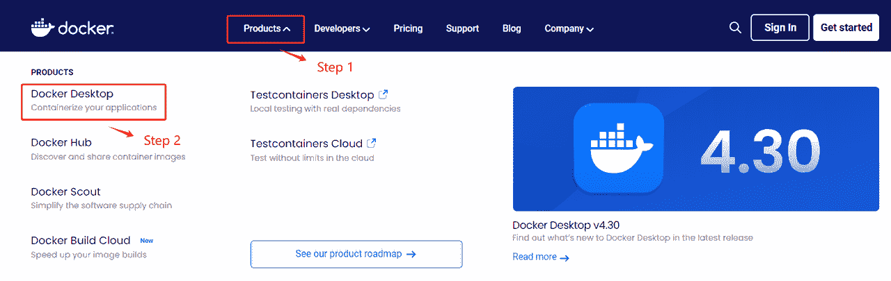

选择Windows操作系统版本。

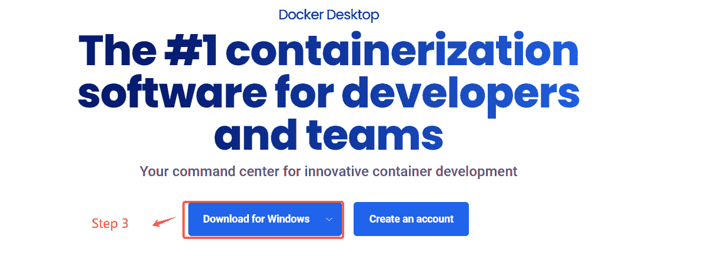

选择安装包存放路径，点击等待下载完成即可。

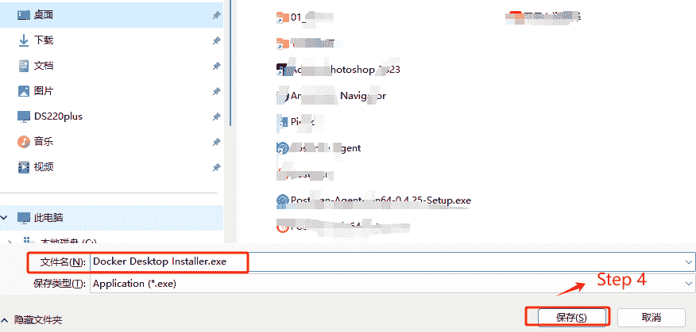

+   Step 2. 安装完双击打开Docker

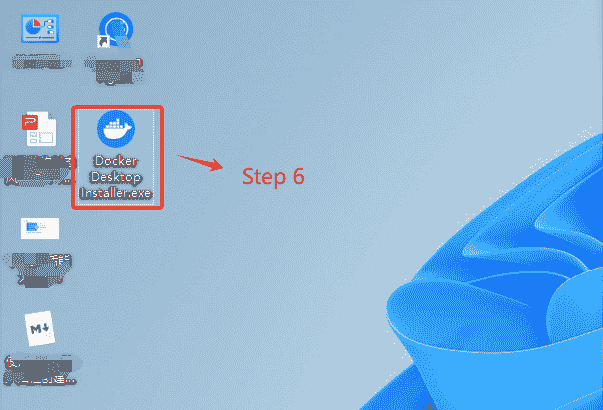

+   **Step 3. 执行安装过程**

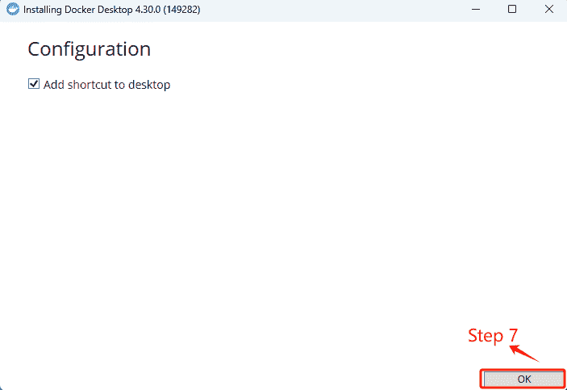

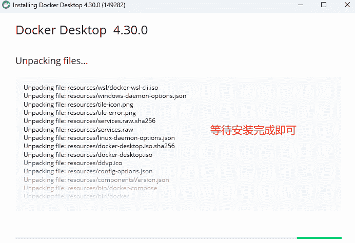

+   Step 4. 安装完成后，需要重启电脑才能加载Docker应用

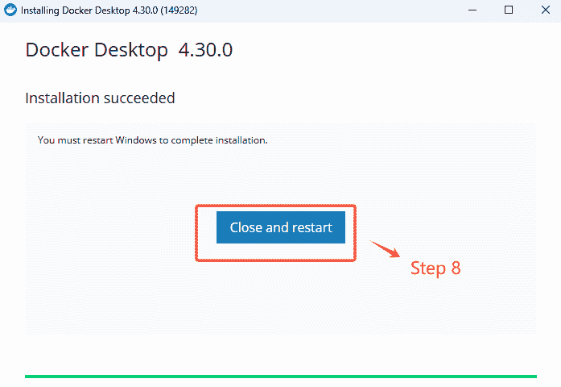

+   **Step 5. 重启完电脑后，打开Docker Des**ktop客户端，首次使用需要接受服务协议


+   Step 6. 这里选择默认配置即可

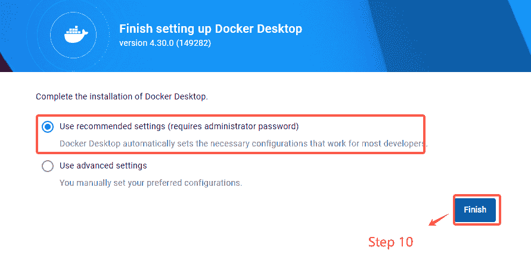

+   Step 7. 在使用前，需要登陆账户，可以免费注册

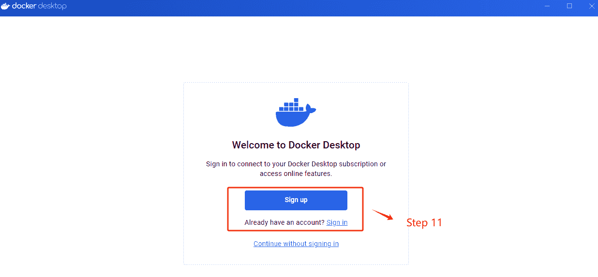

登录后，即可正常使用Docker服务了。

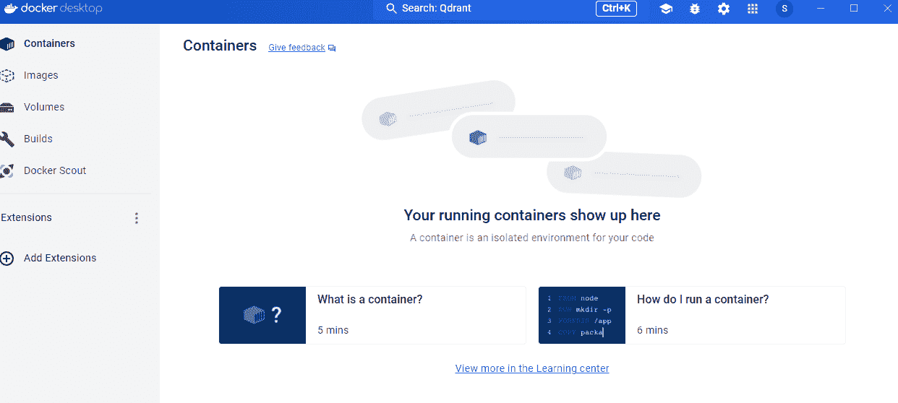

# 2. 安装Qdrant向量数据库

在Docker 环境下安装Qdrant向量数据库非常简单，直接在云环境下拉取镜像即可。如下所示：

+   **Step 1. 拉取镜像**

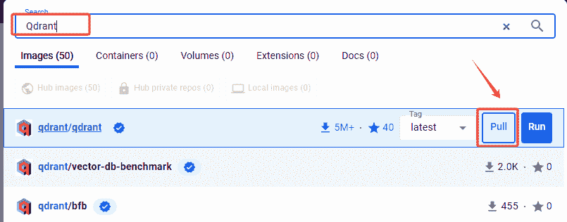

当执行拉取后，Docker客户端的右下角会显示拉取进度。耐心等待即可。

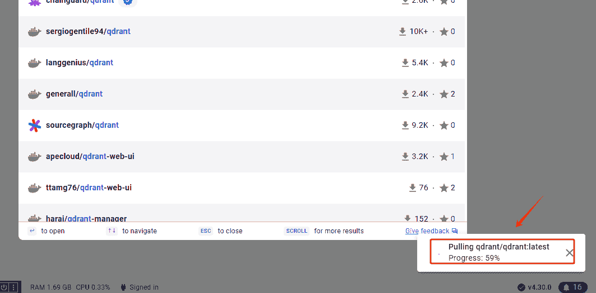

+   **Step 2. 启动镜像**

当镜像拉取到本地后，在Images中可以启动该镜像服务。

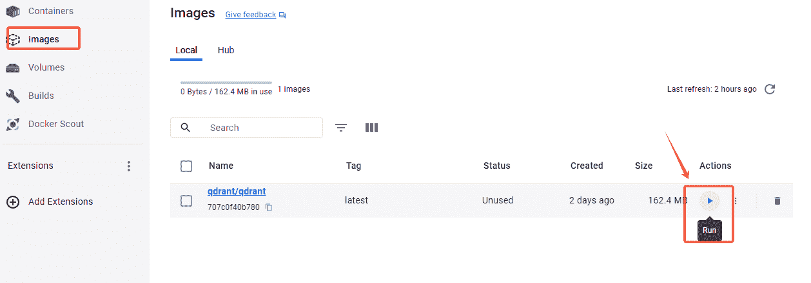

这里可以配置一些个性化设置，比如镜像名 和端口等。

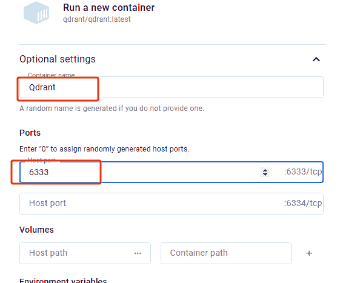

+   **Step 3. 查看容器实例**

当镜像启动完成后，可在容器实例中看到该服务进程。一个容器是基于一个镜像启动的，所以每个容器对应一个特定的镜像。但是，一个镜像可以启动多个容器。例如，如果你有一个 web 服务器的 Docker 镜像，你可以从这个镜像启动多个容器。每个容器都是一个独立的 web 服务器实例，它们可以在不同的端口上监听，从而在同一台机器上同时服务多个不同的请求。

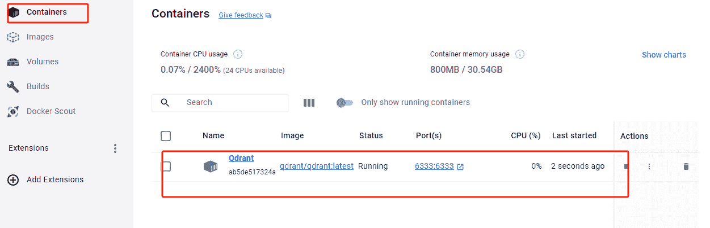

启动成功后，可进入WebUI：http://localhost:6333/dashboard 页面。

# 3. 快速入门Qdrant

Qdrant官方文档：https://qdrant.tech/documentation/quick-start/

```
! pip install qdrant_client 
```

```
Requirement already satisfied: qdrant_client in c:\users\snowb\anaconda3\lib\site-packages (1.9.1)
Requirement already satisfied: grpcio&gt;=1.41.0 in c:\users\snowb\anaconda3\lib\site-packages (from qdrant_client) (1.64.0)
Requirement already satisfied: grpcio-tools&gt;=1.41.0 in c:\users\snowb\anaconda3\lib\site-packages (from qdrant_client) (1.64.0)
Requirement already satisfied: httpx&gt;=0.20.0 in c:\users\snowb\anaconda3\lib\site-packages (from httpx[http2]&gt;=0.20.0-&gt;qdrant_client) (0.27.0)
Requirement already satisfied: numpy&gt;=1.21 in c:\users\snowb\anaconda3\lib\site-packages (from qdrant_client) (1.26.4)
Requirement already satisfied: portalocker&lt;3.0.0,&gt;=2.7.0 in c:\users\snowb\anaconda3\lib\site-packages (from qdrant_client) (2.8.2)
Requirement already satisfied: pydantic&gt;=1.10.8 in c:\users\snowb\anaconda3\lib\site-packages (from qdrant_client) (1.10.12)
Requirement already satisfied: urllib3&lt;3,&gt;=1.26.14 in c:\users\snowb\anaconda3\lib\site-packages (from qdrant_client) (2.0.7)
Requirement already satisfied: protobuf&lt;6.0dev,&gt;=5.26.1 in c:\users\snowb\anaconda3\lib\site-packages (from grpcio-tools&gt;=1.41.0-&gt;qdrant_client) (5.27.0)
Requirement already satisfied: setuptools in c:\users\snowb\anaconda3\lib\site-packages (from grpcio-tools&gt;=1.41.0-&gt;qdrant_client) (68.2.2)
Requirement already satisfied: anyio in c:\users\snowb\anaconda3\lib\site-packages (from httpx&gt;=0.20.0-&gt;httpx[http2]&gt;=0.20.0-&gt;qdrant_client) (4.2.0)
Requirement already satisfied: certifi in c:\users\snowb\anaconda3\lib\site-packages (from httpx&gt;=0.20.0-&gt;httpx[http2]&gt;=0.20.0-&gt;qdrant_client) (2024.2.2)
Requirement already satisfied: httpcore==1.* in c:\users\snowb\anaconda3\lib\site-packages (from httpx&gt;=0.20.0-&gt;httpx[http2]&gt;=0.20.0-&gt;qdrant_client) (1.0.5)
Requirement already satisfied: idna in c:\users\snowb\anaconda3\lib\site-packages (from httpx&gt;=0.20.0-&gt;httpx[http2]&gt;=0.20.0-&gt;qdrant_client) (3.4)
Requirement already satisfied: sniffio in c:\users\snowb\anaconda3\lib\site-packages (from httpx&gt;=0.20.0-&gt;httpx[http2]&gt;=0.20.0-&gt;qdrant_client) (1.3.0)
Requirement already satisfied: h11&lt;0.15,&gt;=0.13 in c:\users\snowb\anaconda3\lib\site-packages (from httpcore==1.*-&gt;httpx&gt;=0.20.0-&gt;httpx[http2]&gt;=0.20.0-&gt;qdrant_client) (0.14.0)
Requirement already satisfied: h2&lt;5,&gt;=3 in c:\users\snowb\anaconda3\lib\site-packages (from httpx[http2]&gt;=0.20.0-&gt;qdrant_client) (4.1.0)
Requirement already satisfied: pywin32&gt;=226 in c:\users\snowb\anaconda3\lib\site-packages (from portalocker&lt;3.0.0,&gt;=2.7.0-&gt;qdrant_client) (305.1)
Requirement already satisfied: typing-extensions&gt;=4.2.0 in c:\users\snowb\anaconda3\lib\site-packages (from pydantic&gt;=1.10.8-&gt;qdrant_client) (4.9.0)
Requirement already satisfied: hyperframe&lt;7,&gt;=6.0 in c:\users\snowb\anaconda3\lib\site-packages (from h2&lt;5,&gt;=3-&gt;httpx[http2]&gt;=0.20.0-&gt;qdrant_client) (6.0.1)
Requirement already satisfied: hpack&lt;5,&gt;=4.0 in c:\users\snowb\anaconda3\lib\site-packages (from h2&lt;5,&gt;=3-&gt;httpx[http2]&gt;=0.20.0-&gt;qdrant_client) (4.0.0)
```

## 3.1 创建数据库连接

```
# 创建客户端实例

from qdrant_client import QdrantClient

client = QdrantClient(host=&quot;localhost&quot;, port=6333)
```

```
# 创建一个集合
```

## 3.2 创建集合

```
from qdrant_client.http.models import Distance, VectorParams, Batch

client.create_collection(
    collection_name=&quot;test_collection&quot;, 
    vectors_config=VectorParams(
        size=4, 
        distance=Distance.DOT), )
```

```
True
```

## 3.3 插入数据

```
from qdrant_client.models import PointStruct

operation_info = client.upsert(
    collection_name=&quot;test_collection&quot;,
    wait=True,
    points=[
        PointStruct(id=1, vector=[0.05, 0.61, 0.76, 0.74], payload={&quot;city&quot;: &quot;Berlin&quot;}),
        PointStruct(id=2, vector=[0.19, 0.81, 0.75, 0.11], payload={&quot;city&quot;: &quot;London&quot;}),
        PointStruct(id=3, vector=[0.36, 0.55, 0.47, 0.94], payload={&quot;city&quot;: &quot;Moscow&quot;}),
        PointStruct(id=4, vector=[0.18, 0.01, 0.85, 0.80], payload={&quot;city&quot;: &quot;New York&quot;}),
        PointStruct(id=5, vector=[0.24, 0.18, 0.22, 0.44], payload={&quot;city&quot;: &quot;Beijing&quot;}),
        PointStruct(id=6, vector=[0.35, 0.08, 0.11, 0.44], payload={&quot;city&quot;: &quot;Mumbai&quot;}),
    ],
)

print(operation_info)
```

```
operation_id=1 status=&lt;UpdateStatus.COMPLETED: &#x27;completed&#x27;&gt;
```

## 3.3 查询数据

```
# 查询

search_result = client.search(
    collection_name=&quot;test_collection&quot;, query_vector=[0.2, 0.1, 0.9, 0.7], limit=3
)

print(search_result)
```

```
[ScoredPoint(id=4, version=1, score=1.362, payload={&#x27;city&#x27;: &#x27;New York&#x27;}, vector=None, shard_key=None), ScoredPoint(id=1, version=1, score=1.273, payload={&#x27;city&#x27;: &#x27;Berlin&#x27;}, vector=None, shard_key=None), ScoredPoint(id=3, version=1, score=1.208, payload={&#x27;city&#x27;: &#x27;Moscow&#x27;}, vector=None, shard_key=None)]
```

```

```

```

```

体验课时间有限，若想深度学习大模型RAG技术，欢迎大家报名九天&菜菜老师团队精心研发的《大模型Agent开发实战课》：

📍更**多大模型技术内容学习**

**扫码添加助理****英英**，回复“大模型”，了解更多大模型技术详情哦👇


此外，**扫码回复“入群”**，即可加入**大模型技术社群****：海量硬核独家技术****干货内容****+无门槛****技术交流****！**