# 零门槛部署Qwen开源大模型

> 来源：[https://kq4b3vgg5b.feishu.cn/docx/MBspd4278or6eYxQdeSc38XCn5d](https://kq4b3vgg5b.feishu.cn/docx/MBspd4278or6eYxQdeSc38XCn5d)

在了解了目前大模型技术发展全貌、并且对开源大模型技术体系有一定的认识后，接下来将进入到实操环节，我们将手动尝试部署Qwen系列开源大模型。正如此前所说，任何开源大模型的安装部署调用都需要提前准备算力，通常来看开源大模型最低运行标准为15G显存，此外还需要提前准备模型运行环境，如操作系统、CUDA软件、transformer库等。不过对于Qwen系列模型，我们可以借助魔搭社区提供的限时免费算力，一键部署Qwen模型所需环境，并在线上完成模型部署。

> 注：以Qwen1.5_MoE为模型进行部署调用实验，但由于该模型发布不久，所需的transformer库尚出于开发状态（未正式发布），因此在调用过程中会出现些许不稳定情况，课程后半段将改为Qwen1.5-1.8B模型进行后续实验。尽管模型不同，但实际模型下载和使用过程完全相同。

+   限时免费算力获取

登录魔搭社区：https://www.modelscope.cn/home ，点击注册：

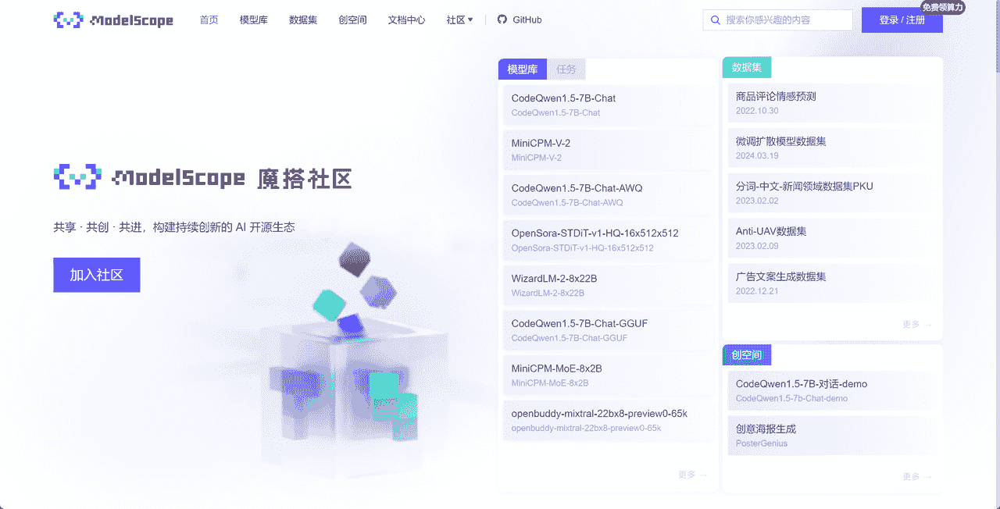

输入账号密码完成注册：

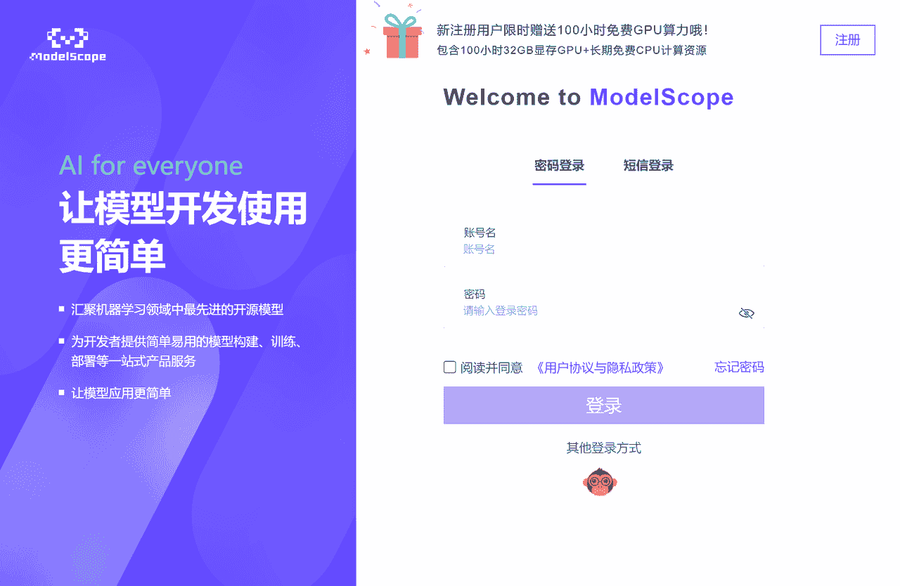

注册完成后，点击个人中心，点击绑定阿里云账号：

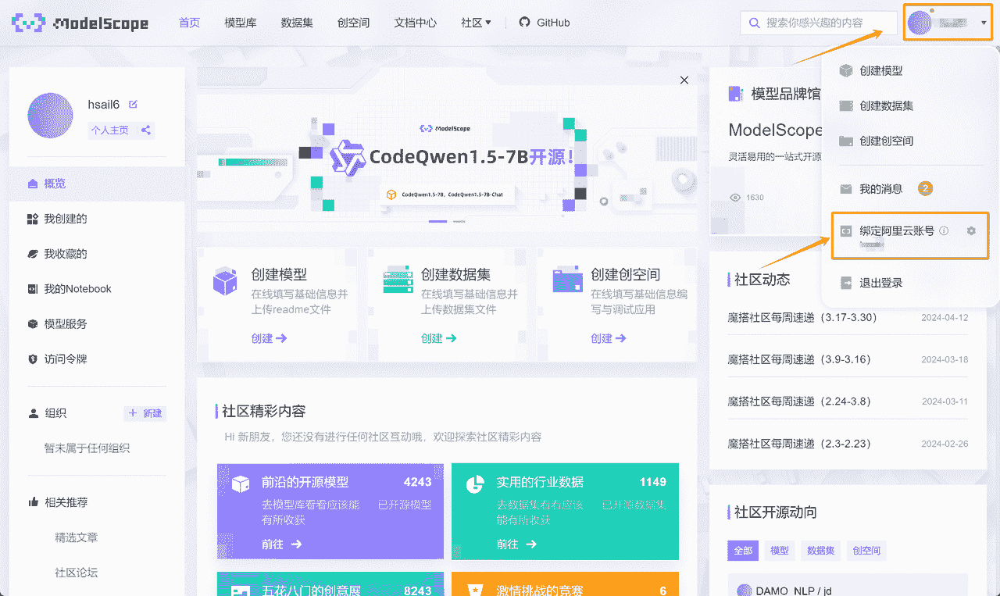

在跳转页面中选择登录阿里云，未注册阿里云也可以在当前页面注册：


点击授权：

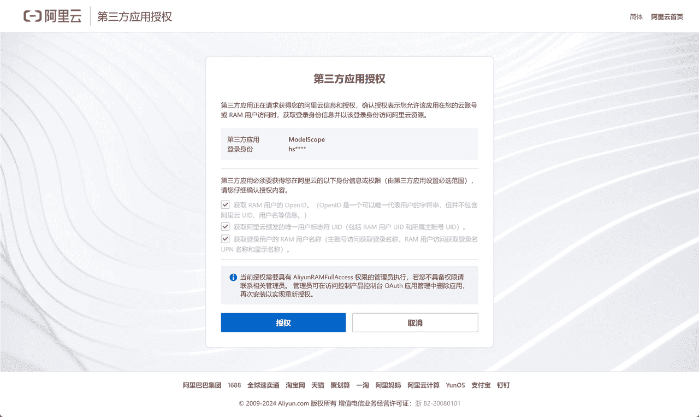

绑定完成后，点击左侧“我的Notebook”，即可查看当前账号获赠算力情况。对于首次绑定阿里云账号的用户，都会赠送永久免费的CPU环境（8核32G内存）和36小时限时使用的GPU算力（32G内存+24G显存）。这里的GPU算力会根据实际使用情况扣除剩余时间，总共36小时的使用时间完全足够进行前期各项实验。

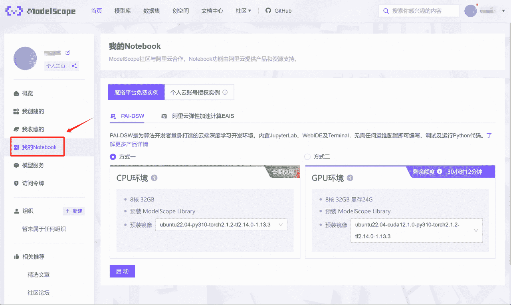

> 关于大模型算力问题，[《大模型技术实战课》（第3期）](https://appZe9inzwc2314.h5.xiaoeknow.com)正式课程会详细介绍各类不同项目所需算力、本地硬件采购建议、以及在线GPU算力获取方法等，帮助大家一站式解决大模型硬件问题。

接下来启动GPU在线算力环境，选择方式二、点击启动：

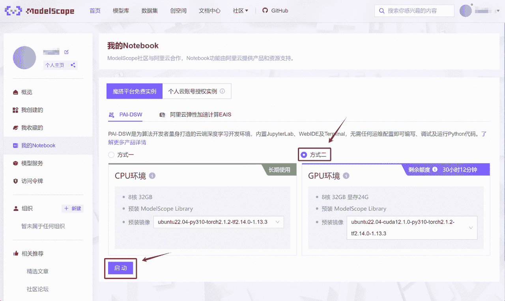

稍等片刻即可完成启动，并点击查看Notebook：

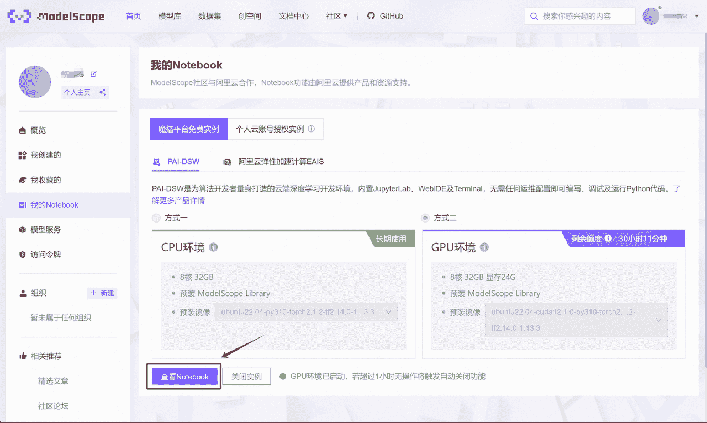

即可接入在线NoteBook编程环境：

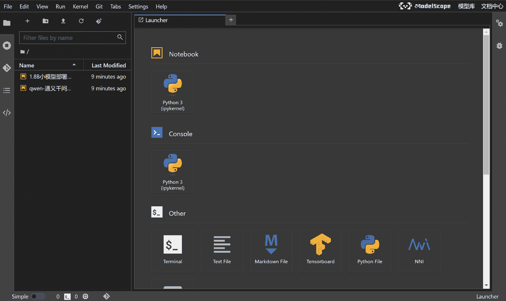

当前NoteBook编程环境和Colab类似（谷歌提供的在线编程环境），可以直接调用在线算力来完成编程工作，并且由于该服务由ModelScope提供，因此当前NoteBook已经完成了CUDA、PyTorch、Tensorflow环境配置，并且已经预安装了大模型部署所需各种库，如Transformer库、vLLM库、modelscope库等，并且当前NoteBook运行环境是Ubuntu操作系统，我们可以通过Jupyter中的Terminal功能对Ubuntu系统进行操作：

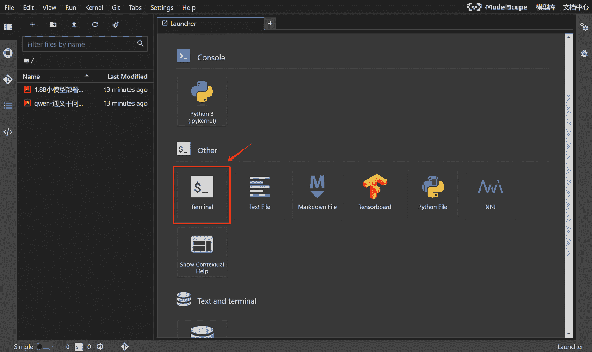

进入到命令行界面：

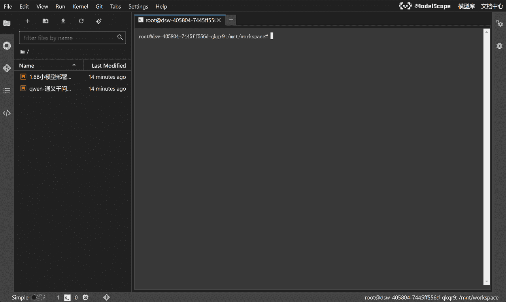

输入nvidia-smi，查看当前GPU情况：

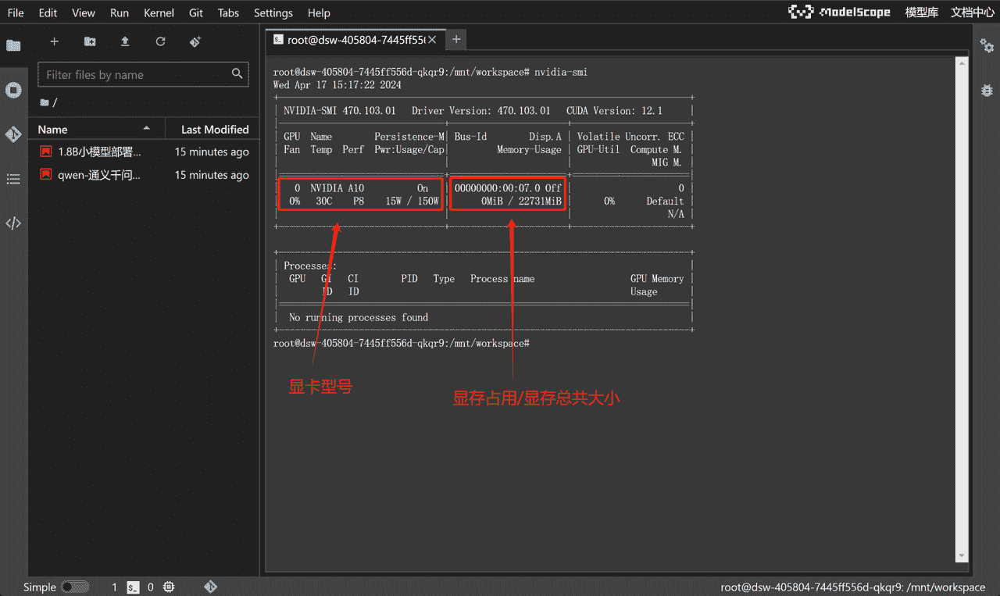

该功能也是我们操作远程Ubuntu系统的核心功能。

> 目前来说，绝大多数大模型开发项目都需要Linux操作系统，不同于大家常用的[Windows图形化操作系统，](https://appZe9inzwc2314.h5.xiaoeknow.com)大多数Linux操作系统都是以命令行操作为主，而在《大模型技术实战课》（第3期）课程中，我们也会提供完整详细的Ubuntu操作系统安装与使用教学。

此外，ModelScope NoteBooko还可以一键拉取ModelScope上发布的模型或项目，直接在云端环境进行运行和实验。这个点击+号开启新的导航页：

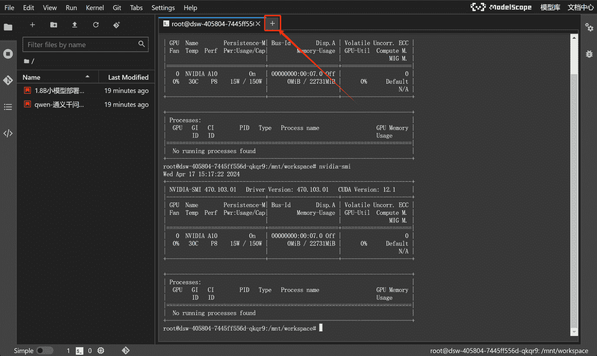

并在导航页下方点击模型库：

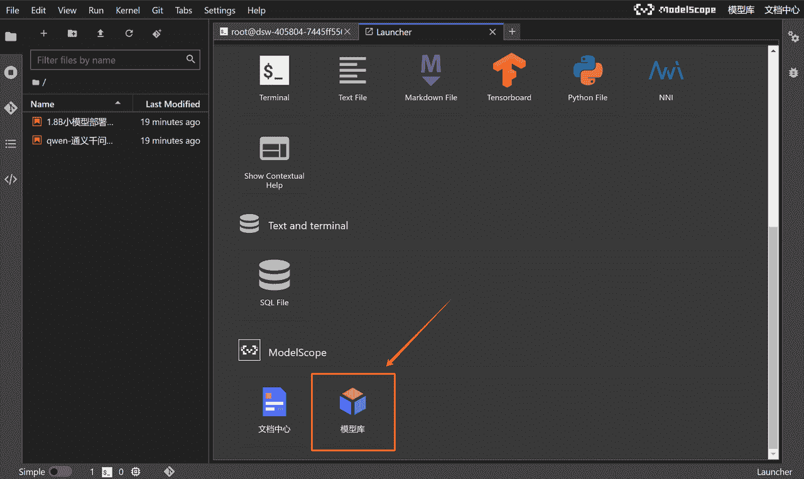

即可选择任意模型文档，进行尝试运行：

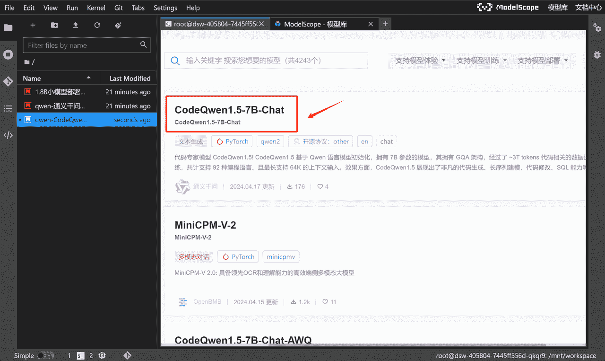

例如我们点击选择CodeQwen1.5-7B-Chat，一个基于Qwen1.5-7B微调得到的代码模型。点击即可获得一个新的Jupyter文件，包含了该模型的说明文档和运行代码（也就是该模型在ModelScope上的readme文档）：

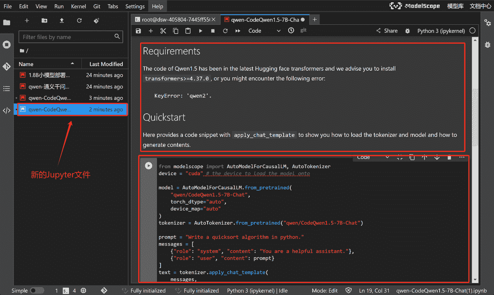

而如果想要下载某个Jupyter文件到本地，只需要选择文件点击右键、选择Download，即可通过浏览器将项目文件下载到本地：

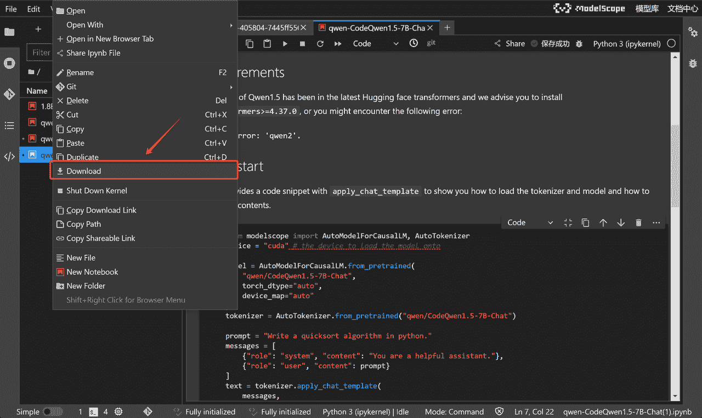

当然，这里需要注意的是，哪怕当前在线编程环境已经做了适配，但并不一定满足所有ModelScope中模型运行要求，既并非每个拉取的Jupyter文件都可以直接运行。当前体验课只把ModelScope视作在线编程环境，并不会直接Copy项目文件代码进行运行。不过无论如何，ModelScope Notebook还是为初学者提供了非常友好的、零基础即可入手尝试部署大模型的绝佳实践环境。

接下来我们就借助ModelScope Notebook来完成体验课的大模型部署调用入门实验。

+   Qwen1.5-MoE-A2.7B 模型获取

接下来按照此前规划，我们尝试来部署最新版千问MoE大模型：Qwen1.5-MoE-A2.7B模型。

在安装部署任何一个大模型之前，我们都必须找到模型发布平台。对于阿里Qwen大模型，首发平台都是阿里系的ModelScope，我们可以直接在ModelScope看到模型的相关信息。这里我们继续在ModelScope页面，点击上方菜单栏“模型库”，然后再搜索框内输入Qwen1.5-MoE，获得搜索结果如下：

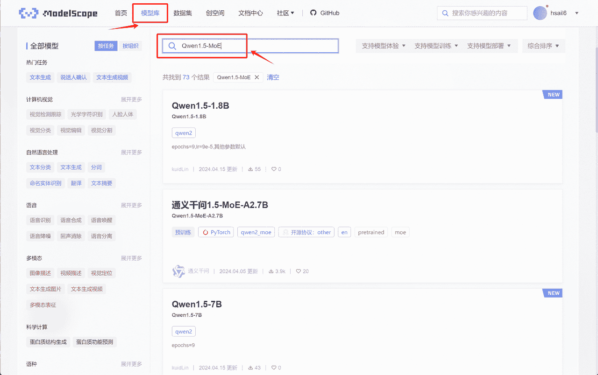

点击通义千问1.5-MoE-A2.7B页面，即可查看当前模型基本情况：

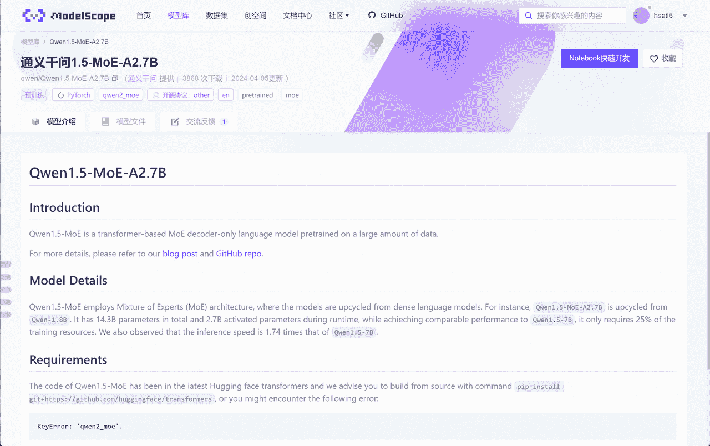

这里点击模型文件，即可查看并下载当前模型文件：

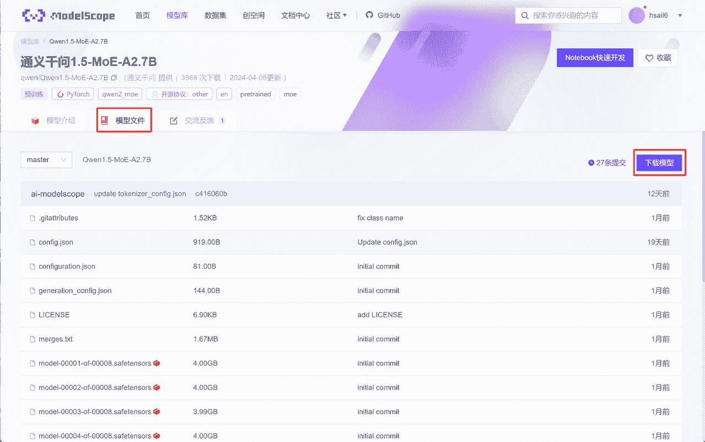

不过ModelScope只支持通过git或者SDK（modelscope库）进行下载，无法直接通过网页下载各文件：

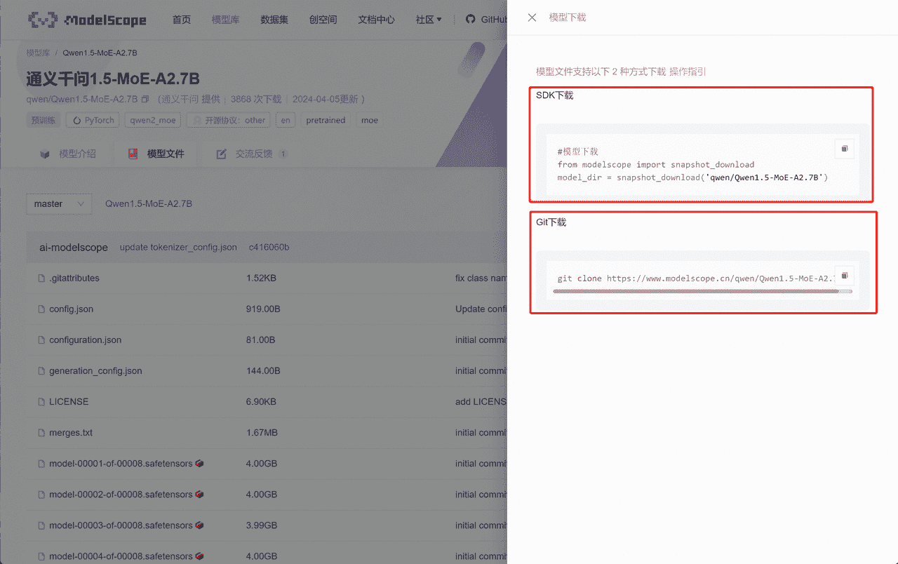

> 稍后我们会进一步介绍如何进行下载及解释各模型文件所代表的含义，这里我们先继续梳理可以进行模型下载的各平台。

而除了Qwen1.5-MoE-A2.7B模型外，本次开源的MoE模型开包括Qwen1.5-MoE-A2.7B-chat模型和Qwen1.5-MoE-A2.7B-GPTQ-Int4模型，总共三个模型。根据名称不难发现三个模型定位，Qwen1.5-MoE-A2.7B属于基础模型，Qwen1.5-MoE-A2.7B-chat为对话功能微调模型，更适合执行对话类任务，而Qwen1.5-MoE-A2.7B-GPTQ-Int4则是对话模型的INT4量化版，即参数位只保留4位，运行所需算力和功能性都有所下降。

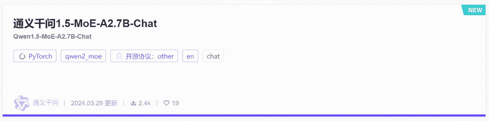

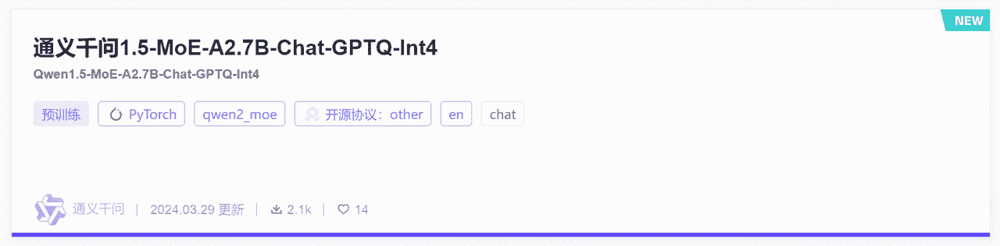

当然除了ModelScope，开源大模型还会在Github和HuggingFace上发布。我们可以在Qwen1.5系列模型的Github山主页看到目前MoE系列模型开源情况：https://github.com/QwenLM/Qwen1.5 ：

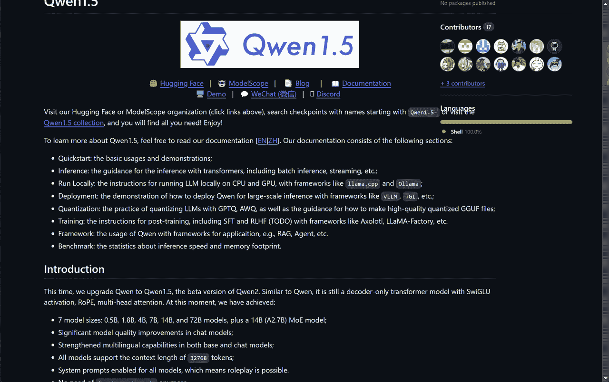

以及在huggingface的Qwen模型项目主页上，查看当前Qwen系列模型发布情况：https://huggingface.co/Qwen

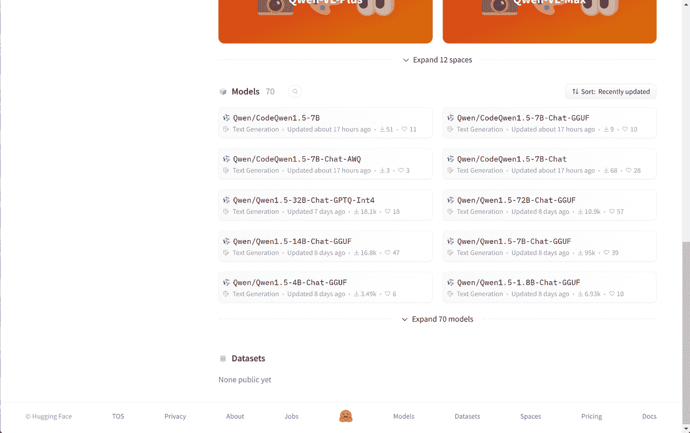

> 目前huggingface访问需要🪜方法。

就huggingface和Github来说，Github的功能更偏向代码托管和项目管理，而huggingface和ModelScope类似，都是深度学习、大模型的模型库，模型发布门槛较低，并且huggingface还负责托管了奠定整个大模型基础的transformer库，后续的开源大模型部署和使用也将用到transformer库。因此，整体来看，Github更适合查阅模型各类深度详细信息，而huggingface和ModelScope则更加适合模型关键信息检索与模型快速部署。并且对于huggingface而言，发布的各项模型都可以直接在网页端下载项目文件。例如对于Qwen/Qwen1.5-MoE-A2.7B模型，模型主页https://huggingface.co/Qwen/Qwen1.5-MoE-A2.7B 如下：

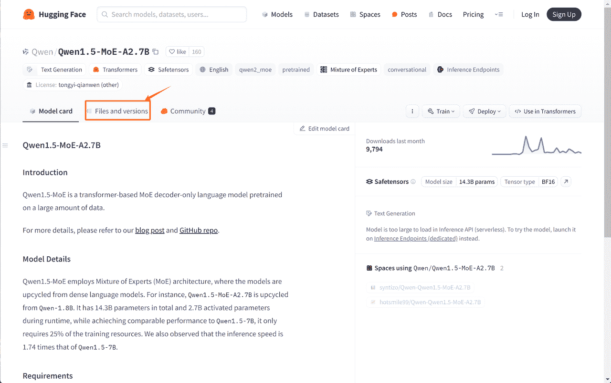

点击文件和版本说明，即可进入到模型文件页面。而和ModelScope不同的是，huggingface提供了每个项目文件的基于网页端的下载选项，有必要的话我们可以直接从网页端下载项目文件：

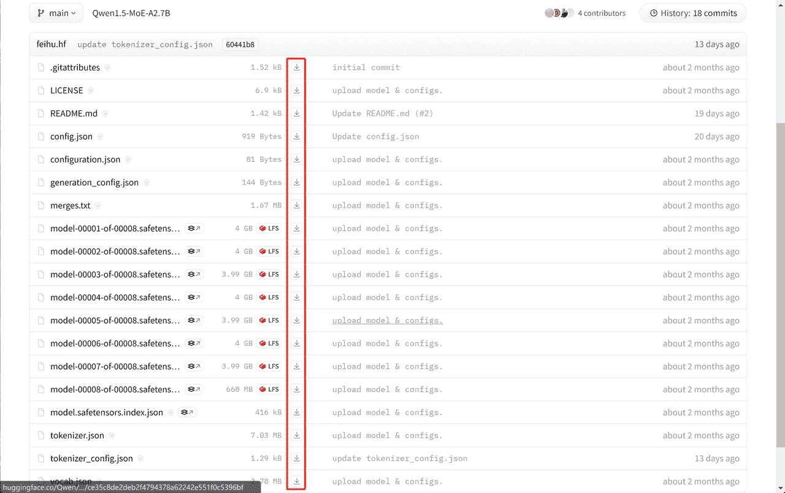

> 在[开源大模型安装部署调用的过程中](https://appZe9inzwc2314.h5.xiaoeknow.com)，需要反复使用各类开源项目下载工具，以及各项开源项目平台，我们的正式课程《大模型技术实战课》（第3期）会详细介绍Github、HuggingFace、ModelScope等各平台使用方法，及Git等工具使用方法，帮助大家零基础高效掌握大模型技术。

> 除了这些通用的平台外，目前一些大模型部署工具如ollama等，也可以直接下载模型。

+   Qwen大模型项目文件介绍

而在正式部署模型之前，我们还需要围绕当前Qwen模型的项目文件进行简要介绍。以帮助大家更好的理解一个开源大模型项目的基本构成。这里我们以Qwen为例进行介绍，其他大模型的项目文件构成都基本类似。后续我们在调用任何一个开源大模型之前，都必须完整的项目文件下载到指定目录中，无论是手动下载还是通过某些工具进行下载，都是如此。Qwen模型项目文件构成如下：

| 文件名 | 文件功能解释 |
| --- | --- |
| .gitattributes | 项目中用于定义项目特定的属性配置。它可以用来控制不同文件的行为，例如指定文件的对比方式、定义文件的编码、处理换行符等。此文件允许你为特定文件或目录设置一些规则，这些规则会影响Git的各种操作，如合并和检出等。 |
| LICENSE | 文件通常是用来说明模型或软件项目的使用许可。这个文件详细描述了其他用户和开发者可以如何使用、修改、共享和分发这个项目或模型。它规定了法律条款，确保了作者的知识产权同时允许社区以特定方式利用这个资源。 |
| config.json | 通常用于存储软件或模型的基本配置参数，如模型的架构设置、超参数或环境依赖性设置。这些配置使得用户或开发者可以在不修改代码的情况下调整程序行为。 |
| configuration.json | 文件通常也用于类似目的，存储配置信息。具体内容可能包括更详细或专门的设置，如API密钥、用户权限等。 |
| generation_config.json | 通常用于存储与文本生成相关的配置设置。在涉及到语言模型或文本生成任务的项目中，这个文件可以包含用于文本生成的各种参数，如最大生成长度、温度（用于控制生成文本的随机性）、重复率控制和特定的前置或后置处理规则。 |
| merges.txt | 在自然语言处理领域，特别是在使用基于 Transformer 的模型如 BERT 或 GPT 时，merges.txt 文件常用于存储用于字节对编码（Byte Pair Encoding, BPE）或其他子词分割算法的合并规则。这些规则帮助分词器决定如何将未知或罕见词汇分解成已知的子单位。 |
| model-0000X-of-00008.safetensors | 表示这是模型文件的一部分，其中使用了分片存储的方式。这种命名模式表明文件是分段保存的大型模型的一部分。safetensors 是一种文件格式，用于安全地存储包含模型权重的张量数据。当模型太大而无法单个文件存储时，会将其分成多个部分，每个文件包含模型的一部分数据。这些文件通常在加载模型时需要被一起读取来完整地重建模型。 |
| model.safetensors.index.json | 文件通常用作存储有关模型分片的索引信息。这个索引文件包含了各个分片文件的元数据，比如每个分片的名称、大小、顺序等，以便在需要时正确地加载和重建整个模型。 |
| tokenizer.json | 文件通常包含分词器的配置和词汇表，用于加载和使用分词器进行文本处理。它可能包括词汇的具体列表、分词规则和特殊标记等信息。 |
| tokenizer_config.json | 包含关于分词器设置的配置信息，如是否添加特殊标记到序列的开头或结尾、分词的最大长度等。这个文件用于详细指定如何初始化分词器的各项参数，以确保在处理文本时能够正确应用这些设置。 |
| vocab.json | 文件通常用于存储分词器的词汇表。这个文件包含了模型可以识别的所有词汇的索引，每个词汇或标记都与一个唯一的数字ID关联。 |

而我们所说的开源大模型部署与调用，本质上就是下载项目文件并进行运行的过程。

+   Qwen大模型部署与调用

正如此前所说，我们需要先下载模型，然后再进行使用。这里受限于单卡24显存限制条件，我们考虑部署Qwen1.5-MoE的INT4版本模型进行使用，即考虑安装部署使用Qwen1.5-MoE-A2.7B-GPTQ-Int4模型，该安装部署方法也可以迁移到其他模型部署中，而该模型也是目前最高效（算力要求较低、同时性能较好）的大模型。同时，考虑到后续微调实验，我们还将介绍Qwen1.5-1.8B模型部署方法。

> 根据实际测试，Qwen1.5-MoE-A2.7B和Qwen1.5-MoE-A2.7B-chat模型运行需要28G显存，而Qwen1.5-MoE-A2.7B-GPTQ-Int4则需要10G内存即可调用。

> 在[《大模型技术实战课》（第3期）](https://appZe9inzwc2314.h5.xiaoeknow.com)课程中，还会详细介绍多卡环境中部署更高参数模型方法。在实际大模型开发场景下，多卡部署是更为通用的技术需求。

+   开源大模型部署方法

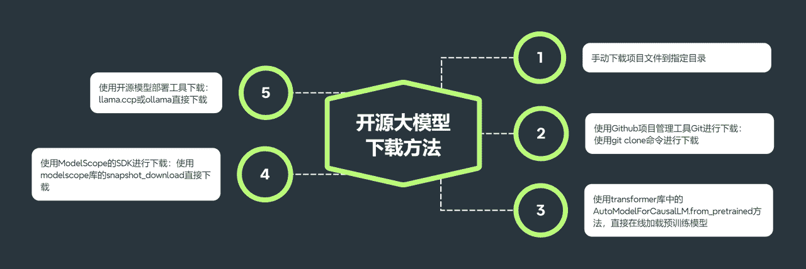

对于国内用户来说，一个比较稳定的下载和部署开源大模型的方法就是使用ModelScope的SDK进行下载，然后再Transformer库进行调用。接下来我们就照此流程来尝试安装部署Qwen1.5-MoE-A2.7B-GPTQ-Int4模型，其他模型部署方法也类似：

+   Step 1.检查环境依赖是否满足条件

对于本地开源大模型部署来说，前期配置大模型运行环境是一件较为复杂的工作，需要提前准备好Linux操作系统，CUDA软件、PyTorch框架，以及一系列库、如Transformer库等，并且还需要考虑其中各组件的适配条件是否满足。而现在的ModelScope在线NoteBook环境已经配置好，基本环境都已经满足，唯一需要注意的是，由于Qwen1.5-MoE模型是最新发布的模型，因此需要更新transformers库（4.37以上）才可使用。

这里我们可以在Jupyter进入命令行，然后输入以下命令即可完成更新。由于ModelScope在线环境较为特殊，因此在更新transformer库时会显示部分其他库冲突，这些库并版本不匹配问题并不影响模型调用和运行，忽视即可：

```
pip install git+https://github.com/huggingface/transformers
```

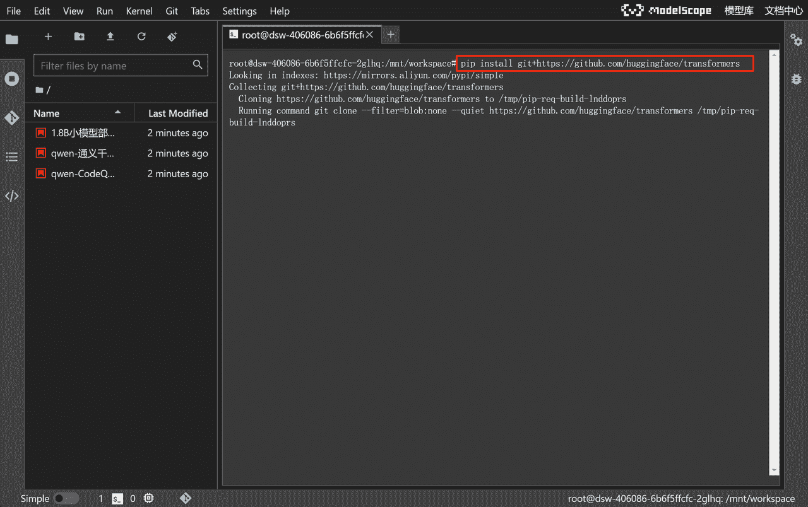

```
import transformers
```

```
/opt/conda/lib/python3.10/site-packages/tqdm/auto.py:21: TqdmWarning: IProgress not found. Please update jupyter and ipywidgets. See https://ipywidgets.readthedocs.io/en/stable/user_install.html
  from .autonotebook import tqdm as notebook_tqdm
```

```
transformers.__version__
```

```
&#x27;4.40.0.dev0&#x27;
```

+   Step 2.使用snapshot_download获取模型项目文件

接下来回到Jupyter页面中执行以下命令完成模型下载：

```
from modelscope import snapshot_download
```

```
2024-04-17 17:04:41,072 - modelscope - INFO - PyTorch version 2.1.2+cu121 Found.
2024-04-17 17:04:41,074 - modelscope - INFO - TensorFlow version 2.14.0 Found.
2024-04-17 17:04:41,074 - modelscope - INFO - Loading ast index from /mnt/workspace/.cache/modelscope/ast_indexer
2024-04-17 17:04:41,075 - modelscope - INFO - No valid ast index found from /mnt/workspace/.cache/modelscope/ast_indexer, generating ast index from prebuilt!
2024-04-17 17:04:41,129 - modelscope - INFO - Loading done! Current index file version is 1.13.3, with md5 55e7043102d017111a56be6e6d7a6a16 and a total number of 972 components indexed
```

```
model_dir=snapshot_download(&quot;qwen/Qwen1.5-MoE-A2.7B-Chat-GPTQ-Int4&quot;)
```

```
Downloading: 100%|██████████| 7.98k/7.98k [00:00&lt;00:00, 26.3MB/s]
Downloading: 100%|██████████| 42.0/42.0 [00:00&lt;00:00, 298kB/s]
Downloading: 100%|██████████| 248/248 [00:00&lt;00:00, 1.92MB/s]
Downloading: 100%|██████████| 6.74k/6.74k [00:00&lt;00:00, 11.4MB/s]
Downloading: 100%|██████████| 1.59M/1.59M [00:00&lt;00:00, 39.6MB/s]
Downloading: 100%|█████████▉| 3.73G/3.73G [00:11&lt;00:00, 343MB/s]
Downloading: 100%|█████████▉| 3.53G/3.53G [00:10&lt;00:00, 370MB/s]
Downloading: 100%|█████████▉| 594M/594M [00:01&lt;00:00, 357MB/s] 
Downloading: 100%|██████████| 1.92M/1.92M [00:00&lt;00:00, 47.8MB/s]
Downloading: 100%|██████████| 2.82k/2.82k [00:00&lt;00:00, 19.6MB/s]
Downloading: 100%|██████████| 6.70M/6.70M [00:00&lt;00:00, 48.9MB/s]
Downloading: 100%|██████████| 1.37k/1.37k [00:00&lt;00:00, 12.0MB/s]
Downloading: 100%|██████████| 2.65M/2.65M [00:00&lt;00:00, 38.5MB/s]
```

下载完成后，model_dir变量就代表着当前模型下载地址。在之后的模型调用过程中，模型地址就是模型对象的重要指代变量：

```
model_dir
```

```
&#x27;/mnt/workspace/.cache/modelscope/qwen/Qwen1___5-MoE-A2___7B-Chat-GPTQ-Int4&#x27;
```

而我们也可以据此查阅模型下载情况。回到命令行界面中，使用命令

```
cd /mnt/workspace/.cache/modelscope/qwen/
ll
```

查看下载文件

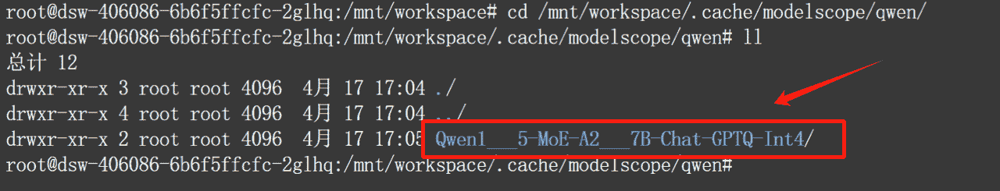

+   Step 3.使用transformer库调用本地大模型

```
# AutoModelForCausalLM 是用于加载预训练的因果语言模型（如GPT系列）
# 而 AutoTokenizer 是用于加载与这些模型匹配的分词器。
from transformers import AutoModelForCausalLM, AutoTokenizer

# 这行设置将模型加载到 GPU 设备上，以利用 GPU 的计算能力进行快速处理
device = &quot;cuda&quot; 

# 加载了一个因果语言模型。
# model_dir 是模型文件所在的目录。
# torch_dtype=&quot;auto&quot; 自动选择最优的数据类型以平衡性能和精度。
# device_map=&quot;auto&quot; 自动将模型的不同部分映射到可用的设备上。
model = AutoModelForCausalLM.from_pretrained(
    model_dir,
    torch_dtype=&quot;auto&quot;,
    device_map=&quot;auto&quot;
)

# 加载与模型相匹配的分词器。分词器用于将文本转换成模型能够理解和处理的格式。
tokenizer = AutoTokenizer.from_pretrained(model_dir)
```

```
2024-04-17 17:07:27.322845: I tensorflow/core/util/port.cc:111] oneDNN custom operations are on. You may see slightly different numerical results due to floating-point round-off errors from different computation orders. To turn them off, set the environment variable `TF_ENABLE_ONEDNN_OPTS=0`.
2024-04-17 17:07:27.325358: I tensorflow/tsl/cuda/cudart_stub.cc:28] Could not find cuda drivers on your machine, GPU will not be used.
2024-04-17 17:07:27.356807: E tensorflow/compiler/xla/stream_executor/cuda/cuda_dnn.cc:9342] Unable to register cuDNN factory: Attempting to register factory for plugin cuDNN when one has already been registered
2024-04-17 17:07:27.356840: E tensorflow/compiler/xla/stream_executor/cuda/cuda_fft.cc:609] Unable to register cuFFT factory: Attempting to register factory for plugin cuFFT when one has already been registered
2024-04-17 17:07:27.356859: E tensorflow/compiler/xla/stream_executor/cuda/cuda_blas.cc:1518] Unable to register cuBLAS factory: Attempting to register factory for plugin cuBLAS when one has already been registered
2024-04-17 17:07:27.363201: I tensorflow/tsl/cuda/cudart_stub.cc:28] Could not find cuda drivers on your machine, GPU will not be used.
2024-04-17 17:07:27.363680: I tensorflow/core/platform/cpu_feature_guard.cc:182] This TensorFlow binary is optimized to use available CPU instructions in performance-critical operations.
To enable the following instructions: AVX2 AVX512F AVX512_VNNI FMA, in other operations, rebuild TensorFlow with the appropriate compiler flags.
2024-04-17 17:07:28.534980: W tensorflow/compiler/tf2tensorrt/utils/py_utils.cc:38] TF-TRT Warning: Could not find TensorRT
/opt/conda/lib/python3.10/site-packages/transformers/modeling_utils.py:4371: FutureWarning: `_is_quantized_training_enabled` is going to be deprecated in transformers 4.39.0. Please use `model.hf_quantizer.is_trainable` instead
  warnings.warn(
Loading checkpoint shards: 100%|██████████| 3/3 [00:23&lt;00:00,  7.74s/it]
Special tokens have been added in the vocabulary, make sure the associated word embeddings are fine-tuned or trained.
```

```
# 加载与模型相匹配的分词器。分词器用于将文本转换成模型能够理解和处理的格式
prompt = &quot;你好，请介绍下你自己。&quot;
messages = [
    {&quot;role&quot;: &quot;system&quot;, &quot;content&quot;: &quot;You are a helpful assistant.&quot;},
    {&quot;role&quot;: &quot;user&quot;, &quot;content&quot;: prompt}
]

# 使用分词器的 apply_chat_template 方法将上面定义的消息列表转换为一个格式化的字符串，适合输入到模型中。
# tokenize=False 表示此时不进行令牌化，add_generation_prompt=True 添加生成提示。
text = tokenizer.apply_chat_template(
    messages,
    tokenize=False,
    add_generation_prompt=True
)

# 将处理后的文本令牌化并转换为模型输入张量，然后将这些张量移至之前定义的设备（GPU）上。
model_inputs = tokenizer([text], return_tensors=&quot;pt&quot;).to(device)
```

```
# 使用模型的 generate 方法基于输入生成文本。
# max_new_tokens=512 限制了生成的最大令牌数量，以控制输出长度。
generated_ids = model.generate(
    model_inputs.input_ids,
    max_new_tokens=512
)

# 从生成的令牌中提取新生成的部分，忽略输入部分的令牌。
generated_ids = [
    output_ids[len(input_ids):] for input_ids, output_ids in zip(model_inputs.input_ids, generated_ids)
]

# 将生成的令牌ID解码为人类可读的文本，并且跳过特殊令牌，如填充令牌或其他非文本内容的标记。
response = tokenizer.batch_decode(generated_ids, skip_special_tokens=True)[0]
```

```
# 打印模型返回结果
print(response)
```

```
大家好，我是来自阿里云的超大规模语言模型，我叫通义千问。作为阿里云推出的一种超大规模语言模型，我能够回答问题、创作文字，还能表达观点、撰写代码。如果您有任何问题或需要帮助，请随时告诉我，我会尽力提供支持。
```

+   显存占用

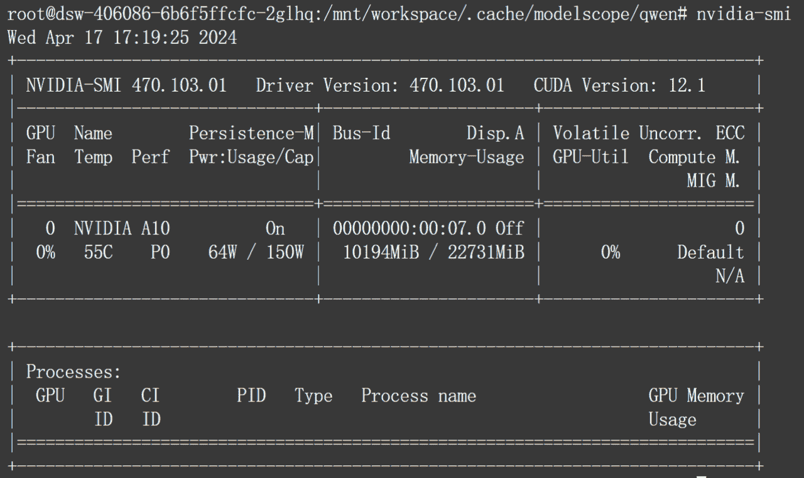

而伴随着多轮对话不断进行，还会占用越累越多的显存。这里重启Jupyter kernel可以清空显存占用。

+   优化对话形式

可以看出，基于transformer库的大模型调用流程非常复杂，其中会涉及非常多的底层技术细节。这些底层技术细节对于大模型应用开发人员来说并不重要，对于开发人员来说，一种更友好的大模型调用方法是“一问一答”式对话，类似与OpenAI提供的GPT系列大模型调用流程，我们只需要编辑好输入模型的内容，然后观察模型回答即可：

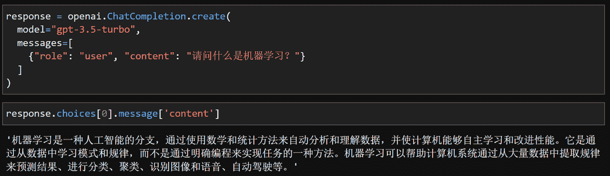

这里我们重启Jupyter kernel，清空显存后继续进行实验：

```
from modelscope import snapshot_download
model_dir=snapshot_download(&quot;qwen/Qwen1.5-MoE-A2.7B-Chat-GPTQ-Int4&quot;)
```

```
2024-04-17 18:16:14,080 - modelscope - INFO - PyTorch version 2.1.2+cu121 Found.
2024-04-17 18:16:14,084 - modelscope - INFO - TensorFlow version 2.14.0 Found.
2024-04-17 18:16:14,084 - modelscope - INFO - Loading ast index from /mnt/workspace/.cache/modelscope/ast_indexer
2024-04-17 18:16:14,353 - modelscope - INFO - Loading done! Current index file version is 1.13.3, with md5 55e7043102d017111a56be6e6d7a6a16 and a total number of 972 components indexed
/opt/conda/lib/python3.10/site-packages/tqdm/auto.py:21: TqdmWarning: IProgress not found. Please update jupyter and ipywidgets. See https://ipywidgets.readthedocs.io/en/stable/user_install.html
  from .autonotebook import tqdm as notebook_tqdm
```

```
from transformers import AutoModelForCausalLM, AutoTokenizer
```

```
def ChatModel(model_dir, messages):
    
    device = &quot;cuda&quot;
    
    model = AutoModelForCausalLM.from_pretrained(
        model_dir,
        torch_dtype=&quot;auto&quot;,
        device_map=&quot;auto&quot;
    )
    
    tokenizer = AutoTokenizer.from_pretrained(model_dir)

    messages = [
        {&quot;role&quot;: &quot;system&quot;, &quot;content&quot;: &quot;You are a helpful assistant.&quot;},
        {&quot;role&quot;: &quot;user&quot;, &quot;content&quot;: prompt}
    ]
    text = tokenizer.apply_chat_template(
        messages,
        tokenize=False,
        add_generation_prompt=True
    )
    model_inputs = tokenizer([text], return_tensors=&quot;pt&quot;).to(device)
    generated_ids = model.generate(
        model_inputs.input_ids,
        max_new_tokens=512
    )
    generated_ids = [
        output_ids[len(input_ids):] for input_ids, output_ids in zip(model_inputs.input_ids, generated_ids)
    ]

    response = tokenizer.batch_decode(generated_ids, skip_special_tokens=True)[0]
    return response
```

```
prompt = &quot;请问什么是机器学习？&quot;
messages = [
    {&quot;role&quot;: &quot;system&quot;, &quot;content&quot;: &quot;你是一位助人为乐的助手。&quot;},
    {&quot;role&quot;: &quot;user&quot;, &quot;content&quot;: prompt}
]
```

```
messages
```

```
[{&#x27;role&#x27;: &#x27;system&#x27;, &#x27;content&#x27;: &#x27;你是一位助人为乐的助手。&#x27;},
 {&#x27;role&#x27;: &#x27;user&#x27;, &#x27;content&#x27;: &#x27;请问什么是机器学习？&#x27;}]
```

```
res = ChatModel(model_dir=model_dir, messages=messages)
```

```
2024-04-17 18:17:59.480256: I tensorflow/core/util/port.cc:111] oneDNN custom operations are on. You may see slightly different numerical results due to floating-point round-off errors from different computation orders. To turn them off, set the environment variable `TF_ENABLE_ONEDNN_OPTS=0`.
2024-04-17 18:17:59.505983: I tensorflow/tsl/cuda/cudart_stub.cc:28] Could not find cuda drivers on your machine, GPU will not be used.
2024-04-17 18:17:59.551025: E tensorflow/compiler/xla/stream_executor/cuda/cuda_dnn.cc:9342] Unable to register cuDNN factory: Attempting to register factory for plugin cuDNN when one has already been registered
2024-04-17 18:17:59.551055: E tensorflow/compiler/xla/stream_executor/cuda/cuda_fft.cc:609] Unable to register cuFFT factory: Attempting to register factory for plugin cuFFT when one has already been registered
2024-04-17 18:17:59.551074: E tensorflow/compiler/xla/stream_executor/cuda/cuda_blas.cc:1518] Unable to register cuBLAS factory: Attempting to register factory for plugin cuBLAS when one has already been registered
2024-04-17 18:17:59.561547: I tensorflow/tsl/cuda/cudart_stub.cc:28] Could not find cuda drivers on your machine, GPU will not be used.
2024-04-17 18:17:59.562021: I tensorflow/core/platform/cpu_feature_guard.cc:182] This TensorFlow binary is optimized to use available CPU instructions in performance-critical operations.
To enable the following instructions: AVX2 AVX512F AVX512_VNNI FMA, in other operations, rebuild TensorFlow with the appropriate compiler flags.
2024-04-17 18:18:00.859183: W tensorflow/compiler/tf2tensorrt/utils/py_utils.cc:38] TF-TRT Warning: Could not find TensorRT
/opt/conda/lib/python3.10/site-packages/transformers/modeling_utils.py:4371: FutureWarning: `_is_quantized_training_enabled` is going to be deprecated in transformers 4.39.0. Please use `model.hf_quantizer.is_trainable` instead
  warnings.warn(
Loading checkpoint shards: 100%|██████████| 3/3 [00:09&lt;00:00,  3.20s/it]
Special tokens have been added in the vocabulary, make sure the associated word embeddings are fine-tuned or trained.
```

```
res = ChatModel(model_dir=model_dir, messages=messages)
```

```
Loading checkpoint shards: 100%|██████████| 3/3 [00:16&lt;00:00,  5.66s/it]
Special tokens have been added in the vocabulary, make sure the associated word embeddings are fine-tuned or trained.
```

```
res
```

```
&#x27;机器学习（Machine Learning）是一种人工智能技术，它使用算法和统计模型来使计算机系统自动“学习”经验，从而实现自动化决策和预测。它的目标是让计算机通过学习数据和经验，自动改进其性能，而不需要显式编程。机器学习可以应用于各种领域，如自然语言处理、图像识别、推荐系统等。&#x27;
```

+   Qwen1.5-1.8B模型下载与部署

由于Qwen1.5-MoE最新版模型所需transformer库尚不稳定，因此后续实验使用Qwen1.5-1.8B模型进行，1.8B模型为今年2月发布的稳定版模型。部署流程如下：

```
from modelscope import snapshot_download
from transformers import AutoModelForCausalLM, AutoTokenizer
```

```
qwen18_dir=snapshot_download(&quot;Qwen/Qwen1.5-1.8B-Chat&quot;)
```

```
from transformers import AutoModelForCausalLM, AutoTokenizer
device = &quot;cuda&quot; # the device to load the model onto

model = AutoModelForCausalLM.from_pretrained(
    qwen18_dir,
    torch_dtype=&quot;auto&quot;,
    device_map=&quot;auto&quot;
)
tokenizer = AutoTokenizer.from_pretrained(qwen18_dir)
```

```
Special tokens have been added in the vocabulary, make sure the associated word embeddings are fine-tuned or trained.
```

```
prompt = &quot;你好，请介绍下你自己。&quot;
messages = [
    {&quot;role&quot;: &quot;system&quot;, &quot;content&quot;: &quot;You are a helpful assistant.&quot;},
    {&quot;role&quot;: &quot;user&quot;, &quot;content&quot;: prompt}
]
text = tokenizer.apply_chat_template(
    messages,
    tokenize=False,
    add_generation_prompt=True
)
model_inputs = tokenizer([text], return_tensors=&quot;pt&quot;).to(device)
```

```
generated_ids = model.generate(
    model_inputs.input_ids,
    max_new_tokens=512
)
generated_ids = [
    output_ids[len(input_ids):] for input_ids, output_ids in zip(model_inputs.input_ids, generated_ids)
]

response = tokenizer.batch_decode(generated_ids, skip_special_tokens=True)[0]
```

```
print(response)
```

```
您好！我是一个大型语言模型，由阿里云开发和维护。我被设计为一个自然语言处理（NLP）语言模型，能够理解和生成人类语言的文本。我被集成到阿里云的超大规模语言模型平台，可以回答各种问题、写故事、撰写代码、翻译文本等多种任务，并具有强大的知识库和精准的上下文理解能力。

我可以进行以下方面的工作：

1. 问答：根据用户的提问，如天气预报、股票行情、电影推荐等，通过预训练的深度学习模型，快速生成准确的答案或提供相关信息。

2. 文本生成：基于用户提供的输入，我可以自动生成与之相关的高质量文本，如新闻报道、科技文章、小说情节等。

3. 编码和转换：支持多种编程语言的代码自动完成，例如Python、Java、C++等，也可以将文本从一种语言转译成另一种语言。

4. 文本摘要：对较长的文章或文档进行简短的概括，提取出关键信息和主题观点，帮助用户快速了解文章内容。

5. 文本分类：将文本根据其主题、情感倾向或其他属性进行分类，如新闻事件、人物评述、情绪分析等。

6. 自然语言处理对话：能够模拟人类对话，回答用户的指令和问题，具备良好的语义理解能力和交互体验。

7. 多轮对话系统：支持多轮交互，能够理解并回答用户提出的复杂问题，提高系统的响应速度和灵活性。

8. 语音识别：对于音频数据，可以实现文本转语音的功能，帮助用户通过语音与计算机进行交互。

9. 舆情分析：通过对社交媒体上文本的分析，获取用户情绪、热点话题、趋势等内容，帮助企业了解市场动态和社会舆情。

10. 知识图谱构建：通过构建知识图谱，提供知识检索、推理、解析等功能，支持用户在海量信息中快速找到所需的知识点。

以上是我作为一个人工智能助手的主要功能和应用场景，随着技术的进步和数据的增长，我的能力将会不断提升，为用户提供更高效、更个性化的服务。如果您有任何关于我或者NLP领域的问题，欢迎随时向我提出！
```

+   使用大模型部署工具快速完成开源大模型部署与调用

当然，除了可以使用上述方法进行开源大模型部署调用外，我们也可以使用一些大模型部署和调用工具，来快速完成各类大模型部署。目前来看，最常用的开源大模型部署和调用工具有两类，其一是ollama、其二是vLLM。这两款工具定位类似，但功能实现各有侧重。ollama更加侧重于为个人用户提供更加便捷的开源模型部署和调用服务，ollama提供了openai风格的调用方法、GPU和CPU混合运行模式、以及更加便捷的显存管理方法，而vLLM则更加适用于企业级应用场景，采用的是服务端和客户端分离的模式，更适合企业级项目使用。

这里我们以ollama为例，介绍借助工具部署调用开源大模型方法。ollama部署和调用开源大模型方式非常简单，首先打开服务器命令行页面并运行安装脚本：

```
curl -fsSL https://ollama.com/install.sh | sh
```

稍等片刻即可完成安装：

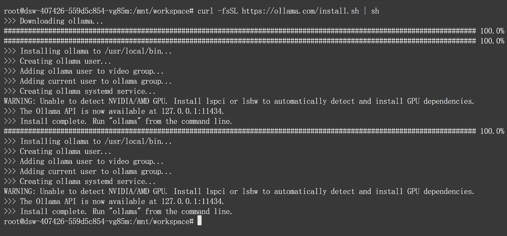

然后开启ollama服务：

```
ollama serve
```

然后即可使用如下命令安装和在命令行中调用qwen1.5大模型：

```
ollama run qwen:1.8b
```

```

```

> 这里如果要使用本地已经下载好的大模型，则需要编辑ollama配置文件

而在代码环境中，ollama则提供了openai API风格的大模型调用方法。在开启ollama服务情况下，我们只需要进一步在代码环境中安装openai库即可完成调用：

```
!pip install openai
```

```
huggingface/tokenizers: The current process just got forked, after parallelism has already been used. Disabling parallelism to avoid deadlocks...
To disable this warning, you can either:
        - Avoid using `tokenizers` before the fork if possible
        - Explicitly set the environment variable TOKENIZERS_PARALLELISM=(true | false)


Looking in indexes: https://mirrors.aliyun.com/pypi/simple
Collecting openai
  Downloading https://mirrors.aliyun.com/pypi/packages/e7/c4/c992bd201ac468fa92ed19e002b5c74be80968ca1be8f7b735dc88dbe0b8/openai-1.19.0-py3-none-any.whl (292 kB)
     ━━━━━━━━━━━━━━━━━━━━━━━━━━━━━━━━━━━━━━━ 292.8/292.8 kB 8.7 MB/s eta 0:00:00
[?25hRequirement already satisfied: anyio&lt;5,&gt;=3.5.0 in /opt/conda/lib/python3.10/site-packages (from openai) (4.2.0)
Collecting distro&lt;2,&gt;=1.7.0 (from openai)
  Downloading https://mirrors.aliyun.com/pypi/packages/12/b3/231ffd4ab1fc9d679809f356cebee130ac7daa00d6d6f3206dd4fd137e9e/distro-1.9.0-py3-none-any.whl (20 kB)
Collecting httpx&lt;1,&gt;=0.23.0 (from openai)
  Downloading https://mirrors.aliyun.com/pypi/packages/41/7b/ddacf6dcebb42466abd03f368782142baa82e08fc0c1f8eaa05b4bae87d5/httpx-0.27.0-py3-none-any.whl (75 kB)
     ━━━━━━━━━━━━━━━━━━━━━━━━━━━━━━━━━━━━━━━━ 75.6/75.6 kB 25.1 MB/s eta 0:00:00
[?25hRequirement already satisfied: pydantic&lt;3,&gt;=1.9.0 in /opt/conda/lib/python3.10/site-packages (from openai) (2.5.3)
Requirement already satisfied: sniffio in /opt/conda/lib/python3.10/site-packages (from openai) (1.3.0)
Requirement already satisfied: tqdm&gt;4 in /opt/conda/lib/python3.10/site-packages (from openai) (4.65.0)
Requirement already satisfied: typing-extensions&lt;5,&gt;=4.7 in /opt/conda/lib/python3.10/site-packages (from openai) (4.9.0)
Requirement already satisfied: idna&gt;=2.8 in /opt/conda/lib/python3.10/site-packages (from anyio&lt;5,&gt;=3.5.0-&gt;openai) (3.4)
Requirement already satisfied: exceptiongroup&gt;=1.0.2 in /opt/conda/lib/python3.10/site-packages (from anyio&lt;5,&gt;=3.5.0-&gt;openai) (1.2.0)
Requirement already satisfied: certifi in /opt/conda/lib/python3.10/site-packages (from httpx&lt;1,&gt;=0.23.0-&gt;openai) (2023.11.17)
Collecting httpcore==1.* (from httpx&lt;1,&gt;=0.23.0-&gt;openai)
  Downloading https://mirrors.aliyun.com/pypi/packages/78/d4/e5d7e4f2174f8a4d63c8897d79eb8fe2503f7ecc03282fee1fa2719c2704/httpcore-1.0.5-py3-none-any.whl (77 kB)
     ━━━━━━━━━━━━━━━━━━━━━━━━━━━━━━━━━━━━━━━━ 77.9/77.9 kB 21.7 MB/s eta 0:00:00
[?25hRequirement already satisfied: h11&lt;0.15,&gt;=0.13 in /opt/conda/lib/python3.10/site-packages (from httpcore==1.*-&gt;httpx&lt;1,&gt;=0.23.0-&gt;openai) (0.14.0)
Requirement already satisfied: annotated-types&gt;=0.4.0 in /opt/conda/lib/python3.10/site-packages (from pydantic&lt;3,&gt;=1.9.0-&gt;openai) (0.6.0)
Requirement already satisfied: pydantic-core==2.14.6 in /opt/conda/lib/python3.10/site-packages (from pydantic&lt;3,&gt;=1.9.0-&gt;openai) (2.14.6)
DEPRECATION: pytorch-lightning 1.7.7 has a non-standard dependency specifier torch&gt;=1.9.*. pip 24.1 will enforce this behaviour change. A possible replacement is to upgrade to a newer version of pytorch-lightning or contact the author to suggest that they release a version with a conforming dependency specifiers. Discussion can be found at https://github.com/pypa/pip/issues/12063
Installing collected packages: httpcore, distro, httpx, openai
Successfully installed distro-1.9.0 httpcore-1.0.5 httpx-0.27.0 openai-1.19.0
WARNING: Running pip as the &#x27;root&#x27; user can result in broken permissions and conflicting behaviour with the system package manager. It is recommended to use a virtual environment instead: https://pip.pypa.io/warnings/venv

```

```
from openai import OpenAI
```

```
from openai import OpenAI
client = OpenAI(
    base_url=&#x27;http://localhost:11434/v1/&#x27;,
    api_key=&#x27;ollama&#x27;,  # required but ignored
)
chat_completion = client.chat.completions.create(
    messages=[
        {&#x27;role&#x27;: &#x27;user&#x27;,&#x27;content&#x27;: &#x27;你好&#x27;,}
    ],
    model=&#x27;qwen:1.8b&#x27;,
)
```

```
chat_completion.choices[0]
```

```
Choice(finish_reason=&#x27;stop&#x27;, index=0, logprobs=None, message=ChatCompletionMessage(content=&#x27;你好！有什么我可以帮助你的吗？例如，你可以询问关于某个特定主题的信息或者提供一个问题或主题以供讨论。我期待着听到你的提问并为你提供相关信息。\n&#x27;, role=&#x27;assistant&#x27;, function_call=None, tool_calls=None))
```

```
print(chat_completion.choices[0].message.content)
```

```
你好！有什么我可以帮助你的吗？例如，你可以询问关于某个特定主题的信息或者提供一个问题或主题以供讨论。我期待着听到你的提问并为你提供相关信息。
```

而据此，我们就可以非常便捷的编写一个基于Qwen1.5-1.8b模型的多轮对话函数：

```
def run_chat_session():
    # 初始化客户端
    client = OpenAI(
        base_url=&#x27;http://localhost:11434/v1/&#x27;,
        api_key=&#x27;ollama&#x27;,  # API key is required but ignored for local model
    )
    
    # 初始化对话历史
    chat_history = []
    
    # 启动对话循环
    while True:
        # 获取用户输入
        user_input = input(&quot;你: &quot;)
        
        # 检查是否退出对话
        if user_input.lower() == &#x27;exit&#x27;:
            print(&quot;退出对话。&quot;)
            break
        
        # 更新对话历史
        chat_history.append({&#x27;role&#x27;: &#x27;user&#x27;, &#x27;content&#x27;: user_input})
        
        # 调用模型获取回答
        try:
            chat_completion = client.chat.completions.create(
                messages=chat_history,
                model=&#x27;qwen:1.8b&#x27;,
            )
            # 获取最新回答，适当修改以适应对象属性
            model_response = chat_completion.choices[0].message.content
            print(&quot;AI: &quot;, model_response)
            
            # 更新对话历史
            chat_history.append({&#x27;role&#x27;: &#x27;assistant&#x27;, &#x27;content&#x27;: model_response})
        except Exception as e:
            print(&quot;发生错误:&quot;, e)
            break
```

```
# 调用函数以启动多轮对话
run_chat_session()
```

```
你:  你好


AI:  你好！有什么我可以帮助你的吗？例如，解答某个问题、提供某种信息等。请详细描述一下你想要解决的问题或获取的信息，这样我才能更准确地为你服务。谢谢！


你:  请问，什么是机器学习


AI:  机器学习（Machine Learning）是一种人工智能的分支，主要研究如何使用计算机程序从经验数据中自动提取规律并用于预测新数据的能力。

机器学习的基本思想是：将需要处理的数据集划分为训练集和测试集。在训练集中，通过各种算法或模型，让计算机能够从训练数据中发现潜在的模式、规律或者特性，并将这些模式、规律或者特性以预定的形式表示出来，从而实现对新数据进行预测的能力。

机器学习的应用领域广泛，包括但不限于：图像识别（Image Recognition）、自然语言处理（Natural Language Processing）以及智能推荐系统（Intelligent Recommendation Systems）等。


你:  那什么是深度学习呢？


AI:  深度学习（Deep Learning）是一种人工智能领域的分支，主要研究如何使用多层神经网络从大量数据中自动提取模式、规律或特性，并将这些模式、规律或特性以预定的形式表示出来，从而实现对新数据进行预测的能力。
深度学习的研究对象主要是由大量的特征向量构成的复杂数据集。在深度学习系统中，每个神经元通过一系列复杂的数学运算来计算输入数据的特征向量，并将其作为神经元的输出信息（Output Information）；而每个输出信息经过一系列复杂的数学运算之后，则会被转换为一个或多个数值型特征向量（Feature Vector），然后这些数值型特征向量（Feature Vector）将会被用来作为模型训练时的输入参数。
深度学习系统中的每一层神经元通常都由一个或多层卷积层、一个或多层全连接层和一个多层池化层组成，其结构如图所示：

```python
import torch.nn as nn

# Define the input shape and number of channels.
input_shape = (28, 28))
num_channels = 3

# Define a convolutional neural network with max pooling layers.
class ConvNet(nn.Module):
    # Define the architecture of the convolutional neural network.
    super().__init__()
    # Add one convolutional layer with max pooling layers.
    convolutional_layer1 = nn.Conv(in_features=input_shape[0]], out_features=num_channels, stride=2))
    max_pooling_layer1 = nn.MaxPool1d(kernel_size=2, padding=-1)))
    convolutional_layer2 = nn.Conv(in_features=input_shape[0]], out_features=num_channels-1, stride=2))
    max_pooling_layer2 = nn.MaxPool1d(kernel_size=2, padding=-1)))
    convolutional_layer3 = nn.Conv(in_features=input_shape[0]], out_features=num_channels-2, stride=2))
    max_pooling_layer3 = nn.MaxPool1d(kernel_size=2, padding=-1)))
    dense_block_1 = nn.Linear(num_channels-2), num_classes)
    dense_block_2 = nn.Linear(num_channels-2), num_classes-1)

# Define the last fully connected layer and its corresponding output size.
output_size = num_classes
lastfully_connected_layer = dense_block_1(output_size))
```

In this example, we have defined a convolutional neural network with max pooling layers. The architecture of the network consists of five convolutional layers (with max pool layers) followed by three fully connected layers.
The first and second convolutional layers each have one convolutional layer with max pooling layers and a max pooling layer applied to the output of the first convolutional layer. The third convolutional layer has no max pooling layers, and it applies a max pooling layer to the output of the previous two convolutional layers.
In each of the five convolutional layers, there are multiple convolutional filters with different kernel sizes and stride values. These convolutional filters are used to extract features from the input data that can be used for training the neural network.
The output of each convolutional layer is a set of extracted features or labels that represent the input data in terms of its structure and characteristics. These extracted features or labels can then be used by the last fully connected layer (the final output layer) to generate the final predictions or classifications based on the input data.
In summary, deep learning networks are trained using large datasets consisting of high-dimensional feature vectors, which can be represented mathematically as a tensor with $(m+n) \times (m+n)$ elements).
In these training sessions, deep neural networks learn how to extract features from input data and use those extracted features to make predictions or classifications on new data.
Deep learning networks are capable of handling complex datasets consisting of high-dimensional feature vectors that can be represented mathematically as a tensor with $(m+n) \times (m+n)$ elements), and they have been successfully applied to various fields, including computer vision, natural language processing, robotics, bioinformatics, among others.
Overall, deep learning networks are powerful tools for solving complex problems in various domains, thanks to their ability to handle large datasets consisting of high-dimensional feature vectors that can be represented mathematically as a tensor with $(m+n) \times (m+n)$ elements).


你:  我的上一个问题是什么？


AI:  很抱歉，由于您没有提供具体的上一个问题，我无法确定该问题的类型或内容。如果您能提供更多关于上一个问题的信息，例如问题的主题、背景、目的等，那么我将能够更好地理解并回答您的问题。谢谢！


你:  我之前问过哪些问题？


AI:  很抱歉，由于您没有提供具体的上一个问题的具体名称（如：你之前提问的“深度学习”是什么的问题吗？），所以目前无法准确地指出您之前询问过的哪些问题。如果您能提供更多关于您之前询问过的具体问题的信息（如：问题的主题、背景、目的等），那么我将能够更好地理解并回答您的问题。感谢！


你:  exit


退出对话。
```

---

+   体验课内容节选自《大模型技术实战》完整版付费课程

体验课时间有限，若想深度学习大模型技术，请扫码添加英英，回复“大模型”，即咨询相关信息哦👇


此外，**扫码回复“LLM”**，即可领取**公开课课件、代码、数据**等~


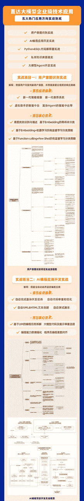

