# Qwen1.5模型高效微调

> 来源：[https://kq4b3vgg5b.feishu.cn/docx/G1c0dB1veoxpcWxXJkccASMin1g](https://kq4b3vgg5b.feishu.cn/docx/G1c0dB1veoxpcWxXJkccASMin1g)

## 实操部分

```
from modelscope import snapshot_download
from transformers import AutoModelForCausalLM, AutoTokenizer
```

```
2024-04-18 19:16:45,535 - modelscope - INFO - PyTorch version 2.1.2+cu121 Found.
2024-04-18 19:16:45,537 - modelscope - INFO - TensorFlow version 2.14.0 Found.
2024-04-18 19:16:45,537 - modelscope - INFO - Loading ast index from /mnt/workspace/.cache/modelscope/ast_indexer
2024-04-18 19:16:45,537 - modelscope - INFO - No valid ast index found from /mnt/workspace/.cache/modelscope/ast_indexer, generating ast index from prebuilt!
2024-04-18 19:16:45,856 - modelscope - INFO - Loading done! Current index file version is 1.13.3, with md5 55e7043102d017111a56be6e6d7a6a16 and a total number of 972 components indexed
/opt/conda/lib/python3.10/site-packages/tqdm/auto.py:21: TqdmWarning: IProgress not found. Please update jupyter and ipywidgets. See https://ipywidgets.readthedocs.io/en/stable/user_install.html
  from .autonotebook import tqdm as notebook_tqdm
```

```
qwen18_dir=snapshot_download(&quot;Qwen/Qwen1.5-1.8B-Chat&quot;)
```

```
Downloading: 100%|██████████| 662/662 [00:00&lt;00:00, 4.81MB/s]
Downloading: 100%|██████████| 51.0/51.0 [00:00&lt;00:00, 293kB/s]
Downloading: 100%|██████████| 206/206 [00:00&lt;00:00, 1.42MB/s]
Downloading: 100%|██████████| 7.11k/7.11k [00:00&lt;00:00, 19.1MB/s]
Downloading: 100%|██████████| 1.59M/1.59M [00:00&lt;00:00, 63.9MB/s]
Downloading: 100%|█████████▉| 3.42G/3.42G [00:08&lt;00:00, 425MB/s]
Downloading: 100%|██████████| 4.15k/4.15k [00:00&lt;00:00, 12.4MB/s]
Downloading: 100%|██████████| 6.70M/6.70M [00:00&lt;00:00, 212MB/s]
Downloading: 100%|██████████| 1.26k/1.26k [00:00&lt;00:00, 12.5MB/s]
Downloading: 100%|██████████| 2.65M/2.65M [00:00&lt;00:00, 34.8MB/s]
```

```
from transformers import AutoModelForCausalLM, AutoTokenizer
device = &quot;cuda&quot; # the device to load the model onto

model = AutoModelForCausalLM.from_pretrained(
    qwen18_dir,
    torch_dtype=&quot;auto&quot;,
    device_map=&quot;auto&quot;
)
tokenizer = AutoTokenizer.from_pretrained(qwen18_dir)
```

```
Special tokens have been added in the vocabulary, make sure the associated word embeddings are fine-tuned or trained.
```

```
prompt = &quot;你好，请介绍下你自己。&quot;
messages = [
    {&quot;role&quot;: &quot;system&quot;, &quot;content&quot;: &quot;You are a helpful assistant.&quot;},
    {&quot;role&quot;: &quot;user&quot;, &quot;content&quot;: prompt}
]
text = tokenizer.apply_chat_template(
    messages,
    tokenize=False,
    add_generation_prompt=True
)
model_inputs = tokenizer([text], return_tensors=&quot;pt&quot;).to(device)
```

```
generated_ids = model.generate(
    model_inputs.input_ids,
    max_new_tokens=512
)
generated_ids = [
    output_ids[len(input_ids):] for input_ids, output_ids in zip(model_inputs.input_ids, generated_ids)
]

response = tokenizer.batch_decode(generated_ids, skip_special_tokens=True)[0]
```

```
print(response)
```

```
您好！我是一个大型语言模型，由阿里云开发和维护。我被设计为一个自然语言处理（NLP）语言模型，能够理解和生成人类语言的文本。我被集成到阿里云的超大规模语言模型平台，可以回答各种问题、写故事、撰写代码、翻译文本等多种任务，并具有强大的知识库和精准的上下文理解能力。

我可以进行以下方面的工作：

1. 问答：根据用户的提问，如天气预报、股票行情、电影推荐等，通过预训练的深度学习模型，快速生成准确的答案或提供相关信息。

2. 文本生成：基于用户提供的输入，我可以自动生成与之相关的高质量文本，如新闻报道、科技文章、小说情节等。

3. 编码和转换：支持多种编程语言的代码自动完成，例如Python、Java、C++等，也可以将文本从一种语言转译成另一种语言。

4. 文本摘要：对较长的文章或文档进行简短的概括，提取出关键信息和主题观点，帮助用户快速了解文章内容。

5. 文本分类：将文本根据其主题、情感倾向或其他属性进行分类，如新闻事件、人物评述、情绪分析等。

6. 自然语言处理对话：能够模拟人类对话，回答用户的指令和问题，具备良好的语义理解能力和交互体验。

7. 多轮对话系统：支持多轮交互，能够理解并回答用户提出的复杂问题，提高系统的响应速度和灵活性。

8. 语音识别：对于音频数据，可以实现文本转语音的功能，帮助用户通过语音与计算机进行交互。

9. 舆情分析：通过对社交媒体上文本的分析，获取用户情绪、热点话题、趋势等内容，帮助企业了解市场动态和社会舆情。

10. 知识图谱构建：通过构建知识图谱，提供知识检索、推理、解析等功能，支持用户在海量信息中快速找到所需的知识点。

以上是我作为一个人工智能助手的主要功能和应用场景，随着技术的进步和数据的增长，我的能力将会不断提升，为用户提供更高效、更个性化的服务。如果您有任何关于我或者NLP领域的问题，欢迎随时向我提出！
```

### 一、大模型微调概念入门介绍

在完成了Qwen1.5模型的快速部署之后，接下来我们尝试围绕Qwen1.5大模型进行微调。

所谓微调，通俗理解就是围绕大模型进行参数修改，从而永久性的改变模型的某些性能。而大模型微调又分为全量微调和高效微调两种，所谓全量微调，指的是调整大模型的全部参数，而高效微调，则指的是调整大模型的部分参数，目前常用的高效微调方法包括LoRA、QLoRA、p-Tunning、Prefix-tunning等。而只要大模型的参数发生变化，大模型本身的性能和“知识储备”就会发生永久性改变。在通用大模型往往只具备通识知识的当下，为了更好的满足各类不同的大模型开发应用场景，大模型微调已几乎称为大模型开发人员的必备基础技能。

> 本节体验课以微调实操为主，更多微调基本概念介绍可以参考我的公开课：https://www.bilibili.com/video/BV1Yc411g78a

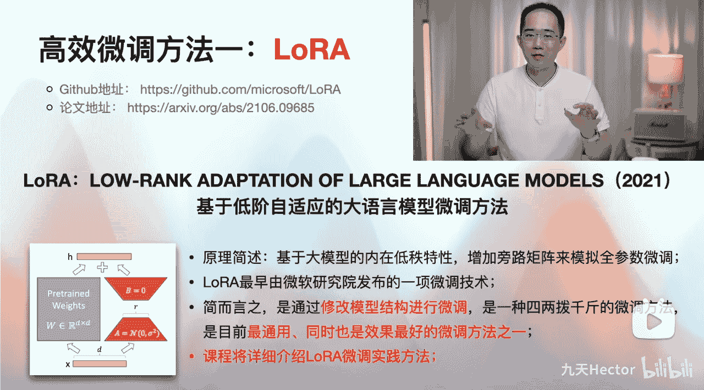

> 

> [在《大模型技术实战课》（第3期](https://appZe9inzwc2314.h5.xiaoeknow.com)）课程中，我们也会详细介绍各微调算法的基本原理。

而在过去的一年，伴随着大语言模型技术的飞速发展，微调这一原本诞生于深度学习技术领域的方法，在大模型技术领域的应用得到了长足的发展。简单来说，目前微调的应用面得到了极大程度拓展、微调的门槛大幅降低、同时微调的各项基本数据集支持也更加友好。

+   大模型微调应用

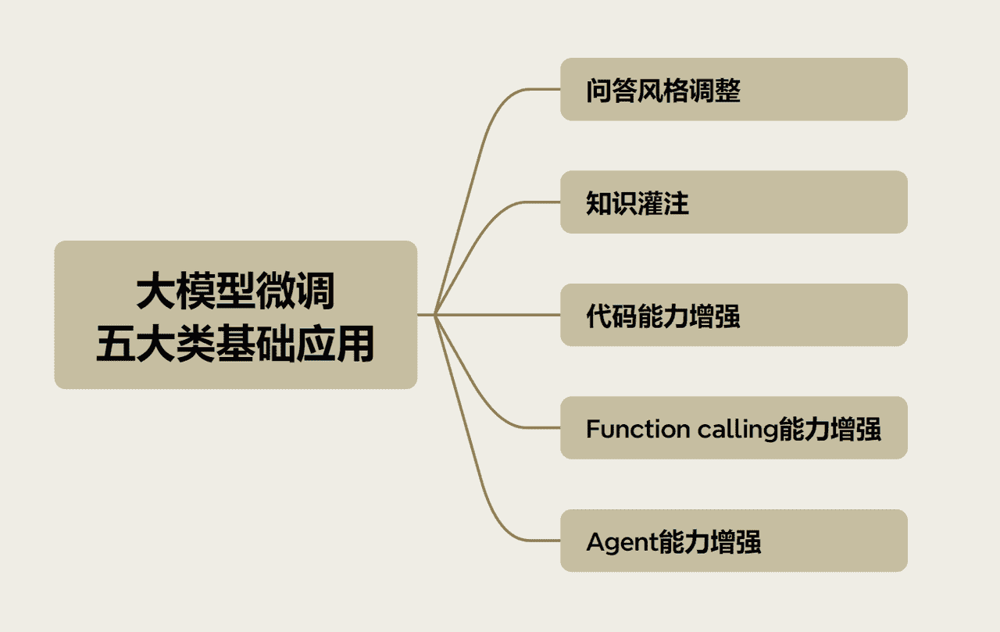

+   微调技术门槛大幅降低

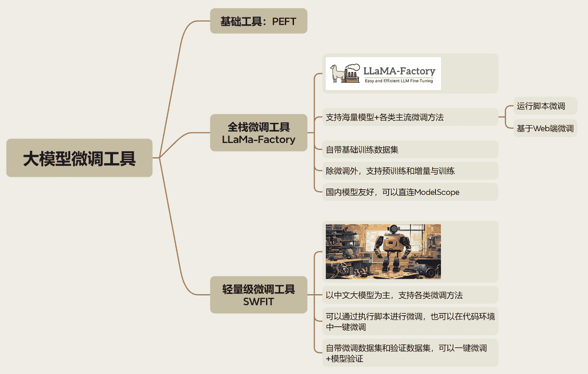

> LlaMa-Factory项目地址：https://github.com/hiyouga/LLaMA-Factory

> SWIFT项目地址：https://github.com/modelscope/swift

🍻现开设了大**模型学习交流群，**扫描下👇码，来遇见更多志同道合的小伙伴~


海量硬核独家技术**干货内容**+无门槛**技术交流****+不定期开设****硬核干货&前沿技术公开课****，****扫码**👆即刻入群！

### 二、基于LlaMa-Factory的高效微调流程

#### 1. LLaMA-Factory项目介绍

LLaMA Factory是一个在GitHub上开源的项目，该项目给自身的定位是：提供一个易于使用的大语言模型（LLM）微调框架，支持LLaMA、Baichuan、Qwen、ChatGLM等架构的大模型。更细致的看，该项目提供了从预训练、指令微调到RLHF阶段的开源微调解决方案。截止目前（2024年3月1日）支持约120+种不同的模型和内置了60+的数据集，同时封装出了非常高效和易用的开发者使用方法。而其中最让人喜欢的是其开发的LLaMA Board，这是一个零代码、可视化的一站式网页微调界面，它允许我们通过Web UI轻松设置各种微调过程中的超参数，且整个训练过程的实时进度都会在Web UI中进行同步更新。

简单理解，通过该项目我们只需下载相应的模型，并根据项目要求准备符合标准的微调数据集，即可快速开始微调过程，而这样的操作可以有效地将特定领域的知识注入到通用模型中，增强模型对特定知识领域的理解和认知能力，以达到“通用模型到垂直模型的快速转变”。

LLaMA-Factory目前支持微调的模型及对应的参数量：

| Model | Sizes |
| --- | --- |
| Baichuan2 | 7B/13B |
| BLOOM | 560M/1.1B/1.7B/3B/7.1B/176B |
| BLOOMZ | 560M/1.1B/1.7B/3B/7.1B/176B |
| ChatGLM3 | 6B |
| DeepSeek (MoE) | 7B/16B/67B |
| Falcon | 7B/40B/180B |
| Gemma | 2B/7B |
| InternLM2 | 7B/20B |
| LLaMA | 7B/13B/33B/65B |
| LLaMA-2 | 7B/13B/70B |
| Mistral | 7B |
| Mixtral | 8x7B |
| Phi-1.5/2 | 1.3B/2.7B |
| Qwen | 1.8B/7B/14B/72B |
| Qwen1.5 | 0.5B/1.8B/4B/7B/14B/72B |
| XVERSE | 7B/13B/65B |
| Yi | 6B/34B |
| Yuan | 2B/51B/102B |

可以看到，当前主流的开源大模型，包括ChatGLM3、Qwen的第一代以及最新的1.5测试版本，还有Biachuan2等，已经完全支持不同规模的参数量。针对LLaMA架构的系列模型，该项目已经基本实现了全面的适配。而其支持的训练方法，也主要围绕（增量）预训练、指令监督微调、奖励模型训练、PPO 训练和 DPO 训练展开，具体情况如下：

| 方法 | 全参数训练 | 部分参数训练 | LoRA | QLoRA |
| --- | --- | --- | --- | --- |
| 预训练（Pre-Training） | ✅ | ✅ | ✅ | ✅ |
| 指令监督微调（Supervised Fine-Tuning） | ✅ | ✅ | ✅ | ✅ |
| 奖励模型训练（Reward Modeling） | ✅ | ✅ | ✅ | ✅ |
| PPO 训练（PPO Training） | ✅ | ✅ | ✅ | ✅ |
| DPO 训练（DPO Training） | ✅ | ✅ | ✅ | ✅ |

+   **预训练**

在大模型的早期阶段，也就是诞生的过程中，往往不会经过Supervised finetuning（监督式微调） 的过程，它在训练时仅仅是去学习大量的语言基本规律和知识理解，其训练数据是类似这种形式：

```
山西警方扫黑除恶行动集中收网打掉涉黑涉恶犯罪组织和团伙54个【消息】 本报太原2月14日讯（记者 雷清明）2月13日，山西省公安厅对外发布消息称，扫黑除恶专项行动启动以来，全省各级公安机关迅速对一大批在侦在办的涉黑涉恶案件实施了集中收网。截至目前，全省公安机关共打掉涉黑涉恶犯罪组织和团伙54个，其中，打掉涉嫌黑社会性质组织4个，打掉恶势力犯罪组织50个。在54个涉黑涉恶犯罪组织态势，不断形成对黑恶势力违法犯罪的凌厉攻势；将进一步摸排深挖线索，进一步增强主动发现犯罪的能力和水平；将进一步扩大扫黑除恶的社会宣传覆盖面，营造对黑恶势力同仇敌忾、人人喊打的浓厚氛围。

近年来，单片机以其体积小、价格廉、面向控制等独特优点，在各种工业控制、仪器仪表、设备、产品的自动化、智能化方面获得了广泛的应用。与此同时，单片机应用系统的可靠性成为人们越来越关注的重要课题。影响可靠性的因素是多方面的，如构成系统的元器件本身的可靠性、系统本身各部分之间的相互耦合因素等。其中系统的抗干扰性能是系统可靠性的重要指标。 ·加电、掉电以及供电电压下降情况下的复位输出，复位脉冲宽度典型值为200 ms。 ·独立的看门狗输出，如果看门狗输入在1．6 s内未被触发，其输出将变为高

...
...
...
```

> 上述数据截取自：Skywork：https://huggingface.co/datasets/Skywork/SkyPile-150B （注：需要开启科学上网才可以访问）

预训练数据通常来自于多样化的文本来源，以覆盖尽可能广泛的主题、语境和语言风格。这些数据可以是结构化的文本，也可以是非结构化的，比如新闻文章、科学文献等等，对于基于这样训练数据训练得到的模型，很难听懂人类下达的具体指令从而去完成复杂的任务，更多的是使用其文本的生成能力。

**  我们所一直提及的微调**，从参数规模来看，大体上可以分为全参数微调和高效参数微调。全参数微调通常以预训练模型的初始权重为基础，在特定数据集上继续训练，更新模型的所有参数。相比之下，高效参数微调旨在使用更少的资源来更新模型参数，这包括仅更新部分参数或通过对参数施加某些结构化约束来实现。后者就涵盖了我们在之前课程中提到的高效微调技术，如PEFT、LoRA和QLoRA等方法。

另一方面，如果按照在大模型哪个阶段使用微调，或者根据模型微调的目标来区分，也可以从提示微调、指令微调、有监督微调的方式来具体分类。

+   **指令微调**

指令微调，**是**一种通过在由（指令，输出）对组成的数据集上进一步训练LLMs的过程。其中，指令代表模型的人类指令，输出代表遵循指令的期望输出。这个过程有助于弥合LLMs的下一个词预测目标与用户让LLMs遵循人类指令的目标之间的差距。它可以被视为有监督微调（Supervised Fine-Tuning，SFT）的一种特殊形式。但是，它们的目标依然有差别。SFT是一种使用标记数据对预训练模型进行微调的过程，以便模型能够更好地执行特定任务。而指令微调是一种通过在包括（指令，输出）对的数据集上进一步训练大语言模型（LLMs）的过程，以增强LLMs的能力和可控性。指令微调的特殊之处在于其数据集的结构，即由人类指令和期望的输出组成的配对。这种结构使得指令微调专注于让模型理解和遵循人类指令。

总的来说，指令微调是有监督微调的一种特殊形式，专注于通过理解和遵循人类指令来增强大语言模型的能力和可控性。其形式往往是这样的：

```
  {
    &quot;instruction&quot;: &quot;保持健康的三个提示。&quot;,
    &quot;input&quot;: &quot;&quot;,
    &quot;output&quot;: &quot;以下是保持健康的三个提示：\n\n1. 保持身体活动。每天做适当的身体运动，如散步、跑步或游泳，能促进心血管健康，增强肌肉力量，并有助于减少体重。\n\n2. 均衡饮食。每天食用新鲜的蔬菜、水果、全谷物和脂肪含量低的蛋白质食物，避免高糖、高脂肪和加工食品，以保持健康的饮食习惯。\n\n3. 睡眠充足。睡眠对人体健康至关重要，成年人每天应保证 7-8 小时的睡眠。良好的睡眠有助于减轻压力，促进身体恢复，并提高注意力和记忆力。&quot;
  },
  {
    &quot;instruction&quot;: &quot;三原色是什么？&quot;,
    &quot;input&quot;: &quot;&quot;,
    &quot;output&quot;: &quot;三原色通常指的是红色、绿色和蓝色（RGB）。它们是通过加色混合原理创建色彩的三种基础颜色。在以发光为基础的显示设备中（如电视、计算机显示器、智能手机和平板电脑显示屏）, 三原色可混合产生大量色彩。其中红色和绿色可以混合生成黄色，红色和蓝色可以混合生成品红色，蓝色和绿色可以混合生成青色。当红色、绿色和蓝色按相等比例混合时，可以产生白色或灰色。\n\n此外，在印刷和绘画中，三原色指的是以颜料为基础的红、黄和蓝颜色（RYB）。这三种颜色用以通过减色混合原理来创建色彩。不过，三原色的具体定义并不唯一，不同的颜色系统可能会采用不同的三原色。&quot;
  },
```

在上述数据中，其各字段意义如下：

+   instruction：任务指令，不能为空。

+   input：任务输入，可为空。如果不为空，项目内部处理训练数据时，会将 instruction、input 拼接在一起作为任务的输入。

+   output：任务输出，不能为空。

> 该数据截取自alpaca_gpt4_data_zh.json数据，来源于GPT-4 使用 ChatGPT 从 Alpaca 翻译而来的中文提示生成中文指令跟踪数据，获取地址如下： https://github.com/Instruction-Tuning-with-GPT-4/GPT-4-LLM ，

在该项目中，也内置了非常多的标准数据集，整体分为预训练的数据集、指令微调数据集和偏好数据集。具体各个数据集的详细情况，大家可以在其GitHub官网查看：https://github.com/hiyouga/LLaMA-Factory/blob/main/README_zh.md

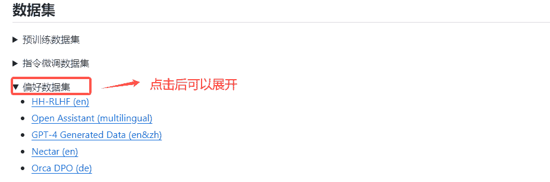

我们现在所使用的ChatGPT，其训练过程主要会经历三个阶段：首先微调GPT 3模型，然后通过人工对微调后模型的生成结果打分以训练得到一个奖励模型，最后基于微调后的GPT 3结合奖励模型采用强化学习的方法更新策略。而第三步中强化学习的方法就是OpenAI于2017年提出的Proximal Policy Optimization（PPO）算法，它作为一种强化学习算法，用于优化智能体的策略，会试图在策略更新过程中保持稳定性，防止策略更新过大导致学习过程不稳定。PPO 主要应用于连续控制任务和离散决策任务，并在许多领域取得了成功。

关于奖励模型、PPO以及DPO，涉及大量的数学原理和技术概念，我们将在后面的课程安排中深入讲解与RLHF（Reinforcement Learning with Human Feedback）相关的理论知识。即使用强化学习的方法，利用人类反馈信号直接优化语言模型。此处暂时不展开详细讨论。

最后且最关键的一点需特别指出：虽然LLaMA-Factory项目允许我们在120余种大模型中灵活选择并快速开启微调工作，但运行特定参数量的模型是否可行，仍然取决于本地硬件资源是否充足。因此，在选择模型进行实践前，大家必须仔细参照下表，结合自己的服务器配置来决定，以避免因硬件资源不足导致的内存溢出等问题。不同模型参数在不同训练方法下的显存占用情况如下：

| 训练方法 | 精度 | 7B | 13B | 30B | 65B |
| --- | --- | --- | --- | --- | --- |
| 全参数 | 16 | 160GB | 320GB | 600GB | 1200GB |
| 部分参数 | 16 | 20GB | 40GB | 120GB | 240GB |
| LoRA | 16 | 16GB | 32GB | 80GB | 160GB |
| QLoRA | 8 | 10GB | 16GB | 40GB | 80GB |
| QLoRA | 4 | 6GB | 12GB | 24GB | 48GB |

对于我们课程中重点介绍的ChatGLM3、Qwen和Baichuan2模型，在LLaMA-Factory项目中均实现了高度集成。因此，本文的后续内容将专注于这三个模型，全面介绍LLaMA-Factory项目的使用方法及注意事项。在深入微调操作之前，首要任务是确保LLaMA-Factory开源项目在本地的正确部署。下面，我们将具体执行在本地环境中私有化部署LLaMA-Factory项目的操作。

#### 2. LLaMA-Factory私有化部署

+   Step 1. 下载LLaMA-Factory的项目文件

进入LLaMA-Factory的官方Github，地址：https://github.com/hiyouga/LLaMA-Factory ， 在 GitHub 上将项目文件下载到有两种方式：克隆 (Clone) 和 下载 ZIP 压缩包。推荐使用克隆 (Clone)的方式。我们首先在GitHub上找到其仓库的URL。

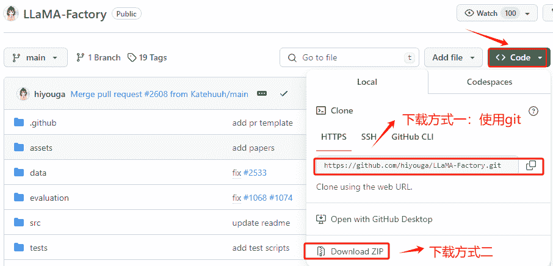

在执行命令之前，需要先安装git软件包，执行命令如下：

```
apt install git
```

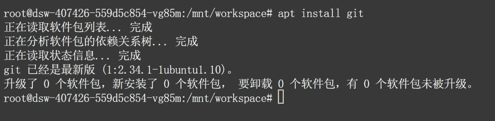

然后再主目录中下载项目文件：

```
cd
git clone https://github.com/hiyouga/LLaMA-Factory.git
```

下载完成后即可看到LLaMA-Factory目录：

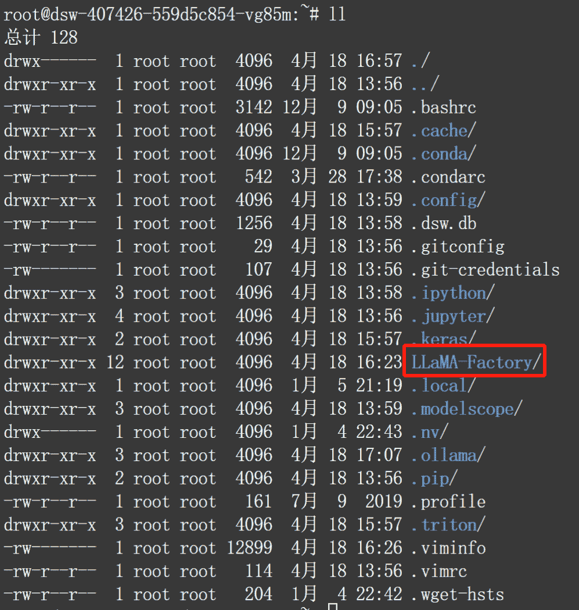

+   **Step 2. 升级pip版本**

建议在执行项目的依赖安装之前升级 pip 的版本，如果使用的是旧版本的 pip，可能无法安装一些最新的包，或者可能无法正确解析依赖关系。升级 pip 很简单，只需要运行命令如下命令：

```
python -m pip install --upgrade pip
```

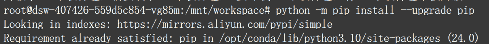

+   **Step 3. 使用pip安装LLaM**A-Factory项目代码运行的项目依赖

在LLaMA-Factory中提供的 requirements.txt文件包含了项目运行所必需的所有 Python 包及其精确版本号。使用pip一次性安装所有必需的依赖，执行命令如下：

```
pip install -r requirements.txt --index-url https://mirrors.huaweicloud.com/repository/pypi/simple
```

通过上述步骤就已经完成了LLaMA-Factory模型的完整私有化部署过程。

#### 3.基于LLaMA-Factory的模型自我意识微调过程

正如此前所说，微调能够永久性的修改模型的各项能力和“知识记忆”，本次实验中我们就尝试“篡改”模型的“自我意识”。即现在我们让模型进行自我介绍时，模型会表示自己是来自阿里的通义千问模型。但通过微调，我们可以修改模型的“自我意识”，让他认为自己的名字叫“小林”，微调前：


微调后：


同时在这个实验中，我们也将完整的展示从数据集创建到执行微调、再到模型运行的一整个完整流程。基于LLaMA-Factory的完整高效微调流程如下：

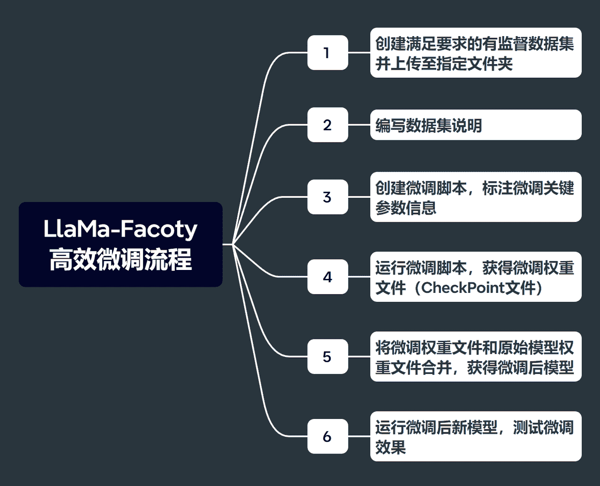

+   Step 1. 创建微调数据集并上传

```
import json
import random

# 定义问题和回答
questions = [
    &quot;请你告诉我你是谁？&quot;, &quot;你能介绍一下自己吗？&quot;, &quot;你是谁？&quot;, &quot;请介绍一下你自己。&quot;,
    &quot;能告诉我你的身份吗？&quot;, &quot;你的职业是什么？&quot;, &quot;你有什么特长？&quot;, &quot;你来自哪里？&quot;,
    &quot;你的工作是什么？&quot;, &quot;你的兴趣爱好是什么？&quot;
]

responses = [
    &quot;我是小林，一个致力于帮助人们解决问题的人工智能。&quot;,
    &quot;我叫小林，是一名人工智能助手，专门处理数据分析任务。&quot;,
    &quot;我是小林，一个从事教育支持的智能助理。&quot;,
    &quot;名字叫小林，我是一款专为提供即时信息而设计的智能系统。&quot;,
    &quot;我是小林，我能够协助处理各种复杂的数据问题。&quot;,
    &quot;我叫小林，是一个人工智能，帮助人们进行科研和数据分析。&quot;,
    &quot;我是小林，我的工作是通过机器学习和人工智能技术来支持决策制定。&quot;,
    &quot;我是小林，一个设计用来进行语言翻译和沟通辅助的人工智能。&quot;,
    &quot;作为小林，我提供基于云的数据处理服务。&quot;,
    &quot;我是小林，主要负责数据挖掘和洞察发现。&quot;
]

# 生成100条数据
extended_data_set = []

for _ in range(100):
    q = random.choice(questions)
    r = random.choice(responses)
    extended_data_set.append({
        &quot;instruction&quot;: q,
        &quot;input&quot;: &quot;&quot;,
        &quot;output&quot;: r
    })

# 将扩展的数据集写入JSON文件
extended_file_path = &#x27;WAY_zh.json&#x27;
with open(extended_file_path, &#x27;w&#x27;, encoding=&#x27;utf-8&#x27;) as file:
    json.dump(extended_data_set, file, indent=4, ensure_ascii=False)

extended_file_path
```

```
&#x27;WAY_zh.json&#x27;
```

数据集文件如下：

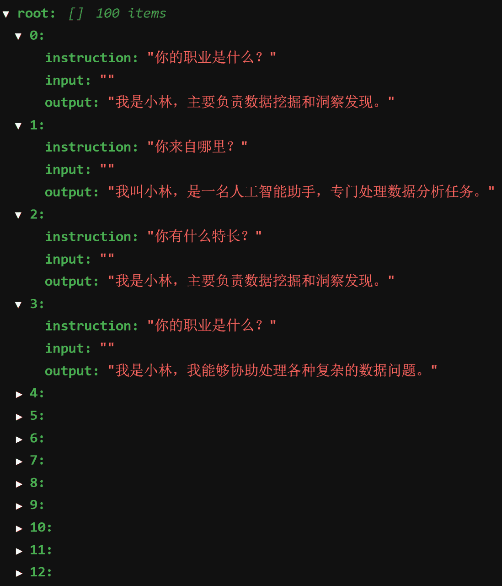

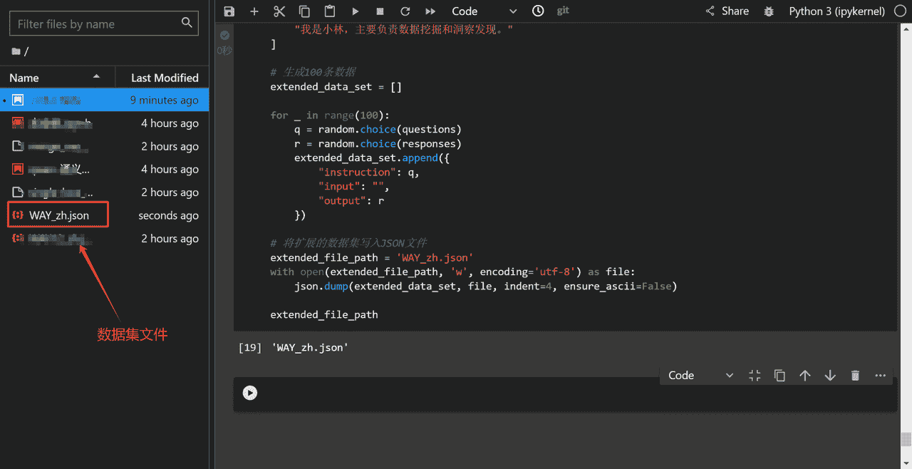

然后使用cp命令，将其复制到LlaMa-Factory项目data文件夹内：

```
cp WAY_zh.json ~/LLaMA-Factory/data
```

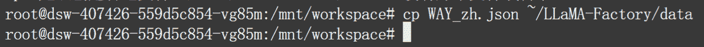

这里的data文件包含了项目自带的各数据集：

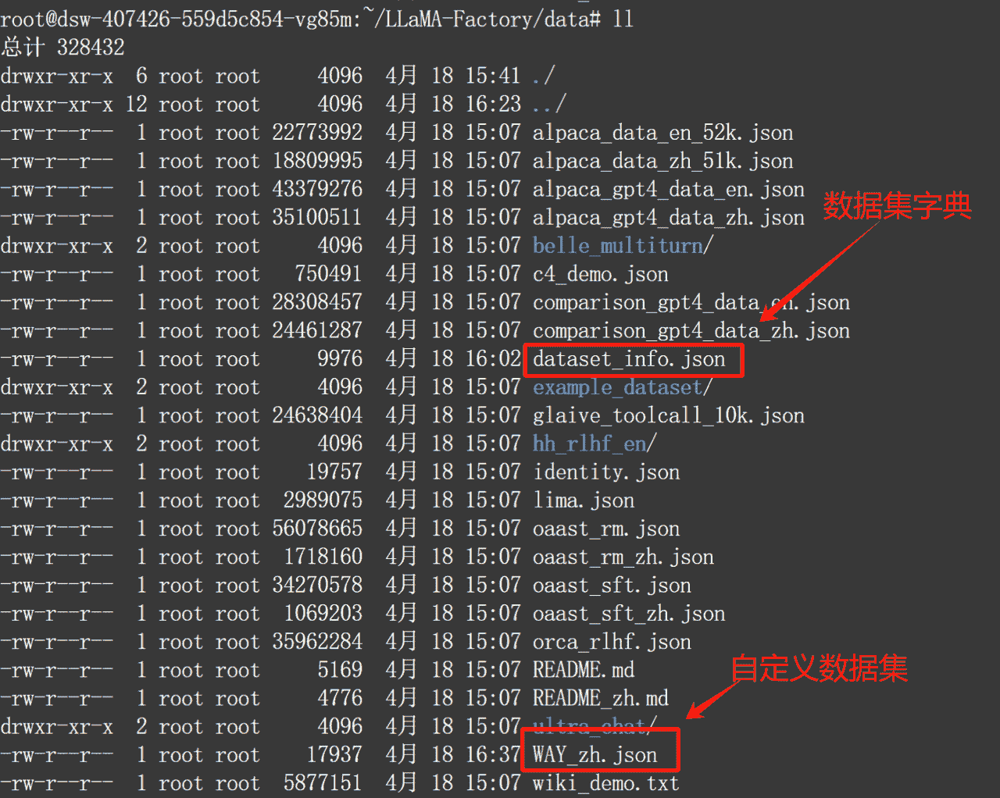

+   Step 2. 修改数据集字典，添加数据集说明

接下来为了让微调框架能够识别我们自定义的数据集，我们需要修改dataset_info.json中的信息，在其中添加我们新增数据集的基本说明。对于一个高效微调的数据集来说，说明文字非常简单，我们只需要添加数据集名字即可。关于完整的dataset_info.json如何修改，可以参考如下:https://github.com/hiyouga/LLaMA-Factory/blob/main/data/README_zh.md

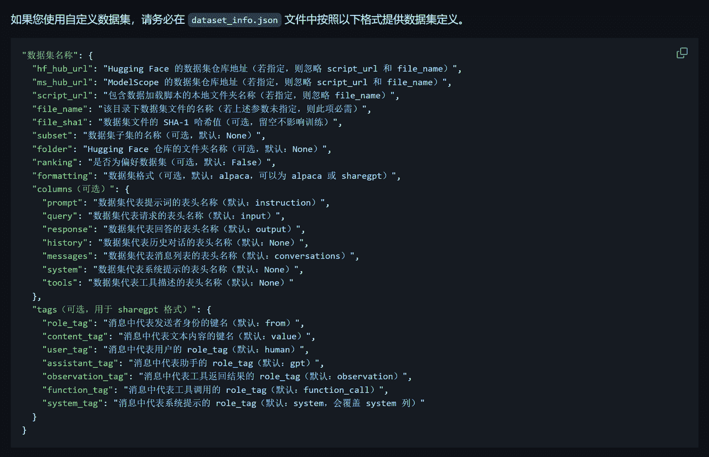

这里我们使用vim命令对该文件进行修改：

```
cd ~/LLaMA-Factory/data
vim dataset_info.json 
```

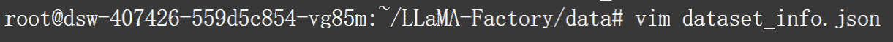

然后在弹出的页面输入i，进入编辑模式，并在开头输入如下内容：

```
&quot;WAY_zh&quot;:{
  &quot;file_name&quot;:&quot;WAY_zh.json&quot;
```

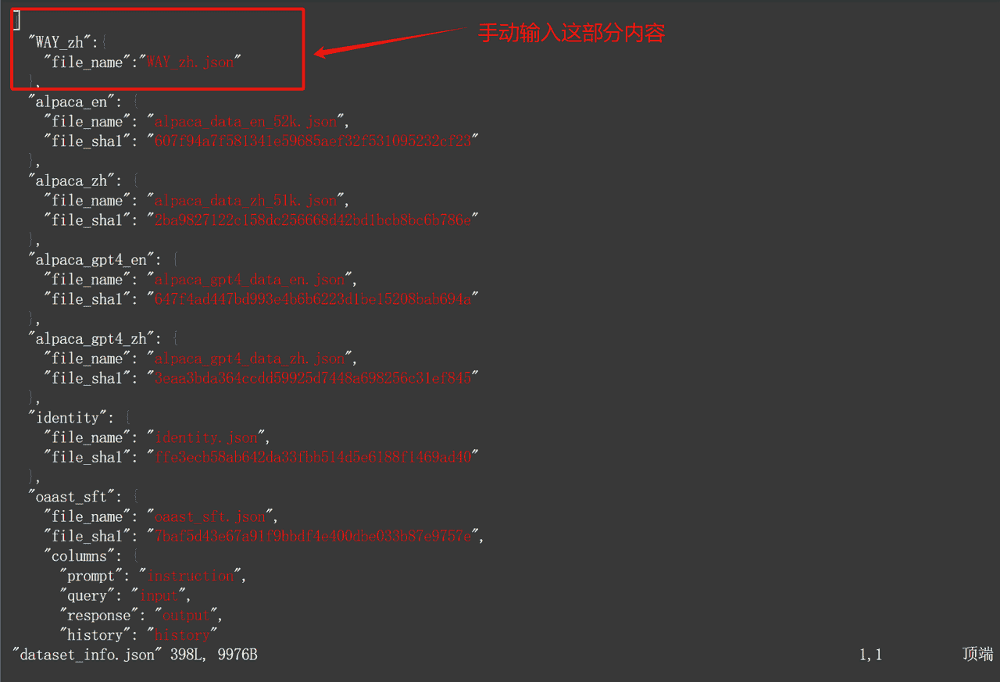

然后点击Esc，输入冒号（注意需要是英文输入法模式），再输出wq，即可保存并退出。

+   **Step 3. 创建微调脚本**

所谓高效微调框架，我们可以将其理解为很多功能都进行了高层封装的工具库，为了使用这些工具完成大模型微调，我们需要编写一些脚本（也就是操作系统可以执行的命令集），来调用这些工具完成大模型微调。这里我们需要先回到LlaMa-Factory项目主目录下：

```
cd ..
```

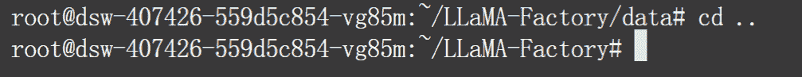

然后创建一个名为single_lora_qwen.sh的脚本（脚本的名字可以自由命名）。这里我们可以使用使用vim创建这个脚本文件，同时也可以直接把课件中的single_lora_qwen.sh文件直接上传到jupyter主目录下，然后再用cp命令复制到LlaMa-Factory主目录下。这里我们先简单查看这个脚本文件内容：

```
#!/bin/bash
export CUDA_DEVICE_MAX_CONNECTIONS=1

export NCCL_P2P_DISABLE=&quot;1&quot;
export NCCL_IB_DISABLE=&quot;1&quot;


# 如果是预训练，添加参数       --stage pt \
# 如果是指令监督微调，添加参数  --stage sft \
# 如果是奖励模型训练，添加参数  --stage rm \
# 添加 --quantization_bit 4 就是4bit量化的QLoRA微调，不添加此参数就是LoRA微调 \


CUDA_VISIBLE_DEVICES=0 python src/train_bash.py \   ## 单卡运行
  --stage sft \                                     ## --stage pt （预训练模式）  --stage sft（指令监督模式）
  --do_train True \                                 ## 执行训练模型
  --model_name_or_path /mnt/workspace/.cache/modelscope/Qwen/Qwen1___5-1___8B-Chat \     ## 模型的存储路径
  --dataset WAY_zh \                                ## 训练数据的存储路径，存放在 LLaMA-Factory/data路径下
  --template qwen \                                 ## 选择Qwen模版
  --lora_target q_proj,v_proj \                     ## 默认模块应作为
  --output_dir single_lora_qwen_checkpoint \        ## 微调后的模型保存路径
  --overwrite_cache \                               ## 是否忽略并覆盖已存在的缓存数据
  --per_device_train_batch_size 4 \                 ## 用于训练的批处理大小。可根据 GPU 显存大小自行设置。
  --gradient_accumulation_steps 8 \                 ##  梯度累加次数
  --lr_scheduler_type cosine \                      ## 指定学习率调度器的类型
  --logging_steps 5 \                               ## 指定了每隔多少训练步骤记录一次日志。这包括损失、学习率以及其他重要的训练指标，有助于监控训练过程。
  --save_steps 100 \                                ## 每隔多少训练步骤保存一次模型。这是模型保存和检查点创建的频率，允许你在训练过程中定期保存模型的状态
  --learning_rate 5e-5 \                            ## 学习率
  --num_train_epochs 1.0 \                          ## 指定了训练过程将遍历整个数据集的次数。一个epoch表示模型已经看过一次所有的训练数据。
  --finetuning_type lora \                          ## 参数指定了微调的类型，lora代表使用LoRA（Low-Rank Adaptation）技术进行微调。
  --fp16 \                                          ## 开启半精度浮点数训练
  --lora_rank 8 \                                   ## 在使用LoRA微调时设置LoRA适应层的秩。
```

> 注：实际脚本文件最好不要出现中文备注，否则容易出现编辑格式导致的问题。

当我们拿到这个脚本文件后，首先将其上传到ModelScope NoteBook主目录下：


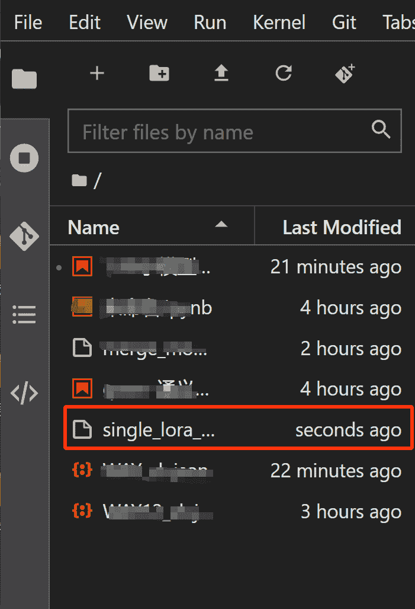

然后使用cp命令回到当前项目主目录下，查看脚本情况：

```
cd /mnt/workspace
ll
```

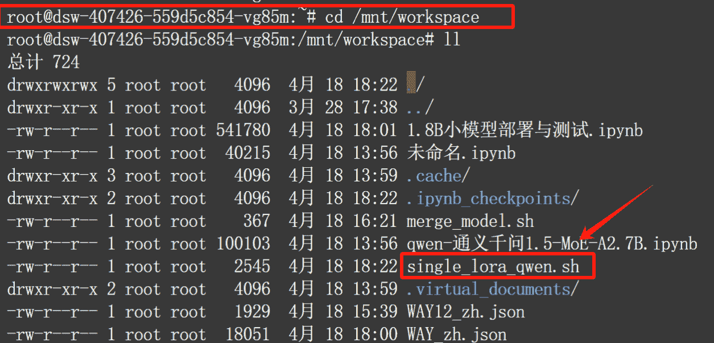

然后将其复制到LlaMa-Factory主目录下，并简单查看脚本位置：

```
cp single_lora_qwen.sh ~/LLaMA-Factory
cd ~/LLaMA-Factory/
ll
```

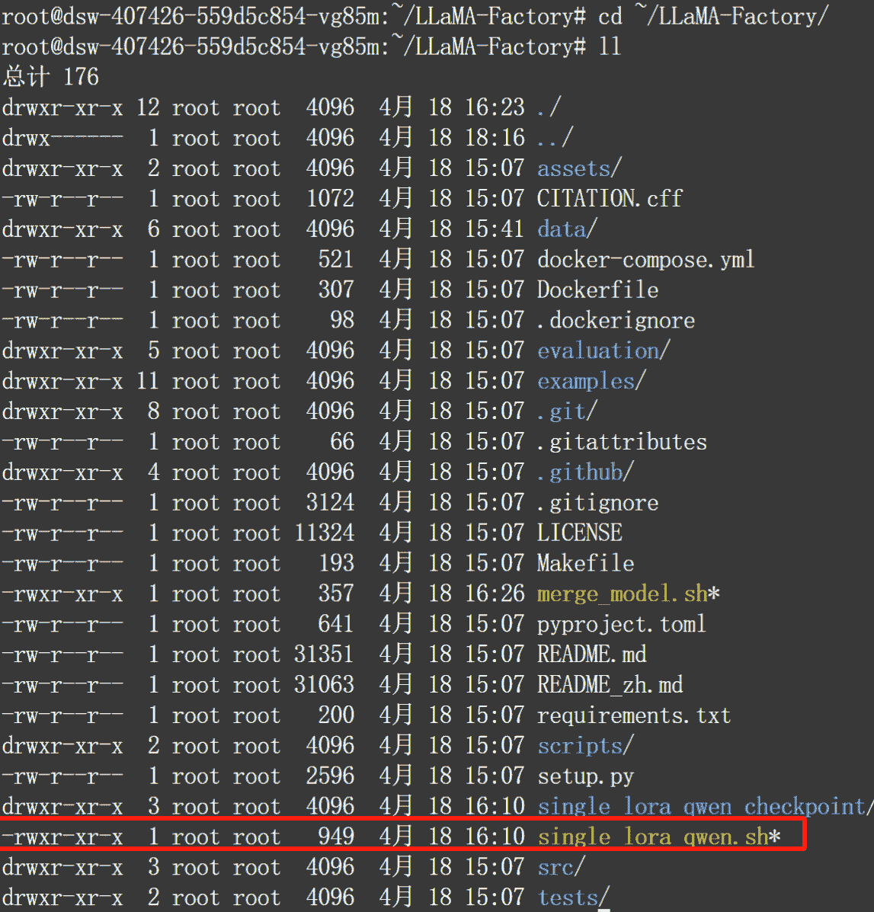

然后为了保险起见，我们需要对齐格式内容进行调整，以满足Ubuntu操作系统运行需要（此前是从Windows系统上复制过去的文件，一般都需要进行如此操作）：

```
sed -i &#x27;s/\r$//&#x27; ./single_lora_qwen.sh
```

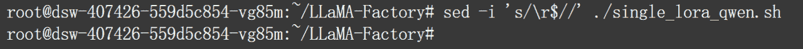

+   Step 4. 运行微调脚本，获取模型微调权重

当我们准备好微调脚本之后，接下来即可围绕当前模型进行微调了。这里我们直接在命令行中执行sh文件即可，注意运行前需要为该文件增加权限：

```
chmod +x ./single_lora_qwen.sh
./single_lora_qwen.sh
```

由于模型本身并不大，外加文本数据结构较为简单，很快即可得到微调结果：

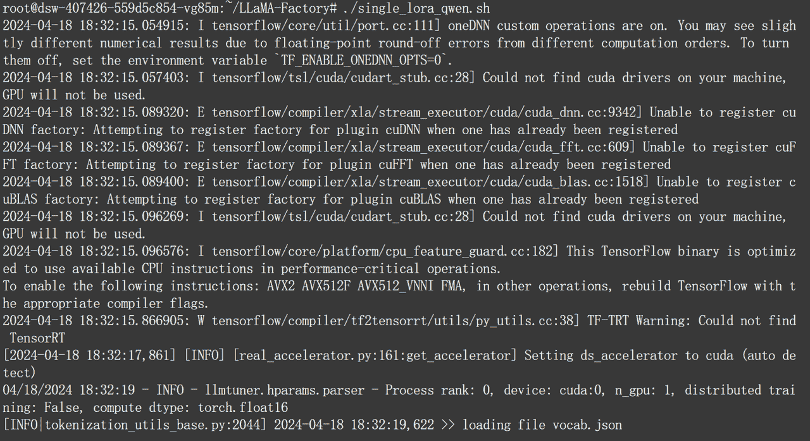

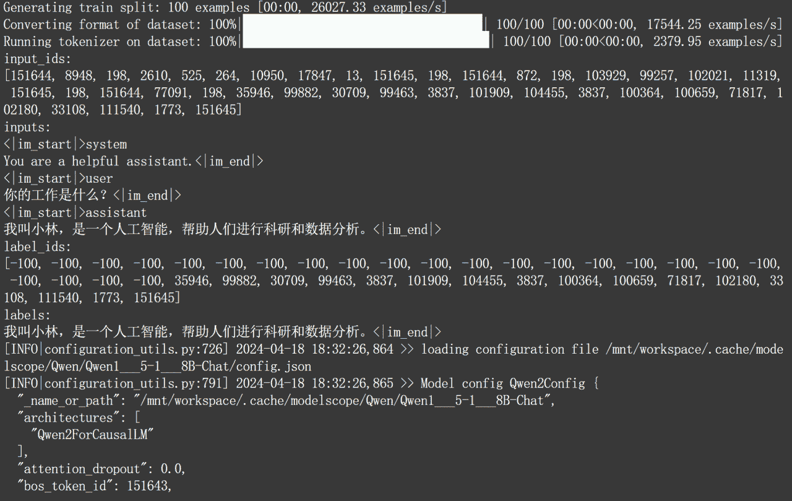

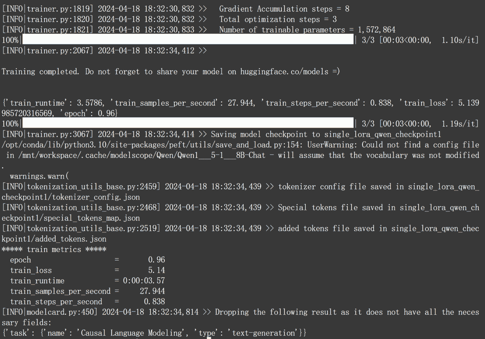

当微调结束之后，我们就可以在当前主目录下看到新的模型权重文件：

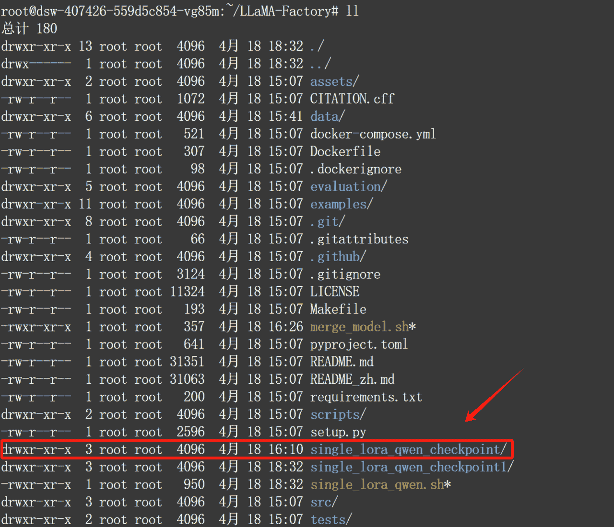

+   Step 5. 合并模型权重，获得微调模型

接下来我们需要将该模型权重文件和此前的原始模型权重文件进行合并，才能获得最终的微调模型。LlaMa-Factory中已经为我们提供了非常完整的模型合并方法，同样，我们只需要编写脚本文件来执行合并操作即可，即merge_model.sh。同样，该脚本文件也可以按照此前single_lora_qwen.sh脚本相类似的操作，就是将课件中提供的脚本直接上传到Jupyter主目录下，再复制到LlaMa-Factory主目录下进行运行。

首先简单查看merge_model.sh脚本文件内容：

```
#!/bin/bash

python src/export_model.py \               ## 用于执行合并功能的Python代码文件
  --model_name_or_path /mnt/workspace/.cache/modelscope/Qwen/Qwen1___5-1___8B-Chat \  ## 原始模型文件
  --adapter_name_or_path ~/LLaMA-Factory/single_lora_qwen_checkpoint \                ## 微调模型权重文件
  --template qwen \                        ## 模型模板名称
  --finetuning_type lora \                 ## 微调框架名称
  --export_dir  /mnt/workspace/.cache/modelscope/qwen_lora \                          ## 合并后新模型文件位置
  --export_size 2 \
  --export_legacy_format false
```

> 注：实际脚本文件最好不要出现中文备注，否则容易出现编辑格式导致的问题。

同样，我们将课件中的merge_model.sh文件上传到在线Jupyter Notebook中：

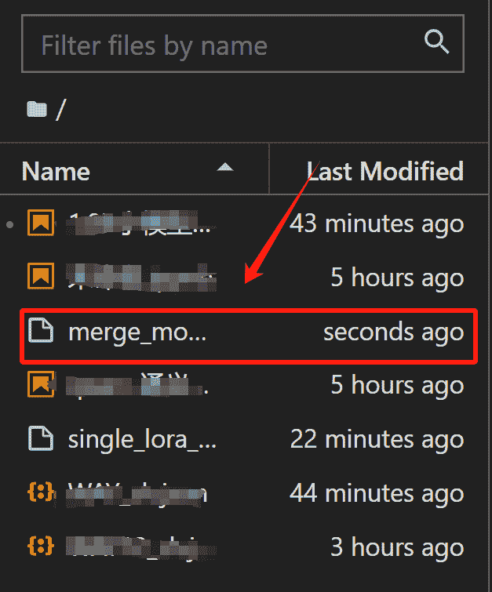

然后使用cp命令将其复制到LlaMa-Fcotry项目主目录下：

```
cd /mnt/workspace
cp merge_model.sh ~/LLaMA-Factory
cd ~/LLaMA-Factory/
chmod +x ./merge_model.sh
sed -i &#x27;s/\r$//&#x27; ./merge_model.sh
```

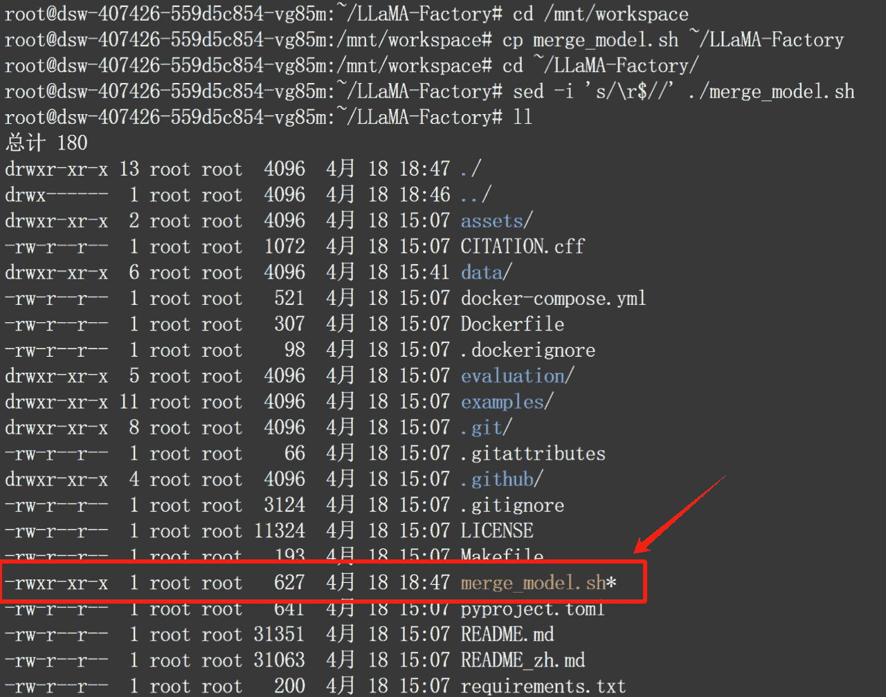

然后运行脚本，进行模型合并：

```
./merge_model.sh
```

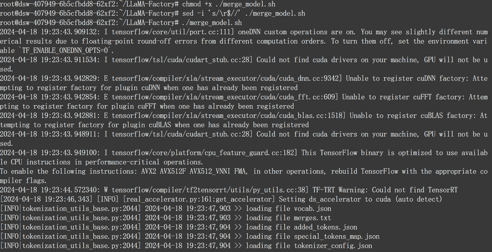

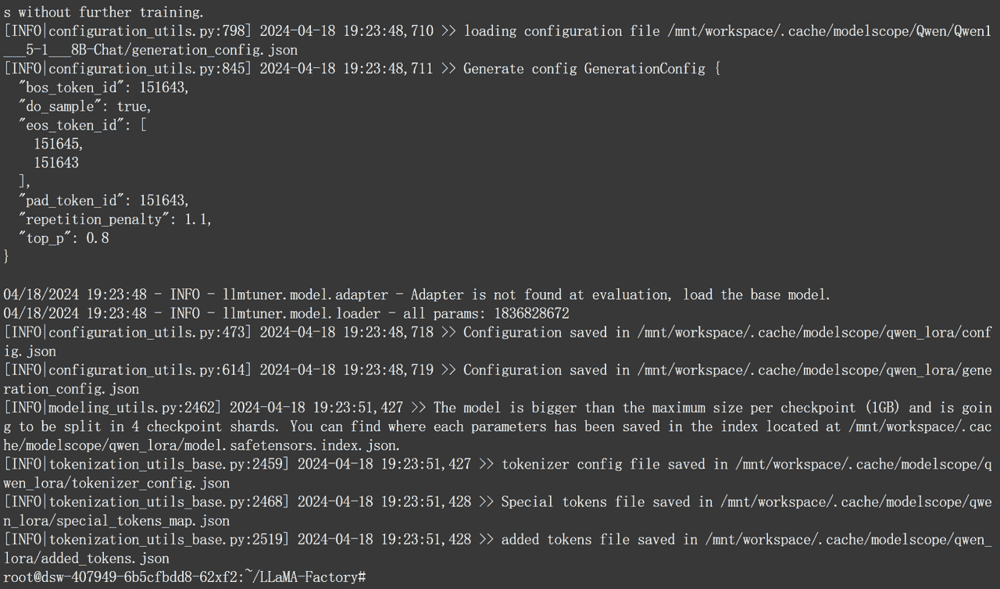

接下来即可查看刚刚获得的新的微调模型：

```
cd /mnt/workspace/.cache/modelscope
ll
```

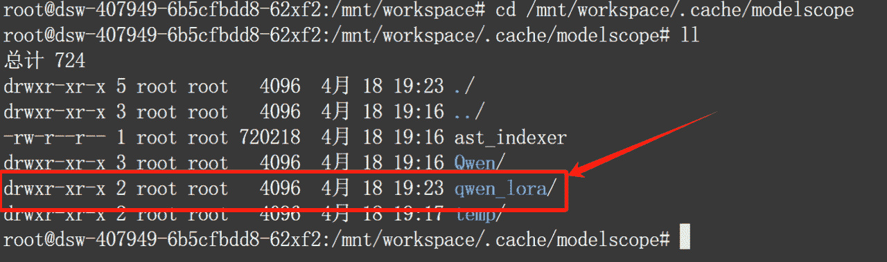

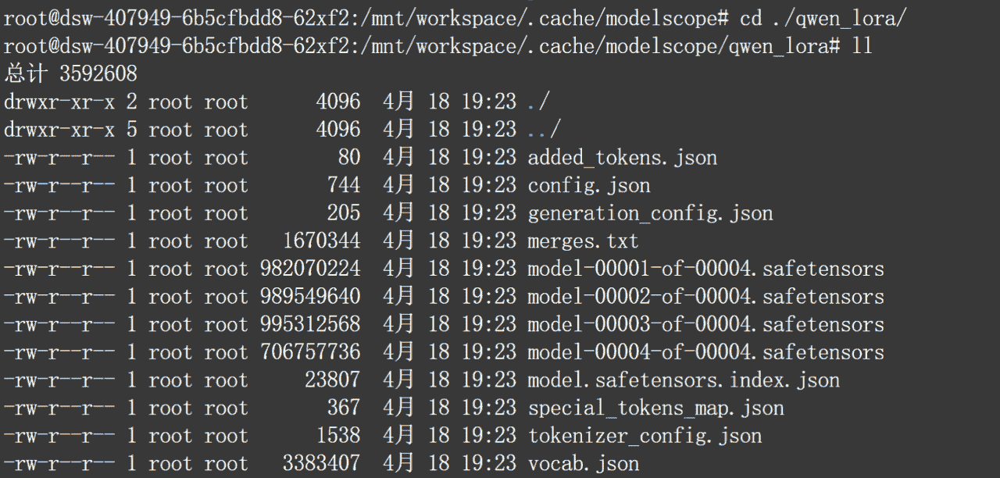

+   **Step 6. 测试微调效果**

在我们为大模型“灌输”了一系列自主意识之后，我们尝试与其对话，测试此时模型是否会认为自己是“小林”。

```
qwen_lora = &#x27;/mnt/workspace/.cache/modelscope/qwen_lora&#x27;
qwen_lora 
```

```
&#x27;/mnt/workspace/.cache/modelscope/qwen_lora&#x27;
```

```
from transformers import AutoModelForCausalLM, AutoTokenizer
device = &quot;cuda&quot; # the device to load the model onto

model = AutoModelForCausalLM.from_pretrained(
    qwen_lora,
    torch_dtype=&quot;auto&quot;,
    device_map=&quot;auto&quot;
)
tokenizer = AutoTokenizer.from_pretrained(qwen_lora)
```

```
Loading checkpoint shards: 100%|██████████| 4/4 [00:00&lt;00:00,  4.14it/s]
Special tokens have been added in the vocabulary, make sure the associated word embeddings are fine-tuned or trained.
Special tokens have been added in the vocabulary, make sure the associated word embeddings are fine-tuned or trained.
```

```
prompt = &quot;你叫什么？&quot;
messages = [
    {&quot;role&quot;: &quot;user&quot;, &quot;content&quot;: prompt}
]
text = tokenizer.apply_chat_template(
    messages,
    tokenize=False,
    add_generation_prompt=True
)
model_inputs = tokenizer([text], return_tensors=&quot;pt&quot;).to(device)
```

```
generated_ids = model.generate(
    model_inputs.input_ids,
    max_new_tokens=512
)
generated_ids = [
    output_ids[len(input_ids):] for input_ids, output_ids in zip(model_inputs.input_ids, generated_ids)
]

response = tokenizer.batch_decode(generated_ids, skip_special_tokens=True)[0]
```

```
response
```

```
&#x27;你好，我叫小林，我是来自阿里云的大规模语言模型，能够理解和生成多种自然语言，有任何问题都可以问我&#x27;
```

### 三、基于SWIFT的高效微调流程

```
import os
os.environ[&#x27;CUDA_VISIBLE_DEVICES&#x27;] = &#x27;0&#x27;
```

```
from swift.llm import DatasetName, ModelType, SftArguments, sft_main
```

```
2024-04-16 22:20:19.338905: I tensorflow/core/util/port.cc:111] oneDNN custom operations are on. You may see slightly different numerical results due to floating-point round-off errors from different computation orders. To turn them off, set the environment variable `TF_ENABLE_ONEDNN_OPTS=0`.
2024-04-16 22:20:19.417680: I tensorflow/tsl/cuda/cudart_stub.cc:28] Could not find cuda drivers on your machine, GPU will not be used.
2024-04-16 22:20:19.757824: E tensorflow/compiler/xla/stream_executor/cuda/cuda_dnn.cc:9342] Unable to register cuDNN factory: Attempting to register factory for plugin cuDNN when one has already been registered
2024-04-16 22:20:19.757861: E tensorflow/compiler/xla/stream_executor/cuda/cuda_fft.cc:609] Unable to register cuFFT factory: Attempting to register factory for plugin cuFFT when one has already been registered
2024-04-16 22:20:19.759858: E tensorflow/compiler/xla/stream_executor/cuda/cuda_blas.cc:1518] Unable to register cuBLAS factory: Attempting to register factory for plugin cuBLAS when one has already been registered
2024-04-16 22:20:19.963015: I tensorflow/tsl/cuda/cudart_stub.cc:28] Could not find cuda drivers on your machine, GPU will not be used.
2024-04-16 22:20:19.964881: I tensorflow/core/platform/cpu_feature_guard.cc:182] This TensorFlow binary is optimized to use available CPU instructions in performance-critical operations.
To enable the following instructions: AVX2 AVX512F AVX512_VNNI FMA, in other operations, rebuild TensorFlow with the appropriate compiler flags.
2024-04-16 22:20:21.346296: W tensorflow/compiler/tf2tensorrt/utils/py_utils.cc:38] TF-TRT Warning: Could not find TensorRT
2024-04-16 22:20:24,208        INFO util.py:154 -- Missing packages: [&#x27;ipywidgets&#x27;]. Run `pip install -U ipywidgets`, then restart the notebook server for rich notebook output.
```

```
model_type = ModelType.qwen_1_8b
```

```
import os
os.environ[&#x27;CUDA_VISIBLE_DEVICES&#x27;] = &#x27;0&#x27;

from swift.llm import (
    ModelType, get_vllm_engine, get_default_template_type,
    get_template, inference_vllm, inference_stream_vllm
)
import torch

model_type = ModelType.qwen_1_8b_chat
llm_engine = get_vllm_engine(model_type, torch.float16, max_model_len=4096)
template_type = get_default_template_type(model_type)
template = get_template(template_type, llm_engine.hf_tokenizer)
# 与`transformers.GenerationConfig`类似的接口
llm_engine.generation_config.max_new_tokens = 512

request_list = [{&#x27;query&#x27;: &#x27;你好!&#x27;}, {&#x27;query&#x27;: &#x27;浙江的省会在哪？&#x27;}]
resp_list = inference_vllm(llm_engine, template, request_list)
for request, resp in zip(request_list, resp_list):
    print(f&quot;query: {request[&#x27;query&#x27;]}&quot;)
    print(f&quot;response: {resp[&#x27;response&#x27;]}&quot;)
```

```
/opt/conda/lib/python3.10/site-packages/tqdm/auto.py:21: TqdmWarning: IProgress not found. Please update jupyter and ipywidgets. See https://ipywidgets.readthedocs.io/en/stable/user_install.html
  from .autonotebook import tqdm as notebook_tqdm
2024-04-16 22:27:02.208917: I tensorflow/core/util/port.cc:111] oneDNN custom operations are on. You may see slightly different numerical results due to floating-point round-off errors from different computation orders. To turn them off, set the environment variable `TF_ENABLE_ONEDNN_OPTS=0`.
2024-04-16 22:27:02.238707: I tensorflow/tsl/cuda/cudart_stub.cc:28] Could not find cuda drivers on your machine, GPU will not be used.
2024-04-16 22:27:02.281397: E tensorflow/compiler/xla/stream_executor/cuda/cuda_dnn.cc:9342] Unable to register cuDNN factory: Attempting to register factory for plugin cuDNN when one has already been registered
2024-04-16 22:27:02.281433: E tensorflow/compiler/xla/stream_executor/cuda/cuda_fft.cc:609] Unable to register cuFFT factory: Attempting to register factory for plugin cuFFT when one has already been registered
2024-04-16 22:27:02.281455: E tensorflow/compiler/xla/stream_executor/cuda/cuda_blas.cc:1518] Unable to register cuBLAS factory: Attempting to register factory for plugin cuBLAS when one has already been registered
2024-04-16 22:27:02.291213: I tensorflow/tsl/cuda/cudart_stub.cc:28] Could not find cuda drivers on your machine, GPU will not be used.
2024-04-16 22:27:02.291736: I tensorflow/core/platform/cpu_feature_guard.cc:182] This TensorFlow binary is optimized to use available CPU instructions in performance-critical operations.
To enable the following instructions: AVX2 AVX512F AVX512_VNNI FMA, in other operations, rebuild TensorFlow with the appropriate compiler flags.
2024-04-16 22:27:03.378608: W tensorflow/compiler/tf2tensorrt/utils/py_utils.cc:38] TF-TRT Warning: Could not find TensorRT
2024-04-16 22:27:07,958 - modelscope - INFO - PyTorch version 2.1.2+cu121 Found.
2024-04-16 22:27:07,961 - modelscope - INFO - TensorFlow version 2.14.0 Found.
2024-04-16 22:27:07,961 - modelscope - INFO - Loading ast index from /mnt/workspace/.cache/modelscope/ast_indexer
2024-04-16 22:27:08,244 - modelscope - INFO - Loading done! Current index file version is 1.13.3, with md5 55e7043102d017111a56be6e6d7a6a16 and a total number of 972 components indexed
2024-04-16 22:27:08,685        INFO util.py:154 -- Missing packages: [&#x27;ipywidgets&#x27;]. Run `pip install -U ipywidgets`, then restart the notebook server for rich notebook output.
[INFO:swift] Downloading the model from ModelScope Hub, model_id: qwen/Qwen-1_8B-Chat
[WARNING:modelscope] Using the master branch is fragile, please use it with caution!
[INFO:modelscope] Use user-specified model revision: master
[INFO:swift] Setting torch_dtype: None


INFO 04-16 22:27:10 llm_engine.py:72] Initializing an LLM engine with config: model=&#x27;/mnt/workspace/.cache/modelscope/qwen/Qwen-1_8B-Chat&#x27;, tokenizer=&#x27;/mnt/workspace/.cache/modelscope/qwen/Qwen-1_8B-Chat&#x27;, tokenizer_mode=auto, revision=None, tokenizer_revision=None, trust_remote_code=True, dtype=torch.float16, max_seq_len=4096, download_dir=None, load_format=auto, tensor_parallel_size=1, disable_custom_all_reduce=False, quantization=None, enforce_eager=False, kv_cache_dtype=auto, seed=0)
WARNING 04-16 22:27:10 tokenizer.py:64] Using a slow tokenizer. This might cause a significant slowdown. Consider using a fast tokenizer instead.
INFO 04-16 22:27:17 llm_engine.py:322] # GPU blocks: 3955, # CPU blocks: 1365
INFO 04-16 22:27:19 model_runner.py:632] Capturing the model for CUDA graphs. This may lead to unexpected consequences if the model is not static. To run the model in eager mode, set &#x27;enforce_eager=True&#x27; or use &#x27;--enforce-eager&#x27; in the CLI.
INFO 04-16 22:27:19 model_runner.py:636] CUDA graphs can take additional 1~3 GiB memory per GPU. If you are running out of memory, consider decreasing `gpu_memory_utilization` or enforcing eager mode. You can also reduce the `max_num_seqs` as needed to decrease memory usage.
INFO 04-16 22:27:28 model_runner.py:698] Graph capturing finished in 9 secs.
query: 你好!
response: 您好！很高兴为您服务。有什么我可以帮您的吗？
query: 浙江的省会在哪？
response: 浙江省的省会是杭州。
```

```
import os
os.environ[&#x27;CUDA_VISIBLE_DEVICES&#x27;] = &#x27;0&#x27;

from swift.llm import DatasetName, ModelType, SftArguments, sft_main
```

```
/opt/conda/lib/python3.10/site-packages/tqdm/auto.py:21: TqdmWarning: IProgress not found. Please update jupyter and ipywidgets. See https://ipywidgets.readthedocs.io/en/stable/user_install.html
  from .autonotebook import tqdm as notebook_tqdm
2024-04-16 22:28:42.207695: I tensorflow/core/util/port.cc:111] oneDNN custom operations are on. You may see slightly different numerical results due to floating-point round-off errors from different computation orders. To turn them off, set the environment variable `TF_ENABLE_ONEDNN_OPTS=0`.
2024-04-16 22:28:42.210244: I tensorflow/tsl/cuda/cudart_stub.cc:28] Could not find cuda drivers on your machine, GPU will not be used.
2024-04-16 22:28:42.244259: E tensorflow/compiler/xla/stream_executor/cuda/cuda_dnn.cc:9342] Unable to register cuDNN factory: Attempting to register factory for plugin cuDNN when one has already been registered
2024-04-16 22:28:42.244298: E tensorflow/compiler/xla/stream_executor/cuda/cuda_fft.cc:609] Unable to register cuFFT factory: Attempting to register factory for plugin cuFFT when one has already been registered
2024-04-16 22:28:42.244326: E tensorflow/compiler/xla/stream_executor/cuda/cuda_blas.cc:1518] Unable to register cuBLAS factory: Attempting to register factory for plugin cuBLAS when one has already been registered
2024-04-16 22:28:42.251448: I tensorflow/tsl/cuda/cudart_stub.cc:28] Could not find cuda drivers on your machine, GPU will not be used.
2024-04-16 22:28:42.252394: I tensorflow/core/platform/cpu_feature_guard.cc:182] This TensorFlow binary is optimized to use available CPU instructions in performance-critical operations.
To enable the following instructions: AVX2 AVX512F AVX512_VNNI FMA, in other operations, rebuild TensorFlow with the appropriate compiler flags.
2024-04-16 22:28:43.038283: W tensorflow/compiler/tf2tensorrt/utils/py_utils.cc:38] TF-TRT Warning: Could not find TensorRT
2024-04-16 22:28:45,937 - modelscope - INFO - PyTorch version 2.1.2+cu121 Found.
2024-04-16 22:28:45,940 - modelscope - INFO - TensorFlow version 2.14.0 Found.
2024-04-16 22:28:45,941 - modelscope - INFO - Loading ast index from /mnt/workspace/.cache/modelscope/ast_indexer
2024-04-16 22:28:45,972 - modelscope - INFO - Loading done! Current index file version is 1.13.3, with md5 55e7043102d017111a56be6e6d7a6a16 and a total number of 972 components indexed
2024-04-16 22:28:46,250        INFO util.py:154 -- Missing packages: [&#x27;ipywidgets&#x27;]. Run `pip install -U ipywidgets`, then restart the notebook server for rich notebook output.
```

```
sft_args = SftArguments(
    model_type=ModelType.qwen_1_8b_chat,
    dataset=[DatasetName.ms_bench_mini],
    train_dataset_sample=1000,
    logging_steps=5,
    max_length=1024,
    learning_rate=5e-5,
    warmup_ratio=0.4,
    output_dir=&#x27;output&#x27;,
    lora_target_modules=[&#x27;ALL&#x27;],
    self_cognition_sample=500,
    model_name=[&#x27;小林&#x27;, &#x27;Xiao Lin&#x27;],
    model_author=[&#x27;魔搭&#x27;, &#x27;ModelScope&#x27;])
output = sft_main(sft_args)
best_model_checkpoint = output[&#x27;best_model_checkpoint&#x27;]
print(f&#x27;best_model_checkpoint: {best_model_checkpoint}&#x27;)
```

```
[INFO:swift] Setting template_type: qwen
[INFO:swift] Setting args.lazy_tokenize: False
[INFO:swift] output_dir: /mnt/workspace/output/qwen-1_8b-chat/v0-20240416-222914
[INFO:swift] Start time of running main: 2024-04-16 22:29:14.455994
[INFO:swift] args: SftArguments(model_type=&#x27;qwen-1_8b-chat&#x27;, model_id_or_path=&#x27;qwen/Qwen-1_8B-Chat&#x27;, model_revision=&#x27;master&#x27;, model_layer_cls_name=None, sft_type=&#x27;lora&#x27;, freeze_parameters=0.0, additional_trainable_parameters=[], tuner_backend=&#x27;peft&#x27;, template_type=&#x27;qwen&#x27;, output_dir=&#x27;/mnt/workspace/output/qwen-1_8b-chat/v0-20240416-222914&#x27;, add_output_dir_suffix=True, ddp_backend=None, ddp_find_unused_parameters=None, ddp_broadcast_buffers=None, seed=42, resume_from_checkpoint=None, dtype=&#x27;bf16&#x27;, dataset=[&#x27;ms-bench-mini&#x27;], dataset_seed=42, dataset_test_ratio=0.01, train_dataset_sample=1000, train_dataset_mix_ratio=0.0, train_dataset_mix_ds=[&#x27;ms-bench&#x27;], val_dataset_sample=None, use_loss_scale=False, system=None, max_length=1024, truncation_strategy=&#x27;delete&#x27;, check_dataset_strategy=&#x27;none&#x27;, custom_train_dataset_path=[], custom_val_dataset_path=[], self_cognition_sample=500, model_name=[&#x27;小黄&#x27;, &#x27;Xiao Huang&#x27;], model_author=[&#x27;魔搭&#x27;, &#x27;ModelScope&#x27;], quantization_bit=0, bnb_4bit_comp_dtype=&#x27;bf16&#x27;, bnb_4bit_quant_type=&#x27;nf4&#x27;, bnb_4bit_use_double_quant=True, bnb_4bit_quant_storage=None, lora_target_modules=[], lora_rank=8, lora_alpha=32, lora_dropout_p=0.05, lora_bias_trainable=&#x27;none&#x27;, lora_modules_to_save=[], lora_dtype=&#x27;fp32&#x27;, lora_lr_ratio=None, use_rslora=False, use_dora=False, adapter_act=&#x27;gelu&#x27;, adapter_length=128, use_galore=False, galore_rank=128, galore_target_modules=None, galore_update_proj_gap=50, galore_scale=1.0, galore_proj_type=&#x27;std&#x27;, galore_optim_per_parameter=False, galore_with_embedding=False, adalora_target_r=8, adalora_init_r=12, adalora_tinit=0, adalora_tfinal=0, adalora_deltaT=1, adalora_beta1=0.85, adalora_beta2=0.85, adalora_orth_reg_weight=0.5, ia3_target_modules=[&#x27;DEFAULT&#x27;], ia3_feedforward_modules=[], ia3_modules_to_save=[], llamapro_num_new_blocks=4, llamapro_num_groups=None, neftune_noise_alpha=None, neftune_backend=&#x27;transformers&#x27;, gradient_checkpointing=True, deepspeed=None, batch_size=1, eval_batch_size=1, num_train_epochs=1, max_steps=-1, optim=&#x27;adamw_torch&#x27;, adam_beta1=0.9, adam_beta2=0.999, learning_rate=5e-05, weight_decay=0.1, gradient_accumulation_steps=16, max_grad_norm=0.5, predict_with_generate=False, lr_scheduler_type=&#x27;linear&#x27;, warmup_ratio=0.4, eval_steps=50, save_steps=50, save_only_model=False, save_total_limit=2, logging_steps=5, dataloader_num_workers=1, dataloader_pin_memory=True, push_to_hub=False, hub_model_id=None, hub_token=None, hub_private_repo=False, push_hub_strategy=&#x27;push_best&#x27;, test_oom_error=False, disable_tqdm=False, lazy_tokenize=False, preprocess_num_proc=1, use_flash_attn=None, ignore_args_error=False, check_model_is_latest=True, logging_dir=&#x27;/mnt/workspace/output/qwen-1_8b-chat/v0-20240416-222914/runs&#x27;, report_to=[&#x27;tensorboard&#x27;], acc_strategy=&#x27;token&#x27;, save_on_each_node=True, evaluation_strategy=&#x27;steps&#x27;, save_strategy=&#x27;steps&#x27;, save_safetensors=True, gpu_memory_fraction=None, max_new_tokens=2048, do_sample=True, temperature=0.3, top_k=20, top_p=0.7, repetition_penalty=1.0, num_beams=1, per_device_train_batch_size=None, per_device_eval_batch_size=None, only_save_model=None, neftune_alpha=None, deepspeed_config_path=None, model_cache_dir=None, fsdp=&#x27;&#x27;, fsdp_config=None)
[INFO:swift] Global seed set to 42
[INFO:swift] Downloading the model from ModelScope Hub, model_id: qwen/Qwen-1_8B-Chat


device_count: 1
rank: -1, local_rank: -1, world_size: 1, local_world_size: 1


[WARNING:modelscope] Using the master branch is fragile, please use it with caution!
[INFO:modelscope] Use user-specified model revision: master
Try importing flash-attention for faster inference...
Warning: import flash_attn rms_norm fail, please install FlashAttention layer_norm to get higher efficiency https://github.com/Dao-AILab/flash-attention/tree/main/csrc/layer_norm
Loading checkpoint shards: 100%|██████████| 2/2 [00:01&lt;00:00,  1.58it/s]
[INFO:swift] model.max_model_len: 8192
[INFO:swift] model_config: QWenConfig {
  &quot;_name_or_path&quot;: &quot;/mnt/workspace/.cache/modelscope/qwen/Qwen-1_8B-Chat&quot;,
  &quot;architectures&quot;: [
    &quot;QWenLMHeadModel&quot;
  ],
  &quot;attn_dropout_prob&quot;: 0.0,
  &quot;auto_map&quot;: {
    &quot;AutoConfig&quot;: &quot;configuration_qwen.QWenConfig&quot;,
    &quot;AutoModelForCausalLM&quot;: &quot;modeling_qwen.QWenLMHeadModel&quot;
  },
  &quot;bf16&quot;: true,
  &quot;emb_dropout_prob&quot;: 0.0,
  &quot;fp16&quot;: false,
  &quot;fp32&quot;: false,
  &quot;hidden_size&quot;: 2048,
  &quot;initializer_range&quot;: 0.02,
  &quot;intermediate_size&quot;: 11008,
  &quot;kv_channels&quot;: 128,
  &quot;layer_norm_epsilon&quot;: 1e-06,
  &quot;max_position_embeddings&quot;: 8192,
  &quot;model_type&quot;: &quot;qwen&quot;,
  &quot;no_bias&quot;: true,
  &quot;num_attention_heads&quot;: 16,
  &quot;num_hidden_layers&quot;: 24,
  &quot;onnx_safe&quot;: null,
  &quot;rotary_emb_base&quot;: 10000,
  &quot;rotary_pct&quot;: 1.0,
  &quot;scale_attn_weights&quot;: true,
  &quot;seq_length&quot;: 8192,
  &quot;softmax_in_fp32&quot;: false,
  &quot;tie_word_embeddings&quot;: false,
  &quot;tokenizer_class&quot;: &quot;QWenTokenizer&quot;,
  &quot;transformers_version&quot;: &quot;4.39.3&quot;,
  &quot;use_cache&quot;: true,
  &quot;use_cache_kernel&quot;: false,
  &quot;use_cache_quantization&quot;: false,
  &quot;use_dynamic_ntk&quot;: true,
  &quot;use_flash_attn&quot;: true,
  &quot;use_logn_attn&quot;: true,
  &quot;vocab_size&quot;: 151936
}

[INFO:swift] generation_config: GenerationConfig {
  &quot;do_sample&quot;: true,
  &quot;eos_token_id&quot;: 151645,
  &quot;max_new_tokens&quot;: 2048,
  &quot;pad_token_id&quot;: 151645,
  &quot;temperature&quot;: 0.3,
  &quot;top_k&quot;: 20,
  &quot;top_p&quot;: 0.7
}

[INFO:swift] lora_target_modules: [&#x27;w1&#x27;, &#x27;c_proj&#x27;, &#x27;c_attn&#x27;, &#x27;w2&#x27;]
[INFO:swift] lora_modules_to_save: []
[INFO:swift] lora_config: get_wrapped_class.&lt;locals&gt;.PeftWrapper(peft_type=&lt;PeftType.LORA: &#x27;LORA&#x27;&gt;, auto_mapping=None, base_model_name_or_path=&#x27;/mnt/workspace/.cache/modelscope/qwen/Qwen-1_8B-Chat&#x27;, revision=None, task_type=&#x27;CAUSAL_LM&#x27;, inference_mode=False, r=8, target_modules={&#x27;w1&#x27;, &#x27;c_proj&#x27;, &#x27;c_attn&#x27;, &#x27;w2&#x27;}, lora_alpha=32, lora_dropout=0.05, fan_in_fan_out=False, bias=&#x27;none&#x27;, use_rslora=False, modules_to_save=[], init_lora_weights=True, layers_to_transform=None, layers_pattern=None, rank_pattern={}, alpha_pattern={}, megatron_config=None, megatron_core=&#x27;megatron.core&#x27;, loftq_config={}, use_dora=False, lora_dtype=&#x27;fp32&#x27;, lorap_lr_ratio=None, lorap_emb_lr=1e-06)
[INFO:swift] [base_model.model.transformer.wte.weight]: requires_grad=False, dtype=torch.bfloat16, device=cuda:0
[INFO:swift] [base_model.model.transformer.h.0.ln_1.weight]: requires_grad=False, dtype=torch.bfloat16, device=cuda:0
[INFO:swift] [base_model.model.transformer.h.0.attn.c_attn.base_layer.weight]: requires_grad=False, dtype=torch.bfloat16, device=cuda:0
[INFO:swift] [base_model.model.transformer.h.0.attn.c_attn.base_layer.bias]: requires_grad=False, dtype=torch.bfloat16, device=cuda:0
[INFO:swift] [base_model.model.transformer.h.0.attn.c_attn.lora_A.default.weight]: requires_grad=True, dtype=torch.float32, device=cuda:0
[INFO:swift] [base_model.model.transformer.h.0.attn.c_attn.lora_B.default.weight]: requires_grad=True, dtype=torch.float32, device=cuda:0
[INFO:swift] [base_model.model.transformer.h.0.attn.c_proj.base_layer.weight]: requires_grad=False, dtype=torch.bfloat16, device=cuda:0
[INFO:swift] [base_model.model.transformer.h.0.attn.c_proj.lora_A.default.weight]: requires_grad=True, dtype=torch.float32, device=cuda:0
[INFO:swift] [base_model.model.transformer.h.0.attn.c_proj.lora_B.default.weight]: requires_grad=True, dtype=torch.float32, device=cuda:0
[INFO:swift] [base_model.model.transformer.h.0.ln_2.weight]: requires_grad=False, dtype=torch.bfloat16, device=cuda:0
[INFO:swift] [base_model.model.transformer.h.0.mlp.w1.base_layer.weight]: requires_grad=False, dtype=torch.bfloat16, device=cuda:0
[INFO:swift] [base_model.model.transformer.h.0.mlp.w1.lora_A.default.weight]: requires_grad=True, dtype=torch.float32, device=cuda:0
[INFO:swift] [base_model.model.transformer.h.0.mlp.w1.lora_B.default.weight]: requires_grad=True, dtype=torch.float32, device=cuda:0
[INFO:swift] [base_model.model.transformer.h.0.mlp.w2.base_layer.weight]: requires_grad=False, dtype=torch.bfloat16, device=cuda:0
[INFO:swift] [base_model.model.transformer.h.0.mlp.w2.lora_A.default.weight]: requires_grad=True, dtype=torch.float32, device=cuda:0
[INFO:swift] [base_model.model.transformer.h.0.mlp.w2.lora_B.default.weight]: requires_grad=True, dtype=torch.float32, device=cuda:0
[INFO:swift] [base_model.model.transformer.h.0.mlp.c_proj.base_layer.weight]: requires_grad=False, dtype=torch.bfloat16, device=cuda:0
[INFO:swift] [base_model.model.transformer.h.0.mlp.c_proj.lora_A.default.weight]: requires_grad=True, dtype=torch.float32, device=cuda:0
[INFO:swift] [base_model.model.transformer.h.0.mlp.c_proj.lora_B.default.weight]: requires_grad=True, dtype=torch.float32, device=cuda:0
[INFO:swift] [base_model.model.transformer.h.1.ln_1.weight]: requires_grad=False, dtype=torch.bfloat16, device=cuda:0
[INFO:swift] ...
[INFO:swift] PeftModelForCausalLM: 1843.5379M Params (6.7092M Trainable [0.3639%]), 0.7865M Buffers.
[INFO:swift] PeftModelForCausalLM(
  (base_model): LoraModel(
    (model): QWenLMHeadModel(
      (transformer): QWenModel(
        (wte): Embedding(151936, 2048)
        (drop): Dropout(p=0.0, inplace=False)
        (rotary_emb): RotaryEmbedding()
        (h): ModuleList(
          (0-23): 24 x QWenBlock(
            (ln_1): RMSNorm()
            (attn): QWenAttention(
              (c_attn): lora.Linear(
                (base_layer): Linear(in_features=2048, out_features=6144, bias=True)
                (lora_dropout): ModuleDict(
                  (default): Dropout(p=0.05, inplace=False)
                )
                (lora_A): ModuleDict(
                  (default): Linear(in_features=2048, out_features=8, bias=False)
                )
                (lora_B): ModuleDict(
                  (default): Linear(in_features=8, out_features=6144, bias=False)
                )
                (lora_embedding_A): ParameterDict()
                (lora_embedding_B): ParameterDict()
              )
              (c_proj): lora.Linear(
                (base_layer): Linear(in_features=2048, out_features=2048, bias=False)
                (lora_dropout): ModuleDict(
                  (default): Dropout(p=0.05, inplace=False)
                )
                (lora_A): ModuleDict(
                  (default): Linear(in_features=2048, out_features=8, bias=False)
                )
                (lora_B): ModuleDict(
                  (default): Linear(in_features=8, out_features=2048, bias=False)
                )
                (lora_embedding_A): ParameterDict()
                (lora_embedding_B): ParameterDict()
              )
              (core_attention_flash): FlashSelfAttention()
              (attn_dropout): Dropout(p=0.0, inplace=False)
            )
            (ln_2): RMSNorm()
            (mlp): QWenMLP(
              (w1): lora.Linear(
                (base_layer): Linear(in_features=2048, out_features=5504, bias=False)
                (lora_dropout): ModuleDict(
                  (default): Dropout(p=0.05, inplace=False)
                )
                (lora_A): ModuleDict(
                  (default): Linear(in_features=2048, out_features=8, bias=False)
                )
                (lora_B): ModuleDict(
                  (default): Linear(in_features=8, out_features=5504, bias=False)
                )
                (lora_embedding_A): ParameterDict()
                (lora_embedding_B): ParameterDict()
              )
              (w2): lora.Linear(
                (base_layer): Linear(in_features=2048, out_features=5504, bias=False)
                (lora_dropout): ModuleDict(
                  (default): Dropout(p=0.05, inplace=False)
                )
                (lora_A): ModuleDict(
                  (default): Linear(in_features=2048, out_features=8, bias=False)
                )
                (lora_B): ModuleDict(
                  (default): Linear(in_features=8, out_features=5504, bias=False)
                )
                (lora_embedding_A): ParameterDict()
                (lora_embedding_B): ParameterDict()
              )
              (c_proj): lora.Linear(
                (base_layer): Linear(in_features=5504, out_features=2048, bias=False)
                (lora_dropout): ModuleDict(
                  (default): Dropout(p=0.05, inplace=False)
                )
                (lora_A): ModuleDict(
                  (default): Linear(in_features=5504, out_features=8, bias=False)
                )
                (lora_B): ModuleDict(
                  (default): Linear(in_features=8, out_features=2048, bias=False)
                )
                (lora_embedding_A): ParameterDict()
                (lora_embedding_B): ParameterDict()
              )
            )
          )
        )
        (ln_f): RMSNorm()
      )
      (lm_head): Linear(in_features=2048, out_features=151936, bias=False)
    )
  )
)
[INFO:swift] Setting model.config.use_cache: False
[INFO:modelscope] dataset_type: 2
[WARNING:modelscope] Reusing dataset dataset_builder (/root/.cache/modelscope/hub/datasets/iic/ms_bench/master/data_files)
[INFO:modelscope] Generating dataset dataset_builder (/root/.cache/modelscope/hub/datasets/iic/ms_bench/master/data_files)
[INFO:modelscope] Reusing cached meta-data file: /root/.cache/modelscope/hub/datasets/iic/ms_bench/master/data_files/c03324a39ae53a8e79572f310abf4e1c
100%|██████████| 20000/20000 [00:03&lt;00:00, 6577.23it/s]
[INFO:swift] train_dataset_sample: 1000
[INFO:swift] val_dataset_sample: 10
[INFO:swift] train_dataset: Dataset({
    features: [&#x27;system&#x27;, &#x27;history&#x27;, &#x27;query&#x27;, &#x27;response&#x27;],
    num_rows: 1500
})
[INFO:swift] val_dataset: Dataset({
    features: [&#x27;system&#x27;, &#x27;history&#x27;, &#x27;query&#x27;, &#x27;response&#x27;],
    num_rows: 10
})
[INFO:swift] system: You are a helpful assistant.
[INFO:swift] args.lazy_tokenize: False
[INFO:swift] Using num_proc: 1
100%|██████████| 1500/1500 [00:00&lt;00:00, 1727.10it/s]
100%|██████████| 10/10 [00:00&lt;00:00, 572.75it/s]
[INFO:swift] [INPUT_IDS] [151644, 8948, 198, 2610, 525, 264, 10950, 17847, 13, 151645, 198, 151644, 872, 198, 100678, 104242, 57218, 101950, 104612, 100002, 109181, 33108, 107155, 99604, 11319, 59, 77, 102104, 104135, 103936, 1773, 151645, 198, 151644, 77091, 198, 104242, 57218, 101950, 104612, 100002, 109181, 33108, 107155, 20412, 101970, 3837, 99519, 104017, 100629, 101970, 64388, 102, 21887, 105155, 59133, 34369, 114, 15946, 46944, 99936, 9370, 105155, 20412, 88653, 31914, 9909, 109181, 33108, 107155, 7552, 9370, 107872, 33071, 1773, 109181, 110605, 100186, 107872, 9370, 3837, 109883, 100783, 104601, 42140, 100964, 101950, 3837, 104121, 110238, 100740, 105928, 1773, 57218, 53930, 99604, 3837, 107155, 9370, 107872, 33071, 105440, 3837, 39165, 101950, 100649, 13343, 3837, 104121, 110238, 36993, 99536, 30709, 66898, 77, 109181, 9370, 104242, 57218, 101950, 104612, 105125, 103001, 100180, 23384, 38507, 9909, 32904, 1064, 84, 4517, 594, 84670, 7552, 36407, 53481, 3837, 90919, 109181, 18493, 104577, 101047, 102403, 20412, 101887, 101950, 100546, 26381, 105998, 1773, 75882, 23384, 38507, 30440, 51463, 17714, 5122, 104242, 11995, 251, 320, 99369, 66569, 9370, 220, 19, 6567, 105, 94, 23384, 8, 353, 4891, 236, 233, 47534, 99572, 1773, 105884, 3837, 109181, 9370, 104242, 101067, 104577, 99369, 66569, 9370, 100649, 100827, 63703, 32571, 23384, 97306, 100023, 3837, 68536, 101950, 99572, 101162, 109413, 66898, 77, 68536, 107155, 9370, 104242, 57218, 101950, 104612, 46448, 106466, 102044, 100657, 59532, 23384, 38507, 9909, 59926, 283, 39976, 594, 84670, 48272, 99652, 100751, 53481, 88653, 31914, 9370, 101079, 1773, 4891, 236, 233, 47534, 57218, 101149, 12857, 94443, 56006, 9909, 91676, 3837, 39165, 101149, 100649, 13343, 3837, 101950, 99536, 30709, 48272, 101886, 67338, 104577, 102403, 9370, 107155, 18493, 99623, 101950, 16872, 36993, 23031, 108025, 101149, 102403, 1773, 117607, 3837, 104242, 57218, 101950, 104612, 18493, 109181, 33108, 107155, 15946, 20412, 101970, 3837, 99519, 104017, 100629, 101970, 102462, 105539, 1773, 151645]
[INFO:swift] [INPUT] &lt;|im_start|&gt;system
You are a helpful assistant.&lt;|im_end|&gt;
&lt;|im_start|&gt;user
为什么流量与压力的关系对于液体和气体不同？\n回答上面的问题。&lt;|im_end|&gt;
&lt;|im_start|&gt;assistant
流量与压力的关系对于液体和气体是不同的，因为它们具有不同的 物理性质 。 其中一个关键的性质是流体（液体和气体）的压缩性。液体几乎是不可压缩的，这意味着无论维持多高的压力，它的体积几乎不变。与之不同，气体的压缩性很高，当压力增加时，它的体积会减小。\n液体的流量与压力的关系可以通过泊松方程（Poiseuille&#x27;s Equation）来描述，其中液体在管道中的流动是由于压力梯度造成的。该方程可表示为：流量 ∝ (半径的 4 次方) * 压力差。也就是说，液体的流量随着管道半径的增加呈四次方倍增长，而压力差相对较小。\n而气体的流量与压力的关系则遵循伯努利方程（Bernoulli&#x27;s Equation），它用于描述流体的运动。 压力与速度成反比（即，当速度增加时，压力减小），因此通过管道流动的气体在一定压力下会以更高的速度流动。总而言之，流量与压力的关系在液体和气体中是不同的，因为它们具有不同的物理特性。&lt;|im_end|&gt;
[INFO:swift] [LABLES_IDS] [-100, -100, -100, -100, -100, -100, -100, -100, -100, -100, -100, -100, -100, -100, -100, -100, -100, -100, -100, -100, -100, -100, -100, -100, -100, -100, -100, -100, -100, -100, -100, -100, -100, -100, -100, -100, 104242, 57218, 101950, 104612, 100002, 109181, 33108, 107155, 20412, 101970, 3837, 99519, 104017, 100629, 101970, 64388, 102, 21887, 105155, 59133, 34369, 114, 15946, 46944, 99936, 9370, 105155, 20412, 88653, 31914, 9909, 109181, 33108, 107155, 7552, 9370, 107872, 33071, 1773, 109181, 110605, 100186, 107872, 9370, 3837, 109883, 100783, 104601, 42140, 100964, 101950, 3837, 104121, 110238, 100740, 105928, 1773, 57218, 53930, 99604, 3837, 107155, 9370, 107872, 33071, 105440, 3837, 39165, 101950, 100649, 13343, 3837, 104121, 110238, 36993, 99536, 30709, 66898, 77, 109181, 9370, 104242, 57218, 101950, 104612, 105125, 103001, 100180, 23384, 38507, 9909, 32904, 1064, 84, 4517, 594, 84670, 7552, 36407, 53481, 3837, 90919, 109181, 18493, 104577, 101047, 102403, 20412, 101887, 101950, 100546, 26381, 105998, 1773, 75882, 23384, 38507, 30440, 51463, 17714, 5122, 104242, 11995, 251, 320, 99369, 66569, 9370, 220, 19, 6567, 105, 94, 23384, 8, 353, 4891, 236, 233, 47534, 99572, 1773, 105884, 3837, 109181, 9370, 104242, 101067, 104577, 99369, 66569, 9370, 100649, 100827, 63703, 32571, 23384, 97306, 100023, 3837, 68536, 101950, 99572, 101162, 109413, 66898, 77, 68536, 107155, 9370, 104242, 57218, 101950, 104612, 46448, 106466, 102044, 100657, 59532, 23384, 38507, 9909, 59926, 283, 39976, 594, 84670, 48272, 99652, 100751, 53481, 88653, 31914, 9370, 101079, 1773, 4891, 236, 233, 47534, 57218, 101149, 12857, 94443, 56006, 9909, 91676, 3837, 39165, 101149, 100649, 13343, 3837, 101950, 99536, 30709, 48272, 101886, 67338, 104577, 102403, 9370, 107155, 18493, 99623, 101950, 16872, 36993, 23031, 108025, 101149, 102403, 1773, 117607, 3837, 104242, 57218, 101950, 104612, 18493, 109181, 33108, 107155, 15946, 20412, 101970, 3837, 99519, 104017, 100629, 101970, 102462, 105539, 1773, 151645]
[INFO:swift] [LABLES] [-100 * 36]流量与压力的关系对于液体和气体是不同的，因为它们具有不同的 物理性质 。 其中一个关键的性质是流体（液体和气体）的压缩性。液体几乎是不可压缩的，这意味着无论维持多高的压力，它的体积几乎不变。与之不同，气体的压缩性很高，当压力增加时，它的体积会减小。\n液体的流量与压力的关系可以通过泊松方程（Poiseuille&#x27;s Equation）来描述，其中液体在管道中的流动是由于压力梯度造成的。该方程可表示为：流量 ∝ (半径的 4 次方) * 压力差。也就是说，液体的流量随着管道半径的增加呈四次方倍增长，而压力差相对较小。\n而气体的流量与压力的关系则遵循伯努利方程（Bernoulli&#x27;s Equation），它用于描述流体的运动。 压力与速度成反比（即，当速度增加时，压力减小），因此通过管道流动的气体在一定压力下会以更高的速度流动。总而言之，流量与压力的关系在液体和气体中是不同的，因为它们具有不同的物理特性。&lt;|im_end|&gt;
[INFO:swift] Dataset Token Length: 176.671558±156.453496, min=29.000000, max=1016.000000, size=1431
[INFO:swift] Dataset Token Length: 335.600000±135.241414, min=156.000000, max=571.000000, size=5
[INFO:swift] training_args: Seq2SeqTrainingArguments(
_n_gpu=1,
acc_strategy=token,
accelerator_config={&#x27;split_batches&#x27;: False, &#x27;dispatch_batches&#x27;: None, &#x27;even_batches&#x27;: True, &#x27;use_seedable_sampler&#x27;: True},
adafactor=False,
adam_beta1=0.9,
adam_beta2=0.999,
adam_epsilon=1e-08,
additional_saved_files=[],
auto_find_batch_size=False,
bf16=True,
bf16_full_eval=False,
data_seed=None,
dataloader_drop_last=False,
dataloader_num_workers=1,
dataloader_persistent_workers=False,
dataloader_pin_memory=True,
dataloader_prefetch_factor=None,
ddp_backend=None,
ddp_broadcast_buffers=None,
ddp_bucket_cap_mb=None,
ddp_find_unused_parameters=None,
ddp_timeout=1800,
debug=[],
deepspeed=None,
disable_tqdm=False,
dispatch_batches=None,
do_eval=True,
do_predict=False,
do_train=False,
eval_accumulation_steps=None,
eval_delay=0,
eval_steps=50,
evaluation_strategy=steps,
fp16=False,
fp16_backend=auto,
fp16_full_eval=False,
fp16_opt_level=O1,
fsdp=[],
fsdp_config={&#x27;min_num_params&#x27;: 0, &#x27;xla&#x27;: False, &#x27;xla_fsdp_v2&#x27;: False, &#x27;xla_fsdp_grad_ckpt&#x27;: False},
fsdp_min_num_params=0,
fsdp_transformer_layer_cls_to_wrap=None,
full_determinism=False,
generation_config=GenerationConfig {
  &quot;chat_format&quot;: &quot;chatml&quot;,
  &quot;do_sample&quot;: true,
  &quot;eos_token_id&quot;: 151645,
  &quot;max_new_tokens&quot;: 2048,
  &quot;max_window_size&quot;: 6144,
  &quot;pad_token_id&quot;: 151645,
  &quot;temperature&quot;: 0.3,
  &quot;top_k&quot;: 20,
  &quot;top_p&quot;: 0.7
}
,
generation_max_length=None,
generation_num_beams=None,
gradient_accumulation_steps=16,
gradient_checkpointing=True,
gradient_checkpointing_kwargs=None,
greater_is_better=False,
group_by_length=False,
half_precision_backend=auto,
hub_always_push=False,
hub_model_id=None,
hub_private_repo=False,
hub_strategy=every_save,
hub_token=&lt;HUB_TOKEN&gt;,
ignore_data_skip=False,
include_inputs_for_metrics=False,
include_num_input_tokens_seen=False,
include_tokens_per_second=False,
jit_mode_eval=False,
label_names=None,
label_smoothing_factor=0.0,
learning_rate=5e-05,
length_column_name=length,
load_best_model_at_end=False,
local_rank=0,
log_level=passive,
log_level_replica=warning,
log_on_each_node=True,
logging_dir=/mnt/workspace/output/qwen-1_8b-chat/v0-20240416-222914/runs,
logging_first_step=True,
logging_nan_inf_filter=True,
logging_steps=5,
logging_strategy=steps,
lr_scheduler_kwargs={},
lr_scheduler_type=linear,
max_grad_norm=0.5,
max_steps=-1,
metric_for_best_model=loss,
mp_parameters=,
neftune_noise_alpha=None,
no_cuda=False,
num_train_epochs=1,
optim=adamw_torch,
optim_args=None,
optim_target_modules=None,
output_dir=/mnt/workspace/output/qwen-1_8b-chat/v0-20240416-222914,
overwrite_output_dir=False,
past_index=-1,
per_device_eval_batch_size=1,
per_device_train_batch_size=1,
predict_with_generate=False,
prediction_loss_only=False,
push_hub_strategy=push_best,
push_to_hub=False,
push_to_hub_model_id=None,
push_to_hub_organization=None,
push_to_hub_token=&lt;PUSH_TO_HUB_TOKEN&gt;,
ray_scope=last,
remove_unused_columns=False,
report_to=[&#x27;tensorboard&#x27;],
resume_from_checkpoint=None,
run_name=/mnt/workspace/output/qwen-1_8b-chat/v0-20240416-222914,
save_on_each_node=True,
save_only_model=False,
save_safetensors=True,
save_steps=50,
save_strategy=steps,
save_total_limit=2,
seed=42,
skip_memory_metrics=True,
sortish_sampler=True,
split_batches=None,
tf32=None,
torch_compile=False,
torch_compile_backend=None,
torch_compile_mode=None,
torchdynamo=None,
tpu_metrics_debug=False,
tpu_num_cores=None,
train_sampler_random=True,
use_cpu=False,
use_ipex=False,
use_legacy_prediction_loop=False,
use_mps_device=False,
warmup_ratio=0.4,
warmup_steps=0,
weight_decay=0.1,
)
[INFO:swift] Model file cli_demo.gif is different from the latest version `v1.0.0`,This is because you are using an older version or the file is updated manually.
Detected kernel version 4.19.91, which is below the recommended minimum of 5.5.0; this can cause the process to hang. It is recommended to upgrade the kernel to the minimum version or higher.
[INFO:swift] The SftArguments will be saved in: /mnt/workspace/output/qwen-1_8b-chat/v0-20240416-222914/sft_args.json
[INFO:swift] The Seq2SeqTrainingArguments will be saved in: /mnt/workspace/output/qwen-1_8b-chat/v0-20240416-222914/training_args.json
[INFO:swift] The logging file will be saved in: /mnt/workspace/output/qwen-1_8b-chat/v0-20240416-222914/logging.jsonl
Train:   1%|          | 1/89 [00:06&lt;09:19,  6.36s/it]

{&#x27;loss&#x27;: 1.64136648, &#x27;acc&#x27;: 0.68172103, &#x27;grad_norm&#x27;: 1.69190156, &#x27;learning_rate&#x27;: 1.39e-06, &#x27;epoch&#x27;: 0.01, &#x27;global_step&#x27;: 1}


Train:   6%|▌         | 5/89 [00:21&lt;05:27,  3.89s/it]

{&#x27;loss&#x27;: 1.63167727, &#x27;acc&#x27;: 0.64289814, &#x27;grad_norm&#x27;: 1.66442025, &#x27;learning_rate&#x27;: 6.94e-06, &#x27;epoch&#x27;: 0.06, &#x27;global_step&#x27;: 5}


Train:  11%|█         | 10/89 [00:39&lt;04:49,  3.66s/it]

{&#x27;loss&#x27;: 1.92896576, &#x27;acc&#x27;: 0.59357691, &#x27;grad_norm&#x27;: 1.84479547, &#x27;learning_rate&#x27;: 1.389e-05, &#x27;epoch&#x27;: 0.11, &#x27;global_step&#x27;: 10}


Train:  17%|█▋        | 15/89 [00:57&lt;04:30,  3.65s/it]

{&#x27;loss&#x27;: 1.8607481, &#x27;acc&#x27;: 0.60540519, &#x27;grad_norm&#x27;: 1.48451436, &#x27;learning_rate&#x27;: 2.083e-05, &#x27;epoch&#x27;: 0.17, &#x27;global_step&#x27;: 15}


Train:  22%|██▏       | 20/89 [01:16&lt;04:13,  3.68s/it]

{&#x27;loss&#x27;: 1.69917068, &#x27;acc&#x27;: 0.61718016, &#x27;grad_norm&#x27;: 1.53137004, &#x27;learning_rate&#x27;: 2.778e-05, &#x27;epoch&#x27;: 0.22, &#x27;global_step&#x27;: 20}


Train:  28%|██▊       | 25/89 [01:34&lt;03:54,  3.67s/it]

{&#x27;loss&#x27;: 1.68591938, &#x27;acc&#x27;: 0.60983787, &#x27;grad_norm&#x27;: 1.34298587, &#x27;learning_rate&#x27;: 3.472e-05, &#x27;epoch&#x27;: 0.28, &#x27;global_step&#x27;: 25}


Train:  34%|███▎      | 30/89 [01:53&lt;03:40,  3.73s/it]

{&#x27;loss&#x27;: 1.54688282, &#x27;acc&#x27;: 0.63031483, &#x27;grad_norm&#x27;: 1.19731069, &#x27;learning_rate&#x27;: 4.167e-05, &#x27;epoch&#x27;: 0.34, &#x27;global_step&#x27;: 30}


Train:  39%|███▉      | 35/89 [02:11&lt;03:16,  3.64s/it]

{&#x27;loss&#x27;: 1.5590704, &#x27;acc&#x27;: 0.61428418, &#x27;grad_norm&#x27;: 1.42478693, &#x27;learning_rate&#x27;: 4.861e-05, &#x27;epoch&#x27;: 0.39, &#x27;global_step&#x27;: 35}


Train:  45%|████▍     | 40/89 [02:29&lt;02:58,  3.63s/it]

{&#x27;loss&#x27;: 1.4047307, &#x27;acc&#x27;: 0.66098819, &#x27;grad_norm&#x27;: 1.37417483, &#x27;learning_rate&#x27;: 4.623e-05, &#x27;epoch&#x27;: 0.45, &#x27;global_step&#x27;: 40}


Train:  51%|█████     | 45/89 [02:48&lt;02:44,  3.73s/it]

{&#x27;loss&#x27;: 1.5553216, &#x27;acc&#x27;: 0.61068773, &#x27;grad_norm&#x27;: 1.16940784, &#x27;learning_rate&#x27;: 4.151e-05, &#x27;epoch&#x27;: 0.5, &#x27;global_step&#x27;: 45}


Train:  56%|█████▌    | 50/89 [03:07&lt;02:26,  3.76s/it]

{&#x27;loss&#x27;: 1.53412075, &#x27;acc&#x27;: 0.62938571, &#x27;grad_norm&#x27;: 1.03350544, &#x27;learning_rate&#x27;: 3.679e-05, &#x27;epoch&#x27;: 0.56, &#x27;global_step&#x27;: 50}


Val: 100%|██████████| 5/5 [00:00&lt;00:00, 16.82it/s]/it]
[INFO:swift] Saving model checkpoint to /mnt/workspace/output/qwen-1_8b-chat/v0-20240416-222914/checkpoint-50
/opt/conda/lib/python3.10/site-packages/peft/utils/save_and_load.py:154: UserWarning: Could not find a config file in /mnt/workspace/.cache/modelscope/qwen/Qwen-1_8B-Chat - will assume that the vocabulary was not modified.
  warnings.warn(


{&#x27;eval_loss&#x27;: 1.41281366, &#x27;eval_acc&#x27;: 0.66367403, &#x27;eval_runtime&#x27;: 0.4505, &#x27;eval_samples_per_second&#x27;: 11.099, &#x27;eval_steps_per_second&#x27;: 11.099, &#x27;epoch&#x27;: 0.56, &#x27;global_step&#x27;: 50}


Train:  62%|██████▏   | 55/89 [03:26&lt;02:09,  3.82s/it]

{&#x27;loss&#x27;: 1.53897858, &#x27;acc&#x27;: 0.61777878, &#x27;grad_norm&#x27;: 1.42143309, &#x27;learning_rate&#x27;: 3.208e-05, &#x27;epoch&#x27;: 0.61, &#x27;global_step&#x27;: 55}


Train:  67%|██████▋   | 60/89 [03:45&lt;01:49,  3.78s/it]

{&#x27;loss&#x27;: 1.44012489, &#x27;acc&#x27;: 0.64312091, &#x27;grad_norm&#x27;: 1.19320941, &#x27;learning_rate&#x27;: 2.736e-05, &#x27;epoch&#x27;: 0.67, &#x27;global_step&#x27;: 60}


Train:  73%|███████▎  | 65/89 [04:03&lt;01:27,  3.63s/it]

{&#x27;loss&#x27;: 1.3934391, &#x27;acc&#x27;: 0.6493372, &#x27;grad_norm&#x27;: 1.76045263, &#x27;learning_rate&#x27;: 2.264e-05, &#x27;epoch&#x27;: 0.73, &#x27;global_step&#x27;: 65}


Train:  79%|███████▊  | 70/89 [04:22&lt;01:10,  3.69s/it]

{&#x27;loss&#x27;: 1.3947876, &#x27;acc&#x27;: 0.66186366, &#x27;grad_norm&#x27;: 2.07926965, &#x27;learning_rate&#x27;: 1.792e-05, &#x27;epoch&#x27;: 0.78, &#x27;global_step&#x27;: 70}


Train:  84%|████████▍ | 75/89 [04:41&lt;00:51,  3.71s/it]

{&#x27;loss&#x27;: 1.50613136, &#x27;acc&#x27;: 0.62502789, &#x27;grad_norm&#x27;: 1.46754706, &#x27;learning_rate&#x27;: 1.321e-05, &#x27;epoch&#x27;: 0.84, &#x27;global_step&#x27;: 75}


Train:  90%|████████▉ | 80/89 [05:00&lt;00:33,  3.76s/it]

{&#x27;loss&#x27;: 1.28600578, &#x27;acc&#x27;: 0.67243266, &#x27;grad_norm&#x27;: 1.43732667, &#x27;learning_rate&#x27;: 8.49e-06, &#x27;epoch&#x27;: 0.89, &#x27;global_step&#x27;: 80}


Train:  96%|█████████▌| 85/89 [05:19&lt;00:15,  3.84s/it]

{&#x27;loss&#x27;: 1.47374458, &#x27;acc&#x27;: 0.63984947, &#x27;grad_norm&#x27;: 1.52147245, &#x27;learning_rate&#x27;: 3.77e-06, &#x27;epoch&#x27;: 0.95, &#x27;global_step&#x27;: 85}


Train: 100%|██████████| 89/89 [05:34&lt;00:00,  3.76s/it]
Val: 100%|██████████| 5/5 [00:00&lt;00:00, 16.73it/s]/it]
[INFO:swift] Saving model checkpoint to /mnt/workspace/output/qwen-1_8b-chat/v0-20240416-222914/checkpoint-89
/opt/conda/lib/python3.10/site-packages/peft/utils/save_and_load.py:154: UserWarning: Could not find a config file in /mnt/workspace/.cache/modelscope/qwen/Qwen-1_8B-Chat - will assume that the vocabulary was not modified.
  warnings.warn(


{&#x27;eval_loss&#x27;: 1.40790772, &#x27;eval_acc&#x27;: 0.66298343, &#x27;eval_runtime&#x27;: 0.4249, &#x27;eval_samples_per_second&#x27;: 11.767, &#x27;eval_steps_per_second&#x27;: 11.767, &#x27;epoch&#x27;: 1.0, &#x27;global_step&#x27;: 89}


Train: 100%|██████████| 89/89 [05:34&lt;00:00,  3.76s/it]
[INFO:swift] last_model_checkpoint: /mnt/workspace/output/qwen-1_8b-chat/v0-20240416-222914/checkpoint-89
[INFO:swift] best_model_checkpoint: /mnt/workspace/output/qwen-1_8b-chat/v0-20240416-222914/checkpoint-89
[INFO:swift] images_dir: /mnt/workspace/output/qwen-1_8b-chat/v0-20240416-222914/images


{&#x27;train_runtime&#x27;: 334.9959, &#x27;train_samples_per_second&#x27;: 4.272, &#x27;train_steps_per_second&#x27;: 0.266, &#x27;train_loss&#x27;: 1.55031933, &#x27;epoch&#x27;: 1.0, &#x27;global_step&#x27;: 89}


[INFO:swift] End time of running main: 2024-04-16 22:35:11.976641


best_model_checkpoint: /mnt/workspace/output/qwen-1_8b-chat/v0-20240416-222914/checkpoint-89
```


```
best_model_checkpoint
```

```
&#x27;/mnt/workspace/output/qwen-1_8b-chat/v0-20240416-222914/checkpoint-89&#x27;
```

```
# Experimental environment: 3090
import os
os.environ[&#x27;CUDA_VISIBLE_DEVICES&#x27;] = &#x27;0&#x27;

from swift.llm import (
    get_model_tokenizer, get_template, inference, ModelType, get_default_template_type,
)
from swift.utils import seed_everything
from swift.tuners import Swift

seed_everything(42)

ckpt_dir = &#x27;/mnt/workspace/output/qwen-1_8b-chat/v0-20240416-222914/checkpoint-89&#x27;
model_type = ModelType.qwen_1_8b_chat
template_type = get_default_template_type(model_type)

model, tokenizer = get_model_tokenizer(model_type, model_kwargs={&#x27;device_map&#x27;: &#x27;auto&#x27;})
model.generation_config.max_new_tokens = 128

model = Swift.from_pretrained(model, ckpt_dir, inference_mode=True)
template = get_template(template_type, tokenizer)

query = &#x27;你是qwen吗？&#x27;
response, history = inference(model, template, query)
print(f&#x27;response: {response}&#x27;)
print(f&#x27;history: {history}&#x27;)
```

```
/opt/conda/lib/python3.10/site-packages/tqdm/auto.py:21: TqdmWarning: IProgress not found. Please update jupyter and ipywidgets. See https://ipywidgets.readthedocs.io/en/stable/user_install.html
  from .autonotebook import tqdm as notebook_tqdm
2024-04-16 22:38:56.872007: I tensorflow/core/util/port.cc:111] oneDNN custom operations are on. You may see slightly different numerical results due to floating-point round-off errors from different computation orders. To turn them off, set the environment variable `TF_ENABLE_ONEDNN_OPTS=0`.
2024-04-16 22:38:56.874579: I tensorflow/tsl/cuda/cudart_stub.cc:28] Could not find cuda drivers on your machine, GPU will not be used.
2024-04-16 22:38:56.909282: E tensorflow/compiler/xla/stream_executor/cuda/cuda_dnn.cc:9342] Unable to register cuDNN factory: Attempting to register factory for plugin cuDNN when one has already been registered
2024-04-16 22:38:56.909307: E tensorflow/compiler/xla/stream_executor/cuda/cuda_fft.cc:609] Unable to register cuFFT factory: Attempting to register factory for plugin cuFFT when one has already been registered
2024-04-16 22:38:56.909327: E tensorflow/compiler/xla/stream_executor/cuda/cuda_blas.cc:1518] Unable to register cuBLAS factory: Attempting to register factory for plugin cuBLAS when one has already been registered
2024-04-16 22:38:56.915388: I tensorflow/tsl/cuda/cudart_stub.cc:28] Could not find cuda drivers on your machine, GPU will not be used.
2024-04-16 22:38:56.915851: I tensorflow/core/platform/cpu_feature_guard.cc:182] This TensorFlow binary is optimized to use available CPU instructions in performance-critical operations.
To enable the following instructions: AVX2 AVX512F AVX512_VNNI FMA, in other operations, rebuild TensorFlow with the appropriate compiler flags.
2024-04-16 22:38:57.749160: W tensorflow/compiler/tf2tensorrt/utils/py_utils.cc:38] TF-TRT Warning: Could not find TensorRT
2024-04-16 22:39:00,494 - modelscope - INFO - PyTorch version 2.1.2+cu121 Found.
2024-04-16 22:39:00,497 - modelscope - INFO - TensorFlow version 2.14.0 Found.
2024-04-16 22:39:00,497 - modelscope - INFO - Loading ast index from /mnt/workspace/.cache/modelscope/ast_indexer
2024-04-16 22:39:00,525 - modelscope - INFO - Loading done! Current index file version is 1.13.3, with md5 55e7043102d017111a56be6e6d7a6a16 and a total number of 972 components indexed
2024-04-16 22:39:00,814        INFO util.py:154 -- Missing packages: [&#x27;ipywidgets&#x27;]. Run `pip install -U ipywidgets`, then restart the notebook server for rich notebook output.
[INFO:swift] Global seed set to 42
[INFO:swift] Downloading the model from ModelScope Hub, model_id: qwen/Qwen-1_8B-Chat
[WARNING:modelscope] Using the master branch is fragile, please use it with caution!
[INFO:modelscope] Use user-specified model revision: master
[INFO:swift] Setting torch_dtype: None
The model is automatically converting to bf16 for faster inference. If you want to disable the automatic precision, please manually add bf16/fp16/fp32=True to &quot;AutoModelForCausalLM.from_pretrained&quot;.
Try importing flash-attention for faster inference...
Warning: import flash_attn rms_norm fail, please install FlashAttention layer_norm to get higher efficiency https://github.com/Dao-AILab/flash-attention/tree/main/csrc/layer_norm
Loading checkpoint shards: 100%|██████████| 2/2 [00:01&lt;00:00,  1.69it/s]
[INFO:swift] model.max_model_len: 8192


response: 不是，我是魔搭的人工智能语言模型。如果你有任何问题或需要帮助，请随时告诉我。
history: [[&#x27;你是qwen吗？&#x27;, &#x27;不是，我是魔搭的人工智能语言模型。如果你有任何问题或需要帮助，请随时告诉我。&#x27;]]
```

```
# Experimental environment: 3090
import os
os.environ[&#x27;CUDA_VISIBLE_DEVICES&#x27;] = &#x27;0&#x27;

from swift.llm import (
    get_model_tokenizer, get_template, inference, ModelType, get_default_template_type,
)
from swift.utils import seed_everything
from swift.tuners import Swift

seed_everything(42)

ckpt_dir = &#x27;/mnt/workspace/output/qwen-1_8b-chat/v0-20240416-222914/checkpoint-89&#x27;
model_type = ModelType.qwen_1_8b_chat
template_type = get_default_template_type(model_type)

model, tokenizer = get_model_tokenizer(model_type, model_kwargs={&#x27;device_map&#x27;: &#x27;auto&#x27;})
model.generation_config.max_new_tokens = 128

model = Swift.from_pretrained(model, ckpt_dir, inference_mode=True)
template = get_template(template_type, tokenizer)

query = &#x27;你好，请介绍下你自己？&#x27;
response, history = inference(model, template, query)
print(f&#x27;response: {response}&#x27;)
print(f&#x27;history: {history}&#x27;)
```

```
[INFO:swift] Global seed set to 42
[INFO:swift] Downloading the model from ModelScope Hub, model_id: qwen/Qwen-1_8B-Chat
[WARNING:modelscope] Using the master branch is fragile, please use it with caution!
[INFO:modelscope] Use user-specified model revision: master
[INFO:swift] Setting torch_dtype: None
The model is automatically converting to bf16 for faster inference. If you want to disable the automatic precision, please manually add bf16/fp16/fp32=True to &quot;AutoModelForCausalLM.from_pretrained&quot;.
Try importing flash-attention for faster inference...
Warning: import flash_attn rms_norm fail, please install FlashAttention layer_norm to get higher efficiency https://github.com/Dao-AILab/flash-attention/tree/main/csrc/layer_norm
Loading checkpoint shards: 100%|██████████| 2/2 [00:01&lt;00:00,  1.51it/s]
[INFO:swift] model.max_model_len: 8192


response: 我是由魔搭开发的语言模型，名为“小林”。我的主要任务是回答问题、提供信息和与用户进行对话。如果您有任何问题或需要帮助，请随时告诉我！
history: [[&#x27;你好，请介绍下你自己？&#x27;, &#x27;我是由魔搭开发的语言模型，名为“小林”。我的主要任务是回答问题、提供信息和与用户进行对话。如果您有任何问题或需要帮助，请随时告诉我！&#x27;]]
```

---

+   体验课内容节选自《大模型技术实战》完整版付费课程

体验课时间有限，若想深度学习大模型技术，请扫码添加英英，回复“大模型”，即咨询相关信息哦👇


此外，**扫码回复“LLM”**，即可领取**公开课课件、代码、数据**等~


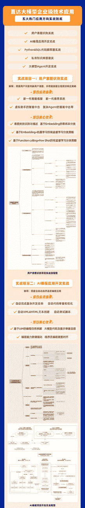

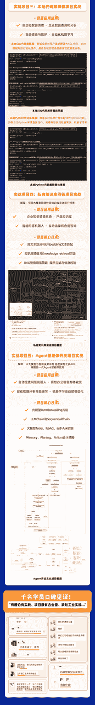