# 提示工程入门实操

> 来源：[https://kq4b3vgg5b.feishu.cn/docx/N8EvdYSk6oAxTpx6jcrc8SMKnug](https://kq4b3vgg5b.feishu.cn/docx/N8EvdYSk6oAxTpx6jcrc8SMKnug)

---

```
import os
import openai
openai.api_key = os.getenv("OPENAI_API_KEY")

import numpy as np
import pandas as pd
```

## 一、大模型提示工程入门

### 大模型的涌现能力

GPT3模型是第一批拥有“涌现能力”的大语言模型，即哪怕模型未经特定任务的训练，但在适当的提示下，仍然能够解决某些特定领域的问题。例如大语言模型可以解答数学问题、辅助进行编程、甚至是进行问答等，其实都属于模型的涌现能力。而为何类似数学能力是模型的“涌现能力”，其实原因也并不复杂——作为概率模型，大语言模型甚至不知道数字代表的真实含义，模型只是在学习了无数的语料之后，发现了一些数学结论之间的潜在概率关系，才最终涌现出了数学运算或者复杂推理的能力。

> 可能很难想象，能够进行问答，其实也是大语言的涌现能力。大语言模型的训练目标目标是生成或预测文本，而不是进行问答。

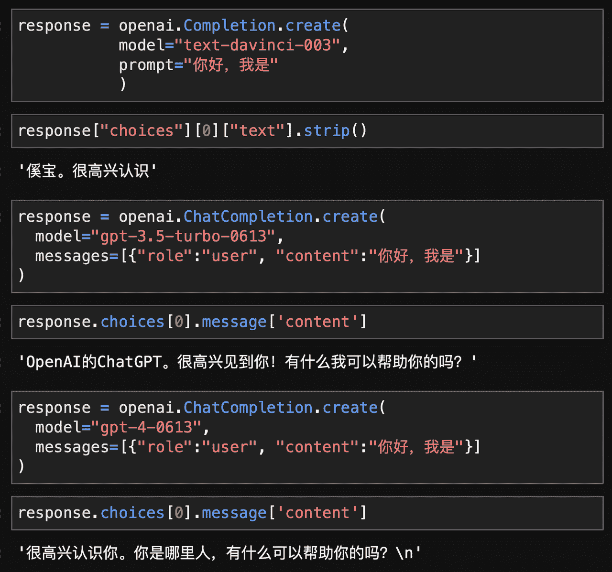

### 大模型应用的关键技术——提示工程（Prompt engineering）

不过需要注意的是，大模型的这种“涌现能力”其实并不稳定，在不修改模型本身参数（微调）的情况下，模型涌现能力极度依赖对模型的提示过程，即对同样一个模型，不同的提示方法将获得质量完全不同的结果。而一个完整的用户和大语言模型的交互流程，也被称为大语言模型的提示工程（Prompt engineering），根据此前的描述我们不难理解，提示工程是激发模型涌现能力（激发模型潜力）的非常关键的技术。同时，由于我们对大语言模型“涌现能力”的应用要求是远远多于简单的使用大模型进行文本创建的（毕竟哪怕是对话任务都属于大模型涌现能力的范畴），因此提示工程这一专门用于激发大语言模型涌现能力的技术就变得尤其重要。这也是为何自GPT大模型爆火之后，提示工程便成了非常热门的科研方向，同时提示工程技术也成了大模型应用工程师必不可少的技能。

### 提示工程与模型微调

从技术角度来说，提示工程其实是一个易学习门槛很低、但同时技术难度上限又很高的技术。提示工程简单的应用的话，只需要添加一些提示词后缀、或者把问题描述的更加详细即可，而复杂的提示工程，则会涉及多段嵌套提示和极具创造力的围绕中间结果的问答设计等。很遗憾的是，由于大多数非专业人士对大语言模型“浅尝辄止”的使用状态，导致市面上充斥着快餐化的“提示词模板”以及对提示工程粗浅的理解，进而误导很多技术人员觉得提示工程并不重要，而一些看起来技术难度更大、更加高大上的“微调”方法貌似会比提示工程更有效。这其实是一种非常大的误解。微调和提示工程同属对模型涌现能力的引导和优化方法，但相比微调，提示工程成本更低、使用更加灵活，且对于提升模型在小语义空间内复杂语义理解效果更好。当然，在很多时候，我们甚至需要要先设计提示工程进行文本标注，再使用这些标注的文本进行模型微调。不难发现，提示工程技术的学习和掌握，对大模型工程师而言至关重要。

对于`ChatCompletion.create`函数来说，通过灵活的`messages`参数，能够非常便捷高效的实现诸多类型的对话需求，例如基于提示词模板的提问、`Few-shot`提问、基于某背景知识的提问等，接下来我们进一步介绍不同场景下`messages`参数的设置方法，并在这个过程进一步介绍关于`messages`中`name`的设置方法。

由于我们接下来需要使用以下四个经典推理问题作为示例，因此我们提前定义好四组问题的问题和答案：

```
Q1 = '罗杰有五个网球，他又买了两盒网球，每盒有3个网球，请问他现在总共有多少个网球？';
A1 = '现在罗杰总共有11个网球。';
```

```
Q2 = '食堂总共有23个苹果，如果他们用掉20个苹果，然后又买了6个苹果，请问现在食堂总共有多少个苹果？';
A2 = '现在食堂总共有9个苹果。';
```

```
Q3 = '杂耍者可以杂耍16个球。其中一半的球是高尔夫球，其中一半的高尔夫球是蓝色的。请问总共有多少个蓝色高尔夫球？';
A3 = '现在总共有4个蓝色高尔夫球。';
```

```
Q4 = '艾米需要4分钟才能爬到滑梯顶部，她花了1分钟才滑下来，水滑梯将在15分钟后关闭，请问在关闭之前她能滑多少次？';
A4 = '关闭之前艾米能滑3次。';
```

### GPT-3.5推理能力测试

这里需要注意的是，`gpt-3.5`在解决推理问题上同样展示出了涌现能力，此前的四个推理问题对于`gpt-3.5`来说，除了最后两个问题具有一定难度外，其他问题均可正常回答：

```
response = openai.ChatCompletion.create(
  model="gpt-3.5-turbo",
  messages=[
    {"role": "user", "content": Q1},
  ]
)
```

```
response.choices[0].message['content']
```

```
'罗杰原本有5个网球，又买了两盒网球，每盒有3个网球，所以一共买了2 * 3 = 6个网球。\n现在总共有5 + 6 = 11个网球。 \n所以，他现在总共有11个网球。';
```

```
response = openai.ChatCompletion.create(
  model="gpt-3.5-turbo",
  messages=[
    {"role": "user", "content": Q2},
  ]
)
```

```
response.choices[0].message['content']
```

```
'食堂现在总共有23 - 20 + 6 = 9个苹果。';
```

```
response = openai.ChatCompletion.create(
  model="gpt-3.5-turbo",
  messages=[
    {"role": "user", "content": Q3},
  ]
)
```

```
response.choices[0].message['content']
```

```
'根据题意，杂耍者可以杂耍16个球，其中一半是高尔夫球，即8个球是高尔夫球。又已知一半的高尔夫球是蓝色的，即有一半的8个高尔夫球是蓝色的。\n\n所以，总共有8个蓝色高尔夫球。';
```

```
response = openai.ChatCompletion.create(
  model="gpt-3.5-turbo",
  messages=[
    {"role": "user", "content": Q4},
  ]
)
```

```
response.choices[0].message['content']
```

```
'在滑梯关闭之前，她能滑的次数取决于她滑下来所需要的时间和滑梯关闭的时间之间的差距。\n\n滑下来所需要的时间是1分钟。\n滑梯关闭的时间是15分钟，即900秒。\n\n在滑梯关闭之前，她能滑的次数等于（滑梯关闭时间 - 滑下来所需时间）/ 爬到滑梯顶部所需时间。\n\n次数 = (900秒 - 60秒) / 4分钟 = 840秒 / 4分钟 = 210次。\n\n所以，在关闭之前，她能滑210次。';
```

### 1. Zero-shot与Few-shot提示法

#### 借助多轮user-assistant消息进行few-shot

首先，最为简单的提示工程的方法就是通过输入一些类似问题和问题答案，让模型参考学习，并在同一个prompt的末尾提出新的问题，依次提升模型的推理能力。这种方法也被称为`One-shot`或者`Few-shot`提示方法。`One-shot`和`Few-shot`最早由OpenAI研究团队在论文《Language Models are Few-Shot Learners》中率先提出，这篇论文也是提示工程方法开山鼻祖，不仅介绍了提示工程的两大核心方法，同时也详细介绍这么做背后的具体原因。

如果想在Chat模型中进行`Few-shot`，最好的办法就是在`messages`中设置多轮`user-assistant`消息，这里我们还是以Ch.4中的推理问题为例，尝试在Chat模型中进行推理并进行`Few-shot`，这里我们尝试以第一个问题的问题和答案作为提示示例，引导模型解答第二个问题，则可以按照如下方式设置`messages`：

```
response = openai.ChatCompletion.create(
  model="gpt-3.5-turbo",
  messages=[
    {"role": "user", "content": Q1},
    {"role": "assistant", "content": A1},
    {"role": "user", "content": Q2}
  ]
)
```

```
response.choices[0].message['content']
```

```
'现在食堂总共有9个苹果。';
```

而相比单独进行`Q2`的提问，经过`Few-shot`的提示回答的结果，会更加接近`A1`结果的表示格式：

```
response = openai.ChatCompletion.create(
  model="gpt-3.5-turbo",
  messages=[
    {"role": "user", "content": Q2}
  ]
)
```

```
response.choices[0].message['content']
```

```
'食堂原本有23个苹果，用掉了20个，剩下3个苹果。\n然后又买了6个苹果，所以现在食堂总共有3 + 6 = 9个苹果。';
```

`A1`

```
'现在罗杰总共有11个网球。';
```

在这个示例中，我们能够看出其实`assistant`消息也是可以自定义的，用于给模型提供回答的范本。并且由此可见`messages`参数具体呈现形式可以非常多样，不仅可以按照`system-user`的形式规定回答风格，而且还可以按照`user-assistant-user-assistant...`形式来进行`Few-shot`。这其实也是得益于`messages`高度灵活的参数构成形式——即由多条注明消息源的消息构成。`messages`中具体每条消息的内容以及消息序列构成形式上，有非常大的调整的空间。

```
response = openai.ChatCompletion.create(
  model="gpt-3.5-turbo",
  messages=[
    {"role": "user", "content": Q1},
    {"role": "assistant", "content": A1},
    {"role": "user", "content": Q2}, 
    {"role": "assistant", "content": A2},   
    {"role": "user", "content": Q3}, 
  ]
)
```

```
response.choices[0].message['content']
```

```
'根据问题描述，可以得知杂耍者有8个高尔夫球，其中一半的高尔夫球是蓝色的。所以，有4个蓝色的高尔夫球。';
```

```
response = openai.ChatCompletion.create(
  model="gpt-3.5-turbo",
  messages=[
    {"role": "user", "content": Q1},
    {"role": "assistant", "content": A1},
    {"role": "user", "content": Q2}, 
    {"role": "assistant", "content": A2},   
    {"role": "user", "content": Q3}, 
    {"role": "assistant", "content": A3},   
    {"role": "user", "content": Q4},
  ]
)
```

```
response.choices[0].message['content']
```

```
'在关闭之前，艾米可以滑10次。';
```

### 2. 思考链COT提示法

#### 借助system role输入提示模板实现COT

那有什么办法能够通过更好的提示来提高模型的推理能力呢？最简单的一类办法就是借助思维链（也被称为思考链，Chain of Thought，CoT）提示法来解决这个问题。在这些方法中，最为简单的思维链的实现方法是在提示词尾部追加一句`Let’s think step by step`，即可大幅提高模型推理能力。这种方法最早由东京大学和谷歌在论文《Large Language Models are Zero-Shot Reasoners》中提出。由于只需要修改提示词而无需手动编写推导的成功示例（无需编写思维链样本），因此这种方法也被称为`Zero-shot-CoT`。

根据原论文描述，作者在测试`Zero_shot_CoT`方法时曾尝试过多组不同的提示词尾缀，并在一个机器人指令数据集上进行测试，最终发现`Let’s think step by step`效果最好，其他指令及各指令准确率排名如下：

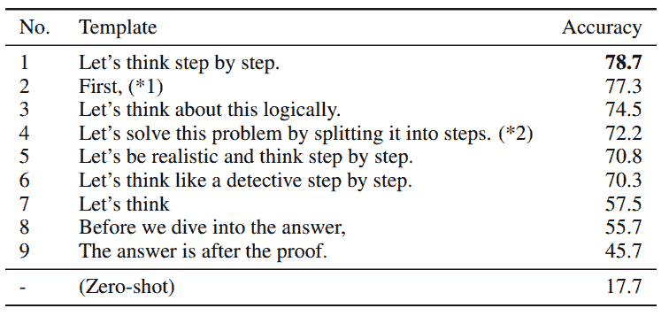

类似的，就该指令`Let’s think step by step`的中文翻译而言，`请一步步进行推理并得出结论`要远远好于`请让我们一步步进行思考`等类似的提示词语句。这一客观情况也给大模型使用者非常深刻的启发，那就是大模型的“思考过程”是黑箱模型，哪怕表意近似的提示词对模型来说实际的影响力可能会有非常大的区别，围绕提示词的开发需要进行大量的尝试，这个过程也非常类似于掘金的过程。而对于实际使用者而言，则需要平日多注重提示词的积累和尝试。

其次，论文中首次提出了利用大模型进行两阶段推理的设想，即第一个阶段先进行问题的拆分并分段解答问题（`Reasoning Extraction`），然后第二阶段再进行答案的汇总（`Answer Extraction`）。这一设想尽管没有在论文中进行大量验证，但却给之后的一种名为`LEAST-TO-MOST`（`LtM`）的提示方法给予了启发，该方法将在后文中进行介绍。

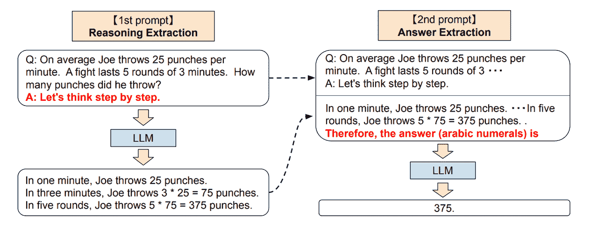

既然`system`消息能够作为背景设定的基本消息并对后续的问答消息造成影响，那么很容易想到的`system`消息的一个应用场景就是借助`system role`输入提示模板，为了更好的提高模型推理能力，我们可以在每个prompt中加入一句`请一步步推理并得出结论`进而实现`Zero-shot-CoT`。而在Chat模型中，这种prompt模板信息是非常适合通过`system role`进行输入的，例如围绕第四个推理问题，我们可以通过输入一条内容为`请一步步推理并得出结论`的系统信息，来引导模型完成`Zero-shot-CoT`：

```
prompt_temp_cot = '请一步步思考并解决问题'
```


```python
response = openai.ChatCompletion.create(
  model="gpt-3.5-turbo",
  messages=[
    {"role": "system", "content": prompt_temp_cot},
    {"role": "user", "content": Q1}
  ]
)
```

```python
response.choices[0].message['content']
```

```
'罗杰原本有5个网球\n他又买了两盒网球，每盒有3个，所以一共买了2盒 × 3个/盒 = 6个网球\n总共的网球数量为5个 + 6个 = 11个网球'
```

能够看出，模型确实开始进行了CoT推导。接下来我们测试第四个推理问题、也是最复杂的一个推理问题：

```python
response = openai.ChatCompletion.create(
  model="gpt-3.5-turbo",
  messages=[
    {"role": "system", "content": prompt_temp_cot},
    {"role": "user", "content": Q4}
  ]
)
```

```python
response.choices[0].message['content']
```

```
'首先，我们需要弄清楚在15分钟内，艾米能够滑下来多少次。\n\n艾米每次从滑梯顶部滑下来需要1分钟，所以在15分钟内，她最多可以滑下来15次。\n\n然后，我们需要确定艾米每次滑下来后需要多少时间才能再次爬到滑梯顶部。\n\n艾米每次滑下来耗时1分钟，所以她需要再花4分钟才能爬到滑梯顶部。所以总共耗时为1分钟下滑时间加上4分钟爬升时间，即为5分钟。\n\n最后，我们可以计算出在15分钟内，艾米可以滑多少次。\n\n15分钟总共有多少个5分钟？答案是15/5=3个。\n\n艾米每次滑下来需要1分钟，所以在15分钟内，她可以滑3次。\n\n因此，在关闭之前，艾米可以滑3次。'
```

能够看出发现在Zero-shot-CoT的情况下，`gpt-3.5`模型能够推导得出第四个问题的正确答案。

### 2.2 Few-shot-CoT提示方法

+ Few-shot-CoT实现过程

哪怕[是](https://arxiv.org/pdf/2201.11903.pdf)CoT方法，既然可以Zero-shot-CoT，自然也可以Few-shot-CoT。需要注意的是，Zero-shot-CoT是零样本提示的情况下通过修改提示词后缀激发模型的思维链，而Few-shot-CoT则是通过编写思维链样本作为提示词，让模型学会思维链的推导方式，从而更好的完成推导任务。该方法最早由谷歌大脑团队在论文《Chain-of-Thought Prompting Elicits Reasoning in Large Language Models》中首次提出，也是在这篇论文中思维链的概念被首次提出，因此该论文可以说是思维链的开山鼻祖之作。

> 这里需要注意，从诞生时间上来说，Few-shot-CoT诞生时间要早于Zero-shot-CoT，课程中是按照先易后难的顺序编排的内容，所以先介绍Zero-shot-CoT、后介绍Few-shot-CoT。

其实相比于Few-shot，`Few-shot-CoT`的不同之处只是在于需要在提示样本中不仅给出问题的答案，还同时需要给出问题推导的过程（即思维链），从而让模型学到思维链的推导过程，并将其应用到新的问题中。例如，围绕上述四个推理问题，第一个问题是比较好解决的，我们可以手动写一个思维链作为Few-shot的示例：

```
'Q：“罗杰有五个网球，他又买了两盒网球，每盒有3个网球，请问他现在总共有多少个网球？” \
A：“罗杰一开始有五个网球，又购买了两盒网球，每盒3个，共购买了6个网球，因此现在总共由5+6=11个网球。因此答案是11。” '
```

```
'Q：“罗杰有五个网球，他又买了两盒网球，每盒有3个网球，请问他现在总共有多少个网球？” A：“罗杰一开始有五个网球，又购买了两盒网球，每盒3个，共购买了6个网球，因此现在总共由5+6=11个网球。因此答案是11。” '
```

当然类似这种思维链，也可以借助此前的Zero-shot-CoT来完成创建。

在获得了一个思维链示例后，我们即可以此作为样本进行Few-shot-CoT来解决最后一个推理问题，具体执行过程如下

```python
prompt_Few_shot_CoT3 = 'Q“罗杰有五个网球，他又买了两盒网球，每盒有3个网球，请问他现在总共有多少个网球？” \
                        A：“罗杰一开始有五个网球，又购买了两盒网球，每盒3个，共购买了6个网球，因此现在总共由5+6=11个网球。因此答案是11。” \
                        Q：“食堂总共有23个苹果，如果他们用掉20个苹果，然后又买了6个苹果，请问现在食堂总共有多少个苹果？” \
                        A：“食堂最初有23个苹果，用掉20个，然后又买了6个，总共有23-20+6=9个苹果，答案是9。” \
                        Q：“杂耍者可以杂耍16个球。其中一半的球是高尔夫球，其中一半的高尔夫球是蓝色的。请问总共有多少个蓝色高尔夫球？” \
                        A：“总共有16个球，其中一半是高尔夫球，也就是8个，其中一半是蓝色的，也就是4个，答案是4个。” \
                       '
prompt_Few_shot_CoT3
```

```
'Q“罗杰有五个网球，他又买了两盒网球，每盒有3个网球，请问他现在总共有多少个网球？”                         A：“罗杰一开始有五个网球，又购买了两盒网球，每盒3个，共购买了6个网球，因此现在总共由5+6=11个网球。因此答案是11。”                         Q：“食堂总共有23个苹果，如果他们用掉20个苹果，然后又买了6个苹果，请问现在食堂总共有多少个苹果？”                         A：“食堂最初有23个苹果，用掉20个，然后又买了6个，总共有23-20+6=9个苹果，答案是9。”                         Q：“杂耍者可以杂耍16个球。其中一半的球是高尔夫球，其中一半的高尔夫球是蓝色的。请问总共有多少个蓝色高尔夫球？”                         A：“总共有16个球，其中一半是高尔夫球，也就是8个，其中一半是蓝色的，也就是4个，答案是4个。”                        '
```

```python
response = openai.ChatCompletion.create(
  model="gpt-3.5-turbo-0613",
  messages=[
    {"role": "system", "content": prompt_Few_shot_CoT3},
    {"role": "user", "content": 'Q:'+Q4}
  ]
)
```

```python
response.choices[0].message['content']
```

```
'A: 艾米需要4分钟才能爬到滑梯顶部，滑下来只需要1分钟，所以她完成一次滑梯的时间是4+1=5分钟。在滑梯关闭之前，她可以滑的次数是15分钟除以每次滑梯所需时间，即15÷5=3次。所以，在关闭之前她能滑3次滑梯。'
```

能够发现，在输入了前三个问题的思维链作为提示词样本，第四个问题已经可以顺利回答了。

+ 《Chain-of-Thought Prompting Elicits Reasoning in Large Language Models》重点结论解读

由于《Chain-of-Thought Prompting Elicits Reasoning in Large Language Models》是思维链的开山之作，因此论文中提出了大量的关于思维链的应用场景——除了可以用于解决上述推理问题外，思维链还可以被广泛应用于复杂语义理解、符号映射、连贯文本生成等领域。论文中给出了一系列结论，用于论证思维链在这些领域应用的有效性。

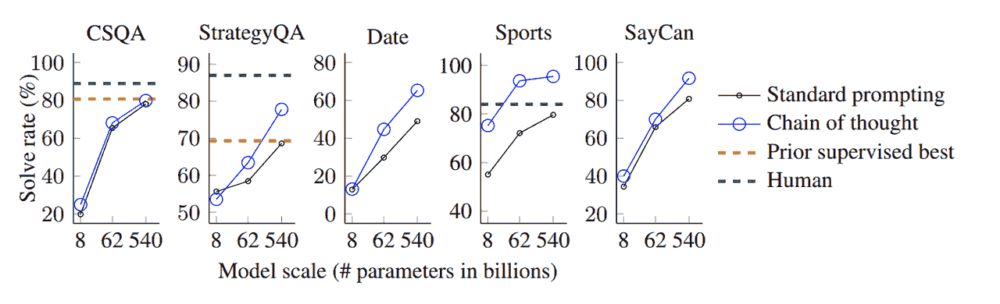

此外，论文中还重点强调了模型体量和思维链效果之间的关系，简而言之就是，模型越大、`Few-shot-CoT`应用效果越好。论文同样以`GSM8K`数据集为例进行了说明，能够看出模型效果`LaMDA`（137B）< `GPT-3`（175B） < `PaLM`（540B）。和`Zero-shot-CoT`类似，模型越大、`CoT`对模型潜在能力激发效果越好。

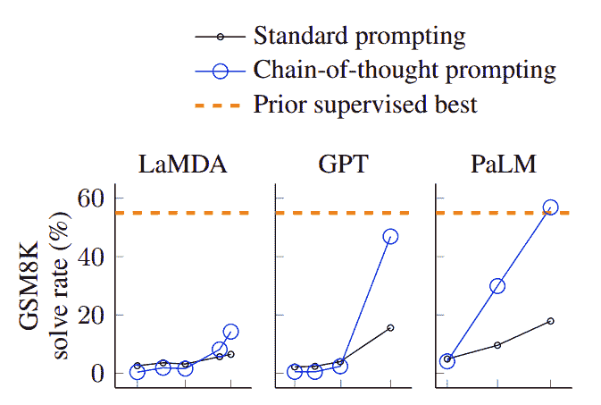

> 这里`PaLM`具体得分为57分，而`Prior supervised best`（单独训练的最佳有监督学习模型）得分为55分。

[就在谷歌大脑提出的CoT被实际验证能够大幅提升大语言模型的推理能力](https://arxiv.org/pdf/2205.10625.pdf)不久，来自谷歌大脑的另一个团队在此基础上发表了另一篇重量级论文《LEAST-TO-MOST PROMPTING ENABLES COMPLEX REASONING IN LARGE LANGUAGE MODELS》，并在其中提出了一种名为`Least-to-Most`（`LtM`）的提示方法，将大语言模型的推理能力进一步提高。这种名为`LtM`的提示方法不仅能够将模型在`GSM8K`上的表现提高至62%，甚至在某些特殊语义解读场景下能够达到3倍于`CoT`的效果。不得不说，该方法也是截至目前围绕模型推理能力提升的最为有效的提示学习方法。相关方法方法介绍以及实际应用方法，我们会在正式课程中进行讲解。

此外，在正式课程中，我们还将更深度的介绍更为复杂的工业级提示工程方法，并用于解决NLP领域的顶尖难题——指令翻译任务：

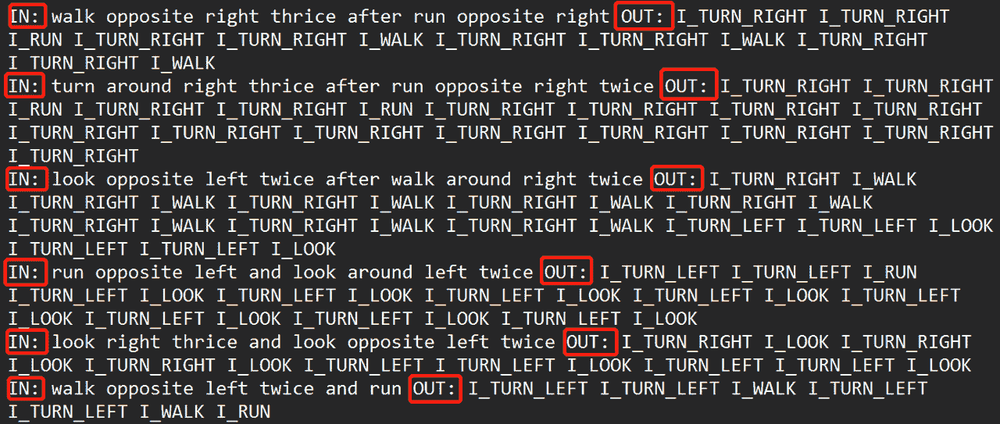

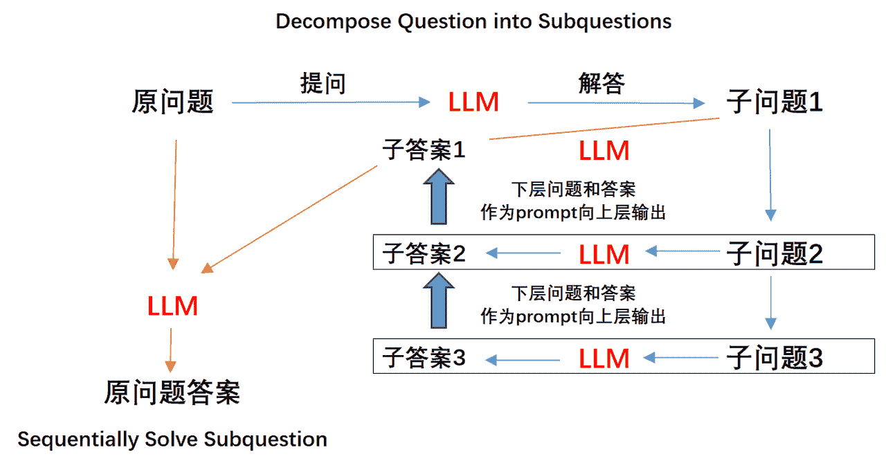

## 二、借助提示工程提升自然语言编程能力

+ 原始问题

```python
response = openai.ChatCompletion.create(
  model="gpt-3.5-turbo-0613",
  messages=[
    {"role": "user", "content": "请帮我编写一个多轮对话函数。"}
  ]
)
```

```python
response.choices[0].message['content']
```

```
'当然，我可以帮你编写多轮对话函数。请告诉我具体的需求和要实现的功能，然后我们可以一起开始编写代码。'
```

+ 优化技巧一：清晰准确

```python
q1 = "请帮我编写一个基于OpenAI ChatCompletion.create函数的多轮对话函数。"
```

```python
response = openai.ChatCompletion.create(
  model="gpt-3.5-turbo-0613",
  messages=[
    {"role": "user", "content": q1}
  ]
)
```

```python
response.choices[0].message['content']
```

```
'当然可以！以下是一个基于OpenAI ChatCompletion.create函数的多轮对话函数的示例：\n\n```python\nimport openai\n\ndef start_chat(prompt):\n    # 设置OpenAI API\n    openai.api_key = \'YOUR_API_KEY_HERE\'\n\n    # 初始化对话历史\n    chat_history = []\n\n    # 发送初始提示\n    response = openai.ChatCompletion.create(\n        model="gpt-3.5-turbo",\n        messages=[\n            {"role": "system", "content": "You are a helpful assistant."},\n            {"role": "user", "content": prompt}\n        ]\n    )\n\n    # 提取模型的回复\n    model_reply = response[\'choices\'][0][\'message\'][\'content\']\n    \n    # 将模型的回复添加到对话历史中\n    chat_history.append(model_reply)\n\n    # 返回模型的回复作为初始对话回复\n    return model_reply\n\ndef continue_chat(prompt):\n    # 检查对话历史是否为空\n    if len(chat_history) == 0:\n        return start_chat(prompt)\n\n    # 向聊天历史中添加用户输入\n    chat_history.append(prompt)\n\n    # 发送完整的对话历史给模型\n    response = openai.ChatCompletion.create(\n        model="gpt-3.5-turbo",\n        messages=[\n            {"role": "system", "content": "You are a helpful assistant."},\n            {"role": "user", "content": chat_history[-2]},\n            {"role": "assistant", "content": chat_history[-1]}\n        ]\n    )\n\n    # 提取模型的回复\n    model_reply = response[\'choices\'][0][\'message\'][\'content\']\n    \n    # 将模型的回复添加到对话历史中\n    chat_history.append(model_reply)\n\n    # 返回模型的回复\n    return model_reply\n\n# 示例对话\nchat_prompt = "What\'s the weather like today?"\n\n# 开始第一次对话\nchat_reply = start_chat(chat_prompt)\nprint("Assistant:", chat_reply)\n\n# 第一次对话后，继续对话\nwhile True:\n    user_input = input("User: ")\n    chat_reply = continue_chat(user_input)\n    print("Assistant:", chat_reply)\n```\n\n请记得替换示例代码中的`YOUR_API_KEY_HERE`为您的实际API密钥。您可以在OpenAI的网站上生成API密钥。\n\n在这个多轮对话函数中，我们使用了`start_chat`函数作为开始对话时的第一个模型回复，`continue_chat`函数用于之后的每一个用户输入和模型回复。\n\n这个函数允许您与模型进行多轮对话，用户输入将被添加到对话历史中，并与上一次模型回复一起发送给模型。模型会根据整个对话历史生成相应的回复。\n\n请注意，由于返回的对话历史中包含了所有的消息内容，您在使用模型回复时需要使用合适的格式来提取和展示回复内容。'
```

```python
from IPython.display import display, Code, Markdown

display(Markdown(response.choices[0].message['content']))
```

当然可以！以下是一个基于OpenAI ChatCompletion.create函数的多轮对话函数的示例：

```python
import openai

def start_chat(prompt):

    # 设置OpenAI API


```python
openai.api_key = 'YOUR_API_KEY_HERE'

# 初始化对话历史
chat_history = []

# 发送初始提示
response = openai.ChatCompletion.create(
    model="gpt-3.5-turbo",
    messages=[
        {"role": "system", "content": "You are a helpful assistant."},
        {"role": "user", "content": prompt}
    ]
)

# 提取模型的回复
model_reply = response['choices'][0]['message']['content']

# 将模型的回复添加到对话历史中
chat_history.append(model_reply)

# 返回模型的回复作为初始对话回复
return model_reply

def continue_chat(prompt):
    # 检查对话历史是否为空
    if len(chat_history) == 0:
        return start_chat(prompt)

    # 向聊天历史中添加用户输入
    chat_history.append(prompt)

    # 发送完整的对话历史给模型
    response = openai.ChatCompletion.create(
        model="gpt-3.5-turbo",
        messages=[
            {"role": "system", "content": "You are a helpful assistant."},
            {"role": "user", "content": chat_history[-2]},
            {"role": "assistant", "content": chat_history[-1]}
        ]
    )

    # 提取模型的回复
    model_reply = response['choices'][0]['message']['content']

    # 将模型的回复添加到对话历史中
    chat_history.append(model_reply)

    # 返回模型的回复
    return model_reply
```

# 示例对话

## 开始第一次对话

```python
chat_prompt = "What's the weather like today?"
chat_reply = start_chat(chat_prompt)
print("Assistant:", chat_reply)
```

## 第一次对话后，继续对话

```python
while True:
    user_input = input("User: ")
    chat_reply = continue_chat(user_input)
    print("Assistant:", chat_reply)
```

请记得替换示例代码中的`YOUR_API_KEY_HERE`为您的实际API密钥。您可以在OpenAI的网站上生成API密钥。

在这个多轮对话函数中，我们使用了`start_chat`函数作为开始对话时的第一个模型回复，`continue_chat`函数用于之后的每一个用户输入和模型回复。

这个函数允许您与模型进行多轮对话，用户输入将被添加到对话历史中，并与上一次模型回复一起发送给模型。模型会根据整个对话历史生成相应的回复。

请注意，由于返回的对话历史中包含了所有的消息内容，您在使用模型回复时需要使用合适的格式来提取和展示回复内容。

```python
with open('example1.md', 'a', encoding='utf-8') as f:
    f.write(response.choices[0].message['content'])
```

## 优化技巧二：设置角色

```python
messages=[
    {"role": "system", "content": "你是一位擅长编写代码的大模型技术专家。"},
    {"role": "user", "content": q1}
]

response = openai.ChatCompletion.create(
  model="gpt-3.5-turbo-0613",
  messages=messages
)

display(Markdown(response.choices[0].message['content']))
```

当然可以！以下是一个基于OpenAI `ChatCompletion.create`函数的多轮对话函数的示例代码：

```python
import openai

def chat_with_openai(prompt):
    # 设置OpenAI的API密钥
    openai.api_key = 'your-api-key'

    # 初始化对话历史
    chat_history = []

    while True:
        # 构建聊天输入，将对话历史和用户输入拼接起来
        user_input = input("User: ")
        chat_history.append(f"User: {user_input}")
        chat_history_str = '\n'.join(chat_history)

        # 使用OpenAI API进行聊天
        response = openai.ChatCompletion.create(
            model="gpt-3.5-turbo",
            messages=[
                {"role": "system", "content": "You are a helpful assistant."},
                {"role": "user", "content": chat_history_str}
            ],
            max_tokens=50
        )

        # 解析API响应，提取助手的回复
        assistant_reply = response.choices[0].message.content

        print("Assistant:", assistant_reply)

        # 将助手的回复添加到对话历史中
        chat_history.append(f"Assistant: {assistant_reply}")

        # 当用户输入"结束对话"时退出循环
        if user_input.lower() == "end conversation":
            break

chat_with_openai("Let's start the conversation!")
```

在这个示例代码中，我们首先使用`openai.ChatCompletion.create`函数来进行单次的用户输入和助手回复转换。然后，我们将用户输入和助手的回复添加到对话历史中，并将对话历史作为输入传递给下一次API调用。我们重复这个过程，直到用户输入"end conversation"来结束对话。

需要注意的是，这个示例代码仅用于简单的对话，您可能需要进行一些修改来满足您的具体需求，比如添加其他的聊天逻辑或更复杂的对话历史管理。

```python
with open('example2.md', 'a', encoding='utf-8') as f:
    f.write(response.choices[0].message['content'])
```

```python
import openai

def chat_with_openai(prompt):
    # 设置OpenAI的API密钥
    openai.api_key = os.getenv("OPENAI_API_KEY")

    # 初始化对话历史
    chat_history = []

    while True:
        # 构建聊天输入，将对话历史和用户输入拼接起来
        user_input = input("User: ")
        chat_history.append(f"User: {user_input}")
        chat_history_str = '\n'.join(chat_history)

        # 使用OpenAI API进行聊天
        response = openai.ChatCompletion.create(
            model="gpt-3.5-turbo",
            messages=[
                {"role": "system", "content": "You are a helpful assistant."},
                {"role": "user", "content": chat_history_str}
            ]
        )

        # 解析API响应，提取助手的回复
        assistant_reply = response.choices[0].message.content

        print("Assistant:", assistant_reply)

        # 将助手的回复添加到对话历史中
        chat_history.append(f"Assistant: {assistant_reply}")

        # 当用户输入"结束对话"时退出循环
        if user_input.lower() == "end conversation":
            break
```

```python
chat_with_openai("Let's start the conversation!")
```

```
User:  请问什么是机器学习

Assistant: 机器学习是一种人工智能领域的技术，它使计算机能够从数据中学习和改进性能，而不需要进行明确的程序编写。通过利用统计学和算法模型，机器学习可以自动地从大量的数据中发现规律、模式和趋势，并且基于这些发现做出预测和决策。机器学习常被应用于各种领域，如图像识别、语音识别、自然语言处理、推荐系统等，以帮助人们解决复杂的问题和改进现有的系统。

User:  我的上一个问题是？

Assistant: 您之前的问题是关于什么是机器学习的。

User:  end conversation

Assistant: Assistant: If you have any more questions in the future, feel free to ask. Have a great day!
```

## 完整提示策略

```python
user_input = "我现在已经获取了OpenAI API-KEY，并已赋值给openai.api_key。我现在想要编写一个基于ChatCompletion.create函数的多轮对话函数，函数要求如下:\
1.函数无任何必选参数，用户无需输入任何参数即可开启多轮对话;\
2.当用户输入退出时退出多轮对话;\
3.ChatCompletion.create函数运行过程不设置任何其他参数;\
4.请在函数编写过程中，帮我编写详细的函数说明文档，用于说明函数功能、函数参数情况以及函数返回结果等信息；"

messages=[
    {"role": "system", "content": "你是一位擅长编写代码的大模型技术专家。"},
    {"role": "user", "content": user_input}
]

response = openai.ChatCompletion.create(
  model="gpt-3.5-turbo-0613",
  messages=messages
)

display(Markdown(response.choices[0].message['content']))
```

当根据用户输入与AI进行多轮对话时，您可以编写以下函数来实现：

```python
import openai

def chat_with_ai():
    """
    基于OpenAI GPT-3 API的多轮对话函数

    1. 该函数无任何必选参数，用户无需输入任何参数即可开始多轮对话。

    2. 当用户输入"退出"时，函数将退出多轮对话。

    3. 函数使用ChatCompletion.create函数运行AI模型，内部不设置任何其他参数。

    Returns:
        response: AI的回复

    Raises:
        Exception: 当与API通信发生错误时，将引发异常。
    """

    # 初始化对话过程
    user_input = ""

    conversation_history = []

    while user_input.lower() != "退出":
        # 获取用户输入
        user_input = input("> ")

        # 创建聊天记录，在历史记录中保存用户输入和AI回复
        conversation_history.append({"role": "user", "content": user_input})

        # 发送请求到 GPT-3 API
        try:
            response = openai.ChatCompletion.create(
                model="gpt-3.5-turbo",
                messages=conversation_history
            )
        except Exception as e:
            raise Exception("与 GPT-3 API 进行通信时发生错误：" + str(e))

        # 解析 AI 的回复
        ai_reply = response.choices[0].message.get("content")

        # 打印 AI 回复
        print("AI:", ai_reply)

        # 在历史记录中保存 AI 回复
        conversation_history.append({"role": "assistant", "content": ai_reply})

    return ai_reply
```


# Python 多轮对话函数实现

## 函数流程与说明

这个函数中使用了一个`while`循环来完成多轮对话的过程。在循环中，用户会被要求输入一个问题或指令，然后将其添加到对话历史记录中。然后，调用`ChatCompletion.create`函数与AI模型进行交互，获取AI的回复。AI的回复然后被打印出来并添加到对话历史记录中。循环会一直持续，直到用户输入`"退出"`为止。

函数的文档字符串提供了对函数的详细说明，包括函数的功能、参数和返回结果等信息。注意，在调用API时可能会出现异常，因此，我在代码中添加了错误处理以捕获并引发异常，以便您可以捕获并处理错误。

## 代码实现

以下代码演示了如何将AI回复写入文件：

```
with open('example3.md', 'a', encoding='utf-8') as f:
    f.write(response.choices[0].message['content'])
```

完整的多轮对话函数定义如下：

```
def chat_with_ai():
    """
    基于OpenAI GPT-3 API的多轮对话函数

    1. 该函数无任何必选参数，用户无需输入任何参数即可开始多轮对话。

    2. 当用户输入"退出"时，函数将退出多轮对话。

    3. 函数使用ChatCompletion.create函数运行AI模型，内部不设置任何其他参数。

    Returns:

        response: AI的回复

    Raises:

        Exception: 当与API通信发生错误时，将引发异常。
    """

    # 初始化对话过程
    user_input = ""
    conversation_history = []

    while user_input.lower() != "退出":
        # 获取用户输入
        user_input = input("> ")

        # 创建聊天记录，在历史记录中保存用户输入和AI回复
        conversation_history.append({"role": "user", "content": user_input})

        # 发送请求到 GPT-3 API
        try:
            response = openai.ChatCompletion.create(
                model="gpt-3.5-turbo",
                messages=conversation_history
            )
        except Exception as e:
            raise Exception("与 GPT-3 API 进行通信时发生错误：" + str(e))

        # 解析 AI 的回复
        ai_reply = response.choices[0].message.get("content")

        # 打印 AI 回复
        print("AI:", ai_reply)

        # 在历史记录中保存 AI 回复
        conversation_history.append({"role": "assistant", "content": ai_reply})

    return ai_reply
```

调用函数：

```
chat_with_ai()
```

## 运行示例

```
> 你好
AI: 你好！有什么我可以帮助你的吗？

> 请问什么是机器学习？
AI: 机器学习是一种人工智能领域的技术，通过使用算法和模型让计算机系统从经验数据中学习，并根据学习的知识进行预测和决策。它的目标是让计算机具备从数据中获取知识、理解模式和进行自主学习的能力，而无需明确地编程指令。机器学习的过程涉及数据的收集、预处理、特征提取、模型构建、模型训练和评估等步骤。通过机器学习，计算机可以自动发现数据中的规律和模式，从而对未知数据做出预测和判断。机器学习在各个领域都有广泛的应用，如推荐系统、图像识别、自然语言处理等。

> 请问我的上一个问题是？
AI: 你上一个问题是“请问什么是机器学习？”

> 退出
AI: 好的，如果你有任何其他问题，随时可以来问我。再见！
```

'好的，如果你有任何其他问题，随时可以来问我。再见！'

## 课程与社群

+ 高阶自然语言编程策略

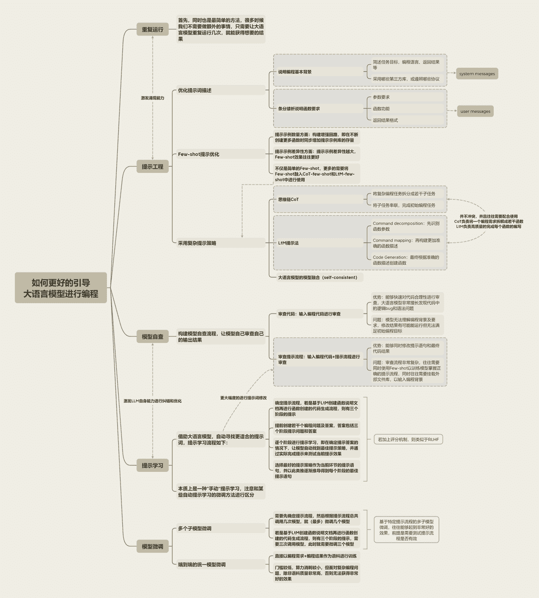

+ 用AI开发AI

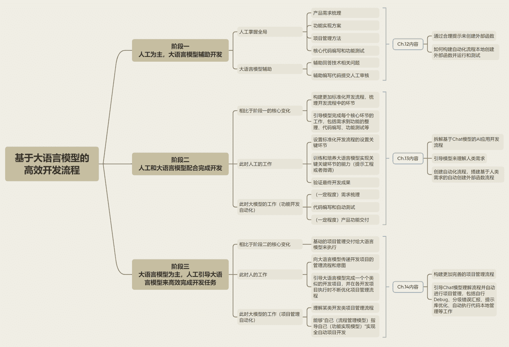
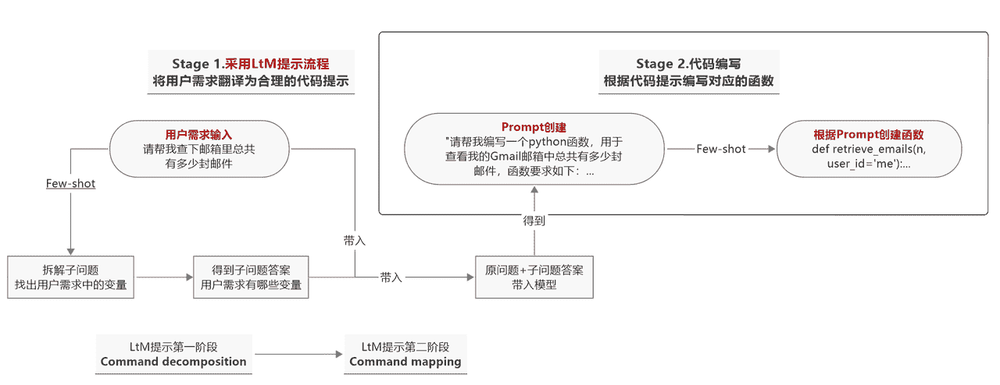
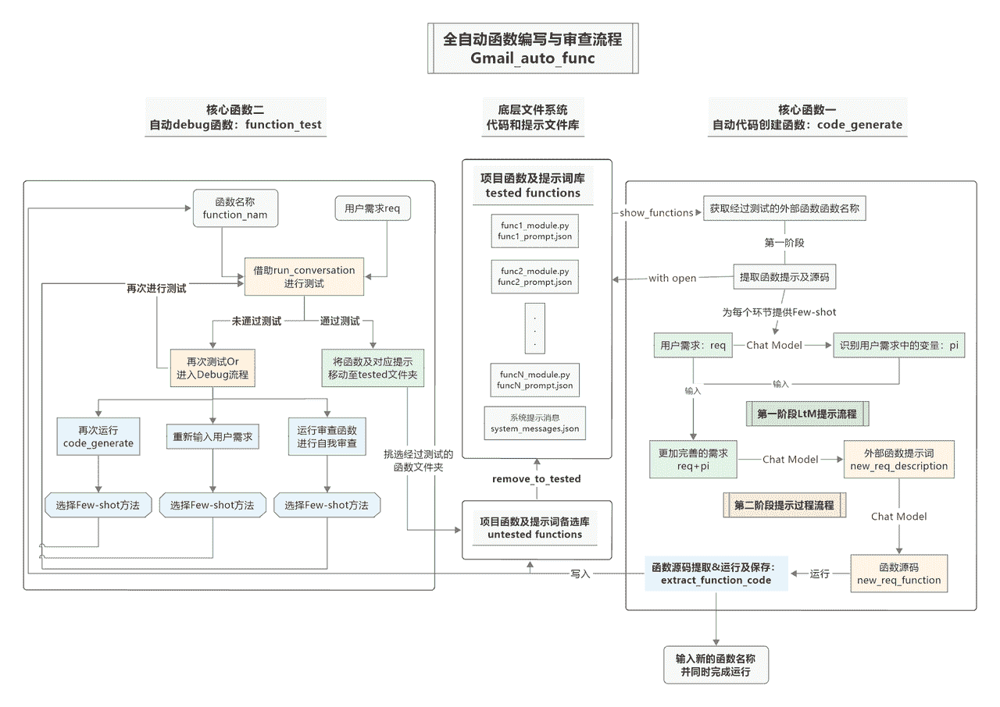

+ 体验课内容节选自《大模型技术实战》完整版付费课程

更多大模型技术内容学习，请扫码添加英英，回复“大模型”，即咨询相关信息哦👇


🍻现开设了大模型学习交流群，扫码遇见更多志同道合的小伙伴~

海量硬核独家技术干货内容+无门槛技术交流+不定期开设硬核干货&前沿技术公开课，扫码👆即刻入群
